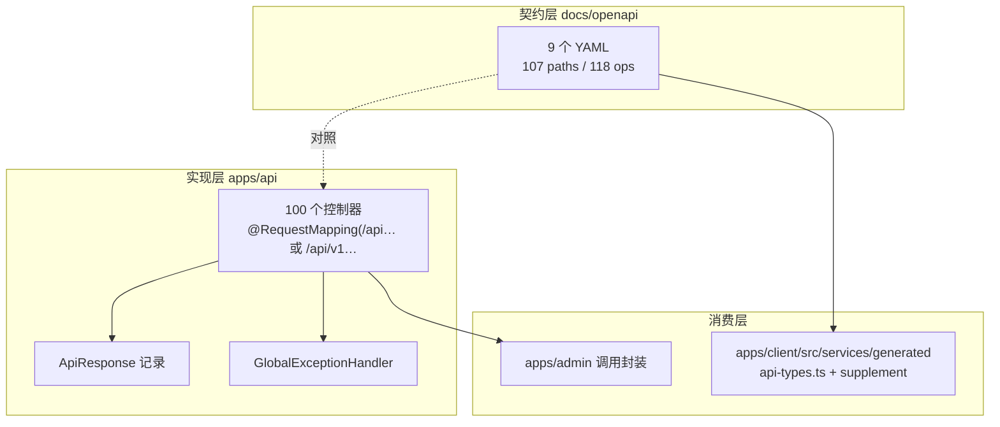
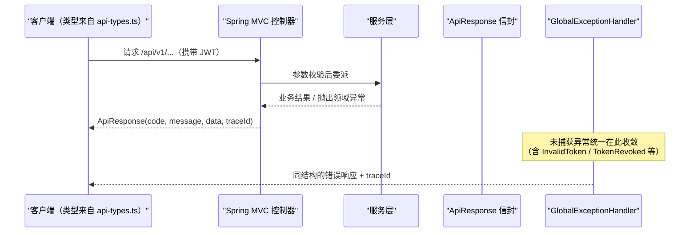
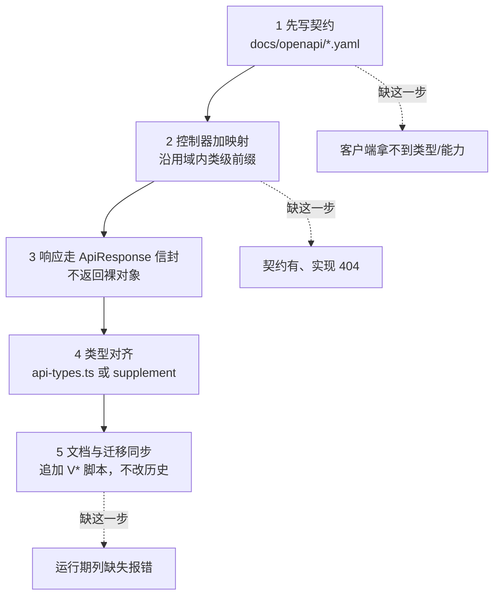

# API接口文档

<cite>
**本文引用的文件**
- [check-in.yaml](file://docs/openapi/check-in.yaml)
- [feedback-growth-and-auth.yaml](file://docs/openapi/feedback-growth-and-auth.yaml)
- [likes.yaml](file://docs/openapi/likes.yaml)
- [notifications.yaml](file://docs/openapi/notifications.yaml)
- [official-accounts.yaml](file://docs/openapi/official-accounts.yaml)
- [recommendations.yaml](file://docs/openapi/recommendations.yaml)
- [users.yaml](file://docs/openapi/users.yaml)
- [village.yaml](file://docs/openapi/village.yaml)
- [whispers.yaml](file://docs/openapi/whispers.yaml)
- [ApiResponse.java](file://apps/api/src/main/java/com/campuslove/api/common/ApiResponse.java)
- [GlobalExceptionHandler.java](file://apps/api/src/main/java/com/campuslove/api/config/GlobalExceptionHandler.java)
- [AuthController.java](file://apps/api/src/main/java/com/campuslove/api/auth/AuthController.java)
- [VillageController.java](file://apps/api/src/main/java/com/campuslove/api/village/VillageController.java)
- [MatchController.java](file://apps/api/src/main/java/com/campuslove/api/match/MatchController.java)
- [RecommendationController.java](file://apps/api/src/main/java/com/campuslove/api/discover/RecommendationController.java)
- [TempChatController.java](file://apps/api/src/main/java/com/campuslove/api/chat/TempChatController.java)
- [WhisperController.java](file://apps/api/src/main/java/com/campuslove/api/whisper/WhisperController.java)
- [AdminOfficialAccountController.java](file://apps/api/src/main/java/com/campuslove/api/admin/AdminOfficialAccountController.java)
- [SecurityConfig.java](file://apps/api/src/main/java/com/campuslove/api/config/SecurityConfig.java)
- [api-types.ts](file://apps/client/src/services/generated/api-types.ts)
- [api-types-supplement.ts](file://apps/client/src/services/generated/api-types-supplement.ts)
</cite>

## 目录
1. [简介](#简介)
2. [项目结构](#项目结构)
3. [核心组件](#核心组件)
4. [架构总览](#架构总览)
5. [契约文件清单](#契约文件清单)
6. [子页面导航与边界](#子页面导航与边界)
7. [统一前缀与版本策略](#统一前缀与版本策略)
8. [响应信封与错误约定](#响应信封与错误约定)
9. [鉴权模型](#鉴权模型)
10. [契约与实现的覆盖差](#契约与实现的覆盖差)
11. [客户端类型生成](#客户端类型生成)
12. [新增接口的落地顺序](#新增接口的落地顺序)
13. [依赖关系分析](#依赖关系分析)
14. [性能考虑](#性能考虑)
15. [故障排查指南](#故障排查指南)
16. [结论](#结论)

## 简介
本页是 API 参考域的总入口，回答三件事：**接口契约放在哪里**（`docs/openapi/`，9 个 YAML 文件）、
**实现接口放在哪里**（`apps/api/` 下 100 个带类级 `@RequestMapping("/api…")` 的控制器）、
**以及两者之间的落差有多大**（契约共 107 条路径 / 118 个操作，远小于实现面）。

具体接口的逐条清单不在本页，而在五个子页面里，按业务域切分：
认证与用户、匹配与推荐、消息与聊天、社区圈子、通知与官方账号。

## 项目结构
- 契约：`docs/openapi/*.yaml`，9 个文件，合计 6564 行。
- 实现：`apps/api/src/main/java/com/campuslove/api/<域>/<X>Controller.java`，
  按域分包（`auth`、`user`、`profile`、`match`、`discover`、`village`、`chat`、`whisper`、`admin` 等）。
- 客户端类型：`apps/client/src/services/generated/`，`api-types.ts`（2675 行）与
  `api-types-supplement.ts`（741 行）。
- 统一响应与异常：`common/ApiResponse.java`（记录类型在 L34）与
  `config/GlobalExceptionHandler.java`（类声明在 L61）。

**图表来源**
- [ApiResponse.java:34-34](file://apps/api/src/main/java/com/campuslove/api/common/ApiResponse.java#L34-L34)
- [GlobalExceptionHandler.java:61-61](file://apps/api/src/main/java/com/campuslove/api/config/GlobalExceptionHandler.java#L61-L61)
- [api-types.ts:1-2675](file://apps/client/src/services/generated/api-types.ts#L1-L2675)
- [api-types-supplement.ts:1-741](file://apps/client/src/services/generated/api-types-supplement.ts#L1-L741)

## 核心组件
- **契约文件**：见"契约文件清单"，其中 `feedback-growth-and-auth.yaml`（2501 行 / 41 路径）体量最大，
  一个文件同时承载 auth、profile、growth、app-config 四组 tag；
  `whispers.yaml`（128 行 / 4 路径）最小，是唯一"契约与实现完全一致"的域。
- **前缀承载**：控制器以类级注解声明前缀，例如
  `@RequestMapping("/api/v1/auth")`（`AuthController` L36）、
  `@RequestMapping("/api/v1/posts")`（`VillageController` L36）、
  `@RequestMapping("/api/v1/matches")`（`MatchController` L50）、
  `@RequestMapping("/api/v1/temp-chat/sessions")`（`TempChatController` L21）、
  `@RequestMapping("/api/v1/whispers")`（`WhisperController` L22）；
  也有控制器把前缀放宽到 `/api/v1` 让每条方法映射自带完整路径
  （`RecommendationController` L37）。
- **后台前缀**：`AdminOfficialAccountController` 用 `@RequestMapping("/api/v1/admin/official-accounts")`(L29)，
  并受 `SecurityConfig` 中 `.requestMatchers("/api/v1/admin/**").hasRole("ADMIN")`(L175) 约束。

**章节来源**
- [AuthController.java:36-36](file://apps/api/src/main/java/com/campuslove/api/auth/AuthController.java#L36-L36)
- [VillageController.java:36-36](file://apps/api/src/main/java/com/campuslove/api/village/VillageController.java#L36-L36)
- [MatchController.java:50-50](file://apps/api/src/main/java/com/campuslove/api/match/MatchController.java#L50-L50)
- [RecommendationController.java:37-37](file://apps/api/src/main/java/com/campuslove/api/discover/RecommendationController.java#L37-L37)
- [TempChatController.java:21-21](file://apps/api/src/main/java/com/campuslove/api/chat/TempChatController.java#L21-L21)
- [WhisperController.java:22-22](file://apps/api/src/main/java/com/campuslove/api/whisper/WhisperController.java#L22-L22)
- [AdminOfficialAccountController.java:29-29](file://apps/api/src/main/java/com/campuslove/api/admin/AdminOfficialAccountController.java#L29-L29)

## 架构总览

**图表来源**
- [ApiResponse.java:34-34](file://apps/api/src/main/java/com/campuslove/api/common/ApiResponse.java#L34-L34)
- [GlobalExceptionHandler.java:61-61](file://apps/api/src/main/java/com/campuslove/api/config/GlobalExceptionHandler.java#L61-L61)

## 契约文件清单
按行数量级排序（数字来自对各文件的直接枚举）：

| 文件 | 行数 | 路径数 | 操作数 | 覆盖域 |
|---|---|---|---|---|
| `feedback-growth-and-auth.yaml` | 2501 | 41 | 44 | auth、profile、growth、app-config |
| `likes.yaml` | 944 | 20 | 20 | 匹配/滑动/访客/心动信号/破冰 |
| `village.yaml` | 930 | 10 | 14 | 帖子、评论、圈子、话题 |
| `recommendations.yaml` | 806 | 13 | 16 | 推荐流、配额、偏好、每日一问、活动 |
| `users.yaml` | 463 | 7 | 8 | 关注关系、在线状态、用户搜索 |
| `notifications.yaml` | 337 | 7 | 7 | 通知列表、计数、已读 |
| `check-in.yaml` | 257 | 3 | 3 | 签到 |
| `official-accounts.yaml` | 198 | 2 | 2 | 官方账号列表与消息流（只读）|
| `whispers.yaml` | 128 | 4 | 4 | 悄悄话收发与已读 |
| 合计 | 6564 | 107 | 118 | — |

**章节来源**
- [feedback-growth-and-auth.yaml:1-2501](file://docs/openapi/feedback-growth-and-auth.yaml#L1-L2501)
- [likes.yaml:1-944](file://docs/openapi/likes.yaml#L1-L944)
- [village.yaml:1-930](file://docs/openapi/village.yaml#L1-L930)
- [recommendations.yaml:1-806](file://docs/openapi/recommendations.yaml#L1-L806)
- [users.yaml:1-463](file://docs/openapi/users.yaml#L1-L463)
- [notifications.yaml:1-337](file://docs/openapi/notifications.yaml#L1-L337)
- [check-in.yaml:1-257](file://docs/openapi/check-in.yaml#L1-L257)
- [official-accounts.yaml:1-198](file://docs/openapi/official-accounts.yaml#L1-L198)
- [whispers.yaml:1-128](file://docs/openapi/whispers.yaml#L1-L128)

## 子页面导航与边界
本页只维护全景与约定，端点级细节交给子页：

- **认证与用户API**：`/api/v1/auth/**`、`/api/v1/sms/**`、`/api/v1/users/**`、`/api/v1/profile/**`；
  含令牌签发与吊销、账号安全五个端点、第三方绑定五个端点。
- **匹配与推荐API**：`/api/v1/matches/**` 与 `/api/v1/recommendations/**`；
  含四种滑动语义、权重配置（校区 50 / 城市 20 / 日程 15 / 兴趣 10）、缓存与排序链路。
- **消息与聊天API**：`/api/v1/messages/**`、`/api/v1/temp-chat/**`、`/api/v1/chat/**`；
  含私聊 9 个映射、临时聊天 9 个映射、语音与视频通话、关系看板的 real/mock 双实现。
- **社区圈子API**：帖子流、评论、圈子与话题、标签、举报；实现 29 个映射。
- **通知与官方账号API**：通知 7 个映射、互动事件 4 个映射、官方账号 3 个映射 + 后台 2 个。

与其他文档的边界：`后端API服务/*` 讲服务内部分层与算法，
`客户端应用（Uni-app）/API 服务层` 讲 HTTP 客户端、拦截器与 WebSocket 前端实现；
本页只回答"接口有哪些、契约在哪、两者差多少"。

**章节来源**
- [users.yaml:15-270](file://docs/openapi/users.yaml#L15-L270)
- [likes.yaml:19-510](file://docs/openapi/likes.yaml#L19-L510)

## 统一前缀与版本策略
- **版本写在路径里**：`/api/v1/...`。`SecurityConfig` 的注释记录了这次迁移：
  "路径统一升级为 /api/v1/admin/**"(L174)，说明历史上曾是无 v1 的 `/api/admin/**`，
  现由一行 `requestMatchers` 收口(L175)。
- **两种声明风格并存**：多数控制器类级注解写完整前缀（`/api/v1/auth`、`/api/v1/matches`），
  少数把类级前缀放宽到 `/api/v1`，由方法注解补全资源路径（`RecommendationController` L37 即如此）。
  阅读代码时若只看类注解会误判路径。
- **别名路径**：同一方法可挂两个路径，
  `@GetMapping({"/recommendations/people", "/recommendations"})`（L212）就是一例；
  契约里只登记其中一个，按契约生成的客户端看不到别名。
- **同前缀多控制器**：`/api/v1/posts` 同时被 `VillageController`(L36) 与
  `PostReportController` 使用；`/api/v1/messages` 同时承载私聊与看板（含 mock 版）。
  因此"按前缀找实现"必须搜多个文件。

**章节来源**
- [SecurityConfig.java:174-175](file://apps/api/src/main/java/com/campuslove/api/config/SecurityConfig.java#L180-L181)
- [RecommendationController.java:37-37](file://apps/api/src/main/java/com/campuslove/api/discover/RecommendationController.java#L37-L37)
- [RecommendationController.java:212-212](file://apps/api/src/main/java/com/campuslove/api/discover/RecommendationController.java#L212-L212)
- [VillageController.java:36-36](file://apps/api/src/main/java/com/campuslove/api/village/VillageController.java#L36-L36)
- [AuthController.java:36-36](file://apps/api/src/main/java/com/campuslove/api/auth/AuthController.java#L36-L36)

## 响应信封与错误约定
统一响应是一个记录类型：
`record ApiResponse<T>(int code, String message, T data, String traceId)`（`ApiResponse.java` L34）。
四元组意味着：**业务码与 HTTP 状态分离**（`code` 在 body 里），
**且每个响应携带 `traceId`**，排障时应以 traceId 关联日志而不是只看 message。

错误收敛在 `config/GlobalExceptionHandler`（L61）一处，
认证类异常有自己的错误码出口（`InvalidTokenException.getErrorCode()`、
`TokenRevokedException.getErrorCode()`），因此"401 究竟为什么"可从 code 区分。

契约侧也遵循同一形状：例如 `likes.yaml` 与 `feedback-growth-and-auth.yaml` 中的响应示例
都是 `{code, message, data}` 三段式，`data` 里放具体视图（如 `HeartSignalView`、`NotificationView`）。

**章节来源**
- [ApiResponse.java:34-34](file://apps/api/src/main/java/com/campuslove/api/common/ApiResponse.java#L34-L34)
- [GlobalExceptionHandler.java:61-61](file://apps/api/src/main/java/com/campuslove/api/config/GlobalExceptionHandler.java#L61-L61)
- [likes.yaml:135-171](file://docs/openapi/likes.yaml#L135-L171)
- [feedback-growth-and-auth.yaml:52-72](file://docs/openapi/feedback-growth-and-auth.yaml#L52-L72)

## 鉴权模型
- 用户端接口默认需要 JWT；令牌的解释与吊销在 `JwtTokenProvider` / `JwtAuthenticationFilter` 一侧，
  细节见 `API接口文档/认证与用户API`。
- 后台接口以角色划分：`/api/v1/admin/**` 要求 `ADMIN` 角色（`SecurityConfig` L175），
  角色列来自 `users.role`（见 `数据库设计与迁移/核心表结构设计/用户相关表`）。
- 媒体访问另有独立令牌范围（`generateMediaToken`），不是所有接口都能复用主访问令牌。

**章节来源**
- [SecurityConfig.java:174-175](file://apps/api/src/main/java/com/campuslove/api/config/SecurityConfig.java#L180-L181)
- [AuthController.java:36-73](file://apps/api/src/main/java/com/campuslove/api/auth/AuthController.java#L36-L73)

## 契约与实现的覆盖差
这是 API 参考域最重要的结论：**契约不等于能力全集**。各子页逐一检索后的结果：

| 域 | 实现映射 | 契约覆盖 | 缺口 |
|---|---|---|---|
| 悄悄话 | 4 | 4（whispers.yaml）| 无 |
| 匹配 | 19 | 18 条路径全覆盖 | 无 |
| 通知 | 7 | 7（notifications.yaml）| 无 |
| 推荐 | 12 | 13 条路径中的相关项 | `/recommendations/{userId}/profile` 未声明；`/recommendations/people` 别名未登记；`whisper/unlock`（POST）未声明 |
| 官方账号 | 3 + 后台 2 | 2 条 GET | `POST /official-accounts/{code}/messages` 未声明；后台两个端点未声明 |
| 互动事件 | 4 | 0 | 全部未声明 |
| 私聊 / 临时聊天 / 语音 / 视频 / 总览 / 看板 | 39 | 0 | 全部未声明 |
| 认证与账号安全 | 24 | 6 个 auth 端点 | 注册、手机号登录、体验登录、改密、换号、设备、注销、绑定、短信全部未声明；且契约路径不带 `/api/v1` 前缀 |

两点必须记住：其一，**契约里的路径不含 `/api/v1` 前缀**，直接照抄会 404；
其二，`docs/openapi` 有 107 条路径，而实现面有 100 个控制器（每个多条映射），
按契约生成客户端会大面积缺功能，尤其是整个消息域与账号安全域。

**章节来源**
- [whispers.yaml:10-77](file://docs/openapi/whispers.yaml#L10-L77)
- [likes.yaml:19-510](file://docs/openapi/likes.yaml#L19-L510)
- [notifications.yaml:15-215](file://docs/openapi/notifications.yaml#L15-L215)
- [feedback-growth-and-auth.yaml:52-199](file://docs/openapi/feedback-growth-and-auth.yaml#L52-L199)
- [official-accounts.yaml:18-59](file://docs/openapi/official-accounts.yaml#L18-L59)
- [recommendations.yaml:77-384](file://docs/openapi/recommendations.yaml#L77-L384)

## 客户端类型生成
`apps/client/src/services/generated/` 下有两个文件：`api-types.ts`（2675 行）与
`api-types-supplement.ts`（741 行）。文件名里的 `generated` 与 `supplement` 说明了两件事：
类型来自契约生成，而**生成之后又补了一份手写补充**——
补充文件的存在本身就是契约缺口的证据：契约没写的接口，类型只能手写。

使用上的纪律：新增接口若期望自动获得类型，必须先写进 `docs/openapi`；
否则要么进 `api-types-supplement.ts`（手工维护，随契约漂移），要么在每个调用处内联类型。

**章节来源**
- [api-types.ts:1-2675](file://apps/client/src/services/generated/api-types.ts#L1-L2675)
- [api-types-supplement.ts:1-741](file://apps/client/src/services/generated/api-types-supplement.ts#L1-L741)

## 新增接口的落地顺序
把一次接口新增完整落到本仓库，顺序是固定的五步：

[此图为概念流程，不直接对应具体源文件，故不提供图表来源]

1. **先写契约**：在对应 `docs/openapi/*.yaml` 增加 path 与 operation（含 `operationId`、
   参数与 `code/message/data` 响应示例），保持与其他条目同样的写法。
2. **控制器加映射**：沿用所在域的类级前缀（不要新造第四种前缀写法），
   方法上补 `@Operation` 说明与可能的 `@ApiResponse`（`MatchController` 的 `passUser`
   就是注解里同时写中文说明与幂等性的范例）。
3. **响应继续走 `ApiResponse` 信封**，不要返回裸对象，否则客户端解包逻辑分叉。
4. **类型对齐**：重新生成或手工补 `api-types.ts` / `api-types-supplement.ts`，
   避免调用处出现 `any`。
5. **文档同步**：在对应子页补清单条目；若引入新数据字段，按
   `数据库设计与迁移` 的规则追加迁移脚本而不是改历史脚本。

**章节来源**
- [MatchController.java:305-313](file://apps/api/src/main/java/com/campuslove/api/match/MatchController.java#L305-L313)
- [whispers.yaml:10-30](file://docs/openapi/whispers.yaml#L10-L30)
- [ApiResponse.java:34-34](file://apps/api/src/main/java/com/campuslove/api/common/ApiResponse.java#L34-L34)

## 依赖关系分析
- 契约 → 实现：靠 `operationId` 与路径对齐，**没有机器校验**保证二者一致；
  各子页的"契约与实现的差异"一节是人工逐条检索的结果。
- 实现 → 信封/异常：控制器与 `ApiResponse`、`GlobalExceptionHandler` 耦合，
  这使得错误格式在全站统一。
- 实现 → 安全：`SecurityConfig` 决定哪些前缀需要角色，因此后台接口天然依赖
  `users.role` 数据列。
- 契约 → 客户端：`api-types.ts` 是契约的下游产物，`api-types-supplement.ts` 是实现侧的补丁，
  两者并存说明客户端同时依赖契约与实现两个来源。

**章节来源**
- [GlobalExceptionHandler.java:61-61](file://apps/api/src/main/java/com/campuslove/api/config/GlobalExceptionHandler.java#L61-L61)
- [SecurityConfig.java:174-175](file://apps/api/src/main/java/com/campuslove/api/config/SecurityConfig.java#L180-L181)
- [api-types-supplement.ts:1-741](file://apps/client/src/services/generated/api-types-supplement.ts#L1-L741)

## 性能考虑
- **按域取列表而不是全量拉契约**：`feedback-growth-and-auth.yaml` 单文件 2501 行，
  工具若一次读全部 YAML（6564 行）做校验会很慢；按域增量校验更实际。
- **操作数与路径数不等即是负载信号**：`village.yaml` 10 路径 / 14 操作、
  `recommendations.yaml` 13 路径 / 16 操作，说明同一路径挂多个动词——
  这类端点最容易在缓存与幂等处理上出错（GET 与 POST 共用 path 前缀）。
- **批量端点已经存在**：`POST /users/online-status/batch`（users.yaml L223-L266）
  是为列表页设计的，逐个调用单个在线状态端点会线性放大请求数。

**章节来源**
- [village.yaml:1-930](file://docs/openapi/village.yaml#L1-L930)
- [recommendations.yaml:1-806](file://docs/openapi/recommendations.yaml#L1-L806)
- [users.yaml:223-266](file://docs/openapi/users.yaml#L223-L266)

## 故障排查指南
- **按契约拼路径全部 404**：契约路径不带 `/api/v1`，实现带；先补前缀再排查。
- **契约里找不到刚写的接口**：先判断它属于哪个域文件；消息域、账号安全域、互动事件域
  本身就没有契约，找不到是预期结果。
- **客户端类型与实现不一致**：检查该接口是否来自 `api-types-supplement.ts`（手写补充）
  而非生成部分；两者漂移方向不同，补充文件不会随契约更新。
- **同一前缀行为不一致**：`/api/v1/posts`、`/api/v1/messages` 各有两个控制器，
  排查时要把同前缀的文件全部列出来，只看一个会漏。
- **错误码看不懂**：响应体是 `ApiResponse(code, message, data, traceId)`，
  先看 `code` 与 `traceId`；HTTP 状态只反映传输层结果，业务失败通常仍是 200 且 code 非 0。
- **后台接口 403**：`/api/v1/admin/**` 需要 `ADMIN` 角色，账号 `role` 列不对就会 403，
  这与令牌是否有效是两回事。

**章节来源**
- [ApiResponse.java:34-34](file://apps/api/src/main/java/com/campuslove/api/common/ApiResponse.java#L34-L34)
- [SecurityConfig.java:174-175](file://apps/api/src/main/java/com/campuslove/api/config/SecurityConfig.java#L180-L181)
- [api-types-supplement.ts:1-741](file://apps/client/src/services/generated/api-types-supplement.ts#L1-L741)
- [whispers.yaml:10-77](file://docs/openapi/whispers.yaml#L10-L77)

## 结论
API 参考域的形状是：**契约集中在 `docs/openapi` 的 9 个文件（107 路径 / 118 操作 / 6564 行）**，
**实现在 100 个 `/api…` 前缀的控制器里**，响应统一为 `ApiResponse(code, message, data, traceId)`，
版本以 `/api/v1` 写在路径中，后台以角色 `ADMIN` 隔离。

匹配、通知、悄悄话三个域的契约是完整的；推荐与官方账号有小缺口；
认证与账号安全、整个消息域（私聊、临时聊天、语音、视频、总览、看板）、互动事件域
基本没有契约。客户端类型由契约生成后又用手写补充文件（741 行）托底，
这正是覆盖差在下游的表现形式。

因此本页最实用的部分是"契约与实现的覆盖差"这张表：写客户端时以子页清单为实现权威、
以 YAML 为参数细节参考；改接口时按"新增接口的落地顺序"五步走，先补契约再动代码。
