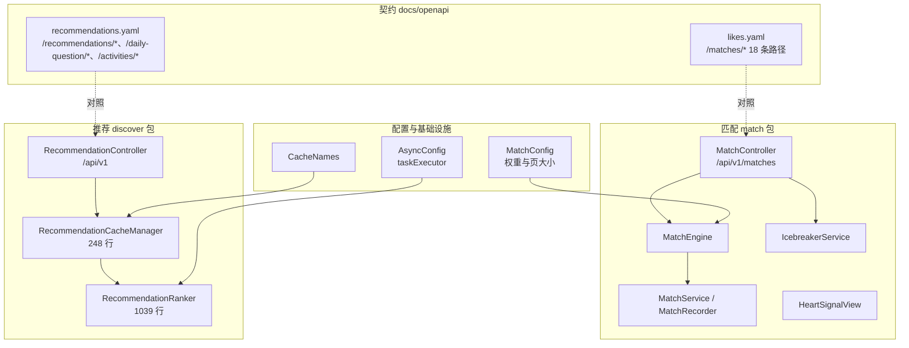
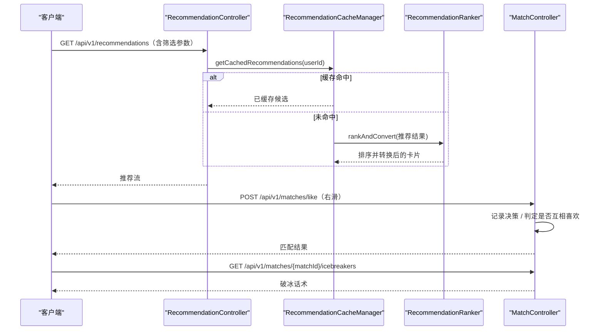
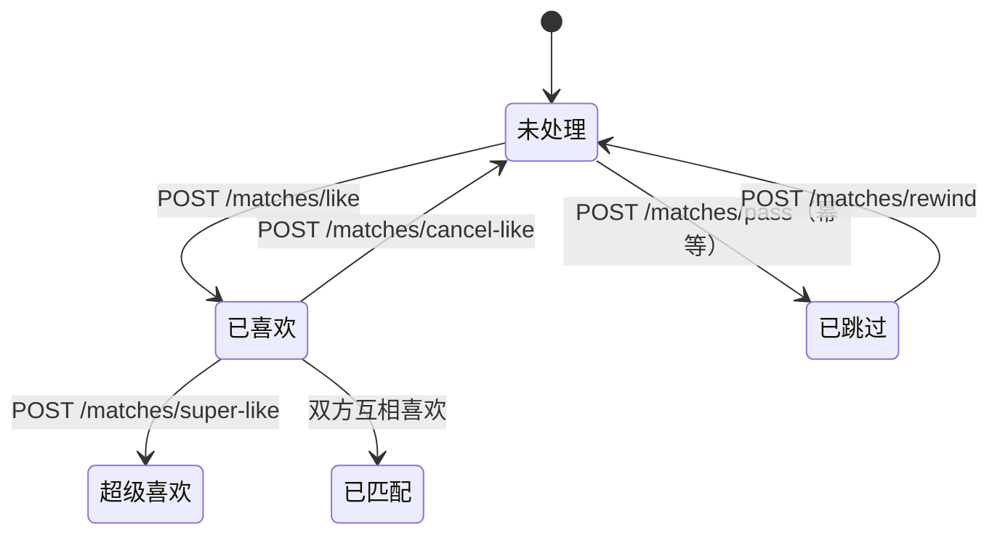
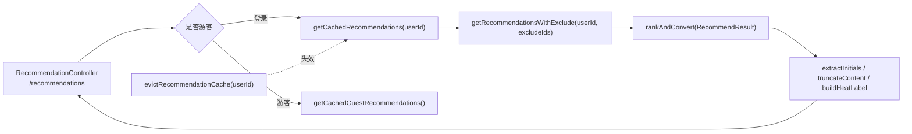

# 匹配与推荐API

<cite>
**本文引用的文件**
- [likes.yaml](file://docs/openapi/likes.yaml)
- [recommendations.yaml](file://docs/openapi/recommendations.yaml)
- [MatchController.java](file://apps/api/src/main/java/com/campuslove/api/match/MatchController.java)
- [RecommendationController.java](file://apps/api/src/main/java/com/campuslove/api/discover/RecommendationController.java)
- [MatchConfig.java](file://apps/api/src/main/java/com/campuslove/api/config/MatchConfig.java)
- [MatchConfigView.java](file://apps/api/src/main/java/com/campuslove/api/admin/MatchConfigView.java)
- [RecommendationRanker.java](file://apps/api/src/main/java/com/campuslove/api/discover/RecommendationRanker.java)
- [RecommendationCacheManager.java](file://apps/api/src/main/java/com/campuslove/api/discover/RecommendationCacheManager.java)
- [CacheNames.java](file://apps/api/src/main/java/com/campuslove/api/config/CacheNames.java)
- [AsyncConfig.java](file://apps/api/src/main/java/com/campuslove/api/config/AsyncConfig.java)
- [MatchEngine.java](file://apps/api/src/main/java/com/campuslove/api/match/MatchEngine.java)
- [MatchService.java](file://apps/api/src/main/java/com/campuslove/api/match/MatchService.java)
- [RealMatchService.java](file://apps/api/src/main/java/com/campuslove/api/match/RealMatchService.java)
- [MatchPolicy.java](file://apps/api/src/main/java/com/campuslove/api/match/MatchPolicy.java)
- [MatchRecorder.java](file://apps/api/src/main/java/com/campuslove/api/match/MatchRecorder.java)
- [MatchMetrics.java](file://apps/api/src/main/java/com/campuslove/api/monitor/MatchMetrics.java)
- [HeartSignalView.java](file://apps/api/src/main/java/com/campuslove/api/match/HeartSignalView.java)
- [IcebreakerService.java](file://apps/api/src/main/java/com/campuslove/api/match/IcebreakerService.java)
- [RecommendationRankerTest.java](file://apps/api/src/test/java/com/campuslove/api/discover/RecommendationRankerTest.java)
- [RecommendationRankerFieldsTest.java](file://apps/api/src/test/java/com/campuslove/api/discover/RecommendationRankerFieldsTest.java)
- [RecommendationCacheManagerTest.java](file://apps/api/src/test/java/com/campuslove/api/discover/RecommendationCacheManagerTest.java)
- [RecommendationRankerWhisperTest.java](file://apps/api/src/test/java/com/campuslove/api/discover/RecommendationRankerWhisperTest.java)
- [CacheTest.java](file://apps/api/src/test/java/com/campuslove/api/config/CacheTest.java)
</cite>

## 目录
1. [简介](#简介)
2. [项目结构](#项目结构)
3. [核心组件](#核心组件)
4. [架构总览](#架构总览)
5. [匹配端点清单](#匹配端点清单)
6. [滑动与匹配语义](#滑动与匹配语义)
7. [心动信号与访客端点](#心动信号与访客端点)
8. [推荐端点清单](#推荐端点清单)
9. [配额与偏好](#配额与偏好)
10. [排序与缓存链路](#排序与缓存链路)
11. [匹配打分权重配置](#匹配打分权重配置)
12. [契约与实现的差异](#契约与实现的差异)
13. [依赖关系分析](#依赖关系分析)
14. [性能考虑](#性能考虑)
15. [故障排查指南](#故障排查指南)
16. [结论](#结论)

## 简介
本页覆盖两组接口：

- **匹配**：`MatchController`，前缀 `/api/v1/matches`（L50），19 个方法映射，负责创建匹配请求、
  右滑/取消/超级喜欢、左滑跳过、撤回上一次滑动、谁喜欢我、访客、心动信号的收发与接受拒绝、
  以及按匹配取破冰话术。契约在 `docs/openapi/likes.yaml`（944 行，18 条路径）。
- **推荐**：`RecommendationController`，前缀 `/api/v1`（L37），12 个方法映射，负责推荐流、
  配额、讨论与活动推荐、偏好读写、推荐历史、单个推荐对象的资料与悄悄话解锁。
  契约在 `docs/openapi/recommendations.yaml`（806 行）。

两组接口的分工是"推荐给出候选，匹配记录决策"。

## 项目结构

**图表来源**
- [MatchController.java:50-50](file://apps/api/src/main/java/com/campuslove/api/match/MatchController.java#L50-L50)
- [RecommendationController.java:37-37](file://apps/api/src/main/java/com/campuslove/api/discover/RecommendationController.java#L37-L37)
- [RecommendationRanker.java:60-61](file://apps/api/src/main/java/com/campuslove/api/discover/RecommendationRanker.java#L60-L61)
- [RecommendationCacheManager.java:33-34](file://apps/api/src/main/java/com/campuslove/api/discover/RecommendationCacheManager.java#L33-L34)
- [likes.yaml:19-510](file://docs/openapi/likes.yaml#L19-L510)
- [recommendations.yaml:77-384](file://docs/openapi/recommendations.yaml#L77-L384)

## 核心组件
- **MatchController**（456 行）：`GET /form-config`(L69)、`POST /`(L80)、`POST /quick`(L106)、
  `GET /{id}`(L126)、`POST /like`(L148)、`POST /cancel-like`(L185)、`POST /super-like`(L202)、
  `GET /liked-me`(L237)、`GET /visitors`(L249)、`POST /visit`(L260)、`GET /heart-signals`(L271)、
  `POST /heart-signals/{id}/accept`(L281)、`POST /heart-signals/{id}/decline`(L292)、
  `POST /pass`(L305)、`POST /rewind`(L331)、`GET /my-likes`(L350)、
  `PUT /visitors/{id}/read`(L360)、`GET /{matchId}/icebreakers`(L376)。
- **RecommendationController**（705 行）：`GET /recommendations/quota`(L115)、
  `GET /recommendations/discussions`(L138)、`GET /recommendations/activities`(L151)、
  `GET /recommendations/preferences`(L165) 与 `PUT /recommendations/preferences`(L181)、
  `GET {"/recommendations/people", "/recommendations"}`(L212)（一个方法两个路径）、
  `GET /recommendations/preferences/me`(L409) 与 `PUT /recommendations/preferences/me`(L423)、
  `GET /recommendations/history`(L447)、`GET /recommendations/{userId}/profile`(L473)、
  `GET /recommendations/{userId}/whisper`(L534)、`POST /recommendations/{userId}/whisper/unlock`(L560)。
- **RecommendationRanker**（1039 行，`@Component` L60）：`resolveWhispers(Long userId)`(L171)、
  `rankAndConvert(RecommendationStrategy.RecommendResult result)`(L384)、`buildHistory(Long userId)`(L417)、
  `extractInitials(String name)`(L733)、`truncateContent(String content, int maxLength)`(L743)、
  `buildHeatLabel(Integer replyCount, int likesCount)`(L757)、`getDiscussionLimit()`(L777)，
  并注入 `GeoService`(L125) 说明排序含地理维度。
- **RecommendationCacheManager**（248 行）：`getCachedRecommendations(Long userId)`(L89)、
  `getCachedGuestRecommendations()`(L144)、`evictRecommendationCache(Long userId)`(L181)、
  `evictAllRecommendationCaches()`(L190)、`buildHistory(Long userId)`(L202)、
  `getRecommendationsWithExclude(Long userId, Set<Long> excludeIds)`(L216)；
  依赖 `RecommendQuotaService`(L46) 与 `SocialProgressService`(L53)。
- **配置类**：`MatchConfig`（92 行，`@Component` L12）承载打分权重与规模参数；
  `MatchConfigView`（17 行）是其后台只读投影类型（L14）。

**章节来源**
- [MatchController.java:50-376](file://apps/api/src/main/java/com/campuslove/api/match/MatchController.java#L50-L376)
- [RecommendationController.java:37-560](file://apps/api/src/main/java/com/campuslove/api/discover/RecommendationController.java#L37-L560)
- [RecommendationRanker.java:60-777](file://apps/api/src/main/java/com/campuslove/api/discover/RecommendationRanker.java#L60-L777)
- [RecommendationCacheManager.java:33-216](file://apps/api/src/main/java/com/campuslove/api/discover/RecommendationCacheManager.java#L33-L216)
- [MatchConfigView.java:14-17](file://apps/api/src/main/java/com/campuslove/api/admin/MatchConfigView.java#L14-L17)

## 架构总览

**图表来源**
- [RecommendationCacheManager.java:89-216](file://apps/api/src/main/java/com/campuslove/api/discover/RecommendationCacheManager.java#L89-L216)
- [RecommendationRanker.java:384-416](file://apps/api/src/main/java/com/campuslove/api/discover/RecommendationRanker.java#L384-L416)
- [MatchController.java:148-184](file://apps/api/src/main/java/com/campuslove/api/match/MatchController.java#L148-L184)

## 匹配端点清单
`likes.yaml` 对匹配面覆盖完整（18 条路径），与控制器一一对应：

| 方法 | 路径 | 实现 | 契约位置 |
|---|---|---|---|
| GET | `/matches/form-config` | L69 | likes.yaml L19（`getMatchFormConfig` L24）|
| POST | `/matches` | L80 | L38（`createMatch` L47）|
| POST | `/matches/quick` | L106 | L77（`createQuickMatch` L82）|
| GET | `/matches/{id}` | L126 | L107（`getMatch` L112）|
| POST | `/matches/like` | L148 | L135（`likeUser` L143，summary "Like a user (swipe right)"）|
| POST | `/matches/cancel-like` | L185 | L171（`cancelLike` L176）|
| POST | `/matches/super-like` | L202 | L471 |
| POST | `/matches/pass` | L305 | L196（`passUser` L201）|
| POST | `/matches/rewind` | L331 | L222（`rewind` L230）|
| GET | `/matches/liked-me` | L237 | L246（`getLikedMe` L251）|
| GET | `/matches/my-likes` | L350 | L267 |
| GET | `/matches/visitors` | L249 | L288 |
| POST | `/matches/visit` | L260 | L309 |
| PUT | `/matches/visitors/{id}/read` | L360 | L334 |
| GET | `/matches/heart-signals` | L271 | L362 |
| POST | `/matches/heart-signals/{id}/accept` | L281 | L383 |
| POST | `/matches/heart-signals/{id}/decline` | L292 | L411 |
| GET | `/matches/{matchId}/icebreakers` | L376 | L439 |

契约里另有 `/profile/visitors`（L510）与 `/profile/{userId}/visit`（L534）两条与访客相邻的路径，
属于资料域而非匹配域，但同一份 `likes.yaml` 承载，检索时容易混淆。

**章节来源**
- [MatchController.java:69-376](file://apps/api/src/main/java/com/campuslove/api/match/MatchController.java#L69-L376)
- [likes.yaml:19-534](file://docs/openapi/likes.yaml#L19-L534)

## 滑动与匹配语义
滑动类端点有四个，语义上必须严格区分：

- **`POST /like`（L148）**：右滑表示喜欢。契约 summary 明确 "Like a user (swipe right)"。
- **`POST /cancel-like`（L185）**：撤销此前记录的喜欢，契约 summary 为
  "Cancel a previously recorded like"。它与 `rewind` 不同：撤销针对"某一次喜欢"，
  撤回针对"最近一次滑动"。
- **`POST /pass`（L305）**：左滑跳过。方法上的 `@Operation` 注解把中文描述与幂等性写在了代码里：
  "对目标用户标记为 pass（不喜欢），不会产生匹配。**支持幂等性**"，
  并声明了 400 响应条件"`passedUserId` 缺失"(L306-L309)，`operationId = "passUser"`(L306)。
  因此重复 pass 同一用户不应产生副作用。
- **`POST /rewind`（L331）**：撤回最近一次滑动，契约 summary "Rewind the last swipe"（L222-L245）。
- **`POST /super-like`（L202）**：强意愿信号，与 `like` 分离，说明匹配判定要区分普通喜欢与超级喜欢。

匹配请求本身有两个入口：`POST /matches`（L80，契约 `createMatch`）与 `POST /matches/quick`
（L106，契约 `createQuickMatch`，summary "Create a quick match request"），
前者是带表单的完整请求（其表单结构由 `GET /form-config` L69 提供），后者是快速发起。
`GET /matches/{id}`（L126）用于回查请求状态。

返回类型透露了一个重要事实：**喜欢类端点自己就携带匹配结果**。`likeUser` 的签名是
`ApiResponse<HeartSignalView>`(L159)，内部调用 `matchService.likeUser(userId, request.targetUserId())`(L169)；
`superLikeUser` 同样返回 `ApiResponse<HeartSignalView>`(L213) 并调用
`matchService.superLikeUser(...)`(L222)。两处 `@ApiResponse` 的描述都是
"操作成功，data 为 HeartSignalView（**如双向喜欢则非空**）"(L152、L206)。
也就是说客户端不需要在右滑后再去轮询 `/heart-signals`，判断"是否配对成功"的权威来源是这次调用的响应体；
`GET /heart-signals`(L272) 返回 `List<HeartSignalView>`，用于列出历史待处理信号，两者用途不同。
破冰端点 `GET /{matchId}/icebreakers`(L377) 返回 `ResponseEntity<List<IcebreakerView>>`，
服务接口是 `IcebreakerService`（`interface IcebreakerService` L9）。

滑动动作的可观测性由 `MatchMetrics` 承担：`recordSwipe(String direction)`(L87)、
`recordMatchSuccess()`(L107)、`recordRecommendLatency(long durationMs)`(L120)，
控制器通过构造器注入该指标组件（L61），因此"滑动量、匹配成功数、推荐耗时"三项可在监控侧直接取到。

[此图为概念流程，不直接对应具体源文件，故不提供图表来源]

**章节来源**
- [MatchController.java:148-331](file://apps/api/src/main/java/com/campuslove/api/match/MatchController.java#L148-L331)
- [likes.yaml:135-245](file://docs/openapi/likes.yaml#L135-L245)

## 心动信号与访客端点
- **心动信号**：`GET /heart-signals`(L271) 列出收到的信号，
  `POST /heart-signals/{id}/accept`(L281) 与 `.../decline`(L292) 构成处理闭环；
  响应类型是 `HeartSignalView`。信号的有效期由配置项 `heartSignalExpireHours = 48`(L17) 控制，
  即"未处理的心动信号 48 小时后过期"。契约位置分别是 likes.yaml L362、L383、L411。
- **访客**：`GET /visitors`(L249) 读取"谁来过"，`POST /visit`(L260) 记录一次到访，
  `PUT /visitors/{id}/read`(L360) 标记某条访客为已读。三个端点配合，使访客列表可以区分已读/未读。
- **谁喜欢我 / 我喜欢谁**：`GET /liked-me`(L237，契约 L246) 与 `GET /my-likes`(L350，契约 L267)
  是一对反向查询。
- **破冰**：`GET /{matchId}/icebreakers`(L376，契约 L439) 在匹配成立后取破冰话术，
  由 `IcebreakerService` 提供，接口层与 `MockIcebreakerService` 实现分离。

**章节来源**
- [MatchController.java:237-376](file://apps/api/src/main/java/com/campuslove/api/match/MatchController.java#L237-L376)
- [likes.yaml:246-471](file://docs/openapi/likes.yaml#L246-L471)
- [MatchConfig.java:17-17](file://apps/api/src/main/java/com/campuslove/api/config/MatchConfig.java#L17-L17)

## 推荐端点清单
`RecommendationController` 用类级前缀 `/api/v1`（L37），因此每条映射都写完整路径：

| 方法 | 路径 | 实现 | 契约 |
|---|---|---|---|
| GET | `/recommendations` 与 `/recommendations/people` | L212（同一方法两个路径）| recommendations.yaml L77-L159（`getRecommendations`，summary 注明带筛选）|
| GET | `/recommendations/quota` | L115 | L160-L184（`getRecommendationQuota`）|
| GET | `/recommendations/discussions` | L138 | L185-L204（`getDiscussions`）|
| GET | `/recommendations/activities` | L151 | L205-L224（`getActivities`）|
| GET / PUT | `/recommendations/history` | L447 | L225-L246（`getHistory`）|
| GET / PUT | `/recommendations/preferences/me` | L409 / L423 | L247-L287（`getPreferencesByUserId` / `savePreferences`）|
| GET / PUT | `/recommendations/preferences` | L165 / L181 | L288-L324 |
| GET | `/recommendations/{userId}/profile` | L473 | **未声明** |
| GET | `/recommendations/{userId}/whisper` | L534 | L384 |
| POST | `/recommendations/{userId}/whisper/unlock` | L560 | 未声明（仅 GET 侧在契约内）|

同一份 `recommendations.yaml` 还承载每日一问三段（`/daily-question/today` L8-L22、
`/daily-question/answer` L23-L45、`/daily-question/answers` L46-L76）与活动两段
（`/activities/{id}/join` L325、`/activities/{id}` L355）。它们与推荐流同属发现域，
实现分别在 `discover/DailyQuestionController`（前缀 `/api/v1/daily-question`）与
`discover/ActivityController`（前缀 `/api/v1/activities`），详见
`后端API服务/核心业务服务/发现推荐服务/每日一问系统` 与 `活动管理`。

**章节来源**
- [RecommendationController.java:37-560](file://apps/api/src/main/java/com/campuslove/api/discover/RecommendationController.java#L37-L560)
- [recommendations.yaml:8-384](file://docs/openapi/recommendations.yaml#L8-L384)

## 配额与偏好
- **配额**：`GET /recommendations/quota`(L115) 与 `RecommendQuotaService`(缓存管理器字段 L46)
  配套，返回"今日推荐用量"（契约 summary L162）。配额的存在说明推荐流是受限资源，
  而不是无限翻页。
- **偏好有两组端点**：`/recommendations/preferences/me`（GET L409、PUT L423）与
  `/recommendations/preferences`（GET L165、PUT L181）。前者的
  `operationId` 是 `getPreferencesByUserId`（契约 L250）与 `savePreferences`（L266），
  语义是"当前登录用户自己的偏好"；后者 summary 为 "Get recommendation preferences" /
  "Update recommendation preferences"（L290、L304），是通用（可按参数指定）的读写口。
  客户端应优先使用 `/me` 变体，避免自行传用户 ID。
- **历史**：`GET /recommendations/history`(L447，契约 L225-L246) 与排序器/缓存管理器里同名的
  `buildHistory(Long userId)`(Ranker L417、CacheManager L202) 是同一概念的两侧：
  一个是接口出口，一个是内部构建步骤。

**章节来源**
- [RecommendationController.java:115-447](file://apps/api/src/main/java/com/campuslove/api/discover/RecommendationController.java#L115-L447)
- [recommendations.yaml:160-324](file://docs/openapi/recommendations.yaml#L160-L324)
- [RecommendationCacheManager.java:46-53](file://apps/api/src/main/java/com/campuslove/api/discover/RecommendationCacheManager.java#L46-L53)
- [RecommendationRanker.java:417-417](file://apps/api/src/main/java/com/campuslove/api/discover/RecommendationRanker.java#L417-L417)

## 排序与缓存链路
推荐流的数据路径是"控制器 → 缓存管理器 → 排序器 → 卡片结构"：

1. `RecommendationController` 的推荐方法（L212）向 `RecommendationCacheManager` 要数据：
   登录用户走 `getCachedRecommendations(userId)`(L89)，游客走
   `getCachedGuestRecommendations()`(L144)——两条路径分开，游客没有配额与偏好语义。
2. 需要排除已看过的候选时用 `getRecommendationsWithExclude(userId, excludeIds)`(L216)。
3. 排序与转换为 `RecommendationRanker.rankAndConvert(RecommendationStrategy.RecommendResult)`(L384)，
   即算法产出的 `RecommendResult` 在此转成前端卡片；展示细节也由排序器负责：
   `extractInitials(name)`(L733) 生成头像占位字母、`truncateContent(content, maxLength)`(L743)
   截断文案、`buildHeatLabel(replyCount, likesCount)`(L757) 生成热度标签、
   `getDiscussionLimit()`(L777) 决定讨论条目数。
4. 失效由 `evictRecommendationCache(userId)`(L181) 与 `evictAllRecommendationCaches()`(L190) 承担，
   缓存名集中在 `CacheNames`(L12)。
5. 并行执行走 `AsyncConfig` 的 `taskExecutor()`(L89)，线程池参数是配置项：
   `corePoolSize`(L65)、`maxPoolSize`(L68)、`queueCapacity`(L71)、`threadNamePrefix`(L74)、
   `keepAliveSeconds`(L77)。

对应测试：`RecommendationRankerTest`（138 行，L38 持有 ranker）、
`RecommendationRankerFieldsTest`（225 行，L72）、`RecommendationRankerWhisperTest`（55 行，L16）、
`RecommendationCacheManagerTest`（153 行，L42）、`CacheTest`（431 行，L57 依赖
`CaffeineCacheConfig`）。

**图表来源**
- [RecommendationCacheManager.java:89-216](file://apps/api/src/main/java/com/campuslove/api/discover/RecommendationCacheManager.java#L89-L216)
- [RecommendationRanker.java:384-777](file://apps/api/src/main/java/com/campuslove/api/discover/RecommendationRanker.java#L384-L777)
- [AsyncConfig.java:65-89](file://apps/api/src/main/java/com/campuslove/api/config/AsyncConfig.java#L65-L89)

**章节来源**
- [RecommendationCacheManager.java:33-216](file://apps/api/src/main/java/com/campuslove/api/discover/RecommendationCacheManager.java#L33-L216)
- [RecommendationRanker.java:60-777](file://apps/api/src/main/java/com/campuslove/api/discover/RecommendationRanker.java#L60-L777)
- [CacheNames.java:12-111](file://apps/api/src/main/java/com/campuslove/api/config/CacheNames.java#L12-L111)
- [AsyncConfig.java:42-89](file://apps/api/src/main/java/com/campuslove/api/config/AsyncConfig.java#L42-L89)
- [CacheTest.java:54-57](file://apps/api/src/test/java/com/campuslove/api/config/CacheTest.java#L54-L57)

## 匹配打分权重配置
`MatchConfig`（`@Component` L12）把打分权重做成可配置字段，默认值即当前线上口径：

| 字段 | 默认值 | 行号 | 含义 |
|---|---|---|---|
| `campusWeight` | 50 | L26 | 同校区权重，最高 |
| `cityWeight` | 20 | L29 | 同城权重 |
| `scheduleWeight` | 15 | L35 | 日程/时间窗契合权重 |
| `interestWeight` | 10 | L32 | 共同兴趣权重 |
| `heartSignalExpireHours` | 48 | L17 | 心动信号过期小时数 |
| `candidatePageSize` | 50 | L20 | 候选分页大小 |
| `defaultChatDuration` | 20 | L23 | 默认聊天时长 |

每个字段都有对应 getter/setter（L37-L89），因此可以被后台配置覆盖；
后台侧的只读投影是 `MatchConfigView`(L14)。权重排序（校区 50 > 城市 20 > 日程 15 > 兴趣 10）
直接体现产品判断：**校园场景里"在同一校区"比"有共同爱好"更能促成匹配**。
`candidatePageSize = 50` 与 `interest_tags` 的推荐打分（每个共同标签 +10 分，见
`数据库设计与迁移/核心表结构设计/用户相关表`）是两套不同的加分口径，
一处控制候选规模，一处控制兴趣契合分值。

**章节来源**
- [MatchConfig.java:12-89](file://apps/api/src/main/java/com/campuslove/api/config/MatchConfig.java#L12-L89)
- [MatchConfigView.java:14-17](file://apps/api/src/main/java/com/campuslove/api/admin/MatchConfigView.java#L14-L17)

## 契约与实现的差异
与认证面相比，这两组接口的契约覆盖度很高，差异只剩三处：

- **`GET /recommendations/{userId}/profile`（L473）在任何契约文件中都不存在**：
  推荐卡片点开后的资料读取接口没有契约，属实质缺口。
- **`/recommendations/people` 是实现的别名路径**（L212 同时映射
  `{"/recommendations/people", "/recommendations"}`），契约只写 `/recommendations`（L77）。
  别名不会造成故障，但会让按契约生成的客户端不知道有此写法。
- **`POST /recommendations/{userId}/whisper/unlock`（L560）未声明**，
  契约只有 GET 侧 `/recommendations/{userId}/whisper`（L384）——
  即"看悄悄话"有契约、"付费解锁悄悄话"没有。

反向差异没有发现：匹配面 19 个映射全部能在 `likes.yaml` 找到对应路径。

**章节来源**
- [RecommendationController.java:212-560](file://apps/api/src/main/java/com/campuslove/api/discover/RecommendationController.java#L212-L560)
- [recommendations.yaml:77-384](file://docs/openapi/recommendations.yaml#L77-L384)
- [likes.yaml:19-510](file://docs/openapi/likes.yaml#L19-L510)

## 依赖关系分析
- 匹配链：`MatchController` 通过构造器注入 `MatchService`(L54)、`IcebreakerService`(L55)、
  `MatchMetrics`(L61)，其中 `MatchService` 是接口（`MatchService.java` L10）。
  真实实现 `RealMatchService` 的类注释记录了重构事实："原 1273 行 God Class 已拆分为 3 个组件：
  `MatchEngine`（算法）、`MatchPolicy`（策略/限额）、`MatchRecorder`（记录/通知）"(L44-L45)，
  并相应注入 `matchEngine`(L58) 与 `matchRecorder`(L60)，构造参数在 L101 与 L103；
  打分中间结构是 `MatchEngine.ScoredCandidate`（在 `RealMatchService` L159 使用）。
  `MatchRecorder` 的类注释再次确认职责边界："专注记录写入 + 通知推送，不包含算法逻辑（由 MatchEngine 提供）"
  （L40），其 `recordVisit` 写访客记录后接通知链路（`mq/MatchEventConsumer` L222 的修复注释）。
  因此正确的调用链是 **控制器 → 服务接口 → 引擎 / 策略 / 记录器**，控制器并不直接依赖引擎。
- 推荐链：`RecommendationController` → `RecommendationCacheManager` → `RecommendationRanker`
  → `RecommendationStrategy.RecommendResult`（排序器入口参数类型 L384）。
- 跨域依赖：排序器注入 `GeoService`(L125)，缓存管理器注入 `RecommendQuotaService`(L46) 与
  `SocialProgressService`(L53)——推荐结果因此同时受"位置"与"社交进度"影响；
  `resolveWhispers(userId)`(L171) 说明悄悄话解锁状态会参与推荐卡片渲染。
- 配置依赖：`MatchConfig` 供匹配打分；`CacheNames` 供缓存键；`AsyncConfig` 供线程池。
- 后台联动：`MatchConfigView` 让匹配权重在管理后台可见（见
  `后端API服务/管理后台API/系统配置管理`）。

**章节来源**
- [RecommendationRanker.java:125-171](file://apps/api/src/main/java/com/campuslove/api/discover/RecommendationRanker.java#L125-L171)
- [RecommendationCacheManager.java:46-53](file://apps/api/src/main/java/com/campuslove/api/discover/RecommendationCacheManager.java#L46-L53)
- [MatchController.java:50-80](file://apps/api/src/main/java/com/campuslove/api/match/MatchController.java#L50-L80)
- [MatchController.java:54-61](file://apps/api/src/main/java/com/campuslove/api/match/MatchController.java#L54-L61)
- [MatchService.java:10-172](file://apps/api/src/main/java/com/campuslove/api/match/MatchService.java#L10-L172)
- [RealMatchService.java:44-159](file://apps/api/src/main/java/com/campuslove/api/match/RealMatchService.java#L44-L159)
- [MatchEngine.java:379-388](file://apps/api/src/main/java/com/campuslove/api/match/MatchEngine.java#L379-L388)
- [MatchRecorder.java:40-427](file://apps/api/src/main/java/com/campuslove/api/match/MatchRecorder.java#L40-L427)
- [MatchPolicy.java:33-334](file://apps/api/src/main/java/com/campuslove/api/match/MatchPolicy.java#L33-L334)
- [MatchMetrics.java:87-120](file://apps/api/src/main/java/com/campuslove/api/monitor/MatchMetrics.java#L87-L120)

## 性能考虑
- **缓存优先**：推荐流每次读取先走 `getCachedRecommendations`(L89)，
  只有未命中才做排序转换（`rankAndConvert` L384）。排序器文件 1039 行，
  说明转换逻辑不轻，绕开缓存的代价直接体现在首屏时间。
- **失效要精准**：`evictRecommendationCache(userId)`(L181) 与
  `evictAllRecommendationCaches()`(L190) 的区分很重要——偏好更新应只失效该用户，
  全局失效会让所有用户的缓存同时击穿。
- **候选规模固定**：`candidatePageSize = 50`(L20) 界定了每轮候选上限，
  配合 `/recommendations/quota`(L115) 的配额形成双重限流。
- **游客路径更省**：`getCachedGuestRecommendations()`(L144) 无用户参数，
  意味着游客推荐可以共享同一份缓存，不必逐用户重算。
- **并行度可调**：`corePoolSize`/`maxPoolSize`/`queueCapacity`(L65-L71) 是可调项，
  推荐内部的并行取数依赖它，队列容量过小会让任务被拒而非排队。

**章节来源**
- [RecommendationCacheManager.java:89-190](file://apps/api/src/main/java/com/campuslove/api/discover/RecommendationCacheManager.java#L89-L190)
- [MatchConfig.java:20-20](file://apps/api/src/main/java/com/campuslove/api/config/MatchConfig.java#L20-L20)
- [AsyncConfig.java:65-77](file://apps/api/src/main/java/com/campuslove/api/config/AsyncConfig.java#L65-L77)

## 故障排查指南
- **右滑后没有匹配**：`/matches/like`(L148) 只记录单方意愿，匹配需双方互相喜欢；
  先用 `/matches/liked-me`(L237) 确认对方是否已喜欢，再判断是否是判定环节问题。
- **pass 重复提交报错**：`/pass` 的注解声明支持幂等（L306），
  若返回 400 且提示 `passedUserId` 缺失（L309），是参数没带上，不是幂等失效。
- **rewind 与 cancel-like 用混**：`/rewind`(L331) 撤回"最近一次滑动"，
  `/cancel-like`(L185) 撤销"某条喜欢记录"；对已经存在多条喜欢的账号，用 rewind 撤不掉指定那条。
- **推荐流不更新**：优先怀疑缓存未失效——确认是否调用了 `evictRecommendationCache(userId)`
  （L181），或者只做了全局 `evictAllRecommendationCaches()`(L190) 但请求打到了未刷新的实例。
- **偏好保存后不生效**：确认写的是 `/recommendations/preferences/me`(L423) 而不是
  `/recommendations/preferences`(L181)，两者不是同一个读写口。
- **悄悄话解锁失败**：解锁走 `POST /recommendations/{userId}/whisper/unlock`(L560)，
  该端点不在契约内；若按契约拼路径只会拿到 GET 结果（recommendations.yaml L384）。
- **心动信号不见了**：`heartSignalExpireHours = 48`(L17) 是过期口径，超过 48 小时未处理的信号
  本就不应出现在 `/heart-signals`(L271) 列表里。
- **游客看到需要登录的推荐**：游客分支是 `getCachedGuestRecommendations()`(L144)，
  若游客页出现配额或偏好相关内容，说明分支判定漏了。

**章节来源**
- [MatchController.java:148-331](file://apps/api/src/main/java/com/campuslove/api/match/MatchController.java#L148-L331)
- [MatchController.java:237-292](file://apps/api/src/main/java/com/campuslove/api/match/MatchController.java#L237-L292)
- [RecommendationController.java:165-560](file://apps/api/src/main/java/com/campuslove/api/discover/RecommendationController.java#L165-L560)
- [RecommendationCacheManager.java:144-190](file://apps/api/src/main/java/com/campuslove/api/discover/RecommendationCacheManager.java#L144-L190)

## 结论
匹配面在结构上是"一个控制器 + 一条引擎链"：19 个端点把创建请求、四种滑动语义、访客、心动信号、
破冰全部覆盖，并且**这 19 个端点全部有 OpenAPI 契约**，`@Operation` 注解还把幂等性与 400 条件写进了代码。
推荐面是"控制器 + 缓存 + 排序器"三层：配额、偏好、历史、讨论、活动、悄悄话各占一个端点组，
排序器承担算法结果到卡片的转换与展示细节。

需要修的是三处契约缺口：`/recommendations/{userId}/profile` 完全没有契约、
`/recommendations/{userId}/whisper/unlock`（写侧）没有契约、`/recommendations/people` 别名未记录。
需要理解的设计取向是两条：其一，匹配权重把校区放在第一位（50 分，高于城市 20、日程 15、兴趣 10）；
其二，游客与登录用户的推荐取数路径是分开的（L89 与 L144），配额与偏好只对后者有意义。
