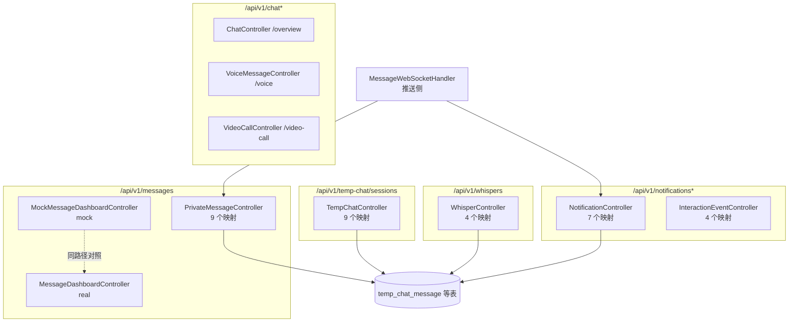
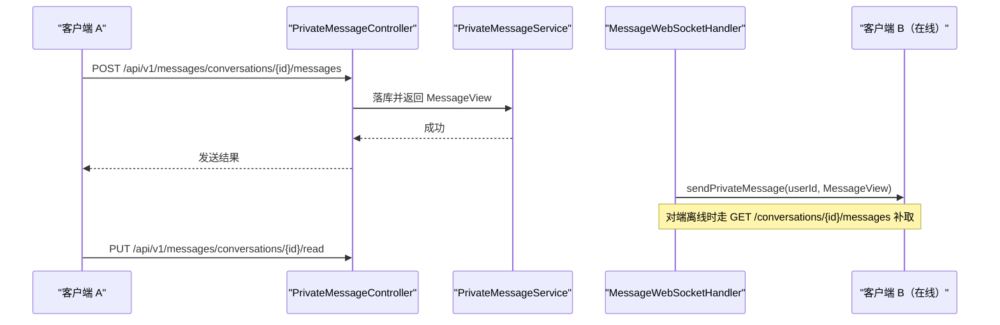
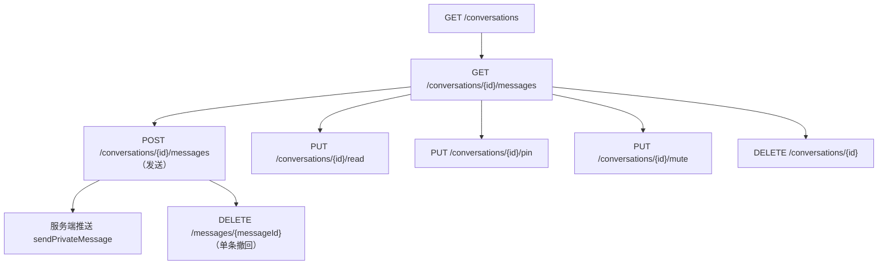
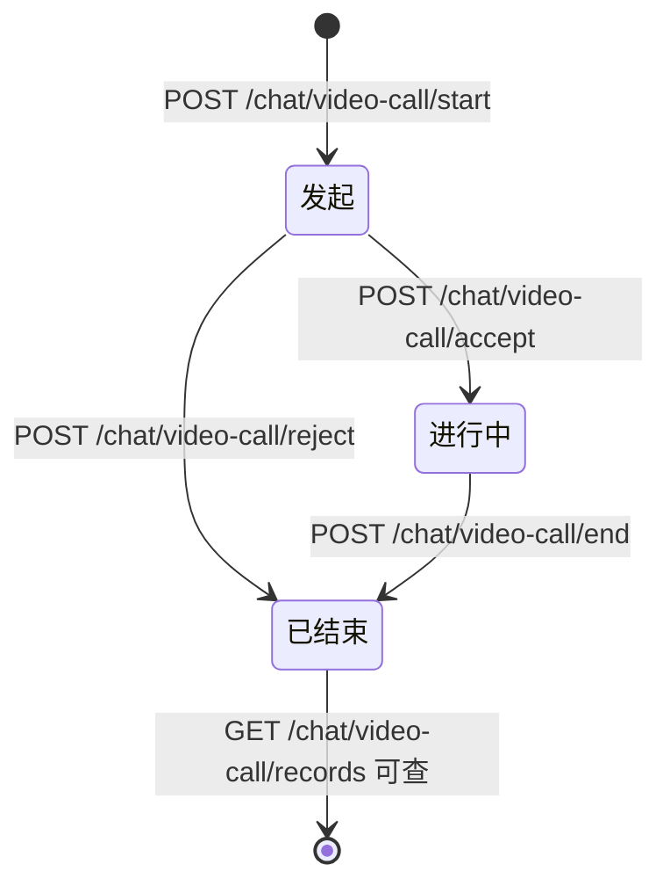
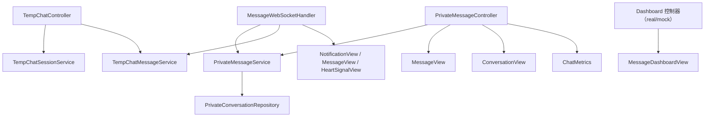

# 消息与聊天API

<cite>
**本文引用的文件**
- [whispers.yaml](file://docs/openapi/whispers.yaml)
- [ChatController.java](file://apps/api/src/main/java/com/campuslove/api/chat/ChatController.java)
- [PrivateMessageController.java](file://apps/api/src/main/java/com/campuslove/api/chat/PrivateMessageController.java)
- [MessageDashboardController.java](file://apps/api/src/main/java/com/campuslove/api/chat/MessageDashboardController.java)
- [MockMessageDashboardController.java](file://apps/api/src/main/java/com/campuslove/api/chat/MockMessageDashboardController.java)
- [TempChatController.java](file://apps/api/src/main/java/com/campuslove/api/chat/TempChatController.java)
- [VoiceMessageController.java](file://apps/api/src/main/java/com/campuslove/api/chat/VoiceMessageController.java)
- [VideoCallController.java](file://apps/api/src/main/java/com/campuslove/api/chat/VideoCallController.java)
- [NotificationController.java](file://apps/api/src/main/java/com/campuslove/api/chat/NotificationController.java)
- [InteractionEventController.java](file://apps/api/src/main/java/com/campuslove/api/chat/InteractionEventController.java)
- [WhisperController.java](file://apps/api/src/main/java/com/campuslove/api/whisper/WhisperController.java)
- [MessageWebSocketHandler.java](file://apps/api/src/main/java/com/campuslove/api/chat/MessageWebSocketHandler.java)
- [TempChatMessage.java](file://apps/api/src/main/java/com/campuslove/api/entity/TempChatMessage.java)
- [MessageView.java](file://apps/api/src/main/java/com/campuslove/api/chat/MessageView.java)
- [ConversationView.java](file://apps/api/src/main/java/com/campuslove/api/chat/ConversationView.java)
- [MessageDashboardView.java](file://apps/api/src/main/java/com/campuslove/api/chat/MessageDashboardView.java)
- [VoiceMessageService.java](file://apps/api/src/main/java/com/campuslove/api/chat/VoiceMessageService.java)
- [ChatMetrics.java](file://apps/api/src/main/java/com/campuslove/api/monitor/ChatMetrics.java)
</cite>

## 目录
1. [简介](#简介)
2. [项目结构](#项目结构)
3. [核心组件](#核心组件)
4. [架构总览](#架构总览)
5. [私聊会话与消息端点](#私聊会话与消息端点)
6. [临时匿名聊天端点](#临时匿名聊天端点)
7. [悄悄话（付费纸条）端点](#悄悄话付费纸条端点)
8. [语音与视频通话端点](#语音与视频通话端点)
9. [通知与互动事件端点](#通知与互动事件端点)
10. [聊天总览与关系看板](#聊天总览与关系看板)
11. [REST 与 WebSocket 的分工](#rest-与-websocket-的分工)
12. [契约与实现的差异](#契约与实现的差异)
13. [依赖关系分析](#依赖关系分析)
14. [性能考虑](#性能考虑)
15. [故障排查指南](#故障排查指南)
16. [结论](#结论)

## 简介
消息域是本项目 HTTP 面最宽的一块，10 个控制器分布在 6 个前缀上：

- `/api/v1/messages`：私聊会话与消息（`PrivateMessageController`）+ 关系看板（`MessageDashboardController`
  与其 mock 对应物），三个控制器共用这一前缀。
- `/api/v1/temp-chat/sessions`：临时匿名聊天（`TempChatController`）。
- `/api/v1/chat`：聊天页总览（`ChatController` L15），以及它的两个子前缀
  `/api/v1/chat/voice`（`VoiceMessageController` L46）与 `/api/v1/chat/video-call`
  （`VideoCallController` L44）。
- `/api/v1/notifications`：通知（`NotificationController` L26）与互动事件
  `/api/v1/notifications/interactions`（`InteractionEventController` L25）。
- `/api/v1/whispers`：恋爱小纸条（`WhisperController` L22），是唯一有 OpenAPI 契约的一组
  （`docs/openapi/whispers.yaml`，128 行）。

唯一的契约文件把悄悄话四步写清楚了：`POST /whispers/send`（`sendWhisper`，L10-L30，
summary "Send a paid whisper"）、`GET /whispers/inbox`（`getWhisperInbox`，L31-L45）、
`GET /whispers/sent`（`getWhisperSent`，L46-L60）、`POST /whispers/{id}/read`
（`readWhisper`，L61-L77，summary "Mark a received whisper as read"）。
其余消息域端点没有契约，本页以控制器实现为权威逐一列出。

## 项目结构

**图表来源**
- [PrivateMessageController.java:37-51](file://apps/api/src/main/java/com/campuslove/api/chat/PrivateMessageController.java#L37-L51)
- [TempChatController.java:21-36](file://apps/api/src/main/java/com/campuslove/api/chat/TempChatController.java#L21-L36)
- [VoiceMessageController.java:46-68](file://apps/api/src/main/java/com/campuslove/api/chat/VoiceMessageController.java#L46-L68)
- [VideoCallController.java:44-60](file://apps/api/src/main/java/com/campuslove/api/chat/VideoCallController.java#L44-L60)
- [NotificationController.java:26-40](file://apps/api/src/main/java/com/campuslove/api/chat/NotificationController.java#L26-L40)
- [InteractionEventController.java:25-43](file://apps/api/src/main/java/com/campuslove/api/chat/InteractionEventController.java#L25-L43)
- [WhisperController.java:22-31](file://apps/api/src/main/java/com/campuslove/api/whisper/WhisperController.java#L22-L31)

## 核心组件
- **PrivateMessageController**（220 行）：`GET /conversations`(L51)、`POST /conversations`(L61)、
  `GET /conversations/{id}/messages`(L76)、`POST /conversations/{id}/messages`(L94)、
  `PUT /conversations/{id}/read`(L111)、`PUT /conversations/{id}/pin`(L125)、
  `PUT /conversations/{id}/mute`(L144)、`DELETE /conversations/{id}`(L163)、
  `DELETE /{messageId}`(L180)。
- **TempChatController**（174 行）：`POST /`(L36) 开会话、`GET /{id}`(L42)、
  `POST /{id}/messages`(L48)、`POST /{id}/contact-exchange/respond`(L57)、
  `POST /{id}/end`(L66)、`POST /{id}/pin`(L72)、`POST /{id}/unpin`(L78)、
  `POST /{id}/read`(L84)、`POST /{id}/messages/{messageId}/recall`(L90)。
- **NotificationController**（127 行）：`GET /`(L40)、`PUT /{id}/read`(L53)、
  `GET /unread-count`(L64)、`GET /list`(L81)、`GET /count`(L100)、
  `PUT /{id}/read-with-user`(L110)、`PUT /read-all`(L121)。
- **InteractionEventController**（109 行）：`GET /`(L43)、`GET /unread-count`(L62)、
  `PUT /{eventId}/read`(L80)、`PUT /read-all`(L98)。
- **WhisperController**（58 行）：`POST /send`(L31)、`GET /inbox`(L38)、`GET /sent`(L45)、
  `POST /{id}/read`(L52)——四个映射与 `whispers.yaml` 的四条路径一一对应。
- **VoiceMessageController**（177 行）：`POST /`(L68) 上传、`DELETE /{id}`(L104) 删除。
- **VideoCallController**（163 行）：`POST /start`(L60)、`POST /accept`(L78)、
  `POST /reject`(L92)、`POST /end`(L105)、`GET /records`(L120)。
- **ChatController**（108 行）：`GET /overview`(L36)。
- **MessageDashboardController**（34 行）：`GET /relationship-dashboard`(L28)；
  `MockMessageDashboardController`（99 行）：同路径 `GET /relationship-dashboard`(L34)。
- **TempChatMessage**（174 行实体）：`@Table(name = "temp_chat_message")`(L24)，
  `session`(L34)、`sender`(L38)、`kind = "text"`(L42)、`body`(L46)、
  `durationSeconds`(L50)、`recalled = false`(L54)、`deliveryStatus = "sent"`(L58)、
  `quoteSnapshot`(L62)、`createdAt`(L69)、`version = 0L`(L81)。

**章节来源**
- [PrivateMessageController.java:37-220](file://apps/api/src/main/java/com/campuslove/api/chat/PrivateMessageController.java#L37-L220)
- [TempChatController.java:21-174](file://apps/api/src/main/java/com/campuslove/api/chat/TempChatController.java#L21-L174)
- [NotificationController.java:26-127](file://apps/api/src/main/java/com/campuslove/api/chat/NotificationController.java#L26-L127)
- [InteractionEventController.java:25-109](file://apps/api/src/main/java/com/campuslove/api/chat/InteractionEventController.java#L25-L109)
- [WhisperController.java:22-58](file://apps/api/src/main/java/com/campuslove/api/whisper/WhisperController.java#L22-L58)
- [VideoCallController.java:44-163](file://apps/api/src/main/java/com/campuslove/api/chat/VideoCallController.java#L44-L163)
- [TempChatMessage.java:22-81](file://apps/api/src/main/java/com/campuslove/api/entity/TempChatMessage.java#L22-L81)

## 架构总览
消息域是"REST 写入 + WebSocket 推送"的双通道结构：客户端用 HTTP 发起与拉取，
服务端用 WebSocket 把新消息与通知推给在线的对端。

**图表来源**
- [PrivateMessageController.java:94-111](file://apps/api/src/main/java/com/campuslove/api/chat/PrivateMessageController.java#L94-L111)
- [MessageWebSocketHandler.java:83-437](file://apps/api/src/main/java/com/campuslove/api/chat/MessageWebSocketHandler.java#L83-L437)
- [MessageView.java:9-31](file://apps/api/src/main/java/com/campuslove/api/chat/MessageView.java#L9-L31)

## 私聊会话与消息端点
`/api/v1/messages` 下的私聊操作分两个层级——会话级与消息级，路径形态据此区分：

- **会话列表 `GET /conversations`（L51）**：返回 `ConversationView` 集合（该视图类型 51 行，L7）。
- **建会话 `POST /conversations`（L61）**：两人之间会话的创建入口。
- **拉消息 `GET /conversations/{id}/messages`（L76）** 与 **发消息
  `POST /conversations/{id}/messages`（L94）**：消息主体挂在会话路径下，
  响应元素是 `MessageView`（31 行，L9）。
- **会话状态三个 PUT**：`/read`(L111) 标记已读、`/pin`(L125) 置顶、`/mute`(L144) 免打扰。
  三者是**会话属性**而非消息属性，因此作用在 `{id}` 上而不是消息 ID 上。
- **删除分两级**：`DELETE /conversations/{id}`(L163) 处理整个会话，
  `DELETE /{messageId}`(L180) 处理单条消息——注意后者的路径没有 `conversations/` 前缀，
  是 `/api/v1/messages/{messageId}`。

免打扰与置顶的存在说明消息列表的排序与提醒策略是可用户配置的，
未读判定则依赖 `/read`(L111) 的上报，因此客户端切后台时必须先上报已读，否则回到前台仍会显示红点。

**图表来源**
- [PrivateMessageController.java:51-180](file://apps/api/src/main/java/com/campuslove/api/chat/PrivateMessageController.java#L51-L180)
- [MessageWebSocketHandler.java:437-455](file://apps/api/src/main/java/com/campuslove/api/chat/MessageWebSocketHandler.java#L437-L455)

**章节来源**
- [PrivateMessageController.java:37-180](file://apps/api/src/main/java/com/campuslove/api/chat/PrivateMessageController.java#L37-L180)
- [ConversationView.java:7-51](file://apps/api/src/main/java/com/campuslove/api/chat/ConversationView.java#L7-L51)
- [MessageView.java:9-31](file://apps/api/src/main/java/com/campuslove/api/chat/MessageView.java#L9-L31)

## 临时匿名聊天端点
临时聊天（匿名会话）以会话为单位组织，前缀 `/api/v1/temp-chat/sessions`：

- `POST /`（L36）开启一段临时会话；`GET /{id}`（L42）读取会话状态。
- `POST /{id}/messages`（L48）在会话内发消息，消息落 `temp_chat_message`：
  `kind = "text"`(L42) 表明消息有类型维度，`durationSeconds`(L50) 服务于语音类消息的时长，
  `recalled = false`(L54) 是撤回标志位，`deliveryStatus = "sent"`(L58) 是投递状态，
  `quoteSnapshot`(L62) 保存被引用消息的快照（引用不依赖原消息仍存活），
  `sender`(L38) 是会话内的发送方标识而非真实用户 ID（匿名语义由此而来）。
- `POST /{id}/messages/{messageId}/recall`（L90）撤回某条消息，与 `recalled` 列对应。
- `POST /{id}/contact-exchange/respond`（L57）处理"交换联系方式"的响应，
  这是匿名会话走向实名会话的关键动作。
- 会话生命周期：`POST /{id}/end`（L66）结束会话；`POST /{id}/pin`(L72) 与
  `POST /{id}/unpin`(L78) 固定/取消固定；`POST /{id}/read`(L84) 上报已读。

**章节来源**
- [TempChatController.java:21-90](file://apps/api/src/main/java/com/campuslove/api/chat/TempChatController.java#L21-L90)
- [TempChatMessage.java:22-81](file://apps/api/src/main/java/com/campuslove/api/entity/TempChatMessage.java#L22-L81)

## 悄悄话（付费纸条）端点
`WhisperController`（58 行，前缀 `/api/v1/whispers` L22）是消息域里唯一有完整契约的组：

| 实现 | 契约 | operationId / summary |
|---|---|---|
| `POST /send`(L31) | whispers.yaml L10-L30 | `sendWhisper`，"Send a paid whisper" |
| `GET /inbox`(L38) | L31-L45 | `getWhisperInbox`，"List received whispers" |
| `GET /sent`(L45) | L46-L60 | `getWhisperSent`，"List sent whispers" |
| `POST /{id}/read`(L52) | L61-L77 | `readWhisper`，"Mark a received whisper as read" |

契约把付费语义写在 summary 上（"paid whisper"），并且收件箱与发件箱是两个独立端点而非一个带参数的列表，
这与推荐流里的悄悄话解锁相互独立：`/recommendations/{userId}/whisper/unlock` 属于推荐域
（见 `API接口文档/匹配与推荐API`）。

## 语音与视频通话端点
- **语音消息**：`/api/v1/chat/voice`（`VoiceMessageController` L46），两个端点——
  `POST /`(L68) 上传、`DELETE /{id}`(L104) 删除。落盘逻辑在 `VoiceMessageService`
  （281 行，`@Service` L50）：`store(Long userId, MultipartFile file, Integer duration)`(L109)
  接受时长参数，`delete(Long ownerUserId, String url)`(L200) 以属主 + URL 双条件删除，
  返回结构 `VoiceUploadResult`(L275)。存储路径由两个字段决定：
  `urlPrefix`(L83) 与 `storageRoot`(L93)，即"对外 URL 前缀"和"本地根目录"分离。
  语音时长与临时聊天消息里的 `durationSeconds`(TempChatMessage L50) 是同一类信息的两个落点。
- **视频通话**：`/api/v1/chat/video-call`（`VideoCallController` L44），
  `POST /start`(L60)、`POST /accept`(L78)、`POST /reject`(L92)、`POST /end`(L105)、
  `GET /records`(L120)。四个写端点构成完整状态机（发起→接受/拒绝→结束），
  `GET /records` 提供历史通话记录查询。

[此图为概念流程，不直接对应具体源文件，故不提供图表来源]

**章节来源**
- [VoiceMessageController.java:46-104](file://apps/api/src/main/java/com/campuslove/api/chat/VoiceMessageController.java#L46-L104)
- [VoiceMessageService.java:50-275](file://apps/api/src/main/java/com/campuslove/api/chat/VoiceMessageService.java#L50-L275)
- [VideoCallController.java:44-120](file://apps/api/src/main/java/com/campuslove/api/chat/VideoCallController.java#L44-L120)

## 通知与互动事件端点
通知有两个控制器、两个前缀，职责不同：

- **`/api/v1/notifications`（`NotificationController` L26）** 7 个端点：
  `GET /`(L40) 与 `GET /list`(L81) 两种列表入口、`GET /unread-count`(L64) 与
  `GET /count`(L100) 两种计数、`PUT /{id}/read`(L53) 单条已读、
  `PUT /{id}/read-with-user`(L110) 带用户维度的已读、`PUT /read-all`(L121) 全部已读。
  `read-with-user` 与普通 `read` 并存，说明存在"按与某人的关系批量清理通知"的需求。
- **`/api/v1/notifications/interactions`（`InteractionEventController` L25）** 4 个端点：
  `GET /`(L43) 互动事件列表、`GET /unread-count`(L62)、`PUT /{eventId}/read`(L80)、
  `PUT /read-all`(L98)。它挂在通知前缀之下，但数据是"互动事件"（谁点赞、谁评论）而不是系统通知。

两者都提供 `unread-count` 与 `read-all`，客户端未读角标需要**分别**取这两个计数再相加，
只读一个会漏。服务端推送入口是 `MessageWebSocketHandler.sendNotification(String userId,
NotificationView notificationView)`(L419)。

**章节来源**
- [NotificationController.java:26-127](file://apps/api/src/main/java/com/campuslove/api/chat/NotificationController.java#L26-L127)
- [InteractionEventController.java:25-109](file://apps/api/src/main/java/com/campuslove/api/chat/InteractionEventController.java#L25-L109)
- [MessageWebSocketHandler.java:419-436](file://apps/api/src/main/java/com/campuslove/api/chat/MessageWebSocketHandler.java#L419-L436)

## 聊天总览与关系看板
- **总览**：`GET /api/v1/chat/overview`(L36) 一次性返回聊天页所需的聚合数据，
  是首屏唯一必须调用的端点。
- **关系看板**：`GET /api/v1/messages/relationship-dashboard` 有**两个实现**，路径相同：
  `MessageDashboardController`(L28，34 行) 与 `MockMessageDashboardController`(L34，99 行)，
  返回类型 `MessageDashboardView`（14 行，L8）。二者按运行模式切换，
  这解释了为什么看板接口在 mock 环境总能出数据——它走的是 mock 控制器。

看板与总览的分工：总览给"会话列表与未读"，看板给"这段关系的进展指标"
（对应 `后端API服务/聊天与消息系统/关系评分系统` 与 `消息仪表盘`）。

**章节来源**
- [ChatController.java:15-36](file://apps/api/src/main/java/com/campuslove/api/chat/ChatController.java#L15-L36)
- [MessageDashboardController.java:15-28](file://apps/api/src/main/java/com/campuslove/api/chat/MessageDashboardController.java#L15-L28)
- [MockMessageDashboardController.java:21-34](file://apps/api/src/main/java/com/campuslove/api/chat/MockMessageDashboardController.java#L21-L34)
- [MessageDashboardView.java:8-14](file://apps/api/src/main/java/com/campuslove/api/chat/MessageDashboardView.java#L8-L14)

## REST 与 WebSocket 的分工
`MessageWebSocketHandler`（455 行，`@Controller` L42）只做三件推送：
`sendHeartSignal(String userId, HeartSignalView signal)`(L401)、
`sendNotification(String userId, NotificationView notificationView)`(L419)、
`sendPrivateMessage(String userId, MessageView messageView)`(L437)。
它持有的依赖正好说明"推送需要什么"：`TempChatSessionService`(L60)、
`TempChatMessageService`(L67)、`PrivateConversationRepository`(L74)、
`PrivateMessageService`(L83)。

因此约定是：**写操作一律走 REST，实时到达走 WebSocket 的三个 send* 方法**。
消息可靠性不靠"推成功"，而是靠客户端在重连后用
`GET /conversations/{id}/messages`(L76) 或 `GET /{id}`(TempChatController L42) 补齐——
这就是为什么 `deliveryStatus = "sent"`(TempChatMessage L58) 是消息行上的状态而不是内存状态。

计数侧配套：`ChatMetrics.recordMessageSent(String messageType)`(L60)、
`recordMessageFailed(String reason)`(L77)、`incrementActiveSession()`(L92)、
`decrementActiveSession()`(L103)。发送失败与活跃会话数因此可以直接监控。

**章节来源**
- [MessageWebSocketHandler.java:42-83](file://apps/api/src/main/java/com/campuslove/api/chat/MessageWebSocketHandler.java#L42-L83)
- [MessageWebSocketHandler.java:401-455](file://apps/api/src/main/java/com/campuslove/api/chat/MessageWebSocketHandler.java#L401-L455)
- [ChatMetrics.java:23-103](file://apps/api/src/main/java/com/campuslove/api/monitor/ChatMetrics.java#L23-L103)

## 契约与实现的差异
在 `docs/openapi` 全部 9 个契约文件中检索后，消息域的契约覆盖情况是：

- **只有悄悄话有契约**：`whispers.yaml` 的 4 条路径与 `WhisperController` 的 4 个映射完全一致，
  无缺口。
- **私聊、临时聊天、通知、互动事件、语音、视频通话、总览、看板全部无契约**：
  非契约映射共 39 个（按路径去重是 38 个，因为看板的同一路径有两个实现）。分布为
  `/messages/conversations*` 与消息删除 9 个、`/temp-chat/sessions*` 9 个、
  `/notifications*` 7 个、`/notifications/interactions*` 4 个、`/chat/voice` 2 个、
  `/chat/video-call` 5 个、`/chat/overview` 1 个、
  `/messages/relationship-dashboard` 2 个实现（real 与 mock 各 1）。
- **同一路径两个实现**：`/api/v1/messages/relationship-dashboard` 由 real 与 mock 两个控制器提供，
  契约层面无法表达这种"按模式切换"，需要在文档里显式说明。

对客户端的影响：除悄悄话外，消息域的参数与响应结构只能从控制器与视图类推导，
无法用契约生成类型。

**章节来源**
- [whispers.yaml:10-77](file://docs/openapi/whispers.yaml#L10-L77)
- [WhisperController.java:22-58](file://apps/api/src/main/java/com/campuslove/api/whisper/WhisperController.java#L22-L58)
- [MessageDashboardController.java:28-28](file://apps/api/src/main/java/com/campuslove/api/chat/MessageDashboardController.java#L28-L28)
- [MockMessageDashboardController.java:34-34](file://apps/api/src/main/java/com/campuslove/api/chat/MockMessageDashboardController.java#L34-L34)

## 依赖关系分析
- 控制器 → 服务：私聊依赖 `PrivateMessageService`（在推送处理器中以字段 L83 出现，
  仓储 `PrivateConversationRepository` L74 同域）；临时聊天依赖
  `TempChatSessionService`(L60) 与 `TempChatMessageService`(L67)。
- 实体 → 视图：`TempChatMessage` 是持久结构，对外一律经 `MessageView`(L9) /
  `ConversationView`(L7) / `MessageDashboardView`(L8) 投影，接口不直接吐实体。
- 推送 → 业务事件：`MessageWebSocketHandler` 的三个 `send*` 是通知、私聊、心动信号
  三条链路的共同出口，心动信号的来源是匹配域（`/matches/like` 返回 `HeartSignalView`）。
- 监控 → 指标：`ChatMetrics` 与 `AuthMetrics`(L23)、`MatchMetrics`(L28)、`VillageMetrics`(L29)、
  `PaymentMetrics`(L30) 同属 `monitor` 包，说明聊天侧指标与全站指标是一套体系。
- 文件存储：`VoiceMessageService` 用 `urlPrefix`(L83) 与 `storageRoot`(L93) 分离内外路径，
  与媒体资产域是两条独立链路（语音消息直接落本地根目录）。

**图表来源**
- [MessageWebSocketHandler.java:60-83](file://apps/api/src/main/java/com/campuslove/api/chat/MessageWebSocketHandler.java#L60-L83)
- [PrivateMessageController.java:37-51](file://apps/api/src/main/java/com/campuslove/api/chat/PrivateMessageController.java#L37-L51)
- [TempChatController.java:21-36](file://apps/api/src/main/java/com/campuslove/api/chat/TempChatController.java#L21-L36)

**章节来源**
- [MessageView.java:9-31](file://apps/api/src/main/java/com/campuslove/api/chat/MessageView.java#L9-L31)
- [ConversationView.java:7-51](file://apps/api/src/main/java/com/campuslove/api/chat/ConversationView.java#L7-L51)
- [ChatMetrics.java:23-103](file://apps/api/src/main/java/com/campuslove/api/monitor/ChatMetrics.java#L23-L103)

## 性能考虑
- **首屏用总览而不是轮询**：`GET /chat/overview`(L36) 聚合聊天页数据，
  替代"会话列表 + 未读数 + 通知数"多次往返。
- **未读数有两个来源**：`/notifications/unread-count`(L64) 与
  `/notifications/interactions/unread-count`(L62)，两者都要取；
  `/notifications/count`(L100) 与 `/list`(L81) 是另一组，不要混用成"未读数"。
- **列表分页与引用快照**：`TempChatMessage.quoteSnapshot`(L62) 把被引用消息内联存下来，
  使渲染引用不需要回查原消息，读放大换来了查询次数减少。
- **撤回是标志位不是删除**：`recalled`(L54) 让撤回变成一次 UPDATE，
  消息主体（`body` L46）仍在，便于审计但要求列表侧过滤。
- **语音删除要带属主**：`delete(Long ownerUserId, String url)`(L200) 用两个条件定位文件，
  避免按 URL 猜测属主带来的额外查询与越权风险。
- **乐观锁**：`version = 0L`(L81) 存在于消息实体，会话状态并发更新（pin/mute/read）
  需要预期版本冲突。

**章节来源**
- [ChatController.java:36-36](file://apps/api/src/main/java/com/campuslove/api/chat/ChatController.java#L36-L36)
- [NotificationController.java:64-100](file://apps/api/src/main/java/com/campuslove/api/chat/NotificationController.java#L64-L100)
- [InteractionEventController.java:62-62](file://apps/api/src/main/java/com/campuslove/api/chat/InteractionEventController.java#L62-L62)
- [TempChatMessage.java:46-81](file://apps/api/src/main/java/com/campuslove/api/entity/TempChatMessage.java#L46-L81)
- [VoiceMessageService.java:200-200](file://apps/api/src/main/java/com/campuslove/api/chat/VoiceMessageService.java#L200-L200)

## 故障排查指南
- **发消息成功但对端没收到**：先确认对端是否在线。REST 只负责落库，
  到达依赖 `sendPrivateMessage`(L437)；对端不在线时应在重连后
  `GET /conversations/{id}/messages`(L76) 补齐。指标侧看
  `ChatMetrics.recordMessageFailed(reason)`(L77) 是否增长。
- **单条消息删除路径 404**：消息级删除是 `DELETE /api/v1/messages/{messageId}`(L180)，
  不是 `/messages/conversations/{id}/messages/{messageId}`；会话删除才是
  `DELETE /conversations/{id}`(L163)。
- **临时聊天撤回无效**：撤回走 `POST /{id}/messages/{messageId}/recall`(L90)，
  它置 `recalled`(L54) 为真；若前端仍显示原内容，是列表没有按该标志过滤。
- **未读红点不清**：通知与互动事件是两套计数（L64 与 L62），
  已读也只各自清理（`/{id}/read` L53 与 `/{eventId}/read` L80）；
  全域清理需分别调用两个 `read-all`(L121、L98)。
- **看板数据在 mock 环境永远存在**：那是 `MockMessageDashboardController`(L34) 在响应，
  与真实看板 `MessageDashboardController`(L28) 同路径；排查时先确认运行模式。
- **语音上传后无法播放**：`store(...)`(L109) 返回 `VoiceUploadResult`(L275)，
  可播放 URL 由 `urlPrefix`(L83) 拼接，而文件实际落在 `storageRoot`(L93) 下；
  前缀或根目录任一配置错都会表现为"上传成功但播放 404"。
- **视频通话状态不流转**：四个写端点分别对应状态迁移（L60、L78、L92、L105），
  跳过 accept 直接 end 或反过来都会表现为状态与记录不一致，历史记录看 `GET /records`(L120)。

**章节来源**
- [PrivateMessageController.java:76-180](file://apps/api/src/main/java/com/campuslove/api/chat/PrivateMessageController.java#L76-L180)
- [TempChatController.java:84-90](file://apps/api/src/main/java/com/campuslove/api/chat/TempChatController.java#L84-L90)
- [NotificationController.java:53-121](file://apps/api/src/main/java/com/campuslove/api/chat/NotificationController.java#L53-L121)
- [InteractionEventController.java:80-98](file://apps/api/src/main/java/com/campuslove/api/chat/InteractionEventController.java#L80-L98)
- [VoiceMessageService.java:83-109](file://apps/api/src/main/java/com/campuslove/api/chat/VoiceMessageService.java#L83-L109)
- [VideoCallController.java:60-120](file://apps/api/src/main/java/com/campuslove/api/chat/VideoCallController.java#L60-L120)

## 结论
消息域 10 个控制器、43 个方法映射分布在 6 个前缀上，形成"REST 写 + WebSocket 推"的稳定分工：
推送侧只有三个出口（通知、私聊、心动信号），其余全部通过 HTTP 完成，
消息可靠性依赖客户端重连后的列表补齐而不是推送成功。

三处设计值得注意：其一，私聊的会话属性（已读、置顶、免打扰）与消息操作分层清晰，
删除也分会话级与消息级两条路径；其二，临时聊天的匿名性写在实体里——
`sender` 是会话内标识、`quoteSnapshot` 内联引用、`recalled`/`deliveryStatus` 都是行上状态；
其三，关系看板有 real 与 mock 两个同路径实现，是本页唯一"同一路径两个控制器"的地方。

契约缺口是本域最大问题：43 个映射里只有悄悄话的 4 个有 OpenAPI 描述，
其余私聊、临时聊天、通知、互动事件、语音、视频、总览、看板全部没有，
按契约生成客户端会几乎拿不到消息域类型。补齐顺序建议从数据量最大的
`/messages/conversations*` 与 `/temp-chat/sessions*` 开始。
