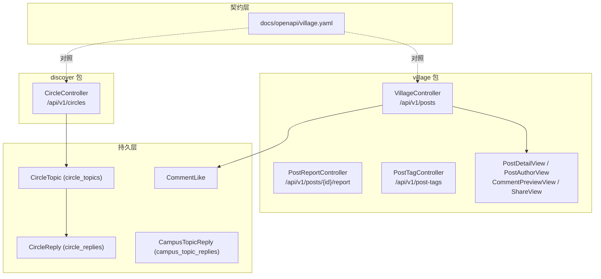
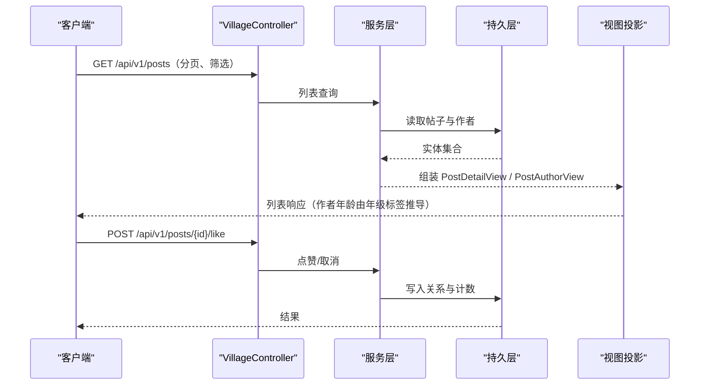
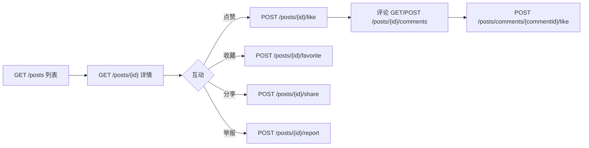
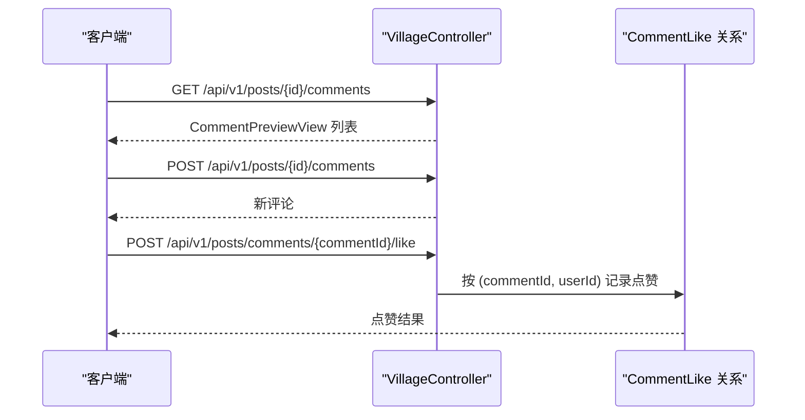
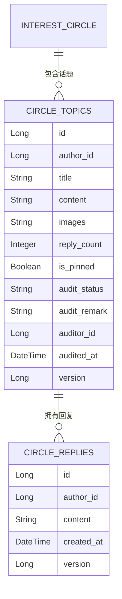
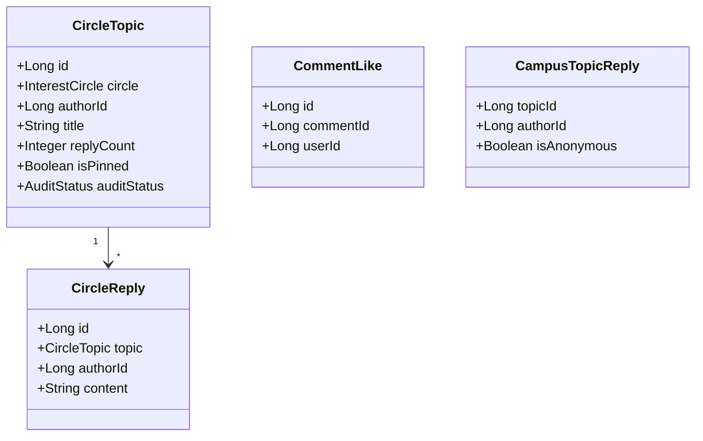

# 社区圈子API

<cite>
**本文引用的文件**
- [village.yaml](file://docs/openapi/village.yaml)
- [VillageController.java](file://apps/api/src/main/java/com/campuslove/api/village/VillageController.java)
- [PostReportController.java](file://apps/api/src/main/java/com/campuslove/api/village/PostReportController.java)
- [PostTagController.java](file://apps/api/src/main/java/com/campuslove/api/village/PostTagController.java)
- [CircleController.java](file://apps/api/src/main/java/com/campuslove/api/discover/CircleController.java)
- [PostDetailView.java](file://apps/api/src/main/java/com/campuslove/api/village/PostDetailView.java)
- [PostAuthorView.java](file://apps/api/src/main/java/com/campuslove/api/village/PostAuthorView.java)
- [CommentPreviewView.java](file://apps/api/src/main/java/com/campuslove/api/village/CommentPreviewView.java)
- [ShareView.java](file://apps/api/src/main/java/com/campuslove/api/village/ShareView.java)
- [CampusTopicView.java](file://apps/api/src/main/java/com/campuslove/api/village/CampusTopicView.java)
- [PostTagService.java](file://apps/api/src/main/java/com/campuslove/api/village/PostTagService.java)
- [CircleTopic.java](file://apps/api/src/main/java/com/campuslove/api/entity/CircleTopic.java)
- [CircleReply.java](file://apps/api/src/main/java/com/campuslove/api/entity/CircleReply.java)
- [CampusTopicReply.java](file://apps/api/src/main/java/com/campuslove/api/entity/CampusTopicReply.java)
- [CommentLike.java](file://apps/api/src/main/java/com/campuslove/api/village/CommentLike.java)
- [PostReportControllerTest.java](file://apps/api/src/test/java/com/campuslove/api/village/PostReportControllerTest.java)
</cite>

## 目录
1. [简介](#简介)
2. [项目结构](#项目结构)
3. [核心组件](#核心组件)
4. [架构总览](#架构总览)
5. [接口清单](#接口清单)
6. [帖子与互动接口详解](#帖子与互动接口详解)
7. [评论接口详解](#评论接口详解)
8. [圈子与话题接口详解](#圈子与话题接口详解)
9. [标签与举报接口详解](#标签与举报接口详解)
10. [契约与实现的差异](#契约与实现的差异)
11. [依赖关系分析](#依赖关系分析)
12. [性能考虑](#性能考虑)
13. [故障排查指南](#故障排查指南)
14. [结论](#结论)

## 简介
本页文档化社区圈子（广场帖子 + 兴趣圈子话题）对外的 HTTP 接口。接口定义有两个来源，必须同时看：

- **契约**：`docs/openapi/village.yaml` 声明了 `/posts`、`/posts/{id}`、`/posts/{id}/like`、`/posts/{id}/share`、
  `/posts/{id}/comments`、`/circles`、`/circles/{id}/join`、`/circles/{id}/topics`、`/circles/topics/{id}/replies`
  共 9 条路径下的操作，并给出 `operationId`（如 `getPosts`、`createPost`、`getPostComments`、`toggleCircleJoin`）。
- **实现**：`village` 包与 `discover` 包的控制器实际挂载了更多端点。`VillageController` 以
  `@RequestMapping("/api/v1/posts")` 为前缀，内部有 17 个方法映射；`CircleController` 以
  `@RequestMapping("/api/v1/circles")` 为前缀，有 9 个方法映射；`PostTagController` 负责
  `/api/v1/post-tags`；`PostReportController` 同样挂在 `/api/v1/posts` 前缀下，只提供举报端点。

本页的接口表以控制器为权威（它是真正会被调用的东西），并逐条标注契约里对应或缺失的位置。

## 项目结构
社区相关的 HTTP 层分布在两个包中，边界清晰：

- `apps/api/src/main/java/com/campuslove/api/village/`：帖子流与帖子互动。
  `VillageController.java`（404 行）承载列表、发布、详情、收藏、点赞、评论、分享、校园 feed、相似作者、浏览历史；
  `PostReportController.java`（158 行）承载举报；`PostTagController.java`（75 行）承载标签查询；
  响应侧是一组只读视图：`PostDetailView`、`PostAuthorView`、`CommentPreviewView`、`ShareView`、`CampusTopicView`。
- `apps/api/src/main/java/com/campuslove/api/discover/CircleController.java`：兴趣圈子列表、加入/退出、
  圈内话题、话题回复、精选圈子。
- `apps/api/src/main/java/com/campuslove/api/entity/`：`CircleTopic`（表 `circle_topics`）、
  `CircleReply`（表 `circle_replies`）、`CampusTopicReply`（表 `campus_topic_replies`）定义持久化结构；
  `village/CommentLike` 是评论点赞的关系实体。

**图表来源**
- [VillageController.java:36-71](file://apps/api/src/main/java/com/campuslove/api/village/VillageController.java#L36-L71)
- [PostReportController.java:47-77](file://apps/api/src/main/java/com/campuslove/api/village/PostReportController.java#L47-L77)
- [PostTagController.java:21-37](file://apps/api/src/main/java/com/campuslove/api/village/PostTagController.java#L21-L37)
- [CircleController.java:35-55](file://apps/api/src/main/java/com/campuslove/api/discover/CircleController.java#L35-L55)

## 核心组件
- **VillageController**：帖子域的唯一入口。方法映射按行号顺序为
  `@GetMapping`(L71)、`/my-dailies`(L113)、`@PostMapping`(L152)、`/hot-board`(L184)、`/recommend`(L194)、
  `/{id}`(L205)、`/{id}/favorite`(L218)、`/{id}/like`(L235)、`/{id}/comments` GET(L258) 与 POST(L272)、
  `/comments/{commentId}/like`(L302)、`/{id}/share`(L320)、`/campus-feed`(L337)、
  `/{id}/similar-authors`(L360)、`/history` GET(L379) 与 DELETE(L391)。
- **CircleController**：圈子域入口。`@GetMapping`(L55) 列表、`/{id}/join` POST(L66) 与 DELETE(L78) 分别加入与退出、
  `/{id}/topics` GET(L92) 与 POST(L108) 读取与发布圈内话题、`/topics/{id}`(L124) 话题详情、
  `/topics/{id}/replies` GET(L135) 与 POST(L151) 回复的读与写、`/topics/{id}` GET(L124)、`/topics/{id}/replies`(L135)。
- **PostReportController**：`@PostMapping("/{id}/report")`(L77) 一个写端点，内部定义了请求体
  `PostReportRequest`(L131) 与响应体 `PostReportView`(L149)。
- **PostTagController**：`@GetMapping`(L37)、`/popular`(L51)、`/posts`(L67) 三个只读端点，配套
  `PostTagService`(L9) 提供标签数据。
- **视图对象**：`PostDetailView`(L8) 是帖子详情响应；`PostAuthorView`(L15) 携带作者展示信息，并且内置
  `deriveAgeFromGradeLabel(String gradeLabel)`(L42)，即年龄由年级标签推导而不是单独存储；
  `CommentPreviewView`(L9) 用于评论预览；`ShareView`(L6) 表示分享结果；`CampusTopicView`(L8) 表示校园话题项。

**章节来源**
- [VillageController.java:71-403](file://apps/api/src/main/java/com/campuslove/api/village/VillageController.java#L71-L403)
- [CircleController.java:55-259](file://apps/api/src/main/java/com/campuslove/api/discover/CircleController.java#L55-L259)
- [PostReportController.java:77-158](file://apps/api/src/main/java/com/campuslove/api/village/PostReportController.java#L77-L158)
- [PostTagController.java:37-74](file://apps/api/src/main/java/com/campuslove/api/village/PostTagController.java#L37-L74)
- [PostAuthorView.java:15-57](file://apps/api/src/main/java/com/campuslove/api/village/PostAuthorView.java#L15-L57)

## 架构总览
一次"刷帖—互动"的调用链在实现上分成三段：控制器做参数与身份解析、服务层做业务与权限判断、视图层把实体投影成
响应结构。圈子话题的写入还会经过审核状态字段。

**图表来源**
- [VillageController.java:71-112](file://apps/api/src/main/java/com/campuslove/api/village/VillageController.java#L71-L112)
- [VillageController.java:235-257](file://apps/api/src/main/java/com/campuslove/api/village/VillageController.java#L235-L257)
- [PostDetailView.java:8-35](file://apps/api/src/main/java/com/campuslove/api/village/PostDetailView.java#L8-L35)
- [PostAuthorView.java:42-57](file://apps/api/src/main/java/com/campuslove/api/village/PostAuthorView.java#L42-L57)

## 接口清单
下表以控制器为准（`实现` 列给出行号），并标出契约 `village.yaml` 是否声明。

| 方法 | 路径 | 用途 | 实现位置 | 契约 |
|---|---|---|---|---|
| GET | `/api/v1/posts` | 帖子列表 | VillageController L71 | village.yaml L9-L64（`getPosts`）|
| GET | `/api/v1/posts/my-dailies` | 我的日常 | VillageController L113 | 未声明 |
| POST | `/api/v1/posts` | 发布帖子 | VillageController L152 | village.yaml L66-L87（`createPost`）|
| GET | `/api/v1/posts/hot-board` | 热榜 | VillageController L184 | 未声明 |
| GET | `/api/v1/posts/recommend` | 推荐流 | VillageController L194 | 未声明 |
| GET | `/api/v1/posts/{id}` | 帖子详情 | VillageController L205 | village.yaml L88-L113（`getPostDetail`）|
| POST | `/api/v1/posts/{id}/favorite` | 收藏 | VillageController L218 | 未声明 |
| POST | `/api/v1/posts/{id}/like` | 点赞 | VillageController L235 | village.yaml L114-L139（`likePost`）|
| GET | `/api/v1/posts/{id}/comments` | 评论列表 | VillageController L258 | village.yaml L172-L214（`getPostComments`）|
| POST | `/api/v1/posts/{id}/comments` | 发表评论 | VillageController L272 | village.yaml L215-L247（`createComment`）|
| POST | `/api/v1/posts/comments/{commentId}/like` | 评论点赞 | VillageController L302 | 未声明 |
| POST | `/api/v1/posts/{id}/share` | 分享 | VillageController L320 | village.yaml L140-L171（`sharePost`）|
| GET | `/api/v1/posts/campus-feed` | 校园动态 | VillageController L337 | 未声明 |
| GET | `/api/v1/posts/{id}/similar-authors` | 相似作者 | VillageController L360 | 未声明 |
| GET | `/api/v1/posts/history` | 浏览历史 | VillageController L379 | 未声明 |
| DELETE | `/api/v1/posts/history` | 清空浏览历史 | VillageController L391 | 未声明 |
| POST | `/api/v1/posts/{id}/report` | 举报帖子 | PostReportController L77 | 未声明 |
| GET | `/api/v1/post-tags` | 标签列表 | PostTagController L37 | 未声明 |
| GET | `/api/v1/post-tags/popular` | 热门标签 | PostTagController L51 | 未声明 |
| GET | `/api/v1/post-tags/posts` | 按标签取帖子 | PostTagController L67 | 未声明 |
| GET | `/api/v1/circles` | 圈子列表 | CircleController L55 | village.yaml L248-L264（`getCircles`）|
| POST | `/api/v1/circles/{id}/join` | 加入圈子 | CircleController L66 | village.yaml L265-L290（`toggleCircleJoin`）|
| DELETE | `/api/v1/circles/{id}/join` | 退出圈子 | CircleController L78 | 未声明 |
| GET | `/api/v1/circles/{id}/topics` | 圈内话题 | CircleController L92 | village.yaml L291-L318（`getCircleTopics`）|
| POST | `/api/v1/circles/{id}/topics` | 发布圈内话题 | CircleController L108 | village.yaml L319-L349（`createCircleTopic`）|
| GET | `/api/v1/circles/topics/{id}` | 话题详情 | CircleController L124 | 未声明 |
| GET | `/api/v1/circles/topics/{id}/replies` | 话题回复列表 | CircleController L135 | village.yaml L350-L360（`getCircleReplies`）|
| POST | `/api/v1/circles/topics/{id}/replies` | 发表话题回复 | CircleController L151 | 未声明 |
| GET | `/api/v1/circles/featured` | 精选圈子 | CircleController L168 | 未声明 |

**章节来源**
- [VillageController.java:36-403](file://apps/api/src/main/java/com/campuslove/api/village/VillageController.java#L36-L403)
- [CircleController.java:35-259](file://apps/api/src/main/java/com/campuslove/api/discover/CircleController.java#L35-L259)
- [PostTagController.java:21-74](file://apps/api/src/main/java/com/campuslove/api/village/PostTagController.java#L21-L74)
- [PostReportController.java:47-158](file://apps/api/src/main/java/com/campuslove/api/village/PostReportController.java#L47-L158)
- [village.yaml:9-360](file://docs/openapi/village.yaml#L9-L360)

## 帖子与互动接口详解
- **列表 `GET /api/v1/posts`（L71）**：与契约 `getPosts`（village.yaml L9-L64）对应。契约里定义了列表查询的
  参数与分页语义，因此"分类筛选、标签过滤、排序方式、分页"四项以 `village.yaml` 的声明为准；实现侧的
  路由前缀与方法是 `VillageController` 的 `@RequestMapping("/api/v1/posts")` + `@GetMapping`。
- **发布 `POST /api/v1/posts`（L152）**：对应契约 `createPost`（L66-L87）。发布成功后帖子进入作者时间线，
  并被列表、热榜、推荐流读取。
- **详情 `GET /api/v1/posts/{id}`（L205）**：响应结构是 `PostDetailView`（35 行，L8 声明类型），作者信息由
  `PostAuthorView` 承载；后者通过 `deriveAgeFromGradeLabel(String gradeLabel)`（L42）从年级标签推导年龄，
  这意味着接口不返回独立的年龄字段，客户端要按标签展示。
- **点赞 `POST /api/v1/posts/{id}/like`（L235）**：对应契约 `likePost`（L114-L139）；点赞是可逆操作，
  重复调用改变的是同一关系记录。
- **收藏 `POST /api/v1/posts/{id}/favorite`（L218）**、**分享 `POST /api/v1/posts/{id}/share`（L320）**：
  分享对应契约 `sharePost`（L140-L171），响应类型是 `ShareView`（7 行，L6）。
- **热榜与推荐 `GET /posts/hot-board`（L184）、`GET /posts/recommend`（L194）**：这两个是纯读端点，
  服务的是运营位与算法位；热度与推荐的具体打分口径不属于本页范围（见 `后端API服务/社区圈子功能/热度计算算法`
  与 `后端API服务/核心业务服务/发现推荐服务/推荐引擎核心`）。
- **浏览历史 `GET /api/v1/posts/history`（L379）与 `DELETE`（L391）**：GET 读取、DELETE 清空，
  是社区页唯一成对出现的读/写清理端点。

**图表来源**
- [VillageController.java:205-336](file://apps/api/src/main/java/com/campuslove/api/village/VillageController.java#L205-L336)
- [PostReportController.java:77-158](file://apps/api/src/main/java/com/campuslove/api/village/PostReportController.java#L77-L158)

**章节来源**
- [VillageController.java:71-391](file://apps/api/src/main/java/com/campuslove/api/village/VillageController.java#L71-L391)
- [PostDetailView.java:8-35](file://apps/api/src/main/java/com/campuslove/api/village/PostDetailView.java#L8-L35)
- [PostAuthorView.java:15-57](file://apps/api/src/main/java/com/campuslove/api/village/PostAuthorView.java#L15-L57)
- [ShareView.java:6-7](file://apps/api/src/main/java/com/campuslove/api/village/ShareView.java#L6-L7)
- [village.yaml:9-171](file://docs/openapi/village.yaml#L9-L171)

## 评论接口详解
- **读取 `GET /api/v1/posts/{id}/comments`（L258）**：对应契约 `getPostComments`（L172-L214）。
  评论条目在响应里以 `CommentPreviewView`（16 行，L9 声明类型）呈现，是"预览"结构而非完整实体，
  避免把内部字段带出。
- **发表 `POST /api/v1/posts/{id}/comments`（L272）**：对应契约 `createComment`（L215-L247）。
- **评论点赞 `POST /api/v1/posts/comments/{commentId}/like`（L302）**：路径形态与帖子点赞不同
  （以 `commentId` 为主键，挂在 `/posts/comments/` 下），对应关系实体 `CommentLike`（86 行）：
  `@Entity`(L20) + `@Table`(L22)，字段为 `id`(L32)、`commentId`(L36)、`userId`(L40)、`createdAt`(L45)，
  即"一人一评论一条记录"的去重模型。
- **校园话题回复**：与帖子评论是两套结构。`CampusTopicReply`（表 `campus_topic_replies`，122 行）字段为
  `topicId`(L30)、`authorId`(L34)、`content`(L38)、`isAnonymous = false`(L42)、`createdAt`(L49)、
  `version = 0L`(L61)，其中 `isAnonymous` 表示回复可匿名，`version` 表示实体带乐观锁版本；
  对外投影是 `CampusTopicView`（16 行，L8）。

**图表来源**
- [VillageController.java:258-319](file://apps/api/src/main/java/com/campuslove/api/village/VillageController.java#L258-L319)
- [CommentLike.java:20-45](file://apps/api/src/main/java/com/campuslove/api/village/CommentLike.java#L20-L45)
- [CommentPreviewView.java:9-16](file://apps/api/src/main/java/com/campuslove/api/village/CommentPreviewView.java#L9-L16)

**章节来源**
- [VillageController.java:258-319](file://apps/api/src/main/java/com/campuslove/api/village/VillageController.java#L258-L319)
- [CommentLike.java:20-86](file://apps/api/src/main/java/com/campuslove/api/village/CommentLike.java#L20-L86)
- [CampusTopicReply.java:19-122](file://apps/api/src/main/java/com/campuslove/api/entity/CampusTopicReply.java#L19-L122)
- [CampusTopicView.java:8-16](file://apps/api/src/main/java/com/campuslove/api/village/CampusTopicView.java#L8-L16)
- [village.yaml:172-247](file://docs/openapi/village.yaml#L172-L247)

## 圈子与话题接口详解
`CircleController` 挂在 `/api/v1/circles` 前缀（L35）。

- **圈子列表 `GET`（L55）**：对应契约 `getCircles`（village.yaml L248-L264）。
- **加入/退出 `POST /{id}/join`（L66）与 `DELETE /{id}/join`（L78）**：契约把这两个动作合并成一个
  `toggleCircleJoin`（L265-L290），实现则拆成两个明确动词的端点，见"契约与实现的差异"。
- **圈内话题 `GET /{id}/topics`（L92）与 `POST /{id}/topics`（L108）**：分别对应契约
  `getCircleTopics`（L291-L318）与 `createCircleTopic`（L319-L349）。话题实体 `CircleTopic`
  （表 `circle_topics`，222 行）的关键字段：`circle`(L45) 关联 `InterestCircle`、`authorId`(L49)、
  `title`(L53)、`content`(L57)、`images = "[]"`(L61)、`replyCount = 0`(L65)、`isPinned = false`(L69)、
  `auditStatus = AuditStatus.approved`(L74)、`auditRemark`(L78)、`auditorId`(L82)、`auditedAt`(L86)、
  `version = 0L`(L105)。其中 `AuditStatus` 枚举在 L34 声明，图片以 JSON 数组字符串存于 `images`，
  默认值是空数组 `"[]"`。
- **话题详情 `GET /topics/{id}`（L124）**、**回复列表 `GET /topics/{id}/replies`（L135）**、
  **发表回复 `POST /topics/{id}/replies`（L151）**、**精选圈子 `GET /topics/{id}` 与 `/featured`（L168）**。
  回复实体 `CircleReply`（表 `circle_replies`，114 行）字段为 `topic`(L34) 关联话题、`authorId`(L38)、
  `content`(L42)、`createdAt`(L49)、`version = 0L`(L61)。

**图表来源**
- [CircleTopic.java:24-105](file://apps/api/src/main/java/com/campuslove/api/entity/CircleTopic.java#L24-L105)
- [CircleReply.java:22-61](file://apps/api/src/main/java/com/campuslove/api/entity/CircleReply.java#L22-L61)

**章节来源**
- [CircleController.java:35-259](file://apps/api/src/main/java/com/campuslove/api/discover/CircleController.java#L35-L259)
- [CircleTopic.java:24-195](file://apps/api/src/main/java/com/campuslove/api/entity/CircleTopic.java#L24-L195)
- [CircleReply.java:22-114](file://apps/api/src/main/java/com/campuslove/api/entity/CircleReply.java#L22-L114)
- [village.yaml:248-360](file://docs/openapi/village.yaml#L248-L360)

## 标签与举报接口详解
- **标签**：`PostTagController` 前缀 `/api/v1/post-tags`（L21），三个只读端点
  `@GetMapping`(L37) 全部标签、`/popular`(L51) 热门标签、`/posts`(L67) 按标签取帖子；
  数据来自 `PostTagService`（39 行，L9 声明类型）。标签是帖子筛选与话题聚合的维度，
  与"分类筛选"配合使用时应以 `/posts` 列表端点的查询参数为准。
- **举报**：`PostReportController` 与帖子控制器共用 `/api/v1/posts` 前缀（L48），
  唯一写端点是 `@PostMapping("/{id}/report")`(L77)。请求体与响应体在该文件内以嵌套类型定义：
  `PostReportRequest`(L131)、`PostReportView`(L149)。举报的可测性由
  `PostReportControllerTest`（39 行，L15 声明类型，L20 持有 controller 字段）保证。

需要如实说明：本页只对"接口存在且可达"负责。举报之后的处理链路（谁在后台看到举报、如何处置）属于
`后端API服务/管理后台API/内容审核系统`；帖子内容的敏感词检测与审核字段落库见
`CircleTopic.auditStatus` 一类字段的定义，仓库中未发现独立的敏感词检测端点，因此本页不描述其接口。

**章节来源**
- [PostTagController.java:21-74](file://apps/api/src/main/java/com/campuslove/api/village/PostTagController.java#L21-L74)
- [PostTagService.java:9-39](file://apps/api/src/main/java/com/campuslove/api/village/PostTagService.java#L9-L39)
- [PostReportController.java:47-158](file://apps/api/src/main/java/com/campuslove/api/village/PostReportController.java#L47-L158)
- [PostReportControllerTest.java:15-39](file://apps/api/src/test/java/com/campuslove/api/village/PostReportControllerTest.java#L15-L39)
- [CircleTopic.java:74-86](file://apps/api/src/main/java/com/campuslove/api/entity/CircleTopic.java#L74-L86)

## 契约与实现的差异
`village.yaml` 声明 9 条路径下的操作，控制器实际暴露 29 个映射，差集如下。

- **实现有、契约无**：`/posts/my-dailies`、`/posts/hot-board`、`/posts/recommend`、`/posts/{id}/favorite`、
  `/posts/comments/{commentId}/like`、`/posts/campus-feed`、`/posts/{id}/similar-authors`、
  `/posts/history`（GET 与 DELETE）、`/posts/{id}/report`、`/post-tags`（3 个）、
  `/circles/{id}/join` 的 DELETE、`/circles/topics/{id}`、`/circles/topics/{id}/replies` 的 POST、
  `/circles/featured`。客户端若只按契约生成调用代码，这些能力全部不可见。
- **语义拆分**：契约的 `toggleCircleJoin` 用一个 POST 表达"加入或退出"，实现是 POST + DELETE 两个端点。
  以契约为准的调用方在退出场景下会调错语义。
- **未声明的排序/分页参数**：契约只在 `/posts` 与 `/posts/{id}/comments` 上写了参数与分页，
  其余列表端点（`hot-board`、`recommend`、`campus-feed`、`/post-tags/posts`）没有契约参数定义，
  其筛选与分页能力只能在实现与前端调用处核对。

这三类差异都属于"契约落后于实现"，不构成运行期故障，但会让据契约生成的客户端缺功能。
补契约的正确位置是 `docs/openapi/village.yaml` 的对应 path 段落。

**章节来源**
- [village.yaml:9-360](file://docs/openapi/village.yaml#L9-L360)
- [VillageController.java:71-403](file://apps/api/src/main/java/com/campuslove/api/village/VillageController.java#L71-L403)
- [CircleController.java:55-259](file://apps/api/src/main/java/com/campuslove/api/discover/CircleController.java#L55-L259)

## 依赖关系分析
- **两个前缀，一个资源树**：`VillageController` 与 `PostReportController` 都注册在 `/api/v1/posts` 下，
  按方法级路径区分（`/{id}/report` 只出现在后者）。因此新增举报类端点时不能只看一个文件，
  否则会以为 `/api/v1/posts` 只有列表与详情。
- **圈子实体链**：`CircleTopic` → `CircleReply` 是一对多（回复持有 `topic` 关联，L34），
  `CircleTopic` → `InterestCircle`（L45）。删除圈子或话题的级联行为由数据库约束与服务层共同决定，
  接口层没有暴露删除端点。
- **帖子与评论**：`CommentLike` 以 `commentId` + `userId`（L36、L40）建立关系，
  不直接依赖帖子 ID，评论点赞的鉴权因此需要先解析评论归属。
- **视图依赖**：`PostDetailView`、`CommentPreviewView`、`ShareView`、`CampusTopicView` 是小型只读类型
  （分别 35、16、7、16 行），说明响应结构刻意与实体解耦；`PostAuthorView` 是唯一带派生逻辑的视图
  （`deriveAgeFromGradeLabel`，L42）。

**图表来源**
- [CircleTopic.java:40-86](file://apps/api/src/main/java/com/campuslove/api/entity/CircleTopic.java#L40-L86)
- [CircleReply.java:29-49](file://apps/api/src/main/java/com/campuslove/api/entity/CircleReply.java#L29-L49)
- [CommentLike.java:32-45](file://apps/api/src/main/java/com/campuslove/api/village/CommentLike.java#L32-L45)
- [CampusTopicReply.java:26-42](file://apps/api/src/main/java/com/campuslove/api/entity/CampusTopicReply.java#L26-L42)

**章节来源**
- [VillageController.java:36-36](file://apps/api/src/main/java/com/campuslove/api/village/VillageController.java#L36-L36)
- [PostReportController.java:48-48](file://apps/api/src/main/java/com/campuslove/api/village/PostReportController.java#L48-L48)

## 性能考虑
- **列表端点是主成本**：`/posts`、`/posts/hot-board`、`/posts/recommend`、`/posts/campus-feed`、
  `/circles/{id}/topics` 都返回集合，分页与排序参数的落实位置就是这些方法（L71、L184、L194、L337、L92）。
- **计数字段是读放大换来的**：`CircleTopic.replyCount`（L65）与 `isPinned`（L69）直接存在话题行上，
  列表页不必 COUNT 回复表；代价是写回复时必须同步该计数。
- **乐观锁**：`CircleTopic.version`（L105）与 `CircleReply.version`（L61）、
  `CampusTopicReply.version`（L61）都存在，说明并发更新走版本校验；批量更新回复计数时要预期冲突重试。
- **图片以字符串存 JSON**：`CircleTopic.images` 默认 `"[]"`（L61），列表接口若直接返回该字段，
  体积随图片数线性增长；详情与列表应使用不同的投影。
- **派生字段省一次查询**：`PostAuthorView.deriveAgeFromGradeLabel`（L42）在视图内由年级标签算年龄，
  避免为年龄再加一次查询或列。

**章节来源**
- [CircleTopic.java:61-105](file://apps/api/src/main/java/com/campuslove/api/entity/CircleTopic.java#L61-L105)
- [CircleReply.java:61-61](file://apps/api/src/main/java/com/campuslove/api/entity/CircleReply.java#L61-L61)
- [CampusTopicReply.java:61-61](file://apps/api/src/main/java/com/campuslove/api/entity/CampusTopicReply.java#L61-L61)
- [PostAuthorView.java:42-57](file://apps/api/src/main/java/com/campuslove/api/village/PostAuthorView.java#L42-L57)

## 故障排查指南
- **404 但控制器存在**：先确认前缀。`/api/v1/posts` 与 `/api/v1/circles` 分别来自
  `VillageController` L36、`PostReportController` L48 与 `CircleController` L35；
  评论点赞的路径是 `/api/v1/posts/comments/{commentId}/like`（L302），
  不要写成 `/api/v1/posts/{id}/comments/{commentId}/like`。
- **圈内话题加入/退出不生效**：契约与实现的语义不同（`toggleCircleJoin` 单个 POST 对
  POST+DELETE 两个端点），退出必须用 `DELETE /api/v1/circles/{id}/join`（L78）。
- **话题列表为空但圈子存在**：检查话题 `auditStatus`（L74，枚举 `AuditStatus` 在 L34）与 `isPinned`（L69），
  审核未通过的话题不应出现在公开列表。
- **年龄显示异常**：年龄不是存储字段，来自 `deriveAgeFromGradeLabel`（L42）对年级标签的推导，
  年级标签缺失或非标准时推导结果自然不对。
- **举报失败**：举报是独立控制器 `PostReportController` 的 `POST /{id}/report`（L77），
  请求体类型 `PostReportRequest`（L131）；其行为由 `PostReportControllerTest`（L15）覆盖，
  改动后应先跑该测试。
- **按标签取不到帖子**：标签三个端点都在 `/api/v1/post-tags` 前缀下（L37、L51、L67），
  数据来自 `PostTagService`；`/posts`（L67）是"按标签取帖子"的入口，不是 `/posts?tag=` 的查询变体。

**章节来源**
- [VillageController.java:36-302](file://apps/api/src/main/java/com/campuslove/api/village/VillageController.java#L36-L302)
- [CircleController.java:35-78](file://apps/api/src/main/java/com/campuslove/api/discover/CircleController.java#L35-L78)
- [CircleTopic.java:34-74](file://apps/api/src/main/java/com/campuslove/api/entity/CircleTopic.java#L34-L74)
- [PostTagController.java:37-67](file://apps/api/src/main/java/com/campuslove/api/village/PostTagController.java#L37-L67)
- [PostReportController.java:77-131](file://apps/api/src/main/java/com/campuslove/api/village/PostReportController.java#L77-L131)

## 结论
社区圈子的对外接口由三组控制器构成：帖子域的 `VillageController`（17 个映射）、圈子域的
`CircleController`（9 个映射）、以及 `/api/v1/post-tags` 与 `/api/v1/posts/{id}/report` 两个补充入口。
数据侧的稳定约定是：话题与回复带 `version` 乐观锁、话题带 `auditStatus`/`auditorId`/`auditedAt` 审核三元组、
评论点赞以 `(commentId, userId)` 建关系、响应统一走小型只读视图而不是实体。

本页最需要被记住的是契约落后：`docs/openapi/village.yaml` 只覆盖 9 条路径，实现已经到 29 个映射，
且"加入/退出圈子"的语义在契约里是单个 toggle、在实现里拆成 POST 与 DELETE。任何由契约生成客户端的
流程都会漏掉热榜、推荐流、收藏、评论点赞、校园动态、相似作者、浏览历史清理、举报、标签三类查询、
精选圈子与话题详情。修正方式是在 `village.yaml` 中按现有行号顺序补齐这些 path，并明确分页、
排序与筛选参数——这也正是本页"契约与实现的差异"一节存在的目的。
