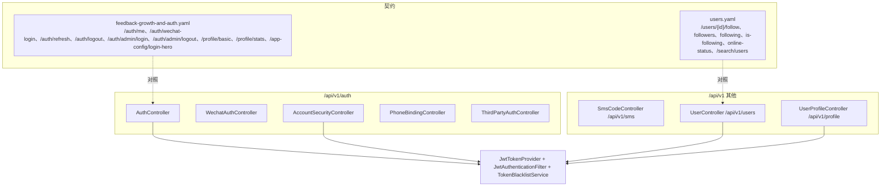
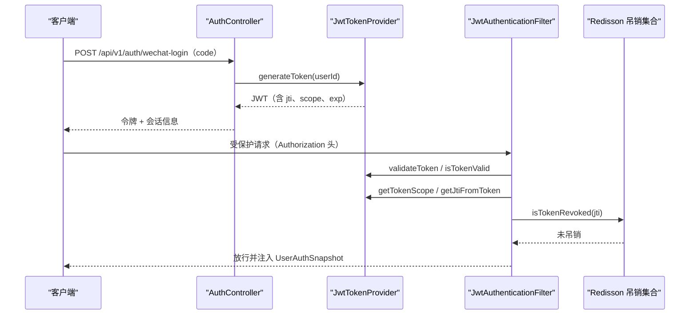
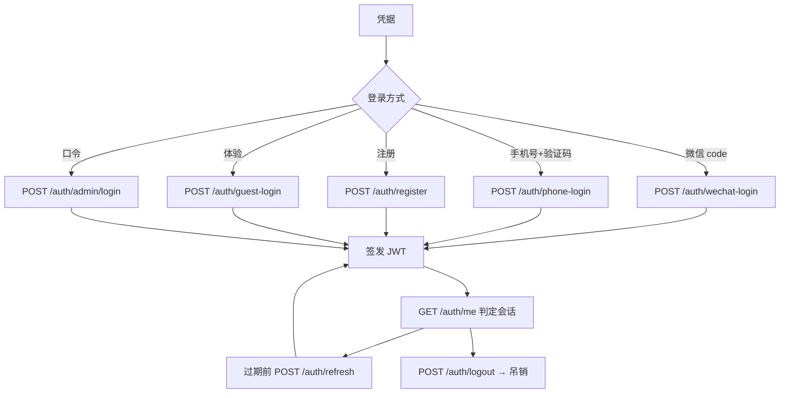
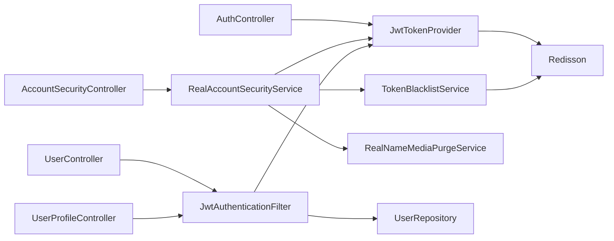

# 认证与用户API

<cite>
**本文引用的文件**
- [feedback-growth-and-auth.yaml](file://docs/openapi/feedback-growth-and-auth.yaml)
- [users.yaml](file://docs/openapi/users.yaml)
- [AuthController.java](file://apps/api/src/main/java/com/campuslove/api/auth/AuthController.java)
- [WechatAuthController.java](file://apps/api/src/main/java/com/campuslove/api/auth/WechatAuthController.java)
- [AccountSecurityController.java](file://apps/api/src/main/java/com/campuslove/api/auth/AccountSecurityController.java)
- [AccountSecurityService.java](file://apps/api/src/main/java/com/campuslove/api/auth/AccountSecurityService.java)
- [RealAccountSecurityService.java](file://apps/api/src/main/java/com/campuslove/api/auth/RealAccountSecurityService.java)
- [PhoneBindingController.java](file://apps/api/src/main/java/com/campuslove/api/auth/PhoneBindingController.java)
- [ThirdPartyAuthController.java](file://apps/api/src/main/java/com/campuslove/api/auth/ThirdPartyAuthController.java)
- [SmsCodeController.java](file://apps/api/src/main/java/com/campuslove/api/auth/SmsCodeController.java)
- [JwtTokenProvider.java](file://apps/api/src/main/java/com/campuslove/api/config/JwtTokenProvider.java)
- [JwtAuthenticationFilter.java](file://apps/api/src/main/java/com/campuslove/api/config/JwtAuthenticationFilter.java)
- [TokenBlacklistService.java](file://apps/api/src/main/java/com/campuslove/api/auth/TokenBlacklistService.java)
- [InvalidTokenException.java](file://apps/api/src/main/java/com/campuslove/api/auth/InvalidTokenException.java)
- [TokenRevokedException.java](file://apps/api/src/main/java/com/campuslove/api/auth/TokenRevokedException.java)
- [UserController.java](file://apps/api/src/main/java/com/campuslove/api/user/UserController.java)
- [UserProfileController.java](file://apps/api/src/main/java/com/campuslove/api/profile/UserProfileController.java)
- [AccountSecurityControllerTest.java](file://apps/api/src/test/java/com/campuslove/api/auth/AccountSecurityControllerTest.java)
- [RealAccountSecurityServiceTest.java](file://apps/api/src/test/java/com/campuslove/api/auth/RealAccountSecurityServiceTest.java)
- [JwtAuthenticationFilterTest.java](file://apps/api/src/test/java/com/campuslove/api/config/JwtAuthenticationFilterTest.java)
</cite>

## 目录
1. [简介](#简介)
2. [项目结构](#项目结构)
3. [核心组件](#核心组件)
4. [架构总览](#架构总览)
5. [认证端点清单](#认证端点清单)
6. [登录与刷新流程](#登录与刷新流程)
7. [令牌签发、范围与吊销](#令牌签发范围与吊销)
8. [账号安全端点详解](#账号安全端点详解)
9. [短信验证码与手机号绑定](#短信验证码与手机号绑定)
10. [第三方账号绑定端点](#第三方账号绑定端点)
11. [用户关系与在线状态端点](#用户关系与在线状态端点)
12. [契约与实现的差异](#契约与实现的差异)
13. [依赖关系分析](#依赖关系分析)
14. [性能考虑](#性能考虑)
15. [故障排查指南](#故障排查指南)
16. [结论](#结论)

## 简介
认证与用户 API 分布在两个命名空间下：`/api/v1/auth/**`（登录、会话、账号安全、第三方绑定）与
`/api/v1/users/**` + `/api/v1/profile/**`（关注关系、在线状态、资料读取），另有一个独立的
`/api/v1/sms/**` 负责验证码下发。

契约文件是 `docs/openapi/feedback-growth-and-auth.yaml`（2501 行，含 `auth` 与 `profile` 两组 tag）
和 `docs/openapi/users.yaml`（463 行，`users` tag）。本页同时以控制器实现为权威列出真实可达端点，
并在"契约与实现的差异"一节说明哪些实现端点尚未进入契约——这直接影响由契约自动生成客户端的完整性。

## 项目结构
`apps/api/src/main/java/com/campuslove/api/auth/` 是控制器集中地，六个控制器共用或派生两个前缀：

- `AuthController`（454 行，`@RequestMapping("/api/v1/auth")` L36）：主登录链路与查询当前会话。
- `WechatAuthController`（97 行，前缀 `/api/v1/auth` L42）：`POST /wechat`(L76)，与 AuthController 的
  `/wechat-login`(L162) 并存，属于两个入口。
- `AccountSecurityController`（194 行，前缀 `/api/v1/auth` L34）：改密、换绑手机、设备列表与吊销、注销账号。
- `PhoneBindingController`（253 行，前缀 `/api/v1/auth` L50）：`POST /phone/bind`(L92)。
- `ThirdPartyAuthController`（204 行，前缀 `/api/v1/auth/third-party` L49）：微信/Apple 绑定、查询绑定、解绑。
- `SmsCodeController`（89 行，前缀 `/api/v1/sms` L34）：`POST /send-code`(L54)。

令牌与鉴权机制在 `config/` 包：`JwtTokenProvider`（438 行）负责签发与解析，`JwtAuthenticationFilter`
（290 行）负责每个请求的身份还原。用户侧 `user/UserController`（169 行，前缀 `/api/v1/users` L36）
与 `profile/UserProfileController`（304 行，前缀 `/api/v1/profile` L34）承接关注关系与资料读取。

**图表来源**
- [AuthController.java:36-36](file://apps/api/src/main/java/com/campuslove/api/auth/AuthController.java#L36-L36)
- [AccountSecurityController.java:33-35](file://apps/api/src/main/java/com/campuslove/api/auth/AccountSecurityController.java#L33-L35)
- [ThirdPartyAuthController.java:49-49](file://apps/api/src/main/java/com/campuslove/api/auth/ThirdPartyAuthController.java#L49-L49)
- [SmsCodeController.java:34-34](file://apps/api/src/main/java/com/campuslove/api/auth/SmsCodeController.java#L34-L34)
- [UserController.java:36-36](file://apps/api/src/main/java/com/campuslove/api/user/UserController.java#L36-L36)
- [feedback-growth-and-auth.yaml:52-199](file://docs/openapi/feedback-growth-and-auth.yaml#L52-L199)
- [users.yaml:15-270](file://docs/openapi/users.yaml#L15-L270)

## 核心组件
- **AuthController**：`GET /me`(L73)、`POST /register`(L113)、`POST /phone-login`(L137)、
  `POST /guest-login`(L154)、`POST /wechat-login`(L162)、`POST /refresh`(L195)、`POST /logout`(L232)、
  `POST /admin/login`(L260)、`POST /admin/logout`(L357)。
- **AccountSecurityController**：`POST /change-password`(L57)、`POST /change-phone`(L80，方法 `changePhone` L84)、
  `GET /devices`(L95，方法 `listDevices` L98)、`POST /devices/{id}/revoke`(L112)、`POST /deactivate`(L133)；
  请求体类型在同文件内定义：`ChangePasswordRequest`(L163)、`ChangePhoneRequest`(L177)、
  `DeactivateRequest`(L190)。接口层是 `AccountSecurityService`(L10)，真实实现
  `RealAccountSecurityService`(L33)。
- **JwtTokenProvider**：`generateToken(String userId)`(L99)、`generateMediaToken(String userId)`(L128)、
  `getTokenScope(String token)`(L160)、`getJtiFromToken(String token)`(L185)、
  `getRemainingTtlSeconds(String token)`(L214)、`getUserIdFromToken(String token)`(L242)、
  `validateToken(String token)`(L265)、`isTokenValid(String token)`(L276)、
  `getExpirationFromToken(String token)`(L298)、`revokeToken(String token)`(L342)、
  `isTokenRevoked(String token)`(L362)、`cleanupExpiredRevokedTokens()`(L387)，
  并持有 `RedissonClient`(L78) 作为吊销状态的载体。
- **JwtAuthenticationFilter**：`UserAuthSnapshot`(L97) 是过滤器解析出的身份快照，
  `strictMediaQueryToken`(L115) 控制媒体查询令牌是否强制严格校验。
- **异常与错误码**：`InvalidTokenException`(L19，`getErrorCode()` L50) 与
  `TokenRevokedException`(L23，`getErrorCode()` L54) 各自携带错误码，供全局异常处理映射为响应。

**章节来源**
- [AuthController.java:36-453](file://apps/api/src/main/java/com/campuslove/api/auth/AuthController.java#L36-L453)
- [AccountSecurityController.java:33-190](file://apps/api/src/main/java/com/campuslove/api/auth/AccountSecurityController.java#L33-L190)
- [JwtTokenProvider.java:78-437](file://apps/api/src/main/java/com/campuslove/api/config/JwtTokenProvider.java#L78-L437)
- [JwtAuthenticationFilter.java:47-115](file://apps/api/src/main/java/com/campuslove/api/config/JwtAuthenticationFilter.java#L47-L115)
- [InvalidTokenException.java:19-50](file://apps/api/src/main/java/com/campuslove/api/auth/InvalidTokenException.java#L19-L50)
- [TokenRevokedException.java:23-54](file://apps/api/src/main/java/com/campuslove/api/auth/TokenRevokedException.java#L23-L54)

## 架构总览
一次微信登录到受保护调用的完整链路如下。令牌自签发起就带"范围"概念：普通访问令牌与媒体令牌由
不同方法签发，过滤器按范围决定是否放行。

**图表来源**
- [AuthController.java:162-194](file://apps/api/src/main/java/com/campuslove/api/auth/AuthController.java#L162-L194)
- [JwtTokenProvider.java:99-189](file://apps/api/src/main/java/com/campuslove/api/config/JwtTokenProvider.java#L99-L189)
- [JwtAuthenticationFilter.java:47-115](file://apps/api/src/main/java/com/campuslove/api/config/JwtAuthenticationFilter.java#L47-L115)

## 认证端点清单
实现侧（`/api/v1` 前缀省略）与契约侧的对应关系：

| 方法 | 路径 | 实现 | 契约 |
|---|---|---|---|
| GET | `/auth/me` | AuthController L73 | feedback-growth-and-auth.yaml L52-L72（`getCurrentSession`）|
| POST | `/auth/register` | AuthController L113 | 未声明 |
| POST | `/auth/phone-login` | AuthController L137 | 未声明 |
| POST | `/auth/guest-login` | AuthController L154 | 未声明 |
| POST | `/auth/wechat-login` | AuthController L162 | 同文件 L73-L104（`loginWithWechat`）|
| POST | `/auth/wechat` | WechatAuthController L76 | 未声明 |
| POST | `/auth/refresh` | AuthController L195 | 同文件 L105-L127（`refreshToken`）|
| POST | `/auth/logout` | AuthController L232 | 同文件 L128-L148（`logout`）|
| POST | `/auth/admin/login` | AuthController L260 | 同文件 L149-L176（`loginAsAdmin`）|
| POST | `/auth/admin/logout` | AuthController L357 | 同文件 L177-L199（`logoutAsAdmin`）|
| POST | `/auth/change-password` | AccountSecurityController L57 | 未声明 |
| POST | `/auth/change-phone` | AccountSecurityController L80 | 未声明 |
| GET | `/auth/devices` | AccountSecurityController L95 | 未声明 |
| POST | `/auth/devices/{id}/revoke` | AccountSecurityController L112 | 未声明 |
| POST | `/auth/deactivate` | AccountSecurityController L133 | 未声明 |
| POST | `/auth/phone/bind` | PhoneBindingController L92 | 未声明 |
| POST | `/auth/third-party/wechat` | ThirdPartyAuthController L69 | 未声明 |
| POST | `/auth/third-party/apple` | ThirdPartyAuthController L84 | 未声明 |
| GET | `/auth/third-party/bindings` | ThirdPartyAuthController L95 | 未声明 |
| POST | `/auth/third-party/bind` | ThirdPartyAuthController L112 | 未声明 |
| DELETE | `/auth/third-party/unbind` | ThirdPartyAuthController L130 | 未声明 |
| POST | `/sms/send-code` | SmsCodeController L54 | 未声明 |
| GET | `/profile/basic` | ProfileController/UserProfileController 前缀 `/api/v1/profile` | feedback-growth-and-auth.yaml L219-L230（`getBasicProfile`）|
| GET | `/profile/stats` | 同上 | 同文件 L200-L218（`getProfileStats`）|
| GET | `/app-config/login-hero` | growth/AppConfigController L24 | 同文件 L33-L51（`getLoginHeroConfig`，tag `home`）|

用户关系端点（`users.yaml` 有完整契约）见"用户关系与在线状态端点"。

**章节来源**
- [AuthController.java:73-453](file://apps/api/src/main/java/com/campuslove/api/auth/AuthController.java#L73-L453)
- [WechatAuthController.java:42-96](file://apps/api/src/main/java/com/campuslove/api/auth/WechatAuthController.java#L42-L96)
- [AccountSecurityController.java:57-190](file://apps/api/src/main/java/com/campuslove/api/auth/AccountSecurityController.java#L57-L190)
- [ThirdPartyAuthController.java:49-203](file://apps/api/src/main/java/com/campuslove/api/auth/ThirdPartyAuthController.java#L49-L203)
- [SmsCodeController.java:34-88](file://apps/api/src/main/java/com/campuslove/api/auth/SmsCodeController.java#L34-L88)
- [feedback-growth-and-auth.yaml:33-230](file://docs/openapi/feedback-growth-and-auth.yaml#L33-L230)

## 登录与刷新流程
- **`GET /auth/me`（L73）**：契约 `getCurrentSession`（L52-L72）。它是客户端判断"现在是不是登录态"的唯一
  权威接口，其余页面只应据此跳转，而不是自行解析本地令牌。
- **`POST /auth/wechat-login`（L162）**：契约 `loginWithWechat`（L73-L104，summary 明确是"Exchange a
  WeChat login code for a session"）。另有 `WechatAuthController` 的 `POST /wechat`（L76）提供同一类交换，
  两个入口并存，客户端必须选定一个，否则会出现同一 code 走不同校验分支的排查困难。
- **`POST /auth/phone-login`（L137）** 与 **`POST /auth/register`（L113）**：手机号口令链路，配合
  `/api/v1/sms/send-code`（L54）的验证码；两者都未进入契约。
- **`POST /auth/guest-login`（L154）**：体验账号入口。
- **`POST /auth/refresh`（L195）**：契约 `refreshToken`（L105-L127）。刷新得到的新令牌取代旧令牌，
  旧令牌是否立即失效取决于是否调用吊销（见下一节）。
- **`POST /auth/logout`（L232）**：契约 `logout`（L128-L148）。
- **`POST /auth/admin/login`（L260）与 `/admin/logout`（L357）**：后台口令登录，契约分别是
  `loginAsAdmin`（L149-L176）与 `logoutAsAdmin`（L177-L199）。管理员口令来自 `users.password` 的
  BCrypt 哈希（表结构见 `数据库设计与迁移/核心表结构设计/用户相关表`）。

[此图为概念流程，不直接对应具体源文件，故不提供图表来源]

**章节来源**
- [AuthController.java:113-357](file://apps/api/src/main/java/com/campuslove/api/auth/AuthController.java#L113-L357)
- [feedback-growth-and-auth.yaml:52-199](file://docs/openapi/feedback-growth-and-auth.yaml#L52-L199)

## 令牌签发、范围与吊销
`JwtTokenProvider` 把"签发"和"解释"分成成对方法：

- 签发：`generateToken(userId)`(L99) 与 `generateMediaToken(userId)`(L128)。两者区分说明媒体访问
  有独立令牌，而不是复用访问令牌。
- 解释：`getTokenScope(token)`(L160) 读范围、`getJtiFromToken(token)`(L185) 读令牌唯一标识、
  `getUserIdFromToken(token)`(L242) 读主体、`getExpirationFromToken(token)`(L298) 读过期、
  `getRemainingTtlSeconds(token)`(L214) 读剩余寿命；有效性判断有 `validateToken`(L265) 与
  `isTokenValid`(L276) 两个入口。
- 吊销：`revokeToken(token)`(L342) 写入吊销状态、`isTokenRevoked(token)`(L362) 查询、
  `cleanupExpiredRevokedTokens()`(L387) 清理已过期的吊销记录（避免集合无限增长）。
  吊销状态经 `RedissonClient`(L78) 承载，`TokenBlacklistService`(L29) 是其服务化封装；
  过滤器侧对吊销令牌抛 `TokenRevokedException`(L23，`getErrorCode()` L54)，
  对格式/签名无效令牌抛 `InvalidTokenException`(L19，`getErrorCode()` L50)。
- 严格模式：`JwtAuthenticationFilter.strictMediaQueryToken`(L115) 是一个布尔开关，
  决定媒体查询是否必须携带媒体范围令牌。

`jti` 的存在意味着吊销是按"单次签发"粒度生效，而不是按用户粒度把整个账号踢出。

**章节来源**
- [JwtTokenProvider.java:99-437](file://apps/api/src/main/java/com/campuslove/api/config/JwtTokenProvider.java#L99-L437)
- [TokenBlacklistService.java:29-54](file://apps/api/src/main/java/com/campuslove/api/auth/TokenBlacklistService.java#L29-L54)
- [JwtAuthenticationFilter.java:97-115](file://apps/api/src/main/java/com/campuslove/api/config/JwtAuthenticationFilter.java#L97-L115)
- [TokenRevokedException.java:23-54](file://apps/api/src/main/java/com/campuslove/api/auth/TokenRevokedException.java#L23-L54)
- [InvalidTokenException.java:19-50](file://apps/api/src/main/java/com/campuslove/api/auth/InvalidTokenException.java#L19-L50)

## 账号安全端点详解
五个端点全部挂在 `/api/v1/auth` 下，且都要求已登录：

- **`POST /change-password`（L57）** → `RealAccountSecurityService.changePassword(Long userId, String oldPassword,
  String newPassword, String currentToken)`(L86)。签名里带 `currentToken`，说明改密成功后要处理"当前令牌"，
  即改密与令牌吊销是一件事的两半。
- **`POST /change-phone`（L80）** → 方法 `changePhone(@Valid @RequestBody ChangePhoneRequest request)`(L84)，
  服务实现 `changePhone(Long userId, String password, String newPhone)`(L122)：换绑手机号必须再次验证口令。
- **`GET /devices`（L95）** → `listDevices()`(L98)，返回设备会话列表。
- **`POST /devices/{id}/revoke`（L112）**：按设备 ID 吊销某个会话，是"踢设备"的能力，
  与账号级 `deactivate` 不同层级。
- **`POST /deactivate`（L133）** → `deactivateAccount(Long userId, String password, String confirmationText,
  String currentToken)`(L169)：同时要求口令与确认文本，并要求当前令牌，属于不可逆操作的多重确认。
  该服务还持有 `RealNameMediaPurgeService`(L58)，说明注销会牵连实名媒体清理。

可测性由三个测试文件保证：`AccountSecurityControllerTest`（102 行，L27 直接持有 controller）、
`RealAccountSecurityServiceTest`（223 行，依赖 `UserRepository`(L39)、`PasswordEncoder`(L40)、
`DeviceSessionService`(L41)、`TokenBlacklistService`(L42)、`JwtTokenProvider`(L43)、`AesEncryptor`(L44)）、
`JwtAuthenticationFilterTest`（349 行，L53-L70 列出过滤器的全部依赖）。
`AesEncryptor` 出现在换绑/注销链路依赖中，说明手机号等敏感字段在库里是加密存储的。

**章节来源**
- [AccountSecurityController.java:57-190](file://apps/api/src/main/java/com/campuslove/api/auth/AccountSecurityController.java#L57-L190)
- [AccountSecurityService.java:10-52](file://apps/api/src/main/java/com/campuslove/api/auth/AccountSecurityService.java#L10-L52)
- [RealAccountSecurityService.java:32-169](file://apps/api/src/main/java/com/campuslove/api/auth/RealAccountSecurityService.java#L32-L169)
- [RealAccountSecurityServiceTest.java:37-45](file://apps/api/src/test/java/com/campuslove/api/auth/RealAccountSecurityServiceTest.java#L37-L45)
- [AccountSecurityControllerTest.java:22-27](file://apps/api/src/test/java/com/campuslove/api/auth/AccountSecurityControllerTest.java#L22-L27)

## 短信验证码与手机号绑定
- `SmsCodeController` 前缀 `/api/v1/sms`（L34），唯一端点 `POST /send-code`（L54）。
  它与 `phone-login`(AuthController L137) 与 `PhoneBindingController` 的 `POST /phone/bind`(L92) 配合使用。
- 手机号绑定与更换是两条不同链路：`/auth/phone/bind` 是"把手机号绑到账号"，
  `/auth/change-phone` 是"在已绑定前提下换号并要求旧口令"（`changePhone(userId, password, newPhone)` L122）。
  调用顺序错了会表现为"明明有验证码却报未绑定"或"改号要求口令"。

**章节来源**
- [SmsCodeController.java:34-88](file://apps/api/src/main/java/com/campuslove/api/auth/SmsCodeController.java#L34-L88)
- [PhoneBindingController.java:50-92](file://apps/api/src/main/java/com/campuslove/api/auth/PhoneBindingController.java#L50-L92)
- [RealAccountSecurityService.java:122-168](file://apps/api/src/main/java/com/campuslove/api/auth/RealAccountSecurityService.java#L122-L168)

## 第三方账号绑定端点
`ThirdPartyAuthController` 前缀 `/api/v1/auth/third-party`（L49），五个端点构成完整闭环：

- `POST /wechat`(L69)：用微信凭据建立第三方绑定；
- `POST /apple`(L84)：Apple 登录绑定；
- `GET /bindings`(L95)：查询当前账号已绑定的第三方；
- `POST /bind`(L112)：通用绑定入口；
- `DELETE /unbind`(L130)：解绑。

这组端点与 `AuthController` 的 `/wechat-login` 语义不同：前者是**账号关联**，后者是**用已有身份换会话**。
把两者混用是这类系统最常见的登录 bug 来源（先绑定却期望登录，或先登录导致重复绑定）。

**章节来源**
- [ThirdPartyAuthController.java:49-203](file://apps/api/src/main/java/com/campuslove/api/auth/ThirdPartyAuthController.java#L49-L203)

## 用户关系与在线状态端点
`UserController`（前缀 `/api/v1/users` L36）七个端点与 `users.yaml` 一一对应：

| 方法 | 路径 | 实现 | 契约 operationId |
|---|---|---|---|
| POST | `/users/{id}/follow` | L55 | `followUser`（users.yaml L15-L54）|
| DELETE | `/users/{id}/follow` | L70 | `unfollowUser`（L55-L91）|
| GET | `/users/{id}/followers` | L87 | `getFollowers`（L92-L123）|
| GET | `/users/{id}/following` | L104 | `getFollowing`（L124-L155）|
| GET | `/users/{id}/is-following` | L119 | `isFollowing`（L156-L187）|
| GET | `/users/{userId}/online-status` | L135 | `getOnlineStatus`（L188-L222）|
| POST | `/users/online-status/batch` | L147 | `batchGetOnlineStatus`（L223-L266）|

契约的写法值得注意：关注与取关是同一 path 下的两个操作（POST 与 DELETE），
而在线状态同时提供单个 `GET` 与批量 `POST`——批量端点用请求体传 ID 列表，
因此它不是"多次单个调用的替代语法糖"，而是列表页必须的优化路径（见性能考虑）。
搜索端点 `GET /search/users`（契约 L267-L270，`searchUsers`，summary 为
"Search users by nickname / campus"）说明搜索维度是昵称与校区。

资料读取走 `UserProfileController`（前缀 `/api/v1/profile` L34）：`GET /me`(L63) 取自己的资料，
`GET /{userId}`(L72) 取他人资料——两者路径不同，权限语义也不同。

**章节来源**
- [UserController.java:36-168](file://apps/api/src/main/java/com/campuslove/api/user/UserController.java#L36-L168)
- [users.yaml:15-270](file://docs/openapi/users.yaml#L15-L270)
- [UserProfileController.java:34-72](file://apps/api/src/main/java/com/campuslove/api/profile/UserProfileController.java#L34-L72)

## 契约与实现的差异
以下差异是逐条在 `docs/openapi/` 全部契约文件中检索路径后得出的（搜索范围为
`feedback-growth-and-auth.yaml`、`users.yaml` 等 9 个文件）：

- **实现有、契约无**：`/auth/register`、`/auth/phone-login`、`/auth/guest-login`、
  `/auth/wechat`（WechatAuthController 版本）、`/auth/change-password`、`/auth/change-phone`、
  `/auth/devices`、`/auth/devices/{id}/revoke`、`/auth/deactivate`、`/auth/phone/bind`、
  `/auth/third-party/*`（5 个）、`/sms/send-code`。也就是说**整个账号安全与第三方绑定面在契约中缺席**。
- **契约有、实现前缀不同**：契约路径写作 `/auth/me`、`/users/{id}/follow`，而实现挂载在
  `/api/v1` 前缀下。若客户端按契约字符串直接拼接，会得到 404。
- **重复入口未标注**：微信登录有两个实现入口（`/auth/wechat-login` 与 `/auth/wechat`），
  契约只描述前者，选错入口的风险由调用方承担。

影响面是：`docs/openapi` 目前不能作为"能力全集"使用，只能作为部分端点的详细参数说明。
补齐位置是 `feedback-growth-and-auth.yaml`（auth/profile 组）与新增短信/账号安全契约段。

**章节来源**
- [feedback-growth-and-auth.yaml:52-230](file://docs/openapi/feedback-growth-and-auth.yaml#L52-L230)
- [users.yaml:15-270](file://docs/openapi/users.yaml#L15-L270)
- [AccountSecurityController.java:57-133](file://apps/api/src/main/java/com/campuslove/api/auth/AccountSecurityController.java#L57-L133)
- [AuthController.java:113-161](file://apps/api/src/main/java/com/campuslove/api/auth/AuthController.java#L113-L161)

## 依赖关系分析
- 控制器 → 机制：`AuthController` 与 `AccountSecurityController` 都依赖 `JwtTokenProvider`；
  吊销链路是 `revokeToken` → `TokenBlacklistService` → Redisson（`RedissonClient` 字段 L78）。
- 过滤器是唯一的身份注入点：`JwtAuthenticationFilter` 产出 `UserAuthSnapshot`(L97)，
  下游控制器因此不需要自己解析令牌。
- 账号安全 → 业务侧连带：`RealAccountSecurityService` 注入 `RealNameMediaPurgeService`(L58)，
  说明注销账号会牵动实名媒体数据；这条依赖是"注销不可逆"的实现根据。
- 用户关系 → 会话：在线状态端点（`/users/{userId}/online-status`、批量版）与
  `OnlineUserService` 的在线记录同源于登录事件（`recordLogin` / `removeLogin`），
  因此登录链路的正确性直接决定在线状态显示是否可信。

**图表来源**
- [JwtAuthenticationFilterTest.java:50-70](file://apps/api/src/test/java/com/campuslove/api/config/JwtAuthenticationFilterTest.java#L50-L70)
- [RealAccountSecurityService.java:32-58](file://apps/api/src/main/java/com/campuslove/api/auth/RealAccountSecurityService.java#L32-L58)
- [JwtTokenProvider.java:78-78](file://apps/api/src/main/java/com/campuslove/api/config/JwtTokenProvider.java#L78-L78)

**章节来源**
- [JwtAuthenticationFilter.java:47-97](file://apps/api/src/main/java/com/campuslove/api/config/JwtAuthenticationFilter.java#L47-L97)
- [RealAccountSecurityServiceTest.java:37-45](file://apps/api/src/test/java/com/campuslove/api/auth/RealAccountSecurityServiceTest.java#L37-L45)

## 性能考虑
- **在线状态用批量端点**：`POST /users/online-status/batch`(L147，契约 L223-L266) 就是为列表页设计的；
  逐个调 `GET /users/{userId}/online-status`(L135) 会把一个 20 条的列表变成 20 次往返。
- **吊销集合需要清理**：`cleanupExpiredRevokedTokens()`(L387) 的必要性在于吊销集合按 `jti` 累积；
  若不调用，Redis 侧会随登出次数线性增长。
- **媒体令牌独立签发**：`generateMediaToken`(L128) 与主令牌分开签发，
  媒体访问不必携带主访问令牌，配合 `strictMediaQueryToken`(L115) 可把媒体域的
  校验成本与主域隔离。
- **剩余 TTL 可预判**：`getRemainingTtlSeconds(token)`(L214) 让客户端可以在过期前主动刷新，
  而不是等 401 后再刷新，减少一次失败往返。

**章节来源**
- [UserController.java:135-168](file://apps/api/src/main/java/com/campuslove/api/user/UserController.java#L135-L168)
- [users.yaml:188-266](file://docs/openapi/users.yaml#L188-L266)
- [JwtTokenProvider.java:128-214](file://apps/api/src/main/java/com/campuslove/api/config/JwtTokenProvider.java#L128-L214)

## 故障排查指南
- **401 但令牌格式正确**：区分两类异常——`InvalidTokenException`(L19) 表示签名/结构无效，
  `TokenRevokedException`(L23) 表示令牌被吊销（登出、改密、踢设备都会触发）。
  两者都带 `getErrorCode()`(L50 / L54)，先看错误码再猜原因。
- **改密后其他端立刻失效**：`changePassword` 的签名包含 `currentToken`(L86)，属预期行为；
  如果希望保留其他设备会话，需要检查设备级吊销逻辑（`/devices/{id}/revoke` L112）是否被顺带触发。
- **按契约拼出的路径 404**：契约里是 `/auth/me`，实现是 `/api/v1/auth/me`；
  `/users/{id}/follow` 同理。先补前缀再排查控制器。
- **微信登录走了错入口**：`/auth/wechat-login`（AuthController L162）与 `/auth/wechat`
  （WechatAuthController L76）是两个端点；绑定用的 `/auth/third-party/wechat`（L69）又是第三个。
  三者混用会产生"绑定成功但没会话""有会话但重复绑定"两类现象。
- **换手机号总是被要求输口令**：那是 `/auth/change-phone`（L80）的语义，
  首次绑定应走 `/auth/phone/bind`（L92）。
- **列表页在线状态慢**：检查是否误用单个 `GET`（L135）而不是 `POST /users/online-status/batch`（L147）。

**章节来源**
- [InvalidTokenException.java:19-50](file://apps/api/src/main/java/com/campuslove/api/auth/InvalidTokenException.java#L19-L50)
- [TokenRevokedException.java:23-54](file://apps/api/src/main/java/com/campuslove/api/auth/TokenRevokedException.java#L23-L54)
- [RealAccountSecurityService.java:86-168](file://apps/api/src/main/java/com/campuslove/api/auth/RealAccountSecurityService.java#L86-L168)
- [WechatAuthController.java:42-96](file://apps/api/src/main/java/com/campuslove/api/auth/WechatAuthController.java#L42-L96)

## 结论
认证面由六个 `/api/v1/auth` 控制器加一个 `/api/v1/sms` 控制器组成，共 24 个可达端点；
用户关系面由 `UserController` 的 7 个端点与 `UserProfileController` 的 2 个读取端点承担。
令牌体系有三个关键设计：签发时区分访问与媒体范围（`generateToken` / `generateMediaToken`）、
按 `jti` 粒度吊销并经 Redis 承载、把剩余 TTL 暴露给调用方以便主动刷新。
账号安全的四个敏感操作（改密、换号、踢设备、注销）都要求二次凭据（旧口令或确认文本），
并通过 `currentToken` 参数把"操作成功"与"当前会话失效"绑定在一起。

最需要修的是契约覆盖：`docs/openapi` 只声明了 6 个 auth 端点与全部 users 端点，
账号安全、第三方绑定、短信、注册、手机号登录、体验登录全部缺席，
且契约路径不带 `/api/v1` 前缀。以契约为准生成的客户端因此缺能力、且默认拼错前缀。
