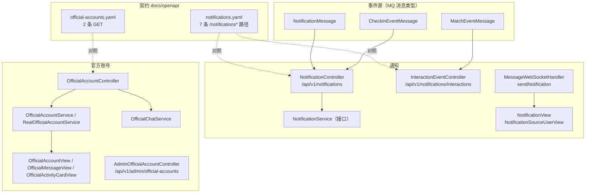
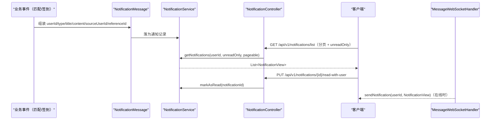
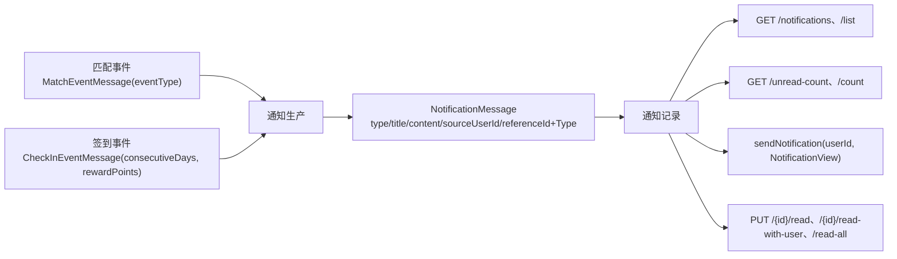

# 通知与官方账号API

<cite>
**本文引用的文件**
- [notifications.yaml](file://docs/openapi/notifications.yaml)
- [official-accounts.yaml](file://docs/openapi/official-accounts.yaml)
- [NotificationController.java](file://apps/api/src/main/java/com/campuslove/api/chat/NotificationController.java)
- [InteractionEventController.java](file://apps/api/src/main/java/com/campuslove/api/chat/InteractionEventController.java)
- [NotificationService.java](file://apps/api/src/main/java/com/campuslove/api/chat/NotificationService.java)
- [NotificationView.java](file://apps/api/src/main/java/com/campuslove/api/chat/NotificationView.java)
- [NotificationSourceUserView.java](file://apps/api/src/main/java/com/campuslove/api/chat/NotificationSourceUserView.java)
- [MessageWebSocketHandler.java](file://apps/api/src/main/java/com/campuslove/api/chat/MessageWebSocketHandler.java)
- [OfficialAccountController.java](file://apps/api/src/main/java/com/campuslove/api/official/OfficialAccountController.java)
- [OfficialAccountService.java](file://apps/api/src/main/java/com/campuslove/api/official/OfficialAccountService.java)
- [RealOfficialAccountService.java](file://apps/api/src/main/java/com/campuslove/api/official/RealOfficialAccountService.java)
- [OfficialChatService.java](file://apps/api/src/main/java/com/campuslove/api/official/OfficialChatService.java)
- [OfficialAccountView.java](file://apps/api/src/main/java/com/campuslove/api/official/OfficialAccountView.java)
- [OfficialMessageView.java](file://apps/api/src/main/java/com/campuslove/api/official/OfficialMessageView.java)
- [OfficialActivityCardView.java](file://apps/api/src/main/java/com/campuslove/api/official/OfficialActivityCardView.java)
- [AdminOfficialAccountController.java](file://apps/api/src/main/java/com/campuslove/api/admin/AdminOfficialAccountController.java)
- [SecurityConfig.java](file://apps/api/src/main/java/com/campuslove/api/config/SecurityConfig.java)
- [NotificationMessage.java](file://apps/api/src/main/java/com/campuslove/api/mq/NotificationMessage.java)
- [MatchEventMessage.java](file://apps/api/src/main/java/com/campuslove/api/mq/MatchEventMessage.java)
- [CheckInEventMessage.java](file://apps/api/src/main/java/com/campuslove/api/mq/CheckInEventMessage.java)
</cite>

## 目录
1. [简介](#简介)
2. [项目结构](#项目结构)
3. [核心组件](#核心组件)
4. [架构总览](#架构总览)
5. [通知端点清单](#通知端点清单)
6. [分页、筛选与两个计数端点](#分页筛选与两个计数端点)
7. [已读标记的三个层次](#已读标记的三个层次)
8. [互动事件端点](#互动事件端点)
9. [通知的生产与推送链路](#通知的生产与推送链路)
10. [官方账号端点清单](#官方账号端点清单)
11. [官方账号消息流](#官方账号消息流)
12. [后台侧官方账号管理](#后台侧官方账号管理)
13. [契约与实现的差异](#契约与实现的差异)
14. [依赖关系分析](#依赖关系分析)
15. [性能考虑](#性能考虑)
16. [故障排查指南](#故障排查指南)
17. [结论](#结论)

## 简介
本页覆盖两组读多写少的接口：

- **通知**：`/api/v1/notifications`（`NotificationController`，127 行，7 个映射）与其子资源
  `/api/v1/notifications/interactions`（`InteractionEventController`，109 行，4 个映射）。
  契约在 `docs/openapi/notifications.yaml`（337 行），声明了通知侧全部 7 条路径。
- **官方账号**：`/api/v1/official-accounts`（`OfficialAccountController`，118 行，3 个映射）
  与后台侧 `/api/v1/admin/official-accounts`（`AdminOfficialAccountController`，66 行，2 个映射）。
  契约在 `docs/openapi/official-accounts.yaml`（198 行），只声明了两条 GET。

通知域有意思的地方在于"计数与列表都被做了两套"，以及"标记已读有三个粒度"；
官方账号域的关键在于 `code`——官方账号以业务编码而不是数字 ID 寻址。

## 项目结构

**图表来源**
- [notifications.yaml:15-209](file://docs/openapi/notifications.yaml#L15-L209)
- [official-accounts.yaml:18-59](file://docs/openapi/official-accounts.yaml#L18-L59)
- [NotificationController.java:26-40](file://apps/api/src/main/java/com/campuslove/api/chat/NotificationController.java#L26-L40)
- [InteractionEventController.java:25-43](file://apps/api/src/main/java/com/campuslove/api/chat/InteractionEventController.java#L25-L43)
- [OfficialAccountController.java:30-49](file://apps/api/src/main/java/com/campuslove/api/official/OfficialAccountController.java#L30-L49)

## 核心组件
- **NotificationController**：`GET /`(L40)、`PUT /{id}/read`(L53)、`GET /unread-count`(L64)、
  `GET /list`(L81)、`GET /count`(L100)、`PUT /{id}/read-with-user`(L110)、`PUT /read-all`(L121)。
- **InteractionEventController**：`GET /`(L43)、`GET /unread-count`(L62)、
  `PUT /{eventId}/read`(L80)、`PUT /read-all`(L98)。
- **NotificationService**（接口，L12）四个能力签名：
  `List<NotificationView> getNotifications(Long userId)`(L20)、
  `void markAsRead(Long notificationId)`(L27)、
  `List<NotificationView> getNotifications(Long userId, Boolean unreadOnly, Pageable pageable)`(L47)、
  `List<NotificationView> getNotifications(Long userId, Boolean unreadOnly, String signalType, Pageable pageable)`(L59)。
- **OfficialAccountController**（类声明 L32）：`GET /`(L49)、`GET /{code}/messages`(L62)、
  `POST /{code}/messages`(L87)。
- **AdminOfficialAccountController**：前缀 `/api/v1/admin/official-accounts`(L29)，
  `GET /`(L46)、`GET /{code}/messages`(L58)。
- **视图类型**：`NotificationView`（17 行，L7）、`NotificationSourceUserView`（9 行，L6）、
  `OfficialAccountView`（13 行）、`OfficialMessageView`（48 行）、`OfficialActivityCardView`（15 行）。
- **MQ 消息类型**：`NotificationMessage`（169 行）、`MatchEventMessage`（94 行）、
  `CheckInEventMessage`（93 行）。

**章节来源**
- [NotificationController.java:26-127](file://apps/api/src/main/java/com/campuslove/api/chat/NotificationController.java#L26-L127)
- [InteractionEventController.java:25-109](file://apps/api/src/main/java/com/campuslove/api/chat/InteractionEventController.java#L25-L109)
- [NotificationService.java:12-59](file://apps/api/src/main/java/com/campuslove/api/chat/NotificationService.java#L12-L59)
- [OfficialAccountController.java:30-87](file://apps/api/src/main/java/com/campuslove/api/official/OfficialAccountController.java#L30-L87)
- [AdminOfficialAccountController.java:29-58](file://apps/api/src/main/java/com/campuslove/api/admin/AdminOfficialAccountController.java#L29-L58)
- [NotificationView.java:7-17](file://apps/api/src/main/java/com/campuslove/api/chat/NotificationView.java#L7-L17)

## 架构总览
通知不是"直接写表然后查"，而是"事件 → 消息 → 通知记录 → 拉取或推送"四步。
官方账号则相反，是一条纯读的列表—详情链，另有一个发送端点。

**图表来源**
- [NotificationMessage.java:29-55](file://apps/api/src/main/java/com/campuslove/api/mq/NotificationMessage.java#L29-L55)
- [NotificationService.java:20-47](file://apps/api/src/main/java/com/campuslove/api/chat/NotificationService.java#L20-L47)
- [NotificationController.java:81-110](file://apps/api/src/main/java/com/campuslove/api/chat/NotificationController.java#L81-L110)
- [MessageWebSocketHandler.java:419-436](file://apps/api/src/main/java/com/campuslove/api/chat/MessageWebSocketHandler.java#L419-L436)

## 通知端点清单
| 方法 | 路径 | 实现 | 契约 operationId / summary |
|---|---|---|---|
| GET | `/notifications` | L40 | `getNotifications`（L15-L46，"Get notification list for current user"）|
| GET | `/notifications/list` | L81 | `getNotificationsPaged`（L47-L104，"Get paged notification list with filters"）|
| GET | `/notifications/count` | L100 | `getUnreadNotificationCountLong`（L105-L126，"Get unread notification count (long)"）|
| GET | `/notifications/unread-count` | L64 | `getUnreadNotificationCount`（L127-L147）|
| PUT | `/notifications/{id}/read` | L53 | `markNotificationRead`（L148-L174）|
| PUT | `/notifications/{id}/read-with-user` | L110 | `markNotificationReadWithUser`（L175-L203，"…with user verification"）|
| PUT | `/notifications/read-all` | L121 | `markAllNotificationsRead`（L204-L215）|

契约里还留了通知文案的样子：示例 summary 写作 `'小明赞了你的帖子'`（L42），
即"主体 + 动作"的短句，而不是模板 ID——这对客户端是直接展示的文本，不做二次拼装。

**章节来源**
- [notifications.yaml:15-215](file://docs/openapi/notifications.yaml#L15-L215)
- [NotificationController.java:40-121](file://apps/api/src/main/java/com/campuslove/api/chat/NotificationController.java#L40-L121)

## 分页、筛选与两个计数端点
- **两个列表入口**：`GET /notifications`(L40) 对应无参版
  `getNotifications(Long userId)`(接口 L20)，返回该用户全部通知；
  `GET /notifications/list`(L81) 对应对应带 `unreadOnly` 与 `Pageable` 的重载（L47），
  契约 summary 明确 "with filters"（L50）。还有一个更宽的重载接受 `signalType`
  （L59），即"按心动信号类型筛选"这一维度存在于服务接口层。
- **两个计数入口**：`GET /notifications/unread-count`(L64) 契约 summary 为
  "Get unread notification count"（L130）；`GET /notifications/count`(L100) 契约 operationId 是
  `getUnreadNotificationCountLong`，summary 为 "Get unread notification count (long)"（L108）。
  两者语义相同、返回类型不同（`long` 与常规计数），属于兼容保留；
  新代码不应再引入第三种计数口径。
- 互动事件侧同样有 `GET /unread-count`(InteractionEventController L62)，
  它与通知的未读数**互不包含**，客户端角标必须相加。

**章节来源**
- [NotificationController.java:40-100](file://apps/api/src/main/java/com/campuslove/api/chat/NotificationController.java#L40-L100)
- [NotificationService.java:20-59](file://apps/api/src/main/java/com/campuslove/api/chat/NotificationService.java#L20-L59)
- [notifications.yaml:47-147](file://docs/openapi/notifications.yaml#L47-L147)
- [InteractionEventController.java:62-62](file://apps/api/src/main/java/com/campuslove/api/chat/InteractionEventController.java#L62-L62)

## 已读标记的三个层次
1. **单条、不带校验**：`PUT /notifications/{id}/read`(L53)，落到
   `markAsRead(Long notificationId)`(接口 L27)。
2. **单条、带用户校验**：`PUT /notifications/{id}/read-with-user`(L110)，契约 summary
   "Mark a notification as read **with user verification**"（L178）。这一层多了一道
   "该通知确属当前用户"的核对，客户端在共享设备/多账号场景应优先使用它。
3. **全量**：`PUT /notifications/read-all`(L121)，`markAllNotificationsRead`（契约 L209）。

互动事件是第四套独立入口：`PUT /notifications/interactions/{eventId}/read`(L80) 与
`PUT /notifications/interactions/read-all`(L98)。
它们与通知的已读互不影响——只调 `read-all` 清不掉互动事件的红点。

`sourceUserId` 字段（`NotificationMessage` L49）解释了 `read-with-user` 为什么需要"with user"：
通知携带来源用户，视图侧还有 `NotificationSourceUserView`（9 行，L6）专门承载来源用户信息，
因此"按来源用户核对"是有数据支撑的操作，不是形式化参数。

**章节来源**
- [NotificationController.java:53-121](file://apps/api/src/main/java/com/campuslove/api/chat/NotificationController.java#L53-L121)
- [notifications.yaml:148-215](file://docs/openapi/notifications.yaml#L148-L215)
- [InteractionEventController.java:80-98](file://apps/api/src/main/java/com/campuslove/api/chat/InteractionEventController.java#L80-L98)
- [NotificationMessage.java:49-49](file://apps/api/src/main/java/com/campuslove/api/mq/NotificationMessage.java#L49-L49)
- [NotificationSourceUserView.java:6-9](file://apps/api/src/main/java/com/campuslove/api/chat/NotificationSourceUserView.java#L6-L9)

## 互动事件端点
`InteractionEventController`（前缀 `/api/v1/notifications/interactions`，L25）表达的是
"别人对我做了什么"这一类事件，而不是系统播报：

- `GET /`(L43)：事件列表。
- `GET /unread-count`(L62)：未读事件数。
- `PUT /{eventId}/read`(L80)：单条已读。
- `PUT /read-all`(L98)：全部已读。

它与通知共用前缀层级，因而客户端拼路径时容易漏掉 `interactions` 段而打到通知控制器上，
表现为"事件列表拿回通知列表"。**这组端点在 `docs/openapi` 中没有任何契约**，
参数只能从实现推导（见"契约与实现的差异"）。

**章节来源**
- [InteractionEventController.java:25-109](file://apps/api/src/main/java/com/campuslove/api/chat/InteractionEventController.java#L25-L109)

## 通知的生产与推送链路
通知的数据形状由 `NotificationMessage`（169 行）定义，字段即语义：
`userId`(L34) 接收人、`type`(L37) 通知类型、`title`(L40) 与 `content`(L43) 文案、
`createdAt`(L46) 时间、`sourceUserId`(L49) 触发人、
`referenceId`(L52) + `referenceType`(L55) 指向被操作对象（帖子、评论、活动…）。
文案与引用分离，使通知可以直接显示文本，同时保留跳转目标。

上游事件各有专用消息类型：
- `MatchEventMessage`（94 行）：`userId`(L26)、`targetUserId`(L29)、`eventType`(L32)、`createdAt`(L35)
  ——匹配类事件（如互相喜欢）走这一路，对应互动事件列表。
- `CheckInEventMessage`（93 行）：`userId`(L25)、`consecutiveDays`(L28)、`rewardPoints`(L31)、
  `createdAt`(L34)——签到连续天数与奖励积分，对应成长类通知。

在线用户的即时推送出口是 `MessageWebSocketHandler.sendNotification(String userId,
NotificationView notificationView)`(L419)：它只负责"送达"，落库仍由通知服务完成。

**图表来源**
- [NotificationMessage.java:29-55](file://apps/api/src/main/java/com/campuslove/api/mq/NotificationMessage.java#L29-L55)
- [MatchEventMessage.java:21-35](file://apps/api/src/main/java/com/campuslove/api/mq/MatchEventMessage.java#L21-L35)
- [CheckInEventMessage.java:20-34](file://apps/api/src/main/java/com/campuslove/api/mq/CheckInEventMessage.java#L20-L34)
- [MessageWebSocketHandler.java:419-436](file://apps/api/src/main/java/com/campuslove/api/chat/MessageWebSocketHandler.java#L419-L436)

**章节来源**
- [NotificationMessage.java:100-165](file://apps/api/src/main/java/com/campuslove/api/mq/NotificationMessage.java#L100-L165)
- [MatchEventMessage.java:56-84](file://apps/api/src/main/java/com/campuslove/api/mq/MatchEventMessage.java#L56-L84)
- [CheckInEventMessage.java:55-83](file://apps/api/src/main/java/com/campuslove/api/mq/CheckInEventMessage.java#L55-L83)

## 官方账号端点清单
`OfficialAccountController`（前缀 `/api/v1/official-accounts` L30，类 L32）：

- `GET /`(L49)：取**已启用**的官方账号，契约 summary 明确 "Get enabled official accounts"
  （official-accounts.yaml L21，`getOfficialAccounts` L23）——即"启用"是服务端过滤条件，
  客户端不需要自己判断可见性。
- `GET /{code}/messages`(L62)：某个官方账号的消息流，契约 `getOfficialAccountMessages`
  （L50-L77，summary "Get message stream of an official account"，L53）。
- `POST /{code}/messages`(L87)：向该官方账号发送消息，**契约中没有这条**。

寻址一律用 `code`（业务编码）而非数字 ID。这个选择让客户端 URL 稳定，
也让后台可以改账号 ID 而不破坏既有链接。
响应结构分别是 `OfficialAccountView`（13 行）与 `OfficialMessageView`（48 行），
活动卡片另有 `OfficialActivityCardView`（15 行）。

**章节来源**
- [OfficialAccountController.java:30-87](file://apps/api/src/main/java/com/campuslove/api/official/OfficialAccountController.java#L30-L87)
- [official-accounts.yaml:18-77](file://docs/openapi/official-accounts.yaml#L18-L77)
- [OfficialAccountView.java:1-13](file://apps/api/src/main/java/com/campuslove/api/official/OfficialAccountView.java#L1-L13)
- [OfficialMessageView.java:1-48](file://apps/api/src/main/java/com/campuslove/api/official/OfficialMessageView.java#L1-L48)
- [OfficialActivityCardView.java:1-15](file://apps/api/src/main/java/com/campuslove/api/official/OfficialActivityCardView.java#L1-L15)

## 官方账号消息流
消息流的读取与发送是两个不同职责：

- 读：`GET /{code}/messages`(L62)，返回 `OfficialMessageView` 集合（48 行的视图类型说明
  一条官方消息不止有文本，还带结构化字段）。
- 写：`POST /{code}/messages`(L87)，向指定官方账号会话发送消息。
- 服务分层：`OfficialAccountService`(接口，L11) 只有两个方法——
  `List<OfficialAccountView> getAccounts()`(L18) 与
  `List<OfficialMessageView> getMessages(String code)`(L26)；其类注释给出了官方号体系的定义：
  "官方号 = 产品助手号（`official-assistant`）/ 活动运营号（`official-promoter`），
  会话进消息列表、**消息流按发布时间升序拉取**"(L5-L10)。实现是
  `RealOfficialAccountService`（97 行），会话链路另有 `OfficialChatService`（117 行）。

服务注释把官方号定义为 `official-assistant` 与 `official-promoter` 两个角色，
但运行时实际能取到几个取决于数据层的启用状态（用户侧列表只返回已启用账号）；
排序方向则由服务注释固定为升序，客户端不需要自己排序，
倒序展示（最新在上）应当由前端反转而不是要求后端改接口。

官方账号因此是"单向广播 + 可回复"的混合形态：列表与消息流面向所有用户，
发送端点则让用户可以回话，会话状态由 `OfficialChatService` 维护。

**章节来源**
- [OfficialAccountService.java:1-27](file://apps/api/src/main/java/com/campuslove/api/official/OfficialAccountService.java#L1-L27)
- [RealOfficialAccountService.java:1-97](file://apps/api/src/main/java/com/campuslove/api/official/RealOfficialAccountService.java#L1-L97)
- [OfficialChatService.java:1-117](file://apps/api/src/main/java/com/campuslove/api/official/OfficialChatService.java#L1-L117)
- [OfficialAccountController.java:62-87](file://apps/api/src/main/java/com/campuslove/api/official/OfficialAccountController.java#L62-L87)

## 后台侧官方账号管理
`AdminOfficialAccountController`（66 行）挂在 `/api/v1/admin/official-accounts`(L29)，
提供两个只读端点：`GET /`(L46) 与 `GET /{code}/messages`(L58)。

两点必须说清楚：其一，后台路径受角色校验约束——`SecurityConfig` 中
`.requestMatchers("/api/v1/admin/**").hasRole("ADMIN")`(L175)，并且同一处的注释记录了
"路径统一升级为 /api/v1/admin/**"(L174)，因此 `users.role = 'ADMIN'` 是访问前提（角色列见
`数据库设计与迁移/核心表结构设计/用户相关表`）。其二，当前后台侧只有读取能力，
**没有**创建、启停或删除官方账号的端点——官方账号的新增与启用状态变更只能落到数据层，
这解释了为什么用户侧 `GET /` 要声明"只返回已启用"。

后台侧的运营管理全景见 `后端API服务/管理后台API/业务运营管理`。

**章节来源**
- [AdminOfficialAccountController.java:29-58](file://apps/api/src/main/java/com/campuslove/api/admin/AdminOfficialAccountController.java#L29-L58)
- [SecurityConfig.java:174-175](file://apps/api/src/main/java/com/campuslove/api/config/SecurityConfig.java#L180-L181)
- [OfficialAccountController.java:49-49](file://apps/api/src/main/java/com/campuslove/api/official/OfficialAccountController.java#L49-L49)

## 契约与实现的差异
逐条核对后的结论：

- **通知侧契约完整**：7 个实现映射与 `notifications.yaml` 的 7 条路径一一对应，
  且 `operationId` 命名与实现语义吻合。
- **互动事件侧完全无契约**：`/api/v1/notifications/interactions` 的 4 个端点在
  任何契约文件中都没有声明；它借用了通知前缀，却不属于通知契约。
- **官方账号侧少一条写端点**：`POST /official-accounts/{code}/messages`(L87) 未出现在
  `official-accounts.yaml`（该文件只声明 L18 的列表与 L50 的消息流读取）。
- **后台侧无契约**：`/api/v1/admin/official-accounts` 的 2 个端点未声明
  （`docs/openapi` 面向用户端，后台接口整体不在契约范围内）。
- **服务层的筛选维度未上浮**：`NotificationService` 接受 `signalType` 的重载（L59）
  没有对应的契约查询参数说明，"按信号类型筛选通知"这一能力在契约里不可见。

**章节来源**
- [notifications.yaml:15-215](file://docs/openapi/notifications.yaml#L15-L215)
- [official-accounts.yaml:18-77](file://docs/openapi/official-accounts.yaml#L18-L77)
- [InteractionEventController.java:25-98](file://apps/api/src/main/java/com/campuslove/api/chat/InteractionEventController.java#L25-L98)
- [OfficialAccountController.java:87-87](file://apps/api/src/main/java/com/campuslove/api/official/OfficialAccountController.java#L87-L87)
- [NotificationService.java:59-59](file://apps/api/src/main/java/com/campuslove/api/chat/NotificationService.java#L59-L59)

## 依赖关系分析
- 控制器 → 服务：`NotificationController` 依赖 `NotificationService` 接口（L12），
  接口有 4 个方法签名（L20、L27、L47、L59），其中三个是 `getNotifications` 重载——
  重载数量说明列表形态是逐步叠加出来的（无参 → 分页 → 按信号类型分页）。
- 视图分离：通知响应用 `NotificationView`（17 行），来源用户信息单独用
  `NotificationSourceUserView`（9 行）承载，避免把用户资料全量塞进通知体。
- 事件与推送解耦：`MatchEventMessage` / `CheckInEventMessage` 是事件入参，
  `NotificationMessage` 是通知出参，`sendNotification`(L419) 是实时出口，
  三者之间没有互相引用，新增一类通知只需产出新的 `NotificationMessage`。
- 官方账号三件套：账号（`OfficialAccountService` / `RealOfficialAccountService`）、
  会话（`OfficialChatService`）、视图（三种 View 类型）分层，
  后台只读控制器复用同一套服务。

**章节来源**
- [NotificationService.java:12-59](file://apps/api/src/main/java/com/campuslove/api/chat/NotificationService.java#L12-L59)
- [NotificationView.java:7-17](file://apps/api/src/main/java/com/campuslove/api/chat/NotificationView.java#L7-L17)
- [NotificationSourceUserView.java:6-9](file://apps/api/src/main/java/com/campuslove/api/chat/NotificationSourceUserView.java#L6-L9)
- [MessageWebSocketHandler.java:419-436](file://apps/api/src/main/java/com/campuslove/api/chat/MessageWebSocketHandler.java#L419-L436)

## 性能考虑
- **列表默认无分页会退化**：`GET /notifications`(L40) 走的是无分页签名（L20），
  通知累积后响应体会线性变大；列表页应改用 `/notifications/list`(L81) 的
  `unreadOnly` + `Pageable` 形态（L47）。
- **计数请求优先于列表请求**：角标场景只需 `unread-count`(L64) 或 `count`(L100)，
  不该为了取未读数拉整个列表。
- **两套未读要合并成一次 UI 更新**：通知与互动事件各有 `unread-count`（L64、L62），
  并行请求两次即可，串行会多一个 RTT。
- **已读全清是单请求**：`PUT /read-all`(L121) 与互动侧 `PUT /read-all`(L98)
  各自一次调用完成全量清理，逐条 `/{id}/read` 会产生 N 次写。
- **官方账号列表应可缓存**：`GET /`(L49) 只返回已启用账号，内容变动频率低，
  适合客户端侧短 TTL 缓存；消息流 `GET /{code}/messages`(L62) 才需要按会话刷新。

**章节来源**
- [NotificationController.java:40-100](file://apps/api/src/main/java/com/campuslove/api/chat/NotificationController.java#L40-L100)
- [NotificationService.java:20-47](file://apps/api/src/main/java/com/campuslove/api/chat/NotificationService.java#L20-L47)
- [InteractionEventController.java:62-98](file://apps/api/src/main/java/com/campuslove/api/chat/InteractionEventController.java#L62-L98)
- [OfficialAccountController.java:49-62](file://apps/api/src/main/java/com/campuslove/api/official/OfficialAccountController.java#L49-L62)

## 故障排查指南
- **红点数量对不上**：通知与互动事件是两个未读源（L64 与 L62），
  只取一个必然偏小；另外 `count`(L100) 与 `unread-count`(L64) 语义相同、类型不同，
  不要在同一页面里混用后相加。
- **`read-all` 后仍有未读**：全量已读只作用于通知域，互动事件需要单独调
  `/interactions/read-all`(L98)。
- **误把事件当通知取**：`/api/v1/notifications/interactions` 漏写 `interactions`
  就会命中 `/api/v1/notifications`(L40)，返回的是通知列表而非互动事件，且不报错。
- **官方账号看不到**：`GET /official-accounts`(L49) 只返回**已启用**账号，
  后台侧当前没有启停端点（AdminOfficialAccountController 只有两个 GET），
  因此"账号存在但不可见"要查数据层的启用状态，而不是怀疑接口。
- **给官方账号发消息失败**：发送走 `POST /{code}/messages`(L87)，
  该端点没有契约，若按 `official-accounts.yaml` 生成客户端会根本不知道它存在；
  另外 `code` 必须与账号业务编码一致，用数字 ID 拼路径会 404。
- **通知文案与跳转不符**：文案在 `title`/`content`（L40、L43），
  跳转依赖 `referenceId` + `referenceType`（L52、L55）；
  两者不一致时应以引用字段为准修正跳转，而不是改写文案。

**章节来源**
- [NotificationController.java:40-121](file://apps/api/src/main/java/com/campuslove/api/chat/NotificationController.java#L40-L121)
- [InteractionEventController.java:25-98](file://apps/api/src/main/java/com/campuslove/api/chat/InteractionEventController.java#L25-L98)
- [OfficialAccountController.java:49-87](file://apps/api/src/main/java/com/campuslove/api/official/OfficialAccountController.java#L49-L87)
- [AdminOfficialAccountController.java:46-58](file://apps/api/src/main/java/com/campuslove/api/admin/AdminOfficialAccountController.java#L46-L58)
- [NotificationMessage.java:40-55](file://apps/api/src/main/java/com/campuslove/api/mq/NotificationMessage.java#L40-L55)

## 结论
通知面有 7 个用户端端点，全部有契约，形态上是"两个列表入口 + 两个计数入口 + 三个已读粒度"：
`/notifications` 与 `/notifications/list` 的差别在于后者支持 `unreadOnly` 与分页；
`unread-count` 与 `count` 语义相同、返回类型不同；已读分单条、单条带用户校验、全量三层。
互动事件挂在通知前缀之下但是独立资源，有 4 个端点、独立的未读与已读入口，
且完全没有契约——这是本域最需要补的一块。

官方账号面以 `code` 寻址，用户端 3 个端点（列表、消息流读、消息流写），
后台端 2 个只读端点，"只返回已启用"的过滤写在契约 summary 里，
而后台没有启停端点，因此启停只能在数据层完成。

生产侧的证据链落在三个 MQ 消息类型上：`NotificationMessage` 用
`type/title/content/sourceUserId/referenceId/referenceType` 描述一条通知，
`MatchEventMessage` 与 `CheckInEventMessage` 分别提供匹配类与签到类事件的入参；
实时送达由 `sendNotification(userId, NotificationView)` 承担，落库与推送分离。
