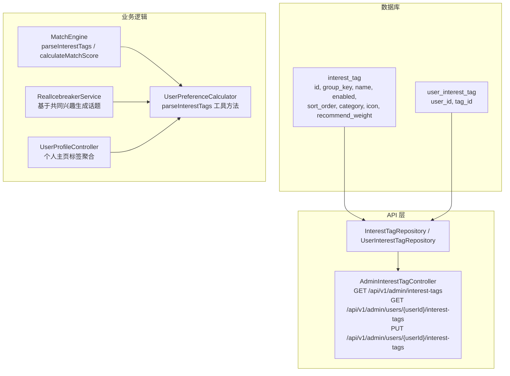
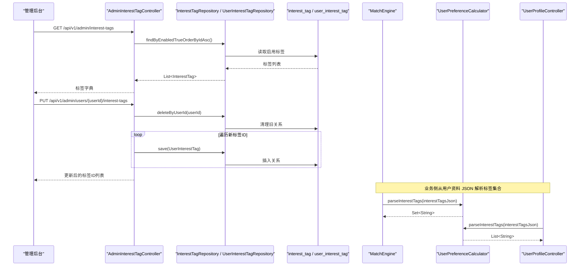
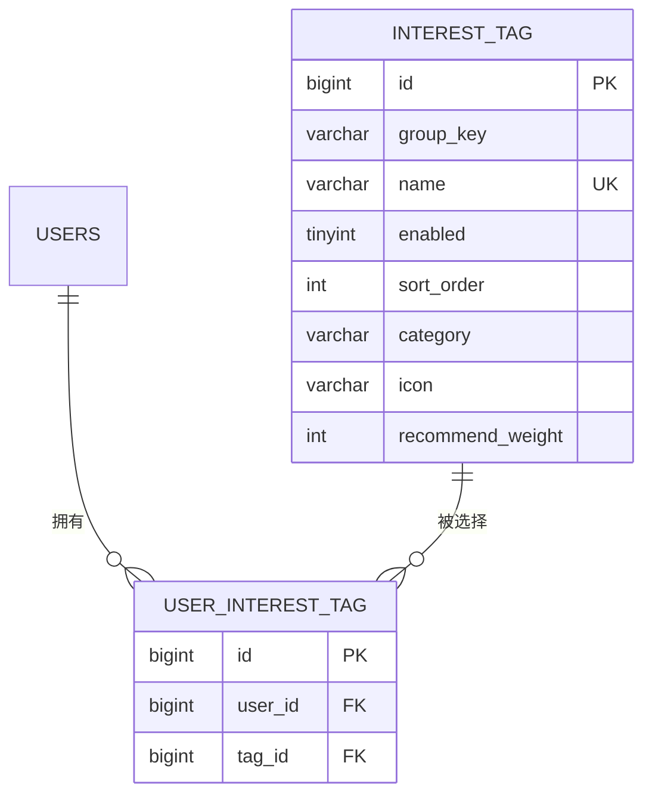
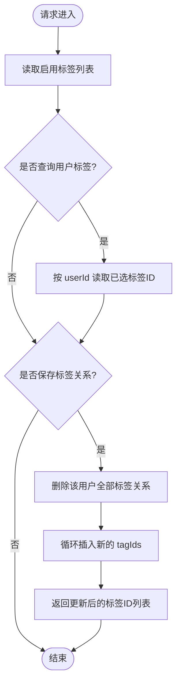
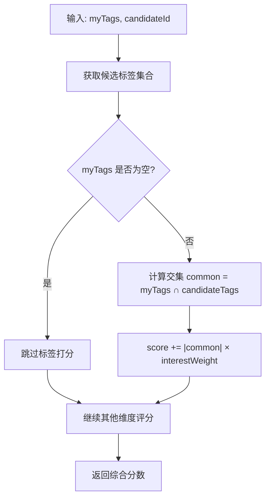
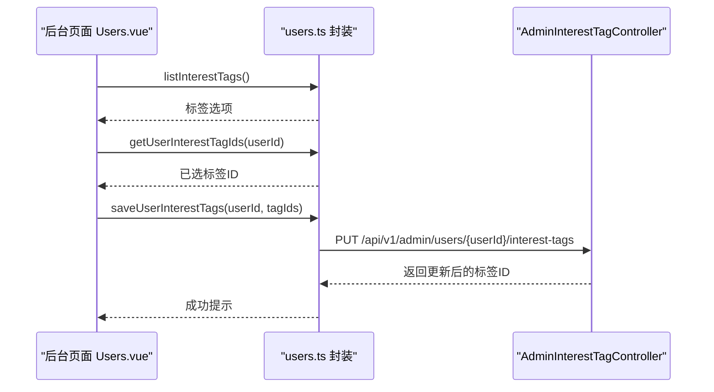
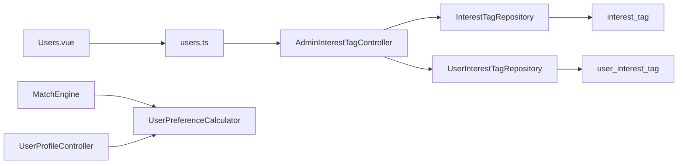

# 兴趣标签管理

<cite>
**本文引用的文件**
- [V2026.08.15.0003__create_interest_tag_relation.sql](file://database/flyway/sql/V2026.08.15.0003__create_interest_tag_relation.sql)
- [V2026.08.15.0005__add_interest_tag_ops_fields.sql](file://database/flyway/sql/V2026.08.15.0005__add_interest_tag_ops_fields.sql)
- [InterestTag.java](file://apps/api/src/main/java/com/campuslove/api/entity/InterestTag.java)
- [UserInterestTag.java](file://apps/api/src/main/java/com/campuslove/api/entity/UserInterestTag.java)
- [InterestTagRepository.java](file://apps/api/src/main/java/com/campuslove/api/repository/InterestTagRepository.java)
- [UserInterestTagRepository.java](file://apps/api/src/main/java/com/campuslove/api/repository/UserInterestTagRepository.java)
- [AdminInterestTagController.java](file://apps/api/src/main/java/com/campuslove/api/admin/AdminInterestTagController.java)
- [MatchEngine.java](file://apps/api/src/main/java/com/campuslove/api/match/MatchEngine.java)
- [RealIcebreakerService.java](file://apps/api/src/main/java/com/campuslove/api/match/RealIcebreakerService.java)
- [RecommendationRanker.java](file://apps/api/src/main/java/com/campuslove/api/discover/RecommendationRanker.java)
- [UserPreferenceCalculator.java](file://apps/api/src/main/java/com/campuslove/api/discover/UserPreferenceCalculator.java)
- [UserProfileController.java](file://apps/api/src/main/java/com/campuslove/api/profile/UserProfileController.java)
- [ProfileUpdateService.java](file://apps/api/src/main/java/com/campuslove/api/profile/ProfileUpdateService.java)
- [Users.vue](file://apps/admin/src/views/content/Users.vue)
- [users.ts](file://apps/admin/src/api/users.ts)
</cite>

## 目录
1. [简介](#简介)
2. [项目结构](#项目结构)
3. [核心组件](#核心组件)
4. [架构总览](#架构总览)
5. [详细组件分析](#详细组件分析)
6. [依赖关系分析](#依赖关系分析)
7. [性能考虑](#性能考虑)
8. [故障排查指南](#故障排查指南)
9. [结论](#结论)
10. [附录](#附录)

## 简介
本技术文档围绕“兴趣标签管理系统”展开，聚焦以下能力：
- 数据模型与层次结构：InterestTag 基础字典、UserInterestTag 用户-标签关系、标签分类（category/group_key）与权重（recommend_weight）。
- CRUD 与批量操作：后台接口对标签字典和用户兴趣关系的增删改查；通过管理员后台完成批量导入/导出。
- 匹配算法中的标签使用：标签解析、相似度计算、推荐机制与破冰话题生成。
- 运营后台与展示：标签分类体系、排序、图标、权重配置；前端在个人资料页、发现卡片中展示标签。
- 质量、审核与生命周期：标签启用控制、操作字段扩展、迁移脚本演进。
- 性能与缓存：预加载优化、评分阶段投影减少 IO、偏好更新时失效推荐缓存。

## 项目结构
后端以 Spring Boot 为主，数据库变更由 Flyway 管理；标签相关实体位于 API 模块的 entity、repository、admin 控制器；匹配与推荐链路消费用户资料中的兴趣标签集合。

图表来源
- [V2026.08.15.0003__create_interest_tag_relation.sql:1-29](file://database/flyway/sql/V2026.08.15.0003__create_interest_tag_relation.sql#L1-L29)
- [V2026.08.15.0005__add_interest_tag_ops_fields.sql:1-5](file://database/flyway/sql/V2026.08.15.0005__add_interest_tag_ops_fields.sql#L1-L5)
- [AdminInterestTagController.java:1-66](file://apps/api/src/main/java/com/campuslove/api/admin/AdminInterestTagController.java#L1-L66)
- [InterestTagRepository.java:1-9](file://apps/api/src/main/java/com/campuslove/api/repository/InterestTagRepository.java#L1-L9)
- [UserInterestTagRepository.java:1-10](file://apps/api/src/main/java/com/campuslove/api/repository/UserInterestTagRepository.java#L1-L10)
- [MatchEngine.java:280-388](file://apps/api/src/main/java/com/campuslove/api/match/MatchEngine.java#L280-L388)
- [RealIcebreakerService.java:179-289](file://apps/api/src/main/java/com/campuslove/api/match/RealIcebreakerService.java#L179-L289)
- [UserPreferenceCalculator.java:150-203](file://apps/api/src/main/java/com/campuslove/api/discover/UserPreferenceCalculator.java#L150-L203)
- [UserProfileController.java:1-200](file://apps/api/src/main/java/com/campuslove/api/profile/UserProfileController.java#L1-L200)

章节来源
- [V2026.08.15.0003__create_interest_tag_relation.sql:1-29](file://database/flyway/sql/V2026.08.15.0003__create_interest_tag_relation.sql#L1-L29)
- [V2026.08.15.0005__add_interest_tag_ops_fields.sql:1-5](file://database/flyway/sql/V2026.08.15.0005__add_interest_tag_ops_fields.sql#L1-L5)

## 核心组件
- 实体 InterestTag：描述标签基础信息（名称、分组 key、是否启用），以及运营字段（排序、分类、图标、推荐权重）。
- 实体 UserInterestTag：记录用户与标签的多对多关系，具备唯一约束防止重复绑定。
- Repository：提供按启用状态查询标签、按用户 ID 查询/删除其已选标签的能力。
- 管理后台控制器 AdminInterestTagController：暴露标签列表、用户标签查询与保存接口，用于后台批量导入/导出场景。
- 匹配引擎 MatchEngine：从用户资料 JSON 中解析兴趣标签集合，参与候选评分。
- 破冰服务 RealIcebreakerService：利用双方共同兴趣标签生成开场白。
- 偏好计算器 UserPreferenceCalculator：提供统一的 JSON 解析工具 parseInterestTags，供多处复用。
- 个人主页 UserProfileController：聚合并返回用户兴趣标签，用于前端展示与“共同兴趣”推导。

章节来源
- [InterestTag.java:1-67](file://apps/api/src/main/java/com/campuslove/api/entity/InterestTag.java#L1-L67)
- [UserInterestTag.java:1-43](file://apps/api/src/main/java/com/campuslove/api/entity/UserInterestTag.java#L1-L43)
- [InterestTagRepository.java:1-9](file://apps/api/src/main/java/com/campuslove/api/repository/InterestTagRepository.java#L1-L9)
- [UserInterestTagRepository.java:1-10](file://apps/api/src/main/java/com/campuslove/api/repository/UserInterestTagRepository.java#L1-L10)
- [AdminInterestTagController.java:1-66](file://apps/api/src/main/java/com/campuslove/api/admin/AdminInterestTagController.java#L1-L66)
- [MatchEngine.java:280-388](file://apps/api/src/main/java/com/campuslove/api/match/MatchEngine.java#L280-L388)
- [RealIcebreakerService.java:179-289](file://apps/api/src/main/java/com/campuslove/api/match/RealIcebreakerService.java#L179-L289)
- [UserPreferenceCalculator.java:150-203](file://apps/api/src/main/java/com/campuslove/api/discover/UserPreferenceCalculator.java#L150-L203)
- [UserProfileController.java:1-200](file://apps/api/src/main/java/com/campuslove/api/profile/UserProfileController.java#L1-L200)

## 架构总览
下图展示了兴趣标签从数据库到匹配/推荐链路的调用关系，以及后台管理入口。

图表来源
- [AdminInterestTagController.java:1-66](file://apps/api/src/main/java/com/campuslove/api/admin/AdminInterestTagController.java#L1-L66)
- [InterestTagRepository.java:1-9](file://apps/api/src/main/java/com/campuslove/api/repository/InterestTagRepository.java#L1-L9)
- [UserInterestTagRepository.java:1-10](file://apps/api/src/main/java/com/campuslove/api/repository/UserInterestTagRepository.java#L1-L10)
- [UserPreferenceCalculator.java:150-203](file://apps/api/src/main/java/com/campuslove/api/discover/UserPreferenceCalculator.java#L150-L203)
- [MatchEngine.java:280-388](file://apps/api/src/main/java/com/campuslove/api/match/MatchEngine.java#L280-L388)
- [UserProfileController.java:1-200](file://apps/api/src/main/java/com/campuslove/api/profile/UserProfileController.java#L1-L200)

## 详细组件分析

### 数据模型与层次结构
- interest_tag：主键 id；group_key 用于分组（如 lifestyle）；name 为唯一标签名；enabled 控制启用状态；新增 sort_order、category、icon、recommend_weight 支持运营配置与推荐加权。
- user_interest_tag：user_id、tag_id 组合唯一；外键分别指向 users.id 与 interest_tag.id；对 user_id 建索引加速查询。

图表来源
- [V2026.08.15.0003__create_interest_tag_relation.sql:1-29](file://database/flyway/sql/V2026.08.15.0003__create_interest_tag_relation.sql#L1-L29)
- [V2026.08.15.0005__add_interest_tag_ops_fields.sql:1-5](file://database/flyway/sql/V2026.08.15.0005__add_interest_tag_ops_fields.sql#L1-L5)

章节来源
- [V2026.08.15.0003__create_interest_tag_relation.sql:1-29](file://database/flyway/sql/V2026.08.15.0003__create_interest_tag_relation.sql#L1-L29)
- [V2026.08.15.0005__add_interest_tag_ops_fields.sql:1-5](file://database/flyway/sql/V2026.08.15.0005__add_interest_tag_ops_fields.sql#L1-L5)

### 标签 CRUD 与批量导入导出
- 列出标签字典：GET /api/v1/admin/interest-tags，仅返回 enabled=true 的标签，并按 id 升序。
- 查询用户已选标签：GET /api/v1/admin/users/{userId}/interest-tags，返回标签 ID 列表。
- 保存用户标签关系：PUT /api/v1/admin/users/{userId}/interest-tags，先清空该用户已有关系，再批量写入新的 tagIds 列表，最后返回更新后的标签 ID 列表。

图表来源
- [AdminInterestTagController.java:1-66](file://apps/api/src/main/java/com/campuslove/api/admin/AdminInterestTagController.java#L1-L66)
- [UserInterestTagRepository.java:1-10](file://apps/api/src/main/java/com/campuslove/api/repository/UserInterestTagRepository.java#L1-L10)

章节来源
- [AdminInterestTagController.java:1-66](file://apps/api/src/main/java/com/campuslove/api/admin/AdminInterestTagController.java#L1-L66)

### 标签分类体系与权重管理
- 分类与分组：
  - group_key：语义分组键（例如 lifestyle），便于前端组织标签组。
  - category：运营分类维度，可用于后台筛选或统计。
- 排序与展示：
  - sort_order：控制标签在后台或前端的展示顺序。
  - icon：标签图标资源路径。
- 推荐权重：
  - recommend_weight：作为标签在推荐策略中的权重因子（当前匹配引擎未直接使用该字段，但为后续推荐加权预留）。

章节来源
- [InterestTag.java:1-67](file://apps/api/src/main/java/com/campuslove/api/entity/InterestTag.java#L1-L67)
- [V2026.08.15.0005__add_interest_tag_ops_fields.sql:1-5](file://database/flyway/sql/V2026.08.15.0005__add_interest_tag_ops_fields.sql#L1-L5)

### 标签匹配算法：解析、相似度与推荐
- 标签解析：
  - 统一通过 UserPreferenceCalculator.parseInterestTags 将用户资料中的 interestTags JSON 字符串解析为 Set<String>。
  - MatchEngine 和 RealIcebreakerService 也各自实现了类似的解析逻辑，保证健壮性。
- 相似度计算：
  - MatchEngine.calculateMatchScore 中，若当前用户存在兴趣标签，则获取候选用户的标签集合，统计交集数量，乘以兴趣权重得到加分。
  - 日程重叠与校区/城市维度同时参与评分。
- 推荐机制：
  - RecommendationRanker 负责排序与视图转换，不直接消费 interest_tag 表，而是基于用户档案与关系数据进行排序。
  - RealIcebreakerService 基于双方共同兴趣标签生成破冰话题，提升匹配后沟通体验。

图表来源
- [MatchEngine.java:280-388](file://apps/api/src/main/java/com/campuslove/api/match/MatchEngine.java#L280-L388)
- [UserPreferenceCalculator.java:150-203](file://apps/api/src/main/java/com/campuslove/api/discover/UserPreferenceCalculator.java#L150-L203)
- [RealIcebreakerService.java:179-289](file://apps/api/src/main/java/com/campuslove/api/match/RealIcebreakerService.java#L179-L289)

章节来源
- [MatchEngine.java:280-388](file://apps/api/src/main/java/com/campuslove/api/match/MatchEngine.java#L280-L388)
- [UserPreferenceCalculator.java:150-203](file://apps/api/src/main/java/com/campuslove/api/discover/UserPreferenceCalculator.java#L150-L203)
- [RealIcebreakerService.java:179-289](file://apps/api/src/main/java/com/campuslove/api/match/RealIcebreakerService.java#L179-L289)

### 标签运营后台功能
- 后台页面 Users.vue 会并行加载：
  - listInterestTags：获取标签字典选项（含 id、groupKey、name、enabled、sortOrder、category、icon、recommendWeight）。
  - getUserInterestTagIds：获取当前用户已选的标签 ID。
- 编辑用户时，可勾选标签并提交 saveUserInterestTags，最终调用后端 PUT 接口完成关系覆写。

图表来源
- [Users.vue:292-375](file://apps/admin/src/views/content/Users.vue#L292-L375)
- [users.ts:152-185](file://apps/admin/src/api/users.ts#L152-L185)
- [AdminInterestTagController.java:1-66](file://apps/api/src/main/java/com/campuslove/api/admin/AdminInterestTagController.java#L1-L66)

章节来源
- [Users.vue:292-375](file://apps/admin/src/views/content/Users.vue#L292-L375)
- [users.ts:152-185](file://apps/admin/src/api/users.ts#L152-L185)
- [AdminInterestTagController.java:1-66](file://apps/api/src/main/java/com/campuslove/api/admin/AdminInterestTagController.java#L1-L66)

### 标签使用统计分析
- 个人主页聚合：UserProfileController 在组装他人视角时，计算并返回“共同兴趣”列表，用于展示与匹配原因。
- 资料完善度：ProfileQueryService 对兴趣标签非空的情况给予完善度加分，间接体现标签使用率。
- 推荐历史与内容：RecommendationRanker 负责推荐结果排序与视图转换，虽不直接统计标签使用，但可与上层日志/埋点结合形成指标。

章节来源
- [UserProfileController.java:1-200](file://apps/api/src/main/java/com/campuslove/api/profile/UserProfileController.java#L1-L200)
- [RecommendationRanker.java:1-200](file://apps/api/src/main/java/com/campuslove/api/discover/RecommendationRanker.java#L1-L200)

### 标签效果评估
- 匹配评分中兴趣标签贡献明确：共同标签数 × 兴趣权重，可直接用于 A/B 实验对比不同权重下的匹配质量。
- 破冰话题基于共同兴趣生成，可通过对话打开率、首句回复率等指标评估标签对交互效果的增益。

章节来源
- [MatchEngine.java:280-388](file://apps/api/src/main/java/com/campuslove/api/match/MatchEngine.java#L280-L388)
- [RealIcebreakerService.java:179-289](file://apps/api/src/main/java/com/campuslove/api/match/RealIcebreakerService.java#L179-L289)

### 标签数据迁移方案
- 初始化与补全：
  - V2026.08.15.0003：创建 interest_tag 与 user_interest_tag，并插入初始 lifestyle 组种子数据。
  - V2026.08.15.0005：为 interest_tag 增加 sort_order、category、icon、recommend_weight 列，支持运营扩展。
- 迁移建议：
  - 新增标签分类与权重后，应通过后台接口批量刷新用户标签关系（确保 tagId 有效且启用）。
  - 如需重建索引或调整唯一约束，请在低峰期执行并配合回滚脚本。

章节来源
- [V2026.08.15.0003__create_interest_tag_relation.sql:1-29](file://database/flyway/sql/V2026.08.15.0003__create_interest_tag_relation.sql#L1-L29)
- [V2026.08.15.0005__add_interest_tag_ops_fields.sql:1-5](file://database/flyway/sql/V2026.08.15.0005__add_interest_tag_ops_fields.sql#L1-L5)

### 标签性能优化
- 预加载与投影：
  - MatchEngine.findAndScoreCandidates 采用候选 ID 投影 + 批量预加载三类档案，避免 N+1 查询。
  - 仅对 Top-N 候选加载完整 User 实体，降低内存与 IO。
- 解析容错：
  - parseInterestTags 对 JSON 异常返回空集合，不影响主流程。
- 缓存失效：
  - 偏好更新通过 @CacheEvict 失效推荐缓存，保障推荐结果一致性。

章节来源
- [MatchEngine.java:1-200](file://apps/api/src/main/java/com/campuslove/api/match/MatchEngine.java#L1-L200)
- [MatchEngine.java:280-388](file://apps/api/src/main/java/com/campuslove/api/match/MatchEngine.java#L280-L388)
- [UserPreferenceCalculator.java:150-203](file://apps/api/src/main/java/com/campuslove/api/discover/UserPreferenceCalculator.java#L150-L203)

### 标签缓存策略
- 当前代码中未见针对 interest_tag/user_interest_tag 的直接缓存注解。
- 推荐偏好更新时会触发推荐缓存失效，从而间接影响基于标签的推荐结果。
- 建议在高频读路径（如标签字典列表）引入应用级缓存，并在后台修改标签时主动失效。

章节来源
- [UserPreferenceCalculator.java:150-203](file://apps/api/src/main/java/com/campuslove/api/discover/UserPreferenceCalculator.java#L150-L203)

### 标签质量控制、审核与生命周期
- 质量控制：
  - enabled 字段控制标签是否对外可见，避免下线标签影响匹配与展示。
  - name 唯一约束保证标签命名规范。
- 审核流程：
  - 当前未见独立的审核状态字段；可在 interest_tag 上扩展审核状态与审计字段，配合后台审批流。
- 生命周期管理：
  - 通过 sort_order、category、icon、recommend_weight 实现标签的排序、分类、展示与权重调整。
  - 删除标签需先解除所有用户关系（当前保存接口采用覆写方式，可配合后台批量清理）。

章节来源
- [InterestTag.java:1-67](file://apps/api/src/main/java/com/campuslove/api/entity/InterestTag.java#L1-L67)
- [InterestTagRepository.java:1-9](file://apps/api/src/main/java/com/campuslove/api/repository/InterestTagRepository.java#L1-L9)
- [AdminInterestTagController.java:1-66](file://apps/api/src/main/java/com/campuslove/api/admin/AdminInterestTagController.java#L1-L66)

### 前端与展示
- 个人主页：UserProfileController 返回 tags 列表，前端展示兴趣标签。
- 发现卡片：标签来自卡片 tags，统一浅底色胶囊样式展示。
- 高级筛选：AdvancedFilter 支持最多 5 个兴趣标签多选，与资料编辑保持一致的数据源。

章节来源
- [UserProfileController.java:1-200](file://apps/api/src/main/java/com/campuslove/api/profile/UserProfileController.java#L1-L200)

## 依赖关系分析
- 控制器依赖 Repository，Repository 映射至数据库表。
- 匹配与推荐链路依赖 UserPreferenceCalculator 提供的统一解析方法，降低重复实现成本。
- 管理后台页面依赖 users.ts 封装的接口，调用 AdminInterestTagController。

图表来源
- [Users.vue:292-375](file://apps/admin/src/views/content/Users.vue#L292-L375)
- [users.ts:152-185](file://apps/admin/src/api/users.ts#L152-L185)
- [AdminInterestTagController.java:1-66](file://apps/api/src/main/java/com/campuslove/api/admin/AdminInterestTagController.java#L1-L66)
- [InterestTagRepository.java:1-9](file://apps/api/src/main/java/com/campuslove/api/repository/InterestTagRepository.java#L1-L9)
- [UserInterestTagRepository.java:1-10](file://apps/api/src/main/java/com/campuslove/api/repository/UserInterestTagRepository.java#L1-L10)
- [MatchEngine.java:280-388](file://apps/api/src/main/java/com/campuslove/api/match/MatchEngine.java#L280-L388)
- [UserPreferenceCalculator.java:150-203](file://apps/api/src/main/java/com/campuslove/api/discover/UserPreferenceCalculator.java#L150-L203)
- [UserProfileController.java:1-200](file://apps/api/src/main/java/com/campuslove/api/profile/UserProfileController.java#L1-L200)

## 性能考虑
- 数据库层面：
  - user_interest_tag.user_id 建立索引，提高按用户查询效率。
  - interest_tag.name 唯一约束，避免重复标签。
- 应用层面：
  - 匹配阶段使用候选 ID 投影与批量预加载，显著减少 N+1 查询。
  - 仅对 Top-N 候选加载完整实体，降低内存占用。
  - 解析失败降级为空集合，保障主流程稳定性。
- 缓存层面：
  - 推荐偏好更新触发推荐缓存失效，避免脏读。

[本节为通用指导，不直接分析具体文件]

## 故障排查指南
- 标签未生效：
  - 检查 interest_tag.enabled 是否为 true。
  - 确认 user_interest_tag 中是否存在对应关系。
- 标签重复或异常：
  - 检查 name 唯一约束冲突。
  - 检查 user_interest_tag 的唯一约束是否触发。
- 匹配评分异常：
  - 校验 interestTags JSON 格式是否正确，解析失败会降级为空集合。
  - 核对 MatchConfig 中兴趣权重设置。
- 后台保存失败：
  - 检查 PUT 接口传入的 tagIds 是否均为有效且启用的标签 ID。
  - 查看事务是否回滚（保存前会删除旧关系）。

章节来源
- [AdminInterestTagController.java:1-66](file://apps/api/src/main/java/com/campuslove/api/admin/AdminInterestTagController.java#L1-L66)
- [MatchEngine.java:280-388](file://apps/api/src/main/java/com/campuslove/api/match/MatchEngine.java#L280-L388)
- [UserPreferenceCalculator.java:150-203](file://apps/api/src/main/java/com/campuslove/api/discover/UserPreferenceCalculator.java#L150-L203)

## 结论
本系统通过清晰的实体设计与后台接口，完成了兴趣标签的基础数据管理、用户关系维护与批量操作；在匹配与推荐链路中，标签被稳定地解析与使用，支撑了相似度计算与破冰话题生成。未来可在标签审核、效果评估与缓存方面进一步增强，以提升运营效率与用户体验。

## 附录
- 关键接口清单（管理后台）：
  - GET /api/v1/admin/interest-tags：列出启用标签字典。
  - GET /api/v1/admin/users/{userId}/interest-tags：查询用户已选标签 ID。
  - PUT /api/v1/admin/users/{userId}/interest-tags：覆写用户标签关系。

章节来源
- [AdminInterestTagController.java:1-66](file://apps/api/src/main/java/com/campuslove/api/admin/AdminInterestTagController.java#L1-L66)
- [users.ts:152-185](file://apps/admin/src/api/users.ts#L152-L185)