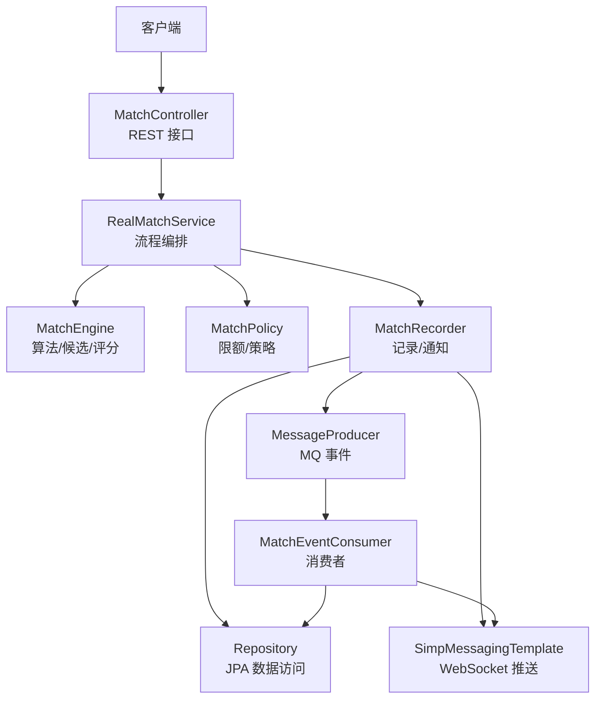
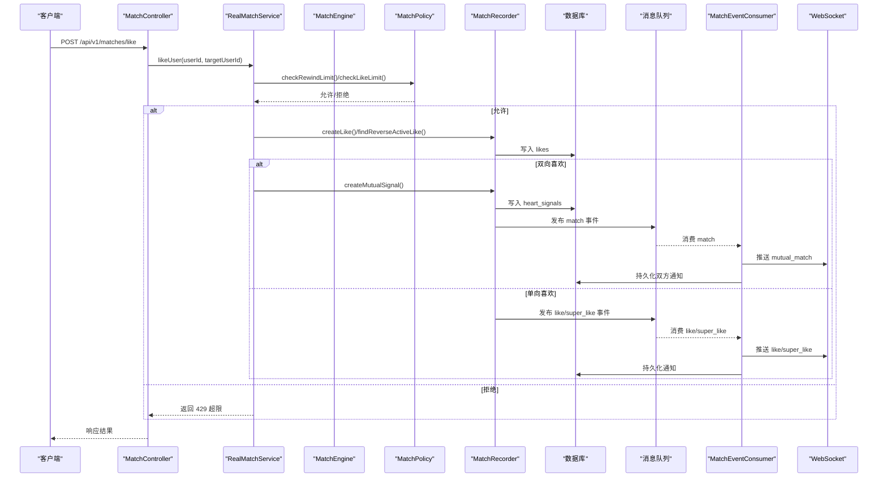
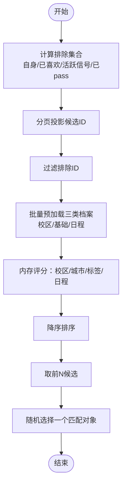
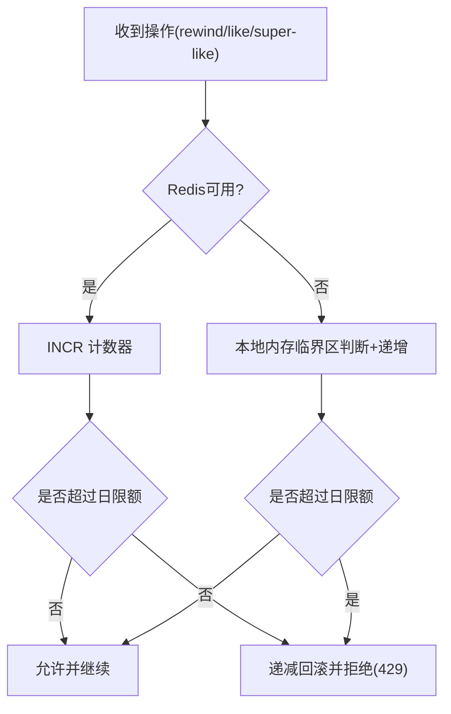
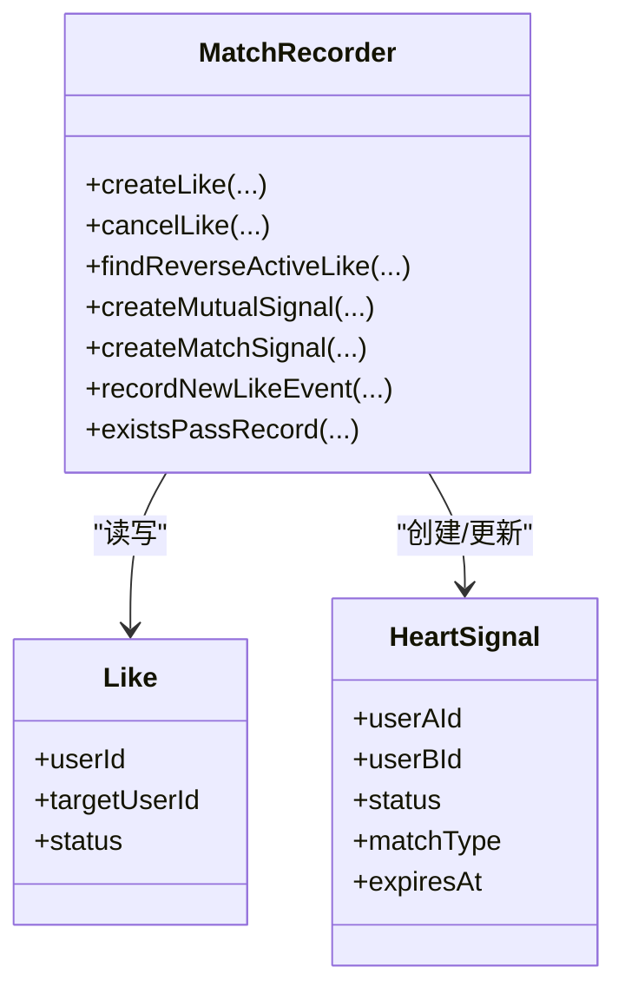
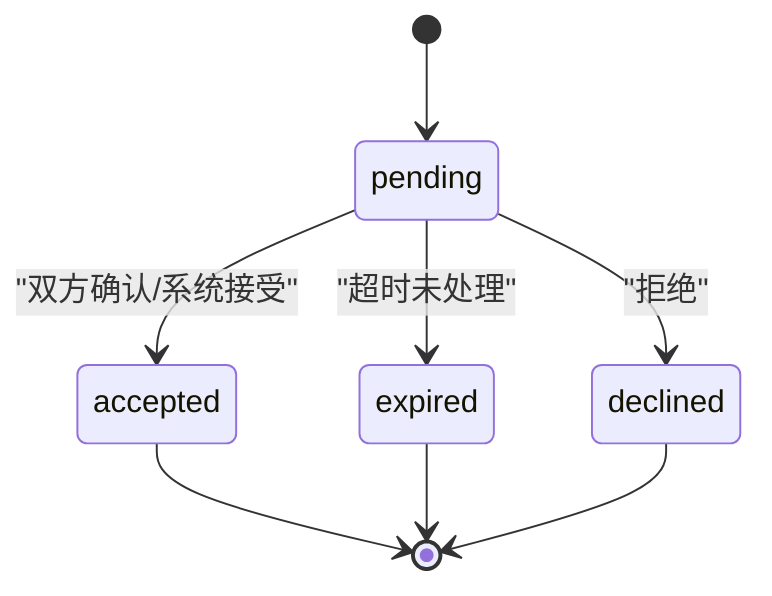
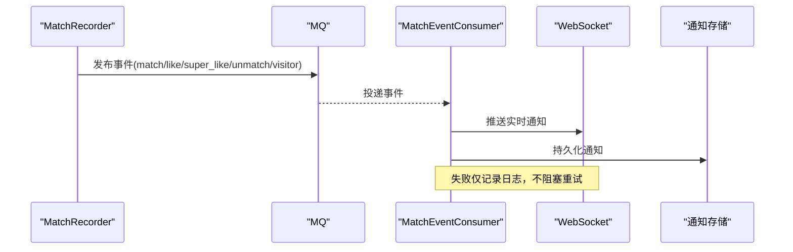
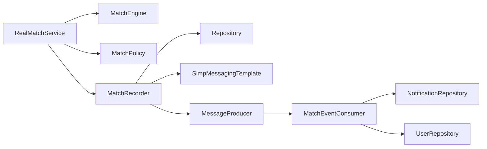

# 匹配业务流程

<cite>
**本文引用的文件**
- [RealMatchService.java](file://apps/api/src/main/java/com/campuslove/api/match/RealMatchService.java)
- [MatchEngine.java](file://apps/api/src/main/java/com/campuslove/api/match/MatchEngine.java)
- [MatchPolicy.java](file://apps/api/src/main/java/com/campuslove/api/match/MatchPolicy.java)
- [MatchRecorder.java](file://apps/api/src/main/java/com/campuslove/api/match/MatchRecorder.java)
- [HeartSignal.java](file://apps/api/src/main/java/com/campuslove/api/entity/HeartSignal.java)
- [Like.java](file://apps/api/src/main/java/com/campuslove/api/entity/Like.java)
- [MatchController.java](file://apps/api/src/main/java/com/campuslove/api/match/MatchController.java)
- [MatchEventConsumer.java](file://apps/api/src/main/java/com/campuslove/api/mq/MatchEventConsumer.java)
</cite>

## 目录
1. [简介](#简介)
2. [项目结构](#项目结构)
3. [核心组件](#核心组件)
4. [架构总览](#架构总览)
5. [详细组件分析](#详细组件分析)
6. [依赖关系分析](#依赖关系分析)
7. [性能考量](#性能考量)
8. [故障排查指南](#故障排查指南)
9. [结论](#结论)
10. [附录](#附录)

## 简介
本文档面向“匹配业务流程”的架构与实现，聚焦 RealMatchService 作为匹配流程编排器的职责边界，以及 MatchEngine（算法）、MatchPolicy（策略/限额）、MatchRecorder（记录/通知）三大组件的协作模式。文档同时覆盖心动信号 HeartSignal 状态机、Like 喜欢关系管理、匹配历史与结果处理、匹配限额控制、商业化解锁机制、社交升温漏斗集成、事件驱动与异步消息、实时推送、监控指标采集与异常处理策略，并给出匹配质量保证、A/B 测试支持与灰度发布的实践建议。

## 项目结构
匹配能力集中在后端 API 服务中，采用分层与职责分离：
- 控制器层：MatchController 暴露 REST 接口，负责鉴权、参数校验、限流与监控埋点。
- 服务编排层：RealMatchService 负责端到端流程编排，协调算法、策略与记录/通知。
- 算法层：MatchEngine 负责候选筛选、评分排序与 Top-N 随机选择。
- 策略层：MatchPolicy 负责限额控制（如 rewind、like、super-like），具备 Redis 与本地内存双写降级。
- 记录与通知层：MatchRecorder 负责 Like/Pass/Visitor/HeartSignal 等记录的持久化与实时通知、MQ 事件发布。
- 数据模型：HeartSignal、Like 为核心实体；Repository 提供数据访问。
- 异步与实时：MatchEventConsumer 消费 MQ 事件，通过 WebSocket 推送至客户端。

**图示来源**
- [MatchController.java:1-200](file://apps/api/src/main/java/com/campuslove/api/match/MatchController.java#L1-L200)
- [RealMatchService.java:1-200](file://apps/api/src/main/java/com/campuslove/api/match/RealMatchService.java#L1-L200)
- [MatchEngine.java:1-200](file://apps/api/src/main/java/com/campuslove/api/match/MatchEngine.java#L1-L200)
- [MatchPolicy.java:1-200](file://apps/api/src/main/java/com/campuslove/api/match/MatchPolicy.java#L1-L200)
- [MatchRecorder.java:1-200](file://apps/api/src/main/java/com/campuslove/api/match/MatchRecorder.java#L1-L200)
- [MatchEventConsumer.java:1-200](file://apps/api/src/main/java/com/campuslove/api/mq/MatchEventConsumer.java#L1-L200)

**章节来源**
- [MatchController.java:1-200](file://apps/api/src/main/java/com/campuslove/api/match/MatchController.java#L1-L200)
- [RealMatchService.java:1-200](file://apps/api/src/main/java/com/campuslove/api/match/RealMatchService.java#L1-L200)

## 核心组件
- RealMatchService：匹配流程编排器。对外暴露创建匹配、快速匹配、查询匹配等能力；对内调用 MatchEngine 计算候选、MatchPolicy 做限额校验、MatchRecorder 完成记录与通知；集成商业化解锁与私信会话自动创建；可选接入社交升温漏斗埋点。
- MatchEngine：纯计算组件，无状态持久化。负责排除集合计算、分页候选获取、N+1 优化批量预加载、多维度评分（校区/城市/兴趣标签/日程重叠）、Top-N 随机选取。
- MatchPolicy：限额与策略中心。提供 rewind、like、super-like 每日限额检查与原子占用额度；支持 Redis 优先、本地内存降级的并发安全计数。
- MatchRecorder：记录与通知中心。负责 Like 创建/取消/反查、Pass/Visitor 记录、HeartSignal 创建（双向喜欢或主动匹配）、WebSocket 推送、MQ 事件发布、视图转换与批量资料加载。
- HeartSignal/Like：核心实体，分别表示心动信号与喜欢关系，含状态枚举与审计字段，支撑匹配成功判定与后续聊天会话创建。

**章节来源**
- [RealMatchService.java:1-200](file://apps/api/src/main/java/com/campuslove/api/match/RealMatchService.java#L1-L200)
- [MatchEngine.java:1-200](file://apps/api/src/main/java/com/campuslove/api/match/MatchEngine.java#L1-L200)
- [MatchPolicy.java:1-200](file://apps/api/src/main/java/com/campuslove/api/match/MatchPolicy.java#L1-L200)
- [MatchRecorder.java:1-200](file://apps/api/src/main/java/com/campuslove/api/match/MatchRecorder.java#L1-L200)
- [HeartSignal.java:1-187](file://apps/api/src/main/java/com/campuslove/api/entity/HeartSignal.java#L1-L187)
- [Like.java:1-170](file://apps/api/src/main/java/com/campuslove/api/entity/Like.java#L1-L170)

## 架构总览
匹配流程由控制器接收请求，进入服务编排层，依次执行策略校验、算法计算、记录写入与通知推送。双向喜欢或主动匹配成功后，通过 MQ 发送事件，消费者统一分发到 WebSocket 与通知存储，保证最终一致性与可观测性。

**图示来源**
- [MatchController.java:1-200](file://apps/api/src/main/java/com/campuslove/api/match/MatchController.java#L1-L200)
- [RealMatchService.java:1-200](file://apps/api/src/main/java/com/campuslove/api/match/RealMatchService.java#L1-L200)
- [MatchPolicy.java:1-200](file://apps/api/src/main/java/com/campuslove/api/match/MatchPolicy.java#L1-L200)
- [MatchRecorder.java:1-200](file://apps/api/src/main/java/com/campuslove/api/match/MatchRecorder.java#L1-L200)
- [MatchEventConsumer.java:1-200](file://apps/api/src/main/java/com/campuslove/api/mq/MatchEventConsumer.java#L1-L200)

## 详细组件分析

### RealMatchService：匹配流程编排器
- 职责边界：统一入口与事务边界；协调算法、策略与记录/通知；保障安全（从 JWT 取 userId，防越权）；集成商业化解锁与私信会话；可选埋点社交升温漏斗。
- 关键流程：
  - 创建匹配/快速匹配：验证用户→排除已互动→Top-N 随机→创建心跳信号→推送通知→返回会话标识。
  - 查询匹配详情：按 ID 查找信号，权限校验仅匹配双方可查看，避免 IDOR。
  - 组合能力：在匹配成功后可自动创建免费私信会话，提升即时沟通体验。
- 错误与异常：非法参数、用户不存在、无权访问等抛出明确异常；限流异常转换为 429。

**章节来源**
- [RealMatchService.java:1-200](file://apps/api/src/main/java/com/campuslove/api/match/RealMatchService.java#L1-L200)

### MatchEngine：匹配算法
- 候选排除：自身、已喜欢、已有活跃心动信号（pending/accepted）、已 pass，必要时可扩展拉黑关系排除。
- 候选评分：同校区/同城市/兴趣标签匹配/日程重叠等多维加权；使用批量预加载消除 N+1；对 Top-N 只加载完整 User 实体，减少 DB 压力。
- 随机性：前 5 个高分候选中随机选取，兼顾质量与多样性。

**图示来源**
- [MatchEngine.java:1-200](file://apps/api/src/main/java/com/campuslove/api/match/MatchEngine.java#L1-L200)

**章节来源**
- [MatchEngine.java:1-200](file://apps/api/src/main/java/com/campuslove/api/match/MatchEngine.java#L1-L200)

### MatchPolicy：限额与策略
- 限额项：rewind 每日上限、普通 like 每日上限、超级喜欢独立配额（默认值可配置）。
- 并发与降级：Redis 原子 INCR 占额度；失败回滚超限计数；不可用时降级为本地 ConcurrentHashMap，单实例内临界区保护。
- 扩展性：可通过配置切换超级喜欢配额；未来可接入扣费商业化。

**图示来源**
- [MatchPolicy.java:1-200](file://apps/api/src/main/java/com/campuslove/api/match/MatchPolicy.java#L1-L200)

**章节来源**
- [MatchPolicy.java:1-200](file://apps/api/src/main/java/com/campuslove/api/match/MatchPolicy.java#L1-L200)

### MatchRecorder：记录与通知
- Like 管理：创建、取消、反向 active 检查、重新激活；记录 NEW_LIKE 互动事件用于通知。
- HeartSignal 管理：双向喜欢创建信号（mutual_like），主动匹配创建信号（topic/coffee/study/quick）；设置过期时间。
- Pass/Visitor：防止重复 pass；访客阅读标记与归属校验。
- 通知与事件：WebSocket 推送匹配/喜欢通知；MQ 发布 match/like/super_like/unmatch/visitor 事件；批量加载用户与校区资料，构造视图。

**图示来源**
- [MatchRecorder.java:1-200](file://apps/api/src/main/java/com/campuslove/api/match/MatchRecorder.java#L1-L200)
- [Like.java:1-170](file://apps/api/src/main/java/com/campuslove/api/entity/Like.java#L1-L170)
- [HeartSignal.java:1-187](file://apps/api/src/main/java/com/campuslove/api/entity/HeartSignal.java#L1-L187)

**章节来源**
- [MatchRecorder.java:1-200](file://apps/api/src/main/java/com/campuslove/api/match/MatchRecorder.java#L1-L200)

### HeartSignal 状态机
- 状态：pending → accepted → expired/declined；创建时设置 expiresAt 用于定时清理。
- 索引：按 user_a_id、user_b_id、status、expires_at、created_at 建索引以支持高效查询与扫描。
- 用途：代表一次心动信号生命周期，匹配成功后可转为 accepted 并触发会话创建。

**图示来源**
- [HeartSignal.java:1-187](file://apps/api/src/main/java/com/campuslove/api/entity/HeartSignal.java#L1-L187)

**章节来源**
- [HeartSignal.java:1-187](file://apps/api/src/main/java/com/campuslove/api/entity/HeartSignal.java#L1-L187)

### Like 喜欢关系管理
- 状态：active / cancelled；唯一约束 (user_id, target_user_id) 防止重复喜欢。
- 行为：创建后若对方也 active 则视为匹配成功；取消后将不再参与匹配逻辑。
- 索引：支持按目标用户、创建时间、状态等多维度查询，优化列表与统计。

**章节来源**
- [Like.java:1-170](file://apps/api/src/main/java/com/campuslove/api/entity/Like.java#L1-L170)

### 匹配历史与结果处理
- 匹配历史：通过 HeartSignal 与 Like 的组合可还原匹配历程（谁先喜欢、何时匹配、是否接受/拒绝/过期）。
- 结果处理：匹配成功后生成会话标识（session-xxx），并可自动创建私信会话；前端据此进入聊天页。

**章节来源**
- [RealMatchService.java:1-200](file://apps/api/src/main/java/com/campuslove/api/match/RealMatchService.java#L1-L200)

### 匹配限额控制与商业化解锁
- 限额控制：MatchPolicy 提供 rewind、like、super-like 每日限额；Redis 原子计数保证并发安全；不可用时降级本地内存。
- 商业化解锁：RealMatchService 注入 WalletUnlockService，可为 liked-me / visitors 列表附加 unlocked 状态字段；支持付费解锁更多曝光或特权功能。

**章节来源**
- [MatchPolicy.java:1-200](file://apps/api/src/main/java/com/campuslove/api/match/MatchPolicy.java#L1-L200)
- [RealMatchService.java:1-200](file://apps/api/src/main/java/com/campuslove/api/match/RealMatchService.java#L1-L200)

### 社交升温漏斗集成
- 埋点：RealMatchService 可选注入 SocialProgressService，在主链路（like/match）上报关键转化节点，便于增长分析与归因。
- 容错：字段注入且 required=false，单元测试/mock 场景下跳过埋点不影响主流程。

**章节来源**
- [RealMatchService.java:1-200](file://apps/api/src/main/java/com/campuslove/api/match/RealMatchService.java#L1-L200)

### 匹配事件驱动架构、异步消息与实时通知
- 生产者：MatchRecorder 在关键动作后发布 MQ 事件（match/like/super_like/unmatch/visitor）。
- 消费者：MatchEventConsumer 监听 match.queue，分发消息类型，通过 WebSocket 推送给相关用户，并持久化通知。
- 幂等与健壮：消费者捕获异常不抛错，避免无限重投；通知持久化确保离线可达。

**图示来源**
- [MatchRecorder.java:1-200](file://apps/api/src/main/java/com/campuslove/api/match/MatchRecorder.java#L1-L200)
- [MatchEventConsumer.java:1-200](file://apps/api/src/main/java/com/campuslove/api/mq/MatchEventConsumer.java#L1-L200)

**章节来源**
- [MatchEventConsumer.java:1-200](file://apps/api/src/main/java/com/campuslove/api/mq/MatchEventConsumer.java#L1-L200)

### 监控、性能指标与异常处理
- 监控埋点：MatchController 在 like 滑动与匹配成功处记录指标（Micrometer），暴露 /actuator/prometheus。
- 性能优化：MatchEngine 批量预加载、Top-N 仅加载实体、投影查询减少 IO；MatchRecorder 批量组装视图降低 N+1。
- 异常处理：GlobalExceptionHandler 将乐观锁冲突等转换为 HTTP 409；限额超出发出 429；消费者异常吞掉避免死循环。

**章节来源**
- [MatchController.java:1-200](file://apps/api/src/main/java/com/campuslove/api/match/MatchController.java#L1-L200)
- [MatchEngine.java:1-200](file://apps/api/src/main/java/com/campuslove/api/match/MatchEngine.java#L1-L200)
- [MatchRecorder.java:1-200](file://apps/api/src/main/java/com/campuslove/api/match/MatchRecorder.java#L1-L200)

### 匹配质量保证、A/B 测试与灰度发布
- 质量保障：
  - 算法侧：Top-N 随机增加多样性；多维权重评分提高相关性；批量预加载避免 N+1 导致的延迟与抖动。
  - 策略侧：限额原子计数与降级保障高可用；权限校验防 IDOR。
  - 数据一致性：实体 version 乐观锁，异常转 409；事务边界在编排层控制。
- A/B 测试建议：
  - 在 MatchEngine 评分权重、Top-N 数量、MatchPolicy 限额阈值等处引入开关或特征桶，结合埋点评估效果。
  - 通过推荐策略与匹配策略的可配置化（配置文件/远程配置中心）实现实验分流。
- 灰度发布建议：
  - 使用 Spring Profile 或特性开关逐步放量新策略；配合监控指标与告警快速回滚。
  - 消费者侧保持幂等与容错，确保灰度期间消息稳定消费。

[本节为通用实践建议，不直接引用具体代码文件]

## 依赖关系分析
- 耦合关系：
  - RealMatchService 强依赖 MatchEngine、MatchPolicy、MatchRecorder；弱依赖 SocialProgressService（可选）。
  - MatchRecorder 依赖多个 Repository、WebSocket、MQ；解耦于业务逻辑。
  - MatchEventConsumer 依赖 NotificationRepository、UserRepository、WebSocket；与生产者松耦合。
- 外部依赖：
  - Redis：限额计数与 TTL；不可用时降级。
  - RabbitMQ：事件总线，解耦生产与消费。
  - JPA：数据持久化，使用索引与版本控制。

**图示来源**
- [RealMatchService.java:1-200](file://apps/api/src/main/java/com/campuslove/api/match/RealMatchService.java#L1-L200)
- [MatchRecorder.java:1-200](file://apps/api/src/main/java/com/campuslove/api/match/MatchRecorder.java#L1-L200)
- [MatchEventConsumer.java:1-200](file://apps/api/src/main/java/com/campuslove/api/mq/MatchEventConsumer.java#L1-L200)

**章节来源**
- [RealMatchService.java:1-200](file://apps/api/src/main/java/com/campuslove/api/match/RealMatchService.java#L1-L200)
- [MatchEventConsumer.java:1-200](file://apps/api/src/main/java/com/campuslove/api/mq/MatchEventConsumer.java#L1-L200)

## 性能考量
- 数据库层：
  - 投影查询与批量预加载消除 N+1。
  - 合理索引：likes 与 heart_signals 的多列索引覆盖常见查询路径。
  - 乐观锁版本控制避免并发覆盖。
- 缓存与限流：
  - Redis 原子计数与 TTL，避免频繁落库。
  - 控制器层 RateLimit 防刷。
- 计算与 IO：
  - 评分在内存进行，仅对 Top-N 加载实体。
  - 通知与事件异步化，降低主流程耗时。

[本节为通用性能指导，不直接引用具体代码文件]

## 故障排查指南
- 常见问题定位：
  - 匹配失败：检查 MatchEngine 候选是否为空、排除集合是否正确、评分权重是否合理。
  - 限额报错：核对 MatchPolicy 的 Redis 连接与 TTL；确认 tryIncrement 是否回滚成功。
  - 通知未达：查看 MatchEventConsumer 日志，确认 WebSocket 推送与通知持久化是否成功。
  - 权限问题：确认 getMatch 中的参与者校验是否通过。
- 监控与告警：
  - 关注 /actuator/prometheus 的滑动与匹配指标。
  - 对消费者异常、WebSocket 推送失败、Redis 不可用等建立告警。
- 回滚与降级：
  - 策略开关快速关闭新功能；消费者异常吞掉避免雪崩；限额降级本地内存。

**章节来源**
- [MatchPolicy.java:1-200](file://apps/api/src/main/java/com/campuslove/api/match/MatchPolicy.java#L1-L200)
- [MatchEventConsumer.java:1-200](file://apps/api/src/main/java/com/campuslove/api/mq/MatchEventConsumer.java#L1-L200)
- [RealMatchService.java:1-200](file://apps/api/src/main/java/com/campuslove/api/match/RealMatchService.java#L1-L200)

## 结论
本架构通过清晰的职责拆分与事件驱动实现了高可用、可扩展的匹配流程。RealMatchService 作为编排者，将算法、策略与记录/通知解耦；MatchEngine 专注评分与候选选择，MatchPolicy 集中限额与降级，MatchRecorder 负责数据与通知；MQ 与 WebSocket 提供异步与实时能力。配合监控、限流、权限校验与商业化解锁，整体满足高质量匹配与业务增长需求。

## 附录
- 术语说明：
  - 心动信号：HeartSignal，代表一次匹配机会的生命周期。
  - 喜欢关系：Like，记录用户对目标用户的喜欢状态。
  - 社交升温漏斗：用户在 like/match 等关键节点的转化过程。
- 扩展方向：
  - 接入更丰富的评分维度（地理位置、活跃度、历史匹配成功率）。
  - 完善拉黑关系在匹配引擎中的排除。
  - 强化 A/B 实验与灰度发布能力，结合埋点进行效果评估。

[本节为概念性内容，不直接引用具体代码文件]