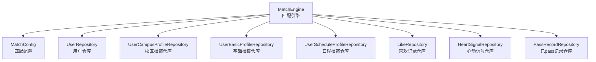
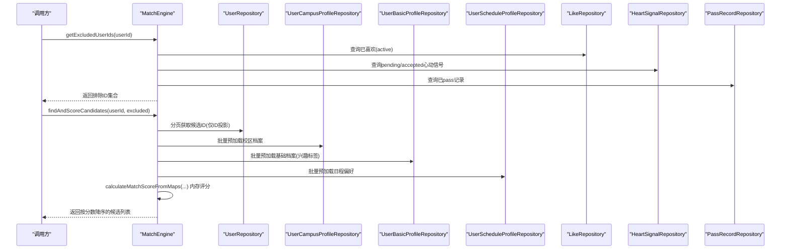
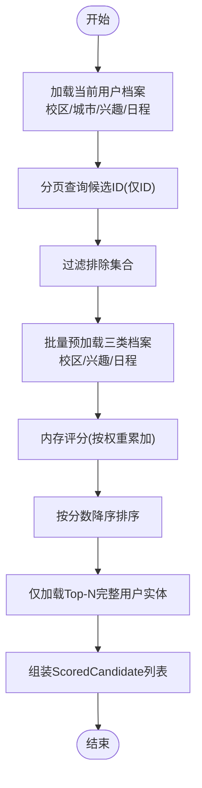
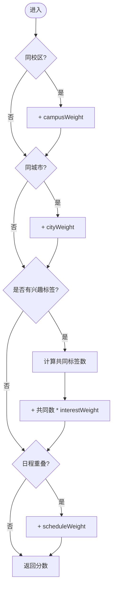
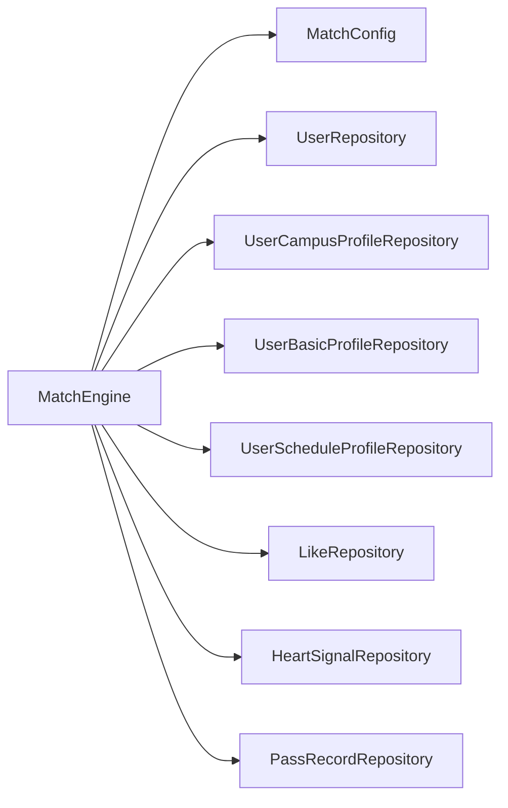

# 匹配算法核心

<cite>
**本文引用的文件**
- [MatchEngine.java](file://apps/api/src/main/java/com/campuslove/api/match/MatchEngine.java)
- [MatchConfig.java](file://apps/api/src/main/java/com/campuslove/api/config/MatchConfig.java)
- [MatchEngineTest.java](file://apps/api/src/test/java/com/campuslove/api/match/MatchEngineTest.java)
- [UserRepository.java](file://apps/api/src/main/java/com/campuslove/api/repository/UserRepository.java)
- [LikeRepository.java](file://apps/api/src/main/java/com/campuslove/api/repository/LikeRepository.java)
- [HeartSignalRepository.java](file://apps/api/src/main/java/com/campuslove/api/repository/HeartSignalRepository.java)
- [PassRecordRepository.java](file://apps/api/src/main/java/com/campuslove/api/repository/PassRecordRepository.java)
- [UserCampusProfileRepository.java](file://apps/api/src/main/java/com/campuslove/api/repository/UserCampusProfileRepository.java)
- [UserBasicProfileRepository.java](file://apps/api/src/main/java/com/campuslove/api/repository/UserBasicProfileRepository.java)
- [UserScheduleProfileRepository.java](file://apps/api/src/main/java/com/campuslove/api/repository/UserScheduleProfileRepository.java)
</cite>

## 目录
1. [简介](#简介)
2. [项目结构](#项目结构)
3. [核心组件](#核心组件)
4. [架构总览](#架构总览)
5. [详细组件分析](#详细组件分析)
6. [依赖关系分析](#依赖关系分析)
7. [性能考量](#性能考量)
8. [故障排查指南](#故障排查指南)
9. [结论](#结论)
10. [附录](#附录)

## 简介
本技术文档聚焦于匹配算法核心组件 MatchEngine，系统阐述其候选筛选与评分逻辑、权重算法、Top-N 随机选择策略、N+1 查询优化与批量预加载机制，并给出配置参数说明、扩展点设计与测试用例要点。目标是帮助开发者快速理解并正确扩展匹配算法。

## 项目结构
匹配算法核心位于后端 API 模块的 match 包中，由 MatchEngine 承担“读取型”计算职责：不持久化状态，仅从各类 Repository 读取数据并进行内存评分与排序。关键相关文件如下：
- 匹配引擎：apps/api/src/main/java/com/campuslove/api/match/MatchEngine.java
- 匹配配置：apps/api/src/main/java/com/campuslove/api/config/MatchConfig.java
- 单元测试：apps/api/src/test/java/com/campuslove/api/match/MatchEngineTest.java
- 数据访问层：各 Repository 接口（用户、兴趣、校区、日程、喜欢、心动信号、已 pass）

图示来源
- [MatchEngine.java:1-388](file://apps/api/src/main/java/com/campuslove/api/match/MatchEngine.java#L1-L388)
- [MatchConfig.java:1-92](file://apps/api/src/main/java/com/campuslove/api/config/MatchConfig.java#L1-L92)
- [UserRepository.java:60-80](file://apps/api/src/main/java/com/campuslove/api/repository/UserRepository.java#L60-L80)

章节来源
- [MatchEngine.java:1-388](file://apps/api/src/main/java/com/campuslove/api/match/MatchEngine.java#L1-L388)
- [MatchConfig.java:1-92](file://apps/api/src/main/java/com/campuslove/api/config/MatchConfig.java#L1-L92)

## 核心组件
- MatchEngine：实现匹配候选筛选与评分的核心逻辑，包括排除集合计算、分页查询候选、加权排序、Top-N 随机选择等。
- MatchConfig：承载匹配权重与分页大小等可配置项，便于运行时调优。
- 各类 Repository：提供数据访问能力，配合 MatchEngine 完成候选获取与档案预加载。

章节来源
- [MatchEngine.java:1-120](file://apps/api/src/main/java/com/campuslove/api/match/MatchEngine.java#L1-L120)
- [MatchConfig.java:1-92](file://apps/api/src/main/java/com/campuslove/api/config/MatchConfig.java#L1-L92)

## 架构总览
MatchEngine 作为无状态的纯计算组件，通过组合多个 Repository 进行数据读取，并在内存中完成匹配分数计算与排序。整体流程如下：

图示来源
- [MatchEngine.java:120-260](file://apps/api/src/main/java/com/campuslove/api/match/MatchEngine.java#L120-L260)
- [UserRepository.java:60-80](file://apps/api/src/main/java/com/campuslove/api/repository/UserRepository.java#L60-L80)

## 详细组件分析

### 排除集合计算：getExcludedUserIds
- 目标：构建应被排除的用户 ID 集合，避免重复推荐或无效匹配。
- 规则：
  - 始终包含当前用户自身。
  - 包含已喜欢（active 状态）的目标用户。
  - 包含已有活跃心动信号（pending/accepted）的另一方用户。
  - 包含已 pass 的用户。
- 实现要点：使用 Set 提升查找性能；预留拉黑关系扩展点（尚未接入）。

章节来源
- [MatchEngine.java:60-118](file://apps/api/src/main/java/com/campuslove/api/match/MatchEngine.java#L60-L118)
- [LikeRepository.java:1-200](file://apps/api/src/main/java/com/campuslove/api/repository/LikeRepository.java#L1-L79)
- [HeartSignalRepository.java:1-200](file://apps/api/src/main/java/com/campuslove/api/repository/HeartSignalRepository.java#L1-L199)
- [PassRecordRepository.java:1-200](file://apps/api/src/main/java/com/campuslove/api/repository/PassRecordRepository.java#L1-L39)

### 候选查询与评分：findAndScoreCandidates
- 步骤概览：
  1) 获取当前用户的校区、城市、兴趣标签、日程时间窗口。
  2) 使用分页查询仅返回候选 ID（投影优化），减少大字段加载。
  3) 过滤掉 excludedUserIds。
  4) 批量预加载三类档案（校区、兴趣标签、日程），消除 N+1 查询。
  5) 对每个候选在内存中计算匹配分数，并按分数降序排序。
  6) 仅对 Top-N 高分候选加载完整 User 实体，降低 DB 负载。
  7) 组装 ScoredCandidate 列表返回。

图示来源
- [MatchEngine.java:120-260](file://apps/api/src/main/java/com/campuslove/api/match/MatchEngine.java#L120-L260)
- [UserRepository.java:60-80](file://apps/api/src/main/java/com/campuslove/api/repository/UserRepository.java#L60-L80)

章节来源
- [MatchEngine.java:120-260](file://apps/api/src/main/java/com/campuslove/api/match/MatchEngine.java#L120-L260)

### 推荐分数计算：calculateMatchScoreFromMaps
- 维度与权重：
  - 同校区：+campusWeight
  - 同城市：+cityWeight
  - 兴趣标签匹配：每匹配一个标签 +interestWeight
  - 日程重叠：若时间窗口有交集 +scheduleWeight
- 输入：当前用户信息（校区、城市、兴趣、日程 JSON）、候选 ID、以及三类档案的批量 Map。
- 特点：纯内存计算，无数据库访问；JSON 解析失败时安全降级为空集合/无重叠。

图示来源
- [MatchEngine.java:220-300](file://apps/api/src/main/java/com/campuslove/api/match/MatchEngine.java#L220-L300)
- [MatchConfig.java:1-92](file://apps/api/src/main/java/com/campuslove/api/config/MatchConfig.java#L1-L92)

章节来源
- [MatchEngine.java:220-300](file://apps/api/src/main/java/com/campuslove/api/match/MatchEngine.java#L220-L300)
- [MatchConfig.java:1-92](file://apps/api/src/main/java/com/campuslove/api/config/MatchConfig.java#L1-L92)

### Top-N 候选随机选择：selectFromTopCandidates
- 策略：从前 TOP_CANDIDATE_COUNT（默认 5）个高分候选中随机选择一个，兼顾质量与多样性。
- 行为：若候选不足 5 个，则取全部候选再随机选择。
- 实现：使用线程局部随机数生成器，保证并发安全。

章节来源
- [MatchEngine.java:300-360](file://apps/api/src/main/java/com/campuslove/api/match/MatchEngine.java#L300-L360)

### 辅助方法
- hasScheduleOverlap：解析两个 JSON 时间窗口，比较键集合是否存在交集；任一为空或解析失败返回 false。
- parseInterestTags：将兴趣标签 JSON 字符串解析为 Set；非法格式返回空集合。

章节来源
- [MatchEngine.java:330-388](file://apps/api/src/main/java/com/campuslove/api/match/MatchEngine.java#L330-L388)

## 依赖关系分析
- 外部依赖：
  - Spring Data JPA Repositories：用于数据访问。
  - Jackson ObjectMapper：用于 JSON 解析。
  - 线程局部随机数：用于 Top-N 随机选择。
- 内部耦合：
  - MatchEngine 与 MatchConfig 松耦合，权重可通过配置动态调整。
  - 与 Repository 的耦合集中在数据读取，便于替换或模拟。

图示来源
- [MatchEngine.java:1-120](file://apps/api/src/main/java/com/campuslove/api/match/MatchEngine.java#L1-L120)

章节来源
- [MatchEngine.java:1-120](file://apps/api/src/main/java/com/campuslove/api/match/MatchEngine.java#L1-L120)

## 性能考量
- N+1 查询优化：
  - 使用 findByUserIdIn 批量预加载校区、兴趣、日程档案，避免对每个候选执行三次单独查询。
- 候选 ID 投影：
  - 使用 findCandidateIds 仅返回 ID 列表，减少大字段传输与内存占用。
- Top-N 实体加载：
  - 仅对前 5 个高分候选加载完整 User 实体，显著降低 DB 负载。
- 内存评分：
  - 所有分数计算在内存中进行，避免额外 I/O。
- 可扩展性：
  - 权重与分页大小通过 MatchConfig 暴露，支持运行时调优。
- 建议：
  - 根据业务数据分布调整 candidatePageSize 与权重比例。
  - 对 JSON 字段（日程、兴趣）增加索引或规范化存储以提升解析与检索效率。

[本节为通用性能指导，无需特定文件引用]

## 故障排查指南
- 排除集合未生效：
  - 检查 Like、HeartSignal、PassRecord 的查询条件与状态是否正确。
- 分数异常：
  - 确认 MatchConfig 中的权重配置是否合理。
  - 校验兴趣标签 JSON 与日程时间窗口 JSON 格式是否合法。
- 性能问题：
  - 增大 candidatePageSize 会提升候选池但增加评分开销；需权衡。
  - 关注批量预加载的数据量，避免过大导致内存压力。

章节来源
- [MatchEngineTest.java:1-278](file://apps/api/src/test/java/com/campuslove/api/match/MatchEngineTest.java#L1-L278)

## 结论
MatchEngine 以清晰的分层职责实现了高效、可配置的匹配算法核心。通过候选 ID 投影、批量预加载与 Top-N 随机选择，有效降低了数据库负载并提升了匹配质量与多样性。权重配置化设计使得算法易于调参与扩展。

[本节总结性内容，无需特定文件引用]

## 附录

### 匹配配置参数
- app.match.candidatePageSize：候选分页大小，默认 50。
- app.match.campusWeight：同校区权重，默认 50。
- app.match.cityWeight：同城市权重，默认 20。
- app.match.interestWeight：兴趣标签匹配权重（每个标签），默认 10。
- app.match.scheduleWeight：日程重叠权重，默认 15。
- app.match.heartSignalExpireHours：心动信号过期时间（小时），默认 48。
- app.match.defaultChatDuration：默认聊天时长（分钟），默认 20。

章节来源
- [MatchConfig.java:1-92](file://apps/api/src/main/java/com/campuslove/api/config/MatchConfig.java#L1-L92)

### 算法测试用例要点
- 排除集合覆盖：自身、已喜欢、心动信号对方、已 pass。
- 分数计算：同校区/同城市/兴趣匹配/日程重叠的权重累加。
- 边界情况：无匹配得分为 0；日程 JSON 为空或非法时的安全降级。
- Top-N 随机选择：从最多 5 个高分候选中随机选取；候选不足 5 个时取全部。

章节来源
- [MatchEngineTest.java:1-278](file://apps/api/src/test/java/com/campuslove/api/match/MatchEngineTest.java#L1-L278)

### 性能基准与基准测试建议
- 建议场景：
  - 不同 candidatePageSize 下的 P95 延迟对比。
  - 批量预加载 vs 逐条查询的 QPS 对比。
  - Top-N 实体加载数量对响应时间的敏感度分析。
- 指标：
  - 平均/分位延迟、QPS、CPU 使用率、DB 连接池命中率。
- 工具：
  - 使用压测脚本与 APM 监控收集指标，持续回归验证。

[本节为通用基准建议，无需特定文件引用]