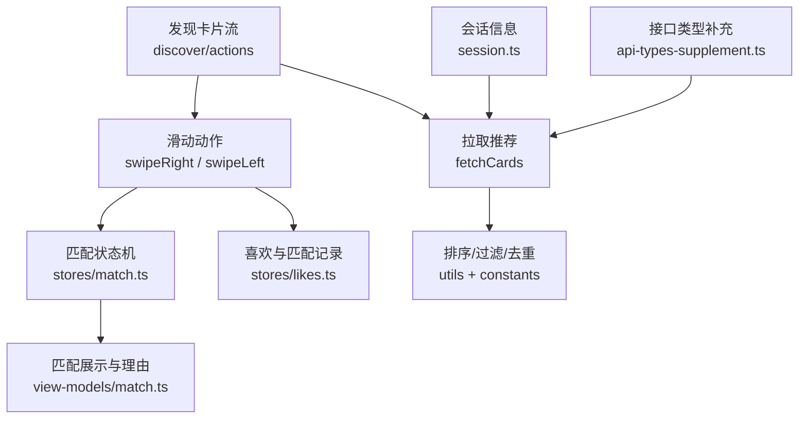
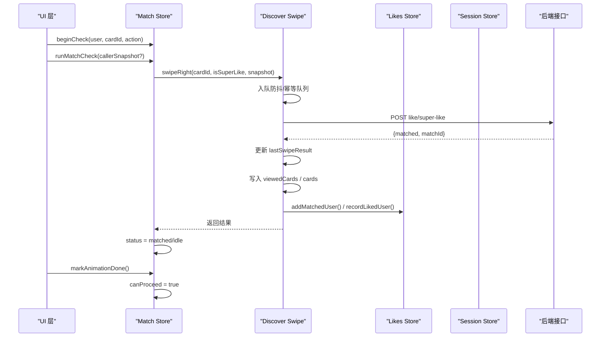
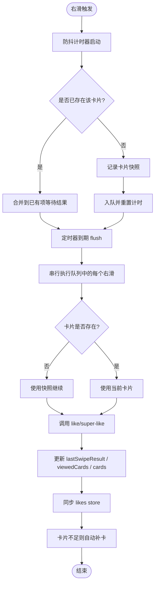
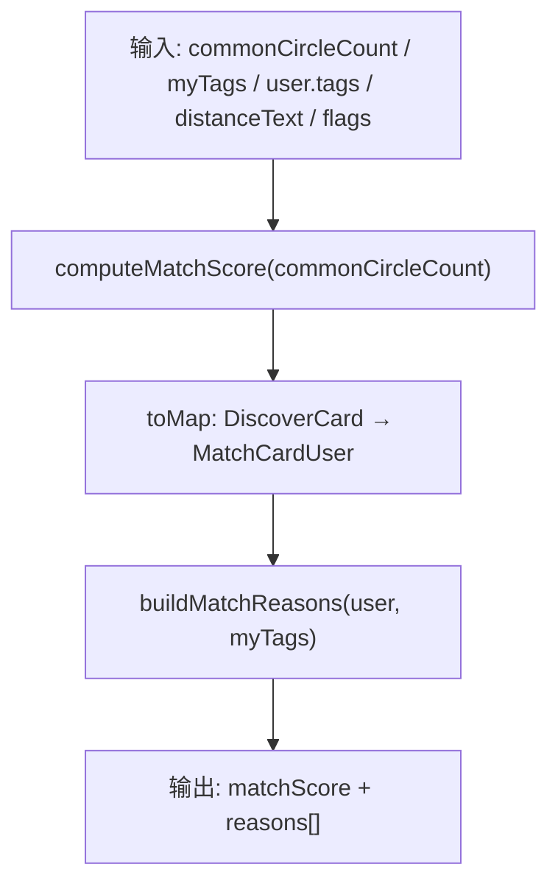
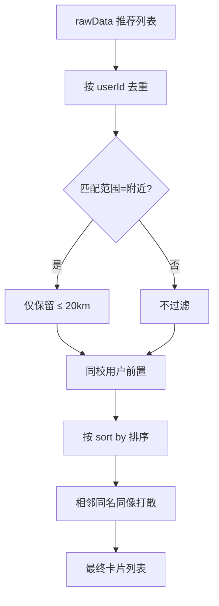
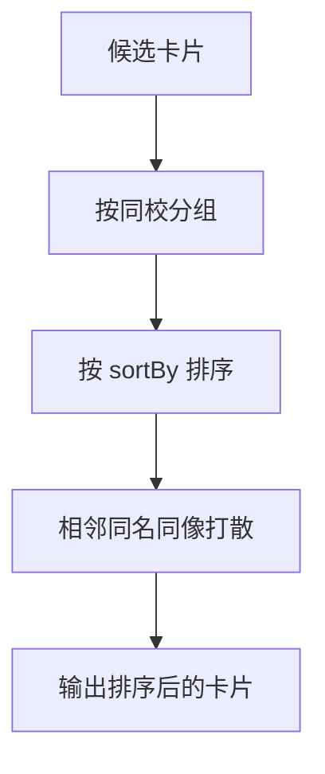
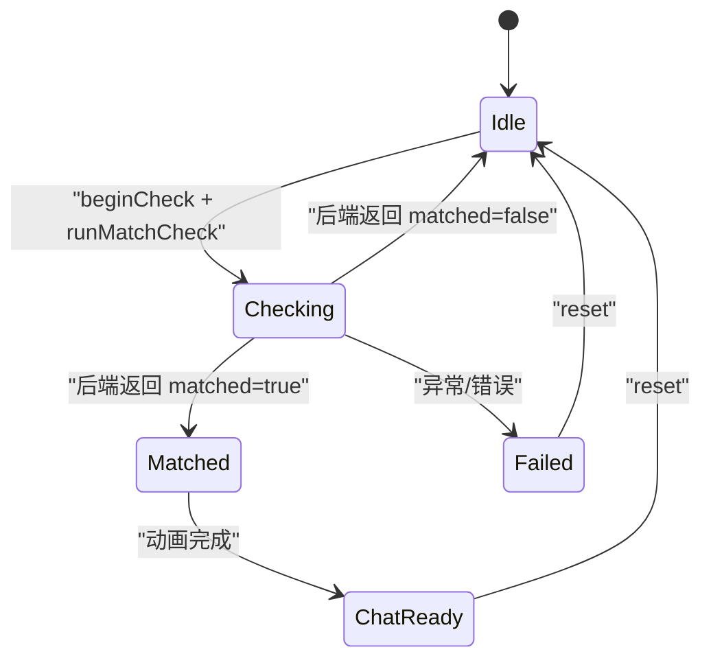
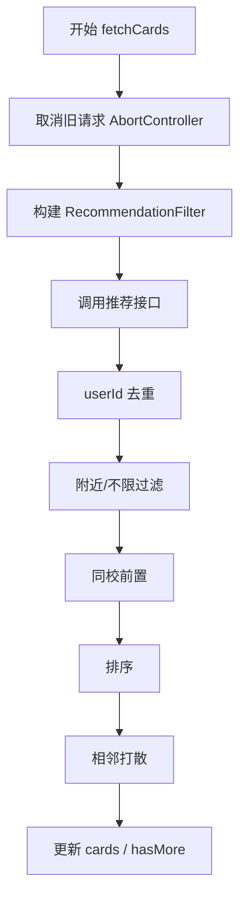
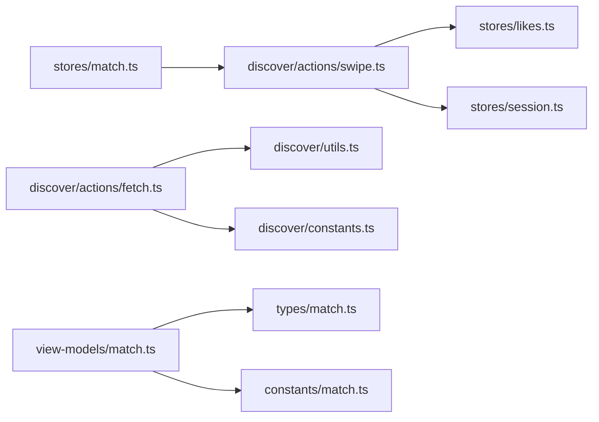

# 匹配系统

<cite>
**本文引用的文件**   
- [apps/client/src/stores/match.ts](file://apps/client/src/stores/match.ts)
- [apps/client/src/types/match.ts](file://apps/client/src/types/match.ts)
- [apps/client/src/view-models/match.ts](file://apps/client/src/view-models/match.ts)
- [apps/client/src/constants/match.ts](file://apps/client/src/constants/match.ts)
- [apps/client/src/stores/discover/actions/swipe.ts](file://apps/client/src/stores/discover/actions/swipe.ts)
- [apps/client/src/stores/discover/actions/fetch.ts](file://apps/client/src/stores/discover/actions/fetch.ts)
- [apps/client/src/stores/discover/constants.ts](file://apps/client/src/stores/discover/constants.ts)
- [apps/client/src/stores/discover/utils.ts](file://apps/client/src/stores/discover/utils.ts)
- [apps/client/src/stores/likes.ts](file://apps/client/src/stores/likes.ts)
- [apps/client/src/stores/session.ts](file://apps/client/src/stores/session.ts)
- [apps/client/src/services/generated/api-types-supplement.ts](file://apps/client/src/services/generated/api-types-supplement.ts)
</cite>

## 目录
1. [引言](#引言)
2. [项目结构](#项目结构)
3. [核心组件](#核心组件)
4. [架构总览](#架构总览)
5. [详细组件分析](#详细组件分析)
6. [依赖关系分析](#依赖关系分析)
7. [性能与缓存策略](#性能与缓存策略)
8. [故障排查指南](#故障排查指南)
9. [结论](#结论)

## 引言
本技术文档面向“寻觅/匹配”子系统的实现，覆盖滑动匹配算法、兴趣标签匹配逻辑、用户画像匹配策略、破冰消息生成机制、推荐排序算法、双向喜欢解锁流程、兴趣标签管理、匹配历史、质量评估、性能优化、批量处理、规则配置、权重调整、个性化推荐、状态管理、结果可视化与用户体验优化等主题。文档以客户端侧代码为依据，尽量用可定位的源码路径解释实现要点，并辅以架构图和流程图帮助非专业读者理解。

## 项目结构
匹配相关代码主要位于前端应用 `apps/client` 中，按职责拆分为：
- 类型定义：`types/match.ts`
- 视图模型：`view-models/match.ts`
- 常量：`constants/match.ts`
- 匹配流程状态机：`stores/match.ts`
- 发现页（卡片流）动作：`stores/discover/actions/swipe.ts`、`fetch.ts`
- 发现域常量与工具：`stores/discover/constants.ts`、`stores/discover/utils.ts`
- 喜欢/匹配结果联动：`stores/likes.ts`
- 会话信息：`stores/session.ts`
- 后端接口类型补充：`services/generated/api-types-supplement.ts`

**图示来源**
- [apps/client/src/stores/discover/actions/swipe.ts:1-200](file://apps/client/src/stores/discover/actions/swipe.ts#L1-L200)
- [apps/client/src/stores/discover/actions/fetch.ts:1-200](file://apps/client/src/stores/discover/actions/fetch.ts#L1-L200)
- [apps/client/src/stores/match.ts:1-112](file://apps/client/src/stores/match.ts#L1-L112)
- [apps/client/src/view-models/match.ts:1-105](file://apps/client/src/view-models/match.ts#L1-L105)

**章节来源**
- [apps/client/src/stores/discover/actions/swipe.ts:1-200](file://apps/client/src/stores/discover/actions/swipe.ts#L1-L200)
- [apps/client/src/stores/discover/actions/fetch.ts:1-200](file://apps/client/src/stores/discover/actions/fetch.ts#L1-L200)
- [apps/client/src/stores/match.ts:1-112](file://apps/client/src/stores/match.ts#L1-L112)
- [apps/client/src/view-models/match.ts:1-105](file://apps/client/src/view-models/match.ts#L1-L105)

## 核心组件
- 匹配状态机：维护 idle/checking/matched/failed/chat_ready 状态，驱动“开始检查→动画完成→进入聊天就绪”的流程。
- 滑动动作：左滑不感兴趣、右滑喜欢/超级喜欢，含防抖、幂等队列、快照兜底、失败透传。
- 推荐拉取：统一通过 API 获取推荐列表，支持 excludeIds、同校加权、排序打散、相邻同形象打散。
- 匹配分数与理由：基于共同兴趣圈数量计算分数；根据同校/同专业/距离/共同标签/兜底文案构建理由。
- 喜欢与匹配联动：将“喜欢我”的用户加入 likes store，同时记录“我喜欢的人”。

**章节来源**
- [apps/client/src/stores/match.ts:1-112](file://apps/client/src/stores/match.ts#L1-L112)
- [apps/client/src/stores/discover/actions/swipe.ts:1-200](file://apps/client/src/stores/discover/actions/swipe.ts#L1-L200)
- [apps/client/src/stores/discover/actions/fetch.ts:1-200](file://apps/client/src/stores/discover/actions/fetch.ts#L1-L200)
- [apps/client/src/view-models/match.ts:1-105](file://apps/client/src/view-models/match.ts#L1-L105)

## 架构总览
下图描述一次右滑喜欢的端到端调用链：从 UI 触发到匹配结果回写、历史记录更新、likes store 同步以及匹配状态机推进。

**图示来源**
- [apps/client/src/stores/match.ts:1-112](file://apps/client/src/stores/match.ts#L1-L112)
- [apps/client/src/stores/discover/actions/swipe.ts:1-200](file://apps/client/src/stores/discover/actions/swipe.ts#L1-L200)
- [apps/client/src/stores/discover/actions/swipe.ts:201-432](file://apps/client/src/stores/discover/actions/swipe.ts#L201-L432)
- [apps/client/src/stores/likes.ts](file://apps/client/src/stores/likes.ts)
- [apps/client/src/stores/session.ts](file://apps/client/src/stores/session.ts)

## 详细组件分析

### 滑动匹配算法与交互参数
- 滑动阈值、旋转角度、飞出位移与时长等由常量集中管理，保证手势与动画一致性。
- 左滑直接本地放行或调用 pass 接口，右滑进入防抖窗口与幂等队列，避免快速滑动丢失操作。
- 同一卡片重复右滑合并执行，不同卡片各自排队，flush 时串行执行，避免并发竞争。
- 快照兜底：当防抖期间卡片被移除时，使用入队快照继续执行，避免误报“卡片不存在”。

**图示来源**
- [apps/client/src/stores/discover/actions/swipe.ts:1-200](file://apps/client/src/stores/discover/actions/swipe.ts#L1-L200)
- [apps/client/src/stores/discover/actions/swipe.ts:201-432](file://apps/client/src/stores/discover/actions/swipe.ts#L201-L432)
- [apps/client/src/constants/match.ts:1-101](file://apps/client/src/constants/match.ts#L1-L101)

**章节来源**
- [apps/client/src/constants/match.ts:1-101](file://apps/client/src/constants/match.ts#L1-L101)
- [apps/client/src/stores/discover/actions/swipe.ts:1-200](file://apps/client/src/stores/discover/actions/swipe.ts#L1-L200)
- [apps/client/src/stores/discover/actions/swipe.ts:201-432](file://apps/client/src/stores/discover/actions/swipe.ts#L201-L432)

### 兴趣标签匹配逻辑
- 匹配分数计算：基于共同兴趣圈数量，基础分 + 每共同圈增量 × 倍率，上限封顶。
- 匹配理由构建：优先同校、同专业、同城距离，其次共同标签（最多三条），不足时用兜底浪漫文案补齐至至少三条，最终最多四条。
- 数据映射：将 DiscoverCard 转换为 MatchCardUser，主图优先级为半身照 > 首图 > 头像。

**图示来源**
- [apps/client/src/view-models/match.ts:1-105](file://apps/client/src/view-models/match.ts#L1-L105)
- [apps/client/src/constants/match.ts:1-101](file://apps/client/src/constants/match.ts#L1-L101)

**章节来源**
- [apps/client/src/view-models/match.ts:1-105](file://apps/client/src/view-models/match.ts#L1-L105)
- [apps/client/src/constants/match.ts:1-101](file://apps/client/src/constants/match.ts#L1-L101)

### 用户画像匹配策略
- 同校加权：拉取推荐后，若当前用户有校园信息，则将同校用户前置。
- 附近范围：当匹配范围为“附近”时，仅保留距离 ≤ 20km 的用户。
- 排序规则：按 sort by 选项排序（匹配度优先/最新注册/最活跃）。
- 相邻打散：对昵称+头像相同的“孪生账号”进行交错打散，避免相邻重复观感。

**图示来源**
- [apps/client/src/stores/discover/actions/fetch.ts:1-200](file://apps/client/src/stores/discover/actions/fetch.ts#L1-L200)
- [apps/client/src/stores/discover/utils.ts](file://apps/client/src/stores/discover/utils.ts)
- [apps/client/src/stores/session.ts](file://apps/client/src/stores/session.ts)

**章节来源**
- [apps/client/src/stores/discover/actions/fetch.ts:1-200](file://apps/client/src/stores/discover/actions/fetch.ts#L1-L200)
- [apps/client/src/stores/discover/utils.ts](file://apps/client/src/stores/discover/utils.ts)
- [apps/client/src/stores/session.ts](file://apps/client/src/stores/session.ts)

### 破冰消息生成机制
- 匹配成功页的关系理由通过 `buildMatchReasons` 构建，包括同校、同专业、同城距离、共同兴趣标签及兜底文案。
- 这些理由可直接作为破冰对话的引导语或话题线索，提升开场自然度。
- 兜底文案确保在任意 mock 对象下都能渲染出至少三条合理话题，保障体验一致性。

**章节来源**
- [apps/client/src/view-models/match.ts:1-105](file://apps/client/src/view-models/match.ts#L1-L105)

### 匹配推荐排序算法
- 排序维度：匹配度优先、最新注册、最活跃（具体顺序由 `sortBy` 决定）。
- 同校优先：在通用排序前，先按同校分组，把同校用户排在前半段。
- 相邻打散：对相同昵称+头像的账号做贪心交错，避免相邻出现。

**图示来源**
- [apps/client/src/stores/discover/actions/fetch.ts:1-200](file://apps/client/src/stores/discover/actions/fetch.ts#L1-L200)
- [apps/client/src/stores/discover/utils.ts](file://apps/client/src/stores/discover/utils.ts)

**章节来源**
- [apps/client/src/stores/discover/actions/fetch.ts:1-200](file://apps/client/src/stores/discover/actions/fetch.ts#L1-L200)

### 双向喜欢解锁流程
- 右滑喜欢后，后端返回 `{matched, matchId}`，前端设置 `lastSwipeResult`。
- 若 matched 为真，则把对方加入“喜欢我”列表，同时在“我喜欢的人”列表中记录自己发出的喜欢。
- 匹配状态机由 checking 转为 matched，动画完成后允许进入聊天界面。

**图示来源**
- [apps/client/src/stores/match.ts:1-112](file://apps/client/src/stores/match.ts#L1-L112)
- [apps/client/src/stores/discover/actions/swipe.ts:201-432](file://apps/client/src/stores/discover/actions/swipe.ts#L201-L432)

**章节来源**
- [apps/client/src/stores/match.ts:1-112](file://apps/client/src/stores/match.ts#L1-L112)
- [apps/client/src/stores/discover/actions/swipe.ts:201-432](file://apps/client/src/stores/discover/actions/swipe.ts#L201-L432)

### 用户兴趣标签管理系统
- 标签来源：来自 DiscoverCard 的 tags 字段，用于匹配理由与兴趣匹配。
- 匹配理由构建：比较本人标签与对方标签，提取共同标签；当本人无标签时退化为对方前三条标签。
- 展示文案：共同兴趣采用口语化表达，增强可读性。

**章节来源**
- [apps/client/src/view-models/match.ts:1-105](file://apps/client/src/view-models/match.ts#L1-L105)
- [apps/client/src/types/match.ts:1-60](file://apps/client/src/types/match.ts#L1-L60)

### 匹配历史记录与匹配质量评估
- 历史记录：每次左滑/右滑都会写入 viewedCards，包含方向、时间戳与卡片快照，供反悔与统计使用。
- 质量评估：前端通过 matchScore 与 reasons 数量/多样性衡量匹配质量；高匹配阈值常量用于强调文案。
- 回放能力：viewedCards 保存快照，便于 rewind 与审计。

**章节来源**
- [apps/client/src/stores/discover/actions/swipe.ts:1-200](file://apps/client/src/stores/discover/actions/swipe.ts#L1-L200)
- [apps/client/src/constants/match.ts:1-101](file://apps/client/src/constants/match.ts#L1-L101)

### 匹配性能优化、缓存策略与批量处理
- 请求取消：fetchCards 使用 AbortController 取消旧请求，避免竞态覆盖。
- 重试机制：withRetry 提供重试能力，结合 MAX_RETRIES 与 RETRY_DELAY_MS。
- 批内去重：dedupByUserId 保证一批数据内 userId 唯一，避免上下相邻同人。
- 相邻打散：spreadIdenticalNeighbors 打散同名同像账号。
- 防抖批量：swipeRight 防抖窗口内批量收集，flush 时串行执行，避免并发。
- 图片与加载：已有卡片时保持旧卡展示，减少骨架屏闪烁与重挂载。

**图示来源**
- [apps/client/src/stores/discover/actions/fetch.ts:1-200](file://apps/client/src/stores/discover/actions/fetch.ts#L1-L200)
- [apps/client/src/stores/discover/constants.ts](file://apps/client/src/stores/discover/constants.ts)
- [apps/client/src/stores/discover/utils.ts](file://apps/client/src/stores/discover/utils.ts)

**章节来源**
- [apps/client/src/stores/discover/actions/fetch.ts:1-200](file://apps/client/src/stores/discover/actions/fetch.ts#L1-L200)
- [apps/client/src/stores/discover/constants.ts](file://apps/client/src/stores/discover/constants.ts)
- [apps/client/src/stores/discover/utils.ts](file://apps/client/src/stores/discover/utils.ts)

### 匹配规则配置、权重调整与个性化推荐
- 匹配范围：nearby 表示仅考虑 ≤ 20km；不限则不过滤。
- 同校权重：同校用户整体前置，提高可见性。
- 排序策略：sortBy 控制匹配度优先、最新注册、最活跃的顺序。
- Mock 概率：MOCK_MATCH_PROBABILITY 控制模拟环境下的匹配概率，便于测试。

**章节来源**
- [apps/client/src/stores/discover/actions/fetch.ts:1-200](file://apps/client/src/stores/discover/actions/fetch.ts#L1-L200)
- [apps/client/src/stores/discover/constants.ts](file://apps/client/src/stores/discover/constants.ts)
- [apps/client/src/stores/discover/actions/swipe.ts:1-200](file://apps/client/src/stores/discover/actions/swipe.ts#L1-L200)

### 匹配状态管理与结果可视化
- 状态机：idle/checking/matched/failed/chat_ready，canProceed 仅在 matched 且动画完成时为真。
- 错误处理：lastError 记录最近错误，页面据此提示。
- 可视化：matchScore 与 reasons 用于展示匹配强度与原因，distanceText 与 activeStatusText 增强上下文。

**章节来源**
- [apps/client/src/stores/match.ts:1-112](file://apps/client/src/stores/match.ts#L1-L112)
- [apps/client/src/view-models/match.ts:1-105](file://apps/client/src/view-models/match.ts#L1-L105)
- [apps/client/src/types/match.ts:1-60](file://apps/client/src/types/match.ts#L1-L60)

### 用户体验优化
- 游客友好：游客左滑仅本地放行，不触发 pass 接口，避免 401 强拉登录。
- 防冲突：左滑会取消同卡片在防抖窗口内的右滑，避免矛盾操作。
- 反馈清晰：错误消息优先透传后端 message，失败时给出明确提示。
- 视觉稳定：已有卡片时保持展示，避免频繁骨架屏切换。

**章节来源**
- [apps/client/src/stores/discover/actions/swipe.ts:1-200](file://apps/client/src/stores/discover/actions/swipe.ts#L1-L200)
- [apps/client/src/stores/discover/actions/fetch.ts:1-200](file://apps/client/src/stores/discover/actions/fetch.ts#L1-L200)

## 依赖关系分析

**图示来源**
- [apps/client/src/stores/match.ts:1-112](file://apps/client/src/stores/match.ts#L1-L112)
- [apps/client/src/stores/discover/actions/swipe.ts:1-200](file://apps/client/src/stores/discover/actions/swipe.ts#L1-L200)
- [apps/client/src/stores/discover/actions/fetch.ts:1-200](file://apps/client/src/stores/discover/actions/fetch.ts#L1-L200)
- [apps/client/src/view-models/match.ts:1-105](file://apps/client/src/view-models/match.ts#L1-L105)
- [apps/client/src/types/match.ts:1-60](file://apps/client/src/types/match.ts#L1-L60)
- [apps/client/src/constants/match.ts:1-101](file://apps/client/src/constants/match.ts#L1-L101)

**章节来源**
- [apps/client/src/stores/match.ts:1-112](file://apps/client/src/stores/match.ts#L1-L112)
- [apps/client/src/stores/discover/actions/swipe.ts:1-200](file://apps/client/src/stores/discover/actions/swipe.ts#L1-L200)
- [apps/client/src/stores/discover/actions/fetch.ts:1-200](file://apps/client/src/stores/discover/actions/fetch.ts#L1-L200)
- [apps/client/src/view-models/match.ts:1-105](file://apps/client/src/view-models/match.ts#L1-L105)
- [apps/client/src/types/match.ts:1-60](file://apps/client/src/types/match.ts#L1-L60)
- [apps/client/src/constants/match.ts:1-101](file://apps/client/src/constants/match.ts#L1-L101)

## 性能与缓存策略
- 请求级优化：AbortController 取消旧请求，避免竞态；withRetry 控制重试次数与间隔。
- 数据级优化：批内 userId 去重、相邻同名同像打散、同校前置、附近过滤。
- 交互级优化：右滑防抖与幂等队列、左滑取消冲突右滑、已有卡片保持展示。
- 缓存建议：
  - 对本地卡片队列与 viewedCards 进行持久化，减少冷启动空窗。
  - 对匹配结果与 reasons 做短期缓存，降低重复计算。
  - 对高频常量（阈值、延迟、分数上限）集中管理，避免硬编码分散。

[本节为通用指导，无需源码引用]

## 故障排查指南
- 常见问题
  - “缺少匹配卡片信息”：runMatchCheck 未收到 pendingCardId 或 pendingAction，检查 beginCheck 调用。
  - “卡片不存在”：swipeRight 在防抖窗口内卡片被移除，应传入 callerSnapshot 或使用快照兜底。
  - “推荐配额耗尽”：isLimitReached 为真，需检查配额限制逻辑。
  - 后端错误被掩盖：确认 API 失败不再走 mock 随机结果，而是向上抛出异常并由 UI 显示。
- 调试步骤
  - 查看 lastError 与 errorMessage，区分 UI 层与 discover 层错误。
  - 检查 lastSwipeResult 是否为 null，判断匹配结果是否正确回写。
  - 检查 viewedCards 是否按预期增长，验证历史与反悔能力。
  - 检查 likes store 是否记录了“喜欢我”与“我喜欢的人”。

**章节来源**
- [apps/client/src/stores/match.ts:1-112](file://apps/client/src/stores/match.ts#L1-L112)
- [apps/client/src/stores/discover/actions/swipe.ts:1-200](file://apps/client/src/stores/discover/actions/swipe.ts#L1-L200)
- [apps/client/src/stores/discover/actions/swipe.ts:201-432](file://apps/client/src/stores/discover/actions/swipe.ts#L201-L432)

## 结论
本匹配系统以清晰的职责分层实现了滑动匹配、兴趣标签匹配、用户画像匹配、推荐排序、双向喜欢解锁与结果可视化。通过防抖与幂等队列、请求取消与重试、批内去重与相邻打散等机制，系统在可用性、一致性与性能之间取得平衡。未来可在本地缓存、个性化权重与更细粒度的质量评估方面继续演进，以进一步提升匹配质量与用户体验。