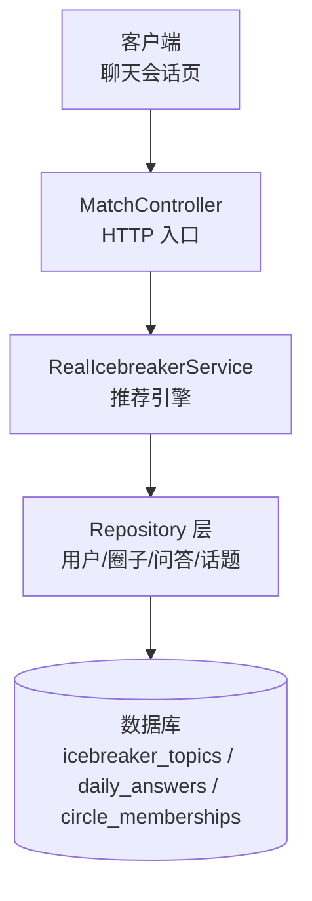
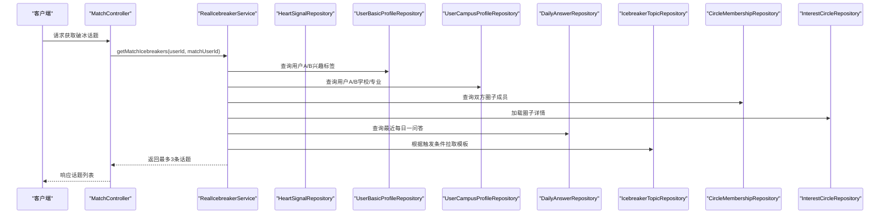
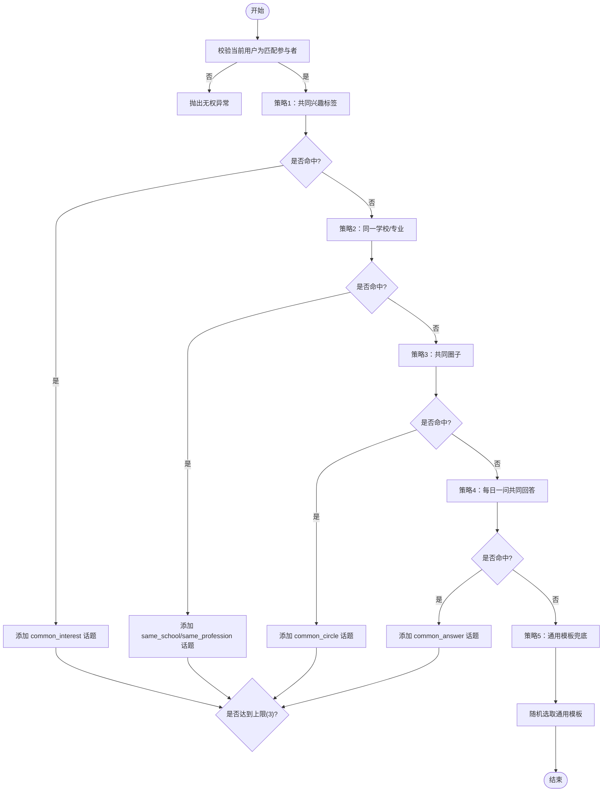
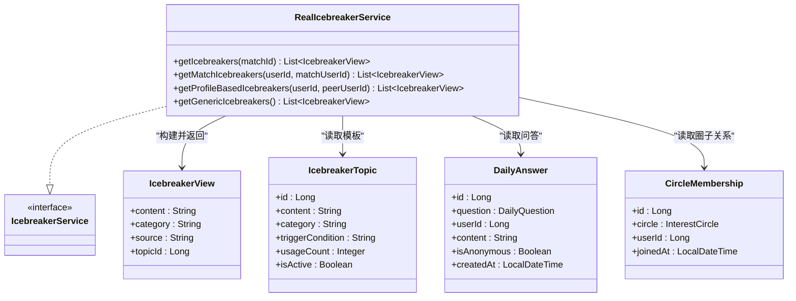

# 破冰消息系统

<cite>
**本文引用的文件**
- [RealIcebreakerService.java](file://apps/api/src/main/java/com/campuslove/api/match/RealIcebreakerService.java)
- [IcebreakerService.java](file://apps/api/src/main/java/com/campuslove/api/match/IcebreakerService.java)
- [IcebreakerView.java](file://apps/api/src/main/java/com/campuslove/api/match/IcebreakerView.java)
- [IcebreakerTopic.java](file://apps/api/src/main/java/com/campuslove/api/entity/IcebreakerTopic.java)
- [DailyAnswer.java](file://apps/api/src/main/java/com/campuslove/api/entity/DailyAnswer.java)
- [CircleMembership.java](file://apps/api/src/main/java/com/campuslove/api/entity/CircleMembership.java)
- [MatchController.java](file://apps/api/src/main/java/com/campuslove/api/match/MatchController.java)
</cite>

## 目录
1. [简介](#简介)
2. [项目结构](#项目结构)
3. [核心组件](#核心组件)
4. [架构总览](#架构总览)
5. [详细组件分析](#详细组件分析)
6. [依赖关系分析](#依赖关系分析)
7. [性能与可扩展性](#性能与可扩展性)
8. [故障排查指南](#故障排查指南)
9. [结论](#结论)
10. [附录：数据模型与接口约定](#附录数据模型与接口约定)

## 简介
本技术文档围绕“破冰消息系统”展开，重点说明 RealIcebreakerService 的实现原理与推荐策略，覆盖基于匹配关系的个性化破冰话题生成、话题去重与质量控制、以及每日问答与圈子关系的联动机制。该系统在用户完成匹配后，依据共同兴趣标签、学校/专业、共同圈子、每日一问共同回答等维度，按优先级顺序生成最多 3 条破冰话题；当以上维度均无法命中时，回退到通用模板库随机选取。该设计兼顾了话题的相关性与多样性，同时通过触发条件与分类体系实现可运营化的内容管理。

## 项目结构
破冰相关代码主要位于后端 API 模块中，服务层以 Spring Service 暴露能力，实体与仓储用于数据访问，控制器负责对外暴露 HTTP 接口（由 MatchController 接入）。前端通过聊天会话页调用对应接口获取建议并展示。

图表来源
- [RealIcebreakerService.java:1-486](file://apps/api/src/main/java/com/campuslove/api/match/RealIcebreakerService.java#L1-L486)
- [MatchController.java](file://apps/api/src/main/java/com/campuslove/api/match/MatchController.java)

章节来源
- [RealIcebreakerService.java:1-486](file://apps/api/src/main/java/com/campuslove/api/match/RealIcebreakerService.java#L1-L486)
- [MatchController.java](file://apps/api/src/main/java/com/campuslove/api/match/MatchController.java)

## 核心组件
- RealIcebreakerService：实现多策略的破冰话题推荐，包含共同兴趣、学校/专业、共同圈子、每日一问共同回答、通用模板兜底等策略，并按优先级合并结果，限制输出上限为 3 条。
- IcebreakerService：定义统一的服务契约，提供 getIcebreakers、getMatchIcebreakers、getProfileBasedIcebreakers、getGenericIcebreakers 等方法。
- IcebreakerView：返回给前端的视图对象，包含内容、分类、来源与模板 ID。
- IcebreakerTopic：持久化存储的话题模板，支持分类、触发条件、使用次数统计与启用状态控制。
- DailyAnswer：记录用户对“每日一问”的回答，用于识别双方是否回答过同一问题。
- CircleMembership：记录用户与圈子的成员关系，用于发现共同圈子。

章节来源
- [IcebreakerService.java:1-48](file://apps/api/src/main/java/com/campuslove/api/match/IcebreakerService.java#L1-L48)
- [IcebreakerView.java:1-68](file://apps/api/src/main/java/com/campuslove/api/match/IcebreakerView.java#L1-L68)
- [IcebreakerTopic.java:1-150](file://apps/api/src/main/java/com/campuslove/api/entity/IcebreakerTopic.java#L1-L150)
- [DailyAnswer.java:1-126](file://apps/api/src/main/java/com/campuslove/api/entity/DailyAnswer.java#L1-L126)
- [CircleMembership.java:1-95](file://apps/api/src/main/java/com/campuslove/api/entity/CircleMembership.java#L1-L95)

## 架构总览
系统采用分层架构：
- 控制器层：接收请求，参数校验与安全校验（如当前用户是否为匹配参与者）。
- 服务层：核心推荐逻辑，按优先级执行多种策略，组装结果并进行去重与限流。
- 数据访问层：通过 Repository 读取用户资料、圈子成员关系、每日一问答、话题模板等数据。
- 存储层：MySQL（JPA），使用乐观锁保证并发安全。

图表来源
- [RealIcebreakerService.java:1-486](file://apps/api/src/main/java/com/campuslove/api/match/RealIcebreakerService.java#L1-L486)

章节来源
- [RealIcebreakerService.java:1-486](file://apps/api/src/main/java/com/campuslove/api/match/RealIcebreakerService.java#L1-L486)

## 详细组件分析

### RealIcebreakerService：推荐策略与流程
- 输入校验与权限检查：确保当前用户是匹配双方之一，防止枚举他人匹配。
- 策略优先级：
  1) 共同兴趣标签：解析双方兴趣标签集合，取交集，匹配 common_interest 模板或生成默认文案。
  2) 同一学校/专业：比较学校名称与专业名称，分别匹配 same_school 与 same_profession 模板。
  3) 共同圈子：计算双方圈子集合交集，匹配 common_circle 模板。
  4) 每日一问共同回答：取用户A最近若干回答的问题ID集合，与用户B最近回答比对，命中则生成 common_answer 话题。
  5) 通用模板兜底：优先选择无触发条件的已启用模板，否则回退到任意已启用模板，随机选取。
- 结果限制：每条策略按需补充，累计不超过 MAX_ICEBREAKERS（3）条。
- 话题去重：由于各策略来源不同且模板ID作为 topicId 标识，若出现重复模板ID可在上层进行去重；当前实现按策略顺序填充，天然避免同策略内重复。
- 个性化与随机性：通用模板采用随机打乱，提升话题多样性；具体策略命中时优先使用模板占位符替换后的文案。

图表来源
- [RealIcebreakerService.java:1-486](file://apps/api/src/main/java/com/campuslove/api/match/RealIcebreakerService.java#L1-L486)

章节来源
- [RealIcebreakerService.java:1-486](file://apps/api/src/main/java/com/campuslove/api/match/RealIcebreakerService.java#L1-L486)

### IcebreakerTopic 实体设计
- 字段说明：
  - content：话题模板内容，支持占位符（如 {interest}、{school}、{profession}、{circle}）。
  - category：话题分类，如 interests、campus、lifestyle、daily、fun、romantic、circles、general。
  - trigger_condition：触发条件标识，如 common_interest、same_school、common_answer、common_circle、same_profession。
  - usage_count：使用次数，可用于质量评估与排序。
  - is_active：是否启用，仅启用模板参与推荐。
  - version：乐观锁版本号，保障并发更新一致性。
- 用途：作为可运营的话题素材库，配合触发条件实现精细化推荐。

章节来源
- [IcebreakerTopic.java:1-150](file://apps/api/src/main/java/com/campuslove/api/entity/IcebreakerTopic.java#L1-L150)

### DailyAnswer 每日问答机制
- 作用：记录用户对每日问题的回答，用于识别双方是否有共同回答过的题目。
- 算法要点：
  - 取用户A最近的若干回答（实现中取最近5个），收集其问题ID集合。
  - 遍历用户B的最近回答，若问题ID在集合中，则命中 common_answer 策略。
- 隐私保护：仅基于问题ID匹配，不直接暴露回答内容。

章节来源
- [DailyAnswer.java:1-126](file://apps/api/src/main/java/com/campuslove/api/entity/DailyAnswer.java#L1-L126)
- [RealIcebreakerService.java:1-486](file://apps/api/src/main/java/com/campuslove/api/match/RealIcebreakerService.java#L1-L486)

### CircleMembership 圈子关系匹配
- 作用：记录用户加入的圈子，用于发现共同圈子。
- 算法要点：
  - 分别查询双方圈子成员，提取圈子ID集合，求交集得到共同圈子。
  - 匹配 common_circle 模板，或使用默认文案提示共同圈子。
- 扩展点：可按圈子活跃度或权重调整推荐优先级。

章节来源
- [CircleMembership.java:1-95](file://apps/api/src/main/java/com/campuslove/api/entity/CircleMembership.java#L1-L95)
- [RealIcebreakerService.java:1-486](file://apps/api/src/main/java/com/campuslove/api/match/RealIcebreakerService.java#L1-L486)

### 话题内容管理与分类体系
- 分类体系：category 字段区分话题类型，便于前端渲染与数据分析。
- 触发条件：trigger_condition 将模板与场景绑定，实现精准投放。
- 启用与统计：is_active 控制是否参与推荐；usage_count 可用于质量评估与排序优化。
- 占位符替换：在服务层根据匹配上下文替换 {interest}、{school}、{profession}、{circle} 等变量。

章节来源
- [IcebreakerTopic.java:1-150](file://apps/api/src/main/java/com/campuslove/api/entity/IcebreakerTopic.java#L1-L150)
- [RealIcebreakerService.java:1-486](file://apps/api/src/main/java/com/campuslove/api/match/RealIcebreakerService.java#L1-L486)

### 话题质量评估与优化策略
- 短期指标：
  - 回复率：发送话题后对方回复的比例。
  - 对话时长：首次破冰后持续聊天的时长。
  - 跳过率：用户忽略或关闭话题的频率。
- 长期指标：
  - 转化率：破冰后发展为稳定关系（如互关、多次聊天）的用户比例。
- 优化手段：
  - 基于 usage_count 与业务埋点，动态提升高价值模板权重。
  - A/B 测试不同分类或触发条件组合的效果。
  - 对低质量模板降低启用概率或下线。

[本节为通用指导，不直接分析具体文件]

### 破冰效果分析与用户反馈收集
- 事件埋点：
  - 曝光：展示话题列表。
  - 点击：用户点击某话题。
  - 发送：用户发送话题。
  - 回复：对方回复消息。
  - 负面反馈：用户标记“不感兴趣”或关闭面板。
- 分析维度：
  - 按分类与触发条件分组统计。
  - 新用户与老用户差异对比。
  - 不同学校/圈子维度的效果对比。
- 反馈闭环：
  - 将负面反馈较多的模板降权或下线。
  - 将高回复率模板加入热门池，提高被选中概率。

[本节为通用指导，不直接分析具体文件]

## 依赖关系分析
RealIcebreakerService 依赖多个 Repository 完成数据读取，并与实体类形成清晰的领域模型映射。

图表来源
- [RealIcebreakerService.java:1-486](file://apps/api/src/main/java/com/campuslove/api/match/RealIcebreakerService.java#L1-L486)
- [IcebreakerService.java:1-48](file://apps/api/src/main/java/com/campuslove/api/match/IcebreakerService.java#L1-L48)
- [IcebreakerView.java:1-68](file://apps/api/src/main/java/com/campuslove/api/match/IcebreakerView.java#L1-L68)
- [IcebreakerTopic.java:1-150](file://apps/api/src/main/java/com/campuslove/api/entity/IcebreakerTopic.java#L1-L150)
- [DailyAnswer.java:1-126](file://apps/api/src/main/java/com/campuslove/api/entity/DailyAnswer.java#L1-L126)
- [CircleMembership.java:1-95](file://apps/api/src/main/java/com/campuslove/api/entity/CircleMembership.java#L1-L95)

章节来源
- [RealIcebreakerService.java:1-486](file://apps/api/src/main/java/com/campuslove/api/match/RealIcebreakerService.java#L1-L486)
- [IcebreakerService.java:1-48](file://apps/api/src/main/java/com/campuslove/api/match/IcebreakerService.java#L1-L48)

## 性能与可扩展性
- 时间复杂度：
  - 兴趣标签交集：O(n+m)，n、m 分别为双方标签数量。
  - 圈子交集：O(a+b)，a、b 为双方圈子数量。
  - 每日一问匹配：O(k×p)，k 为用户A最近答案数，p 为用户B最近答案数（实现中 k≈5）。
- I/O 优化：
  - 所有查询均为只读事务，减少写放大。
  - 仅在必要时加载圈子详情，避免冗余查询。
- 可扩展点：
  - 引入缓存层缓存高频用户资料与圈子信息。
  - 增加策略权重配置，支持按用户画像动态调整优先级。
  - 增加话题质量评分模型，结合使用次数与反馈数据进行智能排序。

[本节为通用指导，不直接分析具体文件]

## 故障排查指南
- 常见错误：
  - 匹配记录不存在：抛出非法参数异常，检查传入的 matchId 是否正确。
  - 无权查看：当前用户不是匹配双方之一，检查登录态与匹配归属。
  - 兴趣标签 JSON 解析失败：日志记录并回退为空集合，检查用户资料中 interestTags 格式。
- 定位步骤：
  - 确认请求参数与用户身份。
  - 查看各 Repository 查询是否返回空集（用户资料缺失、圈子未加入、问答未提交）。
  - 检查话题模板是否启用（is_active=true）且存在对应触发条件。
- 恢复措施：
  - 补齐用户资料或引导用户填写兴趣标签。
  - 引导用户加入圈子或回答每日一问。
  - 在后台启用更多通用模板以提升兜底覆盖率。

章节来源
- [RealIcebreakerService.java:1-486](file://apps/api/src/main/java/com/campuslove/api/match/RealIcebreakerService.java#L1-L486)

## 结论
RealIcebreakerService 通过分层策略与模板化管理，实现了高质量、个性化的破冰推荐。系统在保证隐私与性能的前提下，有效提升了匹配后的沟通效率。未来可通过更精细的质量评估与策略权重优化，进一步提升破冰效果与用户体验。

[本节为总结，不直接分析具体文件]

## 附录：数据模型与接口约定
- 数据模型
  - IcebreakerTopic：id、content、category、trigger_condition、usage_count、is_active、created_at、updated_at、version。
  - DailyAnswer：id、question_id、user_id、content、is_anonymous、created_at、version。
  - CircleMembership：id、circle_id、user_id、joined_at、version。
- 接口约定
  - 服务方法：
    - getIcebreakers(matchId)：基于匹配ID获取破冰话题。
    - getMatchIcebreakers(userId, matchUserId)：基于双方用户ID获取个性化话题。
    - getProfileBasedIcebreakers(userId, peerUserId)：基于对方资料生成话题。
    - getGenericIcebreakers()：获取通用模板话题。
  - 返回结构：
    - IcebreakerView：content、category、source、topicId。

章节来源
- [IcebreakerService.java:1-48](file://apps/api/src/main/java/com/campuslove/api/match/IcebreakerService.java#L1-L48)
- [IcebreakerView.java:1-68](file://apps/api/src/main/java/com/campuslove/api/match/IcebreakerView.java#L1-L68)
- [IcebreakerTopic.java:1-150](file://apps/api/src/main/java/com/campuslove/api/entity/IcebreakerTopic.java#L1-L150)
- [DailyAnswer.java:1-126](file://apps/api/src/main/java/com/campuslove/api/entity/DailyAnswer.java#L1-L126)
- [CircleMembership.java:1-95](file://apps/api/src/main/java/com/campuslove/api/entity/CircleMembership.java#L1-L95)