# 后端API服务

<cite>
**本文引用的文件**   
- [apps/api/pom.xml](file://apps/api/pom.xml)
- [docker-compose.yml](file://docker-compose.yml)
- [docker/client-nginx.conf](file://docker/client-nginx.conf)
- [docs/openapi/users.yaml](file://docs/openapi/users.yaml)
- [docs/openapi/check-in.yaml](file://docs/openapi/check-in.yaml)
- [docs/openapi/feedback-growth-and-auth.yaml](file://docs/openapi/feedback-growth-and-auth.yaml)
- [docs/openapi/likes.yaml](file://docs/openapi/likes.yaml)
- [docs/openapi/notifications.yaml](file://docs/openapi/notifications.yaml)
- [docs/openapi/official-accounts.yaml](file://docs/openapi/official-accounts.yaml)
- [docs/openapi/recommendations.yaml](file://docs/openapi/recommendations.yaml)
- [docs/openapi/village.yaml](file://docs/openapi/village.yaml)
- [docs/openapi/whispers.yaml](file://docs/openapi/whispers.yaml)
- [database/seed-demo-data.sql](file://database/seed-demo-data.sql)
- [database/seed-post-interactions.sql](file://database/seed-post-interactions.sql)
- [database/seed-refresh-chat-demo-times.sql](file://database/seed-refresh-chat-demo-times.sql)
- [apps/api/start-api.ps1](file://apps/api/start-api.ps1)
- [tools/run-api-wrapper.cjs](file://tools/run-api-wrapper.cjs)
</cite>

## 目录
1. [简介](#简介)
2. [项目结构](#项目结构)
3. [核心组件](#核心组件)
4. [架构总览](#架构总览)
5. [详细组件分析](#详细组件分析)
6. [依赖关系分析](#依赖关系分析)
7. [性能与可观测性](#性能与可观测性)
8. [故障排查指南](#故障排查指南)
9. [结论](#结论)
10. [附录：OpenAPI接口清单](#appendicesopenapi接口清单)

## 简介
本项目是一个基于 Spring Boot 3 的后端 API 服务，面向校园社交场景，提供用户认证授权、内容互动（点赞、私信、通知）、社区圈层（村/圈子）、推荐与官方账号等能力。系统采用分层架构，结合 JPA、Redis、消息队列与分布式锁，支持缓存、限流、熔断降级、监控指标与 OpenAPI 文档。

从构建配置可见，后端使用 Spring Boot 3.3.1、Java 17，集成 Spring Security、JPA、Flyway、Redis、Redisson、Spring AMQP、Resilience4j、Micrometer/Prometheus、Caffeine、Bucket4j 等组件；并通过 springdoc-openapi 暴露 OpenAPI/Swagger UI。

## 项目结构
仓库以多应用方式组织，后端 API 位于 apps/api，前端管理端与客户端分别位于 apps/admin、apps/client。数据库迁移脚本在 database/flyway，OpenAPI 规范在 docs/openapi，Docker 与编排在 docker 与 docker-compose.yml。

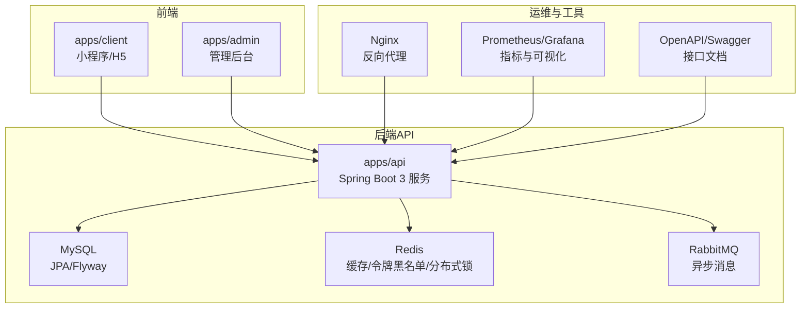

**图示来源**  
- [apps/api/pom.xml:1-377](file://apps/api/pom.xml#L1-L377)  
- [docker-compose.yml](file://docker-compose.yml)  
- [docker/client-nginx.conf](file://docker/client-nginx.conf)

**章节来源**  
- [apps/api/pom.xml:1-377](file://apps/api/pom.xml#L1-L377)  
- [docker-compose.yml](file://docker-compose.yml)

## 核心组件
- Web 与校验：spring-boot-starter-web、validation，用于 REST 控制器与参数校验。
- 数据持久化：spring-boot-starter-jdbc、data-jpa、mysql-connector-j、Flyway，配合 MySQL 完成实体映射与版本化迁移。
- 安全与认证：spring-boot-starter-security、BCryptPasswordEncoder、JWT（jjwt），实现用户认证与鉴权。
- 缓存与分布式能力：spring-boot-starter-data-redis、Caffeine、Redisson，提供本地与分布式缓存、分布式锁。
- 消息与韧性：spring-boot-starter-amqp、spring-retry、resilience4j-spring-boot3/reactor，支撑异步消息、重试与熔断降级。
- 可观测性与治理：spring-boot-starter-actuator、micrometer-registry-prometheus、springdoc-openapi、bucket4j-core。

**章节来源**  
- [apps/api/pom.xml:1-377](file://apps/api/pom.xml#L1-L377)

## 架构总览
系统整体为“前端 → Nginx/API 网关 → Spring Boot API → 数据与中间件”的分层架构。API 内部遵循 Controller → Service → Repository 的分层设计，通过 Spring Security 进行统一鉴权，使用 Redis 做缓存与令牌黑名单，借助 RabbitMQ 处理异步任务，通过 Resilience4j 对外部依赖做韧性保护，并以 Micrometer + Prometheus 暴露运行时指标。

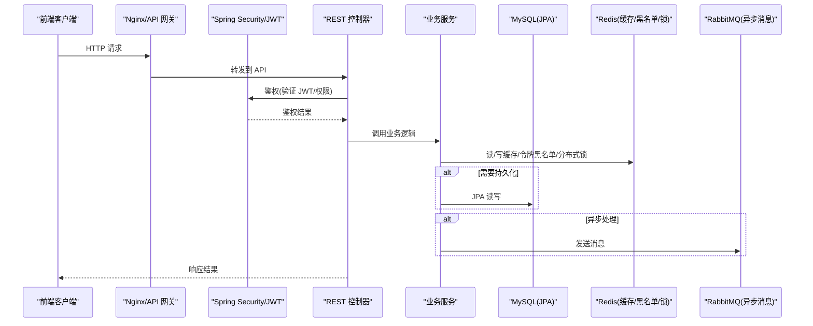

**图示来源**  
- [apps/api/pom.xml:1-377](file://apps/api/pom.xml#L1-L377)  
- [docker/client-nginx.conf](file://docker/client-nginx.conf)

## 详细组件分析

### 用户认证与授权
- 认证流程：客户端登录成功后获取 JWT；后续请求携带 Authorization: Bearer <token>。服务端通过 Spring Security 拦截器解析并校验 JWT，校验失败则返回未授权。
- 令牌管理：JWT 使用 jjwt 生成与解析；Redis 维护令牌黑名单或会话状态以实现主动失效与批量撤销。
- 授权策略：基于角色/权限的访问控制，敏感接口需特定权限才能访问。

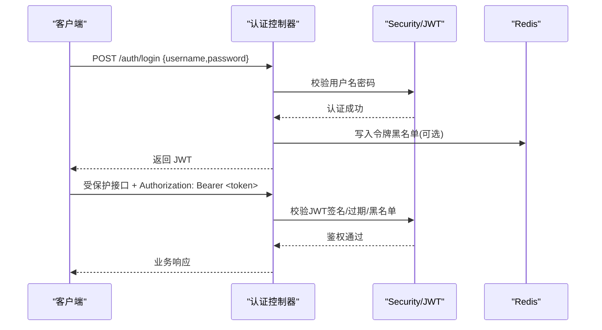

**图示来源**  
- [apps/api/pom.xml:1-377](file://apps/api/pom.xml#L1-L377)

**章节来源**  
- [apps/api/pom.xml:1-377](file://apps/api/pom.xml#L1-L377)

### 安全防护配置
- 传输安全：建议启用 HTTPS，由 Nginx 终止 TLS，后端接收明文 HTTP。
- 请求校验：使用 Bean Validation 注解对入参进行格式校验，统一错误码与错误体。
- 速率限制：基于 Bucket4j 的令牌桶算法对接口进行限流，防止恶意刷接口。
- 跨域与白名单：按环境配置允许的域名与头部。

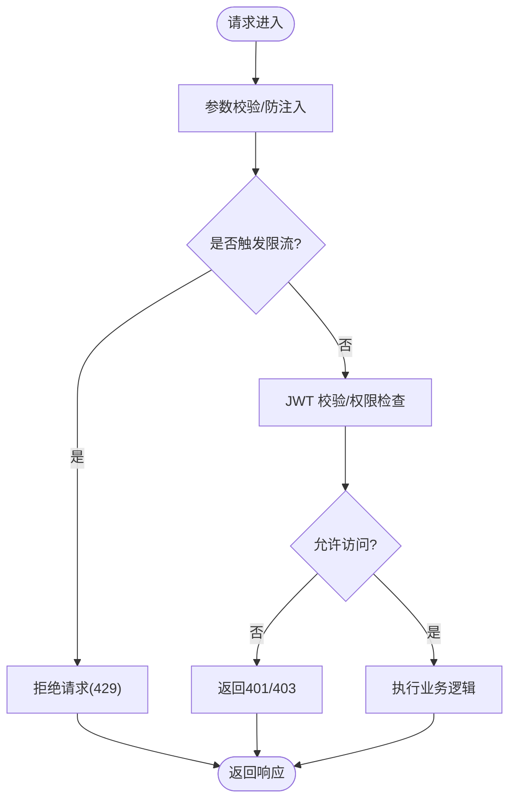

**图示来源**  
- [apps/api/pom.xml:1-377](file://apps/api/pom.xml#L1-L377)

**章节来源**  
- [apps/api/pom.xml:1-377](file://apps/api/pom.xml#L1-L377)

### RESTful API 设计与版本管理
- 设计规范：资源命名采用名词复数形式，HTTP 方法对应 CRUD；分页使用 query 参数；错误码统一结构。
- 版本管理：可通过 URL 前缀（如 /v1）或请求头进行版本控制；当前 OpenAPI 文档以领域划分，便于逐步演进至多版本并存。
- 文档化：通过 springdoc-openapi 自动生成接口文档，OpenAPI YAML 文件集中管理接口契约。

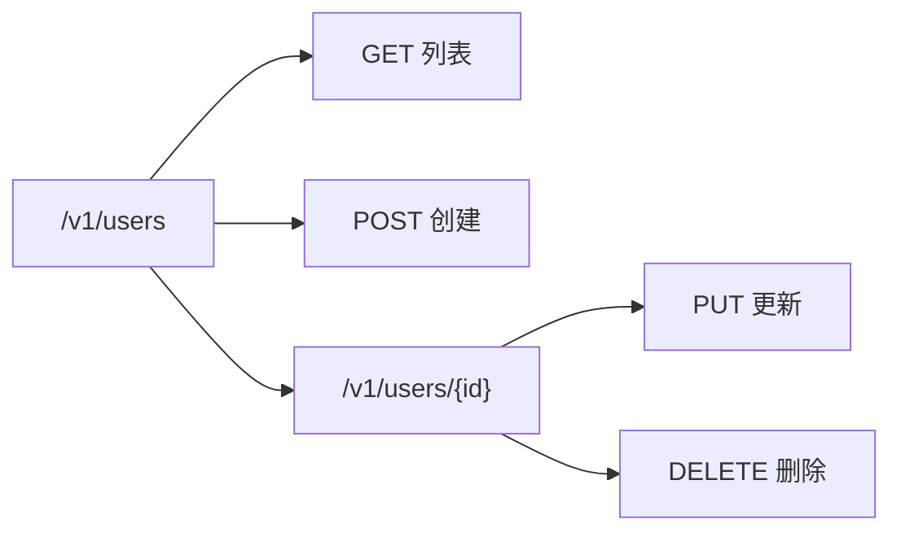

**图示来源**  
- [docs/openapi/users.yaml](file://docs/openapi/users.yaml)

**章节来源**  
- [apps/api/pom.xml:1-377](file://apps/api/pom.xml#L1-L377)  
- [docs/openapi/users.yaml](file://docs/openapi/users.yaml)

### 数据库访问层与查询优化
- ORM 与迁移：JPA 负责实体映射与基础 CRUD；Flyway 管理数据库版本化迁移。
- 连接与索引：合理设置连接池大小与超时；对高频查询字段建立索引，避免全表扫描。
- 复杂查询：优先使用 JPQL/Specification 组合条件，必要时使用原生 SQL；分页查询避免大偏移量。

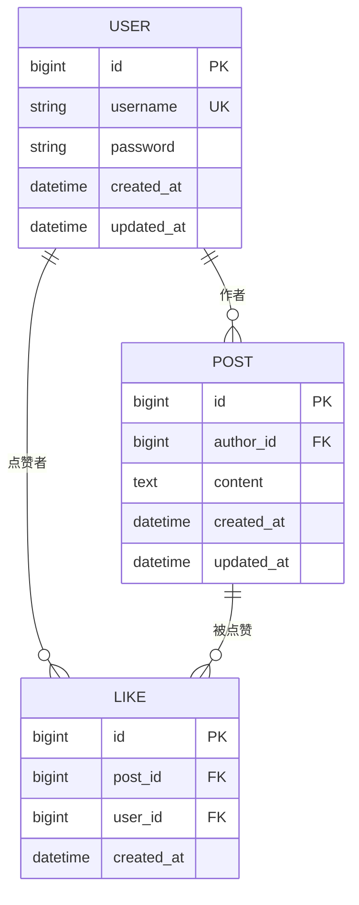

**图示来源**  
- [database/seed-demo-data.sql](file://database/seed-demo-data.sql)  
- [database/seed-post-interactions.sql](file://database/seed-post-interactions.sql)

**章节来源**  
- [apps/api/pom.xml:1-377](file://apps/api/pom.xml#L1-L377)  
- [database/seed-demo-data.sql](file://database/seed-demo-data.sql)  
- [database/seed-post-interactions.sql](file://database/seed-post-interactions.sql)

### 缓存策略与异步处理
- 多级缓存：Caffeine 作为 L1 本地缓存，Redis 作为 L2 分布式缓存；热点数据优先走本地缓存，穿透时回源 DB 并回填缓存。
- 异步消息：使用 Spring AMQP 将耗时任务（通知、统计、导出）投递到队列，消费者异步处理，提升吞吐与用户体验。
- 事件驱动：关键业务变更发布领域事件，订阅方独立处理，降低耦合度。

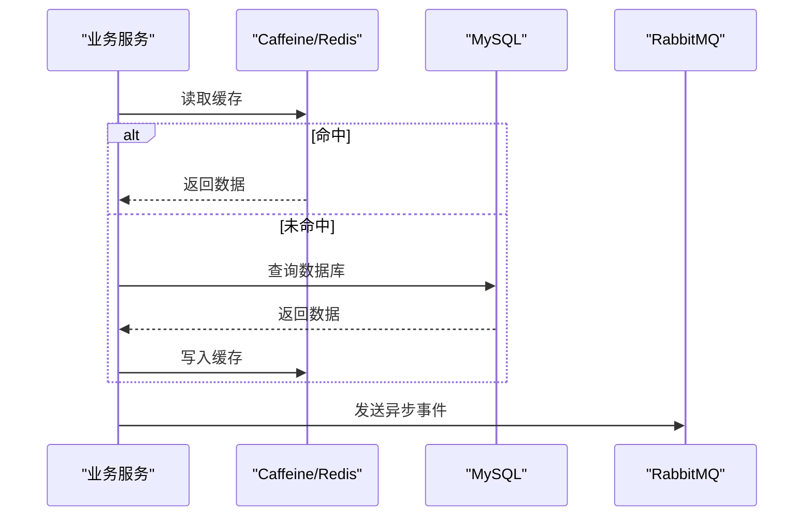

**图示来源**  
- [apps/api/pom.xml:1-377](file://apps/api/pom.xml#L1-L377)

**章节来源**  
- [apps/api/pom.xml:1-377](file://apps/api/pom.xml#L1-L377)

### 分布式锁实现
- 场景：续费、秒杀、库存扣减等并发敏感操作。
- 方案：基于 Redisson 的 RLock，支持可重入、看门狗自动续期、宕机释放；在关键代码段加锁，保证原子性。
- 最佳实践：尽量缩短持锁时间，避免死锁；为锁键加入业务维度，减少误锁。

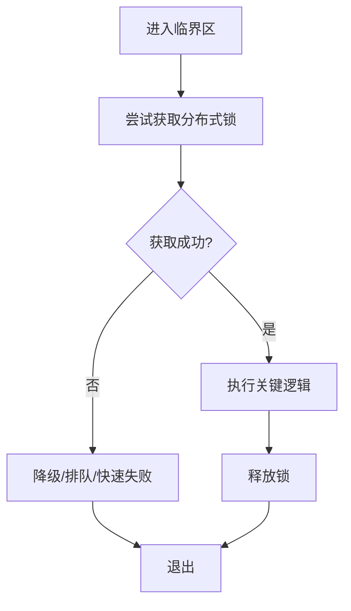

**图示来源**  
- [apps/api/pom.xml:1-377](file://apps/api/pom.xml#L1-L377)

**章节来源**  
- [apps/api/pom.xml:1-377](file://apps/api/pom.xml#L1-L377)

### API 网关、负载均衡与服务发现
- 网关：Nginx 作为反向代理，承担 TLS 终止、静态资源托管、请求转发与简单路由规则。
- 负载均衡：可在 Nginx 层配置 upstream 轮询/加权；容器化后可扩展至 K8s Ingress/Service Mesh。
- 服务发现：单体阶段通过固定地址访问；未来微服务化后引入注册中心（如 Nacos/Eureka）与动态路由。

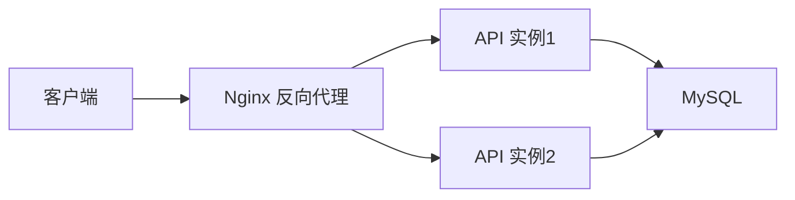

**图示来源**  
- [docker/client-nginx.conf](file://docker/client-nginx.conf)

**章节来源**  
- [docker/client-nginx.conf](file://docker/client-nginx.conf)

## 依赖关系分析

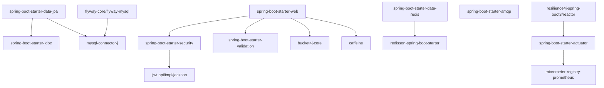

**图示来源**  
- [apps/api/pom.xml:1-377](file://apps/api/pom.xml#L1-L377)

**章节来源**  
- [apps/api/pom.xml:1-377](file://apps/api/pom.xml#L1-L377)

## 性能与可观测性
- 压测与容量规划：根据 QPS/TP99 目标评估 CPU、内存、IO 与带宽；分库分表与读写分离按需引入。
- 连接池与缓存：合理设置 HikariCP、Redis 连接池与缓存 TTL；热点数据预热。
- 监控告警：Actuator + Prometheus 暴露 JVM、HTTP、DB、Redis 指标；Grafana 可视化；针对慢查询、错误率、延迟阈值告警。
- 日志追踪：统一日志格式，关联 TraceId；链路日志上送 ELK/ Loki。

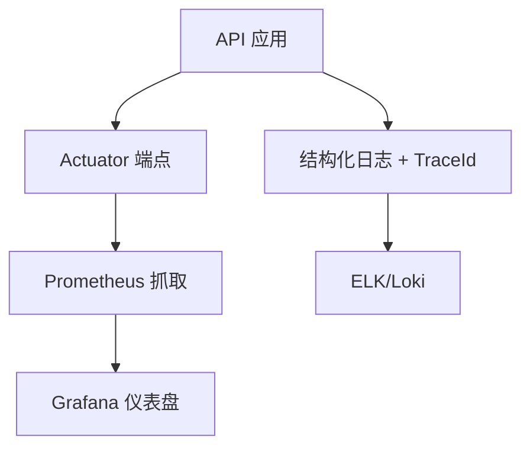

**图示来源**  
- [apps/api/pom.xml:1-377](file://apps/api/pom.xml#L1-L377)

**章节来源**  
- [apps/api/pom.xml:1-377](file://apps/api/pom.xml#L1-L377)

## 故障排查指南
- 启动失败：检查 Java 版本与端口占用；确认数据库与 Redis/RabbitMQ 连通性；查看 Actuator 健康端点。
- 鉴权异常：核对 JWT 密钥与过期策略；检查 Redis 中令牌黑名单；浏览器/客户端是否正确携带 Authorization。
- 接口限流：观察 Bucket4j 计数与窗口；适当调整限流阈值与白名单。
- 慢查询与阻塞：定位慢 SQL、锁等待；检查 Redis/MQ 消费堆积。
- 缓存不一致：清理热点 Key 或缩短 TTL；关注缓存击穿/雪崩防护策略。

**章节来源**  
- [apps/api/pom.xml:1-377](file://apps/api/pom.xml#L1-L377)

## 结论
本后端 API 服务以 Spring Boot 3 为核心，围绕认证授权、数据安全、高可用与可观测性构建了完整的技术栈。通过分层架构、OpenAPI 契约、缓存与消息解耦、分布式锁与韧性框架，满足校园社交场景下的高并发与稳定性需求。后续可按微服务拆分与云原生部署进一步演进。

## 附录：OpenAPI 接口清单
以下为已定义的 OpenAPI 契约文件，覆盖用户、签到、反馈与成长、点赞、通知、官方账号、推荐、村落/圈子、私语等模块：

- [docs/openapi/users.yaml](file://docs/openapi/users.yaml)
- [docs/openapi/check-in.yaml](file://docs/openapi/check-in.yaml)
- [docs/openapi/feedback-growth-and-auth.yaml](file://docs/openapi/feedback-growth-and-auth.yaml)
- [docs/openapi/likes.yaml](file://docs/openapi/likes.yaml)
- [docs/openapi/notifications.yaml](file://docs/openapi/notifications.yaml)
- [docs/openapi/official-accounts.yaml](file://docs/openapi/official-accounts.yaml)
- [docs/openapi/recommendations.yaml](file://docs/openapi/recommendations.yaml)
- [docs/openapi/village.yaml](file://docs/openapi/village.yaml)
- [docs/openapi/whispers.yaml](file://docs/openapi/whispers.yaml)

**章节来源**  
- [docs/openapi/users.yaml](file://docs/openapi/users.yaml)
- [docs/openapi/check-in.yaml](file://docs/openapi/check-in.yaml)
- [docs/openapi/feedback-growth-and-auth.yaml](file://docs/openapi/feedback-growth-and-auth.yaml)
- [docs/openapi/likes.yaml](file://docs/openapi/likes.yaml)
- [docs/openapi/notifications.yaml](file://docs/openapi/notifications.yaml)
- [docs/openapi/official-accounts.yaml](file://docs/openapi/official-accounts.yaml)
- [docs/openapi/recommendations.yaml](file://docs/openapi/recommendations.yaml)
- [docs/openapi/village.yaml](file://docs/openapi/village.yaml)
- [docs/openapi/whispers.yaml](file://docs/openapi/whispers.yaml)