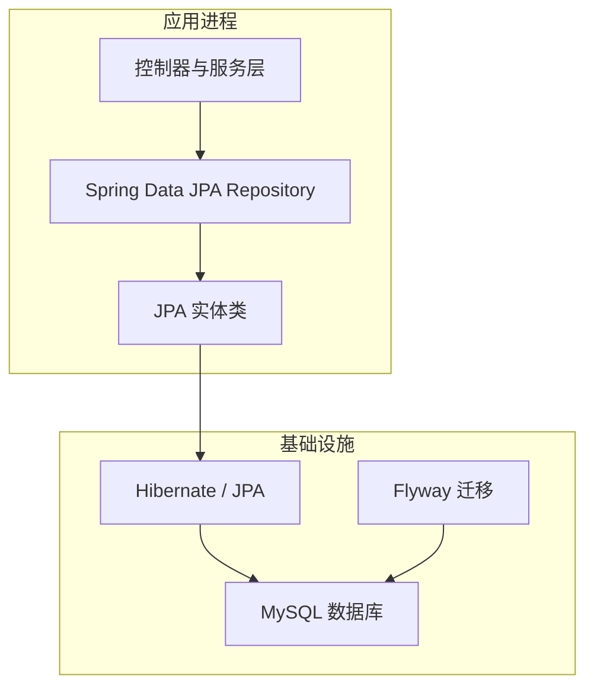
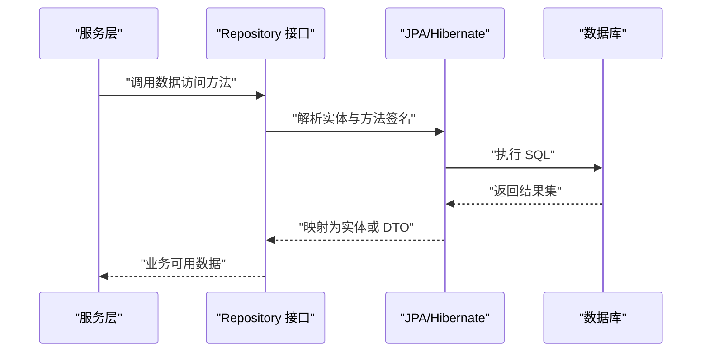
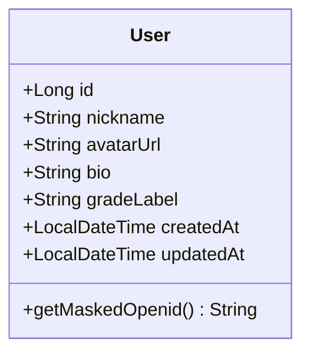
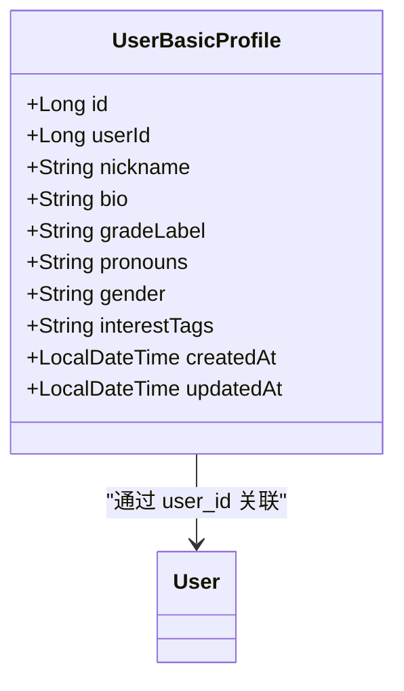
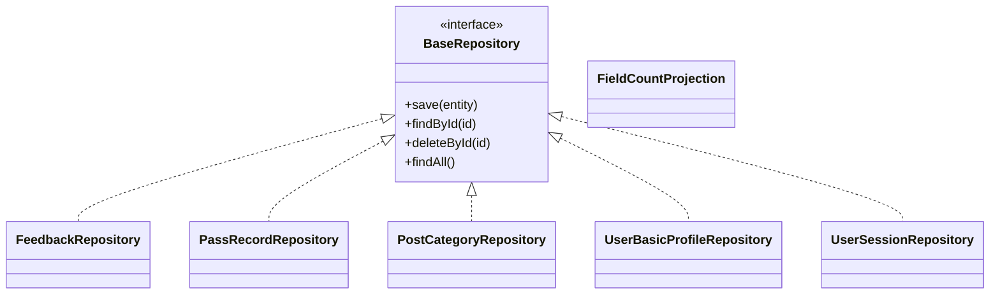
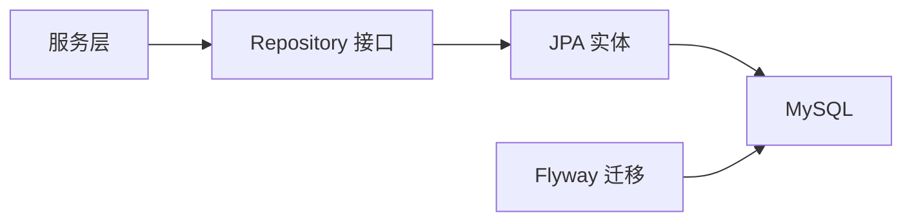
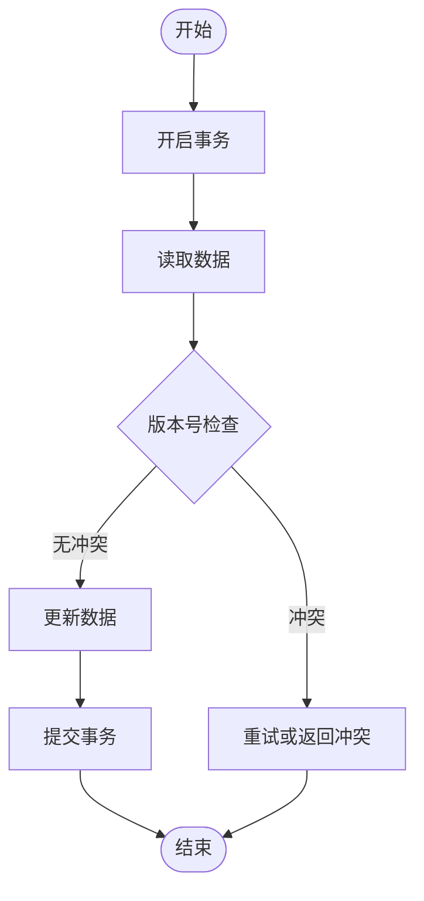
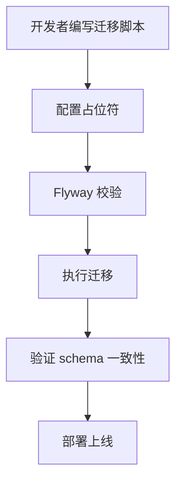

# 数据访问层

<cite>
**本文引用的文件**   
- [User.java](file://apps/api/src/main/java/com/campuslove/api/entity/User.java)
- [UserBasicProfile.java](file://apps/api/src/main/java/com/campuslove/api/entity/UserBasicProfile.java)
- [VisibilityConverter.java](file://apps/api/src/main/java/com/campuslove/api/entity/VisibilityConverter.java)
- [FeedbackRepository.java](file://apps/api/src/main/java/com/campuslove/api/repository/FeedbackRepository.java)
- [PassRecordRepository.java](file://apps/api/src/main/java/com/campuslove/api/repository/PassRecordRepository.java)
- [PostCategoryRepository.java](file://apps/api/src/main/java/com/campuslove/api/repository/PostCategoryRepository.java)
- [DailyQuestionRepository.java](file://apps/api/src/main/java/com/campuslove/api/repository/DailyQuestionRepository.java)
- [PrivateConversationRepository.java](file://apps/api/src/main/java/com/campuslove/api/repository/PrivateConversationRepository.java)
- [RecommendationPreferenceRepository.java](file://apps/api/src/main/java/com/campuslove/api/repository/RecommendationPreferenceRepository.java)
- [UserSessionRepository.java](file://apps/api/src/main/java/com/campuslove/api/repository/UserSessionRepository.java)
- [CampusTopicReplyRepository.java](file://apps/api/src/main/java/com/campuslove/api/repository/CampusTopicReplyRepository.java)
- [DailyBenefitRepository.java](file://apps/api/src/main/java/com/campuslove/api/repository/DailyBenefitRepository.java)
- [IcebreakerTopicRepository.java](file://apps/api/src/main/java/com/campuslove/api/repository/IcebreakerTopicRepository.java)
- [PushPreferenceRepository.java](file://apps/api/src/main/java/com/campuslove/api/repository/PushPreferenceRepository.java)
- [PushSummaryRepository.java](file://apps/api/src/main/java/com/campuslove/api/repository/PushSummaryRepository.java)
- [SocialProgressRepository.java](file://apps/api/src/main/java/com/campuslove/api/repository/SocialProgressRepository.java)
- [UserBasicProfileRepository.java](file://apps/api/src/main/java/com/campuslove/api/repository/UserBasicProfileRepository.java)
- [AdminAppConfigRepository.java](file://apps/api/src/main/java/com/campuslove/api/repository/AdminAppConfigRepository.java)
- [AdminAppRuleRepository.java](file://apps/api/src/main/java/com/campuslove/api/repository/AdminAppRuleRepository.java)
- [AdminAppSwitchRepository.java](file://apps/api/src/main/java/com/campuslove/api/repository/AdminAppSwitchRepository.java)
- [MatchConfigEntityRepository.java](file://apps/api/src/main/java/com/campuslove/api/repository/MatchConfigEntityRepository.java)
- [NotifyConfigRepository.java](file://apps/api/src/main/java/com/campuslove/api/repository/NotifyConfigRepository.java)
- [RecommendStrategyRepository.java](file://apps/api/src/main/java/com/campuslove/api/repository/RecommendStrategyRepository.java)
- [CircleMembershipRepository.java](file://apps/api/src/main/java/com/campuslove/api/repository/CircleMembershipRepository.java)
- [DoNotDisturbSettingRepository.java](file://apps/api/src/main/java/com/campuslove/api/repository/DoNotDisturbSettingRepository.java)
- [ThirdPartyAccountRepository.java](file://apps/api/src/main/java/com/campuslove/api/repository/ThirdPartyAccountRepository.java)
- [VideoCallRecordRepository.java](file://apps/api/src/main/java/com/campuslove/api/repository/VideoCallRecordRepository.java)
- [VideoCallRepository.java](file://apps/api/src/main/java/com/campuslove/api/repository/VideoCallRepository.java)
- [FieldCountProjection.java](file://apps/api/src/main/java/com/campuslove/api/repository/FieldCountProjection.java)
- [flyway.toml](file://database/flyway/flyway.toml)
- [README.md](file://database/flyway/README.md)
</cite>

## 目录
1. [引言](#引言)
2. [项目结构](#项目结构)
3. [核心组件](#核心组件)
4. [架构总览](#架构总览)
5. [详细组件分析](#详细组件分析)
6. [依赖关系分析](#依赖关系分析)
7. [性能与缓存](#性能与缓存)
8. [事务、并发与一致性](#事务并发与一致性)
9. [数据库迁移与版本控制](#数据库迁移与版本控制)
10. [数据安全与合规](#数据安全与合规)
11. [故障排查](#故障排查)
12. [结论](#结论)

## 引言
本技术文档聚焦后端 API 模块的数据访问层，围绕 JPA 实体设计、Repository 接口约定、Flyway 数据库迁移管理，以及事务、并发、安全与性能策略展开。目标读者包括后端开发者、DBA、测试工程师和安全审计人员；文档在保持技术深度的同时，尽量使用直观图示和分层说明，帮助非专业读者理解整体数据流与约束。

## 项目结构
数据访问相关代码主要位于后端 API 模块中：
- JPA 实体集中在 `com.campuslove.api.entity`，用于映射用户、内容、匹配、成长体系、会话与运营配置等核心领域对象。
- Repository 接口集中在 `com.campuslove.api.repository`，面向 Spring Data JPA，提供基础 CRUD 与部分自定义查询。
- 数据库迁移脚本集中在 `database/flyway/sql`，由 Flyway 统一管理版本、校验与占位符注入。
- 种子与演示数据脚本位于 `database/*.sql`，配合 Flyway 的 `demo_seed` 开关控制是否写入演示数据。

**图表来源**
- [User.java:1-80](file://apps/api/src/main/java/com/campuslove/api/entity/User.java#L1-L80)
- [README.md:1-21](file://database/flyway/README.md#L1-L21)
- [flyway.toml:1-39](file://database/flyway/flyway.toml#L1-L39)

**章节来源**
- [README.md:1-21](file://database/flyway/README.md#L1-L21)
- [flyway.toml:1-39](file://database/flyway/flyway.toml#L1-L39)

## 核心组件
本节从三个维度梳理数据访问层的核心构件：
- 实体模型：以用户、用户基础资料为核心，扩展至内容、社交、匹配、成长、会话与运营管理等领域对象。
- 仓库接口：多数继承 Spring Data JPA 的基础 Repository，部分包含自定义查询或投影类型。
- 迁移与配置：通过 Flyway 管理表结构演进，统一占位符与校验规则，确保多环境一致性。

**章节来源**
- [User.java:1-80](file://apps/api/src/main/java/com/campuslove/api/entity/User.java#L1-L80)
- [UserBasicProfile.java:1-60](file://apps/api/src/main/java/com/campuslove/api/entity/UserBasicProfile.java#L1-L60)
- [flyway.toml:1-39](file://database/flyway/flyway.toml#L1-L39)

## 架构总览
数据访问层采用典型的分层结构：
- 控制器与服务层调用 Repository 接口完成业务数据访问。
- Repository 基于 Spring Data JPA，默认方法满足常见查询，复杂场景使用自定义查询或投影。
- JPA 将实体映射为数据库表，借助 Hibernate 生成 SQL。
- Flyway 在启动前执行迁移脚本，保证 schema 版本一致。

[此图为概念流程，不直接对应具体源文件，故不提供图表来源]

## 详细组件分析

### JPA 实体设计
实体类承担领域建模与持久化映射职责。以下以用户主表与用户基础资料为例说明设计要点。

#### 用户实体
- 表名与约束：实体映射到 `users` 表，定义 openid 唯一约束、手机号索引、创建时间索引。
- 审计字段：启用 `AuditingEntityListener`，由 Spring Data JPA 自动维护创建与更新时间。
- 隐私保护：openid 使用 `@JsonIgnore` 防止 JSON 序列化泄露，并通过脱敏工具暴露掩码值。
- 主键策略：自增 Long 主键。
- 字段扩展：包含昵称、头像、简介、年级标签等常用社交字段。

**图表来源**
- [User.java:1-80](file://apps/api/src/main/java/com/campuslove/api/entity/User.java#L1-L80)

**章节来源**
- [User.java:1-80](file://apps/api/src/main/java/com/campuslove/api/entity/User.java#L1-L80)

#### 用户基础资料实体
- 一对一关联：通过 `user_id` 唯一列与用户主表关联。
- 审计字段：同样启用审计监听器。
- 兴趣标签：使用 JSON 列存储兴趣标签数组。
- 扩展字段：支持身高、学历、感情状态、籍贯、未来城市、照片墙等 Phase A 扩展。

**图表来源**
- [UserBasicProfile.java:1-60](file://apps/api/src/main/java/com/campuslove/api/entity/UserBasicProfile.java#L1-L60)

**章节来源**
- [UserBasicProfile.java:1-60](file://apps/api/src/main/java/com/campuslove/api/entity/UserBasicProfile.java#L1-L60)

#### 可见性转换器
- 作用：将领域可见性枚举转换为可持久化的字符串或数值，供 JPA 映射。
- 典型用法：在实体字段上使用 `@Convert(converter = VisibilityConverter.class)`，使业务语义与存储格式解耦。

**章节来源**
- [VisibilityConverter.java](file://apps/api/src/main/java/com/campuslove/api/entity/VisibilityConverter.java)

### Repository 接口设计与自定义查询
仓库接口主要继承 Spring Data JPA 的 `CrudRepository`/`JpaRepository`，并补充特定查询方法。

- 基础仓库示例
  - FeedbackRepository：反馈工单数据访问。
  - PassRecordRepository：通行证记录数据访问。
  - PostCategoryRepository：帖子分类数据访问。
  - DailyQuestionRepository：每日问题数据访问。
  - PrivateConversationRepository：私聊会话数据访问。
  - RecommendationPreferenceRepository：推荐偏好数据访问。
  - UserSessionRepository：用户会话数据访问。
  - CampusTopicReplyRepository：校园话题回复数据访问。
  - DailyBenefitRepository：每日福利数据访问。
  - IcebreakerTopicRepository：破冰话题数据访问。
  - PushPreferenceRepository：推送偏好数据访问。
  - PushSummaryRepository：推送汇总数据访问。
  - SocialProgressRepository：社交进度数据访问。
  - UserBasicProfileRepository：用户基础资料数据访问。
  - AdminAppConfigRepository：管理端应用配置数据访问。
  - AdminAppRuleRepository：管理端规则数据访问。
  - AdminAppSwitchRepository：管理端开关数据访问。
  - MatchConfigEntityRepository：匹配配置数据访问。
  - NotifyConfigRepository：通知配置数据访问。
  - RecommendStrategyRepository：推荐策略数据访问。
  - CircleMembershipRepository：圈子成员关系数据访问。
  - DoNotDisturbSettingRepository：免打扰设置数据访问。
  - ThirdPartyAccountRepository：第三方账户绑定数据访问。
  - VideoCallRepository：视频通话数据访问。
  - VideoCallRecordRepository：视频通话记录数据访问。

- 投影与统计
  - FieldCountProjection：用于简化字段选择与聚合统计，减少不必要字段传输。

**图表来源**
- [FeedbackRepository.java](file://apps/api/src/main/java/com/campuslove/api/repository/FeedbackRepository.java)
- [PassRecordRepository.java](file://apps/api/src/main/java/com/campuslove/api/repository/PassRecordRepository.java)
- [PostCategoryRepository.java](file://apps/api/src/main/java/com/campuslove/api/repository/PostCategoryRepository.java)
- [UserBasicProfileRepository.java](file://apps/api/src/main/java/com/campuslove/api/repository/UserBasicProfileRepository.java)
- [UserSessionRepository.java](file://apps/api/src/main/java/com/campuslove/api/repository/UserSessionRepository.java)
- [FieldCountProjection.java](file://apps/api/src/main/java/com/campuslove/api/repository/FieldCountProjection.java)

**章节来源**
- [FeedbackRepository.java](file://apps/api/src/main/java/com/campuslove/api/repository/FeedbackRepository.java)
- [PassRecordRepository.java](file://apps/api/src/main/java/com/campuslove/api/repository/PassRecordRepository.java)
- [PostCategoryRepository.java](file://apps/api/src/main/java/com/campuslove/api/repository/PostCategoryRepository.java)
- [DailyQuestionRepository.java](file://apps/api/src/main/java/com/campuslove/api/repository/DailyQuestionRepository.java)
- [PrivateConversationRepository.java](file://apps/api/src/main/java/com/campuslove/api/repository/PrivateConversationRepository.java)
- [RecommendationPreferenceRepository.java](file://apps/api/src/main/java/com/campuslove/api/repository/RecommendationPreferenceRepository.java)
- [UserSessionRepository.java](file://apps/api/src/main/java/com/campuslove/api/repository/UserSessionRepository.java)
- [CampusTopicReplyRepository.java](file://apps/api/src/main/java/com/campuslove/api/repository/CampusTopicReplyRepository.java)
- [DailyBenefitRepository.java](file://apps/api/src/main/java/com/campuslove/api/repository/DailyBenefitRepository.java)
- [IcebreakerTopicRepository.java](file://apps/api/src/main/java/com/campuslove/api/repository/IcebreakerTopicRepository.java)
- [PushPreferenceRepository.java](file://apps/api/src/main/java/com/campuslove/api/repository/PushPreferenceRepository.java)
- [PushSummaryRepository.java](file://apps/api/src/main/java/com/campuslove/api/repository/PushSummaryRepository.java)
- [SocialProgressRepository.java](file://apps/api/src/main/java/com/campuslove/api/repository/SocialProgressRepository.java)
- [UserBasicProfileRepository.java](file://apps/api/src/main/java/com/campuslove/api/repository/UserBasicProfileRepository.java)
- [AdminAppConfigRepository.java](file://apps/api/src/main/java/com/campuslove/api/repository/AdminAppConfigRepository.java)
- [AdminAppRuleRepository.java](file://apps/api/src/main/java/com/campuslove/api/repository/AdminAppRuleRepository.java)
- [AdminAppSwitchRepository.java](file://apps/api/src/main/java/com/campuslove/api/repository/AdminAppSwitchRepository.java)
- [MatchConfigEntityRepository.java](file://apps/api/src/main/java/com/campuslove/api/repository/MatchConfigEntityRepository.java)
- [NotifyConfigRepository.java](file://apps/api/src/main/java/com/campuslove/api/repository/NotifyConfigRepository.java)
- [RecommendStrategyRepository.java](file://apps/api/src/main/java/com/campuslove/api/repository/RecommendStrategyRepository.java)
- [CircleMembershipRepository.java](file://apps/api/src/main/java/com/campuslove/api/repository/CircleMembershipRepository.java)
- [DoNotDisturbSettingRepository.java](file://apps/api/src/main/java/com/campuslove/api/repository/DoNotDisturbSettingRepository.java)
- [ThirdPartyAccountRepository.java](file://apps/api/src/main/java/com/campuslove/api/repository/ThirdPartyAccountRepository.java)
- [VideoCallRecordRepository.java](file://apps/api/src/main/java/com/campuslove/api/repository/VideoCallRecordRepository.java)
- [VideoCallRepository.java](file://apps/api/src/main/java/com/campuslove/api/repository/VideoCallRepository.java)
- [FieldCountProjection.java](file://apps/api/src/main/java/com/campuslove/api/repository/FieldCountProjection.java)

## 依赖关系分析
数据访问层的依赖关系呈现“服务层 → Repository → JPA → 数据库”的单向依赖，同时受 Flyway 迁移约束。

[此图为概念依赖图，不直接对应具体源文件，故不提供图表来源]

**章节来源**
- [README.md:1-21](file://database/flyway/README.md#L1-L21)
- [flyway.toml:1-39](file://database/flyway/flyway.toml#L1-L39)

## 性能与缓存
- 索引策略
  - 用户表：openid 唯一索引、phone 索引、created_at 索引，覆盖登录、列表排序与分页场景。
  - 其他实体：按查询热点建立复合索引（例如会话、消息、互动事件等），需结合具体表的 Flyway 脚本评估。
- 投影与只读视图
  - 使用投影类型（如 `FieldCountProjection`）减少字段回传，降低网络与序列化开销。
- 分页与批量
  - 优先使用 Spring Data JPA 的分页与批处理方法，避免全表扫描与大对象加载。
- 连接池与超时
  - 建议在应用配置中合理设置连接池大小、最大空闲连接、获取连接超时与语句超时，结合业务 QPS 与慢查询优化。
- 缓存建议
  - 对热点配置（管理员开关、规则、策略）可使用本地缓存或 Redis 缓存，注意失效策略与一致性保障。
  - 对用户信息、帖子摘要等高频读取数据，可考虑多级缓存（应用级 + 分布式）。

[本节为通用指导，未直接分析具体文件，故不提供章节来源]

## 事务、并发与一致性
- 事务边界
  - 写操作应包裹在事务中，跨多个 Repository 的方法应在服务层统一开启事务，避免部分成功导致数据不一致。
- 乐观锁
  - 实体中使用 `@Version` 字段进行乐观锁控制，适用于并发更新场景（如基础资料、配置项）。
- 幂等性与去重
  - 对重复提交、重试消息、点赞与关注等易并发场景，通过唯一约束与条件更新实现幂等。
- 最终一致性
  - 对于异步事件（如 Outbox 模式），结合消息队列与补偿机制保证最终一致；注意审计日志与错误上报。

[此图为概念流程图，不直接对应具体源文件，故不提供图表来源]

**章节来源**
- [User.java:1-80](file://apps/api/src/main/java/com/campuslove/api/entity/User.java#L1-L80)
- [UserBasicProfile.java:1-60](file://apps/api/src/main/java/com/campuslove/api/entity/UserBasicProfile.java#L1-L60)

## 数据库迁移与版本控制
本项目使用 Flyway 管理数据库迁移，核心要点如下：
- 迁移位置：`database/flyway/sql`，命名遵循 `V<timestamp>__描述.sql`。
- 校验与基线
  - `validateOnMigrate=true`：启动时校验已应用迁移的 checksum，防止历史脚本被篡改。
  - `baselineOnMigrate=false`：禁止在非空库上自动 baseline，避免跳过历史迁移。
- 占位符
  - 统一使用 `${...}` 语法，敏感参数（如管理员 openid、密码哈希）不得有默认弱值，必须通过环境变量或 CLI 参数注入。
  - 演示数据通过 `demo_seed` 开关控制，生产环境默认关闭。
- 运行命令
  - 在项目根目录执行 `run-flyway.cmd`，支持 version/info/migrate/validate/repair 等子命令。

**图表来源**
- [README.md:1-21](file://database/flyway/README.md#L1-L21)
- [flyway.toml:1-39](file://database/flyway/flyway.toml#L1-L39)

**章节来源**
- [README.md:1-21](file://database/flyway/README.md#L1-L21)
- [flyway.toml:1-39](file://database/flyway/flyway.toml#L1-L39)

## 数据安全与合规
- 敏感字段脱敏
  - 用户 openid 使用 `@JsonIgnore` 避免 JSON 序列化泄露，并提供掩码访问方法，日志与审计输出应使用脱敏值。
- 密码与凭据
  - 管理员初始密码哈希不应存在默认弱值，迁移脚本通过占位符强制注入真实哈希；Spring Boot 与 Flyway 两端必须保持一致。
- 隐私字段
  - 个人简介、兴趣标签、性别等可能涉及隐私的数据，应限制查询范围与展示权限，并在导出与审计中脱敏。
- 数据备份与恢复
  - 结合外部备份工具（如数据库厂商备份方案与定时任务）定期备份；恢复时需先执行相应版本的 Flyway 迁移，再导入数据快照。
- 合规要求
  - 最小化数据采集、明确数据保留策略、提供用户数据删除与导出能力；对跨境数据传输与第三方共享进行合规审查。

**章节来源**
- [User.java:1-80](file://apps/api/src/main/java/com/campuslove/api/entity/User.java#L1-L80)
- [flyway.toml:1-39](file://database/flyway/flyway.toml#L1-L39)

## 故障排查
- 迁移失败
  - 检查 `flyway.toml` 中的占位符是否缺失或与环境不一致；确认 demo_seed 开关是否符合预期。
  - 使用 `flyway validate` 与 `flyway info` 定位校验失败与已应用版本。
- 启动报错
  - 若出现 schema 不一致，检查是否存在未执行的迁移或历史脚本被修改；必要时使用 `flyway repair` 修复元数据。
- 性能问题
  - 查看慢查询日志与 EXPLAIN 计划，确认索引命中情况；对大表查询增加分页与必要索引。
- 并发冲突
  - 遇到乐观锁冲突，检查业务逻辑是否正确处理重试与冲突提示；对高并发写热点考虑读写分离或分库分表。

**章节来源**
- [README.md:1-21](file://database/flyway/README.md#L1-L21)
- [flyway.toml:1-39](file://database/flyway/flyway.toml#L1-L39)

## 结论
本数据访问层以 JPA 实体为中心，结合 Spring Data JPA 的 Repository 接口与 Flyway 迁移管理，形成清晰、可演进的数据持久化方案。通过合理的索引、投影、事务与并发控制，以及严格的安全与合规措施，系统在可扩展性与安全性之间取得平衡。后续可进一步引入分布式缓存、读写分离与更细粒度的权限控制，以满足更大规模与更高安全等级需求。