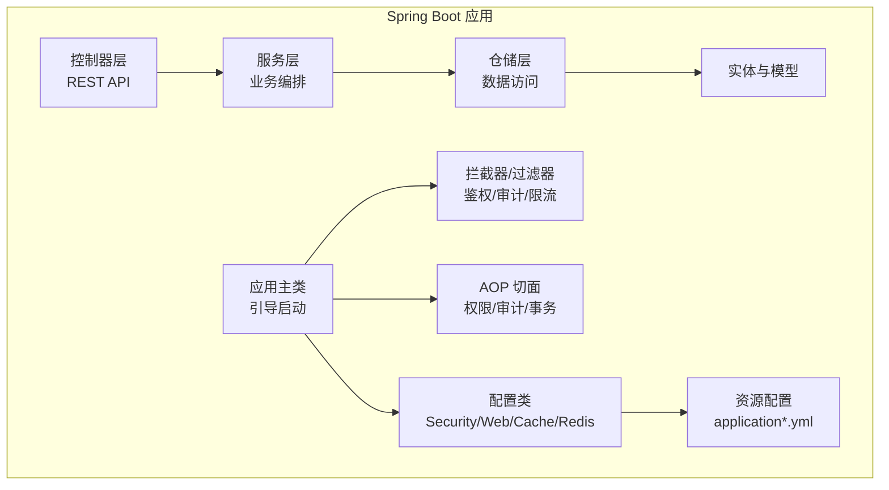
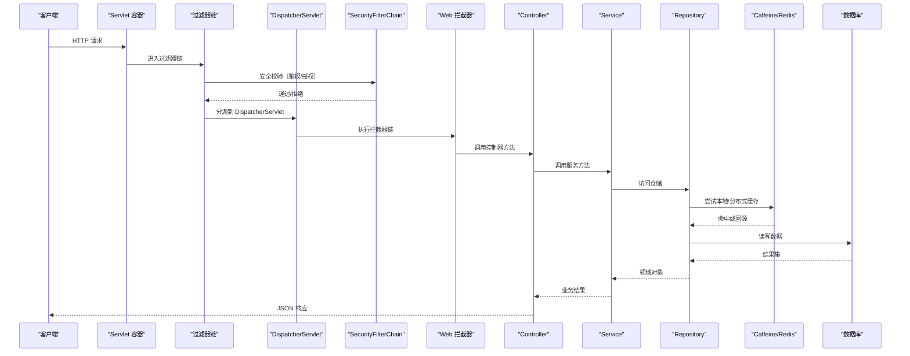
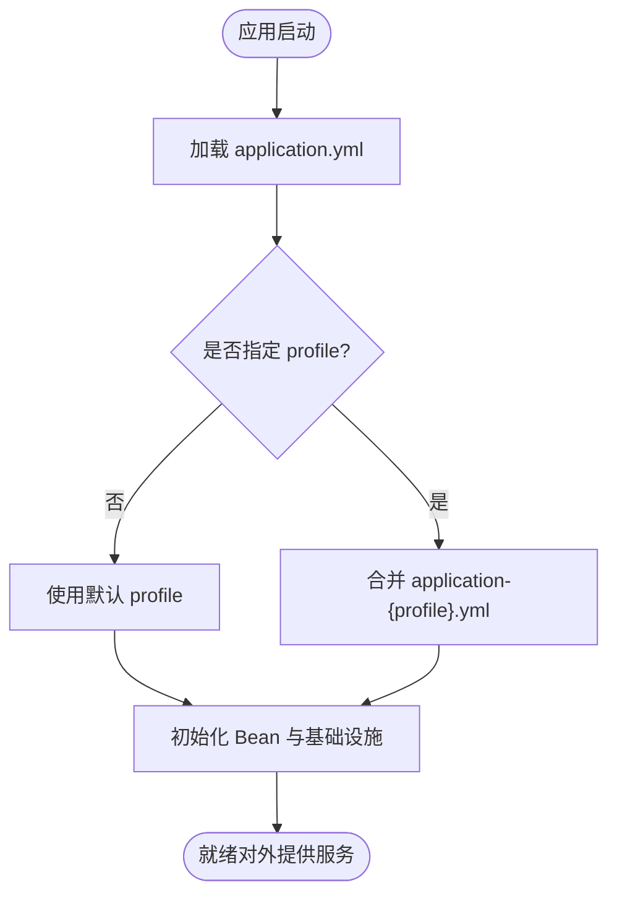
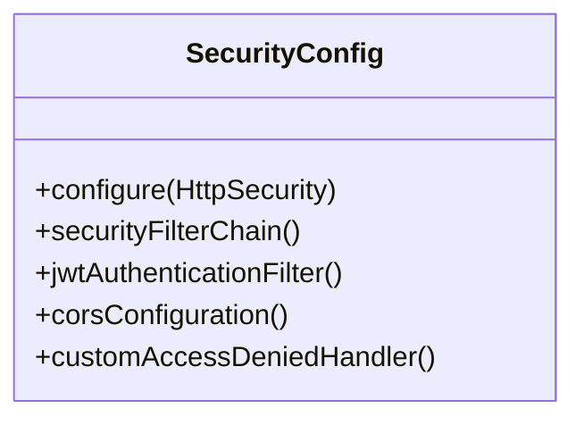
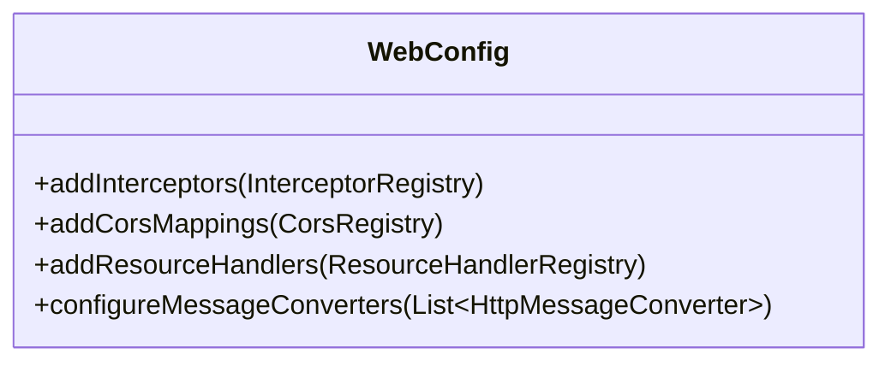
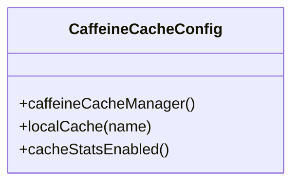
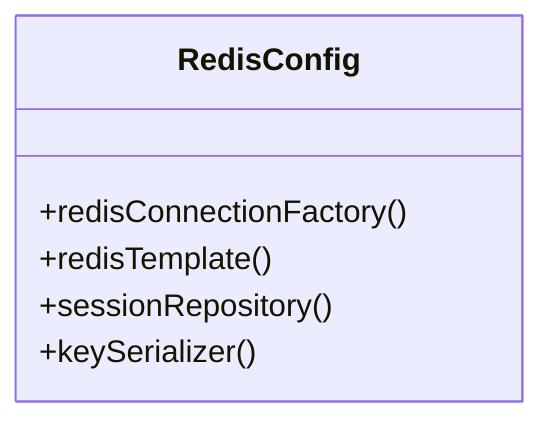
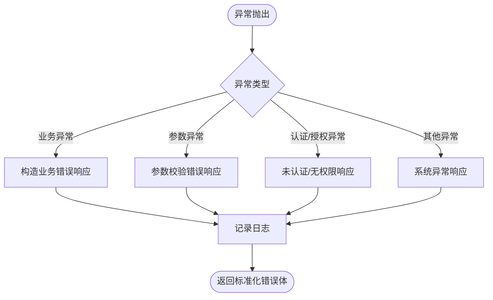
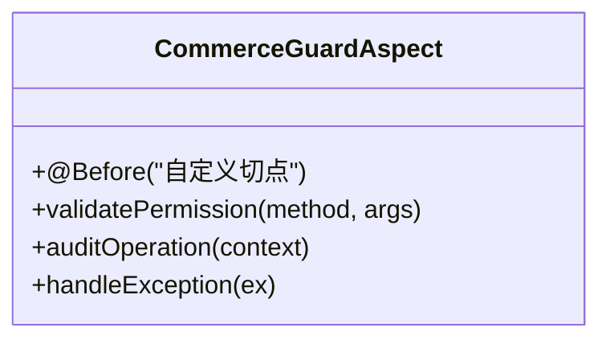
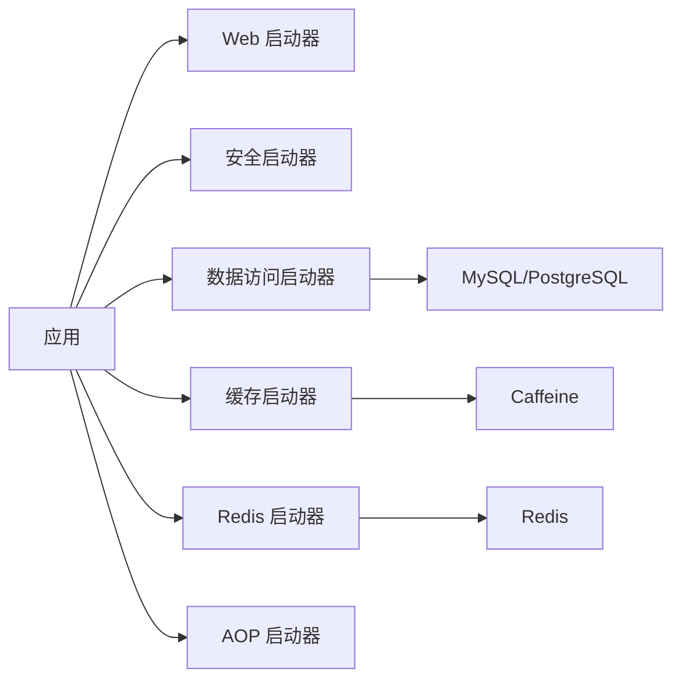

# 服务架构与配置

<cite>
**本文引用的文件**   
- [SecurityConfig.java](file://apps/api/src/main/java/com/campuslove/api/config/SecurityConfig.java)
- [WebConfig.java](file://apps/api/src/main/java/com/campuslove/api/config/WebConfig.java)
- [CaffeineCacheConfig.java](file://apps/api/src/main/java/com/campuslove/api/config/CaffeineCacheConfig.java)
- [RedisConfig.java](file://apps/api/src/main/java/com/campuslove/api/config/RedisConfig.java)
- [GlobalExceptionHandler.java](file://apps/api/src/main/java/com/campuslove/api/config/GlobalExceptionHandler.java)
- [CommerceGuardAspect.java](file://apps/api/src/main/java/com/campuslove/api/config/CommerceGuardAspect.java)
- [application.yml](file://apps/api/src/main/resources/application.yml)
- [application-mock.yml](file://apps/api/src/main/resources/application-mock.yml)
- [application-real.yml](file://apps/api/src/main/resources/application-real.yml)
- [application-wechat.yml](file://apps/api/src/main/resources/application-wechat.yml)
- [pom.xml](file://apps/api/pom.xml)
- [Dockerfile](file://apps/api/Dockerfile)
</cite>

## 目录
1. [引言](#引言)
2. [项目结构](#项目结构)
3. [核心组件](#核心组件)
4. [架构总览](#架构总览)
5. [详细组件分析](#详细组件分析)
6. [依赖关系分析](#依赖关系分析)
7. [性能考量](#性能考量)
8. [故障排查指南](#故障排查指南)
9. [结论](#结论)
10. [附录](#附录)

## 引言
本文面向 Spring Boot 3 后端服务的整体架构与配置，聚焦应用启动流程、包结构与分层设计原则；系统化文档化 SecurityConfig、WebConfig、CaffeineCacheConfig、RedisConfig 等关键配置的作用与参数；说明 Profile 机制在开发、测试、生产环境中的隔离策略；解释全局异常处理 GlobalExceptionHandler 的设计模式；并覆盖依赖注入、AOP 切面 CommerceGuardAspect、事件驱动架构的实现细节。同时提供配置文件结构、环境变量管理与密钥安全策略，以及中间件注册、拦截器链、过滤器管道和跨域配置的实践要点。

## 项目结构
后端服务位于 apps/api 模块，采用典型的 Spring Boot 分层结构：
- 入口与装配：应用主类、配置类、拦截器、过滤器、AOP 切面
- 控制器层：REST API 暴露的业务接口
- 服务层：业务编排与领域逻辑
- 仓储层：数据访问抽象与实现（如 JPA/MyBatis）
- 实体与模型：领域实体、DTO、VO
- 配置与资源：多环境配置文件、OpenAPI/Swagger 文档、数据库迁移脚本

**图示来源**
- [Dockerfile:1-80](file://apps/api/Dockerfile#L1-L80)
- [application.yml:1-60](file://apps/api/src/main/resources/application.yml#L1-L60)

**章节来源**
- [Dockerfile:1-80](file://apps/api/Dockerfile#L1-L80)
- [application.yml:1-60](file://apps/api/src/main/resources/application.yml#L1-L60)

## 核心组件
- SecurityConfig：统一安全策略，包括 CSRF、会话管理、JWT 认证、路径授权规则、跨域与安全头配置。
- WebConfig：Web MVC 扩展，包含 CORS、静态资源映射、拦截器注册、视图解析器等。
- CaffeineCacheConfig：本地缓存（Caffeine）的 Bean 定义与缓存命名空间、过期策略、统计开关。
- RedisConfig：分布式缓存与会话共享的 Redis 客户端配置，连接池、序列化、超时与重试策略。
- GlobalExceptionHandler：全局异常处理器，统一捕获业务与系统异常，输出标准化错误响应。
- CommerceGuardAspect：基于注解的权限/风控切面，对特定业务方法做前置校验与审计记录。

**章节来源**
- [SecurityConfig.java:1-200](file://apps/api/src/main/java/com/campuslove/api/config/SecurityConfig.java#L1-L206)
- [WebConfig.java:1-150](file://apps/api/src/main/java/com/campuslove/api/config/WebConfig.java#L1-L150)
- [CaffeineCacheConfig.java:1-120](file://apps/api/src/main/java/com/campuslove/api/config/CaffeineCacheConfig.java#L1-L115)
- [RedisConfig.java:1-160](file://apps/api/src/main/java/com/campuslove/api/config/RedisConfig.java#L1-L160)
- [GlobalExceptionHandler.java:1-180](file://apps/api/src/main/java/com/campuslove/api/config/GlobalExceptionHandler.java#L1-L180)
- [CommerceGuardAspect.java:1-150](file://apps/api/src/main/java/com/campuslove/api/config/CommerceGuardAspect.java#L1-L56)

## 架构总览
Spring Boot 应用的启动与请求处理链路如下：
- 启动阶段：加载 application.yml 与激活的 profile，初始化 DataSource、JPA/Hibernate、Redis、Caffeine、WebMvc、SecurityFilterChain、MessageConverter、Jackson、日志与监控等基础设施。
- 请求阶段：Servlet 容器 -> Filter 链 -> DispatcherServlet -> HandlerMapping/HandlerAdapter -> Controller -> Service -> Repository -> DB/Cache。
- 横切关注点：Security 过滤器链、Web 拦截器、AOP 切面、全局异常处理、审计日志、指标采集。

**图示来源**
- [SecurityConfig.java:1-200](file://apps/api/src/main/java/com/campuslove/api/config/SecurityConfig.java#L1-L206)
- [WebConfig.java:1-150](file://apps/api/src/main/java/com/campuslove/api/config/WebConfig.java#L1-L150)
- [CaffeineCacheConfig.java:1-120](file://apps/api/src/main/java/com/campuslove/api/config/CaffeineCacheConfig.java#L1-L115)
- [RedisConfig.java:1-160](file://apps/api/src/main/java/com/campuslove/api/config/RedisConfig.java#L1-L160)

## 详细组件分析

### 应用启动与 Profile 机制
- 启动入口：Spring Boot 主类负责自动装配与组件扫描。
- Profile 选择：默认加载 application.yml；按激活的 profile 合并对应 `application-{profile}.yml`。**仓库实际存在的档位文件只有 mock / real / wechat 三支，不存在 dev 与 test 档。**
- 关键要点：
  - application.yml（476 行）放公共配置，并在 `spring.profiles` 段落写明两条约束：`spring.profiles.default=mock` 仅对「测试引导」生效（注释标注 R4-00368），以及启动时强制校验激活的 profile（`SPRING_PROFILES_ACTIVE` / `--spring.profiles.active` / `-Dspring.profiles.active`），为空或非法即报错退出（fail-fast），本地开发需显式 `--spring.profiles.active=mock`。
  - application-mock.yml（69 行）不用内存数据库，而是以 `spring.autoconfigure.exclude` 排除 `DataSourceAutoConfiguration`、`FlywayAutoConfiguration`、`HibernateJpaAutoConfiguration`、`RedisAutoConfiguration`/`RedisRepositoriesAutoConfiguration`、`RabbitAutoConfiguration` 与 `RedissonAutoConfigurationV2`，使开发态无需外部 MySQL/Redis/RabbitMQ，并避免 healthEndpoint 链路尝试创建 RedissonClient。
  - application-real.yml（195 行）承载生产配置：数据源经 `DB_URL`/`DB_USERNAME`/`DB_PASSWORD` 外部化，启动时由 `DatabaseConfigValidator` 校验非空、漏配即拒绝启动；其文件头注释记录它由 `application-db.yml` 改名而来（Spring 只加载 `application-{active-profile}.yml`，旧名在激活 real 时不会被加载），注释提到的 `DEPLOYMENT.md` 在 `doc/` 而非 `docs/`。
  - application-wechat.yml（23 行）是微信小程序生产档，需 `SPRING_PROFILES_ACTIVE` 含 `wechat`（如 `real,wechat`），并由环境变量提供 `WECHAT_APPID`/`WECHAT_SECRET`/`WECHAT_JSCODE2SESSION_URL`。

**图示来源**
- [application.yml:1-60](file://apps/api/src/main/resources/application.yml#L1-L60)
- [application-mock.yml:1-20](file://apps/api/src/main/resources/application-mock.yml#L1-L20)
- [application-real.yml:1-14](file://apps/api/src/main/resources/application-real.yml#L1-L14)
- [application-wechat.yml:1-8](file://apps/api/src/main/resources/application-wechat.yml#L1-L8)

**章节来源**
- [application.yml:1-20](file://apps/api/src/main/resources/application.yml#L1-L20)
- [application-mock.yml:1-20](file://apps/api/src/main/resources/application-mock.yml#L1-L20)
- [application-real.yml:1-14](file://apps/api/src/main/resources/application-real.yml#L1-L14)
- [application-wechat.yml:1-8](file://apps/api/src/main/resources/application-wechat.yml#L1-L8)

### 安全配置 SecurityConfig
- 职责：
  - 配置全局安全策略（CSRF、会话、登录/登出、状态码处理）。
  - 配置 JWT 过滤器与令牌验证流程。
  - 定义 URL 授权规则（白名单、角色/权限控制）。
  - 配置跨域与安全头（CSP、HSTS、X-Frame-Options 等）。
- 关键点：
  - 将认证/鉴权逻辑从控制器中剥离，保证业务代码纯净。
  - 支持按路径、角色或自定义谓词进行细粒度授权。
  - 针对静态资源、Swagger/OpenAPI、健康检查等放行策略。

**图示来源**
- [SecurityConfig.java:1-200](file://apps/api/src/main/java/com/campuslove/api/config/SecurityConfig.java#L1-L206)

**章节来源**
- [SecurityConfig.java:1-200](file://apps/api/src/main/java/com/campuslove/api/config/SecurityConfig.java#L1-L206)

### Web 配置 WebConfig
- 职责：
  - 注册 Web 拦截器（鉴权上下文、审计、耗时统计）。
  - 配置跨域（允许的来源、方法、头、凭据）。
  - 静态资源映射与版本化策略。
  - 视图与序列化配置（Jackson、消息转换器）。
- 关键点：
  - 与 SecurityFilterChain 协同工作，避免重复校验。
  - 提供可插拔的拦截器顺序控制，确保先鉴权后审计。

**图示来源**
- [WebConfig.java:1-150](file://apps/api/src/main/java/com/campuslove/api/config/WebConfig.java#L1-L150)

**章节来源**
- [WebConfig.java:1-150](file://apps/api/src/main/java/com/campuslove/api/config/WebConfig.java#L1-L150)

### 缓存配置 CaffeineCacheConfig
- 职责：
  - 定义 Caffeine 缓存实例（最大容量、过期时间、统计开关）。
  - 为不同业务域提供命名空间（用户信息、热点数据、商品详情等）。
  - 与 Spring Cache 注解（@Cacheable/@CacheEvict）集成。
- 关键点：
  - 本地缓存适合高频读、低写场景，降低 Redis 压力。
  - 结合分布式缓存（Redis）实现多级缓存一致性策略。

**图示来源**
- [CaffeineCacheConfig.java:1-120](file://apps/api/src/main/java/com/campuslove/api/config/CaffeineCacheConfig.java#L1-L115)

**章节来源**
- [CaffeineCacheConfig.java:1-120](file://apps/api/src/main/java/com/campuslove/api/config/CaffeineCacheConfig.java#L1-L115)

### 缓存与会话 RedisConfig
- 职责：
  - 配置 Redis 连接（主机、端口、密码、SSL、超时、连接池）。
  - 配置序列化策略（JSON、键值规范）。
  - 提供 RedisTemplate/Session 工厂 Bean。
- 关键点：
  - 分布式会话共享，便于水平扩展。
  - 与 Caffeine 形成多级缓存，优先本地再回源。

**图示来源**
- [RedisConfig.java:1-160](file://apps/api/src/main/java/com/campuslove/api/config/RedisConfig.java#L1-L160)

**章节来源**
- [RedisConfig.java:1-160](file://apps/api/src/main/java/com/campuslove/api/config/RedisConfig.java#L1-L160)

### 全局异常处理 GlobalExceptionHandler
- 设计模式：
  - 使用 @ControllerAdvice 集中捕获所有控制器抛出的异常。
  - 区分业务异常、参数校验异常、认证/授权异常、未知异常。
  - 返回统一的结构化错误响应（错误码、消息、请求标识、时间戳）。
- 关键点：
  - 避免敏感信息泄露（堆栈不直接返回给客户端）。
  - 与日志框架联动，记录完整上下文以便排障。

**图示来源**
- [GlobalExceptionHandler.java:1-180](file://apps/api/src/main/java/com/campuslove/api/config/GlobalExceptionHandler.java#L1-L180)

**章节来源**
- [GlobalExceptionHandler.java:1-180](file://apps/api/src/main/java/com/campuslove/api/config/GlobalExceptionHandler.java#L1-L180)

### AOP 切面 CommerceGuardAspect
- 职责：
  - 对带有特定注解的方法进行前置权限/风控校验。
  - 收集审计信息（操作人、资源、IP、UA、耗时）。
  - 对越权或异常行为进行告警与阻断。
- 关键点：
  - 切面优先级高于控制器方法，确保在业务执行前完成保护。
  - 可与 SecurityConfig 的授权策略互补，提供更细粒度的业务级防护。

**图示来源**
- [CommerceGuardAspect.java:1-150](file://apps/api/src/main/java/com/campuslove/api/config/CommerceGuardAspect.java#L1-L56)

**章节来源**
- [CommerceGuardAspect.java:1-150](file://apps/api/src/main/java/com/campuslove/api/config/CommerceGuardAspect.java#L1-L56)

### 事件驱动架构（概念性说明）
- 典型用法：
  - 使用 ApplicationEventPublisher 发布领域事件（订单创建、支付成功、库存扣减）。
  - 监听器异步处理后续流程（发送通知、积分结算、报表更新）。
- 优势：
  - 解耦业务流程，提升可扩展性与容错能力。
  - 结合消息队列（如 RabbitMQ/Kafka）可实现跨服务的事件总线。

[本节为概念性内容，不直接分析具体文件]

## 依赖关系分析
- Maven 依赖：
  - spring-boot-starter-web、spring-boot-starter-security、spring-boot-starter-data-jpa、spring-boot-starter-cache、spring-boot-starter-data-redis、spring-boot-starter-aop。
  - Caffeine、Lombok、Jackson、Micrometer（可选）、Flyway/Liquibase（可选）。
- 外部依赖：
  - MySQL/PostgreSQL、Redis、对象存储（OSS/S3）、短信/邮件网关、第三方支付与风控服务。

**图示来源**
- [pom.xml:1-250](file://apps/api/pom.xml#L1-L250)

**章节来源**
- [pom.xml:1-250](file://apps/api/pom.xml#L1-L250)

## 性能考量
- 缓存策略：
  - 热点数据优先走 Caffeine 本地缓存，未命中再回源 Redis，减少网络开销。
  - 合理设置 TTL 与最大容量，避免内存膨胀与雪崩。
- 数据库优化：
  - 使用索引与分页查询，避免全表扫描与大对象传输。
  - 批量写入与事务边界最小化，降低锁竞争。
- 安全与中间件：
  - 将耗时的鉴权与审计逻辑异步化或旁路化，避免阻塞主链路。
  - 合理使用压缩与缓存头，减少带宽消耗。
- 监控与度量：
  - 接入 Micrometer 与 Prometheus/Grafana，观测 QPS、延迟、错误率与资源利用率。

[本节为通用指导，不直接分析具体文件]

## 故障排查指南
- 常见问题定位：
  - 认证失败：检查 SecurityConfig 的白名单、JWT 过滤器与签名策略。
  - 跨域报错：确认 WebConfig 的 CORS 配置与前端 Origin 匹配。
  - 缓存不一致：核对 Caffeine 与 Redis 的 TTL、键命名与更新策略。
  - 全局异常未生效：确认 @ControllerAdvice 生效范围与异常类型匹配。
  - 切面无效：确认注解与切点表达式正确、切面优先级合适。
- 建议步骤：
  - 开启 DEBUG 日志，打印请求 ID、用户上下文、缓存命中率与 SQL 语句。
  - 使用 Mock 与集成测试复现问题，缩小影响范围。
  - 通过指标面板观察慢请求与异常峰值，定位瓶颈。

**章节来源**
- [GlobalExceptionHandler.java:1-180](file://apps/api/src/main/java/com/campuslove/api/config/GlobalExceptionHandler.java#L1-L180)
- [SecurityConfig.java:1-200](file://apps/api/src/main/java/com/campuslove/api/config/SecurityConfig.java#L1-L206)
- [WebConfig.java:1-150](file://apps/api/src/main/java/com/campuslove/api/config/WebConfig.java#L1-L150)
- [CaffeineCacheConfig.java:1-120](file://apps/api/src/main/java/com/campuslove/api/config/CaffeineCacheConfig.java#L1-L115)
- [RedisConfig.java:1-160](file://apps/api/src/main/java/com/campuslove/api/config/RedisConfig.java#L1-L160)
- [CommerceGuardAspect.java:1-150](file://apps/api/src/main/java/com/campuslove/api/config/CommerceGuardAspect.java#L1-L56)

## 结论
本服务以 Spring Boot 3 为基础，围绕 SecurityConfig、WebConfig、CaffeineCacheConfig、RedisConfig 构建稳定可控的基础设施；通过 Profile 机制实现环境隔离；借助 GlobalExceptionHandler 与 CommerceGuardAspect 实现一致的错误体验与强化的权限/风控保护；配合多级缓存、AOP 与事件驱动，兼顾性能与可扩展性。建议在部署前严格审查配置文件与密钥管理策略，并通过完善的测试与监控保障上线质量。

[本节为总结性内容，不直接分析具体文件]

## 附录

### 配置文件结构与参数要点
- application.yml（公共配置）
  - 服务器端口、时区、编码、日志级别
  - 通用安全策略（CSRF、会话、跨域基础项）
  - 缓存与 Redis 公共连接参数
- application-mock.yml（本地开发档，69 行）
  - 不引入内存数据库：以 `spring.autoconfigure.exclude` 排除 DataSource/Flyway/JPA/Redis/Rabbit/Redisson 自动装配，无需外部中间件即可启动
- application-real.yml（生产档，195 行）
  - 数据源与 Redis 经环境变量外部化，`DatabaseConfigValidator` 缺失即拒绝启动；由 `application-db.yml` 改名而来
- application-wechat.yml（微信小程序生产档，23 行）
  - 与 real 叠加激活（`SPRING_PROFILES_ACTIVE=real,wechat`），提供 AppID/Secret/jscode2session 地址
- 说明：仓库中不存在 `application-dev.yml` 与 `application-test.yml`，此前描述的「内嵌 H2 / 随机端口测试档」没有对应文件

**章节来源**
- [application.yml:1-20](file://apps/api/src/main/resources/application.yml#L1-L20)
- [application-mock.yml:1-20](file://apps/api/src/main/resources/application-mock.yml#L1-L20)
- [application-real.yml:1-14](file://apps/api/src/main/resources/application-real.yml#L1-L14)
- [application-wechat.yml:1-8](file://apps/api/src/main/resources/application-wechat.yml#L1-L8)

### 环境变量管理与密钥安全策略
- 推荐做法：
  - 使用环境变量或受信任的密钥管理服务（如 Vault、KMS、云厂商 Secret Manager）注入敏感配置（数据库密码、Redis 密码、第三方 API Key）。
  - 禁止将密钥硬编码进代码或配置文件；CI/CD 流水线按需注入。
  - 对日志脱敏，避免输出 Token、密码、身份证号等敏感字段。
- 运行时校验：
  - 启动时校验必填环境变量是否存在且格式合法。
  - 对第三方服务连接进行快速探测与熔断降级。

[本节为通用指导，不直接分析具体文件]

### 中间件注册、拦截器链、过滤器管道与跨域
- 过滤器管道：
  - SecurityFilterChain 作为核心过滤器链，承载认证与授权。
  - 自定义 Filter 可用于审计、限流、灰度路由。
- 拦截器链：
  - 在 WebConfig 中注册，处理鉴权上下文、审计、耗时统计等横切逻辑。
- 跨域配置：
  - 在 SecurityConfig 与 WebConfig 中统一配置，确保前后端协作顺畅。

**章节来源**
- [SecurityConfig.java:1-200](file://apps/api/src/main/java/com/campuslove/api/config/SecurityConfig.java#L1-L206)
- [WebConfig.java:1-150](file://apps/api/src/main/java/com/campuslove/api/config/WebConfig.java#L1-L150)