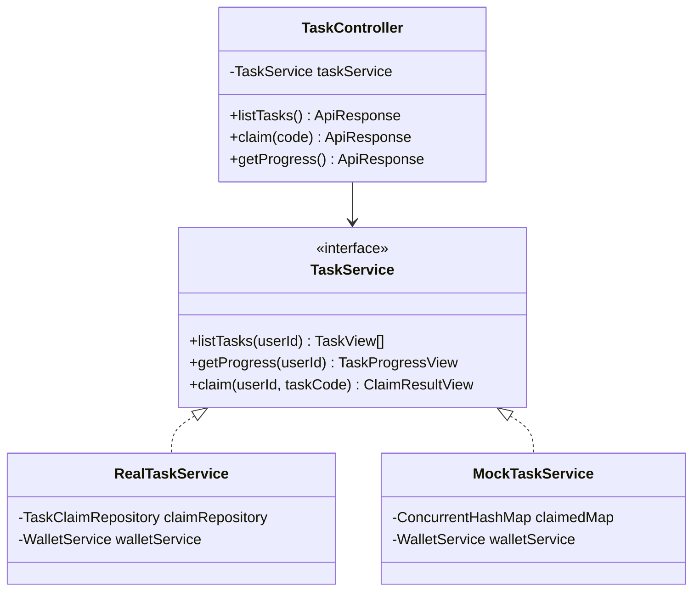
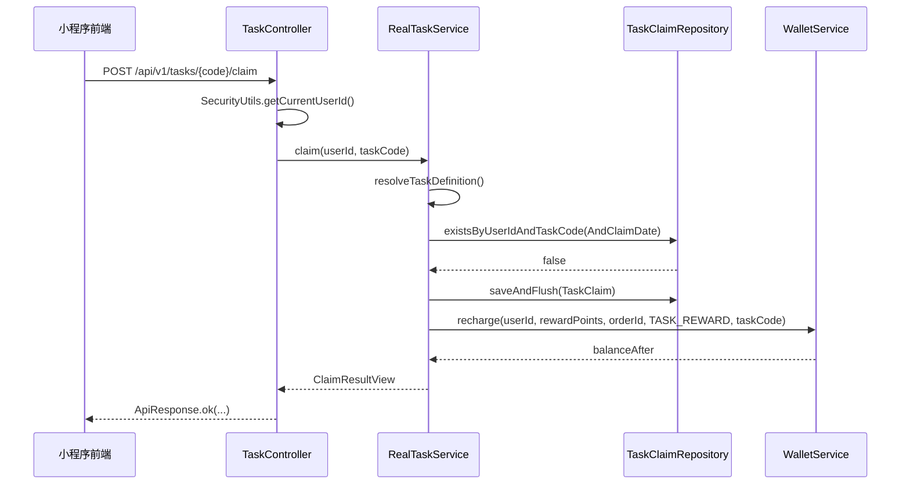
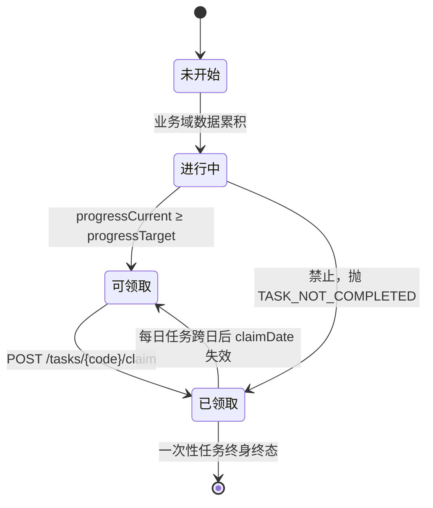
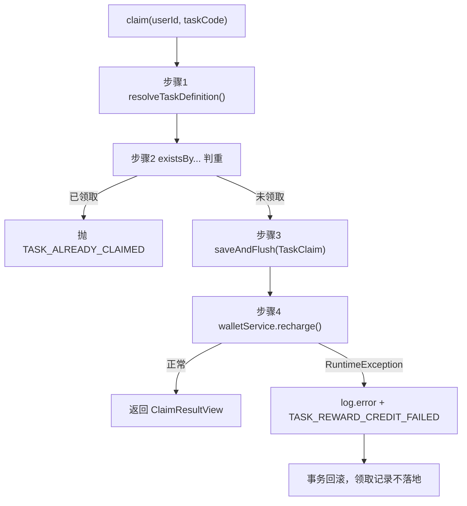

# 任务系统服务

<cite>
**本文引用的文件**
- [TaskService.java](file://apps/api/src/main/java/com/campuslove/api/tasks/TaskService.java)
- [TaskController.java](file://apps/api/src/main/java/com/campuslove/api/tasks/TaskController.java)
- [RealTaskService.java](file://apps/api/src/main/java/com/campuslove/api/tasks/RealTaskService.java)
- [MockTaskService.java](file://apps/api/src/main/java/com/campuslove/api/tasks/MockTaskService.java)
- [TaskControllerTest.java](file://apps/api/src/test/java/com/campuslove/api/tasks/TaskControllerTest.java)
- [RealTaskServiceTest.java](file://apps/api/src/test/java/com/campuslove/api/tasks/RealTaskServiceTest.java)
- [AuthMetrics.java](file://apps/api/src/main/java/com/campuslove/api/monitor/AuthMetrics.java)
- [ChatMetrics.java](file://apps/api/src/main/java/com/campuslove/api/monitor/ChatMetrics.java)
- [MatchMetrics.java](file://apps/api/src/main/java/com/campuslove/api/monitor/MatchMetrics.java)
- [PaymentMetrics.java](file://apps/api/src/main/java/com/campuslove/api/monitor/PaymentMetrics.java)
- [VillageMetrics.java](file://apps/api/src/main/java/com/campuslove/api/monitor/VillageMetrics.java)
</cite>

## 目录
1. [简介](#简介)
2. [项目结构](#项目结构)
3. [核心组件](#核心组件)
4. [架构总览](#架构总览)
5. [任务接口设计](#任务接口设计)
6. [任务生命周期管理](#任务生命周期管理)
7. [任务调度与执行](#任务调度与执行)
8. [任务类型扩展机制](#任务类型扩展机制)
9. [进度跟踪与完成状态](#进度跟踪与完成状态)
10. [任务奖励发放](#任务奖励发放)
11. [详细组件分析](#详细组件分析)
12. [监控与性能统计](#监控与性能统计)
13. [依赖关系分析](#依赖关系分析)
14. [配置与运行模式](#配置与运行模式)
15. [性能考虑](#性能考虑)
16. [故障排查指南](#故障排查指南)
17. [结论](#结论)

## 简介
任务系统服务负责任务列表呈现、进度查询与奖励领取，位于 `com.campuslove.api.tasks` 包，由三个生产类加一个契约接口与两个测试类构成。本文覆盖端点契约、调度与执行逻辑、内存桩实现、生命周期与完成状态、进度聚合、奖励幂等、类型扩展点与可观测性边界；涉及定时触发、异步执行、失败重试、优先级排序、任务模板与批量处理时，区分源码中存在与不存在两种情况。

**章节来源**
- [TaskController.java:29-32](file://apps/api/src/main/java/com/campuslove/api/tasks/TaskController.java#L29-L32)
- [TaskService.java:5-19](file://apps/api/src/main/java/com/campuslove/api/tasks/TaskService.java#L5-L19)

## 项目结构
`tasks` 包四个类：TaskController.java（80 行，REST 入口，映射 `/api/v1/tasks`）、TaskService.java（128 行，契约接口与三个响应 record）、RealTaskService.java（235 行，real 实现）、MockTaskService.java（118 行，mock 内存桩）；测试目录含 TaskControllerTest.java（37 行）与 RealTaskServiceTest.java（140 行）。控制器只做路由与参数透传，业务判断在服务层；服务层以同名三件套（`listTasks`、`getProgress`、`claim`）在两个实现中各自落地，形成可替换实现族。相邻 `monitor` 包有五个指标组件，但没有任务域专属指标类。

```mermaid
graph TB
    subgraph "tasks 包"
        TS["TaskService 接口"]
        TC["TaskController"]
        RTS["RealTaskService"]
        MTS["MockTaskService"]
    end
    subgraph "测试"
        TCT["TaskControllerTest"]
        RTST["RealTaskServiceTest"]
    end
    subgraph "monitor 包"
        AM["AuthMetrics"]
        CM["ChatMetrics"]
        MM["MatchMetrics"]
        PM["PaymentMetrics"]
        VM["VillageMetrics"]
    end
    TC --> TS
    TS <|.. RTS
    TS <|.. MTS
    TCT --> TC
    RTST --> RTS
```

**图表来源**
- [TaskController.java:29-80](file://apps/api/src/main/java/com/campuslove/api/tasks/TaskController.java#L29-L80)
- [MockTaskService.java:31-118](file://apps/api/src/main/java/com/campuslove/api/tasks/MockTaskService.java#L31-L118)

## 核心组件
- TaskService：唯一契约，声明 `listTasks(Long)`、`getProgress(Long)`、`claim(Long, String)`，用接口常量定义 4 个任务编码与 4 个奖励分值，内嵌 `TaskView`、`TaskProgressView`、`ClaimResultView` 三个 record。
- TaskController：`@RestController` + `@RequestMapping("/api/v1/tasks")` + `@Validated`，只做「取当前用户 → 委托服务 → 包 `ApiResponse`」。
- RealTaskService：`@Profile("real")`，完成度来自签到、资料、动态、认证四个数据源，领取记录落 `TaskClaimRepository`，奖励经 `WalletService.recharge` 入账。
- MockTaskService：`@Profile("mock")`，无数据库依赖，用 `ConcurrentHashMap<Long, Set<String>>` 模拟 `task_claim` 表。
- 协作对象：`TaskClaim` 实体及 repository（`existsByUserIdAndTaskCodeAndClaimDate`、`existsByUserIdAndTaskCode`）、`WalletTransactionLog.RELATED_TYPE_TASK_REWARD`。



**图表来源**
- [RealTaskService.java:41-68](file://apps/api/src/main/java/com/campuslove/api/tasks/RealTaskService.java#L41-L68)

**章节来源**
- [TaskController.java:34-38](file://apps/api/src/main/java/com/campuslove/api/tasks/TaskController.java#L34-L38)

## 架构总览
形态为「读多写少 + 强幂等写」：列表与进度是纯读聚合，领取是唯一写路径且同时触达领取记录与钱包账本。三端点均要求 `hasRole('USER')`，用户身份由 `SecurityUtils.getCurrentUserId()` 从安全上下文取出而非参数传入，避免越权领取；双实现由 Profile 在容器启动期二选一注入；持久层四个 Repository 仅 real profile 参与。



**图表来源**
- [TaskController.java:60-66](file://apps/api/src/main/java/com/campuslove/api/tasks/TaskController.java#L60-L66)
- [RealTaskService.java:119-164](file://apps/api/src/main/java/com/campuslove/api/tasks/RealTaskService.java#L119-L164)

读路径单跳聚合、不写入：`listTasks` 从四个数据源各取一值并叠加四次判重查询装配 `List<TaskView>`，`getProgress` 在该列表上二次流式计算。

**章节来源**
- [RealTaskService.java:70-115](file://apps/api/src/main/java/com/campuslove/api/tasks/RealTaskService.java#L70-L115)

## 任务接口设计
TaskController 全类 80 行，无分支逻辑。

| 方法 | 路径 | 注解组合 | 返回 |
| --- | --- | --- | --- |
| `listTasks()` | `GET /api/v1/tasks` | `@GetMapping` + `@PreAuthorize` | `ApiResponse<List<TaskService.TaskView>>` |
| `claim(code)` | `POST /api/v1/tasks/{code}/claim` | `@PostMapping` + `@Idempotent` + `@PreAuthorize` | `ApiResponse<TaskService.ClaimResultView>` |
| `getProgress()` | `GET /api/v1/tasks/progress` | `@GetMapping("/progress")` + `@PreAuthorize` | `ApiResponse<TaskService.TaskProgressView>` |

编码走路径变量（`@PathVariable("code") @NotBlank String code`）而非请求体，配合类级 `@Validated`，空串在参数校验阶段即被拒绝；只有领取端点标注 `@Idempotent`；业务失败不按 HTTP 状态码分流，而由服务层抛 `IllegalArgumentException` 交全局异常处理；未暴露任务写接口，任务定义以常量加 `switch` 固化在代码内。

**章节来源**
- [TaskController.java:1-80](file://apps/api/src/main/java/com/campuslove/api/tasks/TaskController.java#L1-L80)

## 任务生命周期管理
任务不是持久化工作项，而是「代码定义的完成条件 + 领取记录标记的终态」，状态是派生态：除「已领取」有 `TaskClaim` 行落地外，其余每次请求重新计算。`TaskView` 四字段刻画状态——未开始（`progressCurrent = 0` 且未领取）、进行中（`0 < progressCurrent < progressTarget`）、可领取（达标且未领取，`claimable = true`）、已领取（`claimed = true`，`claimable` 恒 `false`）。



**图表来源**
- [RealTaskService.java:171-205](file://apps/api/src/main/java/com/campuslove/api/tasks/RealTaskService.java#L171-L205)

完成判定在 `buildView()` 内为 `boolean completed = progressCurrent >= progressTarget;` 再取 `claimable = completed && !claimed`，`TaskDefinition.completed()` 用同一表达式，保证列表口径与领取口径一致。终态重置只对 `daily = true` 的 `daily-checkin` 生效：real 把 `claimDate` 写为 `LocalDate.now(TimeZones.BUSINESS)` 并带日期判重，一次性任务写 `claimDate = null`、按 `existsByUserIdAndTaskCode` 终身命中；mock 用同语义，每日 key 拼 `code#yyyyMMdd`。

**章节来源**
- [RealTaskService.java:83-99](file://apps/api/src/main/java/com/campuslove/api/tasks/RealTaskService.java#L83-L99)

## 任务调度与执行
catalog 期望的「任务调度」在本仓库的真实形态是请求驱动加事务边界：无 `@Scheduled` 方法、无 TaskScheduler/Quartz 配置、无任务线程池（两个实现的导入集合不含任何并发或调度类型）；三个方法均无 `@Async`，全链路同步返回；无重试机制，入账失败只写一条 `log.error` 并抛 `RuntimeException(ErrorMessages.TASK_REWARD_CREDIT_FAILED, e)`，重试责任在调用方。

调度语义体现在事务边界：`listTasks` 与 `getProgress` 标注 `@Transactional(readOnly = true)`，`claim` 标注 `@Transactional`。执行语义体现在 `claim` 的四步固定顺序（源码以编号注释标出）：解析任务定义、未领取校验、`saveAndFlush` 落记录、`walletService.recharge` 发放奖励。`saveAndFlush` 而非 `save` 使 `(user_id, task_code, claim_date)` 唯一约束在并发重复领取时早于入账动作触发，把数据库约束作为幂等最后防线。



**图表来源**
- [RealTaskService.java:117-164](file://apps/api/src/main/java/com/campuslove/api/tasks/RealTaskService.java#L117-L164)

**章节来源**
- [RealTaskService.java:26-40](file://apps/api/src/main/java/com/campuslove/api/tasks/RealTaskService.java#L26-L40)

## 任务类型扩展机制
类型以「接口常量 + 编码分支」两级定义。接口常量：`TASK_DAILY_CHECKIN = "daily-checkin"`（奖励 `REWARD_DAILY_CHECKIN = 5`，每日）、`TASK_COMPLETE_PROFILE = "complete-profile"`（`REWARD_COMPLETE_PROFILE = 50`）、`TASK_FIRST_POST = "first-post"`（`REWARD_FIRST_POST = 20`）、`TASK_CAMPUS_VERIFY = "campus-verify"`（`REWARD_CAMPUS_VERIFY = 100`），分值在源码注释中标明与前端 `pages/profile/tasks.vue` 对齐。

编码分支：`resolveTaskDefinition()` 用 `switch (taskCode)` 返回 `TaskDefinition(code, name, description, rewardPoints, progressCurrent, progressTarget, daily)`，`default` 抛 `ErrorMessages.TASK_CODE_UNKNOWN_PREFIX + taskCode`；`MockTaskService.claim()` 以 `yield` 返回分值。四个扩展点串成一条链：接口常量、定义分支、列表装配（两个 `listTasks` 的 `List.of(...)`）、领取状态查询；新增任务需四处同改，缺一处即表现为「列表可见但不可领」或「编码未知」。

不存在的能力：无任务模板表、无从数据库或配置加载任务定义的路径、无运行时新增任务入口，`TaskDefinition` 只是私有 record；`listTasks` 返回顺序是字面书写顺序，无比较器与排序调用，任务间无前置约束，四个条件彼此独立评估。

**章节来源**
- [TaskService.java:20-38](file://apps/api/src/main/java/com/campuslove/api/tasks/TaskService.java#L20-L38)
- [RealTaskService.java:171-197](file://apps/api/src/main/java/com/campuslove/api/tasks/RealTaskService.java#L171-L197)
- [MockTaskService.java:54-63](file://apps/api/src/main/java/com/campuslove/api/tasks/MockTaskService.java#L54-L63)

## 进度跟踪与完成状态
单任务进度（real 口径）：`daily-checkin` 用 `calculateStreakDays(userId, today)` 并在装配视图时 `Math.min(streak, 1)` 截断、target 1；`complete-profile` 用 `profileQueryService.calculateProfileCompletion(userId)`（0-100）、target 100；`first-post` 用 `postRepository.countByAuthorIdAndStatus(userId, Post.PostStatus.active)` 并截断到 1、target 1；`campus-verify` 用 `isCampusCertified(userId) ? 1 : 0`、target 1，仅 `APPROVED` 达标。

连续签到天数与 `RealCheckInService` 同构：`checkInRepository.findCheckInDatesBefore(userId, startDate)` 取日期列表后从 `expected = startDate` 逐日比对，命中则 `streak++` 且 `expected.minusDays(1)`，一旦不连续立即 `break`。列表页把 streak 截断到 1，领取路径回填未截断值，两者对「可领取」判定一致但展示值不同。聚合层由 `getProgress` 派生 `completedCount`、`claimedCount`、`totalCount`、`totalReward`、`claimedReward` 与 `percent = totalReward > 0 ? Math.round(claimedReward * 100f / totalReward) : 0`；进度同步是拉取式，服务端不推送、不缓存、不落进度表。

**章节来源**
- [RealTaskService.java:76-115](file://apps/api/src/main/java/com/campuslove/api/tasks/RealTaskService.java#L76-L115)
- [MockTaskService.java:45-76](file://apps/api/src/main/java/com/campuslove/api/tasks/MockTaskService.java#L45-L76)

## 任务奖励发放
发放是任务域唯一写副作用。积分体系（据 `TaskService` 类注释）：本项目无独立「积分」概念，积分即交友币钱包余额，1 积分 = 1 分，任务奖励与签到奖励同一账本，流水 `relatedType = TASK_REWARD`；调用形如 `walletService.recharge(userId, (long) def.rewardPoints, orderId, WalletTransactionLog.RELATED_TYPE_TASK_REWARD, taskCode)`。

四层防重复：`@Idempotent` 按请求维度拦截重放；`claim` 步骤 2 按 `daily` 分叉查 `existsByUserIdAndTaskCodeAndClaimDate` 或 `existsByUserIdAndTaskCode`，命中抛 `ErrorMessages.TASK_ALREADY_CLAIMED`；`saveAndFlush` 立即落库、`(user_id, task_code, claim_date)` 唯一约束兜底并发；`orderId` 幂等，一次性任务固定 `TASK-{code}-{userId}`，每日任务追加 `yyyyMMdd` 后缀（`DateTimeFormatter.ofPattern("yyyyMMdd")`）。

失败语义：`recharge` 抛任意 `RuntimeException` 时先记 `log.error("任务奖励入账失败（回滚领取记录）：...")`，再以 `throw new RuntimeException(ErrorMessages.TASK_REWARD_CREDIT_FAILED, e)` 包裹重抛；`claim` 处于 `@Transactional` 边界内，未提交的 `TaskClaim` 插入随事务回滚，不产生「记录已领取但钱未到账」的脏终态。mock 差异：`orderId` 恒为 `"TASK-" + taskCode + "-" + userId + "-MOCK"`（不含日期后缀），入账不在事务保护下，判重靠 `claimed.add(key)` 返回值。

**章节来源**
- [TaskService.java:56-67](file://apps/api/src/main/java/com/campuslove/api/tasks/TaskService.java#L56-L67)
- [RealTaskService.java:117-164](file://apps/api/src/main/java/com/campuslove/api/tasks/RealTaskService.java#L117-L164)
- [MockTaskService.java:78-117](file://apps/api/src/main/java/com/campuslove/api/tasks/MockTaskService.java#L78-L117)

## 详细组件分析

### RealTaskService：依赖与私有结构
构造注入六个协作者：`TaskClaimRepository`（判重与落库）、`CheckInRepository`（连续签到）、`PostRepository`（active 动态计数）、`CampusCertificationRepository`（认证状态）、`ProfileQueryService`（资料完善度）、`WalletService`（奖励入账）。私有成员为 `static final Logger log` 与 `static final DateTimeFormatter YYYYMMDD`，私有类型为 `record TaskDefinition(String code, String name, String description, int rewardPoints, int progressCurrent, int progressTarget, boolean daily)`（含 `boolean completed()`），私有方法为 `resolveTaskDefinition`、`buildView`、`calculateStreakDays`、`isCampusCertified`。

`isCampusCertified` 以 `Set.of("APPROVED")` 作白名单，`findByUserId(userId).map(CampusCertification::getStatus).map(approved::contains).orElse(false)` 的 Optional 链避免空记录导致 NPE。参数校验用英文字面量而非 `ErrorMessages`，如 `IllegalArgumentException("userId is required")`。

**章节来源**
- [RealTaskService.java:41-235](file://apps/api/src/main/java/com/campuslove/api/tasks/RealTaskService.java#L41-L235)

### MockTaskService：内存桩与数据视图
只注入 `WalletService`，核心状态 `private final ConcurrentHashMap<Long, Set<String>> claimedMap`。与 real 的差异：判重用 `Set.add()` 返回值而非数据库约束；日期用 `LocalDate.now()` 而非 `LocalDate.now(TimeZones.BUSINESS)`；无事务注解；完成度固定为签到 1/1、其余 0/target。契约侧三个 record 即对外结构：`TaskView(code, name, description, rewardPoints, progressCurrent, progressTarget, claimed, claimable)`、`TaskProgressView(tasks, completedCount, claimedCount, totalCount, claimedRewardPoints, totalRewardPoints, progressPercent)`、`ClaimResultView(taskCode, rewardPoints, balanceAfter)`，`balanceAfter` 为 `long`。

**章节来源**
- [MockTaskService.java:15-118](file://apps/api/src/main/java/com/campuslove/api/tasks/MockTaskService.java#L15-L118)
- [TaskService.java:81-127](file://apps/api/src/main/java/com/campuslove/api/tasks/TaskService.java#L81-L127)

### 测试覆盖
两个测试类用 JUnit 5 加 Mockito 且不启动 Spring 上下文，`RealTaskServiceTest.setUp()` 以 `MockitoAnnotations.openMocks(this)` 后直接 `new RealTaskService(...)` 装配六个 mock。七个用例分别断言：列表 `size == 4` 且完善度 100 时 `claimable()`；未知编码抛异常；完善度 30 时领取抛异常；判重命中时抛异常且 `verify(walletService, never()).recharge(...)`；成功领取时 `eq("TASK-complete-profile-1")` 校验 orderId、`rewardPoints == 50`、`balanceAfter == 50L` 并 `verify(claimRepository).saveAndFlush(any(TaskClaim.class))`；`daily-checkin` 连续 1 天时奖励 5；`getProgress` 得 `totalCount == 4`、`totalRewardPoints == 175`、`claimedRewardPoints == 0`。`175` 即 `5 + 50 + 20 + 100`，是对接口奖励常量总和的回归保护。

`TaskControllerTest` 只有 `constructor_shouldAcceptService` 与 `controller_shouldHaveServiceInjected` 两个 `assertNotNull` 用例，类注释界定范围：端点依赖 SecurityUtils，业务校验由服务层测试覆盖。缺口：`MockTaskService` 无测试类；无 MockMvc 用例，故 URL 映射与 `@PreAuthorize`、`@Idempotent`、`@NotBlank` 的生效未被验证；入账异常分支与并发约束回滚路径无用例。

**章节来源**
- [RealTaskServiceTest.java:28-140](file://apps/api/src/test/java/com/campuslove/api/tasks/RealTaskServiceTest.java#L28-L140)
- [TaskControllerTest.java:16-37](file://apps/api/src/test/java/com/campuslove/api/tasks/TaskControllerTest.java#L16-L37)

## 监控与性能统计
如实划界：`monitor` 包中没有 `TaskMetrics` 类，任务域不产出任何指标。该包五个 `@Component` 是 `AuthMetrics`（98 行）、`ChatMetrics`（111 行）、`MatchMetrics`（128 行）、`PaymentMetrics`（90 行）、`VillageMetrics`（162 行），命名形态为 `recordXxx(...)`、`recordXxxFailure(String reason)`、`recordXxxLatency(long durationMs)`；`monitor` 与 `tasks` 之间无任何注入关系，两个实现的构造参数与导入列表均不含指标类型。

任务域唯一可观测手段是三条日志：成功 `log.info("任务奖励领取成功：userId={}, taskCode={}, reward={}, balanceAfter={}", ...)`、失败 `log.error("任务奖励入账失败（回滚领取记录）：...")`、Mock 成功 `log.info("Mock 任务奖励领取成功：...")`。对照 `PaymentMetrics.recordCallbackLatency(long)` 与 `recordCallbackFailure(String)`，若补齐任务域指标，`TaskMetrics` 宜提供 `recordClaim(String)`、`recordClaimFailure(String)`、`recordClaimLatency(long)`；这是基于现有约定的建议，当前源码不存在这些方法。告警现状：无任务域告警规则、阈值配置或通知通道。

## 依赖关系分析
依赖单向：控制器依赖接口，实现依赖外部域，没有任何业务域反向依赖 `tasks` 包，任务域是被调用方，不阻塞其他域演进。

```mermaid
graph LR
    FE["pages/profile/tasks.vue"] --> TC["TaskController"]
    TC --> TS["TaskService"]
    TS <|.. RTS["RealTaskService"]
    TS <|.. MTS["MockTaskService"]
    TC --> CM["ApiResponse / Idempotent / SecurityUtils"]
    RTS --> REPO["四个 Repository"]
    RTS --> PQS["ProfileQueryService"]
    RTS --> WS["WalletService"]
    RTS --> EM["ErrorMessages / TimeZones"]
    MTS --> WS
    MTS --> EM
```

**图表来源**
- [TaskController.java:3-14](file://apps/api/src/main/java/com/campuslove/api/tasks/TaskController.java#L3-L14)
- [RealTaskService.java:3-24](file://apps/api/src/main/java/com/campuslove/api/tasks/RealTaskService.java#L3-L24)

按导入语句：控制器依赖 `ApiResponse`、`Idempotent`、`SecurityUtils`、`NotBlank`、`PreAuthorize`、`Validated`；real 实现额外依赖 `ErrorMessages`、`TimeZones`、三个 entity、`ProfileQueryService`、四个 repository、`WalletService` 与 `WalletTransactionLog`；mock 实现不含任何 repository 与 entity，也不含 `TimeZones`，这正是它能在无数据库环境启动的直接原因。

**章节来源**
- [TaskController.java:1-14](file://apps/api/src/main/java/com/campuslove/api/tasks/TaskController.java#L1-L14)

## 配置与运行模式
实现选择完全由 Spring Profile 决定，无专门开关：`real` 对应 `RealTaskService`（带事务），`mock` 对应 `MockTaskService`（进程内状态，无事务）。启动沿用仓库既有脚本，real 模式见 `apps/api/start-real.sh` 第 32 行、`start-api.ps1` 第 28 行，mock 模式见 `start-mock.sh` 第 30 行、`start-server.bat` 第 3 行，分别传 `--spring.profiles.active=real` 与 `=mock`。应用不允许以未定义 profile 启动：`application.yml` 第 5-14 行注释说明 `spring.profiles.default=mock` 仅对测试引导生效，入口强制校验三种 profile 来源并 fail-fast（`CampusLoveApplication.java` 第 51-95 行）；`start-api-mock.ps1` 第 8 行记录陷阱——`java -jar` 方式会「因 jar 无 mock 类而无法启动」，故 mock 走 `-cp target/classes`。

**章节来源**
- [RealTaskService.java:41-43](file://apps/api/src/main/java/com/campuslove/api/tasks/RealTaskService.java#L41-L43)
- [MockTaskService.java:15-32](file://apps/api/src/main/java/com/campuslove/api/tasks/MockTaskService.java#L15-L32)

## 性能考虑
读放大集中在 `listTasks`：4 次完成度读取加 4 次领取判重，`getProgress` 完整重跑 `listTasks` 且不复用缓存。两个读方法的 `@Transactional(readOnly = true)` 使持久层跳过脏检查，应保持。

与现有结构吻合的优化点：`TaskProgressView` 已含 `tasks` 字段，前端「先列表后进度」的序列中列表请求在多数场景冗余，可合并两个只读端点；`calculateStreakDays` 的输入是 `findCheckInDatesBefore` 返回的日期列表，循环虽在首个断点即 `break`，但列表长度在 Java 侧不受限，签到历史长的用户会把全部日期载入内存，应在查询侧加回溯窗口；mock 的 `claimedMap` 是无界 `ConcurrentHashMap`，每日 key 含日期且无淘汰逻辑，仅影响演示进程。

**章节来源**
- [RealTaskService.java:70-115](file://apps/api/src/main/java/com/campuslove/api/tasks/RealTaskService.java#L70-L115)
- [MockTaskService.java:36-37](file://apps/api/src/main/java/com/campuslove/api/tasks/MockTaskService.java#L36-L37)

## 故障排查指南
失败全部表现为 `IllegalArgumentException`（业务拒绝）或包裹后的 `RuntimeException`（入账异常），由 `com.campuslove.api.config.GlobalExceptionHandler` 统一转换。

| 现象 | 触发条件（源码行号） | 消息常量 |
| --- | --- | --- |
| 已领取 | real 判重查询命中（`RealTaskService.java` 129-134）；mock `claimed.add` 返回 `false`（`MockTaskService.java` 86-106） | `TASK_ALREADY_CLAIMED` |
| 未完成 | `resolveTaskDefinition` 末尾 `if (!def.completed())`（193-195） | `TASK_NOT_COMPLETED` |
| 未知任务 | `switch` 的 `default`（191；mock 109） | `TASK_CODE_UNKNOWN_PREFIX` |
| 入账失败 | `recharge` 抛 `RuntimeException` 后重抛（155-159） | `TASK_REWARD_CREDIT_FAILED` |
| 400 或 403 | `@NotBlank` 空 code、`@Idempotent` 拦截（`TaskController.java` 60-63）或未带 `USER` 角色 | 校验框架与 Spring Security |
| 显示可领取却报未完成 | 核对 `TimeZones.BUSINESS` 与服务器时区跨日差异 | — |
| 列表全不可领取 | 运行于 mock profile，`claimable` 硬编码 `false`（57-62） | — |

日志关键字：`任务奖励领取成功`、`任务奖励入账失败（回滚领取记录）`、`Mock 任务奖励领取成功`。入账失败异常发生在事务提交前，领取记录随事务回滚，调用方可安全重试。

**章节来源**
- [TaskController.java:46-79](file://apps/api/src/main/java/com/campuslove/api/tasks/TaskController.java#L46-L79)
- [RealTaskService.java:129-197](file://apps/api/src/main/java/com/campuslove/api/tasks/RealTaskService.java#L129-L197)

## 结论
该域刻意保持小：四个硬编码任务、两个只读端点与一个幂等写端点。三条约定构成其价值：契约与实现分离（`TaskService` 固化编码、分值、方法签名与三个响应 record，`@Profile` 使双实现按启动参数二选一）；派生状态而非存储状态（进度每次从四源现算，只有「已领取」落 `TaskClaim`）；多重幂等（`@Idempotent` 切面、按 `daily` 分叉的判重查询、`(user_id, task_code, claim_date)` 唯一约束、`TASK-{code}-{userId}[-{yyyyMMdd}]` 账本 orderId）。

与 catalog 期望对照，确实具备：任务定义、列表、进度跟踪与聚合、完成状态管理、奖励发放、领取终态与跨日复位、Profile 切换、服务层单测。确实不存在：`@Scheduled` 定时触发、`@Async` 异步执行、失败重试、优先级排序、任务间依赖、任务模板与动态生成、批量处理、运行时 CRUD、任务域指标与告警、推送式进度同步。这些能力若需落地，应沿用本文指出的既有扩展点。

**章节来源**
- [TaskController.java:16-80](file://apps/api/src/main/java/com/campuslove/api/tasks/TaskController.java#L16-L80)
- [RealTaskService.java:26-235](file://apps/api/src/main/java/com/campuslove/api/tasks/RealTaskService.java#L26-L235)
