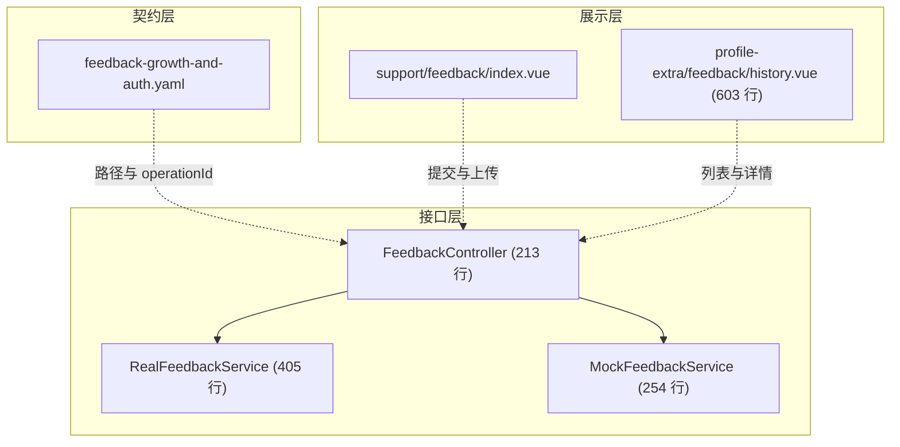
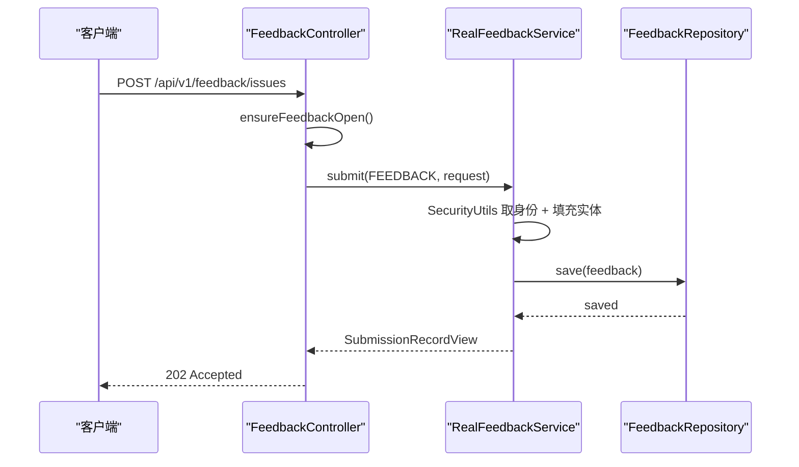
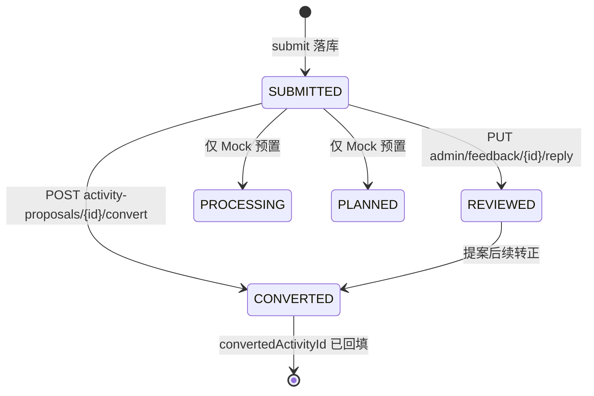
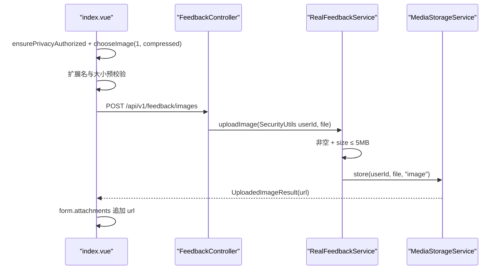
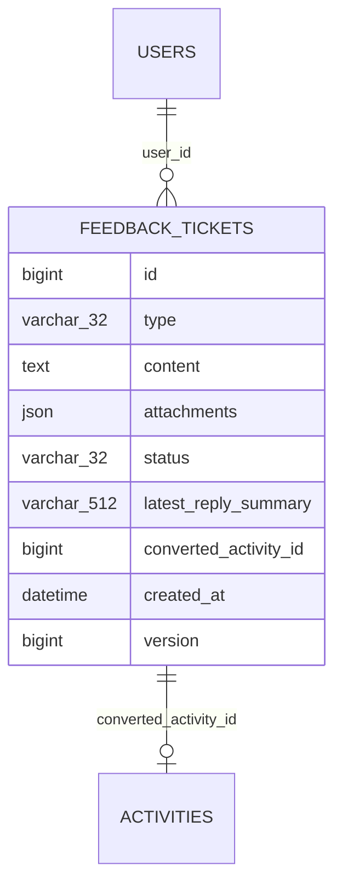
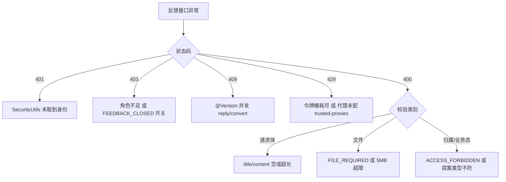

# 反馈收集服务

<cite>
**本文引用的文件**
- [FeedbackController.java](file://apps/api/src/main/java/com/campuslove/api/feedback/FeedbackController.java)
- [FeedbackService.java](file://apps/api/src/main/java/com/campuslove/api/feedback/FeedbackService.java)
- [RealFeedbackService.java](file://apps/api/src/main/java/com/campuslove/api/feedback/RealFeedbackService.java)
- [MockFeedbackService.java](file://apps/api/src/main/java/com/campuslove/api/feedback/MockFeedbackService.java)
- [FeedbackSubmissionRequest.java](file://apps/api/src/main/java/com/campuslove/api/feedback/FeedbackSubmissionRequest.java)
- [FeedbackTicketType.java](file://apps/api/src/main/java/com/campuslove/api/feedback/FeedbackTicketType.java)
- [SubmissionStatus.java](file://apps/api/src/main/java/com/campuslove/api/feedback/SubmissionStatus.java)
- [Feedback.java](file://apps/api/src/main/java/com/campuslove/api/entity/Feedback.java)
- [FeedbackRepository.java](file://apps/api/src/main/java/com/campuslove/api/repository/FeedbackRepository.java)
- [ContentFilterController.java](file://apps/api/src/main/java/com/campuslove/api/config/ContentFilterController.java)
- [SecurityConfig.java](file://apps/api/src/main/java/com/campuslove/api/config/SecurityConfig.java)
- [RateLimitAspect.java](file://apps/api/src/main/java/com/campuslove/api/ratelimit/RateLimitAspect.java)
- [feedback-growth-and-auth.yaml](file://docs/openapi/feedback-growth-and-auth.yaml)
- [V2026.05.28.0001__create_feedback_tickets.sql](file://database/flyway/sql/V2026.05.28.0001__create_feedback_tickets.sql)
- [V2026.07.26.0003__add_version_columns.sql](file://database/flyway/sql/V2026.07.26.0003__add_version_columns.sql)
- [history.vue](file://apps/client/src/subpackages/profile-extra/feedback/history.vue)
- [index.vue](file://apps/client/src/subpackages/support/feedback/index.vue)
- [api.ts](file://apps/client/src/services/api.ts)
- [feedback.ts](file://apps/client/src/stores/feedback.ts)
- [feedback.ts](file://apps/client/src/view-models/feedback.ts)
</cite>

## 目录
1. [简介](#简介)
2. [项目结构](#项目结构)
3. [核心组件](#核心组件)
4. [架构总览](#架构总览)
5. [详细组件分析](#详细组件分析)
6. [反馈类型定义与自动路由](#反馈类型定义与自动路由)
7. [状态流转与处理进度跟踪](#状态流转与处理进度跟踪)
8. [表单校验与附件上传](#表单校验与附件上传)
9. [统计分析与数据可视化](#统计分析与数据可视化)
10. [安全控制与能力边界](#安全控制与能力边界)
11. [依赖关系分析](#依赖关系分析)
12. [性能考虑](#性能考虑)
13. [故障排查指南](#故障排查指南)
14. [结论](#结论)

## 简介

反馈收集服务位于 `com.campuslove.api.feedback` 包，承载用户侧问题上报、建议提交与活动提案。控制器暴露 9 个端点：三条写入、两条列表、一条详情、两条处理与一条图片上传通道。

实现是「一接口两实现」：`RealFeedbackService` 在 `real` profile 下落库，`MockFeedbackService` 在 `mock` profile 下返回内存数据，七个公开方法签名一致，控制器无需感知后端形态。客户端有两处入口：`support/feedback/index.vue` 负责表单与图片上传，`profile-extra/feedback/history.vue` 负责历史列表与详情展开，中间由 Pinia store `feedback` 与 `clientApi` 衔接。

**章节来源**
- [FeedbackController.java:26-52](file://apps/api/src/main/java/com/campuslove/api/feedback/FeedbackController.java#L26-L52)
- [MockFeedbackService.java:13-38](file://apps/api/src/main/java/com/campuslove/api/feedback/MockFeedbackService.java#L13-L38)

## 项目结构

接口层集中在 feedback 包的 9 个文件：控制器、服务接口、两个实现、两个枚举、一个请求 record、两个视图 record；契约层是 `docs/openapi/feedback-growth-and-auth.yaml`（2501 行），展示层是两个 `.vue` 页面。

`Feedback.java` 与 `FeedbackRepository.java` 位于 `entity`、`repository` 包，构成反馈域与持久层的接缝；表结构由 `V2026.05.28.0001__create_feedback_tickets.sql` 创建，乐观锁列由 `V2026.07.26.0003__add_version_columns.sql` 补齐。

**章节来源**
- [V2026.05.28.0001__create_feedback_tickets.sql:1-20](file://database/flyway/sql/V2026.05.28.0001__create_feedback_tickets.sql#L1-L20)

## 核心组件

`FeedbackController` 标注 `@RestController` 与 `@Validated`，构造注入唯一的 `FeedbackService`，并以 `@Autowired(required = false)` 注入 `AppConfigService`（注释：real profile 注入，mock 为 null）；类注释写明「用户ID从JWT认证上下文中获取，不再从请求参数获取」。

`FeedbackService` 接口定义 7 个方法（`submit`、`listMine`、`listAdminFeedback`、`convertProposal`、`replyFeedback`、`uploadImage`、`getSubmissionDetail`）、常量 `FEEDBACK_IMAGE_MAX_BYTES = 5L * 1024 * 1024`（注释标注 R4-01850 双实现共用）与内嵌值对象 `UploadedImageResult`（仅 `url`）。

| 维度 | RealFeedbackService | MockFeedbackService |
| --- | --- | --- |
| 激活 | `@Profile("real")` | `@Profile("mock")` |
| 存储 | `FeedbackRepository` | `seedRecords` + `detailMap` |
| 主键 | 自增 ID | `AtomicLong ids = new AtomicLong(1000)` |
| 构造依赖 | Repository、ObjectMapper、MediaStorageService、ActivityRepository | 无参构造 |
| 预置数据 | 无 | 3 条 seed，覆盖三种类型与三种状态 |

**章节来源**
- [FeedbackService.java:13-30](file://apps/api/src/main/java/com/campuslove/api/feedback/FeedbackService.java#L13-L30)
- [MockFeedbackService.java:20-102](file://apps/api/src/main/java/com/campuslove/api/feedback/MockFeedbackService.java#L20-L102)

## 架构总览

一次写入依次穿过：角色校验 → 幂等与限流切面 → 运营开关 → Bean Validation → 类型分派 → JPA 持久化 → 视图映射；记录落在 `feedback_tickets`，附件 URL 以 JSON 字符串存于同行同列，提案转正跨聚合写入 `Activity`。

`@ResponseStatus(HttpStatus.ACCEPTED)` 与契约 `createFeedbackIssue` 声明的 `202 / 400 / 401 / 429 / 500` 对齐，429 对应 `@RateLimit(capacity = 10, refillTokens = 0.1, key = "#request.remoteAddr")`。

**章节来源**
- [RealFeedbackService.java:81-113](file://apps/api/src/main/java/com/campuslove/api/feedback/RealFeedbackService.java#L81-L113)
- [feedback-growth-and-auth.yaml:947-982](file://docs/openapi/feedback-growth-and-auth.yaml#L947-L982)

## 详细组件分析

### 端点面

| 方法 | 路径 | 鉴权 | 幂等 | 限流 | 开关 |
| --- | --- | --- | --- | --- | --- |
| POST | `/api/v1/feedback/issues` | USER | 是 | 是 | 是 |
| POST | `/api/v1/feedback/suggestions` | USER | 是 | 是 | 是 |
| POST | `/api/v1/feedback/activity-proposals` | USER | 是 | 是 | 是 |
| GET | `/api/v1/feedback/my-submissions` | 链上认证 | 否 | 否 | 否 |
| GET | `/api/v1/feedback/my-submissions/{id}` | 链上认证 | 否 | 否 | 否 |
| GET | `/api/v1/admin/feedback` | 链上 ADMIN | 否 | 否 | 否 |
| PUT | `/api/v1/admin/feedback/{id}/reply` | ADMIN | 否 | 否 | 否 |
| POST | `/api/v1/admin/activity-proposals/{id}/convert` | ADMIN | 是 | 否 | 否 |
| POST | `/api/v1/feedback/images` | USER | 是 | 否 | 否 |

三条写入通道方法体同构：`ensureFeedbackOpen()` 后把不同的 `FeedbackTicketType` 常量传入 `submit`，这就是仓库中「自动路由」的全部形态。两个 admin 端点刻意返回裸对象（注释：与其余 admin 端点一致，后台前端直接消费）；路径变量统一 `@Positive long id`。

### 服务层处理逻辑

`submit`（`L81-L113`）在一个 `@Transactional` 方法内完成：取身份、`LocalDateTime.now(TimeZones.BUSINESS)`、逐 setter 填充（状态硬编码 `SUBMITTED`）、附件非空时 `writeValueAsString`、`save` 后写 info 日志并经 `toView` 返回；序列化遇 `JsonProcessingException` 只 `log.warn` 并把附件置 `null`，工单仍保存。

`listMine`（`L123-L133`）按 `type` 是否为 null 二选一调用仓库派生查询；`listAdminFeedback`（`L141-L146`）用 `findByTypeNotOrderByCreatedAtDesc(ACTIVITY_PROPOSAL)` 把提案排除出运营队列；两者均无分页参数。`toView`（`L211-L224`）是列表视图唯一装配点，时间用类级 `FORMATTER`（`yyyy-MM-dd HH:mm:ss`）格式化。

`convertProposal`（`L157-L203`）是唯一跨聚合写操作：前置判定（记录存在、类型为提案、尚未转换）后新建 `Activity`，标题取提案标题（空则「校园活动提案」）、描述取内容、`location` 取 `expectedCampus`（空则「待定」）、`scheduleText` 固定「待定」、`status = upcoming`、`published = true`，随后把提案置 `CONVERTED` 并回填 `convertedActivityId`；注释标注这是 R4-00342 修复，原实现只改状态、该 ID 恒为 null。

`replyFeedback`（`L329-L349`）置 `REVIEWED`，回复超 200 字符截断加 `…`，空回复抛 `REPLY_CONTENT_REQUIRED`，不写独立回复表。`getSubmissionDetail`（`L306-L320`）比对归属，不一致先 `log.warn` 三个 ID 再抛 `FEEDBACK_ACCESS_FORBIDDEN`；`toDetailView`（`L360-L378`）复用 `parseAttachments`（`L393-L404`，null/空白/解析失败一律返回空列表），`latestReplyContent` 固定传 `null`，注释说明回复表尚未实现。

**章节来源**
- [FeedbackController.java:54-138](file://apps/api/src/main/java/com/campuslove/api/feedback/FeedbackController.java#L54-L138)
- [RealFeedbackService.java:81-404](file://apps/api/src/main/java/com/campuslove/api/feedback/RealFeedbackService.java#L81-L404)

## 反馈类型定义与自动路由

类型在后端只有一个三值枚举 `FeedbackTicketType { FEEDBACK, SUGGESTION, ACTIVITY_PROPOSAL }`（无字段无方法），契约用 `SubmissionType` 复刻同一组值，实体以 `@Enumerated(EnumType.STRING)` 存为 `type VARCHAR(32)`。

客户端有两套标识：`history.vue` 的 `FilterType` 为大写 `"all" | "FEEDBACK" | "SUGGESTION" | "ACTIVITY_PROPOSAL"`（注释：与后端枚举保持一致），`index.vue` 的 `FeedbackType` 为小写 `"feedback" | "suggestion" | "activity_proposal"`，仅用于表单页 chip 切换；小写值不进入请求体——`SubmissionRequest` 没有 `type` 字段，类型由「调用了哪个 store action、命中了哪个端点」表达。

可证实的分流规则只有三条，全是静态分支：入口按端点分派常量类型；`listAdminFeedback` 用 `findByTypeNotOrderByCreatedAtDesc(ACTIVITY_PROPOSAL)` 做队列分流；仅 `ACTIVITY_PROPOSAL` 能走 `convertProposal`，其余类型被 `IllegalStateException` 拒绝且消息带实际类型值。Mock 的 `convertProposal` 返回 `9000L + proposalId` 作为假活动 ID，`uploadImage` 返回 `mock://feedback/image/{id}/{originalFilename}`。

优先级判定在仓库中没有载体：`Feedback` 的全部列、`FeedbackSubmissionRequest` 的 6 个字段与契约 `SubmissionRequest` 都不含优先级或严重程度，排序唯一依据是 `created_at` 降序（三个仓库方法名均以 `OrderByCreatedAtDesc` 结尾）。

**章节来源**
- [FeedbackTicketType.java:3-7](file://apps/api/src/main/java/com/campuslove/api/feedback/FeedbackTicketType.java#L3-L7)
- [Feedback.java:50-124](file://apps/api/src/main/java/com/campuslove/api/entity/Feedback.java#L50-L124)
- [MockFeedbackService.java:155-230](file://apps/api/src/main/java/com/campuslove/api/feedback/MockFeedbackService.java#L155-L230)

## 状态流转与处理进度跟踪

`SubmissionStatus` 定义 `SUBMITTED`、`PROCESSING`、`REVIEWED`、`PLANNED`、`CONVERTED`；实体默认值与 `submit` 的显式赋值都是 `SUBMITTED`。

真实实现只产生两条迁移：`replyFeedback` 置 `REVIEWED`，`convertProposal` 置 `CONVERTED`；`PROCESSING` 与 `PLANNED` 在 `RealFeedbackService` 中无任何赋值点，只作为 Mock seed 的既有值存在，真实环境列表不会出现「处理中」「已规划」。

进度字段全部内联在视图里，没有独立时间线表：`status` 是唯一状态载体，`latest_reply_summary`（512 列，服务层按 200 字符截断）承载回复摘要，`submittedAt` 由 `created_at` 格式化，`convertedActivityId` 指向转正后的活动；`updatedAt` 在三个写入方法里都会刷新，但两个视图都没有暴露它。

客户端把状态映射为文案与色调：`processing`/`planned` 取 `warning`，`reviewed`/`converted` 取 `success`，其余回落 `brand`，并有 `?? "feedbackStatus.submitted"` 兜底。该映射与契约都用小写字面量（`enum: [submitted, ...]`），而后端枚举名与库内值是大写、视图直接透传枚举——这一大小写差异是契约与实现之间的已知缝隙。

用户通知机制不存在：9 个端点与 7 个方法均未引用推送、站内信或订阅消息服务，实体也没有通知状态列，用户只能重拉 `GET /api/v1/feedback/my-submissions`，前端体现为 `onShow` 刷新与 `toggleExpand` 按需取详情。

**章节来源**
- [SubmissionStatus.java:3-9](file://apps/api/src/main/java/com/campuslove/api/feedback/SubmissionStatus.java#L3-L9)
- [feedback.ts:7-28](file://apps/client/src/view-models/feedback.ts#L7-L28)

## 表单校验与附件上传

控制器类上的 `@Validated` 与写入端点的 `@Valid @RequestBody` 构成校验入口，请求体是 15 行 record，约束集中在字段注解上：

| 字段 | 注解 | 实体列 | 契约 |
| --- | --- | --- | --- |
| `title` | `@NotBlank` `@Size(max = 100)` | `VARCHAR(256)` | `maxLength 200` |
| `content` | `@NotBlank` `@Size(max = 5000)` | `TEXT` | `maxLength 5000` |
| `contactWechat` | `@Size(max = 64)` | `VARCHAR(64)` | `maxLength 64` |
| `attachments` | 无 | `JSON DEFAULT NULL` | `array` of string |
| `expectedCity` | `@Size(max = 32)` | `VARCHAR(64)` | 无长度 |
| `expectedCampus` | `@Size(max = 64)` | `VARCHAR(128)` | 无长度 |

三处数值差异可核对：`title` 后端 100 严于契约 200、`expectedCampus` 校验 64 而列宽 128、`expectedCity` 校验 32 而列宽 64；契约必填项 `required: [title, content]` 与注解一致。回复体 `ReplyFeedbackRequest.reply` 带 `@NotBlank`，与服务层 `isBlank()` 双重把守。

富文本支持不存在：内容是 `TEXT` 纯文本列、DTO 是 `String`、表单用原生 `<textarea>` 绑定并 `:maxlength="FEEDBACK_CONTENT_MAX"`（5000），提交前只做 `trim()` 非空判断；反馈包与两个页面均无编辑器组件、HTML 解析或标签白名单。

附件走独立端点，与工单提交解耦。5MB 上限来自共享常量 `FEEDBACK_IMAGE_MAX_BYTES`，超限文案由常量动态拼接，改限即同步；控制器注释给出三项业务规则：jpg/png/webp 由 `MediaStorageService` 校验、比其默认 10MB 更严格、存储路径 `uploads/{userId}/{yyyyMM}/{uuid}.{ext}`。

前端预校验与后端同源但更严：`IMAGE_SIZE_LIMIT = 5MB`、`IMAGE_MAX_COUNT = 3`、`ALLOWED_EXTS = ["jpg","jpeg","png","webp"]`，数量上限 3 是纯前端约束，后端无条数校验；H5 端曾因 `blob:` URL 无扩展名导致校验恒失败，修复为改用 `res.tempFiles[0]` 的 `name`/`type` 判定。

**章节来源**
- [FeedbackSubmissionRequest.java:1-15](file://apps/api/src/main/java/com/campuslove/api/feedback/FeedbackSubmissionRequest.java#L1-L15)
- [index.vue:58-242](file://apps/client/src/subpackages/support/feedback/index.vue#L58-L242)

## 统计分析与数据可视化

`feedback_tickets` 建表脚本给出：`id BIGINT UNSIGNED AUTO_INCREMENT` 主键，`type`/`status` 为 `VARCHAR(32) NOT NULL`（注释直接列出枚举值），`content TEXT NOT NULL`，`attachments JSON DEFAULT NULL`，`status` 默认 `'SUBMITTED'`，`updated_at` 带 `ON UPDATE CURRENT_TIMESTAMP`；索引只有 `idx_feedback_user_id` 与 `idx_feedback_type`。

`V2026.07.26.0003` 在「举报与反馈」分组调用 `add_version_column_if_missing('feedback_tickets')`，列为 `version BIGINT NOT NULL DEFAULT 0`，对应实体 `@Version`；该脚本的外键清单（`private_messages`、`likes`、`pass_records`、`reports`、`notifications`）不含 `feedback_tickets`，故 `user_id` 与 `converted_activity_id` 无数据库级引用约束。

统计能力缺失可从四处同时确证：`FeedbackRepository` 只有 4 个方法且全部返回 `List<Feedback>`，无 `count`、无 `@Query` 聚合，其中 `findAllByOrderByCreatedAtDesc()` 在两个实现中都未被调用；控制器无统计端点；契约中反馈相关路径共 8 条且无分析类端点；历史页只有类型筛选与状态色调，没有图表组件。

可推导但尚无实现的口径：各类型提交量、待处理积压（`status`）、时段分布（`created_at`）、回复覆盖率与提案转化率（`latest_reply_summary`、`converted_activity_id` 是否为 `NULL`）。

**章节来源**
- [V2026.07.26.0003__add_version_columns.sql:119-137](file://database/flyway/sql/V2026.07.26.0003__add_version_columns.sql#L119-L137)
- [FeedbackRepository.java:12-45](file://apps/api/src/main/java/com/campuslove/api/repository/FeedbackRepository.java#L12-L45)

## 安全控制与能力边界

访问控制分两层。链上兜底是 `.requestMatchers("/api/v1/**").authenticated()` 与 `.requestMatchers("/api/v1/admin/**").hasRole("ADMIN")`，因此无 `@PreAuthorize` 的 `GET /api/v1/admin/feedback` 与两个用户查询端点仍分别受 ADMIN 与认证约束，契约里 `/admin/feedback` 声明的 `403` 即来自这一层；方法注解覆盖另五个端点（写入与图片上传为 `hasRole('USER')`，回复与转正为 `hasRole('ADMIN')`）。

越权防护在详情查询：`userId` 与记录归属不一致时先 `log.warn` 三个 ID 再抛 `FEEDBACK_ACCESS_FORBIDDEN`，列表查询从源头按 `user_id` 过滤；Mock 主动放弃该层，注释写明「Mock 模式下不区分用户归属」，属 profile 边界。

| 机制 | 配置 | 范围 |
| --- | --- | --- |
| 令牌桶 | `capacity = 10, refillTokens = 0.1`，键按 `remoteAddr` | 三条写入端点 |
| 幂等 | `@Idempotent` | 写入、convert、images |
| 运营开关 | `SWITCH_FEEDBACK_OPEN` → 403 | 三条写入端点 |
| 体积上限 | `FEEDBACK_IMAGE_MAX_BYTES = 5MB` | 图片上传 |

附件安全：`/uploads/**` 为 `denyAll`（注释记录原 `permitAll` 导致匿名可枚举上传资源），读取必须走 `/api/v1/media/**`（`authenticated()`，按 JWT 中 userId 校验归属）；并发一致性由 `@Version` 保证，冲突抛 `ObjectOptimisticLockingFailureException`，注释说明由 `GlobalExceptionHandler` 转 409。

恶意反馈检测与垃圾过滤不在反馈链路内。仓库确有敏感词能力：`POST /api/v1/content-filter/check` 注入 `SensitiveWordFilter`，超 5000 字符抛异常且只回布尔不回命中词（注释说明防止词库被枚举），并带独立限流 `capacity = 60, refillTokens = 5`；但 `RealFeedbackService` 的 import 与构造参数里没有它，`submit` 原样写入 `content`，也没有重复内容检测、提交者画像、黑名单或附件扫描——滥用防线实际只剩限流、幂等、开关与字段长度。`contact_wechat` 是明文 `VARCHAR(64)`，实体与 DDL 都无加密标记（仓库存在 `AesEncryptor`，反馈包未引用）。

**章节来源**
- [SecurityConfig.java:168-188](file://apps/api/src/main/java/com/campuslove/api/config/SecurityConfig.java#L174-L194)
- [ContentFilterController.java:18-59](file://apps/api/src/main/java/com/campuslove/api/config/ContentFilterController.java#L18-L59)

## 依赖关系分析

`FeedbackController` 的直接协作者只有 `FeedbackService`（构造注入）与可选的 `AppConfigService`；真实实现的四个构造参数把它接到持久层、媒体域、活动域与 JSON 层（`FeedbackRepository`、`MediaStorageService`、`ActivityRepository`、`ObjectMapper`）。两个实现共享 `ErrorMessages` 常量；跨出的两条耦合边都在同事务内同步完成：`convertProposal` 保存 `Activity` 并回填 ID，`uploadImage` 委托 `MediaStorageService.store`。

前端状态集中在 `defineStore("feedback", {...})`：state 为 `submissions`/`loading`/`errorMessage`，action 为 `load`、`submitIssue`、`submitSuggestion`、`submitActivityProposal`、`clearError`，四个异步 action 均为「置 loading → 调 `clientApi` → 成功后 `await this.load()` 重拉 → 失败写 `errorMessage` 并返回布尔」的形状。

`api.ts` 的六个反馈方法都带 `if (useMock())` 分支走 `mockFixtures`，真实分支才拼 `/feedback/...` 相对路径；历史页列表来自 store、详情来自 `clientApi.getSubmissionDetail` 并缓存进 `detailCache`，两个数据源不同步是刻意设计。

契约与实现之间已核对的偏差有四处：`title` 长度（契约 200 / 校验 100）、`status` 大小写、`UploadedImageResult` 字段（契约要求 `url` + `size` + `contentType`，实现只返回 `url`）、回复端点未纳入 OpenAPI。

**章节来源**
- [feedback.ts:12-101](file://apps/client/src/stores/feedback.ts#L12-L101)
- [api.ts:622-660](file://apps/client/src/services/api.ts#L622-L660)

## 性能考虑

限流参数 `capacity = 10, refillTokens = 0.1` 意为瞬时容 10 次、之后平均 10 秒一次。桶键由切面拼为「类名#方法名:解析值」，`#request` 变量由切面注入为当前 `HttpServletRequest`（而非方法入参 DTO），三个端点各有独立分桶；SpEL 解析失败时降级为 `方法限定名:fallback` 并 `log.warn`，不会整体失效。代理部署下若直连来源不在 `app.security.trusted-proxies`，注释明确会「全站共享同一限流桶（误伤）」。

读路径的代价集中在无分页：`listMine` 与 `listAdminFeedback` 返回完整 `List`，后者是全表除提案外一次取回；`toView` 逐行映射并逐行格式化时间。索引匹配度上，用户维度查询可用 `idx_feedback_user_id`，管理端的 `type != ?` 加 `order by created_at desc` 收益有限，`idx_feedback_status` 无查询条件使用。

事务边界有两处值得注意：`uploadImage` 带 `@Transactional`，而其实质工作是委托 `MediaStorageService.store` 落盘，文件 IO 发生在事务持有连接期间；`convertProposal` 在同一事务内做两次 `save`，并发转正以 409 暴露而非产生重复活动。

**章节来源**
- [RateLimitAspect.java:200-272](file://apps/api/src/main/java/com/campuslove/api/ratelimit/RateLimitAspect.java#L200-L272)
- [RealFeedbackService.java:123-146](file://apps/api/src/main/java/com/campuslove/api/feedback/RealFeedbackService.java#L123-L146)

## 故障排查指南

| 现象 | 根因位置 |
| --- | --- |
| 提交成功但列表无附件 | `submit` 序列化失败置 `null`，日志「附件列表序列化失败，将忽略附件」 |
| 详情附件恒为空数组 | `parseAttachments` 对 null/空白/解析失败统一返回空列表 |
| 历史页显示空态而非错误 | store 吞错不抛，页面读 `store.errorMessage`（MP-R1-FEEDBACKHIST-001） |
| 状态标签恒为「已提交」 | 枚举大写与契约小写不一致，前端走 `??` 兜底 |

异常种类可作日志检索词：`IllegalArgumentException`（`FILE_REQUIRED`、超限文案、`REPLY_CONTENT_REQUIRED`、`FEEDBACK_ACCESS_FORBIDDEN`）、`IllegalStateException`（类型不符、已转换）、`NoSuchElementException`（`findById` 未命中）、`OperationForbiddenException`（开关关闭）；控制器注释把前者归 400、未认证归 401，`NoSuchElementException` 交由全局异常处理器，契约侧对应端点声明 `404`。

日志锚点：`用户 {} 提交反馈，类型: {}，ID: {}`、`用户[{}]尝试访问不属于其的反馈记录[ID:{}]，归属用户[{}]`、`活动提案 {} 已转换为活动，convertedActivityId: {}`。

**章节来源**
- [RealFeedbackService.java:99-113](file://apps/api/src/main/java/com/campuslove/api/feedback/RealFeedbackService.java#L99-L113)
- [history.vue:101-172](file://apps/client/src/subpackages/profile-extra/feedback/history.vue#L101-L172)

## 结论

可核验能力包括三条按类型静态分派的写入通道、按 IP 令牌桶与幂等、运营开关、附件独立上传与 5MB 上限、列表与详情分离的读取模型、管理端回复与提案到活动的真实转换，以及归属校验、乐观锁与 `/uploads/**` 封禁构成的越权防护。

能力边界同样可核验：没有优先级、没有分类模型（类型即分类的全部实现）、没有基于内容的路由、没有回复表（`latestReplyContent` 恒为 `null`）、没有主动通知、没有聚合查询或报表端点、没有恶意反馈检测（敏感词预检端点存在但未被反馈链路调用），表上也没有外键；真实链路只产生 `SUBMITTED`、`REVIEWED`、`CONVERTED` 三态，`PROCESSING` 与 `PLANNED` 仅存在于 Mock 种子数据。

四处契约偏差（`title` 长度、`status` 大小写、`UploadedImageResult` 字段、未纳入 OpenAPI 的回复端点）是排查显示异常与类型不一致的首选位置。与同级页面的分工：反馈入口与历史列表归本页，`/api/v1/auth/**` 与 `/profile/**` 见《用户资料服务》，附件落盘与读取代理属媒体域。

**章节来源**
- [feedback-growth-and-auth.yaml:947-1192](file://docs/openapi/feedback-growth-and-auth.yaml#L947-L1192)
