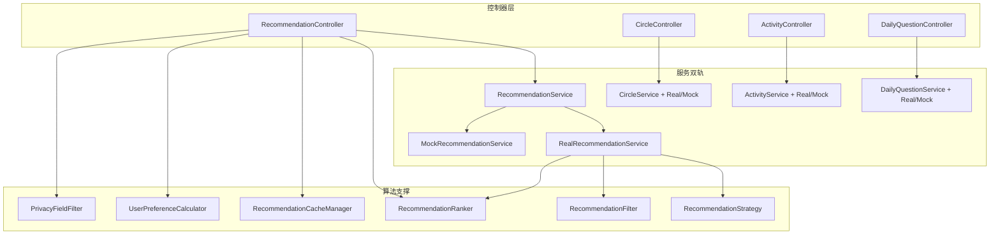
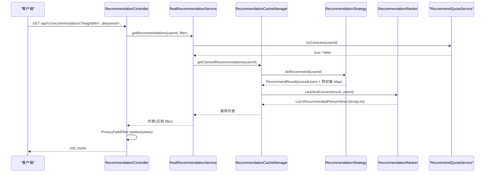
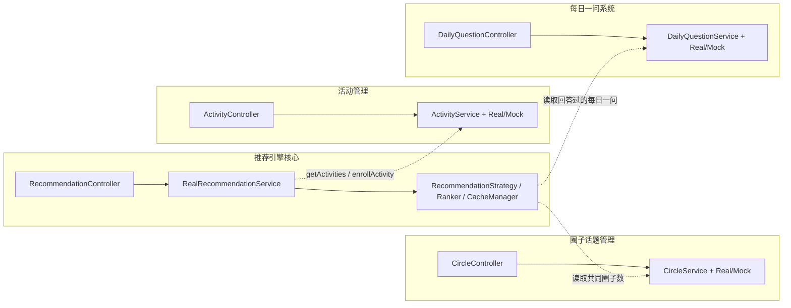
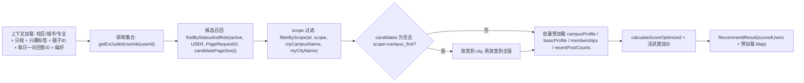
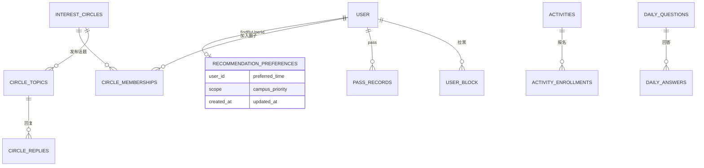
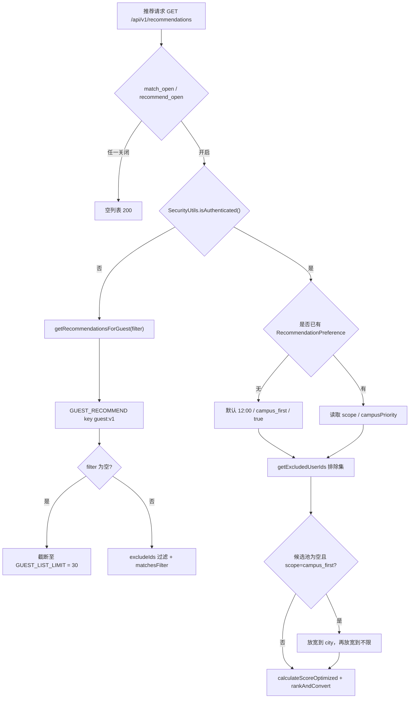
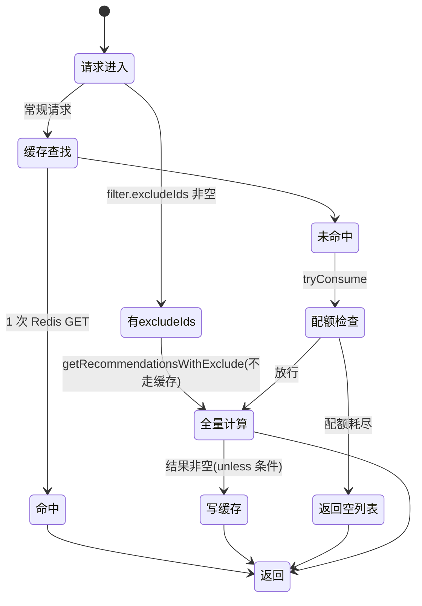

# 发现推荐服务

<cite>
**本文引用的文件**
- [RecommendationController.java](file://apps/api/src/main/java/com/campuslove/api/discover/RecommendationController.java)
- [RealRecommendationService.java](file://apps/api/src/main/java/com/campuslove/api/discover/RealRecommendationService.java)
- [MockRecommendationService.java](file://apps/api/src/main/java/com/campuslove/api/discover/MockRecommendationService.java)
- [CircleController.java](file://apps/api/src/main/java/com/campuslove/api/discover/CircleController.java)
- [ActivityController.java](file://apps/api/src/main/java/com/campuslove/api/discover/ActivityController.java)
- [DailyQuestionController.java](file://apps/api/src/main/java/com/campuslove/api/discover/DailyQuestionController.java)
- [RecommendationService.java](file://apps/api/src/main/java/com/campuslove/api/discover/RecommendationService.java)
- [CircleService.java](file://apps/api/src/main/java/com/campuslove/api/discover/CircleService.java)
- [ActivityService.java](file://apps/api/src/main/java/com/campuslove/api/discover/ActivityService.java)
- [DailyQuestionService.java](file://apps/api/src/main/java/com/campuslove/api/discover/DailyQuestionService.java)
- [RecommendationStrategy.java](file://apps/api/src/main/java/com/campuslove/api/discover/RecommendationStrategy.java)
- [RecommendationRanker.java](file://apps/api/src/main/java/com/campuslove/api/discover/RecommendationRanker.java)
- [RecommendationCacheManager.java](file://apps/api/src/main/java/com/campuslove/api/discover/RecommendationCacheManager.java)
- [UserPreferenceCalculator.java](file://apps/api/src/main/java/com/campuslove/api/discover/UserPreferenceCalculator.java)
- [PrivacyFieldFilter.java](file://apps/api/src/main/java/com/campuslove/api/discover/PrivacyFieldFilter.java)
- [RecommendationFilter.java](file://apps/api/src/main/java/com/campuslove/api/discover/RecommendationFilter.java)
- [RecommendedPersonView.java](file://apps/api/src/main/java/com/campuslove/api/discover/RecommendedPersonView.java)
- [RealCircleService.java](file://apps/api/src/main/java/com/campuslove/api/discover/RealCircleService.java)
- [RecommendationConfig.java](file://apps/api/src/main/java/com/campuslove/api/config/RecommendationConfig.java)
- [CacheNames.java](file://apps/api/src/main/java/com/campuslove/api/config/CacheNames.java)
- [application.yml](file://apps/api/src/main/resources/application.yml)
- [RecommendationPreference.java](file://apps/api/src/main/java/com/campuslove/api/entity/RecommendationPreference.java)
- [CircleTopic.java](file://apps/api/src/main/java/com/campuslove/api/entity/CircleTopic.java)
- [Activity.java](file://apps/api/src/main/java/com/campuslove/api/entity/Activity.java)
- [DailyAnswer.java](file://apps/api/src/main/java/com/campuslove/api/entity/DailyAnswer.java)
- [recommendations.yaml](file://docs/openapi/recommendations.yaml)
- [village.yaml](file://docs/openapi/village.yaml)
- [RecommendationControllerTest.java](file://apps/api/src/test/java/com/campuslove/api/discover/RecommendationControllerTest.java)
- [RealRecommendationServiceTest.java](file://apps/api/src/test/java/com/campuslove/api/discover/RealRecommendationServiceTest.java)
- [CircleControllerTest.java](file://apps/api/src/test/java/com/campuslove/api/discover/CircleControllerTest.java)
</cite>

## 目录
1. [简介](#简介)
2. [项目结构](#项目结构)
3. [核心组件](#核心组件)
4. [架构总览](#架构总览)
5. [子页导航与边界](#子页导航与边界)
6. [详细组件分析](#详细组件分析)
7. [数据模型](#数据模型)
8. [配置与开关](#配置与开关)
9. [偏好端点与冷启动分诊](#偏好端点与冷启动分诊)
10. [缓存收敛与批量装载](#缓存收敛与批量装载)
11. [入参治理与打分输入信号](#入参治理与打分输入信号)
12. [依赖关系分析](#依赖关系分析)
13. [性能考虑](#性能考虑)
14. [故障排查指南](#故障排查指南)
15. [能力缺口登记](#能力缺口登记)
16. [结论](#结论)

## 简介
本页是「发现推荐服务」分组的总览页，负责串联该目录下的四个子页：推荐引擎核心、圈子话题管理、活动管理、每日一问系统。本页不重复子页的实现细节，只回答三类问题：

- 模块边界：`com.campuslove.api.discover` 包内哪些类属于「入口/契约」，哪些属于「算法/编排」，哪些属于「内容管理」。
- 整体数据流：一次发现类请求从 `/api/v1` 路由进来，如何被拆分为候选召回、过滤、排序、配额与付费解锁几个阶段。
- 索引与取证入口：每个子主题对应的控制器、服务、视图契约与测试文件的具体位置。

该分组对外暴露的路由前缀集中在三处：`/api/v1`（推荐与人相关，见 RecommendationController 的 `@RequestMapping("/api/v1")`）、`/api/v1/circles`、`/api/v1/activities`，以及 `/api/v1/daily-question`。服务层统一采用「接口 + Real 实现 + Mock 实现」的双轨结构，通过 Spring Profile 在真实环境与联调环境之间切换。

**章节来源**
- [RecommendationController.java:36-114](file://apps/api/src/main/java/com/campuslove/api/discover/RecommendationController.java#L36-L114)
- [RealRecommendationService.java:51-100](file://apps/api/src/main/java/com/campuslove/api/discover/RealRecommendationService.java#L51-L100)
- [MockRecommendationService.java:20-34](file://apps/api/src/main/java/com/campuslove/api/discover/MockRecommendationService.java#L20-L34)
- [CircleController.java:34-65](file://apps/api/src/main/java/com/campuslove/api/discover/CircleController.java#L34-L65)
- [ActivityController.java:31-71](file://apps/api/src/main/java/com/campuslove/api/discover/ActivityController.java#L31-L71)
- [DailyQuestionController.java:32-46](file://apps/api/src/main/java/com/campuslove/api/discover/DailyQuestionController.java#L32-L46)

## 项目结构
发现推荐相关代码集中在 `apps/api/src/main/java/com/campuslove/api/discover` 包，按职责可分为四层：

- 控制器层：RecommendationController、CircleController、ActivityController、DailyQuestionController
- 服务契约与双轨实现：RecommendationService / RealRecommendationService / MockRecommendationService，CircleService 与 Real/Mock 实现、ActivityService 与 Real/Mock 实现、DailyQuestionService 与 Real/Mock 实现
- 算法与支撑组件：RecommendationRanker、RecommendationCacheManager、RecommendationStrategy、RecommendationFilter、UserPreferenceCalculator、PrivacyFieldFilter
- 视图契约：DiscussionRecommendationView、ActivityRecommendationView、RecommendationPreferencesView、WhisperUnlockView、ActivityDetailView、ActivityEnrollmentResultView、ActivityView、CircleView、CircleMembershipView、CircleTopicView、CircleReplyView、DailyQuestionView、DailyAnswerView、RecommendedPersonView

**图表来源**
- [RecommendationController.java:36-114](file://apps/api/src/main/java/com/campuslove/api/discover/RecommendationController.java#L36-L114)
- [RealRecommendationService.java:51-100](file://apps/api/src/main/java/com/campuslove/api/discover/RealRecommendationService.java#L51-L100)
- [MockRecommendationService.java:20-34](file://apps/api/src/main/java/com/campuslove/api/discover/MockRecommendationService.java#L20-L34)
- [CircleController.java:34-65](file://apps/api/src/main/java/com/campuslove/api/discover/CircleController.java#L34-L65)
- [ActivityController.java:31-71](file://apps/api/src/main/java/com/campuslove/api/discover/ActivityController.java#L31-L71)
- [DailyQuestionController.java:32-46](file://apps/api/src/main/java/com/campuslove/api/discover/DailyQuestionController.java#L32-L46)

**章节来源**
- [RecommendationController.java:36-114](file://apps/api/src/main/java/com/campuslove/api/discover/RecommendationController.java#L36-L114)
- [RealRecommendationService.java:51-100](file://apps/api/src/main/java/com/campuslove/api/discover/RealRecommendationService.java#L51-L100)

## 核心组件
本页只保留「组件身份 + 归属边界」两层信息，实现细节交由四个子页展开。按组件在请求链路上的位置分组如下。

**入口契约层（HTTP 路由 + 请求/响应 record）**

| 组件 | 路由前缀 | 职责定位 | 证据 |
| --- | --- | --- | --- |
| `RecommendationController` | `/api/v1` | 推荐配额、讨论/活动推荐、偏好读写、人物推荐、推荐历史、他人主页、悄悄话查看与解锁 | `@RestController` L36、`@RequestMapping("/api/v1")` L37 |
| `CircleController` | `/api/v1/circles` | 圈子加入/退出、话题发布与浏览、回复发布与浏览、精选话题 | L34-L35 |
| `ActivityController` | `/api/v1/activities` | 活动列表、活动详情、报名与取消报名 | L31-L32 |
| `DailyQuestionController` | `/api/v1/daily-question` | 今日问题、提交回答、回答列表 | L32-L33 |

**服务契约层（接口，双轨实现的公共形状）**

- `RecommendationService`：14 个方法，覆盖讨论推荐、活动推荐、活动报名、活动详情、偏好读写、人物推荐（含带 `RecommendationFilter` 重载与游客重载）、历史；其中 `updatePreferences(RecommendationPreferencesView)` 已标注 `@Deprecated`，注释明确说明「无法持久化偏好」，应改用带 `userId` 的重载。
- `CircleService`：`getCircles`（支持 `category` 过滤，注释列举 study/sports/music/movie/travel/game/food/reading）、`joinCircle`/`leaveCircle`、`getTopics`/`createTopic`/`getTopicDetail`、`replyToTopic`/`getReplies`、`getFeaturedTopics`，分页返回 `Page<>`。
- `ActivityService`：`getActivities(campusName, category, userId, pageable)`、`getActivityDetail(Long activityId, Long userId)`、`enrollActivity`、`cancelEnrollment`。
- `DailyQuestionService`：`getTodayQuestion(userId)`、`submitAnswer`、`getAnswers`（注释要求「只有当前用户已回答才能查看其他人的回答」）、`hasAnswered`。

**算法与支撑层（仅 real profile 装配）**

- `RecommendationStrategy`（`@Profile("real")` + `@Component`，L64-L66）：候选召回、排除集合、scope 过滤、加权评分，产出 `ScoredUser` 与 `RecommendResult`。
- `RecommendationRanker`（`@Profile("real")`，L59）：排序 + 视图转换 + 热度标签 + 悄悄话池 + 距离文案等展示字段装配。
- `RecommendationCacheManager`（`@Profile("real")`，L32）：`@Cacheable` 缓存推荐结果、`@CacheEvict` 主动失效、耗时监控与曝光埋点。
- `UserPreferenceCalculator`（`@Profile("real")`，L31）：偏好读写持久化、`VALID_SCOPES` 校验、兴趣标签 JSON 解析辅助。
- `PrivacyFieldFilter`：静态工具类（私有构造 L127-L129），白名单 + 敏感字段反射校验。
- `RecommendationFilter`：`record` 筛选参数（身高/学历/感情状态/籍贯/未来城市/关键词/年龄/`excludeIds`），提供 `isEmpty()` 向后兼容判定。

**双轨实现（同一接口的两套 Bean）**
`RealRecommendationService`（`@Profile("real")` L50）、`MockRecommendationService`（`@Profile("mock")` L19）、`RealCircleService`（L51）/`MockCircleService`（L19）、`RealActivityService`（L27）/`MockActivityService`（L19）、`RealDailyQuestionService`（L39）/`MockDailyQuestionService`（L23）。

**章节来源**
- [RecommendationController.java:36-37](file://apps/api/src/main/java/com/campuslove/api/discover/RecommendationController.java#L36-L37)
- [CircleController.java:34-35](file://apps/api/src/main/java/com/campuslove/api/discover/CircleController.java#L34-L35)
- [ActivityController.java:31-34](file://apps/api/src/main/java/com/campuslove/api/discover/ActivityController.java#L31-L34)
- [DailyQuestionController.java:32-35](file://apps/api/src/main/java/com/campuslove/api/discover/DailyQuestionController.java#L32-L35)
- [RecommendationService.java:11-140](file://apps/api/src/main/java/com/campuslove/api/discover/RecommendationService.java#L11-L140)
- [CircleService.java:11-96](file://apps/api/src/main/java/com/campuslove/api/discover/CircleService.java#L11-L96)
- [ActivityService.java:10-52](file://apps/api/src/main/java/com/campuslove/api/discover/ActivityService.java#L10-L52)
- [DailyQuestionService.java:10-51](file://apps/api/src/main/java/com/campuslove/api/discover/DailyQuestionService.java#L10-L51)
- [RecommendationStrategy.java:64-66](file://apps/api/src/main/java/com/campuslove/api/discover/RecommendationStrategy.java#L64-L66)
- [RecommendationRanker.java:59-61](file://apps/api/src/main/java/com/campuslove/api/discover/RecommendationRanker.java#L59-L61)
- [RecommendationCacheManager.java:32-34](file://apps/api/src/main/java/com/campuslove/api/discover/RecommendationCacheManager.java#L32-L34)
- [UserPreferenceCalculator.java:31-36](file://apps/api/src/main/java/com/campuslove/api/discover/UserPreferenceCalculator.java#L31-L36)
- [PrivacyFieldFilter.java:127-129](file://apps/api/src/main/java/com/campuslove/api/discover/PrivacyFieldFilter.java#L127-L129)
- [RecommendationFilter.java:23-35](file://apps/api/src/main/java/com/campuslove/api/discover/RecommendationFilter.java#L23-L35)
- [RealRecommendationService.java:50-52](file://apps/api/src/main/java/com/campuslove/api/discover/RealRecommendationService.java#L50-L52)
- [MockRecommendationService.java:19-21](file://apps/api/src/main/java/com/campuslove/api/discover/MockRecommendationService.java#L19-L21)

## 架构总览
一次「人物推荐」请求在 real profile 下的分层链路如下：控制器只做鉴权、参数解析与配额查询，真正的召回-评分-排序-装配被拆到独立 Bean，以便 `@Cacheable` 走代理生效。

链路上有三个关键设计约束，构成分页之间共同的前提：

1. **缓存必须落在独立 Bean 上**。`RecommendationCacheManager` 的类注释明确说明 Spring Cache 基于代理 AOP，`@Cacheable` 若在 `RealRecommendationService` 内部自调用则不生效，因此缓存逻辑独立成组件（Task 4.1.3 拆分）。
2. **配额只在缓存 miss 时扣减**。`getCachedRecommendations` 方法体首部调用 `recommendQuotaService.tryConsume(userId)`，失败即返回空列表；配额耗尽返回的空列表因 `unless` 条件不会入缓存。
3. **隐私过滤位于出口**。推荐视图返回前经 `PrivacyFieldFilter.sanitize()` 做反射校验，视图字段必须同时满足「非敏感模式」与「在白名单内」，否则抛 `IllegalStateException`。

内容管理类子域（圈子/活动/每日一问）不走上述链路，而是「控制器 → 服务接口 → Real/Mock 实现 → Repository」直连，其中 real 实现的圈子发帖与回复会经过敏感词过滤。

**图表来源**
- [RecommendationController.java:212-215](file://apps/api/src/main/java/com/campuslove/api/discover/RecommendationController.java#L212-L215)
- [RealRecommendationService.java:484-504](file://apps/api/src/main/java/com/campuslove/api/discover/RealRecommendationService.java#L484-L504)
- [RecommendationCacheManager.java:87-126](file://apps/api/src/main/java/com/campuslove/api/discover/RecommendationCacheManager.java#L87-L126)
- [RecommendationStrategy.java:131-226](file://apps/api/src/main/java/com/campuslove/api/discover/RecommendationStrategy.java#L131-L226)
- [PrivacyFieldFilter.java:146-157](file://apps/api/src/main/java/com/campuslove/api/discover/PrivacyFieldFilter.java#L146-L157)

**章节来源**
- [RecommendationCacheManager.java:28-30](file://apps/api/src/main/java/com/campuslove/api/discover/RecommendationCacheManager.java#L28-L30)
- [RecommendationCacheManager.java:90-95](file://apps/api/src/main/java/com/campuslove/api/discover/RecommendationCacheManager.java#L90-L95)
- [RecommendationController.java:104-106](file://apps/api/src/main/java/com/campuslove/api/discover/RecommendationController.java#L104-L106)
- [RealCircleService.java:436-440](file://apps/api/src/main/java/com/campuslove/api/discover/RealCircleService.java#L436-L440)

## 子页导航与边界
本分组下四个子页各占一条独立链路，边界由「路由前缀 + 服务接口 + 视图 record」三者共同界定，彼此不重叠。

| 子页 | 覆盖范围（本页不展开） | 归属入口 | 与其他子页的交界 |
| --- | --- | --- | --- |
| 推荐引擎核心 | `/recommendations/**` 全部端点、评分维度与权重装配、缓存与配额、悄悄话解锁 | `RecommendationController` + `RealRecommendationService` | 依赖圈子成员关系与每日一问回答作为加分信号 |
| 圈子话题管理 | `interest_circles` / `circle_memberships` / `circle_topics` / `circle_replies` 的浏览、加入、发帖、回复与分页 | `CircleController` + `CircleService` | 被推荐链路读取 `commonCircleCount` |
| 活动管理 | `/api/v1/activities/**` 列表/详情/报名，以及推荐入口下的活动推荐卡片 | `ActivityController` + `ActivityService` | `RecommendationService` 也声明 `getActivities`/`enrollActivity`（`String activityId` 版本），两套口径并存 |
| 每日一问系统 | `/api/v1/daily-question/**` 今日问题、回答提交、回答列表与「已答才可见」权限 | `DailyQuestionController` + `DailyQuestionService` | 回答记录进入推荐加分 |

需要特别注意的边界模糊点：活动相关能力同时出现在两处——`ActivityController` 的 `/api/v1/activities/{id}`、`/{id}/enroll`、`DELETE /{id}/enroll`（L72、L85、L100），以及 `RecommendationController` 的 `GET /recommendations/activities`（L151）与内部 `ActivityEnrollmentView`（L685）。两者服务接口签名不同（`ActivityService.enrollActivity(Long, Long)` 对 `RecommendationService.enrollActivity(String, boolean, Long)`），属两条独立实现路径。

**图表来源**
- [RecommendationController.java:151-154](file://apps/api/src/main/java/com/campuslove/api/discover/RecommendationController.java#L151-L154)
- [CircleController.java:34-35](file://apps/api/src/main/java/com/campuslove/api/discover/CircleController.java#L34-L35)
- [ActivityController.java:72-100](file://apps/api/src/main/java/com/campuslove/api/discover/ActivityController.java#L72-L100)
- [DailyQuestionController.java:47-48](file://apps/api/src/main/java/com/campuslove/api/discover/DailyQuestionController.java#L47-L48)
- [RecommendationStrategy.java:150-153](file://apps/api/src/main/java/com/campuslove/api/discover/RecommendationStrategy.java#L150-L153)

**章节来源**
- [RecommendationService.java:25-44](file://apps/api/src/main/java/com/campuslove/api/discover/RecommendationService.java#L25-L44)
- [ActivityService.java:22-41](file://apps/api/src/main/java/com/campuslove/api/discover/ActivityService.java#L22-L41)
- [RecommendationController.java:685-685](file://apps/api/src/main/java/com/campuslove/api/discover/RecommendationController.java#L685-L685)
- [CircleService.java:21-21](file://apps/api/src/main/java/com/campuslove/api/discover/CircleService.java#L21-L21)
- [DailyQuestionService.java:19-41](file://apps/api/src/main/java/com/campuslove/api/discover/DailyQuestionService.java#L19-L41)

## 详细组件分析
### 推荐入口层：RecommendationController
控制器持有 8 个协作对象，全部为字段级依赖：`recommendQuotaService`（L64）、`appConfigService`（L68）、`recommendationRanker`（L75）、`walletService`（L79）、`walletTransactionLogRepository`（L83）、`userRepository`（L87）、`userCampusProfileRepository`（L91）、`circleMembershipRepository`（L95）。悄悄话单价由 `@Value("${app.unlock-price.whisper:200}")` 注入为 `whisperPriceCents`（L101-L102），注释说明与客户端定价镜像对齐、服务端定价。

端点清单（`@RequestMapping("/api/v1")`，L37）：

| 方法与路径 | 声明行 | 说明 |
| --- | --- | --- |
| `GET /recommendations/quota` | L115-L116 | 返回 `dailyLimit/used/remaining`；服务未注入时返回 `-1` 无限制语义（L118-L121） |
| `GET /recommendations/discussions` | L138-L139 | 直接委派 `recommendationService.getDiscussions()`（L140） |
| `GET /recommendations/activities` | L151-L152 | 委派 `getActivities()`（L153） |
| `GET /recommendations/preferences` | L165-L166 | 注释记录 infra R2-00202：原实现返回固定默认值，改为按当前用户读取 |
| `PUT /recommendations/preferences` | L181-L183 | `@PreAuthorize("hasRole('USER')")`；infra R2-00203 将 deprecated 调用改为 `savePreferences(userId, dailyNotifyTime, scope, campusPriority)`（L186-L188） |
| `GET /recommendations/people` + 别名 `/recommendations` | L212-L213 | 接收 `heightMin/heightMax/educationLevel/relationshipStatus/hometownProvince/hometownCity/futureCity/keyword/ageMin/ageMax` 等可选参数 |
| `GET /recommendations/preferences/me` | L409-L410 | 显式按当前用户读取偏好 |
| `PUT /recommendations/preferences/me` | L423 | 显式按当前用户保存偏好 |
| `GET /recommendations/history` | L447-L448 | 今日已查看的推荐历史 |
| `GET /recommendations/{userId}/profile` | L473 | 他人主页视图 |
| `GET /recommendations/{userId}/whisper` | L534 | 悄悄话查看（付费内容不进列表响应） |
| `POST /recommendations/{userId}/whisper/unlock` | L560 | 悄悄话解锁，扣费走钱包 |

内嵌视图 record：`WhisperUnlockView`（L638）、`DiscussionRecommendationView`（L647）、`ActivityRecommendationView`（L655）、`RecommendationPreferencesView`（L666）、`EnrollRequest`（L677）、`ActivityEnrollmentView`（L685）、`SavePreferencesRequest`（L699）。

### 召回与评分：RecommendationStrategy
`doRecommend(Long userId)`（L131-L226，`@Transactional(readOnly = true)`）按 11 步执行，可归纳为四个阶段：

- 空池兜底是分级放宽：`campus_first` → `city` → 不限，两段 `if (candidates.isEmpty() && "campus_first".equals(scope))`（L177-L187）。
- 活跃度加分显式受三重配置约束：`min(recentPostCount, activityMaxPosts) * activityWeight`（L212-L213）。
- 游客路径 `doRecommendForGuest()`（L241-L249 起）复用同一候选池与预加载，但不加载个人上下文、不计算排除集合。
- 数据结构：`record ScoredUser(User user, int score)`（L641）与 `record RecommendResult(...)`（L656），后者承载预加载 Map 以避免下游重复查询。

### 排序与装配：RecommendationRanker
该类是 real profile 下的展示装配中心（L59-L61），持有校区档案、基础档案、日程、圈子成员、心信号、喜欢、用户、认证、发帖、钱包流水、媒体、地理位置等仓储（L71-L125）。职责边界：

- 多重 `rankAndConvert` 重载（L250、L268、L284、L384、L395）分别对应「裸评分列表」「RecommendResult」「带 excludeIds」等输入，`buildHistory(Long userId)`（L417）服务历史列表。
- 悄悄话文案池 `WHISPER_POOL`（L95）与 `WHISPER_COUNT = 3`（L108）由 `resolveWhispers(Long userId)`（L171）产出。
- 热度阈值 `HEAT_HIGH_THRESHOLD = 100`（L66）、`HEAT_RISING_THRESHOLD = 20`（L69）驱动 `buildHeatLabel(Integer replyCount, int likesCount)`（L757）。
- 展示派生字段由私有方法负责：`resolveUserAnchor`（L885）、`deriveDistanceText`（L904）、`resolveAvatarUrl`（L938）、`loadRecentPostMap`（L978）、`toRecentPostView`（L1004）、`deriveIpLocation`（L1025）；`CAMPUS_ANCHORS` 静态坐标表在 L858。
- 讨论条数上限由 `getDiscussionLimit()`（L777）暴露。

### 缓存、配额与埋点：RecommendationCacheManager
- 登录用户缓存：`@Cacheable(cacheNames = CacheNames.MATCH_RECOMMEND, key = "'v2:' + #userId", unless = "#result == null || #result.isEmpty()")`（L87-L88），`v2:` 前缀是为绕开历史序列化器写入的旧键类型残留（P0-20）。
- 游客缓存：`@Cacheable(cacheNames = CacheNames.GUEST_RECOMMEND, key = "'guest:v1'", ...)`（L142-L143），注释解释未登录切页卡顿来自每次全量重算约 8 次 SQL、候选池 200 人。
- 失效入口：`evictRecommendationCache(Long)`（L180-L183）与 `evictAllRecommendationCaches()`（L189-L192，`allEntries = true`）。
- 配额扣减仅在 miss 路径（L93-L95），曝光埋点 `socialProgressService.recordExposure(userId)` 包裹 try/catch 且不阻断主流程（L110-L116）。
- 耗时监控：`matchMetrics.recordRecommendLatency(durationMs)` 放在 `finally`，异常路径同样记录（L118-L125）。
- `getRecommendationsWithExclude(Long, Set<Long>)`（L216）显式不走缓存，因为 `excludeIds` 每次请求不同。

### 双轨实现与 Mock 兜底
`MockRecommendationService`（`@Profile("mock")`，L19-L21）实现同一 `RecommendationService`，方法一一对应：`getDiscussions` L35、`getActivities` L47、`enrollActivity` L62、`getActivityDetail` L82、`getPreferences` L111、`updatePreferences` L116、`getRecommendations(Long)` L124、带 filter 版 L132、游客版 L152、`getPreferences(Long)` L460、`savePreferences` L465、`updatePreferences(Long, RecommendationPreference)` L473、`getHistory` L485。

`RealRecommendationService`（`@Profile("real")`，L50-L52）额外持有 `socialProgressService`（L83）、`blockRepository`（L91）、`appConfigService`（L99），其 `getDiscussions` L151、`getActivities` L226、`enrollActivity` L239、`getActivityDetail` L339、`getPreferences` L386、`updatePreferences` L398/L405、`getPreferences(Long)` L411、`savePreferences` L417、`getRecommendations(Long)` L425、带 filter 版 L484、游客版 L505、`getHistory` L550。类头 import 了 `com.campuslove.api.config.SensitiveWordFilter`（L19）。

### 内容发现机制：讨论流、活动流与历史
除人物推荐外，`RecommendationController` 还承载三条内容发现流，全部委派给 `RecommendationService`，real 侧的组装逻辑集中在 `RealRecommendationService`。

**讨论流**（`GET /recommendations/discussions`，控制器 L138-L141 → 服务 `getDiscussions()` L151-L220，方法标注 `@Transactional(readOnly = true)` L150）是两路数据源的合并排序：

1. 热门圈子话题：`circleTopicRepository.findAll(PageRequest.of(0, 20, Sort.by(Sort.Direction.DESC, "createdAt")))`（L156-L158），热度 `heatScore = replyCount * 3`（L160），摘要取 `ranker.truncateContent(topic.getContent(), 60)`（L161），热度标签取 `ranker.buildHeatLabel(replyCount, 0)`（L162）。
2. 热门动态：`postRepository.findByStatusOrderByCreatedAtDesc(PostStatus.active, PageRequest.of(0, 50))`（L178-L181），热度 `commentsCount * 3 + likesCount * 2`（L185），标题由正文截断 30 字得到（L188），热度标签 `buildHeatLabel(commentsCount, likesCount)`（L187）。

两路合并后按 `heatScore` 降序（L203），再执行 R11-G5 同文案去重：以标题前 20 字为指纹放入 `Set`，只保留热度最高的一条（L205-L214，注释记录动因是「种子模板使同句帖子多份存在」导致讨论圈首屏同句霸榜），最后 `limit(recommendationConfigDiscussionLimit())` 截断并映射为 `DiscussionRecommendationView(id, title, summary, heatLabel)`（L216-L219）。条数上限来自 `RecommendationConfig`，经 `ranker.getDiscussionLimit()`（`RecommendationRanker` L777）读取，服务层不重复注入（L635-L638 注释）；中间结果用私有 record `ScoredDiscussion`（L640）。两路查询各自 `try/catch DataAccessException` 并 `log.warn` 后降级跳过（FIN-00041，L171-L174、L197-L200）。

**活动流**（`GET /recommendations/activities`，控制器 L151-L154 → 服务 L226-L235）取 `findByStatusOrderByActivityDateAsc(ActivityStatus.upcoming, PageRequest.of(0, 10))`（L227-L230），经 `toActivityRecommendationView`（L622-L633）映射为 `ActivityRecommendationView(id, title, location, scheduleText, description, enrollmentCount, participantAvatars)`，头像列表由 `preferenceCalculator.parseStringList(activity.getParticipantAvatars())` 解析（L623）。

**历史流**（`GET /recommendations/history`，控制器 L447-L452）不重新计算，直接 `cacheManager.buildHistory(userId)`（服务 L548-L555；组件实现 `RecommendationCacheManager.buildHistory` L202，落到 `RecommendationRanker.buildHistory` L417），返回前同样经 `PrivacyFieldFilter.sanitize`（控制器 L451）。

**章节来源**
- [RecommendationController.java:138-154](file://apps/api/src/main/java/com/campuslove/api/discover/RecommendationController.java#L138-L154)
- [RecommendationController.java:443-452](file://apps/api/src/main/java/com/campuslove/api/discover/RecommendationController.java#L443-L452)
- [RealRecommendationService.java:146-235](file://apps/api/src/main/java/com/campuslove/api/discover/RealRecommendationService.java#L146-L235)
- [RealRecommendationService.java:548-555](file://apps/api/src/main/java/com/campuslove/api/discover/RealRecommendationService.java#L548-L555)
- [RealRecommendationService.java:620-641](file://apps/api/src/main/java/com/campuslove/api/discover/RealRecommendationService.java#L620-L641)
- [RecommendationCacheManager.java:194-204](file://apps/api/src/main/java/com/campuslove/api/discover/RecommendationCacheManager.java#L194-L204)
- [RecommendationRanker.java:417-417](file://apps/api/src/main/java/com/campuslove/api/discover/RecommendationRanker.java#L417-L417)
- [RecommendationRanker.java:743-777](file://apps/api/src/main/java/com/campuslove/api/discover/RecommendationRanker.java#L743-L777)
- [PrivacyFieldFilter.java:146-157](file://apps/api/src/main/java/com/campuslove/api/discover/PrivacyFieldFilter.java#L146-L157)

### 付费可见内容：悄悄话解锁与他人主页
三条与付费展示、他人主页相关的端点全部落在 `RecommendationController`，不经服务层，控制器直接持有钱包与上下文仓储（L79、L83、L87、L91、L95）。

**查看悄悄话** `GET /recommendations/{userId}/whisper`（L534-L545，`@PreAuthorize("hasRole('USER')")` L535）按解锁状态返回：私有 `isMessageOrWhisperUnlocked`（L600-L616）查 `wallet_transaction_log` 是否存在 `MESSAGE_UNLOCK` / `WHISPER_UNLOCK` 流水（L605-L611），查询抛 `RuntimeException` 时降级为未解锁（L612-L615）。已解锁返回 `WhisperUnlockView(true, resolveWhispers(targetUserId), balanceCents)`（L542），未解锁返回 `WhisperUnlockView(false, List.of(), balanceCents)`（L544），即 Javadoc 所述「不泄露付费内容」（L526-L529）。文案来源是 `RecommendationRanker.resolveWhispers`（L171）从静态池 `WHISPER_POOL`（L95）按 `WHISPER_COUNT = 3`（L108）取值；控制器侧的包装方法在排序器未注入（mock profile）时返回空列表（L588-L594）。

**解锁扣费** `POST /recommendations/{userId}/whisper/unlock`（L560-L586）是推荐分组唯一的钱包写端点，四条分支按顺序生效：目标为本人直接拒绝（L567-L569）；已解锁幂等放行、不重复扣费（L570-L573）；`walletService` 未注入时返回「解锁成功但不扣费」的本地演示语义（L574-L577）；否则按服务端定价 `app.unlock-price.whisper`（默认 200 分 = 2 元，`@Value` 注入 L101-L102，注释说明与客户端定价镜像 `UNLOCK_COST_YUAN.WHISPER` 对齐、客户端仅展示提示 L97-L99）调用 `walletService.deduct(currentUserId, (long) whisperPriceCents, "UNLOCK-WHISPER-" + targetUserId, WalletTransactionLog.RELATED_TYPE_WHISPER_UNLOCK, String.valueOf(targetUserId))`（L579-L584）。`order_id` 唯一索引兜底保证同一目标只扣一次费（L551-L554），余额不足抛 `InsufficientBalanceException`（Javadoc 标注 HTTP 409，L556-L558）。

**他人主页** `GET /recommendations/{userId}/profile`（L473-L520，`hasRole('USER')` L474）复用 `RecommendationRanker.toRecommendedPersonView(target, myCampus, myDepartment, myCircleIds)`（L516-L517）做单用户装配：目标 ID 必须为正数（L476-L478，文案取 `ErrorMessages.TARGET_USER_ID_POSITIVE`），目标存在性由 `userRepository.findById` 校验（L492-L493），当前用户校区/院系来自 `userCampusProfileRepository.findByUserId`（L501-L508），共同圈子上下文来自 `circleMembershipRepository.findByUserId(...).map(m -> m.getCircle().getId())`（L509-L513）。排序器或用户仓储为 null（mock profile）时走「从推荐列表精确匹配、匹配不到取首条」的兜底分支（L479-L490），仍无匹配则抛 `ResourceNotFoundException`（L487）。返回值以单元素列表复用 `PrivacyFieldFilter.sanitize`，注释说明「与列表路径语义一致」（L518-L519）。该接口只读不写，访客记录由 `POST /api/matches/visit` 单独写入（L467-L468 注释）。

**配额查询** `GET /recommendations/quota`（L115-L128）返回 `{dailyLimit, used, remaining}`：`recommendQuotaService` 未注入时返回 `{-1, 0, -1}` 的无限制语义（L118-L121），真实路径读 `getDailyQuota` / `getUsedCount` 并取 `Math.max(0, dailyLimit - used)`（L122-L127）。注释记录该端点的用途是「供前端在推荐列表为空时区分『今日次数已用完』与『暂无推荐』」（L112-L113）。

**章节来源**
- [RecommendationController.java:97-128](file://apps/api/src/main/java/com/campuslove/api/discover/RecommendationController.java#L97-L128)
- [RecommendationController.java:456-520](file://apps/api/src/main/java/com/campuslove/api/discover/RecommendationController.java#L456-L520)
- [RecommendationController.java:522-628](file://apps/api/src/main/java/com/campuslove/api/discover/RecommendationController.java#L522-L628)
- [RecommendationRanker.java:95-108](file://apps/api/src/main/java/com/campuslove/api/discover/RecommendationRanker.java#L95-L108)
- [RecommendationRanker.java:171-171](file://apps/api/src/main/java/com/campuslove/api/discover/RecommendationRanker.java#L171-L171)
- [PrivacyFieldFilter.java:146-157](file://apps/api/src/main/java/com/campuslove/api/discover/PrivacyFieldFilter.java#L146-L157)

**章节来源**
- [RecommendationController.java:64-102](file://apps/api/src/main/java/com/campuslove/api/discover/RecommendationController.java#L64-L102)
- [RecommendationController.java:115-121](file://apps/api/src/main/java/com/campuslove/api/discover/RecommendationController.java#L115-L121)
- [RecommendationController.java:181-213](file://apps/api/src/main/java/com/campuslove/api/discover/RecommendationController.java#L181-L213)
- [RecommendationController.java:409-448](file://apps/api/src/main/java/com/campuslove/api/discover/RecommendationController.java#L409-L448)
- [RecommendationController.java:473-560](file://apps/api/src/main/java/com/campuslove/api/discover/RecommendationController.java#L473-L560)
- [RecommendationController.java:638-699](file://apps/api/src/main/java/com/campuslove/api/discover/RecommendationController.java#L638-L699)
- [RecommendationStrategy.java:131-226](file://apps/api/src/main/java/com/campuslove/api/discover/RecommendationStrategy.java#L131-L226)
- [RecommendationStrategy.java:241-249](file://apps/api/src/main/java/com/campuslove/api/discover/RecommendationStrategy.java#L241-L249)
- [RecommendationStrategy.java:287-287](file://apps/api/src/main/java/com/campuslove/api/discover/RecommendationStrategy.java#L287-L287)
- [RecommendationStrategy.java:338-338](file://apps/api/src/main/java/com/campuslove/api/discover/RecommendationStrategy.java#L338-L338)
- [RecommendationStrategy.java:392-406](file://apps/api/src/main/java/com/campuslove/api/discover/RecommendationStrategy.java#L392-L406)
- [RecommendationStrategy.java:641-665](file://apps/api/src/main/java/com/campuslove/api/discover/RecommendationStrategy.java#L641-L665)
- [RecommendationRanker.java:59-125](file://apps/api/src/main/java/com/campuslove/api/discover/RecommendationRanker.java#L59-L125)
- [RecommendationRanker.java:171-171](file://apps/api/src/main/java/com/campuslove/api/discover/RecommendationRanker.java#L171-L171)
- [RecommendationRanker.java:250-284](file://apps/api/src/main/java/com/campuslove/api/discover/RecommendationRanker.java#L250-L284)
- [RecommendationRanker.java:384-417](file://apps/api/src/main/java/com/campuslove/api/discover/RecommendationRanker.java#L384-L417)
- [RecommendationRanker.java:757-777](file://apps/api/src/main/java/com/campuslove/api/discover/RecommendationRanker.java#L757-L777)
- [RecommendationRanker.java:858-885](file://apps/api/src/main/java/com/campuslove/api/discover/RecommendationRanker.java#L858-L885)
- [RecommendationCacheManager.java:87-126](file://apps/api/src/main/java/com/campuslove/api/discover/RecommendationCacheManager.java#L87-L126)
- [RecommendationCacheManager.java:142-144](file://apps/api/src/main/java/com/campuslove/api/discover/RecommendationCacheManager.java#L142-L144)
- [RecommendationCacheManager.java:180-216](file://apps/api/src/main/java/com/campuslove/api/discover/RecommendationCacheManager.java#L180-L216)
- [RealRecommendationService.java:50-99](file://apps/api/src/main/java/com/campuslove/api/discover/RealRecommendationService.java#L50-L99)
- [RealRecommendationService.java:151-151](file://apps/api/src/main/java/com/campuslove/api/discover/RealRecommendationService.java#L151-L151)
- [RealRecommendationService.java:239-239](file://apps/api/src/main/java/com/campuslove/api/discover/RealRecommendationService.java#L239-L239)
- [RealRecommendationService.java:425-549](file://apps/api/src/main/java/com/campuslove/api/discover/RealRecommendationService.java#L425-L549)
- [RealRecommendationService.java:550-641](file://apps/api/src/main/java/com/campuslove/api/discover/RealRecommendationService.java#L550-L641)
- [MockRecommendationService.java:19-21](file://apps/api/src/main/java/com/campuslove/api/discover/MockRecommendationService.java#L19-L21)
- [MockRecommendationService.java:35-152](file://apps/api/src/main/java/com/campuslove/api/discover/MockRecommendationService.java#L35-L152)
- [MockRecommendationService.java:460-489](file://apps/api/src/main/java/com/campuslove/api/discover/MockRecommendationService.java#L460-L489)

## 数据模型
本分组涉及的持久化实体均以 JPA `@Table` 声明表名，取证到的表名与声明位置如下（不重复子页的字段级细节）：

| 实体 | 表名 | 声明行 | 在发现链路中的角色 |
| --- | --- | --- | --- |
| `RecommendationPreference` | `recommendation_preferences` | L22 | 偏好读写与 scope/campusPriority 决策输入 |
| `InterestCircle` | `interest_circles` | L21 | 圈子列表与分类过滤 |
| `CircleMembership` | `circle_memberships` | L20 | 共同兴趣圈数量、圈子加入状态 |
| `CircleTopic` | `circle_topics` | L26 | 话题发布与精选 |
| `CircleReply` | `circle_replies` | L24 | 话题回复分页 |
| `Activity` | `activities` | L25 | 活动列表与详情 |
| `ActivityEnrollment` | `activity_enrollments` | L21 | 报名/取消报名与人数增减 |
| `DailyQuestion` | `daily_questions` | L22 | 今日问题 |
| `DailyAnswer` | `daily_answers` | L24 | 回答提交与「已答才可见」校验 |
| `PassRecord` | `pass_records` | L21 | 推荐排除集合来源之一 |
| `UserBlock` | `user_block` | L35 | 拉黑关系，`RealRecommendationService` 注入 `UserBlockRepository`（L91） |
| `CircleLayer` | `circle_layer` | L11 | 圈子分层（位于 `entity/circle` 子包） |

`recommendation_preferences` 的字段集合可从 `UserPreferenceCalculator` 的读写调用完整还原：`findByUserId(userId)` 查询、`getPreferredTime()/getScope()/getCampusPriority()` 读取、`setUserId/setCreatedAt/setPreferredTime/setScope/setCampusPriority/setUpdatedAt` 写入（L61-L107）。默认值在未持久化时为 `preferredTime=12:00`、`scope=campus_first`、`campusPriority=true`（L64），`campusPriority` 传 null 时同样落为 `true`（L102）。

推荐出口的视图模型是 `record RecommendedPersonView`（L46 起，共 40 余个分量），关键字段分组为：基础展示（`id/name/initials/headline/commonGround/availability/campusName/avatarUrl/tags/bio/images`）、关系信号（`isSameSchool/isSameMajor/commonCircleCount`）、筛选扩展（`height/educationLevel/photoGallery/halfBodyPhotoUrl/gradeLabel/verificationBadgeLevel`）、卡片重设计扩展（`displayId/distanceText/activeStatusText/machineVerified/humanVerified/personality/mbti/whisper/whisperSent/recentPosts/expectedPartner/allowMessage/ipLocation`）、后续版本追加（`occupation/age/registeredAt/profileBackgroundUrl/gender/constellation`）。嵌套 `record RecentPostView`（L163）承载动态预览。

HTTP 契约文件与实现对齐关系（`docs/openapi/recommendations.yaml`，`servers.url: /api`，L5-L6）：`/daily-question/today` L8、`/daily-question/answer` L23、`/daily-question/answers` L46、`/recommendations` L77（operationId `getRecommendations`，L85）、`/recommendations/quota` L160、`/recommendations/discussions` L185、`/recommendations/activities` L205、`/recommendations/history` L225、`/recommendations/preferences/me` L247、`/recommendations/preferences` L288、`/activities/{id}/enroll` L325、`/activities/{id}` L355、`/recommendations/{userId}/whisper` L384。该文件 L73-L76 明确记录：历史文档化的 `/recommendations/cards`、`/cards/{id}/pass`、`/cards/{id}/like`、`/cards/history` 在实现中不存在，已从契约移除。圈子契约另见 `docs/openapi/village.yaml`：`/circles` L248、`/circles/{id}/join` L265、`/circles/{id}/topics` L291、`/circles/topics/{id}/replies` L350。

**章节来源**
- [RecommendationPreference.java:22-22](file://apps/api/src/main/java/com/campuslove/api/entity/RecommendationPreference.java#L22-L22)
- [InterestCircle.java:21-21](file://apps/api/src/main/java/com/campuslove/api/entity/InterestCircle.java#L21-L21)
- [CircleMembership.java:20-20](file://apps/api/src/main/java/com/campuslove/api/entity/CircleMembership.java#L20-L20)
- [CircleTopic.java:26-26](file://apps/api/src/main/java/com/campuslove/api/entity/CircleTopic.java#L26-L26)
- [CircleReply.java:24-24](file://apps/api/src/main/java/com/campuslove/api/entity/CircleReply.java#L24-L24)
- [Activity.java:25-25](file://apps/api/src/main/java/com/campuslove/api/entity/Activity.java#L25-L25)
- [ActivityEnrollment.java:21-21](file://apps/api/src/main/java/com/campuslove/api/entity/ActivityEnrollment.java#L21-L21)
- [DailyQuestion.java:22-22](file://apps/api/src/main/java/com/campuslove/api/entity/DailyQuestion.java#L22-L22)
- [DailyAnswer.java:24-24](file://apps/api/src/main/java/com/campuslove/api/entity/DailyAnswer.java#L24-L24)
- [PassRecord.java:21-21](file://apps/api/src/main/java/com/campuslove/api/entity/PassRecord.java#L21-L21)
- [UserBlock.java:35-35](file://apps/api/src/main/java/com/campuslove/api/entity/UserBlock.java#L35-L35)
- [CircleLayer.java:11-11](file://apps/api/src/main/java/com/campuslove/api/entity/circle/CircleLayer.java#L11-L11)
- [UserPreferenceCalculator.java:61-107](file://apps/api/src/main/java/com/campuslove/api/discover/UserPreferenceCalculator.java#L61-L107)
- [RecommendedPersonView.java:45-178](file://apps/api/src/main/java/com/campuslove/api/discover/RecommendedPersonView.java#L45-L178)
- [RealRecommendationService.java:83-99](file://apps/api/src/main/java/com/campuslove/api/discover/RealRecommendationService.java#L83-L99)
- [recommendations.yaml:1-110](file://docs/openapi/recommendations.yaml#L1-L110)
- [recommendations.yaml:160-160](file://docs/openapi/recommendations.yaml#L160-L160)
- [recommendations.yaml:225-225](file://docs/openapi/recommendations.yaml#L225-L225)
- [recommendations.yaml:384-384](file://docs/openapi/recommendations.yaml#L384-L384)
- [village.yaml:248-248](file://docs/openapi/village.yaml#L248-L248)
- [village.yaml:350-350](file://docs/openapi/village.yaml#L350-L350)

## 配置与开关
配置分三个层次：Spring Profile（决定注入 Real 还是 Mock）、`@ConfigurationProperties` 权重表（`app.recommendation` 前缀）、缓存 TTL 名称常量。

**Profile 开关**
`application.yml` L4-L14 说明 `spring.profiles.default=mock` 仅对「测试引导」生效，运行期强制校验激活 profile（`SPRING_PROFILES_ACTIVE` / `--spring.profiles.active` / `-Dspring.profiles.active`），为空或非法时 fail-fast 报错退出，本地开发需显式 `--spring.profiles.active=mock`。装配归属如下：

| Profile | 发现的 Bean |
| --- | --- |
| `real` | `RealRecommendationService` L50、`RealCircleService` L51、`RealActivityService` L27、`RealDailyQuestionService` L39、`RecommendationStrategy` L64、`RecommendationRanker` L59、`RecommendationCacheManager` L32、`UserPreferenceCalculator` L31 |
| `mock` | `MockRecommendationService` L19、`MockCircleService` L19、`MockActivityService` L19、`MockDailyQuestionService` L23 |

`RecommendationCacheManager` 的 `recommendQuotaService` 与 `socialProgressService` 采用 `@Autowired(required = false)` 字段注入（L45-L53），注释解释目的是「避免破坏既有单测构造器」，因此单测/mock 场景下配额与埋点自动跳过。

**权重与阈值（`app.recommendation`，代码默认值 → yml 覆盖）**

| 配置键 | 代码默认 | yml 是否显式声明 | 用途 |
| --- | --- | --- | --- |
| `daily-limit` | 10（L17） | 是，`${APP_RECOMMENDATION_DAILY_LIMIT:30}`（L302） | 每日推荐上限 |
| `discussion-limit` | 10（L20） | 是，`10`（L303） | 讨论推荐返回条数 |
| `candidate-page-size` | 200（L23） | 是，`200`（L304） | 候选池分页大小，注释「避免全表扫描」 |
| `campus-weight` | 50（L26） | 是（L305） | 同校区加分 |
| `city-weight` | 20（L29） | 是（L306） | 同城市加分 |
| `interest-weight` | 10（L32） | 是（L307） | 每个匹配兴趣标签加分 |
| `schedule-weight` | 15（L35） | 是（L308） | 日程重叠加分 |
| `height-weight` / `height-diff-tolerance` | 15 / 5（L88、L106） | 是（L310、L313） | 身高差 ≤5cm 加分，≤两倍阈值减半 |
| `age-weight` / `age-diff-tolerance` | 10 / 3（L95、L109） | 是（L311、L314） | 年龄差 ≤3 岁加分 |
| `partner-weight` | 8（L103） | 是（L312） | 理想型关键词命中加分 |
| `same-school-boost-percent` / `same-school-boost-enabled` | 0.30 / true（L38、L53） | 否，沿用代码默认 | 同校百分比加成 |
| `same-major-weight` | 20（L41） | 否 | 同专业加分 |
| `common-circle-weight` | 5（L44） | 否 | 每个共同兴趣圈加分 |
| `common-daily-answer-weight` | 3（L47） | 否 | 每个共同每日一问回答加分 |
| `circle-weight` | 8（L50） | 否 | 兴趣圈权重 |
| `activity-weight` / `activity-recent-days` / `activity-max-posts` | 5 / 7 / 10（L63、L73、L81） | 否 | 活跃度维度：近 7 天发帖数 ×5，封顶 10 条 |

`scope` 合法取值由 `UserPreferenceCalculator.VALID_SCOPES = Set.of("campus_first", "city", "unlimited")`（L36）约束，非法值抛出带有效值列表的 `IllegalArgumentException`（L132-L135）。

**商业化与内容安全开关**
`app.unlock-price.whisper` 仅在 `RecommendationController` L101-L102 以默认值 200 分声明；`application.yml` 的 `app.unlock-price` 块只列出 `liked-me` 与 `visitor`（L249-L251）。内容安全开关为 `app.content-security.wechat-secret`（L256-L257，默认空）：注释说明配置后 real profile 下 `WeChatMsgSecCheckClient` 启用并优先于本地敏感词过滤，未配置时仅本地过滤兜底。圈子发帖与回复实际调用 `sensitiveWordFilter.filterWithLog(title/content, authorId, "CIRCLE_TOPIC" / "CIRCLE_REPLY")`（`RealCircleService` L436-L440、L511-L512），并在类注释中记录 checker 自身 fail-closed（L76）。

**缓存命名与 TTL 语义**
`CacheNames` 集中声明缓存名，注释逐一给出 TTL：`MATCH_RECOMMEND = "match_recommend"` TTL 5 分钟（L24-L29）、`GUEST_RECOMMEND = "guest_recommend"` TTL 60 秒（L31-L38）、`DAILY_QUESTION = "daily_question"` TTL 1 小时（L54-L59）、`SENSITIVE_WORDS = "sensitive_words"` TTL 1 小时（L62-L68）、`SYSTEM_CONFIG = "system_config"` TTL 30 分钟（L70-L77）。TTL 具体落在 `RedisConfig#cacheManager` 的 `cacheNameTtl` 映射（L9-L10 注释指路）。

**章节来源**
- [application.yml:4-14](file://apps/api/src/main/resources/application.yml#L4-L14)
- [application.yml:249-257](file://apps/api/src/main/resources/application.yml#L249-L257)
- [application.yml:301-314](file://apps/api/src/main/resources/application.yml#L301-L314)
- [RecommendationConfig.java:12-110](file://apps/api/src/main/java/com/campuslove/api/config/RecommendationConfig.java#L12-L110)
- [CacheNames.java:12-68](file://apps/api/src/main/java/com/campuslove/api/config/CacheNames.java#L12-L68)
- [CacheNames.java:54-77](file://apps/api/src/main/java/com/campuslove/api/config/CacheNames.java#L54-L77)
- [UserPreferenceCalculator.java:31-36](file://apps/api/src/main/java/com/campuslove/api/discover/UserPreferenceCalculator.java#L31-L36)
- [UserPreferenceCalculator.java:132-135](file://apps/api/src/main/java/com/campuslove/api/discover/UserPreferenceCalculator.java#L132-L135)
- [RecommendationController.java:97-102](file://apps/api/src/main/java/com/campuslove/api/discover/RecommendationController.java#L97-L102)
- [RecommendationCacheManager.java:45-53](file://apps/api/src/main/java/com/campuslove/api/discover/RecommendationCacheManager.java#L45-L53)
- [RealCircleService.java:51-51](file://apps/api/src/main/java/com/campuslove/api/discover/RealCircleService.java#L51-L51)
- [RealCircleService.java:76-76](file://apps/api/src/main/java/com/campuslove/api/discover/RealCircleService.java#L76-L76)
- [RealCircleService.java:436-440](file://apps/api/src/main/java/com/campuslove/api/discover/RealCircleService.java#L436-L440)
- [RealCircleService.java:511-512](file://apps/api/src/main/java/com/campuslove/api/discover/RealCircleService.java#L511-L512)
- [MockActivityService.java:19-19](file://apps/api/src/main/java/com/campuslove/api/discover/MockActivityService.java#L19-L19)
- [MockDailyQuestionService.java:23-23](file://apps/api/src/main/java/com/campuslove/api/discover/MockDailyQuestionService.java#L23-L23)
- [RealActivityService.java:27-27](file://apps/api/src/main/java/com/campuslove/api/discover/RealActivityService.java#L27-L27)
- [RealDailyQuestionService.java:39-39](file://apps/api/src/main/java/com/campuslove/api/discover/RealDailyQuestionService.java#L39-L39)

## 偏好端点与冷启动分诊
本节记录「配置值如何被消费」与「新用户/匿名用户走哪条分支」，配置键与权重表本身见上一章「配置与开关」。

**算法参数与运营开关的分层。** 算法参数只在 real 组件里注入：`RecommendationConfig` 由 `RecommendationStrategy`（L68）与 `RecommendationRanker`（L71）各持一份，讨论流条数经 `getDiscussionLimit()`（`RecommendationRanker` L777）暴露，服务层不重复注入（`RealRecommendationService` L635-L638 注释）。运营开关 `AppConfigService.SWITCH_MATCH_OPEN` / `SWITCH_RECOMMEND_OPEN` 由 `com.campuslove.api.growth` 包提供（导入见 `RealRecommendationService` L20），控制器在进入业务前短路（`RecommendationController` L229-L234）、服务层用 `isRecommendationClosed()` 二次保护（`RealRecommendationService` L542-L546），注释明确「优雅降级为空列表（不抛 403，浏览不中断）」（L429-L431、L535-L538）。两处依赖均为 `@Autowired(required = false)`（控制器 L67-L68、服务 L98-L99），因此单测与 mock profile 下「视为开启」，不会因缺 Bean 而 500；游客推荐流同样受该开关保护（服务 L506-L509）。

**偏好端点的两条路径。** 旧路径 `GET /recommendations/preferences`（控制器 L165-L170）曾返回固定默认值，infra R2-00202 修复后改为按当前用户读取（L167-L169）；`PUT /recommendations/preferences`（L181-L189）原调用已废弃的 `updatePreferences(RecommendationPreferencesView)`——该方法在无用户上下文时恒抛 `UnsupportedOperationException`（`RealRecommendationService` L396-L401，控制器注释记录这导致端点 100% 500），infra R2-00203 修复为转调 `savePreferences(userId, ...)`（控制器 L186-L188）。新客户端使用 `/recommendations/preferences/me`：读 L409-L413、写 L423-L441，写路径要求 `scope` 落在 `UserPreferenceCalculator.VALID_SCOPES`（控制器 L434-L437；常量与同语义校验见计算器 L36、L132-L135），错误消息直接列出有效值 `campus_first, city, unlimited`。

A-40 修复把 `PUT /preferences/me` 改成 PATCH 语义：请求体 `SavePreferencesRequest` 三个字段全部可空（`@Size(max = 16)` / `@Size(max = 32)`，控制器 L699-L704，注释说明目的是避免 `@NotBlank` 强制全量提交导致部分更新被 400 拒绝，L692-L697），服务端先读现有偏好、再用传入字段覆盖、缺失字段保持原值（L428-L439），从未保存过偏好的用户按默认值 `12:00 / campus_first / true` 合并（Javadoc L419-L421；默认值实际由 `UserPreferenceCalculator.getPreferences` 的 `orElse` 提供，L61-L64）。写成功后 `savePreferences` 上的 `@CacheEvict(cacheNames = CacheNames.MATCH_RECOMMEND, key = "'v2:' + #userId")`（L78-L79）保证新偏好立刻生效。两个无上下文的 `@Deprecated` 方法（`RealRecommendationService` L379-L401）仍保留以维持向后兼容，注释指引改用带 `userId` 的版本。

**冷启动与访客路径。** 包内没有专设的冷启动策略类（判定见「能力缺口登记」），实际由以下五条已有机制组合承担：

- **未登录可逛**：控制器判 `!SecurityUtils.isAuthenticated()` 后走 `getRecommendationsForGuest(filter)`，注释明确此分支不调用 `getCurrentUserId` 以避免匿名 401（控制器 L277-L283）；策略侧 `doRecommendForGuest()`（L242-L249）复用同一候选池与批量预加载，但不加载个人上下文、不计算排除集合、`scope` 视为不限，评分仅含活跃度加分（类注释 L231-L237）。
- **无偏好记录的新用户**：`getPreferences(Long)` 无记录时返回默认值 `12:00 / campus_first / true`（`UserPreferenceCalculator` L57-L65），`campusPriority` 传 null 时同样落为 `true`（L102、L149-L151）。
- **候选池为空**：`campus_first` 无候选时分级放宽到 `city`、再放宽到不限（`RecommendationStrategy` L175-L187）。
- **配额耗尽**：`recommendQuotaService` 缺失时返回 `dailyLimit = -1` 的无限制语义（控制器 L118-L121），真实路径由 `getDailyQuota` / `getUsedCount` 计算 `remaining`（L122-L127）；扣减只发生在缓存 miss 的真实计算路径（服务 L438-L442）。
- **重复曝光**：策略 `getExcludedUserIds(userId)`（L287）按「自己 + 已 like + 已 pass + 已产生双向信号」构造排除集（注释见 L175-L176），请求参数 `excludeIds` 解析于控制器 L367-L383、上限 `MAX_EXCLUDE_IDS = 200`（L365），后者非空时绕过缓存（服务 L486-L489）。

[此图为分诊条件的概念示意，判定条件逐条取自下列源文件行]

**图表来源**
- [RecommendationController.java:212-234](file://apps/api/src/main/java/com/campuslove/api/discover/RecommendationController.java#L212-L234)
- [RecommendationController.java:277-292](file://apps/api/src/main/java/com/campuslove/api/discover/RecommendationController.java#L277-L292)
- [RealRecommendationService.java:486-532](file://apps/api/src/main/java/com/campuslove/api/discover/RealRecommendationService.java#L486-L532)
- [RealRecommendationService.java:542-546](file://apps/api/src/main/java/com/campuslove/api/discover/RealRecommendationService.java#L542-L546)
- [RecommendationStrategy.java:175-187](file://apps/api/src/main/java/com/campuslove/api/discover/RecommendationStrategy.java#L175-L187)
- [RecommendationStrategy.java:242-249](file://apps/api/src/main/java/com/campuslove/api/discover/RecommendationStrategy.java#L242-L249)
- [RecommendationCacheManager.java:142-144](file://apps/api/src/main/java/com/campuslove/api/discover/RecommendationCacheManager.java#L142-L144)
- [UserPreferenceCalculator.java:57-65](file://apps/api/src/main/java/com/campuslove/api/discover/UserPreferenceCalculator.java#L57-L65)

**章节来源**
- [RecommendationController.java:165-189](file://apps/api/src/main/java/com/campuslove/api/discover/RecommendationController.java#L165-L189)
- [RecommendationController.java:405-441](file://apps/api/src/main/java/com/campuslove/api/discover/RecommendationController.java#L405-L441)
- [RecommendationController.java:692-704](file://apps/api/src/main/java/com/campuslove/api/discover/RecommendationController.java#L692-L704)
- [RealRecommendationService.java:20-20](file://apps/api/src/main/java/com/campuslove/api/discover/RealRecommendationService.java#L20-L20)
- [RealRecommendationService.java:93-99](file://apps/api/src/main/java/com/campuslove/api/discover/RealRecommendationService.java#L93-L99)
- [RealRecommendationService.java:379-401](file://apps/api/src/main/java/com/campuslove/api/discover/RealRecommendationService.java#L379-L401)
- [RealRecommendationService.java:423-442](file://apps/api/src/main/java/com/campuslove/api/discover/RealRecommendationService.java#L423-L442)
- [RealRecommendationService.java:635-638](file://apps/api/src/main/java/com/campuslove/api/discover/RealRecommendationService.java#L635-L638)
- [RecommendationStrategy.java:68-68](file://apps/api/src/main/java/com/campuslove/api/discover/RecommendationStrategy.java#L68-L68)
- [RecommendationStrategy.java:228-237](file://apps/api/src/main/java/com/campuslove/api/discover/RecommendationStrategy.java#L228-L237)
- [RecommendationRanker.java:777-777](file://apps/api/src/main/java/com/campuslove/api/discover/RecommendationRanker.java#L777-L777)
- [UserPreferenceCalculator.java:36-36](file://apps/api/src/main/java/com/campuslove/api/discover/UserPreferenceCalculator.java#L36-L36)
- [UserPreferenceCalculator.java:102-102](file://apps/api/src/main/java/com/campuslove/api/discover/UserPreferenceCalculator.java#L102-L102)
- [UserPreferenceCalculator.java:132-135](file://apps/api/src/main/java/com/campuslove/api/discover/UserPreferenceCalculator.java#L132-L135)

## 缓存收敛与批量装载
「缓存、配额与埋点：RecommendationCacheManager」已列出缓存键、失效入口与配额位置，本节只记录读路径的三处收敛、筛选路径的批量装载与降级口径。

- **双重 `@Cacheable` 的去除。** P0-20 去掉了 `getRecommendations(userId)` 与 `getCachedRecommendations` 的双重缓存，有效缓存层只保留在 CacheManager（带 `unless` 空结果保护与主动失效方法），服务侧退化为纯委托（`RealRecommendationService` L434-L436、L443）。
- **配额扣减随计算走。** R4-00325 把扣减从服务层迁入缓存 miss 路径（服务 L438-L442；组件内 `tryConsume` 见 `RecommendationCacheManager` L90-L95），纠正「缓存期内翻页重复扣减导致配额经济失真」；服务类注释记录本类已不再持有 `RecommendQuotaService`（L74-L75）。
- **偏好写路径自带定向失效。** `UserPreferenceCalculator.savePreferences`（L78-L79）与 `updatePreferences(Long, RecommendationPreference)`（L118-L119）标注与 `evictRecommendationCache`（`RecommendationCacheManager` L180-L181）同键的 `@CacheEvict`，因此偏好修改无需等 TTL 到期；运营侧全量刷新用 `evictAllRecommendationCaches()`（L189-L190，`allEntries = true`）。
- **筛选前的批量装载。** infra R2-00238：`getRecommendations(userId, filter)` 在筛选前用 `loadBasicProfileMap(...)` 一次性取回候选基本资料（`RealRecommendationService` L495-L497，实现 L611-L618），游客路径同理（L521-L523）；`matchesFilter` 优先读 Map，Map 为空（单测直接调用）时才回退 `findByUserId`（L587-L592），并且只有请求真的带了感情状态/籍贯/未来城市时才进入这批比较（`needDbLookup` 判定 L583-L586）。同思路的批量方法还有策略层 `loadMemberships(List<Long>)`（`RecommendationStrategy` L591）、`loadRecentPostCounts(List<Long>)`（L613），排序层 `loadUnlockedMessageIds`（`RecommendationRanker` L341）、`loadBadgeLevelMap`（L815）、`loadRecentPostMap`（L978）。
- **过滤器叠加顺序。** 服务侧先做视图层内存筛选 `matchesFilter`（L564-L603），返回后控制器再执行 `filterOnlineOnly`（`RecommendationController` L340-L348，仅保留 `activeStatusText` 为 `online` / `just_now` 的候选，L346）、`PrivacyFieldFilter.sanitize` 与 `filterByDistanceMax`（L298-L334），登录与游客两条链路顺序一致（控制器 L280-L282、L289-L291）；`onlineOnly` 与 `distanceMaxKm` 留在出参侧，因此不进入缓存键。
- **距离文案解析的三处容错。** `filterByDistanceMax` 支持 `2.3km` / `800m` 两种格式（L322-L327），对 `<1km` 先去掉 `<` 前缀再按数值比较（L313-L320，修复注释记录原实现 `Double.parseDouble("<1")` 抛 `NumberFormatException`、导致附近列表只剩恰好 ≥1km 的用户），解析失败才剔除该条目（L329-L331）；距离数据缺失（LBS Phase 2 未实施）时保留条目而非剔除，避免「附近的人」对任何用户恒为空（R12-IND-NEARBY-LC-001，L307-L312）。
- **降级优先于失败。** 功能开关关闭返回空列表（`RealRecommendationService` L542-L546）、讨论流两路查询异常 `log.warn` 后跳过（L171-L174、L197-L200）、解锁状态查询异常视为未解锁（`RecommendationController` L612-L615）、报名埋点异常只记 debug 日志（L293-L299）。

**推荐质量的度量入口。** 可核实的打点只有两处：`RecommendationCacheManager` 注入 `MatchMetrics`（L38），在三个计算路径的 `finally` 中记录算法耗时（L118-L125、L156-L163、L239-L246）；`SocialProgressService` 在缓存组件（L53）与服务层（`RealRecommendationService` L82-L83）分别记录曝光与活动参与（L110-L116、L291-L299）。二者语义均为耗时与漏斗计数，不含命中率、转化或排序质量类离线指标——该缺口已在「能力缺口登记」中登记。

**章节来源**
- [RecommendationController.java:277-348](file://apps/api/src/main/java/com/campuslove/api/discover/RecommendationController.java#L277-L348)
- [RecommendationController.java:596-616](file://apps/api/src/main/java/com/campuslove/api/discover/RecommendationController.java#L596-L616)
- [RealRecommendationService.java:74-83](file://apps/api/src/main/java/com/campuslove/api/discover/RealRecommendationService.java#L74-L83)
- [RealRecommendationService.java:291-299](file://apps/api/src/main/java/com/campuslove/api/discover/RealRecommendationService.java#L291-L299)
- [RealRecommendationService.java:423-546](file://apps/api/src/main/java/com/campuslove/api/discover/RealRecommendationService.java#L423-L546)
- [RealRecommendationService.java:559-618](file://apps/api/src/main/java/com/campuslove/api/discover/RealRecommendationService.java#L559-L618)
- [RecommendationCacheManager.java:36-53](file://apps/api/src/main/java/com/campuslove/api/discover/RecommendationCacheManager.java#L36-L53)
- [RecommendationCacheManager.java:87-126](file://apps/api/src/main/java/com/campuslove/api/discover/RecommendationCacheManager.java#L87-L126)
- [RecommendationCacheManager.java:156-190](file://apps/api/src/main/java/com/campuslove/api/discover/RecommendationCacheManager.java#L156-L190)
- [RecommendationCacheManager.java:231-246](file://apps/api/src/main/java/com/campuslove/api/discover/RecommendationCacheManager.java#L231-L246)
- [RecommendationStrategy.java:591-613](file://apps/api/src/main/java/com/campuslove/api/discover/RecommendationStrategy.java#L591-L613)
- [RecommendationRanker.java:341-341](file://apps/api/src/main/java/com/campuslove/api/discover/RecommendationRanker.java#L341-L341)
- [RecommendationRanker.java:815-815](file://apps/api/src/main/java/com/campuslove/api/discover/RecommendationRanker.java#L815-L815)
- [RecommendationRanker.java:978-978](file://apps/api/src/main/java/com/campuslove/api/discover/RecommendationRanker.java#L978-L978)
- [UserPreferenceCalculator.java:78-119](file://apps/api/src/main/java/com/campuslove/api/discover/UserPreferenceCalculator.java#L78-L119)

## 入参治理与打分输入信号
**筛选参数不接受任意值。** 控制器用类级常量把区间与枚举钉死：身高 `MIN_HEIGHT_CM = 100` / `MAX_HEIGHT_CM = 250`（L41-L44）、年龄 `MIN_AGE = 18` / `MAX_AGE = 60`（L47-L50），越界或 `min > max` 倒挂直接抛 `IllegalArgumentException` 并给出区间提示（L236-L256，infra R2-00204 与 V2026.08.08.0015 两段注释标记来源）；`educationLevel` / `relationshipStatus` 走枚举白名单 `VALID_EDUCATION_LEVELS`（`high_school` / `bachelor` / `master` / `phd`，L53-L54）与 `VALID_RELATIONSHIP_STATUS`（`never` / `married_before` / `divorced` / `widowed`，L57-L58），由 `validateEnumFilter` 逐项校验（L392-L403），入口调用见 L258-L259——infra R2-00205 要求「非法值直接 400 而非被静默过滤」（L257 注释）。`excludeIds` 解析时跳过非法数字并按 `MAX_EXCLUDE_IDS = 200` 截断（L364-L383）。偏好写路径的 `scope` 另有白名单 `UserPreferenceCalculator.VALID_SCOPES`（L36），非法值消息列出全部有效值（L132-L135；控制器 L434-L437）。

**内容侧治理。** 讨论流只取 `Post.PostStatus.active` 的帖子（`RealRecommendationService` L178-L181），并对同文案做前 20 字指纹去重（R11-G5，L205-L214）；文本长度由排序层 `truncateContent(content, maxLength)`（`RecommendationRanker` L743）统一截断，讨论摘要 60 字、标题 30 字（`RealRecommendationService` L161、L186-L188）。敏感词能力由 `config` 包的 `SensitiveWordFilter` 提供，`RealRecommendationService` 只在导入段引用（L19），读取范围内未见方法体调用点；文本审核的实际接入点在圈子链路（见「能力缺口登记」）。

**打分输入信号清单。** `RecommendationStrategy` 构造器注入的仓储集合即候选打分的信号来源（L69-L79）：`UserRepository`（候选池）、`LikeRepository`（点赞）、`UserCampusProfileRepository`（同校同系）、`UserScheduleProfileRepository`（空闲时段）、`RecommendationPreferenceRepository`（显式偏好）、`UserBasicProfileRepository`（籍贯/未来城市/感情状态）、`HeartSignalRepository`（心动信号）、`PassRecordRepository`（划过记录）、`CircleMembershipRepository`（圈子重合）、`DailyAnswerRepository`（每日一问回答）、`PostRepository`（近期动态数）。这些信号分别经 `loadMyCircleIds`（L548）、`loadMyAnswerQuestionIds`（L563）、`loadRecommendationPreference`（L577）、`loadMemberships`（L591）、`loadRecentPostCounts`（L613）批量装载后进入 `calculateScoreOptimized(...)`（L392 与 L406 重载），`splitKeywords`（L502）与 `hasScheduleOverlap`（L523）把文本与时段信号转成可比较维度，`getExcludedUserIds`（L287）把已产生互动或已曝光的用户移出候选；隐式偏好的 JSON 解析集中在偏好计算器：`parseInterestTags(String)`（`UserPreferenceCalculator` L172）与 `parseStringList(String)`（L192）。需要强调：这些信号只参与一次性加权打分，不存在由行为反馈回写权重的自学习通路（判定见「能力缺口登记」）。

**章节来源**
- [RecommendationController.java:40-58](file://apps/api/src/main/java/com/campuslove/api/discover/RecommendationController.java#L40-L58)
- [RecommendationController.java:235-292](file://apps/api/src/main/java/com/campuslove/api/discover/RecommendationController.java#L235-L292)
- [RecommendationController.java:364-403](file://apps/api/src/main/java/com/campuslove/api/discover/RecommendationController.java#L364-L403)
- [RealRecommendationService.java:18-19](file://apps/api/src/main/java/com/campuslove/api/discover/RealRecommendationService.java#L18-L19)
- [RealRecommendationService.java:156-214](file://apps/api/src/main/java/com/campuslove/api/discover/RealRecommendationService.java#L156-L214)
- [RecommendationStrategy.java:69-79](file://apps/api/src/main/java/com/campuslove/api/discover/RecommendationStrategy.java#L69-L79)
- [RecommendationStrategy.java:287-287](file://apps/api/src/main/java/com/campuslove/api/discover/RecommendationStrategy.java#L287-L287)
- [RecommendationStrategy.java:392-406](file://apps/api/src/main/java/com/campuslove/api/discover/RecommendationStrategy.java#L392-L406)
- [RecommendationStrategy.java:502-613](file://apps/api/src/main/java/com/campuslove/api/discover/RecommendationStrategy.java#L502-L613)
- [RecommendationRanker.java:743-743](file://apps/api/src/main/java/com/campuslove/api/discover/RecommendationRanker.java#L743-L743)
- [UserPreferenceCalculator.java:36-36](file://apps/api/src/main/java/com/campuslove/api/discover/UserPreferenceCalculator.java#L36-L36)
- [UserPreferenceCalculator.java:132-192](file://apps/api/src/main/java/com/campuslove/api/discover/UserPreferenceCalculator.java#L132-L192)

## 依赖关系分析
依赖方向单向向下：控制器不依赖算法组件的实现细节，算法组件不依赖 Web 层。

```mermaid
graph TB
    subgraph "discover 包内"
        Ctrl["RecommendationController"]
        Svc["RealRecommendationService"]
        Strat["RecommendationStrategy"]
        Rank["RecommendationRanker"]
        CacheM["RecommendationCacheManager"]
        Pref["UserPreferenceCalculator"]
        Priv["PrivacyFieldFilter"]
    end
    subgraph "跨包协作"
        Quota["growth.RecommendQuotaService"]
        Social["growth.SocialProgressService"]
        Metrics["monitor.MatchMetrics"]
        Wallet["WalletService / WalletTransactionLogRepository"]
        SecCheck["config.SensitiveWordFilter"]
        Geo["location.GeoService"]
        Media["MediaAssetService"]
        Names["config.CacheNames"]
        Conf["config.RecommendationConfig"]
    end
    subgraph "仓储与实体"
        RepoUser["UserRepository"]
        RepoCampus["UserCampusProfileRepository"]
        RepoBasic["UserBasicProfileRepository"]
        RepoSched["UserScheduleProfileRepository"]
        RepoCircle["CircleMembershipRepository"]
        RepoPref["RecommendationPreferenceRepository"]
        RepoPass["PassRecordRepository"]
        RepoLike["LikeRepository"]
        RepoHeart["HeartSignalRepository"]
        RepoBlock["UserBlockRepository"]
        RepoDaily["DailyAnswerRepository"]
        RepoPost["PostRepository"]
        EntityPref["entity.RecommendationPreference"]
    end
    Ctrl --> Svc
    Ctrl --> CacheM
    Ctrl --> Rank
    Ctrl --> Pref
    Ctrl --> Priv
    Ctrl --> Quota
    Ctrl --> Wallet
    Ctrl --> RepoUser
    Ctrl --> RepoCampus
    Ctrl --> RepoCircle
    Svc --> CacheM
    Svc --> Pref
    Svc --> Social
    Svc --> RepoBlock
    CacheM --> Strat
    CacheM --> Rank
    CacheM --> Quota
    CacheM --> Social
    CacheM --> Metrics
    Strat --> Conf
    Strat --> Pref
    Strat --> RepoUser
    Strat --> RepoCampus
    Strat --> RepoBasic
    Strat --> RepoSched
    Strat --> RepoPref
    Strat --> RepoPass
    Strat --> RepoLike
    Strat --> RepoHeart
    Strat --> RepoCircle
    Strat --> RepoDaily
    Strat --> RepoPost
    Rank --> Conf
    Rank --> Pref
    Rank --> Geo
    Rank --> Media
    Rank --> Wallet
    Rank --> RepoPost
    Pref --> Names
    Pref --> EntityPref
    Pref --> RepoPref
    CacheM --> Names
    Strat --> SecCheck
```

依赖要点：

1. **配额与钱包位于出口层**。`RecommendationController` 直接持有 `RecommendQuotaService`、`WalletService`、`WalletTransactionLogRepository`（L64、L79、L83），悄悄话解锁的扣费与流水在控制器编排；`RecommendationRanker` 也持有 `walletTransactionLogRepository`（L115）以判定解锁集合。
2. **算法组件共享同一份配置对象**。`RecommendationStrategy`（L68）与 `RecommendationRanker`（L71）都注入 `RecommendationConfig`，权重建模与展示阈值同源。
3. **偏好读写被收敛到单一组件**。`UserPreferenceCalculator` 是唯一直接操作 `RecommendationPreferenceRepository` 的 discover 组件（L38、L61、L105、L139、L154），`RecommendationStrategy` 通过它加载偏好（L81、L156）。
4. **缓存名与失效键统一**。`RecommendationCacheManager` 与 `UserPreferenceCalculator` 都引用 `CacheNames.MATCH_RECOMMEND` 且 key 前缀同为 `v2:`（L87、L180；L78、L118），保证偏好更新能命中并清除推荐缓存。
5. **跨包引用为弱依赖**。`SensitiveWordFilter` 在 `RealCircleService`（L20、L71）与 `RealRecommendationService`（L19）被 import，圈子链路以 null 判定兜底（L436、L511）。

**图表来源**
- [RecommendationController.java:64-102](file://apps/api/src/main/java/com/campuslove/api/discover/RecommendationController.java#L64-L102)
- [RealRecommendationService.java:19-19](file://apps/api/src/main/java/com/campuslove/api/discover/RealRecommendationService.java#L19-L19)
- [RealRecommendationService.java:83-99](file://apps/api/src/main/java/com/campuslove/api/discover/RealRecommendationService.java#L83-L99)
- [RecommendationCacheManager.java:3-13](file://apps/api/src/main/java/com/campuslove/api/discover/RecommendationCacheManager.java#L3-L13)
- [RecommendationCacheManager.java:36-62](file://apps/api/src/main/java/com/campuslove/api/discover/RecommendationCacheManager.java#L36-L62)
- [RecommendationStrategy.java:68-81](file://apps/api/src/main/java/com/campuslove/api/discover/RecommendationStrategy.java#L68-L81)
- [RecommendationRanker.java:71-125](file://apps/api/src/main/java/com/campuslove/api/discover/RecommendationRanker.java#L71-L125)
- [UserPreferenceCalculator.java:3-10](file://apps/api/src/main/java/com/campuslove/api/discover/UserPreferenceCalculator.java#L3-L10)
- [RealCircleService.java:20-20](file://apps/api/src/main/java/com/campuslove/api/discover/RealCircleService.java#L20-L20)

**章节来源**
- [RecommendationStrategy.java:156-156](file://apps/api/src/main/java/com/campuslove/api/discover/RecommendationStrategy.java#L156-L156)
- [UserPreferenceCalculator.java:61-61](file://apps/api/src/main/java/com/campuslove/api/discover/UserPreferenceCalculator.java#L61-L61)
- [UserPreferenceCalculator.java:105-105](file://apps/api/src/main/java/com/campuslove/api/discover/UserPreferenceCalculator.java#L105-L105)
- [UserPreferenceCalculator.java:139-154](file://apps/api/src/main/java/com/campuslove/api/discover/UserPreferenceCalculator.java#L139-L154)

## 性能考虑
推荐读路径的性能设计集中在「一次计算、多次复用」与「批量预加载替代逐条查询」两点。

可量化的取值与对应实现：

- **候选池封顶**：`userRepository.findByStatusAndRole("active", "USER", PageRequest.of(0, candidatePageSize))`（`RecommendationStrategy` L164-L166），`candidate-page-size` 在 `application.yml` L304 为 200，配置注释说明目的为「避免全表扫描」（`RecommendationConfig` L22-L23）。游客路径同样封顶（L244-L246）。
- **批量预加载**：候选 ID 一次性取 `campusProfile` / `basicProfile` / `memberships` / `recentPostCounts`（L190-L198），`RecommendResult` 把这些 Map 一并下传给 Ranker 复用，注释明确「避免重复查询」（`RecommendationCacheManager` L72-L74）。
- **游客卡顿根因与修复**：`getCachedGuestRecommendations` 注释记录，未登录每次全量重算约 8 次 SQL（候选池 200 人）是切页卡顿主因，缓存后降为 1 次 Redis GET，TTL 60 秒（L129-L143；`CacheNames` L31-L38）。
- **序列化兼容性代价**：外层列表必须返回可变 `ArrayList`，因为 `Stream.toList()` 产生的 `ImmutableCollections$ListN` 在 Redis Jackson default typing（NON_FINAL）下缺类型信息，反序列化报 `Unexpected token (START_OBJECT)` 导致缓存命中失败并退化为每次全量重算（L101-L106、L149-L155；`RecommendedPersonView` L10-L16、L133-L139）。
- **空结果不缓存**：两处 `@Cacheable` 均带 `unless = "#result == null || #result.isEmpty()"`（L87-L88、L142-L143），避免空列表长期占据键位；配额耗尽的空列表同样不缓存，下次请求重新 `tryConsume`（L91-L95）。
- **去重请求绕过缓存**：`excludeIds` 每次不同，故 `getRecommendationsWithExclude` 直接计算（L207-L216），代价是这类翻页请求不享受缓存命中。
- **只读事务**：`doRecommend` 与 `doRecommendForGuest` 均标注 `@Transactional(readOnly = true)`（L131、L241）。
- **耗时可观测**：`matchMetrics.recordRecommendLatency(durationMs)` 置于 `finally`，异常路径同样记录（L118-L125、L156-L163、L239-L246）。
- **返回条数控制**：讨论推荐条数由 `discussion-limit`（yml L303 / `getDiscussionLimit()` L777）与 `RecommendationRanker` 的热度阈值共同控制。
- **分页边界**：圈子话题、回复、精选话题与每日一问回答均以 `Pageable` + `Page<>` 返回（`CircleService` L48、L87、L95；`DailyQuestionService` L41；`ActivityService` L22），不在服务层做无界查询。

**图表来源**
- [RecommendationCacheManager.java:87-126](file://apps/api/src/main/java/com/campuslove/api/discover/RecommendationCacheManager.java#L87-L126)
- [RecommendationCacheManager.java:142-155](file://apps/api/src/main/java/com/campuslove/api/discover/RecommendationCacheManager.java#L142-L155)
- [RecommendationCacheManager.java:207-216](file://apps/api/src/main/java/com/campuslove/api/discover/RecommendationCacheManager.java#L207-L216)

**章节来源**
- [RecommendationStrategy.java:162-198](file://apps/api/src/main/java/com/campuslove/api/discover/RecommendationStrategy.java#L162-L198)
- [RecommendationStrategy.java:241-249](file://apps/api/src/main/java/com/campuslove/api/discover/RecommendationStrategy.java#L241-L249)
- [RecommendationConfig.java:19-23](file://apps/api/src/main/java/com/campuslove/api/config/RecommendationConfig.java#L19-L23)
- [CacheNames.java:24-38](file://apps/api/src/main/java/com/campuslove/api/config/CacheNames.java#L24-L38)
- [RecommendedPersonView.java:10-16](file://apps/api/src/main/java/com/campuslove/api/discover/RecommendedPersonView.java#L10-L16)
- [RecommendedPersonView.java:127-155](file://apps/api/src/main/java/com/campuslove/api/discover/RecommendedPersonView.java#L127-L155)
- [application.yml:301-304](file://apps/api/src/main/resources/application.yml#L301-L304)
- [RecommendationRanker.java:777-777](file://apps/api/src/main/java/com/campuslove/api/discover/RecommendationRanker.java#L777-L777)
- [CircleService.java:48-48](file://apps/api/src/main/java/com/campuslove/api/discover/CircleService.java#L48-L48)
- [DailyQuestionService.java:41-41](file://apps/api/src/main/java/com/campuslove/api/discover/DailyQuestionService.java#L41-L41)
- [ActivityService.java:22-22](file://apps/api/src/main/java/com/campuslove/api/discover/ActivityService.java#L22-L22)

## 故障排查指南
按症状定位到具体代码位置，每条都能给出可验证的判据。

| 症状 | 判据与首查位置 | 依据 |
| --- | --- | --- |
| 推荐列表为空且无提示 | 先调 `GET /api/v1/recommendations/quota`：`remaining` 为 0 表示配额耗尽，服务未注入时返回 `dailyLimit=-1/remaining=-1`（无限制语义，非故障） | `RecommendationController` L108-L128 |
| 配额耗尽返回空列表 | `getCachedRecommendations` 在 miss 路径首部 `tryConsume` 失败即 `return List.of()`；空结果不入缓存，下次调用重新尝试扣减 | `RecommendationCacheManager` L90-L95 |
| 改偏好后推荐仍不变 | 确认走的是带 `userId` 的保存方法：`savePreferences` / `updatePreferences(Long, RecommendationPreference)` 都带 `@CacheEvict(... key = "'v2:' + #userId")`；无 `userId` 的 `updatePreferences(RecommendationPreferencesView)` 已 `@Deprecated`，注释记录其「恒抛 UnsupportedOperationException，端点 100% 500」 | `UserPreferenceCalculator` L77-L78、L117-L118；`RecommendationService` L58-L61；`RecommendationController` L184-L188 |
| `IllegalArgumentException: 推荐范围(scope)无效…` | 入参不在 `VALID_SCOPES = {campus_first, city, unlimited}` | `UserPreferenceCalculator` L36、L132-L135 |
| `IllegalArgumentException: userId is required` / `preferredTime is required` | 参数校验先于仓储访问；异常文案取自 `ErrorMessages` 常量 | `UserPreferenceCalculator` L58-L60、L81-L89、L120-L131 |
| 保存偏好抛 `RuntimeException` 且含用户 ID | `DataAccessException` 被包装为 `SAVE_PREFERENCE_FAILED_PREFIX + userId` | `UserPreferenceCalculator` L157-L159 |
| 500 + 「隐私字段过滤校验失败」或「隐私字段白名单校验失败」 | 视图 record 新增了敏感字段名（命中 `SENSITIVE_FIELD_PATTERNS`）或新增字段未同步 `ALLOWED_FIELDS`；两处在 `sanitize()` 中同步执行 | `PrivacyFieldFilter` L146-L157、L171-L186、L198-L211 |
| 缓存看似存在但每次仍全量重算（游客接口 300ms+） | 反序列化报 `Unexpected token (START_OBJECT), expected VALUE_STRING`：外层列表为 `ImmutableCollections` 或嵌套对象缺 `@class`；修复方式是返回可变 `ArrayList` 并给 record 加 `@JsonTypeInfo` | `RecommendationCacheManager` L101-L106、L149-L155；`RecommendedPersonView` L10-L16、L45、L133-L147、L162 |
| 推荐列表整体 500 且日志为 NPE | 存量 JSON 数组含 `null` 元素（如 `photo_gallery` 出现 `[null]`），`List.copyOf` 抛 NPE；已由 `filterNullElements` 统一过滤 | `RecommendedPersonView` L127-L155 |
| 按契约接入的前端调用 `/recommendations/cards` 得 404 | 该端点系列（`/cards/{id}/pass`、`/cards/{id}/like`、`/cards/history`）在实现中不存在，已从契约移除；实际路径是 `/recommendations`（别名 `/recommendations/people`） | `recommendations.yaml` L73-L77；`RecommendationController` L193-L213 |
| 圈子话题/回复文本被替换或屏蔽 | `RealCircleService` 调用 `sensitiveWordFilter.filterWithLog(..., "CIRCLE_TOPIC" / "CIRCLE_REPLY")`，checker 自身 fail-closed（异常降级本地过滤）；微信官方 `msgSecCheck` 仅在 `app.content-security.wechat-secret` 配置后启用 | `RealCircleService` L76、L436-L440、L511-L512；`application.yml` L252-L257 |
| 曝光埋点丢失但推荐正常返回 | `recordExposure` 包裹 try/catch，注释明确「埋点失败不阻断推荐返回」，仅在缓存 miss 且列表非空时记录一次 | `RecommendationCacheManager` L108-L116、L231-L237 |
| 同一用户推荐里出现已划过的人 | 带 `excludeIds` 的请求走 `getRecommendationsWithExclude`（不缓存），需确认前端是否传入已曝光 ID；排除集合本身由 `getExcludedUserIds` 计算（自己 + 已喜欢 + 已 pass + 已有双向信号） | `RecommendationCacheManager` L207-L216；`RecommendationStrategy` L159-L160、L287 |

回归验证入口（测试类，均在 `apps/api/src/test/java/com/campuslove/api/discover/`）：`RecommendationControllerTest`（L30，持有 controller 字段 L34）、`RealRecommendationServiceTest`（L39，L51）、`RecommendationRankerTest`（L25，L38）、`RecommendationRankerFieldsTest`（L57，L72）、`RecommendationRankerWhisperTest`（L16）、`CircleControllerTest`（L19，L23）、`ActivityControllerTest`（L13，L17）。

**章节来源**
- [RecommendationController.java:108-128](file://apps/api/src/main/java/com/campuslove/api/discover/RecommendationController.java#L108-L128)
- [RecommendationController.java:184-188](file://apps/api/src/main/java/com/campuslove/api/discover/RecommendationController.java#L184-L188)
- [RecommendationCacheManager.java:90-116](file://apps/api/src/main/java/com/campuslove/api/discover/RecommendationCacheManager.java#L90-L116)
- [RecommendationCacheManager.java:149-155](file://apps/api/src/main/java/com/campuslove/api/discover/RecommendationCacheManager.java#L149-L155)
- [RecommendationCacheManager.java:207-237](file://apps/api/src/main/java/com/campuslove/api/discover/RecommendationCacheManager.java#L207-L237)
- [UserPreferenceCalculator.java:58-89](file://apps/api/src/main/java/com/campuslove/api/discover/UserPreferenceCalculator.java#L58-L89)
- [UserPreferenceCalculator.java:117-159](file://apps/api/src/main/java/com/campuslove/api/discover/UserPreferenceCalculator.java#L117-L159)
- [UserPreferenceCalculator.java:36-36](file://apps/api/src/main/java/com/campuslove/api/discover/UserPreferenceCalculator.java#L36-L36)
- [PrivacyFieldFilter.java:146-211](file://apps/api/src/main/java/com/campuslove/api/discover/PrivacyFieldFilter.java#L146-L211)
- [RecommendedPersonView.java:127-155](file://apps/api/src/main/java/com/campuslove/api/discover/RecommendedPersonView.java#L127-L155)
- [RecommendationService.java:56-61](file://apps/api/src/main/java/com/campuslove/api/discover/RecommendationService.java#L56-L61)
- [RecommendationStrategy.java:159-160](file://apps/api/src/main/java/com/campuslove/api/discover/RecommendationStrategy.java#L159-L160)
- [RecommendationStrategy.java:287-287](file://apps/api/src/main/java/com/campuslove/api/discover/RecommendationStrategy.java#L287-L287)
- [RealCircleService.java:436-440](file://apps/api/src/main/java/com/campuslove/api/discover/RealCircleService.java#L436-L440)
- [RealCircleService.java:511-512](file://apps/api/src/main/java/com/campuslove/api/discover/RealCircleService.java#L511-L512)
- [application.yml:252-257](file://apps/api/src/main/resources/application.yml#L252-L257)
- [recommendations.yaml:73-77](file://docs/openapi/recommendations.yaml#L73-L77)
- [RecommendationControllerTest.java:30-34](file://apps/api/src/test/java/com/campuslove/api/discover/RecommendationControllerTest.java#L30-L34)
- [RealRecommendationServiceTest.java:39-51](file://apps/api/src/test/java/com/campuslove/api/discover/RealRecommendationServiceTest.java#L39-L51)
- [RecommendationRankerTest.java:25-38](file://apps/api/src/test/java/com/campuslove/api/discover/RecommendationRankerTest.java#L25-L38)
- [RecommendationRankerFieldsTest.java:57-72](file://apps/api/src/test/java/com/campuslove/api/discover/RecommendationRankerFieldsTest.java#L57-L72)
- [RecommendationRankerWhisperTest.java:16-16](file://apps/api/src/test/java/com/campuslove/api/discover/RecommendationRankerWhisperTest.java#L16-L16)
- [CircleControllerTest.java:19-23](file://apps/api/src/test/java/com/campuslove/api/discover/CircleControllerTest.java#L19-L23)
- [ActivityControllerTest.java:13-17](file://apps/api/src/test/java/com/campuslove/api/discover/ActivityControllerTest.java#L13-L17)

## 能力缺口登记
生成指令中若干要求在仓库取证范围内没有对应实现。以下逐条登记，判定依据均为「已验证的完整清单 + 已读取的接口/配置全文」，不做推测性补写。

| 生成指令要求 | 判定 | 判定依据 |
| --- | --- | --- |
| A/B 测试支持 | 未实现 | discover 包目录清单共 28 个文件，无任何实验/分流/变体命名的类；`application.yml` 的 `app.recommendation` 块（L301-L314）只有权重与阈值键，无实验或分组键；`RecommendationConfig`（L1-L278 全文）字段仅为权重/阈值/上限 |
| 推荐质量评估（线上或离线指标） | 未实现（仅有耗时指标） | 取证到的唯一推荐侧指标是 `matchMetrics.recordRecommendLatency(durationMs)`（`RecommendationCacheManager` L118-L125、L156-L163、L239-L246），语义为算法耗时，不含命中率/转化/排序质量类评估；包内无评估类 |
| 冷启动处理 | 部分实现，无专设策略 | 存在的近似机制是候选池分级放宽（`campus_first` → `city` → 不限，`RecommendationStrategy` L177-L187）与游客中性排序（仅活跃度加分，L241-L249；`RecommendationCacheManager` L147-L148）；包内无新用户冷启动分支，`calculateScoreOptimized` 未对新用户做单独处理 |
| 用户偏好学习（行为反馈驱动权重自学习） | 未实现 | `UserPreferenceCalculator`（203 行全文）只包含显式偏好的读写与 JSON 解析辅助：`getPreferences` / `savePreferences` / `updatePreferences` / `parseInterestTags` / `parseStringList`，无任何由喜欢、pass、曝光回写权重的逻辑；`RecommendationConfig` 权重也无运行时写回入口 |
| 活动发布（创建/上下架） | 不在本模块 | `ActivityService` 接口共 4 个方法（L10-L52 全文）：`getActivities`、`getActivityDetail`、`enrollActivity`、`cancelEnrollment`，无创建/发布方法；`ActivityController` 仅 `@GetMapping("/{id}")`（L72）、`@PostMapping("/{id}/enroll")`（L85）、`@DeleteMapping("/{id}/enroll")`（L100）三个自定义路由 |
| 圈子帖子管理中的编辑/删除/置顶/加精 | 未实现 | `CircleService` 接口 9 个方法（L11-L96 全文）覆盖列表、加入/退出、话题分页与创建、话题详情、回复与回复分页、精选话题，无 update/delete/pin 语义；`CircleController` 路由为 `{id}/join`、`DELETE {id}/join`、`{id}/topics`(GET/POST)、`topics/{id}`、`topics/{id}/replies`(GET/POST)、`featured`（L66-L168），无话题删除路由。`getFeaturedTopics` 为读取动作，注释说明用于村口「兴趣」分类（L89-L95），非运营加精写入接口 |
| 活动与每日一问的内容审核集成 | 未实现 | 对 discover 全包检索敏感词/审核标识，命中仅出现在 `PrivacyFieldFilter`、`RealCircleService`（L20、L71、L436-L440、L511-L512）与 `RealRecommendationService` 的 import 行（L19）；`RealActivityService`、`MockActivityService`、`RealDailyQuestionService`、`MockDailyQuestionService` 无匹配 |
| 敏感内容过滤的两种形态需区分 | 已实现但范围有限 | 文本敏感词过滤只覆盖圈子话题与回复；推荐出口方向实现的是「隐私字段过滤」——白名单 + 敏感字段名反射校验（`PrivacyFieldFilter` L56-L125、L146-L211），二者不是同一能力 |
| 每日问题的自动生成（定时任务/AI 生成） | 未实现（为惰性生成） | `DailyQuestionService.getTodayQuestion` 注释描述机制为「如果今天还没有生成问题，则从预定义列表中随机选取一个创建」（L13-L19），即读时惰性创建；discover 包内无调度类，取证范围内未见定时任务 |
| 悄悄话文案来源 | 静态池，非生成 | `RecommendationRanker` 定义 `WHISPER_POOL`（L95）与 `WHISPER_COUNT = 3`（L108），由 `resolveWhispers(Long userId)`（L171）取值；文案与内容审核无关，为内置池 |
| 推荐与付费解锁的定价一致性 | 存在配置缺口 | 悄悄话单价仅由 `@Value("${app.unlock-price.whisper:200}")` 提供默认值（`RecommendationController` L101-L102）；`application.yml` 的 `app.unlock-price` 块（L249-L251）只声明 `liked-me` 与 `visitor`，对 `unlock-price` 的全文件检索仅命中该一处，即 `whisper` 键当前依赖代码默认值 |
| 圈子推荐的活动报名口径统一 | 存在双轨并存 | `RecommendationService` 声明 `getActivities()` 与 `enrollActivity(String activityId, boolean enrolled, Long userId)`（L25、L35），`ActivityService` 声明 `getActivities(String, String, Long, Pageable)` 与 `enrollActivity(Long userId, Long activityId)`（L22、L41）：`activityId` 类型分别为 `String` 与 `Long`，且一个带 `enrolled` 布尔开关、一个拆成 enroll/cancel 两方法；取证范围内未见二者收敛为同一实现 |

**章节来源**
- [RecommendationConfig.java:1-110](file://apps/api/src/main/java/com/campuslove/api/config/RecommendationConfig.java#L1-L110)
- [application.yml:249-251](file://apps/api/src/main/resources/application.yml#L249-L251)
- [application.yml:301-314](file://apps/api/src/main/resources/application.yml#L301-L314)
- [UserPreferenceCalculator.java:33-203](file://apps/api/src/main/java/com/campuslove/api/discover/UserPreferenceCalculator.java#L33-L203)
- [RecommendationStrategy.java:177-187](file://apps/api/src/main/java/com/campuslove/api/discover/RecommendationStrategy.java#L177-L187)
- [RecommendationStrategy.java:241-249](file://apps/api/src/main/java/com/campuslove/api/discover/RecommendationStrategy.java#L241-L249)
- [RecommendationCacheManager.java:118-125](file://apps/api/src/main/java/com/campuslove/api/discover/RecommendationCacheManager.java#L118-L125)
- [RecommendationCacheManager.java:147-148](file://apps/api/src/main/java/com/campuslove/api/discover/RecommendationCacheManager.java#L147-L148)
- [ActivityService.java:10-52](file://apps/api/src/main/java/com/campuslove/api/discover/ActivityService.java#L10-L52)
- [ActivityController.java:72-100](file://apps/api/src/main/java/com/campuslove/api/discover/ActivityController.java#L72-L100)
- [CircleService.java:11-96](file://apps/api/src/main/java/com/campuslove/api/discover/CircleService.java#L11-L96)
- [CircleController.java:66-168](file://apps/api/src/main/java/com/campuslove/api/discover/CircleController.java#L66-L168)
- [DailyQuestionService.java:13-19](file://apps/api/src/main/java/com/campuslove/api/discover/DailyQuestionService.java#L13-L19)
- [RecommendationRanker.java:95-108](file://apps/api/src/main/java/com/campuslove/api/discover/RecommendationRanker.java#L95-L108)
- [RecommendationRanker.java:171-171](file://apps/api/src/main/java/com/campuslove/api/discover/RecommendationRanker.java#L171-L171)
- [PrivacyFieldFilter.java:56-125](file://apps/api/src/main/java/com/campuslove/api/discover/PrivacyFieldFilter.java#L56-L125)
- [RealCircleService.java:436-440](file://apps/api/src/main/java/com/campuslove/api/discover/RealCircleService.java#L436-L440)
- [RealRecommendationService.java:19-19](file://apps/api/src/main/java/com/campuslove/api/discover/RealRecommendationService.java#L19-L19)
- [RecommendationService.java:25-41](file://apps/api/src/main/java/com/campuslove/api/discover/RecommendationService.java#L25-L41)
- [RecommendationController.java:97-102](file://apps/api/src/main/java/com/campuslove/api/discover/RecommendationController.java#L97-L102)

## 结论
本分组的结构可以概括为：**一条加权推荐链路 + 三条内容管理链路 + 一套 Real/Mock 双轨装配**。

- 推荐链路由 `RecommendationController` 收口 HTTP 契约，`RecommendationStrategy` 负责召回与评分，`RecommendationRanker` 负责排序与视图装配，`RecommendationCacheManager` 负责缓存、配额与埋点，`UserPreferenceCalculator` 负责偏好持久化与缓存失效，`PrivacyFieldFilter` 负责出口隐私校验；全部算法组件仅在 `real` profile 下存在。
- 三条内容链路的接口形状（`CircleService` 9 方法、`ActivityService` 4 方法、`DailyQuestionService` 4 方法）与各自的控制器路由前缀一一对应，分页统一交给 Spring Data `Pageable`，内容文本审核只在圈子链路接入。
- 跨子域耦合是单向的：推荐读圈子成员关系与每日一问回答作为加分信号（`RecommendationStrategy` L150-L153），反之不成立；活动能力存在推荐入口与活动入口两套签名，属已知并存状态。
- 明确未落地的要求已在「能力缺口登记」列出，其中 A/B 测试、推荐质量评估、行为偏好学习三项是生成指令与本仓库实现差距最大的部分；其余要求（策略配置、个性化排序、缓存策略、敏感内容与隐私过滤、内容发现、圈子互动、每日问答）均有真实代码支撑，细节见四个子页。

**章节来源**
- [RecommendationStrategy.java:150-153](file://apps/api/src/main/java/com/campuslove/api/discover/RecommendationStrategy.java#L150-L153)
- [RecommendationService.java:11-41](file://apps/api/src/main/java/com/campuslove/api/discover/RecommendationService.java#L11-L41)
- [CircleService.java:11-96](file://apps/api/src/main/java/com/campuslove/api/discover/CircleService.java#L11-L96)
- [ActivityService.java:10-52](file://apps/api/src/main/java/com/campuslove/api/discover/ActivityService.java#L10-L52)
- [DailyQuestionService.java:10-51](file://apps/api/src/main/java/com/campuslove/api/discover/DailyQuestionService.java#L10-L51)
- [RecommendationCacheManager.java:15-34](file://apps/api/src/main/java/com/campuslove/api/discover/RecommendationCacheManager.java#L15-L34)
- [PrivacyFieldFilter.java:10-45](file://apps/api/src/main/java/com/campuslove/api/discover/PrivacyFieldFilter.java#L10-L45)

