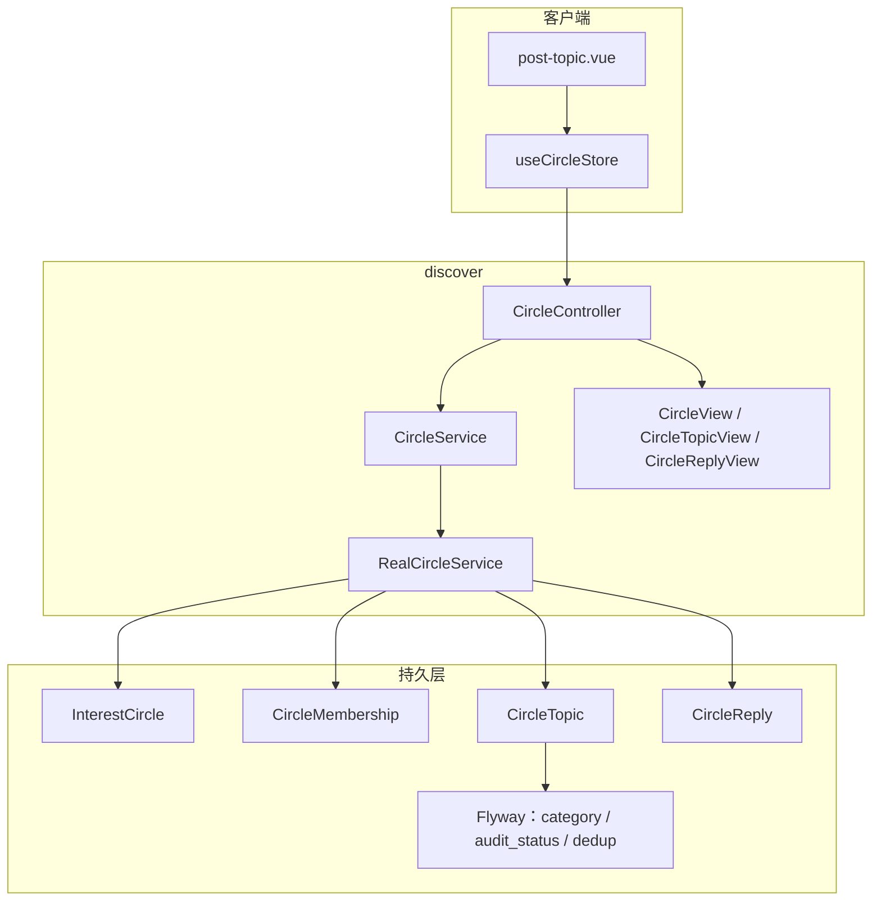
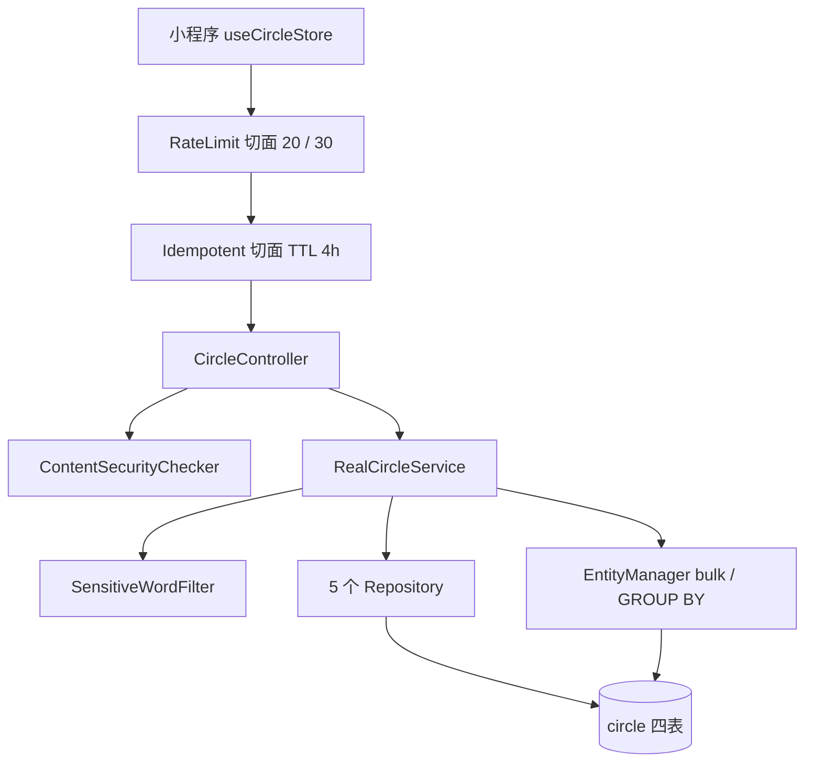
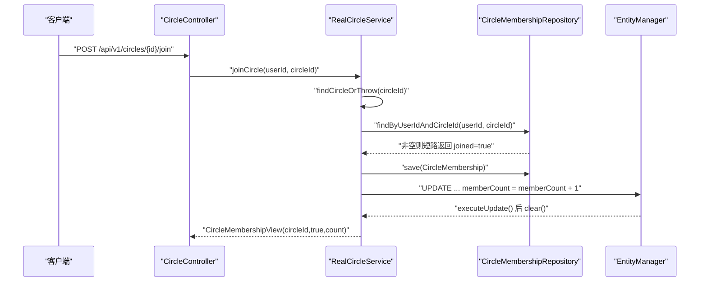
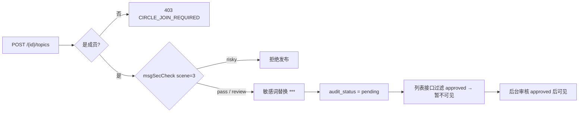
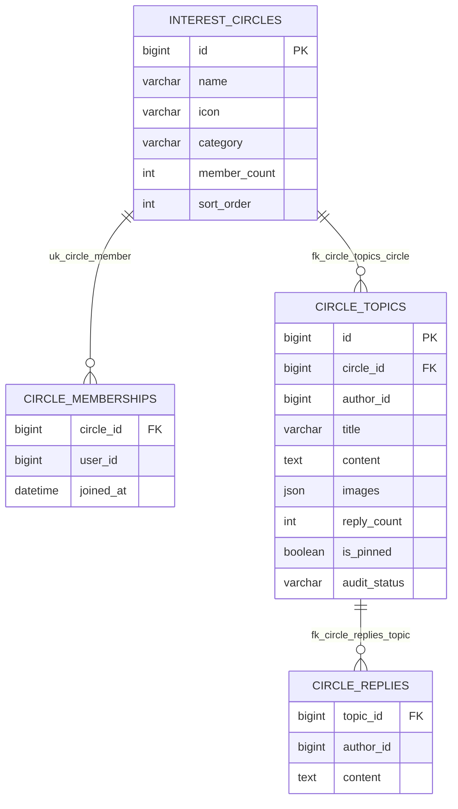
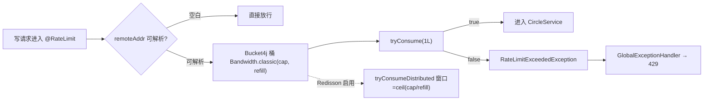
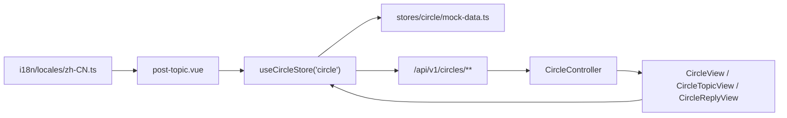
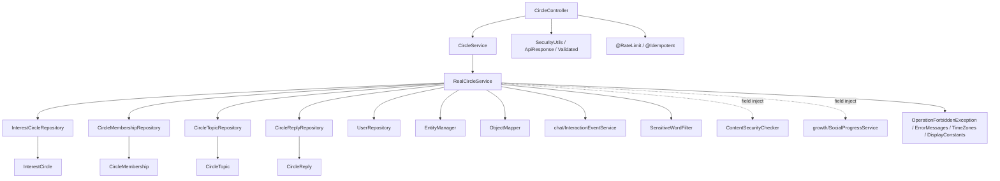

# 圈子话题管理

<cite>
**本文引用的文件**
- [CircleController.java](file://apps/api/src/main/java/com/campuslove/api/discover/CircleController.java)
- [CircleService.java](file://apps/api/src/main/java/com/campuslove/api/discover/CircleService.java)
- [RealCircleService.java](file://apps/api/src/main/java/com/campuslove/api/discover/RealCircleService.java)
- [InterestCircle.java](file://apps/api/src/main/java/com/campuslove/api/entity/InterestCircle.java)
- [CircleTopic.java](file://apps/api/src/main/java/com/campuslove/api/entity/CircleTopic.java)
- [CircleMembership.java](file://apps/api/src/main/java/com/campuslove/api/entity/CircleMembership.java)
- [CircleReply.java](file://apps/api/src/main/java/com/campuslove/api/entity/CircleReply.java)
- [CircleLayer.java](file://apps/api/src/main/java/com/campuslove/api/entity/circle/CircleLayer.java)
- [RateLimitBucketRegistry.java](file://apps/api/src/main/java/com/campuslove/api/ratelimit/RateLimitBucketRegistry.java)
- [RateLimitExceededException.java](file://apps/api/src/main/java/com/campuslove/api/ratelimit/RateLimitExceededException.java)
- [Idempotent.java](file://apps/api/src/main/java/com/campuslove/api/common/Idempotent.java)
- [circle.ts](file://apps/client/src/stores/circle.ts)
- [post-topic.vue](file://apps/client/src/subpackages/circles/circles/post-topic.vue)
- [zh-CN.ts](file://apps/client/src/i18n/locales/zh-CN.ts)
- [V2026.05.23.0005__create_interest_circles.sql](file://database/flyway/sql/V2026.05.23.0005__create_interest_circles.sql)
- [V2026.08.10.0032__add_category_to_interest_circles.sql](file://database/flyway/sql/V2026.08.10.0032__add_category_to_interest_circles.sql)
- [V2026.08.31.0001__add_circle_topic_audit_fields.sql](file://database/flyway/sql/V2026.08.31.0001__add_circle_topic_audit_fields.sql)
- [V2026.09.03.0001__dedup_interest_circles.sql](file://database/flyway/sql/V2026.09.03.0001__dedup_interest_circles.sql)
- [V2026.09.01.0004__dedupe_interest_circles.sql](file://database/flyway/sql/V2026.09.01.0004__dedupe_interest_circles.sql)
- [V2026.06.25.0004__add_user_status_and_post_audit_status.sql](file://database/flyway/sql/V2026.06.25.0004__add_user_status_and_post_audit_status.sql)
- [V2026.08.07.0024__seed_circle_posts_and_topics.sql](file://database/flyway/sql/V2026.08.07.0024__seed_circle_posts_and_topics.sql)
- [V2026.08.07.0022__seed_profiles_and_posts.sql](file://database/flyway/sql/V2026.08.07.0022__seed_profiles_and_posts.sql)
- [V2026.08.09.0008__fix_posts_category_check.sql](file://database/flyway/sql/V2026.08.09.0008__fix_posts_category_check.sql)
- [V2026.08.16.0002__add_gender_to_user_basic_profile.sql](file://database/flyway/sql/V2026.08.16.0002__add_gender_to_user_basic_profile.sql)
</cite>

## 目录
1. [简介](#简介)
2. [项目结构](#项目结构)
3. [核心组件](#核心组件)
4. [架构总览](#架构总览)
5. [详细组件分析](#详细组件分析)
6. [数据模型与索引](#数据模型与索引)
7. [接口规范](#接口规范)
8. [速率限制与幂等性](#速率限制与幂等性)
9. [前端集成](#前端集成)
10. [依赖关系分析](#依赖关系分析)
11. [性能考虑](#性能考虑)
12. [故障排查指南](#故障排查指南)
13. [附录：数据准备与约束](#附录数据准备与约束)
14. [结论](#结论)

## 简介
本页覆盖兴趣圈的查询与分类过滤、成员加入与退出、话题发布与分页浏览、话题回复、精选话题聚合。实现集中在 `com.campuslove.api.discover`：`CircleController`（`@RestController` + `@RequestMapping("/api/v1/circles")` + `@Validated`，260 行，9 个端点）、`CircleService`（96 行接口，9 个方法）、`RealCircleService`（933 行，`@Profile("real")`）。

- 分类体系由 `V2026.08.10.0032` 引入：`interest_circles.category VARCHAR(20) NULL`，注释取值 `study/sports/music/movie/travel/game/food/reading`。
- 审核链路由 `V2026.08.31.0001` 补齐 `audit_status` / `audit_remark` / `auditor_id` / `audited_at`。
- 限流：话题发布 `capacity = 20, refillTokens = 0.5`（每 2 秒补 1 令牌），回复 `capacity = 30, refillTokens = 1`，键 `#request.remoteAddr`。
- 仓库中不存在的能力按缺失记录：圈子 CRUD 的用户侧端点、话题热度排序、圈子活跃度计算、内容质量评估、缓存层、真实好友加入统计（现为按成员数推算）。

**章节来源**
- [CircleController.java:29-37](file://apps/api/src/main/java/com/campuslove/api/discover/CircleController.java#L29-L37)
- [CircleService.java:7-11](file://apps/api/src/main/java/com/campuslove/api/discover/CircleService.java#L7-L11)
- [V2026.08.10.0032__add_category_to_interest_circles.sql:1-13](file://database/flyway/sql/V2026.08.10.0032__add_category_to_interest_circles.sql#L1-L13)

## 项目结构
```
discover 包
├── CircleController.java   260 行：9 个端点 + 6 个内联视图 record
├── CircleService.java       96 行：接口契约 9 个方法
├── RealCircleService.java  933 行：@Profile("real") 实现
└── MockCircleService.java   同包内检索命中的 Mock 实现
entity 包
├── InterestCircle.java → interest_circles   CircleMembership.java → circle_memberships
├── CircleTopic.java    → circle_topics       CircleReply.java      → circle_replies
database/flyway/sql
├── V2026.05.23.0005__create_interest_circles.sql（四表 + 索引）
├── V2026.08.10.0032（category）/ V2026.08.31.0001（audit_*）/ V2026.09.03.0001（去重）
apps/client
├── src/stores/circle.ts（defineStore("circle")）
└── src/subpackages/circles/circles/post-topic.vue（1395 行）
```



[此图为概念流程，不直接对应具体源文件，故不提供图表来源]

**章节来源**
- [CircleController.java:34-37](file://apps/api/src/main/java/com/campuslove/api/discover/CircleController.java#L34-L37)
- [RealCircleService.java:51-53](file://apps/api/src/main/java/com/campuslove/api/discover/RealCircleService.java#L51-L53)
- [V2026.05.23.0005__create_interest_circles.sql:1-52](file://database/flyway/sql/V2026.05.23.0005__create_interest_circles.sql#L1-L52)

## 核心组件
- **CircleController**：唯一 REST 入口，构造器注入 `CircleService`；类注释声明“用户 ID 从 JWT 认证上下文中获取，不再从请求参数获取”，写端点统一调用 `SecurityUtils.getCurrentUserId()`。
- **CircleService**：`getCircles / joinCircle / leaveCircle / getTopics / createTopic / getTopicDetail / replyToTopic / getReplies / getFeaturedTopics`；分页方法接收 `Pageable` 返回 `Page<T>`。
- **RealCircleService**：读方法 `@Transactional(readOnly = true)`，写方法 `@Transactional`；构造器注入 9 个协作者（4 个圈子 Repository、`UserRepository`、`ObjectMapper`、`InteractionEventService`、`SensitiveWordFilter`、`EntityManager`），另以 `@Autowired(required = false)` 字段注入 `ContentSecurityChecker`、`SocialProgressService`，为 `null` 时对应能力静默关闭。
- **视图契约**（控制器文件内联 record，包私有）：

| record | 起始行 | 要点 |
| --- | --- | --- |
| `CircleView` | L182 | `id / name / icon / description / memberCount / isJoined / topicCount / category / friendJoinedCount` |
| `CircleMembershipView` | L201 | `circleId / joined / memberCount` |
| `CircleTopicView` | L211 | `circleName / authorName / authorAvatarUrl / contentPreview / images / replyCount / isPinned / createdAt` |
| `CircleReplyView` | L231 | `id / topicId / authorId / authorName / authorAvatarUrl / content / createdAt` |
| `CreateTopicRequest` | L246 | `@NotBlank @Size(max=200) title`、`@NotBlank @Size(max=5000) content`、`@Size(max=9) images` |
| `CreateReplyRequest` | L257 | `@NotBlank @Size(max=1000) content` |

**章节来源**
- [CircleController.java:39-43](file://apps/api/src/main/java/com/campuslove/api/discover/CircleController.java#L39-L43)
- [CircleController.java:179-260](file://apps/api/src/main/java/com/campuslove/api/discover/CircleController.java#L179-L260)
- [CircleService.java:11-96](file://apps/api/src/main/java/com/campuslove/api/discover/CircleService.java#L11-L96)
- [RealCircleService.java:51-126](file://apps/api/src/main/java/com/campuslove/api/discover/RealCircleService.java#L51-L126)

## 架构总览
控制器只做校验、取上下文用户、包装 `ApiResponse.ok(...)`；业务编排、审核接线与事务边界全在 `RealCircleService`；持久层是 Spring Data 派生查询 + 手写 JPQL 聚合与 bulk 更新。`@PreAuthorize("hasRole('USER')")` 只出现在 4 个写端点，5 个读端点无方法级注解。



[此图为概念流程，不直接对应具体源文件，故不提供图表来源]



**图表来源**
- [CircleController.java:66-72](file://apps/api/src/main/java/com/campuslove/api/discover/CircleController.java#L66-L72)
- [RealCircleService.java:243-296](file://apps/api/src/main/java/com/campuslove/api/discover/RealCircleService.java#L243-L296)

**章节来源**
- [CircleController.java:55-84](file://apps/api/src/main/java/com/campuslove/api/discover/CircleController.java#L55-L84)
- [RealCircleService.java:107-126](file://apps/api/src/main/java/com/campuslove/api/discover/RealCircleService.java#L107-L126)

## 详细组件分析

### 圈子列表与分类过滤
`getCircles(@RequestParam(name = "category", required = false) String category)` → `circleService.getCircles(userId, category)`。服务侧：
1. `interestCircleRepository.findAllByOrderBySortOrderAsc()` 取全量，按 `sort_order` 升序。
2. `category` 非空白时 `trim()` 后 `filter(c -> trimmed.equals(c.getCategory()))`——过滤在内存完成；注释 B4（2026-08-10）说明未分类（`category = null`）圈子仅在未带参数时展示。八个分类值只以注释存在，代码无白名单校验，库内无 CHECK 约束。
3. 已登录时 `circleMembershipRepository.findByUserId(userId)` 映射 `joinedCircleIds` 标记 `isJoined`；`userId == null` 时为空列表。
4. 话题数走 `countTopicsByCircleIds`：一次 JPQL `SELECT t.circle.id, COUNT(t) FROM CircleTopic t WHERE t.circle.id IN :circleIds GROUP BY t.circle.id`；`entityManager == null` 时回退逐圈 `countByCircleId`（FIN-00037 消 N+1）。
5. `memberCount` 为 `null` 按 `0` 输出。

`friendJoinedCount` 由 `estimateFriendJoinedCount(memberCount)` 推算（注释 2026-08-21“后端暂无好友-圈子关系统计”）：`memberCount <= 0 → 3`，否则 `round(memberCount / 1000.0)`，钳制 `[3, 99]`。

**章节来源**
- [CircleController.java:47-60](file://apps/api/src/main/java/com/campuslove/api/discover/CircleController.java#L47-L60)
- [RealCircleService.java:138-229](file://apps/api/src/main/java/com/campuslove/api/discover/RealCircleService.java#L138-L229)
- [InterestCircle.java:19-71](file://apps/api/src/main/java/com/campuslove/api/entity/InterestCircle.java#L19-L71)

### 成员管理
`POST /{id}/join` 与 `DELETE /{id}/join` 结构对称，均 `@Idempotent` + `@PreAuthorize("hasRole('USER')")`，路径变量 `@Positive Long circleId`。
- 加入：`userId == null` 抛 `ErrorMessages.USER_ID_REQUIRED`；已有成员关系短路返回 `joined = true`；`joinedAt = LocalDateTime.now(TimeZones.BUSINESS)`；计数用 JPQL `UPDATE InterestCircle c SET c.memberCount = c.memberCount + 1 WHERE c.id = :circleId` 后 `entityManager.clear()`（FIN-00038 消丢失更新；R2-00015 说明 `clear()` 防 managed 实体提交 flush 覆盖 bulk 结果）；`entityManager == null` 才回退读-改-写。埋点 `socialProgressService.recordCircleActivity(userId)` 被 try/catch 包裹，失败仅 debug 日志（R4-00327）。
- 退出：成员关系为空短路返回 `joined = false`；`deleteAllInBatch(memberships)` 批量删除（R2-00265）；计数带下限原子递减 `SET c.memberCount = CASE WHEN c.memberCount > :delta THEN c.memberCount - :delta ELSE 0 END`，Java 侧同步 `Math.max(0, memberCount - size)`。
- 库级兜底：`UNIQUE KEY uk_circle_member (circle_id, user_id)` 与外键 `ON DELETE CASCADE`。

**章节来源**
- [CircleController.java:62-84](file://apps/api/src/main/java/com/campuslove/api/discover/CircleController.java#L62-L84)
- [RealCircleService.java:231-350](file://apps/api/src/main/java/com/campuslove/api/discover/RealCircleService.java#L231-L350)
- [V2026.05.23.0005__create_interest_circles.sql:13-22](file://database/flyway/sql/V2026.05.23.0005__create_interest_circles.sql#L13-L22)

### 话题发布与审核链
`POST /{id}/topics` 带 `@RateLimit(capacity = 20, refillTokens = 0.5, key = "#request.remoteAddr")`。`createTopic` 七步：
1. 空值校验 `AUTHOR_ID_REQUIRED` / `TITLE_REQUIRED_CN` / `CONTENT_REQUIRED_CN`。
2. `findCircleOrThrow(circleId)`。
3. 成员权限（2026-08-31）：`findByUserIdAndCircleId(authorId, circle.getId())` 为空抛 `OperationForbiddenException(ErrorMessages.CIRCLE_JOIN_REQUIRED)`；注释指出此前只过滤 UI、后端不校验，任意圈 id 皆可发帖，属越权漏洞，403 message 由全局异常处理器透传。
4. 统一内容安全（2026-10-05）：`rejectIfRisky(title, authorId, "3", "话题标题")` 与 `rejectIfRisky(content, ...)`，`scene = "3"` 为论坛；`suggest == "risky"` 抛 `IllegalArgumentException(field + "包含违规内容，请修改后重试")`，`"review"` 放行记 warn，checker 未注入时整体跳过（其自身 fail-closed）。
5. 敏感词过滤（FIN-00039）：`filterWithLog(title, authorId, "CIRCLE_TOPIC")`，策略替换 `***` 而非拒绝，与 `VillagePostService` 一致。
6. 装配：`replyCount = 0`、`isPinned = false`、`images` 经 `toJsonString()`（空列表存 `null`）、`createdAt = now(TimeZones.BUSINESS)`、**`auditStatus = pending`**。
7. `save` 后 `toTopicView(topic)`（80 字符截断，常量 `CONTENT_PREVIEW_MAX_LENGTH`）。

`AuditStatus { pending, approved, rejected }` 语义为“待审不可见 / 通过可见 / 拒绝不可见”；列 `VARCHAR(16) DEFAULT 'approved'` 兼容存量数据，但用户发布路径显式覆盖为 `pending`。



**图表来源**
- [RealCircleService.java:401-463](file://apps/api/src/main/java/com/campuslove/api/discover/RealCircleService.java#L401-L463)
- [CircleTopic.java:32-35](file://apps/api/src/main/java/com/campuslove/api/entity/CircleTopic.java#L32-L35)

### 话题浏览、回复与精选
- `getTopics`：先 `findCircleOrThrow`（圈子不存在直接抛异常而非返回空页），再 `findByCircleIdOrderByIsPinnedDescCreatedAtDesc(circleId, pageable)`，然后 `filter(auditStatus == approved)`，最后 `new PageImpl<>(views, pageable, views.size())`。
- `getTopicDetail` → `toTopicViewFullContent` 返回未截断全文，且**不做审核过滤**。
- `replyToTopic`：`rejectIfRisky(content, authorId, "2", "回复内容")`（`scene = "2"` 评论）→ `filterWithLog(content, authorId, "CIRCLE_REPLY")`（R2-00234，此前回复可绕过敏感词）→ 过滤后空白再抛 `REPLY_CONTENT_REQUIRED` → 保存回复 → **`replyCount` 走实体读-改-写**（未使用 bulk 原子方案）→ 仅当 `!authorId.equals(topic.getAuthorId())` 时 `recordEvent(topic.getAuthorId(), authorId, "TOPIC_REPLIED", topicId, "TOPIC", "有人回复了你的话题")`。
- `getReplies`：`findByTopicIdOrderByCreatedAtDesc(topicId, pageable)` 为 SQL 侧分页（R4-00352，替代全量加载后内存分页），`total` 取 `replyPage.getTotalElements()`，与话题类接口语义不同。
- `getFeaturedTopics`：服务内**重建**排序 `Sort.by(DESC, "isPinned").and(DESC, "createdAt")` 后 `circleTopicRepository.findAll(sortedPageable)`，即全站话题扫描；调用方的 `Pageable` 排序被覆盖。“精选”既非独立标记位也无热度算法，`replyCount` 未参与任何排序或打分。

**章节来源**
- [CircleController.java:88-174](file://apps/api/src/main/java/com/campuslove/api/discover/CircleController.java#L88-L174)
- [CircleService.java:41-95](file://apps/api/src/main/java/com/campuslove/api/discover/CircleService.java#L41-L95)
- [RealCircleService.java:354-387](file://apps/api/src/main/java/com/campuslove/api/discover/RealCircleService.java#L354-L387)
- [RealCircleService.java:465-481](file://apps/api/src/main/java/com/campuslove/api/discover/RealCircleService.java#L465-L481)
- [RealCircleService.java:495-615](file://apps/api/src/main/java/com/campuslove/api/discover/RealCircleService.java#L495-L615)
- [RealCircleService.java:751-797](file://apps/api/src/main/java/com/campuslove/api/discover/RealCircleService.java#L751-L797)
- [RealCircleService.java:920-932](file://apps/api/src/main/java/com/campuslove/api/discover/RealCircleService.java#L920-L932)

## 数据模型与索引
四表同建于 `V2026.05.23.0005`，均 `ENGINE=InnoDB` / `utf8mb4_0900_ai_ci`。
- `interest_circles`：`name VARCHAR(64)`、`icon VARCHAR(16) DEFAULT '📋'`、`description VARCHAR(256)`、`member_count INT DEFAULT 0`、`sort_order INT DEFAULT 0`；`KEY idx_interest_circles_sort (sort_order)`。
- `circle_memberships`：`UNIQUE KEY uk_circle_member (circle_id, user_id)`、`KEY idx_circle_memberships_user`、外键 `ON DELETE CASCADE`。
- `circle_topics`：`title VARCHAR(200)`、`content TEXT`、`images JSON`、`reply_count INT`、`is_pinned BOOLEAN`；`KEY idx_circle_topics_circle` / `_author` / `_created`。
- `circle_replies`：`content TEXT`；`KEY idx_circle_replies_topic` / `_author` / `_created`。
- 增补列：`category VARCHAR(20) NULL`（V2026.08.10.0032 L3）；`audit_status` / `audit_remark VARCHAR(500)` / `auditor_id BIGINT` / `audited_at DATETIME`（V2026.08.31.0001 L6-L10）。

实体映射与列一致：`InterestCircle` 用 `@Column(name = "category", length = 20)`；`CircleTopic` 用 `@Column(name = "images", columnDefinition = "JSON DEFAULT '[]'")`、`@Column(name = "audit_status", nullable = false, columnDefinition = "VARCHAR(16) DEFAULT 'approved'")`。四实体均带 `version` 乐观锁列；`InterestCircle` / `CircleTopic` / `CircleReply` 标注 `@EntityListeners(AuditingEntityListener.class)`。



**图表来源**
- [V2026.05.23.0005__create_interest_circles.sql:1-52](file://database/flyway/sql/V2026.05.23.0005__create_interest_circles.sql#L1-L52)
- [V2026.08.31.0001__add_circle_topic_audit_fields.sql:6-10](file://database/flyway/sql/V2026.08.31.0001__add_circle_topic_audit_fields.sql#L6-L10)
- [CircleTopic.java:24-104](file://apps/api/src/main/java/com/campuslove/api/entity/CircleTopic.java#L24-L104)
- [CircleMembership.java:19-49](file://apps/api/src/main/java/com/campuslove/api/entity/CircleMembership.java#L19-L49)
- [CircleReply.java:22-60](file://apps/api/src/main/java/com/campuslove/api/entity/CircleReply.java#L22-L60)

索引匹配度：`findAllByOrderBySortOrderAsc` 命中 `idx_interest_circles_sort`；`findByCircleIdOrderByIsPinnedDescCreatedAtDesc` 只用到 `idx_circle_topics_circle`，`is_pinned` 无索引需文件排序；回复分页缺 `(topic_id, created_at)` 复合索引；`category` 与 `circle_topics.audit_status` 均无索引——`V2026.06.25.0004` 的 `idx_posts_audit_status`（L45）覆盖的是 `posts`。

**章节来源**
- [V2026.06.25.0004__add_user_status_and_post_audit_status.sql:44-45](file://database/flyway/sql/V2026.06.25.0004__add_user_status_and_post_audit_status.sql#L44-L45)
- [V2026.08.10.0032__add_category_to_interest_circles.sql:1-13](file://database/flyway/sql/V2026.08.10.0032__add_category_to_interest_circles.sql#L1-L13)

## 接口规范
基路径 `/api/v1/circles`，响应统一 `ApiResponse.ok(...)`。

| # | 方法 | 路径 | 控制器方法 | 鉴权 | 横切注解 | 载荷 |
| --- | --- | --- | --- | --- | --- | --- |
| 1 | GET | `/api/v1/circles` | `getCircles` | 匿名 | — | `List<CircleView>` |
| 2 | POST | `/api/v1/circles/{id}/join` | `joinCircle` | `hasRole('USER')` | `@Idempotent` | `CircleMembershipView` |
| 3 | DELETE | `/api/v1/circles/{id}/join` | `leaveCircle` | `hasRole('USER')` | `@Idempotent` | `CircleMembershipView` |
| 4 | GET | `/api/v1/circles/{id}/topics` | `getTopics` | 匿名 | — | `Page<CircleTopicView>` |
| 5 | POST | `/api/v1/circles/{id}/topics` | `createTopic` | `hasRole('USER')` | `@RateLimit(20, 0.5)` `@Idempotent` | `CircleTopicView` |
| 6 | GET | `/api/v1/circles/topics/{id}` | `getTopicDetail` | 匿名 | — | `CircleTopicView`（全文） |
| 7 | GET | `/api/v1/circles/topics/{id}/replies` | `getReplies` | 匿名 | — | `Page<CircleReplyView>` |
| 8 | POST | `/api/v1/circles/topics/{id}/replies` | `createReply` | `hasRole('USER')` | `@RateLimit(30, 1)` `@Idempotent` | `CircleReplyView` |
| 9 | GET | `/api/v1/circles/featured` | `getFeaturedTopics` | 匿名 | — | `Page<CircleTopicView>` |

约束：路径变量一律 `@Positive`；`page` 默认 `0` 且 `@Min(0)`、`size` 默认 `20` 且 `@Min(1) @Max(100)`（三处一致）；`category` 是唯一查询过滤参数；请求体走 `@Valid @RequestBody`，`authorId` 不在请求体内。

“圈子 CRUD”现状：控制器只有读与成员读写，**无**圈子的创建/更新/删除端点，`CircleService` 亦无对应方法；圈子集合增删由迁移脚本维护（`V2026.09.03.0001` 把「美食探店圈」话题改指向「美食」后删除旧圈，注明“幂等：仅当旧圈仍存在时执行”）。管理面另有 `AdminCircleController`、`admin/circle/CircleLayerController`，不在本页范围。本任务取证材料未包含 `/api/v1/circles` 的 OpenAPI 契约文件，规范以注解与 Javadoc 为唯一依据。

**章节来源**
- [CircleController.java:34-175](file://apps/api/src/main/java/com/campuslove/api/discover/CircleController.java#L34-L175)
- [CircleController.java:242-260](file://apps/api/src/main/java/com/campuslove/api/discover/CircleController.java#L242-L260)
- [V2026.09.03.0001__dedup_interest_circles.sql:1-22](file://database/flyway/sql/V2026.09.03.0001__dedup_interest_circles.sql#L1-L22)
- [V2026.09.01.0004__dedupe_interest_circles.sql:1-3](file://database/flyway/sql/V2026.09.01.0004__dedupe_interest_circles.sql#L1-L3)

## 速率限制与幂等性
| 端点 | capacity | refillTokens | 换算 | key |
| --- | --- | --- | --- | --- |
| `POST /{id}/topics` | `20` | `0.5` | 每 2 秒补 1 令牌 | `#request.remoteAddr` |
| `POST /topics/{id}/replies` | `30` | `1` | 每秒补 1 令牌 | `#request.remoteAddr` |

`refillTokens` 语义是“每秒补充的令牌数（支持小数）”。限流维度为 IP，同 NAT 出口下多用户共享桶；控制器注释意图为“防止话题刷屏”“防止回复刷屏与垃圾内容”。

`RateLimitBucketRegistry`（Bucket4j `Bandwidth` / `Bucket` / `Refill`）：
- `tryConsume(key, capacity, refillTokens)` 在 `key` 为 `null`/空白时**直接放行**（“避免误伤合法请求”）。
- 归一化下限 `Math.max(MIN_CAPACITY, capacity)`、`Math.max(MIN_REFILL_TOKENS_PER_SECOND, refillTokens)`；桶存 `ConcurrentHashMap<String, BucketEntry>`，`buckets.compute` 在参数与归一化值不一致时重建，“无需重启应用”。
- `entry.bucket.tryConsume(1L)` 失败写 `log.warn("限流命中：key=..., capacity=..., refillTokens=.../s")`；`bucketCount()` 暴露桶数；闲置桶清理后写 `log.info("清理闲置限流桶：removed=..., remaining=...")`。
- 分布式路径 `tryConsumeDistributed` 用前缀 `ratelimit:`，窗口秒数 = `capacity / refillTokens`（向上取整、至少 1 秒），Redisson 客户端由 FIN-00136 / R4-00377 引入。
- 令牌耗尽抛 `RateLimitExceededException`，由 `GlobalExceptionHandler` 转 HTTP 429 Too Many Requests。



[此图为概念流程，不直接对应具体源文件，故不提供图表来源]

幂等：4 个写端点全部标注 `@Idempotent`（`@Target(METHOD)`、`@Retention(RUNTIME)`），`DEFAULT_TTL_SECONDS = 4L * 3600`，注释 infra R2-00249 记录原 24 小时过长、缩短至 4 小时以平衡防重与可用性。业务层另有自然幂等：`joinCircle` / `leaveCircle` 状态短路，`uk_circle_member` 兜底并发；`createTopic` / `createReply` 无内容级去重，仅依赖注解与 IP 桶。

**章节来源**
- [CircleController.java:101-118](file://apps/api/src/main/java/com/campuslove/api/discover/CircleController.java#L101-L118)
- [CircleController.java:144-160](file://apps/api/src/main/java/com/campuslove/api/discover/CircleController.java#L144-L160)
- [RateLimitBucketRegistry.java:3-8](file://apps/api/src/main/java/com/campuslove/api/ratelimit/RateLimitBucketRegistry.java#L3-L8)
- [RateLimitBucketRegistry.java:64-70](file://apps/api/src/main/java/com/campuslove/api/ratelimit/RateLimitBucketRegistry.java#L64-L70)
- [RateLimitBucketRegistry.java:99-135](file://apps/api/src/main/java/com/campuslove/api/ratelimit/RateLimitBucketRegistry.java#L99-L135)
- [RateLimitBucketRegistry.java:149-176](file://apps/api/src/main/java/com/campuslove/api/ratelimit/RateLimitBucketRegistry.java#L149-L176)
- [RateLimitBucketRegistry.java:204-242](file://apps/api/src/main/java/com/campuslove/api/ratelimit/RateLimitBucketRegistry.java#L204-L242)
- [RateLimitExceededException.java:7-13](file://apps/api/src/main/java/com/campuslove/api/ratelimit/RateLimitExceededException.java#L7-L13)
- [Idempotent.java:36-44](file://apps/api/src/main/java/com/campuslove/api/common/Idempotent.java#L36-L44)

## 前端集成
`apps/client/src/stores/circle.ts` 以 `export const useCircleStore = defineStore("circle", { ... })` 注册（L279），`state` 首字段 `circles: []`；L36 注释显式声明“对应后端 record CircleTopicView(...)”。后端 `Long` 在前端一律降为 `string`（`circleId: String(raw.circleId)`），规避小程序端数字精度丢失。Mock 分支从 `./circle/mock-data` 引入 `MOCK_CURRENT_USER_ID`、`mockCircles`、`mockReplies`、`mockTopicDetail`、`mockTopics`、`resolveMockCircleId`，mock 模式下 `this.circles = [...mockCircles]`；getter `state.circles.filter((c) => c.isJoined)` 直接消费 `CircleView.isJoined`。

`post-topic.vue`（1395 行）三段结构：`<script setup lang="ts">`（L1）、`<template>`（L487）、`<style scoped lang="scss">`（L752）。文案在 `zh-CN.ts`：`circlesTitle`、`circlesCount`（`"{n} 个圈子"`）、`circleMembers`（`"{n} 人加入"`）、`circleNavFailed`、`circlesEmpty`、`circlesEmptyLogin`、`circleIdInvalid`（“兴趣圈 ID 无效”，与后端 `@Positive` 及 `findCircleOrThrow` 同口径）、`circleModeCampus` / `circleModeInterest`。其中 `circleFood`“美食探店”对应已被 `V2026.09.03.0001` 合并的旧圈，属前端文案与后端数据不同步的残留。



[此图为概念流程，不直接对应具体源文件，故不提供图表来源]

**章节来源**
- [circle.ts:11-13](file://apps/client/src/stores/circle.ts#L11-L13)
- [circle.ts:36-41](file://apps/client/src/stores/circle.ts#L36-L41)
- [circle.ts:100-124](file://apps/client/src/stores/circle.ts#L100-L124)
- [circle.ts:279-308](file://apps/client/src/stores/circle.ts#L279-L308)
- [post-topic.vue:1-1](file://apps/client/src/subpackages/circles/circles/post-topic.vue#L1-L1)
- [post-topic.vue:487-487](file://apps/client/src/subpackages/circles/circles/post-topic.vue#L487-L487)
- [post-topic.vue:752-752](file://apps/client/src/subpackages/circles/circles/post-topic.vue#L752-L752)
- [zh-CN.ts:361-374](file://apps/client/src/i18n/locales/zh-CN.ts#L361-L374)
- [zh-CN.ts:2957-2972](file://apps/client/src/i18n/locales/zh-CN.ts#L2957-L2972)
- [zh-CN.ts:4008-4009](file://apps/client/src/i18n/locales/zh-CN.ts#L4008-L4009)

## 依赖关系分析
`RealCircleService` 是依赖最重的节点：构造器 9 参 + 字段注入 2 个。



**图表来源**
- [CircleController.java:1-45](file://apps/api/src/main/java/com/campuslove/api/discover/CircleController.java#L1-L45)
- [RealCircleService.java:1-126](file://apps/api/src/main/java/com/campuslove/api/discover/RealCircleService.java#L1-L126)

要点：
- **两个可选依赖刻意不进构造器**，注释理由均为“兼容 / 避免破坏既有单测构造器”，代价是服务内到处判空，且这两项能力在 `new RealCircleService(...)` 的测试实例上静默关闭。
- **`EntityManager` 在构造器内但允许 `null`**，形成“生产 bulk 原子更新 / 单测读-改-写”双路径，涉及 `joinCircle`、`leaveCircle`、`countTopicsByCircleIds`。
- **单向依赖无环**：`InteractionEventService`（chat）、`SocialProgressService`（growth）只被调用。
- **视图 record 为包私有**（无 `public`），故控制器、接口与实现必须同处 `discover` 包，跨包无法复用这批契约。
- **`CircleLayer` 与本链无关**：其表带 `idx_cl_parent` / `idx_cl_path` / `idx_cl_level` 与 `uk_circle_path`，由 `CircleLayerController` 使用，`RealCircleService` 未引用——圈子层级树与话题流互不调用。

**章节来源**
- [RealCircleService.java:68-94](file://apps/api/src/main/java/com/campuslove/api/discover/RealCircleService.java#L68-L94)
- [RealCircleService.java:619-749](file://apps/api/src/main/java/com/campuslove/api/discover/RealCircleService.java#L619-L749)
- [CircleLayer.java:10-49](file://apps/api/src/main/java/com/campuslove/api/entity/circle/CircleLayer.java#L10-L49)

## 性能考虑
已落地（均有编号注释）：

| 编号 | 位置 | 原问题 | 现实现 |
| --- | --- | --- | --- |
| FIN-00037 | `countTopicsByCircleIds` | 每圈一次 count，N+1 | 单条 `IN ... GROUP BY` 批量聚合 |
| R4-00352 | `getReplies` | 全量加载后内存分页 | `findByTopicIdOrderByCreatedAtDesc(topicId, pageable)` |
| FIN-00038 | `join` / `leave` | 读-改-写丢失更新 | JPQL bulk 原子增减 + `entityManager.clear()` |
| R2-00265 | `leaveCircle` | 循环逐条 delete | `deleteAllInBatch(memberships)` |
| 作者预加载 | `loadAuthorMap` | 逐条 `findById` | `findByIdIn(distinct)` → `Map<Long, User>` |

结构性瓶颈：
- 分类过滤在内存：先全表再 `filter`，`category` 无索引。
- 审核过滤在分页之后：`PageRequest` 取一页原始行 → `filter(approved)` → `PageImpl(views, pageable, views.size())`，单页条数可能少于 `size`，且 `total` 变成“本页过滤后行数”，前端无法据此算页数；`getReplies` 无审核过滤故 `total` 为真实总数，三处语义不一致。
- 精选话题是全站扫描：`findAll(sortedPageable)` 对 `circle_topics` 按 `is_pinned, created_at` 排序分页，`is_pinned` 无索引，深翻页排序代价显著。
- 图片列逐条反序列化：`parseJsonToList` 把 `JsonProcessingException` 吞为 `log.warn` + 空列表。
- 限流桶为进程内 `ConcurrentHashMap`，靠闲置遍历清理控制规模。

缓存策略：`CircleController` 与 `RealCircleService` 的导入清单与类体内均无 Spring Cache 注解或类型（无 `@Cacheable` / `@CacheEvict` / `CacheManager`），`memberCount` 为落库冗余列，`topicCount` 每次请求重新聚合——当前实现**没有**缓存层。

**章节来源**
- [RealCircleService.java:138-229](file://apps/api/src/main/java/com/campuslove/api/discover/RealCircleService.java#L138-L229)
- [RealCircleService.java:327-344](file://apps/api/src/main/java/com/campuslove/api/discover/RealCircleService.java#L327-L344)
- [RealCircleService.java:362-387](file://apps/api/src/main/java/com/campuslove/api/discover/RealCircleService.java#L362-L387)
- [RealCircleService.java:559-615](file://apps/api/src/main/java/com/campuslove/api/discover/RealCircleService.java#L559-L615)
- [RealCircleService.java:685-698](file://apps/api/src/main/java/com/campuslove/api/discover/RealCircleService.java#L685-L698)
- [RealCircleService.java:882-918](file://apps/api/src/main/java/com/campuslove/api/discover/RealCircleService.java#L882-L918)
- [CircleController.java:1-45](file://apps/api/src/main/java/com/campuslove/api/discover/CircleController.java#L1-L45)

## 故障排查指南
| 触发条件 | 抛出类型 | 表现 |
| --- | --- | --- |
| `circleId` / `topicId` 非正数 | `@Positive` 违约 | 参数校验失败 |
| `page < 0` / `size < 1` / `size > 100` | `@Min` / `@Max` 违约 | 参数校验失败 |
| `title > 200` / `content > 5000` / 回复 `> 1000` | `@Size` 违约 | 参数校验失败 |
| 圈子不存在 | `IllegalArgumentException("圈子不存在: " + circleId)` | message 含 ID |
| 话题不存在 | `IllegalArgumentException(TOPIC_NOT_FOUND_PREFIX + topicId)` | 同上 |
| 未加入圈子发帖 | `OperationForbiddenException(CIRCLE_JOIN_REQUIRED)` | 403，透传可读 message |
| 内容命中 `risky` | `IllegalArgumentException(field + "包含违规内容，请修改后重试")` | 先 `log.warn` |
| 令牌耗尽 | `RateLimitExceededException` | HTTP 429 |
| `authorId` 为 `null` | `IllegalArgumentException(AUTHOR_ID_REQUIRED / USER_ID_REQUIRED)` | 缺少用户标识 |
| 回复过滤后空白 | `IllegalArgumentException(REPLY_CONTENT_REQUIRED)` | 与空内容同提示 |

- **发帖成功但列表看不到**：`createTopic` 设 `pending`，列表只放行 `approved`，属预期；详情接口不过滤，可凭 id 直读。查 `audit_status` / `auditor_id` / `audited_at`。
- **成员数与成员行数不一致**：`member_count` 是冗余列，生产靠 bulk `UPDATE` 维护；`V2026.09.03.0001` 这类改 `circle_topics.circle_id` 的迁移不同步计数。校准方式是对 `circle_memberships` 按 `circle_id` 重算回写。
- **前端页数算错**：话题类接口 `total` 为过滤后本页行数，应以“返回条数 < size”为终止条件。
- **同 IP 多人一起被限**：`key = "#request.remoteAddr"` 按 IP 分桶，`log.warn("限流命中...")` 可确认；改注解值无需重启，但 `MIN_CAPACITY` / `MIN_REFILL_TOKENS_PER_SECOND` 会钳制，`key` 解析为空则整条限流被跳过。
- **内容安全检查好像没跑**：`contentSecurityChecker` 是 `@Autowired(required = false)`，未注入时 `rejectIfRisky` 直接 `return`，只剩敏感词替换；`socialProgressService` 为 `null` 时加入圈子不上报 L5 埋点。
- **图片为空**：`images` 列 `JSON DEFAULT NULL`，空列表存 `null`，非法 JSON 返回 `List.of()` 并写 `log.warn("JSON 解析失败: {}")`。
- **“未知用户”或无头像**：昵称缺失返回 `DisplayConstants.UNKNOWN_USER`；头像无值返回**空串**而非 `null`，前端回退默认头像（MP-R1-CIRCLE-001，2026-09-12 补该链路）。
- **时间对不上**：所有写入取 `LocalDateTime.now(TimeZones.BUSINESS)`，非系统默认时区。

**章节来源**
- [CircleController.java:55-160](file://apps/api/src/main/java/com/campuslove/api/discover/CircleController.java#L55-L160)
- [RealCircleService.java:243-350](file://apps/api/src/main/java/com/campuslove/api/discover/RealCircleService.java#L243-L350)
- [RealCircleService.java:401-463](file://apps/api/src/main/java/com/campuslove/api/discover/RealCircleService.java#L401-L463)
- [RealCircleService.java:495-547](file://apps/api/src/main/java/com/campuslove/api/discover/RealCircleService.java#L495-L547)
- [RealCircleService.java:619-666](file://apps/api/src/main/java/com/campuslove/api/discover/RealCircleService.java#L619-L666)
- [RealCircleService.java:675-734](file://apps/api/src/main/java/com/campuslove/api/discover/RealCircleService.java#L675-L734)
- [CircleTopic.java:71-85](file://apps/api/src/main/java/com/campuslove/api/entity/CircleTopic.java#L71-L85)

## 附录：数据准备与约束
命名含 `circle` 的种子脚本 `V2026.08.07.0024__seed_circle_posts_and_topics.sql`（241 行）实际写入 `posts`（L22）、`post_tags`（L88）、`comments`（L101）、`daily_questions`（L201）、`daily_answers`（L216 / L222 / L228）；同批 `V2026.08.07.0022`（142 行）写入 `user_basic_profile`（L24、L115）、`user_campus_profile`（L59、L131）、`posts`（L75、L96）。两者均**不含** `INSERT INTO circle_topics` 或 `INSERT INTO interest_circles`，本地调试话题列表需自备 `circle_topics` 行数据。

库级约束现状：`V2026.06.25.0004`（45 行）末尾建 `idx_users_status`（L44）与 `idx_posts_audit_status`（L45），只覆盖 `posts`，`circle_topics.audit_status` 无索引，两张内容表审核链平行不共用；`V2026.08.09.0008`（26 行）先 `ALTER posts DROP CHECK chk_posts_category`（L24）再 `ADD CONSTRAINT chk_posts_category`（L25），`interest_circles.category` 侧无等价 CHECK；`V2026.08.16.0002` 为 `user_basic_profile` 增 `gender VARCHAR(16) NULL COMMENT '性别 male/female'`（L2），属兴趣匹配输入，但 `estimateFriendJoinedCount` 不读取它。

圈子去重：`V2026.09.03.0001`（22 行）把「美食探店圈」并入「美食」、「萌宠交流圈」并入「宠物」——`UPDATE circle_topics t JOIN interest_circles old_c ON t.circle_id = old_c.id AND old_c.name = '美食探店圈' SET t.circle_id = (SELECT id FROM interest_circles WHERE name = '美食')` 后 `DELETE FROM interest_circles WHERE name = '美食探店圈'`，注明“实测旧圈 0 成员、各 1 话题、无回复，合并无数据损失”；`V2026.09.01.0004` 以同思路删「摄影圈子」留「摄影」。迁移不更新 `member_count`，只让 `topicCount` 在两圈之间迁移。

**章节来源**
- [V2026.08.07.0024__seed_circle_posts_and_topics.sql:22-101](file://database/flyway/sql/V2026.08.07.0024__seed_circle_posts_and_topics.sql#L22-L101)
- [V2026.08.07.0024__seed_circle_posts_and_topics.sql:201-228](file://database/flyway/sql/V2026.08.07.0024__seed_circle_posts_and_topics.sql#L201-L228)
- [V2026.08.07.0022__seed_profiles_and_posts.sql:24-131](file://database/flyway/sql/V2026.08.07.0022__seed_profiles_and_posts.sql#L24-L131)
- [V2026.08.09.0008__fix_posts_category_check.sql:24-25](file://database/flyway/sql/V2026.08.09.0008__fix_posts_category_check.sql#L24-L25)
- [V2026.08.16.0002__add_gender_to_user_basic_profile.sql:2-2](file://database/flyway/sql/V2026.08.16.0002__add_gender_to_user_basic_profile.sql#L2-L2)
- [V2026.09.03.0001__dedup_interest_circles.sql:1-22](file://database/flyway/sql/V2026.09.03.0001__dedup_interest_circles.sql#L1-L22)

## 结论
链路组成：`CircleController`（9 端点）+ `CircleService`（9 方法）+ `RealCircleService`（933 行）+ `interest_circles` / `circle_memberships` / `circle_topics` / `circle_replies` + `useCircleStore` / `post-topic.vue`。

已实现且较健壮：分类服务端过滤、成员读写幂等短路、`memberCount` 数据库侧原子更新与 `clear()` 防脏写、批量聚合与作者批量预加载、回复 SQL 侧分页、三级内容审核接线（msgSecCheck v2 + 敏感词替换 + `AuditStatus` 状态机）、发帖成员权限校验（修复越权）、话题 20 桶 / 2 秒与回复 30 桶 / 1 秒的 IP 令牌桶、`@Idempotent` 4 小时 TTL。

近似或缺失：`friendJoinedCount` 是 `round(memberCount / 1000)` 钳制 `[3, 99]` 的推算值；热度排序、活跃度计算、内容质量评估、缓存层、圈子 CRUD 用户侧端点、`/api/v1/circles` 的 OpenAPI 契约、写入 `circle_topics` 的种子脚本在仓库中均无实现。

已知一致性缺陷：话题类分页接口 `total` 为过滤后本页行数，与回复接口真实 `total` 语义不同；`replyCount` 仍是实体读-改-写，未与 `memberCount` 采用同一套 bulk 原子方案。

维护优先级：建 `(circle_id, is_pinned, created_at)` 复合索引并把审核状态下沉为 SQL 条件 → 修正话题类 `PageImpl` 的 `total` → 分类过滤改 Repository 派生查询 → 补 `circle_topics.audit_status` 索引 → 用真实好友-圈子关系替换 `friendJoinedCount` → `replyCount` 迁移到 bulk 原子更新。

**章节来源**
- [CircleController.java:29-260](file://apps/api/src/main/java/com/campuslove/api/discover/CircleController.java#L29-L260)
- [RealCircleService.java:45-229](file://apps/api/src/main/java/com/campuslove/api/discover/RealCircleService.java#L45-L229)
- [RealCircleService.java:362-463](file://apps/api/src/main/java/com/campuslove/api/discover/RealCircleService.java#L362-L463)
- [RealCircleService.java:559-642](file://apps/api/src/main/java/com/campuslove/api/discover/RealCircleService.java#L559-L642)
- [circle.ts:279-308](file://apps/client/src/stores/circle.ts#L279-L308)
