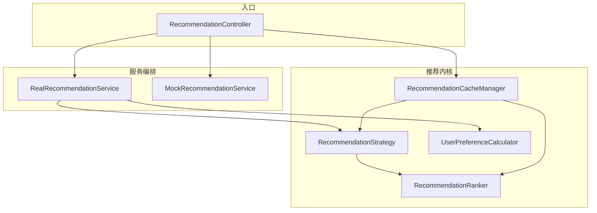
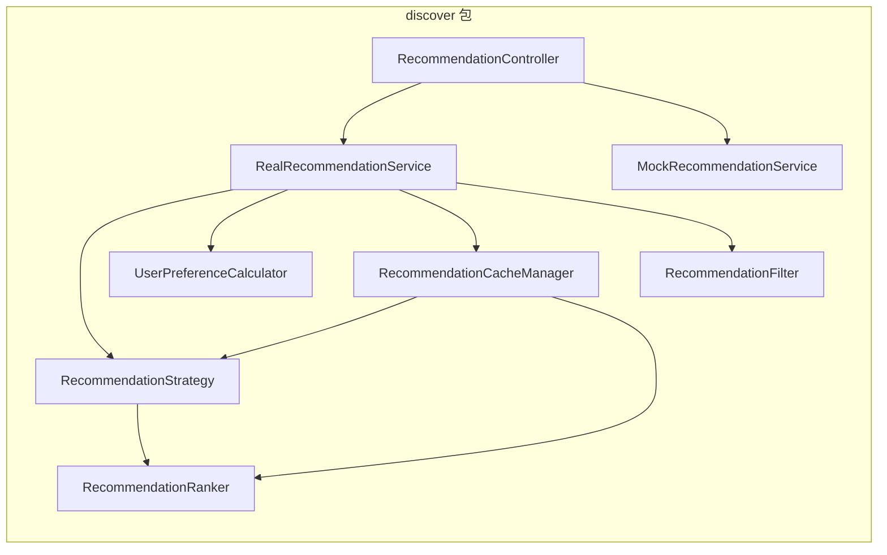
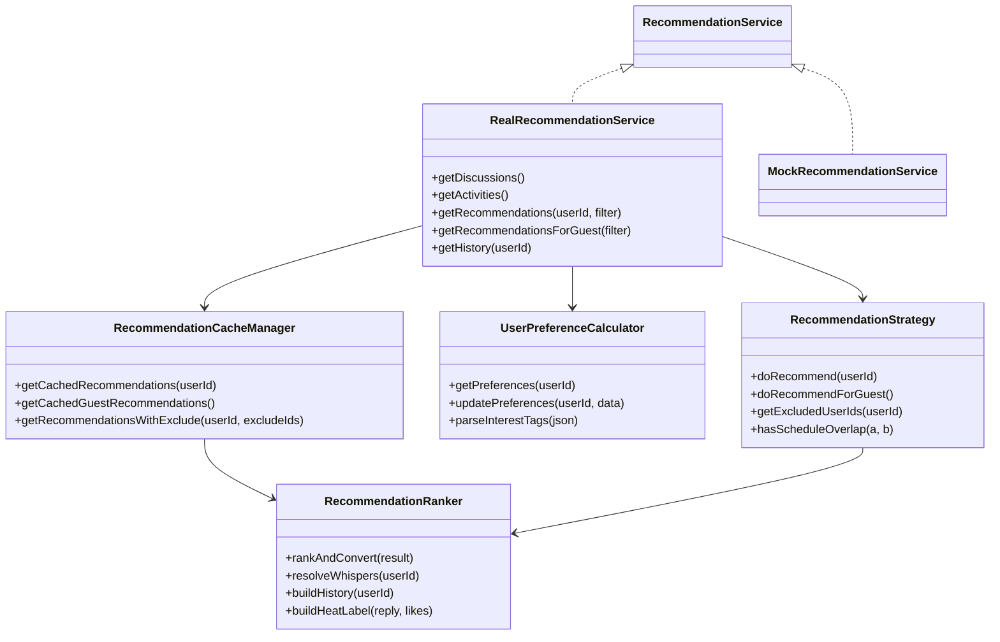
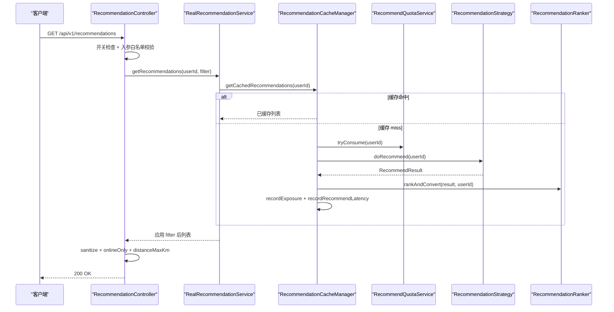
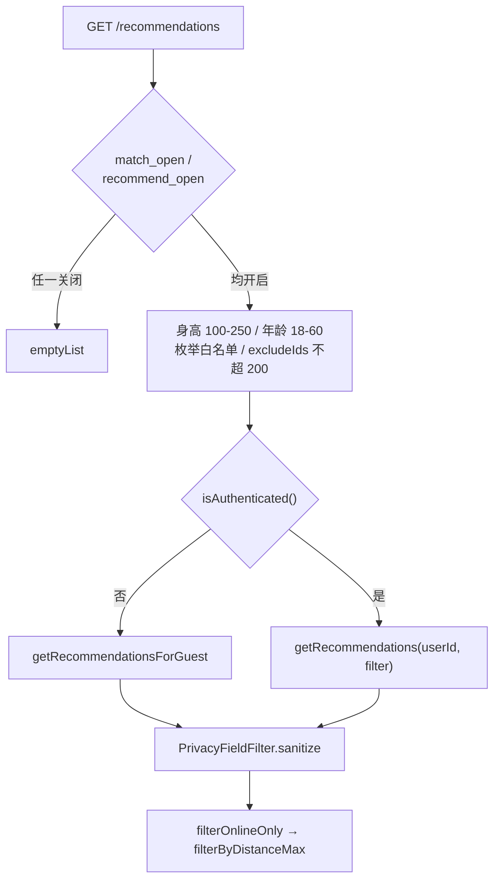
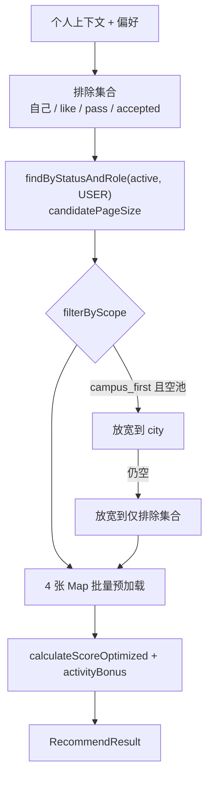
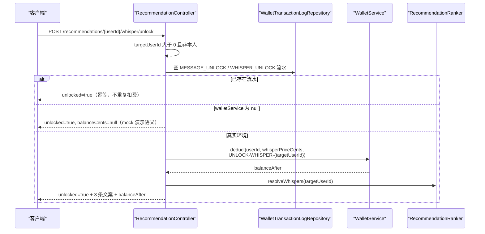
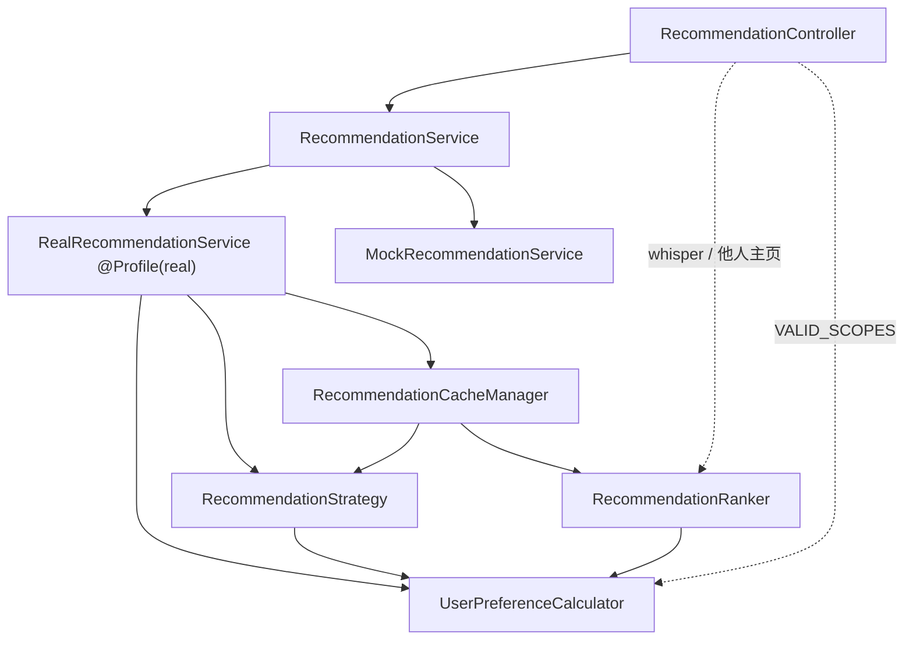
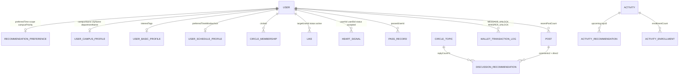

# 推荐引擎核心

<cite>
**本文引用的文件**
- [RecommendationController.java](file://apps/api/src/main/java/com/campuslove/api/discover/RecommendationController.java)
- [RealRecommendationService.java](file://apps/api/src/main/java/com/campuslove/api/discover/RealRecommendationService.java)
- [MockRecommendationService.java](file://apps/api/src/main/java/com/campuslove/api/discover/MockRecommendationService.java)
- [RecommendationStrategy.java](file://apps/api/src/main/java/com/campuslove/api/discover/RecommendationStrategy.java)
- [UserPreferenceCalculator.java](file://apps/api/src/main/java/com/campuslove/api/discover/UserPreferenceCalculator.java)
- [RecommendationCacheManager.java](file://apps/api/src/main/java/com/campuslove/api/discover/RecommendationCacheManager.java)
- [RecommendationRanker.java](file://apps/api/src/main/java/com/campuslove/api/discover/RecommendationRanker.java)
- [RecommendationStrategyTest.java](file://apps/api/src/test/java/com/campuslove/api/discover/RecommendationStrategyTest.java)
- [RecommendationRankerFieldsTest.java](file://apps/api/src/test/java/com/campuslove/api/discover/RecommendationRankerFieldsTest.java)
- [RecommendationCacheManagerTest.java](file://apps/api/src/test/java/com/campuslove/api/discover/RecommendationCacheManagerTest.java)
- [RecommendationRankerTest.java](file://apps/api/src/test/java/com/campuslove/api/discover/RecommendationRankerTest.java)
- [RecommendationRankerWhisperTest.java](file://apps/api/src/test/java/com/campuslove/api/discover/RecommendationRankerWhisperTest.java)
- [profile-index.spec.ts](file://apps/client/src/tests/components/profile-index.spec.ts)
</cite>

## 目录
1. [简介](#简介)
2. [项目结构](#项目结构)
3. [核心组件](#核心组件)
4. [架构总览](#架构总览)
5. [RESTful API 设计](#restful-api-设计)
6. [详细组件分析](#详细组件分析)
7. [热度评分与排序链路](#热度评分与排序链路)
8. [配额控制与悄悄话解锁扣费](#配额控制与悄悄话解锁扣费)
9. [缓存、冷启动与访客态推荐](#缓存冷启动与访客态推荐)
10. [推荐质量评估与实验支持](#推荐质量评估与实验支持)
11. [依赖关系分析](#依赖关系分析)
12. [性能考虑](#性能考虑)
13. [故障排查指南](#故障排查指南)
14. [结论](#结论)
15. [附录：调用链速查表](#附录调用链速查表)

## 简介
本页文档化发现推荐服务的推荐引擎核心，即 `/api/v1/recommendations/**` 从控制器到策略、排序、缓存、偏好计算各层的真实实现，覆盖：人物/讨论/活动三类推荐端点、推荐偏好读写、真实与模拟双实现、候选池构建、排序与截断、缓存与配额联动、悄悄话解锁扣费、拉黑与互动排除、隐私字段过滤、度量与调优入口、冷启动与访客态推荐。

边界说明：人物画像相似度打分属于匹配系统，已由《匹配算法核心》描述，本页只在"推荐链路如何消费评分结果"的意义上引用，不复述打分公式。

**图表来源**
- [RecommendationController.java:36-95](file://apps/api/src/main/java/com/campuslove/api/discover/RecommendationController.java#L36-L95)
- [RealRecommendationService.java:50-99](file://apps/api/src/main/java/com/campuslove/api/discover/RealRecommendationService.java#L50-L99)
- [RecommendationCacheManager.java:32-62](file://apps/api/src/main/java/com/campuslove/api/discover/RecommendationCacheManager.java#L32-L62)

**章节来源**
- [RecommendationController.java:30-106](file://apps/api/src/main/java/com/campuslove/api/discover/RecommendationController.java#L30-L106)
- [RealRecommendationService.java:42-123](file://apps/api/src/main/java/com/campuslove/api/discover/RealRecommendationService.java#L42-L123)

## 项目结构
推荐引擎全部位于 `apps/api/src/main/java/com/campuslove/api/discover` 包，与同城活动（ActivityController）、圈子（CircleController）、每日话题（DailyQuestionController）同包但不共享服务实现：

- 控制器层：RecommendationController（705 行），类级 `@RequestMapping("/api/v1")`，内含 7 个视图 record。
- 服务层：RecommendationService 接口 + RealRecommendationService（641 行，`@Profile("real")`）+ MockRecommendationService（489 行）。
- 推荐内核：RecommendationStrategy（665 行，候选生成）、RecommendationRanker（1039 行，排序与视图装配）、UserPreferenceCalculator（203 行，偏好读写）、RecommendationCacheManager（248 行，缓存/配额/埋点）。
- 数据契约：RecommendationFilter、RecommendationStrategy.ScoredUser 与 RecommendResult、RecommendedPersonView、PrivacyFieldFilter。
- 测试：RecommendationStrategyTest（430 行）、RecommendationRankerFieldsTest（225 行）、RecommendationCacheManagerTest（153 行）、RecommendationRankerTest（138 行）、RecommendationRankerWhisperTest（55 行）。

**图表来源**
- [RecommendationController.java:36-106](file://apps/api/src/main/java/com/campuslove/api/discover/RecommendationController.java#L36-L106)
- [RecommendationRanker.java:59-157](file://apps/api/src/main/java/com/campuslove/api/discover/RecommendationRanker.java#L59-L157)

**章节来源**
- [RecommendationStrategy.java:64-112](file://apps/api/src/main/java/com/campuslove/api/discover/RecommendationStrategy.java#L64-L112)
- [UserPreferenceCalculator.java:31-46](file://apps/api/src/main/java/com/campuslove/api/discover/UserPreferenceCalculator.java#L31-L46)
- [MockRecommendationService.java:20-152](file://apps/api/src/main/java/com/campuslove/api/discover/MockRecommendationService.java#L20-L152)

## 核心组件
- RecommendationController：构造函数注入唯一的 `RecommendationService`；`RecommendQuotaService`、`AppConfigService`、`RecommendationRanker`、`WalletService`、`WalletTransactionLogRepository`、`UserRepository`、`UserCampusProfileRepository`、`CircleMembershipRepository` 共 8 个协作对象以 `@Autowired(required = false)` 字段注入，注释统一标注"real profile 注入；mock 为 null"。
- RealRecommendationService：真实实现，类注释记录"原 1368 行 God Class 已拆分为 4 个组件"，本类保留讨论/活动推荐、筛选过滤与委托逻辑，public 方法签名保持向后兼容。
- MockRecommendationService：同签名内存桩，覆盖 `getDiscussions` L35、`getActivities` L47、`enrollActivity` L62、`getActivityDetail` L82、`getPreferences` L111、`updatePreferences` L116、`getRecommendations` L124/L132、`getRecommendationsForGuest` L152、`getPreferences(userId)` L460、`savePreferences` L465、`updatePreferences(userId,data)` L473、`getHistory` L485。
- RecommendationStrategy：候选生成，`doRecommend(Long)` L132、`doRecommendForGuest()` L242、`getExcludedUserIds(Long)` L287、`hasScheduleOverlap(String,String)` L523，内嵌 `ScoredUser` L641 与 `RecommendResult` L656。
- RecommendationRanker：`resolveWhispers` L171、5 个 `rankAndConvert` 重载（L250/L268/L284/L384/L395）、`buildHistory` L417、`extractInitials` L733、`truncateContent` L743、`buildHeatLabel` L757、`getDiscussionLimit` L777。
- UserPreferenceCalculator：`getPreferences` L57、`savePreferences` L79、`updatePreferences` L119、`parseInterestTags` L172、`parseStringList` L192，并定义 `VALID_SCOPES`。
- RecommendationCacheManager：`getCachedRecommendations` L89、`getCachedGuestRecommendations` L144、`evictRecommendationCache` L181、`evictAllRecommendationCaches` L190、`buildHistory` L202、`getRecommendationsWithExclude` L216。
- RecommendationFilter / PrivacyFieldFilter：人物筛选值对象与输出侧敏感字段白名单校验器。

**图表来源**
- [RecommendationController.java:115-452](file://apps/api/src/main/java/com/campuslove/api/discover/RecommendationController.java#L115-L452)
- [RealRecommendationService.java:148-550](file://apps/api/src/main/java/com/campuslove/api/discover/RealRecommendationService.java#L148-L550)
- [RecommendationStrategy.java:64-665](file://apps/api/src/main/java/com/campuslove/api/discover/RecommendationStrategy.java#L64-L665)
- [RecommendationRanker.java:171-779](file://apps/api/src/main/java/com/campuslove/api/discover/RecommendationRanker.java#L171-L779)
- [UserPreferenceCalculator.java:31-203](file://apps/api/src/main/java/com/campuslove/api/discover/UserPreferenceCalculator.java#L31-L203)

**章节来源**
- [RecommendationController.java:36-106](file://apps/api/src/main/java/com/campuslove/api/discover/RecommendationController.java#L36-L106)
- [MockRecommendationService.java:460-489](file://apps/api/src/main/java/com/campuslove/api/discover/MockRecommendationService.java#L460-L489)

## 架构总览
运行时骨架是"控制器 → 服务门面 → 缓存组件 → 策略 → 排序器"。缓存组件是链路必经节点而非可选装饰：`@Cacheable(cacheNames = CacheNames.MATCH_RECOMMEND, key = "'v2:' + #userId")` 包裹整次计算，配额扣减、曝光埋点与耗时指标都挂在同一次方法调用上。

**图表来源**
- [RecommendationController.java:212-292](file://apps/api/src/main/java/com/campuslove/api/discover/RecommendationController.java#L212-L292)
- [RealRecommendationService.java:484-505](file://apps/api/src/main/java/com/campuslove/api/discover/RealRecommendationService.java#L484-L505)
- [RecommendationCacheManager.java:87-126](file://apps/api/src/main/java/com/campuslove/api/discover/RecommendationCacheManager.java#L87-L126)

三条数据来源共享同一控制器但互不经过对方：人物线走 Strategy + Ranker；讨论线由 `getDiscussions()` 读 `CircleTopicRepository` 与 `PostRepository` 本地计算热度；活动线只取 `ActivityStatus.upcoming` 前 10 条按 `activityDate` 升序映射，不做个性化打分。两个设计约束值得记录：缓存逻辑必须独立成 Spring Bean（Spring Cache 基于代理 AOP，同类自调用会让 `@Cacheable` 失效）；控制器对可选依赖一律 `required = false`，使同一份控制器代码在 mock profile 下也能启动并返回降级语义而不是抛装配异常。

**章节来源**
- [RealRecommendationService.java:148-235](file://apps/api/src/main/java/com/campuslove/api/discover/RealRecommendationService.java#L148-L235)
- [RecommendationCacheManager.java:15-30](file://apps/api/src/main/java/com/campuslove/api/discover/RecommendationCacheManager.java#L15-L30)
- [RecommendationController.java:60-106](file://apps/api/src/main/java/com/campuslove/api/discover/RecommendationController.java#L60-L106)

## RESTful API 设计
12 个端点全部挂在类级 `@RequestMapping("/api/v1")` 下，当前用户 ID 一律由 `SecurityUtils.getCurrentUserId()` 从 JWT 上下文取得，不接受参数传入。

| 端点 | 处理函数 | 权限 | 关键实现事实 |
| --- | --- | --- | --- |
| `GET /recommendations/quota` | `getRecommendationQuota()` L116 | 登录 | 返回 `dailyLimit/used/remaining`；服务为 null 时返回 `{-1, 0, -1}` 无限制语义 |
| `GET /recommendations/discussions` | `getDiscussions()` L139 | 公开 | 直接委托服务层 |
| `GET /recommendations/activities` | `getActivities()` L152 | 公开 | 直接委托服务层 |
| `GET /recommendations/preferences` | `getPreferences()` L166 | 登录 | infra R2-00202：由固定默认值改为按当前用户返回真实偏好 |
| `PUT /recommendations/preferences` | `updatePreferences(prefs)` L183 | `hasRole('USER')` | infra R2-00203：改走 `savePreferences(userId, ...)`，避免恒抛 `UnsupportedOperationException` 导致端点 100% 500 |
| `GET /recommendations/people`、`GET /recommendations` | `getRecommendations(13 参数)` L213 | 登录或匿名 | 双路径别名共享同一实现，兼容前端 real 模式实际调用的 `/recommendations` |
| `GET /recommendations/preferences/me` | `getPreferencesByUserId()` L410 | 登录 | 与 `GET /preferences` 同语义 |
| `PUT /recommendations/preferences/me` | `savePreferences(request)` L425 | `hasRole('USER')` | A-40：PATCH 式部分更新，缺失字段读现有偏好回填 |
| `GET /recommendations/history` | `getHistory()` L448 | 登录 | 输出同样过 `PrivacyFieldFilter.sanitize` |
| `GET /recommendations/{userId}/profile` | `getOtherUserProfile(...)` L475 | `hasRole('USER')` | 只读不写，访客记录由 `POST /api/matches/visit` 写入 |
| `GET /recommendations/{userId}/whisper` | `getWhisper(...)` L536 | `hasRole('USER')` | 未解锁返回 `unlocked:false` 且 `whispers` 为空列表 |
| `POST /recommendations/{userId}/whisper/unlock` | `unlockWhisper(...)` L562 | `hasRole('USER')` | 幂等扣费；余额不足抛 `InsufficientBalanceException`（HTTP 409） |

人物端点的 13 个可选参数为 `heightMin`、`heightMax`、`educationLevel`、`relationshipStatus`、`hometownProvince`、`hometownCity`、`futureCity`、`keyword`、`ageMin`、`ageMax`、`onlineOnly`、`excludeIds`、`distanceMaxKm`。处理顺序固定：功能开关 → 数值区间 → 枚举白名单 → `excludeIds` 解析 → 组装 `RecommendationFilter` → 匿名/登录分流 → 输出侧过滤。

**图表来源**
- [RecommendationController.java:212-292](file://apps/api/src/main/java/com/campuslove/api/discover/RecommendationController.java#L212-L292)
- [RecommendationController.java:294-403](file://apps/api/src/main/java/com/campuslove/api/discover/RecommendationController.java#L294-L403)

**章节来源**
- [RecommendationController.java:40-60](file://apps/api/src/main/java/com/campuslove/api/discover/RecommendationController.java#L40-L60)
- [RecommendationController.java:108-190](file://apps/api/src/main/java/com/campuslove/api/discover/RecommendationController.java#L108-L190)
- [RecommendationController.java:405-452](file://apps/api/src/main/java/com/campuslove/api/discover/RecommendationController.java#L405-L452)
- [RecommendationController.java:456-520](file://apps/api/src/main/java/com/campuslove/api/discover/RecommendationController.java#L456-L520)

## 详细组件分析

### RecommendationController：入口与输入防线
输入域由静态常量定义：`MIN_HEIGHT_CM = 100`、`MAX_HEIGHT_CM = 250`、`MIN_AGE = 18`、`MAX_AGE = 60`、`VALID_EDUCATION_LEVELS = {high_school, bachelor, master, phd}`、`VALID_RELATIONSHIP_STATUS = {never, married_before, divorced, widowed}`、`MAX_EXCLUDE_IDS = 200`；悄悄话单价来自配置 `app.unlock-price.whisper`，默认 200 分（2 元）。`parseCsvToSet` 用 `LinkedHashSet` 去重保序，`parseExcludeIds` 跳过非法值并在 200 个后截断。输出侧两个过滤器语义精细：`filterOnlineOnly` 只保留 `activeStatusText` 为 `online` 或 `just_now` 的候选；`filterByDistanceMax` 对 `distanceText` 缺失的条目保留（R12-IND-NEARBY-LC-001，否则"附近的人"对任何用户恒为空），并把 Ranker 产出的 `"<1km"` 剥掉 `<` 后按 1km 参与比较。错误消息统一取自 `ErrorMessages` 的 `HEIGHT_MIN_GT_MAX`、`AGE_MIN_RANGE_PREFIX`、`AGE_MIN_GT_MAX`、`TARGET_USER_ID_POSITIVE`。

### RealRecommendationService：门面与委托
`@Profile("real") @Service`，构造器注入 10 个依赖（5 个 Repository + 4 个内核组件 + `EntityManager`），另有 3 个字段注入的可选依赖：`SocialProgressService`（活动参与埋点）、`UserBlockRepository`（注释定位"3-F 拉黑：推荐候选排除"，为 null 时跳过拉黑过滤）、`AppConfigService`（开关强制点）。为兼容既有单测保留 `@Deprecated` 的 9 参构造器，把 `entityManager` 置 null 并回退实体读-改-写（FIN-00040 的原子计数改用 `EntityManager`）。R4-00325 之后本类不再持有 `RecommendQuotaService`，配额扣减下移到缓存 miss 路径。委托关系：`getRecommendations` L425/L484 → CacheManager；`getRecommendationsForGuest` L505 → 游客缓存；`getHistory` L550 → `CacheManager.buildHistory`；`getPreferences` L386/L411、`updatePreferences` L398/L405、`savePreferences` L417 → `UserPreferenceCalculator`；`enrollActivity` L239 与 `getActivityDetail` L339 → 活动仓储。

### RecommendationStrategy：候选池构建
`doRecommend(userId)` 的 11 步：加载校区/城市/专业 → 日程 `preferredTimeWindowJson`（默认 `"{}"`）→ 兴趣标签（`parseInterestTags`）→ 兴趣圈 ID → 每日一问 ID → 推荐偏好（`campusPriority` 为 null 按 true）→ 排除集合 → `userRepository.findByStatusAndRole("active", "USER", PageRequest.of(0, recommendationConfig.getCandidatePageSize()))`（P0-21：排除禁用账号与 ADMIN/SUPER_ADMIN）→ 按排除集合与 `filterByScope` 过滤 → 批量预加载 `campusProfileMap`/`basicProfileMap`/`membershipMap`/`recentPostCountMap` → 逐候选 `calculateScoreOptimized` 并叠加活跃度加分 `min(recentPostCount, activityMaxPosts) × activityWeight`，封装为 `RecommendResult`。

**图表来源**
- [RecommendationStrategy.java:114-226](file://apps/api/src/main/java/com/campuslove/api/discover/RecommendationStrategy.java#L114-L226)
- [RecommendationStrategy.java:278-340](file://apps/api/src/main/java/com/campuslove/api/discover/RecommendationStrategy.java#L278-L340)

排除集合 `getExcludedUserIds` L287-L322 是四条来源的并集：`likeRepository.findByUserIdAndStatusIn(userId, [active])` 的 `targetUserId`、用户自身 ID、`heartSignalRepository.findByUserAIdOrUserBIdAndStatus(..., accepted)` 的对端 ID、`passRecordRepository.findByUserIdOrderByCreatedAtDesc` 的 `passedUserId`；后两条各自 `catch (DataAccessException)` 且捕获体为空，查询失败即漏排除。`filterByScope` 语义为 `unlimited` 全通过、`campus_first` 仅同校区、`city` 同城市；`hasScheduleOverlap`（L523）用于日程时间窗重叠判定，参与评分而非硬性过滤。

### UserPreferenceCalculator：偏好读写与缓存联动
`VALID_SCOPES = Set.of("campus_first", "city", "unlimited")` 同时被控制器 L434 引用，构成偏好写入的唯一合法域。`getPreferences` 无记录时返回默认视图 `("12:00", "campus_first", true)` 且永不为 null，控制器的部分更新合并逻辑正依赖这一点。`savePreferences` L79 与 `updatePreferences` L119 都带 `@CacheEvict(cacheNames = CacheNames.MATCH_RECOMMEND, key = "'v2:' + #userId")`，与读缓存 key 严格一致，因此"改偏好 → 下一次请求必然重算"。时间戳统一用 `LocalDateTime.now(TimeZones.BUSINESS)`。`parseInterestTags`/`parseStringList` 解析失败返回空集合或空列表而不抛异常；`updatePreferences` 遇 `DataAccessException` 则包装为带 `ErrorMessages.SAVE_PREFERENCE_FAILED_PREFIX` 的 `RuntimeException`。

### MockRecommendationService：双实现与降级分支
Mock 不依赖任何 real-only 组件，因而没有配额、缓存与曝光副作用，可在无数据库条件下打通 `/recommendations` 全链路。控制器的降级分支与之配套：`getOtherUserProfile` 在 `userRepository == null || recommendationRanker == null` 时改从 `getRecommendations(currentUserId)` 按 ID 匹配、匹配不到取首条、仍为空才抛 `ResourceNotFoundException`；`unlockWhisper` 在 `walletService == null` 时返回 `unlocked=true` 且 `balanceCents=null` 的演示语义。

**章节来源**
- [RecommendationController.java:294-403](file://apps/api/src/main/java/com/campuslove/api/discover/RecommendationController.java#L294-L403)
- [RecommendationController.java:473-520](file://apps/api/src/main/java/com/campuslove/api/discover/RecommendationController.java#L473-L520)
- [RealRecommendationService.java:56-145](file://apps/api/src/main/java/com/campuslove/api/discover/RealRecommendationService.java#L56-L145)
- [RealRecommendationService.java:339-425](file://apps/api/src/main/java/com/campuslove/api/discover/RealRecommendationService.java#L339-L425)
- [RecommendationStrategy.java:48-112](file://apps/api/src/main/java/com/campuslove/api/discover/RecommendationStrategy.java#L48-L112)
- [RecommendationStrategy.java:278-322](file://apps/api/src/main/java/com/campuslove/api/discover/RecommendationStrategy.java#L278-L322)
- [UserPreferenceCalculator.java:35-107](file://apps/api/src/main/java/com/campuslove/api/discover/UserPreferenceCalculator.java#L35-L107)
- [UserPreferenceCalculator.java:109-202](file://apps/api/src/main/java/com/campuslove/api/discover/UserPreferenceCalculator.java#L109-L202)
- [MockRecommendationService.java:20-152](file://apps/api/src/main/java/com/campuslove/api/discover/MockRecommendationService.java#L20-L152)

## 热度评分与排序链路

### 内容热度：reply×3 + like×2
`getDiscussions()`（L151）在本地计算两套 `heatScore`：

| 数据源 | 查询 | heatScore | 标题 / 摘要 | 热度标签 |
| --- | --- | --- | --- | --- |
| `CircleTopic` | `findAll(PageRequest.of(0, 20, Sort.by(DESC, "createdAt")))` | `replyCount × 3` | `topic.getTitle()` / `truncateContent(content, 60)` | `buildHeatLabel(replyCount, 0)` |
| `Post` | `findByStatusOrderByCreatedAtDesc(PostStatus.active, PageRequest.of(0, 50))` | `commentsCount × 3 + likesCount × 2` | `truncateContent(content, 30)` / `(content, 60)` | `buildHeatLabel(commentsCount, likesCount)` |

两侧计数字段先做 null 归零，合并到 `List<ScoredDiscussion>` 后按 `Comparator.comparingInt(ScoredDiscussion::heatScore).reversed()` 排序，再按标题前 20 字指纹去重（R11-G5：种子模板使同句帖子多份存在，热度排序后讨论圈首屏同句霸榜），最后 `limit(getDiscussionLimit())` 截断。两个数据源查询各自 `catch (DataAccessException)` 并打 `log.warn("...降级跳过：error={}")`（FIN-00041：原实现静默吞异常）。

`buildHeatLabel`（L757）用未加权总数 `total = replies + likesCount` 做三档映射，阈值已收敛为命名常量 `HEAT_HIGH_THRESHOLD = 100`、`HEAT_RISING_THRESHOLD = 20`（R4-01829/01830）：`total≥100` → `"{total} 人参与"`；`total≥20` → `"热度上升"`；`0<total<20` → `"{total} 人参与"`；`total=0` → `"新发布"`。标签面向用户可读、权重只影响相对次序，两者口径不同是有意设计。

### 人物排序：截断时机
`rankAndConvert` 提供 5 个重载，只有 9 参版本（L284）执行真实排序，三个动作顺序不可调换：① `excludeIds` 非空时先过滤已曝光用户（B5：在排序前、截断前，否则 `dailyLimit` 截断后新用户数不足，前端表现为"翻页后越翻越少"）；② 拷贝为可变 `ArrayList` 后按 `ScoredUser::score` 降序排序；③ `limit(recommendationConfig.getDailyLimit())`。视图装配统一走 `toRecommendedPersonView`，带预加载 Map 的版本用于批量路径，无预加载版本（L714）用于 `buildHistory` 与"他人主页"这类单条场景。`currentUserId` 非空且 `WalletTransactionLogRepository` 可用时批量预加载已解锁集合，据实填充 `allowMessage` 与 `whisperSent`（R4-00315），否则与旧行为一致（`false` / `null`）。

`buildHistory(userId)`（L417）以 `Set<Long> seenUserIds` 去重合并两段来源：`accepted` 心跳信号（优先，代表已建立双向互动，对端 ID 由 `userAId == userId ? userBId : userAId` 求得）与 `active` 喜欢记录，每个 ID 逐条 `userRepository.findById`，最后 `limit(getDailyLimit())` 并单条转换视图。注意与 `getExcludedUserIds` 口径不同：历史用 `findByUserIdAndStatus` 且不含 pass 记录，两个集合并非同一语义。

**章节来源**
- [RealRecommendationService.java:146-220](file://apps/api/src/main/java/com/campuslove/api/discover/RealRecommendationService.java#L146-L220)
- [RecommendationRanker.java:65-69](file://apps/api/src/main/java/com/campuslove/api/discover/RecommendationRanker.java#L65-L69)
- [RecommendationRanker.java:240-310](file://apps/api/src/main/java/com/campuslove/api/discover/RecommendationRanker.java#L240-L310)
- [RecommendationRanker.java:377-472](file://apps/api/src/main/java/com/campuslove/api/discover/RecommendationRanker.java#L377-L472)
- [RecommendationRanker.java:710-726](file://apps/api/src/main/java/com/campuslove/api/discover/RecommendationRanker.java#L710-L726)
- [RecommendationRanker.java:740-779](file://apps/api/src/main/java/com/campuslove/api/discover/RecommendationRanker.java#L740-L779)

## 配额控制与悄悄话解锁扣费

### 推荐配额：扣减点位于缓存 miss 路径
查询侧 `GET /recommendations/quota` 调 `recommendQuotaService.getDailyQuota(userId)` 与 `getUsedCount(userId)`，`remaining = Math.max(0, dailyLimit - used)`；注释写明用途是"供前端在推荐列表为空时区分「今日次数已用完」与「暂无推荐」，避免配额耗尽后页面空白且无提示"。扣减侧是 `getCachedRecommendations` 方法体首行 `if (recommendQuotaService != null && !recommendQuotaService.tryConsume(userId)) return List.of();`。由于该方法被 `@Cacheable` 包裹，方法体只在缓存 miss 时执行，于是"首页/聊天概览/发现页等入口在缓存 TTL 内共享一次计算、只扣一次配额"。配额耗尽返回空列表且不写缓存（`unless` 排除空结果），下次调用重新 `tryConsume`，超限时由该服务原子回滚递增，不会把配额扣成负数。同一条 miss 路径还承载社交升温漏斗的曝光埋点 `socialProgressService.recordExposure(userId)`（L1_EXPOSURE），外层空捕获注释规定"埋点失败仅记录日志，不阻断推荐返回"。

### 悄悄话解锁：服务端定价与幂等扣费
悄悄话文案不随推荐列表下发。`WHISPER_POOL` 是 9 条硬编码开场白，`WHISPER_COUNT = 3`，`resolveWhispers(userId)`（L171）按 `userId` 稳定取模确定起始位置、连续取 3 条、越界循环，因此同一用户文案恒定；方法注释明确"仅在本方法被解锁接口调用时返回"。

**图表来源**
- [RecommendationController.java:547-628](file://apps/api/src/main/java/com/campuslove/api/discover/RecommendationController.java#L547-L628)
- [RecommendationRanker.java:94-108](file://apps/api/src/main/java/com/campuslove/api/discover/RecommendationRanker.java#L94-L108)
- [RecommendationRanker.java:159-171](file://apps/api/src/main/java/com/campuslove/api/discover/RecommendationRanker.java#L159-L171)

幂等由两层保证：应用层 `isMessageOrWhisperUnlocked` 预检（存在 `MESSAGE_UNLOCK` 或 `WHISPER_UNLOCK` 流水即直接放行），以及数据层 `order_id` 唯一索引（`orderId = "UNLOCK-WHISPER-" + targetUserId`）。定价来自服务端配置 `app.unlock-price.whisper`，默认 200 分，注释说明与客户端定价镜像 `UNLOCK_COST_YUAN.WHISPER` 对齐、客户端仅展示提示。三处降级都朝"不泄露付费内容"方向收敛：`resolveWhispers` 在 Ranker 为 null 时返回空列表；`isMessageOrWhisperUnlocked` 在流水仓储为 null 或抛 `RuntimeException` 时返回 false；`balanceCents` 在钱包不可用或异常时返回 null。

### 拉黑过滤与敏感内容处理
`RealRecommendationService` 持有 `@Autowired(required = false) private UserBlockRepository blockRepository`，注释定位为"3-F 拉黑：推荐候选排除"，并说明单元测试/mock 场景下为 null 时跳过拉黑过滤；它与 `RecommendationStrategy.getExcludedUserIds` 的"自己 + 已 like + 已 pass + 已 accepted"排除集合处于同一筛选阶段但来源不同。输出侧防护是 `PrivacyFieldFilter.sanitize(...)`，用于人物推荐、历史与"他人主页"三条路径；注释解释 `RecommendedPersonView` 是 record、字段在编译期固定，该调用是防御性校验——若未来误加敏感字段，`sanitize` 抛 `IllegalStateException`，由 `GlobalExceptionHandler` 转 500 强制运维修复。`RealRecommendationService` 引入了 `com.campuslove.api.config.SensitiveWordFilter`（L19），在本页取证范围内可见的是导入声明本身，讨论/活动组装逻辑未见对其调用。

**章节来源**
- [RecommendationController.java:62-68](file://apps/api/src/main/java/com/campuslove/api/discover/RecommendationController.java#L62-L68)
- [RecommendationController.java:97-128](file://apps/api/src/main/java/com/campuslove/api/discover/RecommendationController.java#L97-L128)
- [RecommendationController.java:277-292](file://apps/api/src/main/java/com/campuslove/api/discover/RecommendationController.java#L277-L292)
- [RecommendationController.java:443-452](file://apps/api/src/main/java/com/campuslove/api/discover/RecommendationController.java#L443-L452)
- [RecommendationCacheManager.java:40-53](file://apps/api/src/main/java/com/campuslove/api/discover/RecommendationCacheManager.java#L40-L53)
- [RecommendationCacheManager.java:74-116](file://apps/api/src/main/java/com/campuslove/api/discover/RecommendationCacheManager.java#L74-L116)
- [RecommendationRanker.java:110-115](file://apps/api/src/main/java/com/campuslove/api/discover/RecommendationRanker.java#L110-L115)
- [RealRecommendationService.java:19-19](file://apps/api/src/main/java/com/campuslove/api/discover/RealRecommendationService.java#L19-L19)
- [RealRecommendationService.java:74-91](file://apps/api/src/main/java/com/campuslove/api/discover/RealRecommendationService.java#L74-L91)

## 缓存、冷启动与访客态推荐

| 缓存名 | key | 失效触发点 | 备注 |
| --- | --- | --- | --- |
| `CacheNames.MATCH_RECOMMEND` | `'v2:' + #userId` | `UserPreferenceCalculator.savePreferences` L78 / `updatePreferences` L118 的 `@CacheEvict`；`evictRecommendationCache` L181 | `@Cacheable` 见 L87，`unless` 排除 null 与空列表；类注释标注 TTL 默认 5 分钟 |
| `CacheNames.MATCH_RECOMMEND` | 全部条目 | `evictAllRecommendationCaches()` L190（`allEntries = true`） | 注释警告"会清空整个 match_recommend 缓存，谨慎使用"，用于运营后台批量刷新 |
| `CacheNames.GUEST_RECOMMEND` | `'guest:v1'` | 不挂 `@CacheEvict` | TTL 60 秒，注释："新用户/资料更新的可见性窗口 1 分钟，运营可接受" |

`v2:` 版本前缀是 P0-20 修复，绕开历史序列化器写入的旧键类型残留（反序列化报 `Unexpected token` / `missing type id`）。两个读缓存方法都显式 `new java.util.ArrayList<>(...)`：`rankAndConvert` 返回的 `Stream.toList()` 是 `ImmutableCollections$ListN`（final 类），Jackson default typing 不为 final 类型写类型信息，导致缓存值缺外层类型名、反序列化失败，表现为"缓存命中失败 → 每次全量重算"，注释记录这是游客接口 300ms+ 卡顿的根因。

冷启动由 `doRecommend` 的两级放宽承担（P0-21 空池兜底，仅 `scope == "campus_first"` 时生效）：同校无候选则对同一批 `allUsers` 改用 `filterByScope(id, "city", ...)` 重新过滤，仍无候选则只应用排除集合过滤。由于排除集合此时已包含"自己 + 已 like + 已 pass + 已 accepted"，第二级放宽后的候选仍是可推荐集合而非全库。与之配套的是 `getRecommendationQuota` 把"配额耗尽"与"暂无推荐"区分开的前端语义。

访客（未登录）态：控制器以 `!SecurityUtils.isAuthenticated()` 分流，刻意不调用 `getCurrentUserId()`（注释：匿名会抛 401）。`doRecommendForGuest()`（L242）与登录链路共享候选池口径与批量预加载，但不加载个人上下文（`RecommendResult` 的校区/专业传空串、兴趣圈传 `Collections.emptySet()`）、不计算排除集合、评分只保留活跃度加分 `min(recentPostCount, activityMaxPosts) × activityWeight`，即中性排序；`rankAndConvert(result, null)` 使 `allowMessage` 恒为 false、`whisperSent` 为 null。游客缓存 `getCachedGuestRecommendations()` 用固定 key，注释给出动机："游客推荐无个性化上下文，每次全量重算约 8 次 SQL（候选池 200 人）是未登录切页卡顿主因；缓存后降为 1 次 Redis GET"。`filter` 筛选刻意留在调用方内存执行，不进入缓存方法签名，以保证缓存 key 单一。

**章节来源**
- [RecommendationCacheManager.java:64-88](file://apps/api/src/main/java/com/campuslove/api/discover/RecommendationCacheManager.java#L64-L88)
- [RecommendationCacheManager.java:96-164](file://apps/api/src/main/java/com/campuslove/api/discover/RecommendationCacheManager.java#L96-L164)
- [RecommendationCacheManager.java:175-192](file://apps/api/src/main/java/com/campuslove/api/discover/RecommendationCacheManager.java#L175-L192)
- [RecommendationStrategy.java:162-188](file://apps/api/src/main/java/com/campuslove/api/discover/RecommendationStrategy.java#L162-L188)
- [RecommendationStrategy.java:228-276](file://apps/api/src/main/java/com/campuslove/api/discover/RecommendationStrategy.java#L228-L276)
- [RecommendationController.java:108-128](file://apps/api/src/main/java/com/campuslove/api/discover/RecommendationController.java#L108-L128)
- [RecommendationController.java:277-292](file://apps/api/src/main/java/com/campuslove/api/discover/RecommendationController.java#L277-L292)
- [UserPreferenceCalculator.java:67-79](file://apps/api/src/main/java/com/campuslove/api/discover/UserPreferenceCalculator.java#L67-L79)

## 推荐质量评估与实验支持
链路自带两类度量点，全部集中在缓存组件：`matchMetrics.recordRecommendLatency(durationMs)`（指标 `match.recommend.latency`，出现在 `getCachedRecommendations` L121、`getCachedGuestRecommendations` L159、`getRecommendationsWithExclude` L242 的 `finally` 块，保证异常路径同样记录）与 `socialProgressService.recordExposure(userId)`（L112、L233）。由于两者只在 miss 路径执行，缓存命中的请求不产生延迟样本，因此该指标反映的是算法成本而非接口 P99。空结果率可间接观察：`unless` 使空列表不写缓存，空池用户每次请求都会重算并重复 `tryConsume`，可结合配额消耗速率与延迟分布反推。

调优入口分三类。命名常量：`HEAT_HIGH_THRESHOLD`/`HEAT_RISING_THRESHOLD`、`WHISPER_COUNT` 与 `WHISPER_POOL`、身高年龄区间与两个枚举集合、`MAX_EXCLUDE_IDS`、`VALID_SCOPES`。配置对象 `RecommendationConfig`（按 Strategy 与 Ranker 的调用点）：`getCandidatePageSize()`、`getActivityMaxPosts()`、`getActivityWeight()`、`getDailyLimit()`、`getDiscussionLimit()`——后者由 `Ranker.getDiscussionLimit()`（L777）暴露给服务层，注释写明"避免重复注入 RecommendationConfig"。运行期开关：`AppConfigService.SWITCH_MATCH_OPEN` 与 `SWITCH_RECOMMEND_OPEN`（任一关闭时人物端点返回 `Collections.emptyList()`，注释要求"客户端按 app-config 开关显示「匹配暂时关闭」空态，前后端行为一致"）。

测试基线由 5 个测试类构成：`RecommendationStrategyTest`（430 行，持有 `strategy` 字段 L65）、`RecommendationRankerFieldsTest`（225 行，持有 `ranker` L72）、`RecommendationCacheManagerTest`（153 行，持有 `cacheManager` L42）、`RecommendationRankerTest`（138 行，持有 `ranker` L38）、`RecommendationRankerWhisperTest`（55 行）。这些用例约束了生产代码的形状：包内大量"字段注入 + `required = false` + 保留 `@Deprecated` 构造器 + 可空构造参数"的写法，注释理由一致是"避免破坏既有单测构造器"。

A/B 实验支持：在 `apps/api/src/main/java` 检索 `ab.?test`、`experiment`、`featureFlag`、`bucket` 后，命中的 5 个文件全部属于 `com.campuslove.api.ratelimit` 包与 `auth.UserSessionView`，与推荐实验无关。因此当前仓库不存在推荐侧的 A/B 分流、实验分组或流量哈希实现；可承载实验的只有 `AppConfigService` 的两个全局布尔开关（对全体用户一刀切）与 `RecommendationConfig` 的静态权重参数。任何分桶实验都需要新增组件，本页不描述其设计。

**章节来源**
- [RecommendationCacheManager.java:80-125](file://apps/api/src/main/java/com/campuslove/api/discover/RecommendationCacheManager.java#L80-L125)
- [RecommendationCacheManager.java:156-163](file://apps/api/src/main/java/com/campuslove/api/discover/RecommendationCacheManager.java#L156-L163)
- [RecommendationRanker.java:65-69](file://apps/api/src/main/java/com/campuslove/api/discover/RecommendationRanker.java#L65-L69)
- [RecommendationRanker.java:771-779](file://apps/api/src/main/java/com/campuslove/api/discover/RecommendationRanker.java#L771-L779)
- [RecommendationController.java:226-234](file://apps/api/src/main/java/com/campuslove/api/discover/RecommendationController.java#L226-L234)
- [RecommendationStrategy.java:197-215](file://apps/api/src/main/java/com/campuslove/api/discover/RecommendationStrategy.java#L197-L215)
- [RecommendationStrategyTest.java:49-65](file://apps/api/src/test/java/com/campuslove/api/discover/RecommendationStrategyTest.java#L49-L65)
- [RecommendationRankerFieldsTest.java:57-72](file://apps/api/src/test/java/com/campuslove/api/discover/RecommendationRankerFieldsTest.java#L57-L72)
- [RecommendationCacheManagerTest.java:36-42](file://apps/api/src/test/java/com/campuslove/api/discover/RecommendationCacheManagerTest.java#L36-L42)
- [RecommendationRankerTest.java:25-38](file://apps/api/src/test/java/com/campuslove/api/discover/RecommendationRankerTest.java#L25-L38)
- [RecommendationRankerWhisperTest.java:16-16](file://apps/api/src/test/java/com/campuslove/api/discover/RecommendationRankerWhisperTest.java#L16-L16)

## 依赖关系分析
包内依赖严格单向：控制器 → 服务门面 → 内核组件 → 排序器。`RecommendationStrategy` 与 `RecommendationRanker` 都依赖 `UserPreferenceCalculator`（Strategy 用其 `parseInterestTags`，Ranker 作为字段持有），后者不反向依赖任何推荐组件，因此偏好单元是叶子节点，这也是 `@CacheEvict` 可以安全内置在它内部的根本原因。

**图表来源**
- [RealRecommendationService.java:50-123](file://apps/api/src/main/java/com/campuslove/api/discover/RealRecommendationService.java#L50-L123)
- [RecommendationCacheManager.java:32-62](file://apps/api/src/main/java/com/campuslove/api/discover/RecommendationCacheManager.java#L32-L62)
- [RecommendationStrategy.java:64-112](file://apps/api/src/main/java/com/campuslove/api/discover/RecommendationStrategy.java#L64-L112)
- [RecommendationRanker.java:59-157](file://apps/api/src/main/java/com/campuslove/api/discover/RecommendationRanker.java#L59-L157)

跨包依赖（依据各类的 import 与字段声明）：`growth` 提供 `RecommendQuotaService`、`AppConfigService`、`SocialProgressService`；`wallet` 提供 `WalletService`、`WalletTransactionLog`、`WalletTransactionLogRepository`、`InsufficientBalanceException`；`monitor.MatchMetrics` 提供延迟指标；`location.GeoService` 在 Ranker 中 `required = false`（注释："LBS Phase 2：无 GPS 数据时 `deriveDistanceText` 回退 null"）；`config` 提供 `RecommendationConfig`、`CacheNames`、`SecurityUtils`、`SensitiveWordFilter`；`common` 提供 `ErrorMessages`、`TimeZones`、`ResourceNotFoundException`；`repository` 与 `entity` 提供用户、校区资料、基础资料、日程、圈子成员、喜欢、心跳信号、pass 记录、每日一问、帖子、话题、活动与报名、推荐偏好实体。此外 `RecommendationRanker` 还持有 `CampusCertificationService`、`CampusCertificationRepository`、`PostRepository`、`WalletTransactionLogRepository` 与 `MediaAssetService`，后者的注释定位是"2026-08-09：他人视角照片墙过滤 approved-only"，前三个均允许为 null 以兼容旧测试构造器。

**图表来源**
- [RealRecommendationService.java:1-41](file://apps/api/src/main/java/com/campuslove/api/discover/RealRecommendationService.java#L1-L41)
- [RecommendationStrategy.java:1-47](file://apps/api/src/main/java/com/campuslove/api/discover/RecommendationStrategy.java#L1-L47)
- [RecommendationStrategy.java:132-226](file://apps/api/src/main/java/com/campuslove/api/discover/RecommendationStrategy.java#L132-L226)
- [RecommendationRanker.java:408-472](file://apps/api/src/main/java/com/campuslove/api/discover/RecommendationRanker.java#L408-L472)
- [UserPreferenceCalculator.java:1-46](file://apps/api/src/main/java/com/campuslove/api/discover/UserPreferenceCalculator.java#L1-L46)
- [RecommendationController.java:1-28](file://apps/api/src/main/java/com/campuslove/api/discover/RecommendationController.java#L1-L28)

Profile 装配矩阵：`RealRecommendationService`、`RecommendationStrategy`、`RecommendationRanker`、`UserPreferenceCalculator`、`RecommendationCacheManager` 五个组件均带 `@Profile("real")`；`MockRecommendationService` 与 `RecommendationController` 无 profile 限制。控制器始终注册并靠 8 个可选字段注入适配两种环境，这是同一份控制器代码在 mock 下既不抛装配异常也不返回 500 的原因。事务边界上，读路径统一 `@Transactional(readOnly = true)`（`getDiscussions`、`getActivities`、`getActivityDetail`、`doRecommend`、`doRecommendForGuest`），写路径为读写事务（`enrollActivity`、`savePreferences`、`updatePreferences`，后两者叠加 `@CacheEvict`）。

**章节来源**
- [RecommendationController.java:36-106](file://apps/api/src/main/java/com/campuslove/api/discover/RecommendationController.java#L36-L106)
- [RealRecommendationService.java:77-99](file://apps/api/src/main/java/com/campuslove/api/discover/RealRecommendationService.java#L77-L99)
- [RecommendationRanker.java:110-125](file://apps/api/src/main/java/com/campuslove/api/discover/RecommendationRanker.java#L110-L125)
- [RecommendationStrategy.java:64-66](file://apps/api/src/main/java/com/campuslove/api/discover/RecommendationStrategy.java#L64-L66)
- [UserPreferenceCalculator.java:77-79](file://apps/api/src/main/java/com/campuslove/api/discover/UserPreferenceCalculator.java#L77-L79)
- [RecommendationCacheManager.java:32-34](file://apps/api/src/main/java/com/campuslove/api/discover/RecommendationCacheManager.java#L32-L34)

## 性能考虑
批量预加载取代 N+1 是本链路最主要的优化手法，共四处：`doRecommend` 评分前的 4 张 Map（`findByUserIdIn` 两次 + `loadMemberships` + `loadRecentPostCounts`，L189-L198）；`rankAndConvert` 截断后的 `loadBadgeLevelMap`（A-27：把逐候选 `getVerificationBadgeLevel` 的 N 次查询压缩为 2 次——一次查全部 APPROVED 校园认证记录 + 一次批量查基本资料的 email/idcard 标志）；同处的 `recentPostMap`（V2026.08.08.0015：一次查最新动态按创建时间倒序、内存按作者分组）；`resolveBadgeLevelSafe` 仅在批量 Map 为空时才回退逐条查询。两批视图预加载只作用于 `topResults`，因此截断越早、装配越便宜。

分页与截断上限：候选池 `PageRequest.of(0, getCandidatePageSize())`；讨论 `CircleTopic` 20 条 + `Post` 50 条；活动 `upcoming` 前 10 条；人物与历史输出 `limit(getDailyLimit())`；讨论输出 `limit(getDiscussionLimit())`；`excludeIds` 上限 200。

三条代价需要评估：① `getRecommendationsWithExclude` 因 `excludeIds` 每次请求不同而不做任何缓存，带去重的翻页每次都走完整计算，是 miss 路径中最贵的一档；② `unless` 排除空结果使"推荐为空"的用户没有缓存保护，每次重算并重复 `tryConsume`；③ `evictAllRecommendationCaches()` 的 `allEntries = true` 会把全量用户一次性推到 miss 路径。游客链路的收益最直观：注释量化"每次全量重算约 8 次 SQL（候选池 200 人）→ 缓存后降为 1 次 Redis GET"。`buildHistory` 的逐条 `findById` 是唯一未批量化的查询点，其规模受 `dailyLimit` 约束。

**章节来源**
- [RecommendationStrategy.java:189-226](file://apps/api/src/main/java/com/campuslove/api/discover/RecommendationStrategy.java#L189-L226)
- [RecommendationRanker.java:284-320](file://apps/api/src/main/java/com/campuslove/api/discover/RecommendationRanker.java#L284-L320)
- [RecommendationRanker.java:783-810](file://apps/api/src/main/java/com/campuslove/api/discover/RecommendationRanker.java#L783-L810)
- [RecommendationCacheManager.java:128-164](file://apps/api/src/main/java/com/campuslove/api/discover/RecommendationCacheManager.java#L128-L164)
- [RecommendationCacheManager.java:206-230](file://apps/api/src/main/java/com/campuslove/api/discover/RecommendationCacheManager.java#L206-L230)
- [RealRecommendationService.java:224-239](file://apps/api/src/main/java/com/campuslove/api/discover/RealRecommendationService.java#L224-L239)

## 故障排查指南

| 现象 | 首要嫌疑与判据 |
| --- | --- |
| 人物推荐恒为空但 `remaining > 0` | 开关关闭：`isSwitchEnabled(SWITCH_MATCH_OPEN / SWITCH_RECOMMEND_OPEN)` 任一为 false 即返回 `emptyList`，不进服务层；`appConfigService` 为 null 视为开启 |
| 每次请求都重算、延迟高 | ① 配额耗尽且 `unless` 不缓存空结果；② 返回值不是可变 `ArrayList`，反序列化报 `Unexpected token (START_OBJECT), expected VALUE_STRING` |
| 改偏好后仍是旧推荐 | 读写两侧 key 必须逐字一致 `'v2:' + #userId`；`@CacheEvict` 位于 `UserPreferenceCalculator` 而非服务门面 |
| 翻页出现重复用户 | 未传 `excludeIds`，或超过 `MAX_EXCLUDE_IDS = 200` 被静默截断；去重发生在排序前、截断前 |
| 附近的人整体为空 | `distanceText` 缺失条目应保留（R12-IND-NEARBY-LC-001）；`"<1km"` 需剥掉 `<` 再比较，`NumberFormatException` 才剔除 |
| 讨论区同句霸榜 | 去重指纹是标题前 20 字，前 20 字不同即视为不同条目 |
| 讨论或活动只剩一半来源 | 某一侧 `DataAccessException` 降级，查 `log.warn("查询 CircleTopic / Post ... 失败，降级跳过")` |
| 推荐里出现已 pass 或已配对的人 | `getExcludedUserIds` 中 `HeartSignal` 与 `PassRecord` 两段空捕获吞掉异常，导致漏排除 |
| 已付费仍 `unlocked:false` | `isMessageOrWhisperUnlocked` 只认 `MESSAGE_UNLOCK`/`WHISPER_UNLOCK` 两类流水，仓储为 null 或抛异常一律返回 false |
| `unlocked:true` 但 `whispers` 为空 | `recommendationRanker == null`（mock profile）时 `resolveWhispers` 返回空列表 |
| 400 | 身高 `100..250`、年龄 `18..60`、区间倒挂、`educationLevel`/`relationshipStatus` 白名单、scope 不在 `VALID_SCOPES` |
| 500 且异常为 `IllegalStateException` | 推荐视图 record 被误加敏感字段，触发 `PrivacyFieldFilter.sanitize` 的防御性校验 |
| mock 下他人主页返回了别人 | 降级分支按 ID 匹配失败后取 `mockRecs.get(0)` |

静默降级清单（会把故障伪装成数据问题）：Strategy 的 `HeartSignal`/`PassRecord` 空捕获；Service 讨论推荐的两条 `log.warn` 降级；Ranker 的兴趣圈、心跳、喜欢与解锁集合查询（失败降级为空集合并记 warn）；`resolveBadgeLevelSafe` 返回 `"none"`；CacheManager 的曝光埋点与延迟记录；`parseInterestTags`/`parseStringList` 返回空集合或空列表。排查时应先确认这些分支是否被触发，再判断是否为数据问题。

**章节来源**
- [RecommendationController.java:226-259](file://apps/api/src/main/java/com/campuslove/api/discover/RecommendationController.java#L226-L259)
- [RecommendationController.java:294-348](file://apps/api/src/main/java/com/campuslove/api/discover/RecommendationController.java#L294-L348)
- [RecommendationController.java:473-520](file://apps/api/src/main/java/com/campuslove/api/discover/RecommendationController.java#L473-L520)
- [RecommendationController.java:588-628](file://apps/api/src/main/java/com/campuslove/api/discover/RecommendationController.java#L588-L628)
- [RealRecommendationService.java:171-214](file://apps/api/src/main/java/com/campuslove/api/discover/RealRecommendationService.java#L171-L214)
- [RecommendationStrategy.java:287-322](file://apps/api/src/main/java/com/campuslove/api/discover/RecommendationStrategy.java#L287-L322)
- [RecommendationRanker.java:368-374](file://apps/api/src/main/java/com/campuslove/api/discover/RecommendationRanker.java#L368-L374)
- [RecommendationRanker.java:425-466](file://apps/api/src/main/java/com/campuslove/api/discover/RecommendationRanker.java#L425-L466)
- [RecommendationCacheManager.java:89-126](file://apps/api/src/main/java/com/campuslove/api/discover/RecommendationCacheManager.java#L89-L126)

## 结论
1. 控制器是唯一的前置防线：区间校验、枚举白名单、`excludeIds` 截断、功能开关判定与隐私字段过滤全在 `RecommendationController` 内完成，服务层与内核组件不重复校验；代价是绕过控制器的内部调用（如"他人主页"的 mock 降级分支）不获得同等保护。
2. 缓存组件同时是配额、曝光埋点与延迟指标的挂载点，配额语义与 `MATCH_RECOMMEND` 的 TTL 直接耦合——调整 TTL 会改变用户在一天内实际获得的推荐计算次数。
3. Strategy 与 Ranker 的分界是"分数"与"视图"：Strategy 只产出 `ScoredUser` 与预加载 Map，`RecommendResult` 是二者唯一契约，也是 `rankAndConvert` 存在 5 个重载的原因。
4. 偏好是链路唯一的用户可控输入，写入即失效缓存；`VALID_SCOPES` 由 `UserPreferenceCalculator` 定义、控制器引用，避免两处枚举漂移。
5. 付费内容有明确的不可见默认值：未解锁、依赖缺失、查询异常三种情况一律"少给"（空文案列表或 `unlocked:false`）。
6. 讨论推荐（`reply×3 (+ like×2)` 全局热度 + 标题前 20 字去重）与活动推荐（`upcoming` 前 10 条按日期升序）都不参与个性化，与人物推荐共享控制器和视图定义但不共享 Strategy。
7. 仓库当前不存在推荐侧 A/B 实验能力，也没有点击率、配对率等下游转化指标出现在本包内；调优只能通过两个全局开关、`RecommendationConfig` 参数与命名常量完成。

包内几乎每个非直观实现都带工单编号（P0-20、P0-21、R4-00314/00315/00325/00327、R4-01829/01830、R11-G5、A-27、A-40、B5、B6、FIN-00040/00041、infra R2-00202~205、SubTask 5.1.3、Task 4.1.1~4.1.5 等）并写明"原实现问题 + 现在做法"。这些注释是本包唯一的行为规格来源，任何重构都应保留其中的降级方向与缓存 key 前缀约定。

**章节来源**
- [RecommendationController.java:212-292](file://apps/api/src/main/java/com/campuslove/api/discover/RecommendationController.java#L212-L292)
- [RecommendationCacheManager.java:74-126](file://apps/api/src/main/java/com/campuslove/api/discover/RecommendationCacheManager.java#L74-L126)
- [RecommendationStrategy.java:48-62](file://apps/api/src/main/java/com/campuslove/api/discover/RecommendationStrategy.java#L48-L62)
- [RecommendationRanker.java:45-58](file://apps/api/src/main/java/com/campuslove/api/discover/RecommendationRanker.java#L45-L58)
- [RealRecommendationService.java:42-49](file://apps/api/src/main/java/com/campuslove/api/discover/RealRecommendationService.java#L42-L49)

## 附录：调用链速查表

| 端点 | 服务方法（Real / Mock 行号） | 内核落点 | 消耗配额 | 读写缓存 |
| --- | --- | --- | --- | --- |
| `GET /recommendations/quota` | 不经服务层 | `RecommendQuotaService.getDailyQuota / getUsedCount` | 否 | 否 |
| `GET /recommendations/discussions` | L151 / L35 | 话题与帖子仓储 + Ranker 文案工具 | 否 | 否 |
| `GET /recommendations/activities` | L226 / L47 | `ActivityRepository` | 否 | 否 |
| `GET /recommendations/preferences`、`/me` | L411 / L460 | `UserPreferenceCalculator.getPreferences` | 否 | 读偏好实体 |
| `PUT /recommendations/preferences`、`/me` | L417 / L465 | `UserPreferenceCalculator.savePreferences` | 否 | 写 + `@CacheEvict` |
| `GET /recommendations`（登录） | L484 / L132 | CacheManager → Strategy → Ranker | miss 时是 | 读 + 写 `match_recommend` |
| `GET /recommendations`（带 `excludeIds`） | L484 / L132 | `getRecommendationsWithExclude` | 视实现路径 | 不进缓存 |
| `GET /recommendations`（匿名） | L505 / L152 | `getCachedGuestRecommendations` → `doRecommendForGuest` | 否 | 读 + 写 `guest_recommend` |
| `GET /recommendations/history` | L550 / L485 | `Ranker.buildHistory` | 否 | 否 |
| `GET /recommendations/{userId}/profile` | 不经服务方法（mock 才回落 `getRecommendations`） | `Ranker.toRecommendedPersonView` | 否 | 否 |
| `GET /recommendations/{userId}/whisper` | 不经服务层 | `Ranker.resolveWhispers` + 流水仓储 | 否 | 否 |
| `POST /recommendations/{userId}/whisper/unlock` | 不经服务层 | `WalletService.deduct` + `resolveWhispers` | 否（扣钱包余额） | 否 |

控制器内部视图契约：`WhisperUnlockView`（`unlocked` / `whispers` / `balanceCents`，L638）、`DiscussionRecommendationView`（`id` / `title` / `summary` / `heatLabel`，L647）、`ActivityRecommendationView`（`id` / `title` / `location` / `scheduleText` / `description` / `enrollmentCount` / `participantAvatars`，L655）、`RecommendationPreferencesView`（`@NotBlank @Size(max=16) dailyNotifyTime`、`@NotBlank @Size(max=32) scope`、`campusPriority`，L666）、`EnrollRequest`（L677）、`ActivityEnrollmentView`（L685）、`SavePreferencesRequest`（全字段可空，L699）。两个偏好请求体的注解差异正是全量提交与 A-40 部分更新的语义分野。类注释声明"活动详情和报名功能已迁移至 ActivityController"，本控制器内已无引用 `EnrollRequest`/`ActivityEnrollmentView` 的端点，而服务层的 `enrollActivity`（L239）与 `getActivityDetail`（L339）仍然保留，这两个 record 因此属于跨控制器共用期的契约。

客户端侧证据仅一项：`apps/client/src/tests/components/profile-index.spec.ts`（142 行）存在相关组件回归用例。`/recommendations/**` 的前端调用封装、store 定义与页面组件不在本页取证范围内，故本页不对前端消费逻辑作断言。

**章节来源**
- [RecommendationController.java:108-190](file://apps/api/src/main/java/com/campuslove/api/discover/RecommendationController.java#L108-L190)
- [RecommendationController.java:405-594](file://apps/api/src/main/java/com/campuslove/api/discover/RecommendationController.java#L405-L594)
- [RecommendationController.java:631-704](file://apps/api/src/main/java/com/campuslove/api/discover/RecommendationController.java#L631-L704)
- [RealRecommendationService.java:148-239](file://apps/api/src/main/java/com/campuslove/api/discover/RealRecommendationService.java#L148-L239)
- [RealRecommendationService.java:339-550](file://apps/api/src/main/java/com/campuslove/api/discover/RealRecommendationService.java#L339-L550)
- [MockRecommendationService.java:35-152](file://apps/api/src/main/java/com/campuslove/api/discover/MockRecommendationService.java#L35-L152)
- [MockRecommendationService.java:460-489](file://apps/api/src/main/java/com/campuslove/api/discover/MockRecommendationService.java#L460-L489)
- [RecommendationCacheManager.java:87-216](file://apps/api/src/main/java/com/campuslove/api/discover/RecommendationCacheManager.java#L87-L216)
- [RecommendationStrategy.java:131-242](file://apps/api/src/main/java/com/campuslove/api/discover/RecommendationStrategy.java#L131-L242)
- [UserPreferenceCalculator.java:57-119](file://apps/api/src/main/java/com/campuslove/api/discover/UserPreferenceCalculator.java#L57-L119)
- [profile-index.spec.ts:1-142](file://apps/client/src/tests/components/profile-index.spec.ts#L1-L142)
