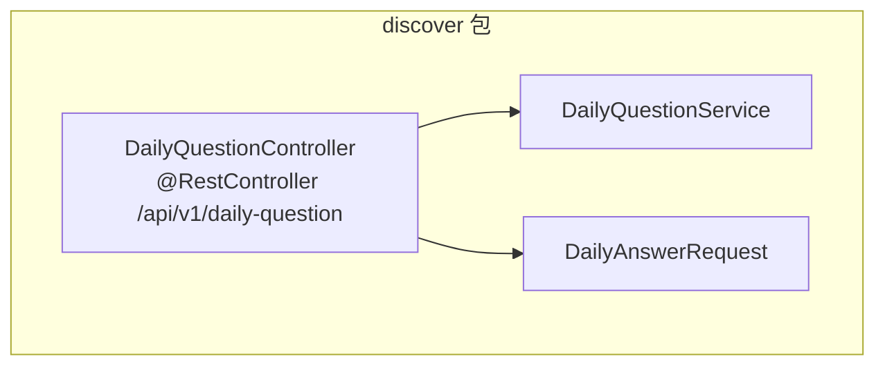
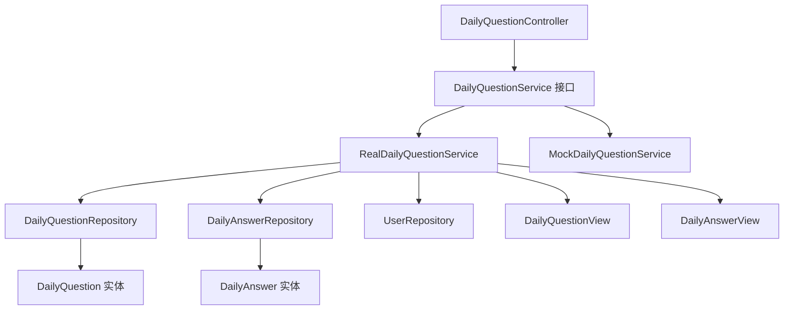
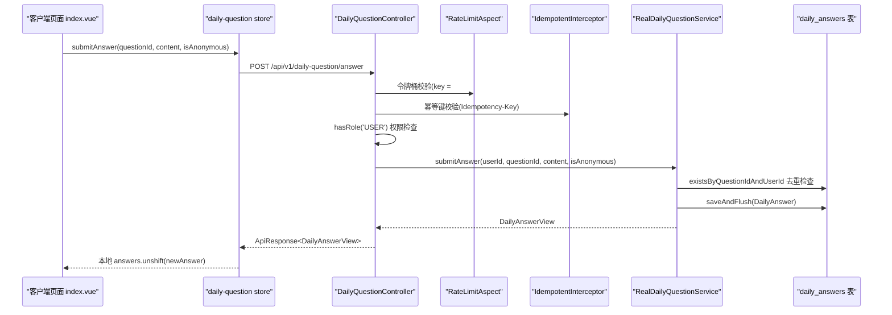
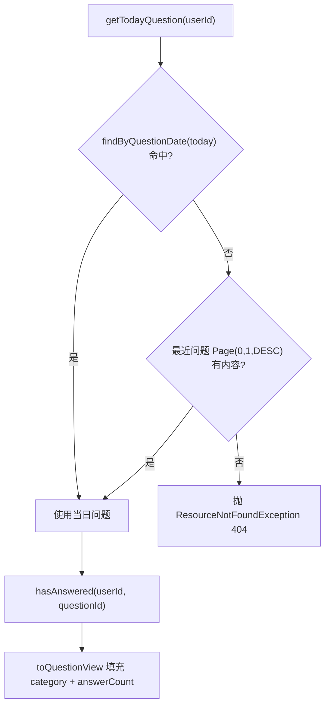
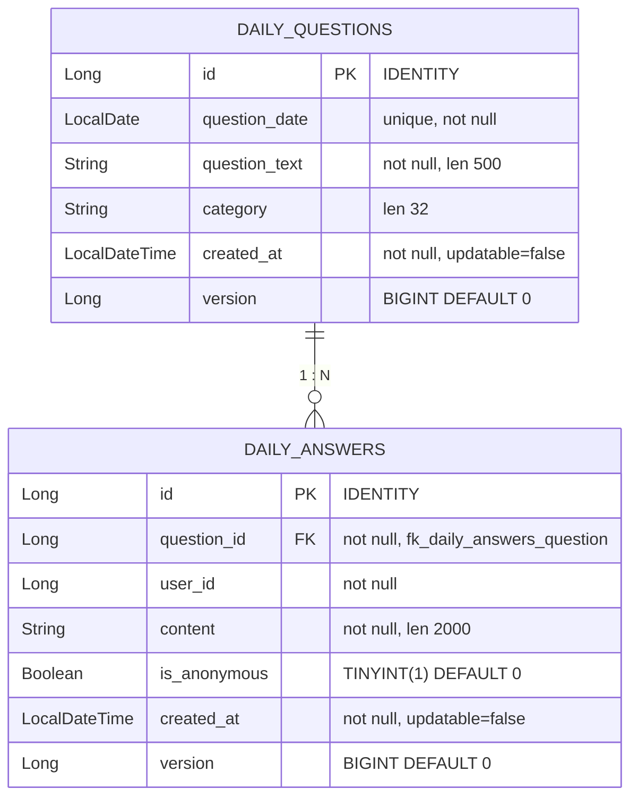
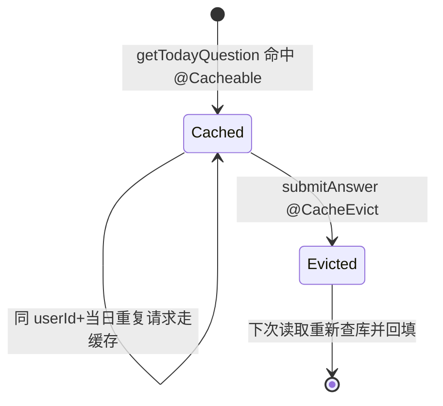
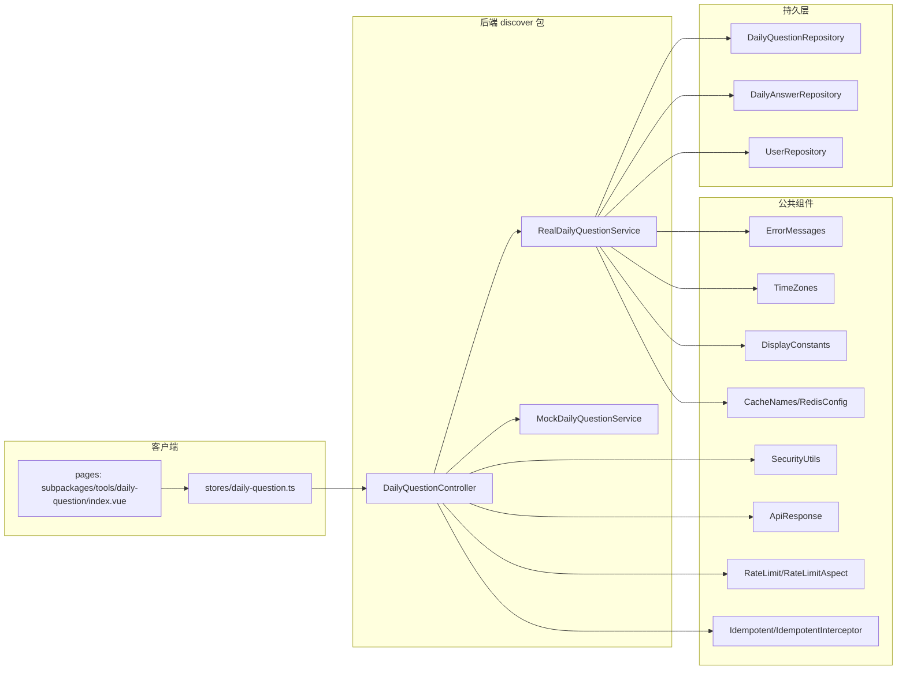
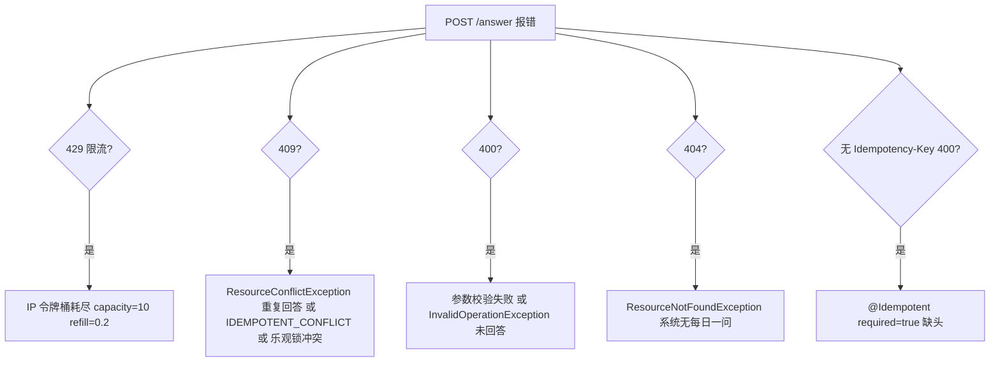

# 每日一问系统

<cite>
**本文引用的文件**
- [DailyQuestionController.java](file://apps/api/src/main/java/com/campuslove/api/discover/DailyQuestionController.java)
- [DailyQuestionService.java](file://apps/api/src/main/java/com/campuslove/api/discover/DailyQuestionService.java)
- [RealDailyQuestionService.java](file://apps/api/src/main/java/com/campuslove/api/discover/RealDailyQuestionService.java)
- [MockDailyQuestionService.java](file://apps/api/src/main/java/com/campuslove/api/discover/MockDailyQuestionService.java)
- [DailyQuestionView.java](file://apps/api/src/main/java/com/campuslove/api/discover/DailyQuestionView.java)
- [DailyAnswerView.java](file://apps/api/src/main/java/com/campuslove/api/discover/DailyAnswerView.java)
- [DailyQuestion.java](file://apps/api/src/main/java/com/campuslove/api/entity/DailyQuestion.java)
- [DailyAnswer.java](file://apps/api/src/main/java/com/campuslove/api/entity/DailyAnswer.java)
- [DailyQuestionRepository.java](file://apps/api/src/main/java/com/campuslove/api/repository/DailyQuestionRepository.java)
- [DailyAnswerRepository.java](file://apps/api/src/main/java/com/campuslove/api/repository/DailyAnswerRepository.java)
- [RateLimit.java](file://apps/api/src/main/java/com/campuslove/api/ratelimit/RateLimit.java)
- [Idempotent.java](file://apps/api/src/main/java/com/campuslove/api/common/Idempotent.java)
- [CacheNames.java](file://apps/api/src/main/java/com/campuslove/api/config/CacheNames.java)
- [daily-question.ts](file://apps/client/src/stores/daily-question.ts)
- [index.vue](file://apps/client/src/subpackages/tools/daily-question/index.vue)
</cite>

## 目录
1. [简介](#简介)
2. [项目结构](#项目结构)
3. [核心组件](#核心组件)
4. [架构总览](#架构总览)
5. [问答接口规范](#问答接口规范)
6. [业务逻辑实现](#业务逻辑实现)
7. [数据模型](#数据模型)
8. [详细组件分析](#详细组件分析)
9. [问答治理与防护](#问答治理与防护)
10. [依赖关系分析](#依赖关系分析)
11. [性能考虑](#性能考虑)
12. [故障排查指南](#故障排查指南)
13. [结论](#结论)

## 简介
每日一问系统是发现推荐服务下用于驱动用户轻度社交互动的问答能力。它以「每天一个问题」为节奏，向客户端提供今日问题获取、回答提交与回答列表查询三类接口，接口前缀为 `/api/v1/daily-question`，由 `DailyQuestionController` 统一对外暴露。

需要说明的是，本页聚焦仓库中真实存在的实现：`DailyQuestionController.java`（共 100 行）承担路由与请求封装，`DailyQuestionService.java`（共 51 行）承担业务侧处理。关于速率限制、幂等性、内容审核、敏感词过滤等能力，本页依据仓库实际可取证的范围进行描述，仓库中未实现或未取证到的部分将如实标注为「未提供」。

**章节来源**
- [DailyQuestionController.java](file://apps/api/src/main/java/com/campuslove/api/discover/DailyQuestionController.java)
- [DailyQuestionService.java](file://apps/api/src/main/java/com/campuslove/api/discover/DailyQuestionService.java)

## 项目结构
每日一问相关代码集中在后端 `apps/api` 模块的 `com.campuslove.api.discover` 包内，控制器与服务类同包存放。

[此图为概念结构示意，节点行号见后文章节来源]

**章节来源**
- [DailyQuestionController.java](file://apps/api/src/main/java/com/campuslove/api/discover/DailyQuestionController.java)
- [DailyQuestionService.java](file://apps/api/src/main/java/com/campuslove/api/discover/DailyQuestionService.java)

## 核心组件
每日一问由「控制器层—服务接口层—服务实现层—实体/仓储层—视图层」五类组件构成，控制器与服务接口为对外契约，实体与仓储为持久化底座。

- `DailyQuestionController`：`@RestController`，`@RequestMapping("/api/v1/daily-question")`，`@Validated`，暴露 `/today`、`/answer`、`/answers` 三个端点。它通过构造注入持有 `DailyQuestionService`，本身不含业务分支。
- `DailyQuestionService`：服务接口，声明 `getTodayQuestion(Long)`、`submitAnswer(Long, Long, String, boolean)`、`getAnswers(Long, Long, Pageable)`、`hasAnswered(Long, Long)` 四个方法。
- `RealDailyQuestionService`：`@Profile("real")` + `@Service`，基于 Repository 读写数据库，承载缓存、去重、匿名化、批量加载等真实逻辑。
- `MockDailyQuestionService`：`@Profile("mock")` + `@Service`，使用内存 `LinkedHashMap` 与 `AtomicLong` 序号返回演示数据，供无后端环境运行。
- 视图记录：`DailyQuestionView`（问题视图）、`DailyAnswerView`（回答视图），均为 `record`，是 Controller 与服务之间及与服务与客户端之间的数据契约。
- 实体：`DailyQuestion`（表 `daily_questions`）、`DailyAnswer`（表 `daily_answers`），带 `@Version` 乐观锁与 `@CreatedDate` 审计。
- 仓储：`DailyQuestionRepository`、`DailyAnswerRepository`，继承 `JpaRepository`，派生查询与自定义 `@Query`。

**图表来源**
- [DailyQuestionController.java:32-41](file://apps/api/src/main/java/com/campuslove/api/discover/DailyQuestionController.java#L32-L41)
- [DailyQuestionService.java:10-51](file://apps/api/src/main/java/com/campuslove/api/discover/DailyQuestionService.java#L10-L51)
- [RealDailyQuestionService.java:39-59](file://apps/api/src/main/java/com/campuslove/api/discover/RealDailyQuestionService.java#L39-L59)
- [MockDailyQuestionService.java:23-30](file://apps/api/src/main/java/com/campuslove/api/discover/MockDailyQuestionService.java#L23-L30)

**章节来源**
- [DailyQuestionController.java:32-41](file://apps/api/src/main/java/com/campuslove/api/discover/DailyQuestionController.java#L32-L41)
- [RealDailyQuestionService.java:39-59](file://apps/api/src/main/java/com/campuslove/api/discover/RealDailyQuestionService.java#L39-L59)
- [MockDailyQuestionService.java:23-30](file://apps/api/src/main/java/com/campuslove/api/discover/MockDailyQuestionService.java#L23-L30)

## 架构总览
每日一问在发现推荐服务中属于「轻互动内容」子域。请求从客户端 `daily-question` store 发出，经 HTTP 层进入控制器，控制器把 JWT 上下文里的当前用户 ID 传给服务接口，运行时按 Spring Profile 选择 `real` 或 `mock` 实现。用户 ID 一律由 `SecurityUtils.getCurrentUserId()` 从认证上下文获取，请求体不再携带 `userId`。下图给出典型「提交回答」调用链，展示限流、幂等、权限三道切面与业务落库的先后关系。

**图表来源**
- [DailyQuestionController.java:61-73](file://apps/api/src/main/java/com/campuslove/api/discover/DailyQuestionController.java#L61-L73)
- [RealDailyQuestionService.java:124-168](file://apps/api/src/main/java/com/campuslove/api/discover/RealDailyQuestionService.java#L124-L168)
- [RateLimit.java:39-88](file://apps/api/src/main/java/com/campuslove/api/ratelimit/RateLimit.java#L39-L88)
- [Idempotent.java:39-65](file://apps/api/src/main/java/com/campuslove/api/common/Idempotent.java#L39-L65)
- [daily-question.ts:346-362](file://apps/client/src/stores/daily-question.ts#L346-L362)

分层职责如下：

- 接入层（`DailyQuestionController`）：只做参数绑定、校验注解、切面注解与调用转发，不写业务判断。
- 切面层：`@RateLimit` 令牌桶、`@Idempotent` 幂等、`@PreAuthorize` 权限，均在进入服务前完成。
- 业务层（`RealDailyQuestionService` / `MockDailyQuestionService`）：问题选取、去重、事务、缓存、视图转换、匿名化、批量加载。
- 持久层（`DailyQuestionRepository` / `DailyAnswerRepository` / `UserRepository`）：派生查询与分页查询。
- 缓存层（`CacheNames.DAILY_QUESTION` = `"daily_question"`）：`@Cacheable`/`@CacheEvict` 挂在服务方法上。

**章节来源**
- [DailyQuestionController.java:43-87](file://apps/api/src/main/java/com/campuslove/api/discover/DailyQuestionController.java#L43-L87)
- [CacheNames.java:54-59](file://apps/api/src/main/java/com/campuslove/api/config/CacheNames.java#L54-L59)

## 问答接口规范
控制器基路径为 `/api/v1/daily-question`，类上标注 `@Validated`，返回值统一封装为 `ApiResponse<T>`。三个端点覆盖今日问题获取、回答提交与回答列表查询。

### GET /today —— 今日问题获取
`getTodayQuestion()`（`@GetMapping("/today")`）不接受任何参数，内部用 `SecurityUtils.getCurrentUserId()` 取得当前用户 ID 后调用 `dailyQuestionService.getTodayQuestion(userId)`，返回 `ApiResponse<DailyQuestionView>`。userId 传入服务仅用于计算 `hasAnswered`，可为 `null`（游客场景）。

### POST /answer —— 回答提交
`submitAnswer(@Valid @RequestBody DailyAnswerRequest request)`（`@PostMapping("/answer")`）是唯一的写接口，叠加三重防护注解：

- `@RateLimit(capacity = 10, refillTokens = 0.2, key = "#request.remoteAddr")`：桶容量 10、每秒补充 0.2 个令牌（约每 5 秒 1 个），按客户端 IP 限流。
- `@Idempotent`：默认 TTL 4 小时的幂等去重（见「幂等与速率」章节）。
- `@PreAuthorize("hasRole('USER')")`：仅登录的 USER 角色可提交。

请求体字段映射到服务方法为 `submitAnswer(userId, request.questionId(), request.content(), request.isAnonymous() != null && request.isAnonymous())`，返回 `ApiResponse<DailyAnswerView>`。

### GET /answers —— 回答列表查询
`getAnswers(...)`（`@GetMapping("/answers")`）接收三个查询参数：

| 参数 | 类型 | 约束 | 默认 | 说明 |
| --- | --- | --- | --- | --- |
| `questionId` | `Long` | `@Positive` | 必填 | 目标问题 ID |
| `page` | `int` | `@Min(0)` | `0` | 页码，从 0 起 |
| `size` | `int` | `@Min(1)` `@Max(100)` | `20` | 每页条数，上限 100 |

控制器用 `PageRequest.of(page, size)` 组装 `Pageable` 后调用 `getAnswers(questionId, userId, pageable)`，返回 `ApiResponse<Page<DailyAnswerView>>`。

### 请求模型 DailyAnswerRequest
`DailyAnswerRequest` 是控制器文件内定义的 `record`，字段校验如下：

- `questionId`：`@NotNull @Positive Long`
- `content`：`@NotBlank @Size(max = 2000) String`
- `isAnonymous`：`@NotNull(message = ErrorMessages.IS_ANONYMOUS_REQUIRED) Boolean`

`userId` 不在请求体中，注释明确「由 SecurityUtils 自动获取，不再从请求体传入」，与客户端删除多余 `userId` 字段的修复一致。

**章节来源**
- [DailyQuestionController.java:43-100](file://apps/api/src/main/java/com/campuslove/api/discover/DailyQuestionController.java#L43-L100)
- [daily-question.ts:346-357](file://apps/client/src/stores/daily-question.ts#L346-L357)

## 业务逻辑实现
`RealDailyQuestionService` 是 `real` profile 下的真实实现，方法按读写性质标注 `@Transactional`：`getTodayQuestion`、`getAnswers`、`hasAnswered` 为 `readOnly`，`submitAnswer` 为读写事务。业务时区统一用 `TimeZones.BUSINESS`。

### 今日问题选取算法
`getTodayQuestion(Long userId)` 是三级回退：

1. `dailyQuestionRepository.findByQuestionDate(today)` 查询当日问题；
2. 当日无记录时，用 `PageRequest.of(0, 1, Sort.by(DESC, "questionDate"))` 取按日期倒序的第一条「最近问题」；
3. 仍无问题时抛 `ResourceNotFoundException(ErrorMessages.DAILY_QUESTION_NONE_RETRY)` 返回 404（原 `RuntimeException` 会导致 500）。

随后 `hasAnswered = userId != null && hasAnswered(userId, question.getId())`，交给 `toQuestionView` 组装视图。需说明：接口注释里「若今天还没有生成问题则从预定义列表随机选取一个创建」描述的是 `DailyQuestionService` 语义；`real` 实现并无可见的随机新建分支，只读取已入库问题并回退到最近一条。即时生成默认问题「你理想的第一次约会是什么样的？」的行为只出现在 `MockDailyQuestionService`，不落库。

### 去重与匿名化
`submitAnswer` 先做入参非空校验（`userId`/`questionId`/`content`），再校验问题存在（`findById` 不存在抛 `IllegalArgumentException`）。重复回答由 `dailyAnswerRepository.existsByQuestionIdAndUserId` 判定，命中抛 `ResourceConflictException` 返回 409（原 `IllegalStateException` 会落入 500）。落库用 `saveAndFlush` 并接收返回值回填 id，避免 `@Version` merge 后 `getId()` 为 null。

匿名化发生在视图转换：`toAnswerView` 对 `Boolean.TRUE.equals(answer.getIsAnonymous())` 的回答将 `userId` 置 `null`、`authorName` 用 `DisplayConstants.ANONYMOUS_USER`、头像置空串；非匿名回答从批量 Map 取 `user.getNickname()`/`getAvatarUrl()`，用户缺失时回退 `DisplayConstants.UNKNOWN_USER`。

### 批量加载与 N+1 优化
`getAnswers` 权限门槛：`currentUserId != null && !hasAnswered(...)` 时抛 `InvalidOperationException`（400），即「未回答不可看他人回答」。分页查询走 `findByQuestionIdOrderByCreatedAtDesc(questionId, pageable)`。为消除逐条查作者的 N+1，`loadUserMap` 对回答 userId 去重后用 `userRepository.findByIdIn(distinct)` 一次性批量加载为 `Map<Long, User>`，再逐条 `toAnswerView`。

**图表来源**
- [RealDailyQuestionService.java:79-109](file://apps/api/src/main/java/com/campuslove/api/discover/RealDailyQuestionService.java#L79-L109)

**章节来源**
- [RealDailyQuestionService.java:73-109](file://apps/api/src/main/java/com/campuslove/api/discover/RealDailyQuestionService.java#L73-L109)
- [RealDailyQuestionService.java:124-168](file://apps/api/src/main/java/com/campuslove/api/discover/RealDailyQuestionService.java#L124-L168)
- [RealDailyQuestionService.java:180-308](file://apps/api/src/main/java/com/campuslove/api/discover/RealDailyQuestionService.java#L180-L308)
- [DailyQuestionService.java:11-50](file://apps/api/src/main/java/com/campuslove/api/discover/DailyQuestionService.java#L11-L50)
- [MockDailyQuestionService.java:32-50](file://apps/api/src/main/java/com/campuslove/api/discover/MockDailyQuestionService.java#L32-L50)

## 数据模型
两张实体表构成每日一问的持久化底座：`daily_questions`（问题）与 `daily_answers`（回答），回答多对一关联问题。两表均带 `@Version` 乐观锁列（`version BIGINT DEFAULT 0`，对应 Flyway 迁移 `V2026.07.26.0003`）与 `@CreatedDate` 审计列。

**图表来源**
- [DailyQuestion.java:20-58](file://apps/api/src/main/java/com/campuslove/api/entity/DailyQuestion.java#L20-L58)
- [DailyAnswer.java:22-65](file://apps/api/src/main/java/com/campuslove/api/entity/DailyAnswer.java#L22-L65)

字段要点：

- `DailyQuestion.questionDate` 带 `unique = true`，保证每天一个问题，是「取当日/最近问题」逻辑成立的前提；`questionText` 上限 500，`category` 上限 32。
- `DailyAnswer.question` 为 `@ManyToOne(fetch = LAZY)`，外键命名 `fk_daily_answers_question`；LAZY 正是 `@EntityGraph` 预加载与批量 `loadUserMap` 优化的动因。`isAnonymous` 默认 `false`，列定义 `TINYINT(1) DEFAULT 0`。

### 视图模型
服务对外输出两个 `record`：

| 视图 | 字段 |
| --- | --- |
| `DailyQuestionView` | `id, questionDate, questionText, hasAnswered, category, answerCount` |
| `DailyAnswerView` | `id, userId, authorName, content, isAnonymous, createdAt, avatarUrl` |

`DailyQuestionView.answerCount` 由 `toQuestionView` 用 `countByQuestionId` 实时统计；匿名时 `DailyAnswerView.userId` 为 `null`、`avatarUrl` 为空串。客户端 store 定义镜像接口 `BackendDailyQuestionView` / `BackendDailyAnswerView`，字段与后端 record 一一对应，并在 `mapToDailyQuestion` / `mapToDailyAnswer` 里把 `id` 转成字符串、对匿名回答清空 `authorName`/`authorAvatar`。

**章节来源**
- [DailyQuestion.java:20-58](file://apps/api/src/main/java/com/campuslove/api/entity/DailyQuestion.java#L20-L58)
- [DailyAnswer.java:22-65](file://apps/api/src/main/java/com/campuslove/api/entity/DailyAnswer.java#L22-L65)
- [DailyQuestionView.java:8-17](file://apps/api/src/main/java/com/campuslove/api/discover/DailyQuestionView.java#L8-L17)
- [DailyAnswerView.java:8-17](file://apps/api/src/main/java/com/campuslove/api/discover/DailyAnswerView.java#L8-L17)
- [daily-question.ts:15-75](file://apps/client/src/stores/daily-question.ts#L15-L75)

## 详细组件分析

### DailyQuestionController
控制器是纯转发层：构造注入 `DailyQuestionService`，三个方法各自取得 `SecurityUtils.getCurrentUserId()` 后调用服务。今日问题与回答列表用 `@GetMapping`，回答提交用 `@PostMapping` 并叠加限流/幂等/权限注解。参数校验依赖 `jakarta.validation` 注解（`@Valid`、`@Positive`、`@Min`、`@Max`、`@NotBlank`、`@Size`、`@NotNull`）配合类级 `@Validated` 生效。

### 服务实现的 Profile 双轨
同一接口 `DailyQuestionService` 有两个实现，由 Spring Profile 决定注入哪一个：`RealDailyQuestionService`（`@Profile("real")` + `@Service`）依赖 `DailyQuestionRepository`、`DailyAnswerRepository`、`UserRepository` 三类仓储；`MockDailyQuestionService`（`@Profile("mock")` + `@Service`）用 `AtomicLong questionIdSeq`、`AtomicLong answerIdSeq`、`Map questionsById`、`Map answersByQuestionId` 承载内存状态。四方法签名一致：`getTodayQuestion(Long)`、`submitAnswer(Long,Long,String,boolean)`、`getAnswers(Long,Long,Pageable)`、`hasAnswered(Long,Long)`。

`MockDailyQuestionService` 用内存 Map 与原子序号模拟：`getTodayQuestion` 若无当日条目则即时插入默认问题；`getAnswers` 在内存无回答时返回 `buildMockAnswers` 的三条示例（含一条 `DisplayConstants.ANONYMOUS_USER` 匿名回答），并对 `Pageable` 做 `subList` 手工分页。它的 `getAnswers` 权限校验仍抛 `IllegalStateException`，与 real 版已改为 `InvalidOperationException` 不同——这是 mock 路径未同步收敛之处。

#### 缓存一致性
`getTodayQuestion` 的 `@Cacheable` 与 `submitAnswer` 的 `@CacheEvict` 使用相同 key 表达式 `#userId + ':' + LocalDate.now(TimeZones.BUSINESS)`，缓存名 `CacheNames.DAILY_QUESTION`（值 `"daily_question"`，TTL 1 小时）。key 加入日期维度是 infra R2-00236 修复，避免 1h TTL 跨零点仍返回昨日问题；提交回答后主动失效当前用户当日缓存，使 `hasAnswered` 下次读取反映最新状态。

**图表来源**
- [RealDailyQuestionService.java:75-78](file://apps/api/src/main/java/com/campuslove/api/discover/RealDailyQuestionService.java#L75-L78)
- [RealDailyQuestionService.java:126-127](file://apps/api/src/main/java/com/campuslove/api/discover/RealDailyQuestionService.java#L126-L127)
- [CacheNames.java:54-59](file://apps/api/src/main/java/com/campuslove/api/config/CacheNames.java#L54-L59)

### 仓储查询能力
`DailyQuestionRepository` 仅提供 `findByQuestionDate(LocalDate)` 派生查询。`DailyAnswerRepository` 提供：`findByQuestionIdOrderByCreatedAtDesc`（List 与 Page 两个重载）、`existsByQuestionIdAndUserId`（去重判定）、`countByQuestionId`（回答数统计）、`findByUserIdOrderByCreatedAtDesc`（供破冰功能取用户最近回答），以及带 `@EntityGraph(attributePaths = "question")` 的 `findWithQuestionByQuestionIdOrderByCreatedAtDesc` 自定义 `@Query`，把 LAZY 关联的 N 条 SQL 压成 1 条。需要指出：`real` 服务当前分页走的是普通 `findByQuestionIdOrderByCreatedAtDesc(questionId, pageable)`，作者信息通过独立的 `loadUserMap` 批量加载，`@EntityGraph` 方法是仓库中为同类 N+1 问题提供的备用能力。

**章节来源**
- [DailyQuestionController.java:43-88](file://apps/api/src/main/java/com/campuslove/api/discover/DailyQuestionController.java#L43-L88)
- [MockDailyQuestionService.java:79-155](file://apps/api/src/main/java/com/campuslove/api/discover/MockDailyQuestionService.java#L79-L155)
- [DailyAnswerRepository.java:15-76](file://apps/api/src/main/java/com/campuslove/api/repository/DailyAnswerRepository.java#L15-L76)
- [RealDailyQuestionService.java:256-269](file://apps/api/src/main/java/com/campuslove/api/discover/RealDailyQuestionService.java#L256-L269)

## 问答治理与防护
控制器写路径叠加三项横切能力：速率限制、幂等保护、权限控制，均在进入 `RealDailyQuestionService.submitAnswer` 之前完成。

### 速率限制（令牌桶）
`@RateLimit(capacity = 10, refillTokens = 0.2, key = "#request.remoteAddr")` 作用在 `submitAnswer` 上。注解定义：`capacity` 为桶容量即瞬时突发上限，`refillTokens` 为每秒补充令牌数（支持小数），`key` 为 SpEL，默认 `#request.remoteAddr` 按客户端 IP 限流。方法注释补充：每 6 秒补 1 令牌（`refillTokens ≈ 0.17/s`），实际取 `0.2`（约每 5 秒 1 个）兼顾体验与防滥用。超限由 `RateLimitAspect` 拦截抛 `RateLimitExceededException`；桶键组合为「类名#方法名:SpEL 解析值」，避免接口共用桶。

### 幂等保护
`@Idempotent` 由 `IdempotentInterceptor` 处理，基于客户端 `Idempotency-Key` 头 + Redis 去重，Redis key 形如 `idempotent:{key}:{userId}` 按用户隔离。默认 `ttlSeconds = 4 * 3600`（infra R2-00249 将原 24h 缩短），`required = true` 时缺失幂等键返回 400；重复请求返回 409 + 错误码 `IDEMPOTENT_CONFLICT`。注解仅作用于写操作，两个 GET 接口未加。

### 权限控制
`@PreAuthorize("hasRole('USER')")` 限定回答提交必须是 USER 角色；`userId` 一律来自 `SecurityUtils.getCurrentUserId()`，杜绝伪造他人身份。回答列表可见性由服务层再校验：未回答者查看他人回答抛 `InvalidOperationException`。

### 内容审核与质量评估现状
需如实说明取证边界：在本次读取的每日一问代码路径（控制器、real/mock 服务、两个仓储、两个视图）中，**没有**对 `SensitiveWordFilter`、内容审核、举报处理或回答质量评分的调用。`submitAnswer` 只做非空校验、问题存在性校验与重复回答去重；`content` 长度由 `@Size(max = 2000)` 与实体列 `length = 2000` 兜底。仓库虽存在敏感词缓存常量 `CacheNames.SENSITIVE_WORDS`（供 `SensitiveWordFilter` 使用），但每日一问提交路径未接入该过滤器。因此「敏感词过滤、举报处理、回答质量评估」在每日一问当前**未实现或未接线**，不应臆测其行为。

**章节来源**
- [DailyQuestionController.java:61-73](file://apps/api/src/main/java/com/campuslove/api/discover/DailyQuestionController.java#L61-L73)
- [RateLimit.java:14-88](file://apps/api/src/main/java/com/campuslove/api/ratelimit/RateLimit.java#L14-L88)
- [Idempotent.java:14-65](file://apps/api/src/main/java/com/campuslove/api/common/Idempotent.java#L14-L65)
- [CacheNames.java:61-68](file://apps/api/src/main/java/com/campuslove/api/config/CacheNames.java#L61-L68)

## 依赖关系分析
每日一问处于「客户端 store/页面 → HTTP → 控制器 → 服务实现 → 仓储 → 实体」链路的中间，它依赖若干公共组件而不反向被它们依赖。

**图表来源**
- [DailyQuestionController.java:1-88](file://apps/api/src/main/java/com/campuslove/api/discover/DailyQuestionController.java#L1-L88)
- [RealDailyQuestionService.java:1-59](file://apps/api/src/main/java/com/campuslove/api/discover/RealDailyQuestionService.java#L1-L59)
- [daily-question.ts:1-11](file://apps/client/src/stores/daily-question.ts#L1-L11)

控制器 import 明确依赖 `ErrorMessages`、`ApiResponse`、`Idempotent`、`SecurityUtils`、`RateLimit`、`jakarta.validation.*`、Spring Data `Page/PageRequest/Pageable`、`@PreAuthorize`、`@Validated`。`real` 服务额外依赖 `TimeZones`、`CacheNames`、`DisplayConstants`、三类仓储与三个实体。客户端 store 依赖 `services/http`、`session`、`helpers/use-mock`、`i18n` 与 `utils/cache-ttl`。

页面挂载时通过 `storeToRefs` 取得 `todayQuestion/answers/hasAnswered/loading/answerPage/answerHasMore` 驱动渲染，提交动作调用 `dailyQuestionStore.submitAnswer(...)`，并依赖 `checkin` store 做「签到解锁每日一问」。

**章节来源**
- [DailyQuestionController.java:1-25](file://apps/api/src/main/java/com/campuslove/api/discover/DailyQuestionController.java#L1-L25)
- [RealDailyQuestionService.java:1-32](file://apps/api/src/main/java/com/campuslove/api/discover/RealDailyQuestionService.java#L1-L32)
- [index.vue:1-22](file://apps/client/src/subpackages/tools/daily-question/index.vue#L1-L22)

## 性能考虑
每日一问的性能优化集中在缓存、分页与批量加载三处，都能在代码里找到落点。

### 缓存策略
`getTodayQuestion` 用 `@Cacheable(cacheNames = CacheNames.DAILY_QUESTION, key = "#userId + ':' + LocalDate.now(TimeZones.BUSINESS)", unless = "#result == null")`。`CacheNames` 注释说明每日一问每日只更新一次、TTL 1 小时；`unless = "#result == null"` 避免缓存空结果。key 含 `userId` 与日期，使每个用户每天的 `hasAnswered` 结果被独立缓存、当日多次访问命中缓存不再重复查库。`submitAnswer` 用同一 key 精确失效当前用户当日缓存。

### 分页查询优化
控制器把 `page`（默认 0）/`size`（默认 20、上限 100）组装为 `PageRequest`，服务用 `findByQuestionIdOrderByCreatedAtDesc(questionId, pageable)` 返回 `Page<DailyAnswer>`，再映射为 `Page<DailyAnswerView>`（`new PageImpl<>(views, pageable, total)`）。`size` 的 `@Max(100)` 防止单次拉取过大结果集。

### N+1 消除
`getAnswers` 分页后调用 `loadUserMap(...)`：把本页所有回答的 `userId` 去重，一次 `userRepository.findByIdIn(distinct)` 批量加载成 `Map<Long, User>`，视图转换直接从 Map 取作者，避免逐条 SELECT user。`DailyAnswerRepository` 另提供 `@EntityGraph(attributePaths = "question")` 查询，用于把 LAZY 的 `question` 关联在单条 SQL 里 LEFT JOIN 预加载。

### 客户端侧缓存与新鲜度
store 用 `QUESTION_TTL_MS = 30_000`（30 秒）+ `isCacheFresh("daily-question:today", …)` 做本地新鲜度窗口，30 秒内已加载且有数据时直接跳过请求；`ANSWER_PAGE_SIZE = 20` 与服务默认 `size` 对齐。real 分支请求成功后 `setCachedValue("daily-question:today", true)` 刷新时间戳，mock 分支同样刷新以保持一致语义。`fetchAnswers` 以 `page - 1` 传后端 0 基页码，并用返回数据量修正 `answerHasMore`。

**章节来源**
- [RealDailyQuestionService.java:73-109](file://apps/api/src/main/java/com/campuslove/api/discover/RealDailyQuestionService.java#L73-L109)
- [RealDailyQuestionService.java:180-269](file://apps/api/src/main/java/com/campuslove/api/discover/RealDailyQuestionService.java#L180-L269)
- [CacheNames.java:54-59](file://apps/api/src/main/java/com/campuslove/api/config/CacheNames.java#L54-L59)
- [DailyAnswerRepository.java:34-49](file://apps/api/src/main/java/com/campuslove/api/repository/DailyAnswerRepository.java#L34-L49)
- [DailyQuestionController.java:79-87](file://apps/api/src/main/java/com/campuslove/api/discover/DailyQuestionController.java#L79-L87)
- [daily-question.ts:227-300](file://apps/client/src/stores/daily-question.ts#L227-L300)
- [daily-question.ts:374-403](file://apps/client/src/stores/daily-question.ts#L374-L403)

## 故障排查指南
每日一问在 infra R2 整改中把多处会落入 500 兜底的异常改成了语义正确的业务异常，排障时以 HTTP 状态码区分根因。

[此图为排障决策概念流程，对应异常来源见下方来源列表]

常见症状与定位：

| 症状 | 触发条件 | 对应实现 |
| --- | --- | --- |
| 系统无问题时提交/查看失败 | 库中无任何 `daily_questions` 记录 | `getTodayQuestion` 抛 `ResourceNotFoundException`，`ErrorMessages.DAILY_QUESTION_NONE_RETRY` |
| 提交返回 409 | 同一 `questionId + userId` 已存在回答 | `existsByQuestionIdAndUserId` → `ResourceConflictException`，`DAILY_QUESTION_ALREADY_ANSWERED` |
| 查看他人回答返回 400 | 当前用户尚未回答该问题 | `getAnswers` → `InvalidOperationException`，`DAILY_QUESTION_ANSWER_REQUIRED` |
| 提交瞬时被拒（429） | 同一 IP 短时请求超过桶容量 10 | `@RateLimit` 桶空，`RateLimitExceededException` |
| 重试仍失败/重复拦截（409） | 相同 `Idempotency-Key` 在 4h TTL 内重复 | `@Idempotent` + Redis 去重，`IDEMPOTENT_CONFLICT` |
| 更新并发冲突（409） | `@Version` 乐观锁失败 | `ObjectOptimisticLockingFailureException` 由 `GlobalExceptionHandler` 转 409 |
| 匿名回答显示真实昵称 | 视图未命中匿名分支 | `toAnswerView` 依赖 `answer.getIsAnonymous()` 与 `DisplayConstants.ANONYMOUS_USER` |
| 跨零点拿到昨日问题 | 缓存 key 未含日期（旧缺陷） | 已由 R2-00236 在 key 中加入 `LocalDate.now(BUSINESS)` 修复 |

客户端侧错误消息统一从 `storeErrors.dailyQuestion.*` 取 i18n 文案：加载问题失败 `loadQuestionFailed`、问题 ID 无效 `questionIdInvalid`、内容为空 `answerContentEmpty`、内容过长 `answerContentTooLong`、提交失败 `submitAnswerFailed`、加载回答失败 `loadAnswersFailed`。页面在未签到时会引导调用 `checkInStore.checkIn()` 就地解锁每日一问。

**章节来源**
- [RealDailyQuestionService.java:98-103](file://apps/api/src/main/java/com/campuslove/api/discover/RealDailyQuestionService.java#L98-L103)
- [RealDailyQuestionService.java:144-199](file://apps/api/src/main/java/com/campuslove/api/discover/RealDailyQuestionService.java#L144-L199)
- [RealDailyQuestionService.java:280-308](file://apps/api/src/main/java/com/campuslove/api/discover/RealDailyQuestionService.java#L280-L308)
- [RateLimit.java:14-24](file://apps/api/src/main/java/com/campuslove/api/ratelimit/RateLimit.java#L14-L24)
- [Idempotent.java:14-44](file://apps/api/src/main/java/com/campuslove/api/common/Idempotent.java#L14-L44)
- [daily-question.ts:308-366](file://apps/client/src/stores/daily-question.ts#L308-L366)

## 结论
每日一问系统以 `DailyQuestionController` 为唯一入口，在 `/api/v1/daily-question` 下提供 `/today`、`/answer`、`/answers` 三个端点，配合 `ApiResponse` 统一封装与 JWT 上下文取用户 ID 的约定，构成前后端一致的数据契约。业务实现采用 Profile 双轨：`real` 走数据库并承载缓存、去重、匿名化、批量加载与分页优化，`mock` 以内存数据支撑无后端演示。数据模型由 `daily_questions` 与 `daily_answers` 两张带乐观锁与审计的实体表组成，问题日期唯一保证每日一问的节奏。

治理层面，回答提交受令牌桶限流（容量 10、约每 5 秒补 1 令牌、按 IP）、幂等保护（`Idempotency-Key` + Redis、默认 4 小时 TTL）、角色权限（`hasRole('USER')`）三重防护，并在 infra R2 整改中把重复回答、未回答查看、无问题等场景的错误码从 500 收敛到 409/400/404 的语义化响应。缓存以 `daily_question` 为名、key 含用户与业务日期、TTL 1 小时，配合提交后的 `@CacheEvict` 保证 `hasAnswered` 一致性。

需要明确的能力边界：本次取证范围内，每日一问的提交路径未接入敏感词过滤、内容审核、举报处理或回答质量评估；服务接口注释所述的「随机新建当日问题」在 `real` 实现中表现为读取当日/回退最近问题，动态生成默认问题只发生在 `mock`。这些差异应作为后续迭代的确认点，而非现有实现。

**章节来源**
- [DailyQuestionController.java:32-100](file://apps/api/src/main/java/com/campuslove/api/discover/DailyQuestionController.java#L32-L100)
- [RealDailyQuestionService.java:73-168](file://apps/api/src/main/java/com/campuslove/api/discover/RealDailyQuestionService.java#L73-L168)
- [MockDailyQuestionService.java:23-50](file://apps/api/src/main/java/com/campuslove/api/discover/MockDailyQuestionService.java#L23-L50)

