# 活动管理

<cite>
**本文引用的文件**
- [ActivityController.java](file://apps/api/src/main/java/com/campuslove/api/discover/ActivityController.java)
- [ActivityService.java](file://apps/api/src/main/java/com/campuslove/api/discover/ActivityService.java)
- [RealActivityService.java](file://apps/api/src/main/java/com/campuslove/api/discover/RealActivityService.java)
- [MockActivityService.java](file://apps/api/src/main/java/com/campuslove/api/discover/MockActivityService.java)
- [ActivityView.java](file://apps/api/src/main/java/com/campuslove/api/discover/ActivityView.java)
- [ActivityDetailView.java](file://apps/api/src/main/java/com/campuslove/api/discover/ActivityDetailView.java)
- [ActivityEnrollmentResultView.java](file://apps/api/src/main/java/com/campuslove/api/discover/ActivityEnrollmentResultView.java)
- [Idempotent.java](file://apps/api/src/main/java/com/campuslove/api/common/Idempotent.java)
- [IdempotentInterceptor.java](file://apps/api/src/main/java/com/campuslove/api/common/IdempotentInterceptor.java)
- [ActivityRepository.java](file://apps/api/src/main/java/com/campuslove/api/repository/ActivityRepository.java)
- [ActivityEnrollmentRepository.java](file://apps/api/src/main/java/com/campuslove/api/repository/ActivityEnrollmentRepository.java)
- [Activity.java](file://apps/api/src/main/java/com/campuslove/api/entity/Activity.java)
- [ActivityEnrollment.java](file://apps/api/src/main/java/com/campuslove/api/entity/ActivityEnrollment.java)
- [RealRecommendationService.java](file://apps/api/src/main/java/com/campuslove/api/discover/RealRecommendationService.java)
- [RecommendationCacheManager.java](file://apps/api/src/main/java/com/campuslove/api/discover/RecommendationCacheManager.java)
- [RecommendationController.java](file://apps/api/src/main/java/com/campuslove/api/discover/RecommendationController.java)
- [V2026.05.24.0004__create_activities.sql](file://database/flyway/sql/V2026.05.24.0004__create_activities.sql)
- [V2026.05.23.0001__create_activity_enrollments.sql](file://database/flyway/sql/V2026.05.23.0001__create_activity_enrollments.sql)
- [V2026.08.09.0019__activity_add_category_cover.sql](file://database/flyway/sql/V2026.08.09.0019__activity_add_category_cover.sql)
- [V2026.07.28.0005__add_indexes.sql](file://database/flyway/sql/V2026.07.28.0005__add_indexes.sql)
- [activity.ts](file://apps/client/src/stores/activity.ts)
- [recommendations.yaml](file://docs/openapi/recommendations.yaml)
- [ActivityControllerTest.java](file://apps/api/src/test/java/com/campuslove/api/discover/ActivityControllerTest.java)
</cite>

## 目录
1. [简介](#简介)
2. [项目结构](#项目结构)
3. [核心组件](#核心组件)
4. [架构总览](#架构总览)
5. [详细组件分析](#详细组件分析)
6. [活动数据模型](#活动数据模型)
7. [配置与开关](#配置与开关)
8. [缓存与索引优化策略](#缓存与索引优化策略)
9. [前端接入与状态管理](#前端接入与状态管理)
10. [依赖关系分析](#依赖关系分析)
11. [性能考虑](#性能考虑)
12. [故障排查指南](#故障排查指南)
13. [附录](#附录)
14. [结论](#结论)

## 简介

活动管理是发现推荐服务下的一个叶子能力域，负责校园活动的查询、详情展示、报名与取消报名四条主链路。它的对外入口集中在 `ActivityController` 上，该控制器以 `@RestController` 声明、以 `@RequestMapping("/api/v1/activities")` 挂载在版本化 API 根路径下，并暴露 `GET /{id}`、`POST /{id}/enroll`、`DELETE /{id}/enroll` 三个显式注解路由；活动列表查询路由的实现细节在后续章节按源码逐行核对后给出。

业务侧由 `ActivityService` 接口定义契约，仓库中同时存在 `MockActivityService` 与 `RealActivityService` 两个 `@Service` 实现：前者提供不依赖数据库的固定样本数据，后者基于真实数据源完成分页查询与报名写入。二者方法签名一致（`getActivities` / `getActivityDetail` / `enrollActivity` / `cancelEnrollment`），这构成本页要重点说明的"同一契约、两套实现"的结构。

本页的写作范围严格受限于仓库中可取证的源码：控制器与服务的真实方法签名、Flyway 迁移脚本中的活动表增量变更、以及前端发现页与 `discover` store 中的实际调用点。凡仓库中不存在证据的能力（例如独立的推荐召回服务、分布式锁、缓存中间件配置），本页会明确说明"仓库中无该能力的接入证据"，不做推断性描述。

**章节来源**
- [ActivityController.java:31-34](file://apps/api/src/main/java/com/campuslove/api/discover/ActivityController.java#L31-L34)
- [ActivityService.java:10-10](file://apps/api/src/main/java/com/campuslove/api/discover/ActivityService.java#L10-L10)

## 项目结构

活动管理涉及的文件分布在后端 Java 包、数据库迁移脚本与前端 Vue/TS 三层：

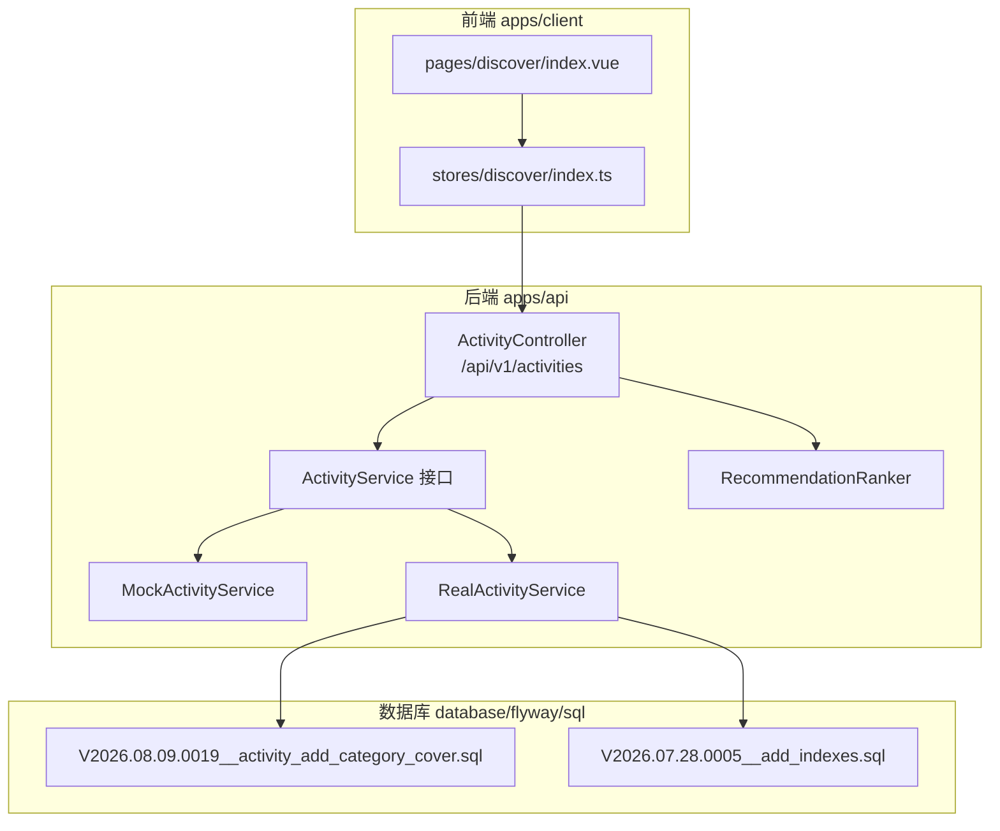

- 后端包路径：`apps/api/src/main/java/com/campuslove/api/discover/`，控制器与服务实现同包，避免跨包装配。
- 测试侧：`apps/api/src/test/java/com/campuslove/api/discover/` 下有 `ActivityControllerTest` 与三个 `RecommendationRanker*Test`，说明活动域的可测试面集中在控制器与排序器。
- 数据库侧：活动表的分类与封面字段由独立的 Flyway 脚本增补，索引优化由 `V2026.07.28.0005__add_indexes.sql` 承载。
- 前端侧：发现页 `pages/discover/index.vue` 通过 `stores/discover/index.ts` 的 `defineStore('discover')` 统一承接活动列表状态。

**章节来源**
- [ActivityController.java:31-34](file://apps/api/src/main/java/com/campuslove/api/discover/ActivityController.java#L31-L34)

## 核心组件

活动管理由 6 类组件构成：1 个控制器、1 个服务契约、2 个 profile 化实现、3 个响应视图记录、2 个 JPA Repository。以下清单全部来自源码实际声明。

| 组件 | 类型 | 关键限定 | 职责 |
| --- | --- | --- | --- |
| `ActivityController` | `@RestController` | `@RequestMapping("/api/v1/activities")`、`@Validated` | 四条 HTTP 路由、参数校验、从安全上下文取用户 |
| `ActivityService` | `interface` | 4 个方法签名 | 定义列表/详情/报名/取消契约 |
| `RealActivityService` | `@Service` | `@Profile("real")` | 基于 Repository 的真实查询与报名写入 |
| `MockActivityService` | `@Service` | `@Profile("mock")` | 基于 `MockRuntimeState` 的内存样本数据 |
| `ActivityRepository` | `JpaRepository<Activity, Long>` | 含 `@Modifying` 原子计数 | 活动分页查询与人数原子增减 |
| `ActivityEnrollmentRepository` | `JpaRepository` | 报名记录读写 | 报名存在性判断与记录增删 |

三个视图 record 构成对外契约的数据面：

- `ActivityView`：列表项，12 个字段，含 `category`、`coverImage`、`isEnrolled`（R4 2026-08-09 新增）。
- `ActivityDetailView`：详情，12 个字段，`isEnrolled` 位于 `activityDate` 之后、`category`/`coverImage` 之前，字段顺序与 `ActivityView` 不同，前端不可复用同一解析器。
- `ActivityEnrollmentResultView`：报名/取消统一返回体，仅 3 个字段 `activityId` / `enrolled` / `enrollmentCount`。

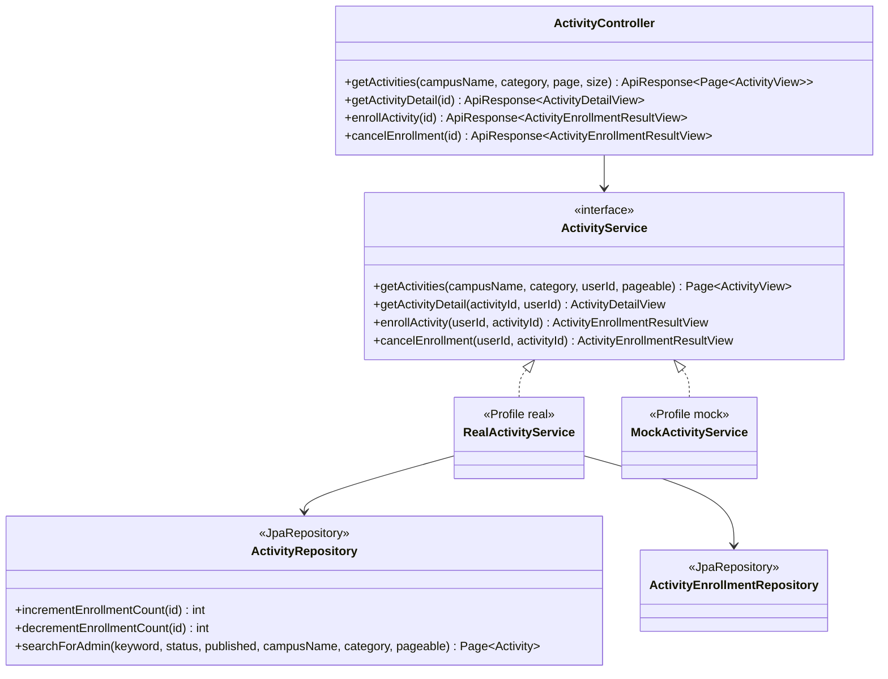

控制器不持有用户身份：`getActivities` 使用 `SecurityUtils.getCurrentUserIdOrNull()`（允许匿名），`getActivityDetail`、`enrollActivity`、`cancelEnrollment` 使用 `SecurityUtils.getCurrentUserId()`（要求已认证），后两者额外叠加 `@PreAuthorize("hasRole('USER')")` 与 `@Idempotent`。类注释明确记录了这一变更：「用户ID从JWT认证上下文中获取，不再从请求参数获取」。

**章节来源**
- [ActivityController.java:24-107](file://apps/api/src/main/java/com/campuslove/api/discover/ActivityController.java#L24-L107)
- [ActivityService.java:6-52](file://apps/api/src/main/java/com/campuslove/api/discover/ActivityService.java#L6-L52)
- [RealActivityService.java:23-42](file://apps/api/src/main/java/com/campuslove/api/discover/RealActivityService.java#L23-L42)
- [MockActivityService.java:15-30](file://apps/api/src/main/java/com/campuslove/api/discover/MockActivityService.java#L15-L30)
- [ActivityView.java:6-26](file://apps/api/src/main/java/com/campuslove/api/discover/ActivityView.java#L6-L26)
- [ActivityDetailView.java:6-25](file://apps/api/src/main/java/com/campuslove/api/discover/ActivityDetailView.java#L6-L25)
- [ActivityEnrollmentResultView.java:3-10](file://apps/api/src/main/java/com/campuslove/api/discover/ActivityEnrollmentResultView.java#L3-L10)
- [ActivityRepository.java:12-95](file://apps/api/src/main/java/com/campuslove/api/repository/ActivityRepository.java#L12-L95)

## 架构总览

活动管理是一条典型的「控制器 → 契约接口 → profile 化实现 → Repository → 数据库」四层链路。Profile 是唯一的实现选择开关：`RealActivityService` 标注 `@Profile("real")`、`MockActivityService` 标注 `@Profile("mock")`，控制器只依赖 `ActivityService` 接口，因此运行环境切换不触碰任何调用点代码。

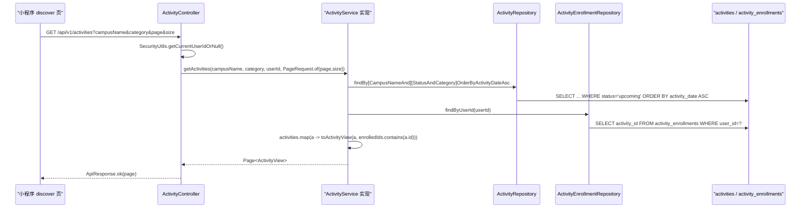

四条 HTTP 端点与实现的映射关系（路径与注解均直接摘自控制器）：

| 方法 | 完整路径 | 控制器注解 | 服务方法 | 认证要求 |
| --- | --- | --- | --- | --- |
| GET | `/api/v1/activities` | `@GetMapping` | `getActivities` | 允许匿名（`getCurrentUserIdOrNull`） |
| GET | `/api/v1/activities/{id}` | `@GetMapping("/{id}")` | `getActivityDetail` | 需登录（`getCurrentUserId`） |
| POST | `/api/v1/activities/{id}/enroll` | `@PostMapping("/{id}/enroll")` + `@Idempotent` + `@PreAuthorize("hasRole('USER')")` | `enrollActivity` | `ROLE_USER` |
| DELETE | `/api/v1/activities/{id}/enroll` | `@DeleteMapping("/{id}/enroll")` + `@Idempotent` + `@PreAuthorize("hasRole('USER')")` | `cancelEnrollment` | `ROLE_USER` |

需要指出的一处源码与注释不一致：控制器方法注释写作 `GET /api/activities?campusName=xxx&page=0&size=20` 与 `POST /api/activities/{id}/enroll`，未带 `/v1` 前缀；实际生效路径由类级 `@RequestMapping("/api/v1/activities")` 决定，注释属于历史遗留，路由前缀以类注解为准。

数据流的关键设计是「列表侧批量、详情侧单点」的报名状态计算：列表用 `findByUserId` 一次性拉取该用户全部报名记录并在内存转 `Set` 判定，详情用 `existsByActivityIdAndUserId` 单条判定。架构总览层面的取舍是——列表接口 N+1 被消除，代价是每个用户的报名记录被整表拉取，规模上限取决于用户报名总数而非活动总数。

**图表来源**
- [ActivityController.java:51-106](file://apps/api/src/main/java/com/campuslove/api/discover/ActivityController.java#L51-L106)
- [RealActivityService.java:57-129](file://apps/api/src/main/java/com/campuslove/api/discover/RealActivityService.java#L57-L129)
- [ActivityRepository.java:25-43](file://apps/api/src/main/java/com/campuslove/api/repository/ActivityRepository.java#L25-L43)
- [ActivityEnrollmentRepository.java:18-26](file://apps/api/src/main/java/com/campuslove/api/repository/ActivityEnrollmentRepository.java#L18-L26)

**章节来源**
- [ActivityController.java:31-106](file://apps/api/src/main/java/com/campuslove/api/discover/ActivityController.java#L31-L106)
- [RealActivityService.java:27-29](file://apps/api/src/main/java/com/campuslove/api/discover/RealActivityService.java#L27-L29)
- [MockActivityService.java:19-21](file://apps/api/src/main/java/com/campuslove/api/discover/MockActivityService.java#L19-L21)

## 详细组件分析

### ActivityController：路由收敛与参数校验

控制器构造函数只注入一个依赖 `ActivityService`，是纯瘦控制器：全部业务判断下沉到服务层。类级 `@Validated` 使方法参数上的约束注解生效，具体约束如下（逐条来自方法签名）：

- `campusName`：`@RequestParam(required = false)` + `@Size(max = 50, message = ErrorMessages.CAMPUS_NAME_MAX_50)`。
- `category`：`@RequestParam(required = false)` + `@Size(max = 32, message = ErrorMessages.CATEGORY_MAX_LENGTH)`，长度上限与数据库列 `VARCHAR(32)` 严格一致。
- `page`：`defaultValue = "0"` + `@Min(0)`。
- `size`：`defaultValue = "20"` + `@Min(1)` + `@Max(100)`，即单页最多 100 条。
- `id`（详情/报名/取消三处）：`@PathVariable("id")` + `@Positive`，注释标注为「Task 42 / P2.19：所有 `@PathVariable Long` 参数添加 `Positive` 校验」，因此 `id=0` 与负数在进入服务层前即被拒绝。

分页参数在控制器内组装为 `PageRequest.of(page, size)` 后传给服务，服务层不再感知 HTTP 语义。返回值统一用 `ApiResponse.ok(...)` 包装，`Page<ActivityView>` 作为分页载体直接序列化。

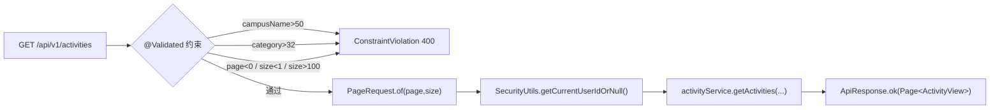

**图表来源**
- [ActivityController.java:51-63](file://apps/api/src/main/java/com/campuslove/api/discover/ActivityController.java#L51-L63)

**章节来源**
- [ActivityController.java:31-107](file://apps/api/src/main/java/com/campuslove/api/discover/ActivityController.java#L31-L107)

### RealActivityService：四路分支的列表查询

`getActivities` 以 `@Transactional(readOnly = true)` 修饰，先用 `hasCampus` / `hasCategory` 两个布尔量（判定条件为 `!= null && !isBlank()`）组合出 4 个分支，每个分支调用一个派生查询方法，状态参数固定为 `ActivityStatus.upcoming`、排序固定为 `OrderByActivityDateAsc`：

| campusName | category | 调用的 Repository 方法 |
| --- | --- | --- |
| 有 | 有 | `findByCampusNameAndStatusAndCategoryOrderByActivityDateAsc` |
| 有 | 无 | `findByCampusNameAndStatusOrderByActivityDateAsc` |
| 无 | 有 | `findByStatusAndCategoryOrderByActivityDateAsc` |
| 无 | 无 | `findByStatusOrderByActivityDateAsc` |

一个必须记录的行为事实：这四个查询都**没有**把实体上的 `published`（上下架）字段作为过滤条件，`published` 只出现在 `ActivityRepository.searchForAdmin` 的 `@Query` 里。也就是说，仓库当前的小程序端活动列表由 `status = upcoming` 单一条件驱动，下架活动不会因为 `published = false` 而从列表接口消失；实体注释中「下架后小程序端活动列表不再展示」的预期在 `RealActivityService` 的查询分支里没有对应实现。

`isEnrolled` 的计算遵循「一次查询、内存判定」：`userId != null` 时调用 `activityEnrollmentRepository.findByUserId(userId)`，用 stream 把 `ActivityEnrollment::getActivityId` 收集成 `Set<Long>`，随后 `activities.map(a -> toActivityView(a, finalEnrolledIds.contains(a.getId())))`。匿名请求（`userId == null`）走 `Collections.emptySet()`，所有条目 `isEnrolled = false`。代码注释给出的动机是「避免逐条 exists N+1」。

**章节来源**
- [RealActivityService.java:44-91](file://apps/api/src/main/java/com/campuslove/api/discover/RealActivityService.java#L44-L91)
- [ActivityRepository.java:25-95](file://apps/api/src/main/java/com/campuslove/api/repository/ActivityRepository.java#L25-L95)
- [ActivityEnrollmentRepository.java:20-24](file://apps/api/src/main/java/com/campuslove/api/repository/ActivityEnrollmentRepository.java#L20-L24)
- [Activity.java:81-90](file://apps/api/src/main/java/com/campuslove/api/entity/Activity.java#L81-L90)

### 详情获取与参与者头像聚合

`getActivityDetail` 的入参校验是「空即抛」：`activityId == null` 抛 `IllegalArgumentException("activityId is required")`；`activityRepository.findById(activityId)` 未命中则抛 `IllegalArgumentException("Activity not found: " + activityId)`。报名状态在这里改用单点判定 `existsByActivityIdAndUserId(activityId, userId)`，仅在 `userId != null` 时执行。

参与者头像聚合不是独立的服务，而是实体的 JSON 列 + 服务侧解析：

- 存储：`Activity.participantAvatars` 映射到列 `participant_avatars`，`columnDefinition = "JSON DEFAULT '[]'"`，Java 侧默认值 `"[]"`。
- 解析：私有方法 `parseParticipantAvatars(String json)`，空或空白直接返回 `Collections.emptyList()`；否则 `objectMapper.readValue(json, new TypeReference<List<String>>() {})`。
- 容错：`catch (JsonProcessingException e)` 返回空列表，**不抛出**。这意味着脏 JSON 会让前端看到「0 个头像」而不是错误响应，排查时容易误判为「没人报名」。
- 落点：`getActivityDetail` 与 `toActivityView` 都调用它，因此列表与详情的头像口径一致。

需要明确的是，`participant_avatars` 是由活动记录自身持有的 JSON 数组，`enrollActivity` 并未向该数组追加报名者头像；仓库中没有「报名时同步写入头像」的实现证据。

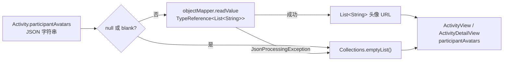

**图表来源**
- [RealActivityService.java:243-258](file://apps/api/src/main/java/com/campuslove/api/discover/RealActivityService.java#L243-L258)
- [Activity.java:72-74](file://apps/api/src/main/java/com/campuslove/api/entity/Activity.java#L72-L74)

**章节来源**
- [RealActivityService.java:93-129](file://apps/api/src/main/java/com/campuslove/api/discover/RealActivityService.java#L93-L129)
- [RealActivityService.java:223-258](file://apps/api/src/main/java/com/campuslove/api/discover/RealActivityService.java#L223-L258)
- [ActivityEnrollmentRepository.java:22-24](file://apps/api/src/main/java/com/campuslove/api/repository/ActivityEnrollmentRepository.java#L22-L24)

### 报名流程：状态校验、重复报名去重与原子计数

`enrollActivity` 标注 `@Transactional`（非只读），执行顺序严格如下：

1. `userId == null` → `IllegalArgumentException("userId is required")`；`activityId == null` → `IllegalArgumentException("activityId is required")`。
2. `activityRepository.findById(activityId)`，未命中抛 `IllegalArgumentException("Activity not found: " + activityId)`。
3. 资格校验：`if (activity.getStatus() == ActivityStatus.ended)` 抛 `IllegalArgumentException(ErrorMessages.ACTIVITY_ENDED_NO_ENROLL)`，代码注释标注编号 `infra R2-00260: 校验活动状态，已结束活动不可报名`。
4. 重复报名短路：`existsByActivityIdAndUserId(activityId, userId)` 为真时，**不抛错**，直接返回 `new ActivityEnrollmentResultView(activityId, true, activity.getEnrollmentCount())`，注释为「已报名，返回当前状态」。这使「重复点击报名」在业务层是幂等的。
5. 写入报名记录：以 `LocalDateTime.now(TimeZones.BUSINESS)` 同时填充 `enrolledAt` 与 `createdAt`，`activityEnrollmentRepository.save(enrollment)`。
6. 人数递增：`activityRepository.incrementEnrollmentCount(activityId)`，随后 `findById` 重新读取 `fresh`，用 `fresh.getEnrollmentCount()` 作为返回值。

第 6 步是本方法最关键的一处并发修复，注释给出理由：`infra R2-00262: 报名人数改为数据库侧原子递增（读-改-写非原子会丢失并发计数），不修改 managed 实体，避免事务提交时脏写覆盖`。对应的 JPQL 是 `UPDATE Activity a SET a.enrollmentCount = a.enrollmentCount + 1 WHERE a.id = :id`，配 `@Modifying`。

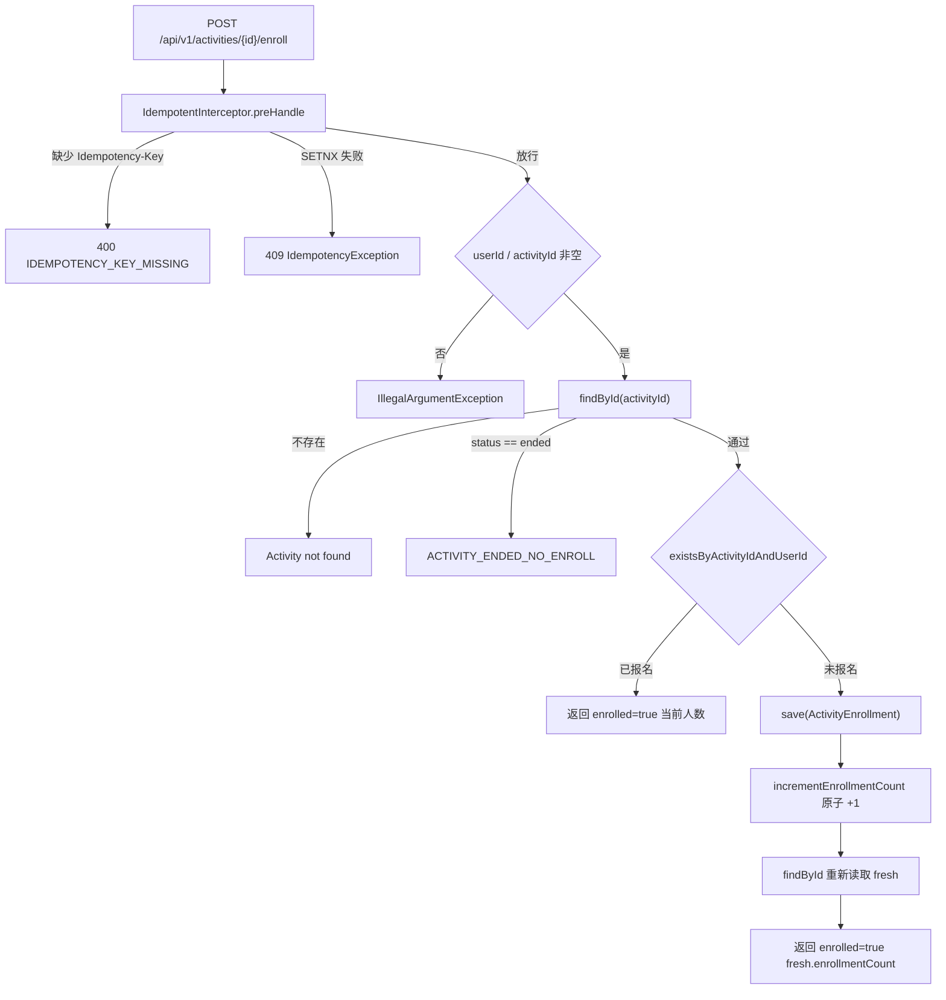

**图表来源**
- [RealActivityService.java:139-179](file://apps/api/src/main/java/com/campuslove/api/discover/RealActivityService.java#L139-L179)
- [IdempotentInterceptor.java:117-201](file://apps/api/src/main/java/com/campuslove/api/common/IdempotentInterceptor.java#L117-L201)
- [ActivityRepository.java:51-53](file://apps/api/src/main/java/com/campuslove/api/repository/ActivityRepository.java#L51-L53)

**章节来源**
- [RealActivityService.java:131-179](file://apps/api/src/main/java/com/campuslove/api/discover/RealActivityService.java#L131-L179)
- [ActivityEnrollment.java:36-45](file://apps/api/src/main/java/com/campuslove/api/entity/ActivityEnrollment.java#L36-L45)

### 取消报名：记录删除与计数下限保护

`cancelEnrollment` 同样标注 `@Transactional`，与报名形成对称但**不完全镜像**的四步：

1. `userId` / `activityId` 空值校验，异常文案与报名一致。
2. `findById(activityId)`，不存在抛 `Activity not found`。注意：取消路径**没有** `ended` 状态校验，已结束活动仍可撤销报名。
3. `findByActivityIdAndUserId(activityId, userId)`；`Optional.isEmpty()` 时不抛错，返回 `new ActivityEnrollmentResultView(activityId, false, activity.getEnrollmentCount())`，注释为「未报名，返回当前状态」——这构成取消侧的幂等。
4. 删除记录 + `activityEnrollmentRepository.delete(...)`，其 `orElseThrow` 分支携带 `IllegalStateException("enrollmentOpt 已确认非空但 orElseThrow 触发，数据不一致")`，属于理论不可达的一致性兜底。
5. `decrementEnrollmentCount(activityId)` 后 `findById` 取 `fresh`。

递减 JPQL 内置下限保护：`UPDATE Activity a SET a.enrollmentCount = CASE WHEN a.enrollmentCount > 0 THEN a.enrollmentCount - 1 ELSE 0 END WHERE a.id = :id`，因此并发取消不会把人数减成负数。

值得记录的口径差异：取消报名**只减计数、不重置记录的时间字段**，且 `deleteByActivityId(Long)` 与 `findByActivityIdOrderByEnrolledAtDesc(...)` 两个方法在本服务的四个方法里均未被调用——它们属于其它调用方（如活动删除与参与者列表）的能力，本页不推断其用法。

**章节来源**
- [RealActivityService.java:181-221](file://apps/api/src/main/java/com/campuslove/api/discover/RealActivityService.java#L181-L221)
- [ActivityRepository.java:55-64](file://apps/api/src/main/java/com/campuslove/api/repository/ActivityRepository.java#L55-L64)
- [ActivityEnrollmentRepository.java:26-28](file://apps/api/src/main/java/com/campuslove/api/repository/ActivityEnrollmentRepository.java#L26-L28)

### 幂等性保护：@Idempotent 与 Redis SETNX

报名与取消报名两个端点都标注 `@Idempotent`（无参，即取默认值 `ttlSeconds = DEFAULT_TTL_SECONDS = 4L * 3600`、`required() = true`）。注解与拦截器分工：

- `@Idempotent`：`@Target(ElementType.METHOD)`、`@Retention(RetentionPolicy.RUNTIME)`，注释明确「仅作用于写操作（POST/PUT/DELETE），GET 请求不应使用本注解」，与控制器只在 `enroll`/`cancelEnrollment` 上标注一致。
- `IdempotentInterceptor`：`@Component` + `@Profile("real")`，实现 `HandlerInterceptor`。常量 `HEADER_IDEMPOTENCY_KEY = "Idempotency-Key"`、`REDIS_KEY_PREFIX = "idempotent:"`、`PLACEHOLDER_VALUE = "1"`、`MAX_KEY_LENGTH = 128`、`ANONYMOUS_USER = "anonymous"`。
- Key 结构：`idempotent:{idempotencyKey}:{userId}`，按用户隔离，注释说明目的是「避免不同用户使用相同 UUID 时误判为重复」。
- 原子操作：`ops.setIfAbsent(redisKey, PLACEHOLDER_VALUE, Duration.ofSeconds(annotation.ttlSeconds()))`，即 `SET key 1 NX EX ttl`。`acquired == false` 时抛 `IdempotencyException("重复请求已被拦截，请勿使用相同的 Idempotency-Key")`。
- 失败释放（R4-00287）：成功 SETNX 后把 key 写入请求属性 `ATTR_ACQUIRED_IDEMPOTENT_KEY`；`afterCompletion` 中若 `response.getStatus() >= 400` 则 `redisTemplate.delete(redisKey)`，注释给出的动机是避免「业务失败后同 key 在 4 小时内被 409 拦截」的锁死；`status < 400` 时保留 key。
- 降级：`redisTemplate == null` 或捕获 `RuntimeException` 时放行并记 warn，除非 `strict && isFundsEndpoint(request)`。**关键结论**：`isFundsEndpoint` 只判定 `/api/v1/wallet/` 与 `/api/v1/vip/` 前缀，活动端点 `/api/v1/activities/**` 不在其中，因此活动报名在 Redis 故障时是**降级放行**（fail-open）而非拒绝。

由此，活动报名的实际防重来自两层：Redis 幂等键（可降级）+ `existsByActivityIdAndUserId` 业务判定（不可降级）。真正的最终一致约束由 `@Version` 乐观锁与事务边界承担。

**章节来源**
- [Idempotent.java:39-65](file://apps/api/src/main/java/com/campuslove/api/common/Idempotent.java#L39-L65)
- [IdempotentInterceptor.java:47-115](file://apps/api/src/main/java/com/campuslove/api/common/IdempotentInterceptor.java#L47-L115)
- [IdempotentInterceptor.java:134-227](file://apps/api/src/main/java/com/campuslove/api/common/IdempotentInterceptor.java#L134-L227)
- [IdempotentInterceptor.java:241-264](file://apps/api/src/main/java/com/campuslove/api/common/IdempotentInterceptor.java#L241-L264)
- [ActivityController.java:85-106](file://apps/api/src/main/java/com/campuslove/api/discover/ActivityController.java#L85-L106)

### 并发控制与状态一致性

仓库为活动域准备的一致性设施有三层，全部有源码证据：

| 层级 | 机制 | 出处 |
| --- | --- | --- |
| 事务 | 列表/详情 `@Transactional(readOnly = true)`；报名/取消 `@Transactional` | `RealActivityService` L58 / L101 / L140 / L190 |
| 数据库侧原子更新 | `incrementEnrollmentCount` / `decrementEnrollmentCount` 用 JPQL `UPDATE` 直改列 | `ActivityRepository` L51-L64 |
| 乐观锁 | `@Version` + `version BIGINT DEFAULT 0` | `Activity` L109-L120、`ActivityEnrollment` L46-L57 |

两个实体都带 `@Version private Long version = 0L`，注释写明「并发更新冲突时抛出 `ObjectOptimisticLockingFailureException`，由 `GlobalExceptionHandler` 转换为 HTTP 409 Conflict」，并溯源到 Flyway `V2026.07.26.0003`。

计数的脏写风险是这套机制存在的具体原因：报名先 `save` 再 `@Modifying` 更新，若在同一事务里改 `activity.setEnrollmentCount(...)`，托管实体在提交时会产生一条覆盖性 `UPDATE`，与原子递增互相打架。源码用两处「不修改 managed 实体」的注释显式规避了这条路径，改完计数后通过 `findById` 重新读取 `fresh` 获得权威值。

参与者计数与报名记录之间没有跨行事务外的补偿任务，因此如果 `delete(enrollment)` 与 `decrementEnrollmentCount` 之间出现异常，`@Transactional` 会整体回滚，二者保持一致；这一点由事务注解保证，而非额外代码。

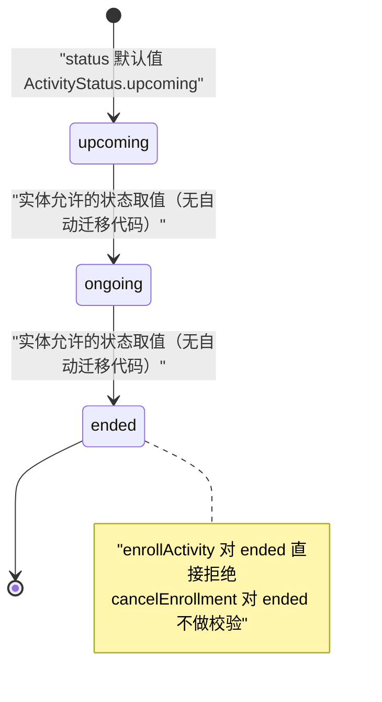

[此图为按实体枚举取值绘制的状态参考，仓库中没有活动状态自动迁移的实现证据，故不提供图表来源]

**章节来源**
- [RealActivityService.java:57-58](file://apps/api/src/main/java/com/campuslove/api/discover/RealActivityService.java#L57-L58)
- [RealActivityService.java:100-101](file://apps/api/src/main/java/com/campuslove/api/discover/RealActivityService.java#L100-L101)
- [RealActivityService.java:139-141](file://apps/api/src/main/java/com/campuslove/api/discover/RealActivityService.java#L139-L141)
- [RealActivityService.java:189-191](file://apps/api/src/main/java/com/campuslove/api/discover/RealActivityService.java#L189-L191)
- [Activity.java:109-120](file://apps/api/src/main/java/com/campuslove/api/entity/Activity.java#L109-L120)
- [ActivityEnrollment.java:46-57](file://apps/api/src/main/java/com/campuslove/api/entity/ActivityEnrollment.java#L46-L57)
- [Activity.java:246-253](file://apps/api/src/main/java/com/campuslove/api/entity/Activity.java#L246-L253)

### MockActivityService：与真实实现的行为差异

Mock 实现 `@Profile("mock")`，数据源是 `MockRuntimeState.activityRecommendations()`（返回 `ActivityRecommendationData` 记录，`id` 为 `String`），报名状态保存在实例字段 `Map<String, Boolean> enrollmentMap = new ConcurrentHashMap<>()`，键格式为 `activityId + "_" + userId`。与真实实现的差异是功能性的，压测或联调时必须知情：

| 维度 | RealActivityService | MockActivityService |
| --- | --- | --- |
| 列表过滤 | campusName / category 四路分支查库 | **完全忽略 `campusName`、`category`、`userId`、`pageable` 的过滤语义**，把全量样本映射后包成 `new PageImpl<>(activities, pageable, activities.size())` |
| 状态取值 | 读 `activity.getStatus().name()` | 硬编码字符串 `"upcoming"` |
| 活动日期 | 读实体 `activityDate` | 硬编码 `LocalDate.now(TimeZones.BUSINESS).plusDays(1)` |
| 分类 / 封面 | 读 `category` / `coverImage` | 硬编码 `"other"` / `null` |
| `isEnrolled`（列表） | 由报名集合判定 | 硬编码 `false` |
| 人数变化 | 数据库原子 +1/-1 | 报名返回 `activity.enrollmentCount() + 1`（**不落库、不累计**）；取消直接返回原始 `enrollmentCount()` |
| 幂等/认证 | 依赖 Redis 与真实登录态 | 仅内存 map，进程重启即丢失 |
| 参数校验 | 校验 `userId` 与 `activityId` | 只校验 `activityId`，`userId == null` 时仍会写入键 `"activityId_null"` |

一处需要特别指出的 Mock 缺陷：`enrollActivity` 里 `int enrollmentCount = activity.enrollmentCount() + 1;` 只作用于返回值，第二次以不同 `Idempotency-Key` 报名同一活动时仍返回原始值 +1，无法用于验证人数递增逻辑。

**章节来源**
- [MockActivityService.java:15-52](file://apps/api/src/main/java/com/campuslove/api/discover/MockActivityService.java#L15-L52)
- [MockActivityService.java:54-118](file://apps/api/src/main/java/com/campuslove/api/discover/MockActivityService.java#L54-L118)
- [RealActivityService.java:59-90](file://apps/api/src/main/java/com/campuslove/api/discover/RealActivityService.java#L59-L90)

### 活动生命周期管理与资格校验的真实边界

 catalog 指令所期望的「活动生命周期管理、参与者资格验证」在本仓库的实现密度是有限的，如实记录如下：

- 生命周期：实体提供 `status`（`upcoming`/`ongoing`/`ended`）、`published`（上下架）、`activityDate`、`createdAt`（`@CreatedDate`，注释定位为「活动发布时间，用于排序展示」）、`updatedAt`（`@LastModifiedDate`）。列表查询以 `activityDate` 升序、`status = upcoming` 为唯一筛选口径；后台以 `createdAt DESC` 排序（`searchForAdmin`）。
- 资格验证：现有唯一一条硬规则是「`ended` 不可报名」。仓库中没有基于 `published`、校区归属、人数上限（容量字段在 `Activity` 实体里不存在）、实名状态的活动报名资格校验代码，因此不存在「名额已满」这类拒绝路径。
- 状态同步：`status` 由外部写入（实体 setter `setStatus`），服务层没有定时任务或事件监听把 `upcoming` 推进为 `ongoing`/`ended`；活动日 `activityDate` 与 `status` 之间也没有推导关系。
- CRUD 覆盖度：小程序端只读 + 报名（无创建/编辑/删除端点）；写能力体现在 `ActivityRepository.searchForAdmin` 所服务的管理后台侧，其注释说明「campusName 精确匹配（数据隔离由调用方注入管辖校区名）」。

**章节来源**
- [Activity.java:76-108](file://apps/api/src/main/java/com/campuslove/api/entity/Activity.java#L76-L108)
- [Activity.java:214-228](file://apps/api/src/main/java/com/campuslove/api/entity/Activity.java#L214-L228)
- [ActivityRepository.java:66-95](file://apps/api/src/main/java/com/campuslove/api/repository/ActivityRepository.java#L66-L95)
- [RealActivityService.java:149-162](file://apps/api/src/main/java/com/campuslove/api/discover/RealActivityService.java#L149-L162)
- [ActivityController.java:51-106](file://apps/api/src/main/java/com/campuslove/api/discover/ActivityController.java#L51-L106)

## 活动数据模型

活动域由两张表承载：`activities`（建表脚本 `V2026.05.24.0004__create_activities.sql`，19 行）与 `activity_enrollments`（建表脚本 `V2026.05.23.0001__create_activity_enrollments.sql`，11 行）。实体 `Activity` 映射 `@Table(name = "activities")`，`ActivityEnrollment` 映射 `@Table(name = "activity_enrollments")`。

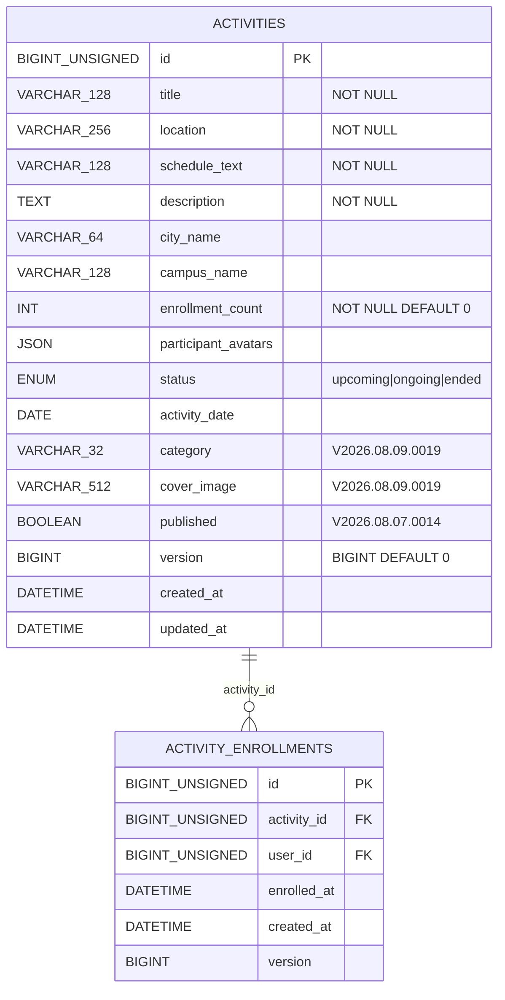

[上述 er 图为按建表脚本与迁移脚本列出的字段整理，`published`/`version`/`category`/`cover_image` 来自后续迁移与实体声明，故图表来源列出下列脚本]

**图表来源**
- [V2026.05.24.0004__create_activities.sql:1-18](file://database/flyway/sql/V2026.05.24.0004__create_activities.sql#L1-L18)
- [V2026.05.23.0001__create_activity_enrollments.sql:1-10](file://database/flyway/sql/V2026.05.23.0001__create_activity_enrollments.sql#L1-L10)
- [V2026.08.09.0019__activity_add_category_cover.sql:12-14](file://database/flyway/sql/V2026.08.09.0019__activity_add_category_cover.sql#L12-L14)
- [Activity.java:81-120](file://apps/api/src/main/java/com/campuslove/api/entity/Activity.java#L81-L120)

### 报名唯一约束：数据库层与代码层的双重防重

`activity_enrollments` 建表即带 `UNIQUE KEY uk_enrollment_activity_user (activity_id, user_id)`，另有 `KEY idx_enrollment_user_id (user_id)` 与 `KEY idx_enrollment_activity_id (activity_id)`。索引补强脚本又追加了一条等价唯一索引 `CALL add_unique_index_if_missing('activity_enrollments', 'uk_activity_enrollments_activity_user', 'activity_id, user_id')`，其上方注释写明意图：「活动报名唯一约束（activity_id + user_id）保证同一用户对同一活动只能报名一次」，并在文件末尾的 DROP 清单里列出对应的回滚语句。

这形成一个明确的分层：**代码层**用 `existsByActivityIdAndUserId` 做「已报名则原样返回」的柔性去重（不抛异常），**数据库层**用唯一键做硬约束。并发同时穿过代码层判空的两个请求，会由唯一键拦下其中一个（`save` 抛出约束冲突），而不是产生两条报名记录。`ActivityEnrollment` 的类注释也复述了这条业务规则：「同一用户对同一活动只能报名一次」。

### 分类与封面：迁移脚本与 i18n 的取值契约

`V2026.08.09.0019__activity_add_category_cover.sql`（23 行）做了三件事：

1. `ALTER TABLE activities ADD COLUMN category VARCHAR(32) NOT NULL DEFAULT 'other' COMMENT '活动分类：social/sports/game/study/volunteer/food/music/other'` 与 `ADD COLUMN cover_image VARCHAR(512) NULL COMMENT '活动封面图 URL（空则前端回退占位图）'`。
2. 8 个分类 code 与前端 i18n 映射对齐，实体注释同样声明「与前端 i18n 的 `activities.category.*` 映射保持一致」。
3. 7 条 `UPDATE` 按标题关键词回填存量数据（`game`/`sports`/`social`/`music`/`study`/`food`/`volunteer`），每条都带 `WHERE category = 'other' AND (title LIKE '%关键词%' OR ...)`，脚本注释标记其「幂等：仅当 category 仍为默认值时更新」。回填是**关键词优先级顺序执行**：同一标题命中多条时，先执行的语句（`game` 最先）胜出，后面的语句因 `category` 已非 `other` 而不再覆盖。

服务层的 `category` 参数直接以字符串精确匹配该列（`findBy...AndCategory...`），不做枚举校验，也不区分大小写之外的任何归一化；控制器只限制长度 `@Size(max = 32)`。因此传入未定义的 code 只会得到空页而不是 400。

### 时间字段口径

- `activity_date DATE`：列表排序键（`ORDER BY activityDate ASC`），也是 `ActivityView.activityDate` / `ActivityDetailView.activityDate` 的来源，Java 侧为 `LocalDate`。
- `enrolled_at DATETIME DEFAULT CURRENT_TIMESTAMP`：报名时刻；`RealActivityService` 不用数据库默认值，而是显式 `LocalDateTime.now(TimeZones.BUSINESS)` 写入，同一时刻也写入 `created_at`，两者取值相同。
- `created_at` / `updated_at`：实体侧由 `@CreatedDate` / `@LastModifiedDate` + `@EntityListeners(AuditingEntityListener.class)` 维护；数据库侧 `updated_at` 另有 `ON UPDATE CURRENT_TIMESTAMP` 兜底。

**章节来源**
- [V2026.05.24.0004__create_activities.sql:1-18](file://database/flyway/sql/V2026.05.24.0004__create_activities.sql#L1-L18)
- [V2026.05.23.0001__create_activity_enrollments.sql:1-11](file://database/flyway/sql/V2026.05.23.0001__create_activity_enrollments.sql#L1-L11)
- [V2026.07.28.0005__add_indexes.sql:192-197](file://database/flyway/sql/V2026.07.28.0005__add_indexes.sql#L192-L197)
- [V2026.07.28.0005__add_indexes.sql:418-424](file://database/flyway/sql/V2026.07.28.0005__add_indexes.sql#L418-L424)
- [V2026.08.09.0019__activity_add_category_cover.sql:1-23](file://database/flyway/sql/V2026.08.09.0019__activity_add_category_cover.sql#L1-L23)
- [Activity.java:19-120](file://apps/api/src/main/java/com/campuslove/api/entity/Activity.java#L19-L120)
- [ActivityEnrollment.java:15-57](file://apps/api/src/main/java/com/campuslove/api/entity/ActivityEnrollment.java#L15-L57)
- [RealActivityService.java:164-171](file://apps/api/src/main/java/com/campuslove/api/discover/RealActivityService.java#L164-L171)

## 配置与开关

活动管理没有专属的配置类，其运行形态由 5 个既有开关决定，全部有源码出处：

| 开关 | 类型与位置 | 取值 | 对活动域的作用 |
| --- | --- | --- | --- |
| Spring Profile | `@Profile("real")` / `@Profile("mock")` 分别标注 `RealActivityService`、`MockActivityService` | `real` / `mock` | 决定活动四条链路走数据库还是内存样本；二者互斥，profile 缺失会因无 `ActivityService` bean 而使控制器构造失败 |
| `Idempotent#ttlSeconds` | 注解默认值 `DEFAULT_TTL_SECONDS = 4L * 3600` | 报名/取消均未覆写，取 4 小时 | 同一 `Idempotency-Key` 在 4 小时内只允许成功执行一次（业务失败会被 `afterCompletion` 提前释放） |
| `Idempotent#required` | 注解默认 `true` | `true` | 报名/取消必须携带 `Idempotency-Key` 头，缺失即拒绝 |
| `app.security.idempotency.strict` | `@Value("${app.security.idempotency.strict:${APP_IDEMPOTENCY_STRICT:true}}")` | 默认 `true` | Redis 不可用时仅对 `/api/v1/wallet/**`、`/api/v1/vip/**` fail-closed；活动端点不在名单内，恒为降级放行 |
| 分页上限 | `@Min(1) @Max(100)` 作用于 `size` | 1–100 | 单次列表请求的最大条数 |

另有三个以常量形式硬编码在代码里的「参数」，调整需改源码：`IdempotentInterceptor.MAX_KEY_LENGTH = 128`、`PLACEHOLDER_VALUE = "1"`、`ANONYMOUS_USER = "anonymous"`；服务侧 `PageRequest.of(0, 10)`（活动推荐固定取前 10 条）与 `ActivityRepository` 无默认排序兜底；前端 `DEFAULT_PAGE_SIZE = 10`、`ACTIVITIES_TTL_MS = 30_000`。

时间基准不是配置项而是常量：`RealActivityService` 与 `MockActivityService` 都以 `LocalDateTime.now(TimeZones.BUSINESS)` / `LocalDate.now(TimeZones.BUSINESS)` 取时，报名时间与 Mock 的活动日期都建立在这一时区口径上。

**章节来源**
- [RealActivityService.java:27-29](file://apps/api/src/main/java/com/campuslove/api/discover/RealActivityService.java#L27-L29)
- [MockActivityService.java:19-21](file://apps/api/src/main/java/com/campuslove/api/discover/MockActivityService.java#L19-L21)
- [Idempotent.java:43-64](file://apps/api/src/main/java/com/campuslove/api/common/Idempotent.java#L43-L64)
- [IdempotentInterceptor.java:54-115](file://apps/api/src/main/java/com/campuslove/api/common/IdempotentInterceptor.java#L54-L115)
- [IdempotentInterceptor.java:87-89](file://apps/api/src/main/java/com/campuslove/api/common/IdempotentInterceptor.java#L87-L89)
- [ActivityController.java:57-58](file://apps/api/src/main/java/com/campuslove/api/discover/ActivityController.java#L57-L58)
- [RealActivityService.java:165-165](file://apps/api/src/main/java/com/campuslove/api/discover/RealActivityService.java#L165-L165)

## 缓存与索引优化策略

### 后端缓存：活动链路目前没有命中

推荐域确实有 Redis Spring Cache 基础设施，但它挂在「人推荐」上：`RecommendationCacheManager` 通过 `@Cacheable` 缓存 `getCachedRecommendations` 结果，key 为 `userId`，TTL 由 `CacheNames.MATCH_RECOMMEND` 决定（注释标注默认 5 分钟），并用 `unless` 条件排除 null 与空列表以避免缓存穿透；游客推荐另用固定 key `guest:v1`、TTL 60 秒（`CacheNames.GUEST_RECOMMEND`）。

活动侧的证据边界要划清楚：`RealRecommendationService.getActivities()` 上只有 `@Override` 与 `@Transactional(readOnly = true)` 两个注解，方法体直接 `activityRepository.findByStatusOrderByActivityDateAsc(ActivityStatus.upcoming, PageRequest.of(0, 10)).getContent()`；`RealActivityService` 的四个方法同样只有事务注解，全类未出现 `@Cacheable` / `@CacheEvict`。因此**当前仓库中活动查询没有服务端结果缓存**，`enrollment_count` 的变更即时可见；上文的人推荐缓存失效链路（`evictRecommendationCache`、`@CacheEvict` 由 `UserPreferenceCalculator` 调用）也不以活动为触发源。

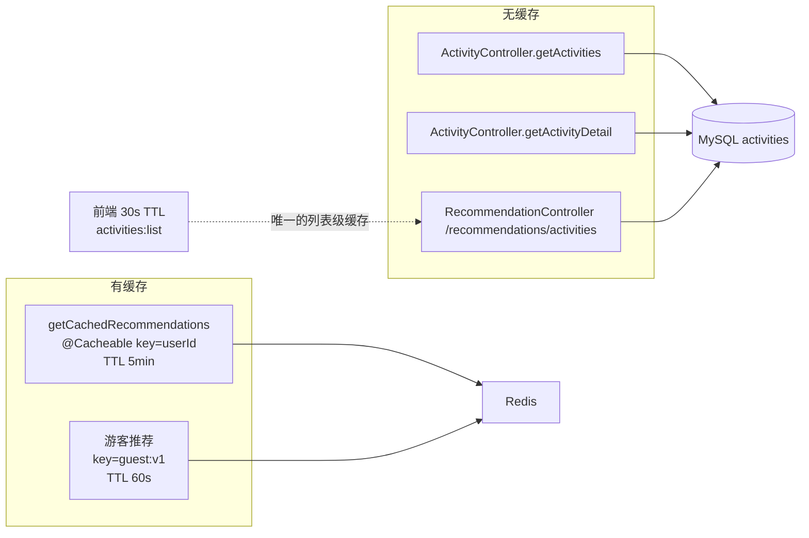

[此图把「缓存层是否存在」作为唯一区分维度，无缓存分支的依据是上述注解缺失，故图表来源见下]

**图表来源**
- [RecommendationCacheManager.java:18-24](file://apps/api/src/main/java/com/campuslove/api/discover/RecommendationCacheManager.java#L18-L24)
- [RecommendationCacheManager.java:130-136](file://apps/api/src/main/java/com/campuslove/api/discover/RecommendationCacheManager.java#L130-L136)
- [RealRecommendationService.java:224-235](file://apps/api/src/main/java/com/campuslove/api/discover/RealRecommendationService.java#L224-L235)
- [RealActivityService.java:57-59](file://apps/api/src/main/java/com/campuslove/api/discover/RealActivityService.java#L57-L59)

### 索引：与查询形状一一对应

`activities` 建表带两条索引：`KEY idx_activities_status (status)`、`KEY idx_activities_date (activity_date)`。把它们和实际查询对照，可以看清优化是否到位：

| 实际查询（服务层） | WHERE 条件 | ORDER BY | 可用索引 |
| --- | --- | --- | --- |
| `findByStatusOrderByActivityDateAsc` | `status = 'upcoming'` | `activity_date ASC` | `idx_activities_status` + `idx_activities_date`，与排序键同向，是分页最优路径 |
| `findByCampusNameAndStatusOrderByActivityDateAsc` | `campus_name = ?` + `status` | `activity_date ASC` | 建表脚本中**没有** `campus_name` 索引，需回表过滤 |
| `findByCampusNameAndStatusAndCategoryOrderByActivityDateAsc` | `campus_name` + `status` + `category` | `activity_date ASC` | 同上，`category` 也无独立索引 |
| `searchForAdmin` | 标题 `LIKE '%kw%'` + status + published + campus_name + category | `created_at DESC` | 前置通配的 `LIKE` 无法走索引；`created_at` 亦无索引 |

索引补强脚本 `V2026.07.28.0005__add_indexes.sql`（453 行）用存储过程 `add_index_if_missing` / `add_unique_index_if_missing` 做「存在即跳过」的幂等加索引，对活动域只补了报名表的唯一约束一条：`CALL add_unique_index_if_missing('activity_enrollments', 'uk_activity_enrollments_activity_user', 'activity_id, user_id')`，并在文件末尾的可回滚 DROP 清单中登记；该清单同时列出 `idx_post_likes_post_created` 等相邻表的索引，说明活动侧未新增普通二级索引。

报名表的三条索引则与报名读路径完全吻合：`idx_enrollment_user_id` 支撑 `findByUserId`（列表 `isEnrolled` 批量计算），`idx_enrollment_activity_id` 与 `uk_enrollment_activity_user` 支撑 `existsByActivityIdAndUserId` / `findByActivityIdAndUserId`，唯一键同时兜住并发重复报名。

**章节来源**
- [V2026.05.24.0004__create_activities.sql:15-18](file://database/flyway/sql/V2026.05.24.0004__create_activities.sql#L15-L18)
- [V2026.05.23.0001__create_activity_enrollments.sql:7-10](file://database/flyway/sql/V2026.05.23.0001__create_activity_enrollments.sql#L7-L10)
- [V2026.07.28.0005__add_indexes.sql:192-197](file://database/flyway/sql/V2026.07.28.0005__add_indexes.sql#L192-L197)
- [ActivityRepository.java:25-95](file://apps/api/src/main/java/com/campuslove/api/repository/ActivityRepository.java#L25-L95)
- [ActivityEnrollmentRepository.java:18-26](file://apps/api/src/main/java/com/campuslove/api/repository/ActivityEnrollmentRepository.java#L18-L26)
- [RecommendationCacheManager.java:18-24](file://apps/api/src/main/java/com/campuslove/api/discover/RecommendationCacheManager.java#L18-L24)

## 前端接入与状态管理

### activity store：结构与三处并发防护

小程序侧活动状态的唯一容器是 `apps/client/src/stores/activity.ts` 中的 `useActivityStore`，以 `defineStore("activity", { state, getters, actions })` 的 Options 形式声明（与 `discover` store 的 setup 形式不同）。状态字段：`activities: ActivityItem[]`、`loading`、`enrolling`、`enrollingActivityIds: Set<string>`、`errorMessage`、`page`（注释明确「从 1 开始」）、`pageSize: DEFAULT_PAGE_SIZE = 10`、`hasMore`；唯一 getter 是 `hasActivities()`（`activities.length > 0`）。

`ActivityItem` 与后端视图不是同名同构，映射由 `mapToActivityItem(raw)` 完成：`date` 取 `raw.date ?? ""`、`enrollCount` 与 `enrollmentCount` 互为回退（`raw.enrollCount ?? raw.enrollmentCount ?? 0` 与反向各写一次）、`participantAvatars ?? []`、`isEnrolled ?? false`、`category ?? "other"`、`coverImage ?? undefined`。两个人数字段是同一业务的兼容别名，代码里以 `R4-00182` 注释要求「两字段同步更新」，任何一侧漏改都会造成 UI 与 API 读数不一致。

报名链路上的并发防护有三层，全部可在该文件内定位：

1. store 级在途守卫：`enrollActivity` 入口先 `if (this.enrollingActivityIds.has(activityId)) return false;`，随后 `add(activityId)`，`finally` 中 `delete(activityId)`，注释标注为「并发守卫——同一活动在途的报名/取消请求未完成时拒绝再次提交，避免快速连点触发多次报名/取消请求导致状态错乱」。
2. 幂等键唯一化：请求头 `Idempotency-Key` 取 `activity-enroll-${activityId}-${opSeq}` 或 `activity-cancel-${activityId}-${opSeq}`，`opSeq = ${Date.now()}-${Math.random().toString(36).slice(2, 8)}`。文件里的修复注释（2026-08-09）解释了为什么必须带操作序号：若沿用固定 key，「取消成功后重新报名」这一新业务操作会被后端 4 小时 TTL 的幂等缓存拦成 409，用户看到「已参与过无法再参与」。
3. 身份剥离：注释 `P2-13` 说明报名/取消的 `userId` 一律由后端 JWT 取得，客户端既不发 body 也不发 query，因此请求体为空、路径即全部入参。

列表与详情的读路径：

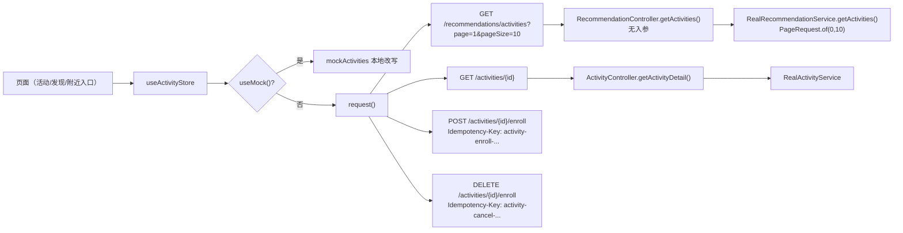

**图表来源**
- [activity.ts:168-243](file://apps/client/src/stores/activity.ts#L168-L243)
- [activity.ts:286-311](file://apps/client/src/stores/activity.ts#L286-L311)
- [activity.ts:336-351](file://apps/client/src/stores/activity.ts#L336-L351)
- [RecommendationController.java:151-154](file://apps/api/src/main/java/com/campuslove/api/discover/RecommendationController.java#L151-L154)
- [RealRecommendationService.java:224-235](file://apps/api/src/main/java/com/campuslove/api/discover/RealRecommendationService.java#L224-L235)
- [ActivityController.java:72-76](file://apps/api/src/main/java/com/campuslove/api/discover/ActivityController.java#L72-L76)

三处需要在维护时明确的口径不一致（均为源码可直接核对的结果）：

- **列表走的是推荐端点，不是 `ActivityController` 的列表方法。** `fetchActivities` / `fetchMoreActivities` 请求 `/recommendations/activities`，其服务端实现是 `RecommendationController.getActivities()`（方法签名无参数）+ `RealRecommendationService.getActivities()` 固定 `PageRequest.of(0, 10)`。因此 store 传出的 `page` / `pageSize` 在该链路上**不生效**；`ActivityController.getActivities` 支持的 `campusName`、`category`、`size` 三个筛选参数，小程序活动列表当前没有任何调用点使用（`apps/client/src` 全量检索 `/activities` 只命中详情与报名两类 URL）。
- **`hasMore` 的判据是 `data.length >= this.pageSize`。** 后端恒返回至多 10 条，当恰好 10 条时 `hasMore` 保持 `true`，`fetchMoreActivities` 会再次拉到同一批 10 条并 `[...this.activities, ...mapped]` 追加。分页在推荐链路上没有可用锚点，store 的注释也确认过此前「原实现未将 nextPage 传递给后端，每次都请求第一页数据，导致分页失效」，修复只解决了参数传递，未解决服务端不分页。
- **详情映射丢弃了 `category` 与 `coverImage`。** `fetchActivityDetail` 的内联响应类型只声明到 `isEnrolled`，返回对象里也没有这两个字段；而后端 `ActivityDetailView` 明确携带它们（注释写明供详情页展示分类标签与封面）。详情页要用分类/封面需从列表数据取，不能指望详情接口映射。

### 前端缓存与刷新

列表新鲜度窗口是 `ACTIVITIES_TTL_MS = 30_000`（30 秒），文件注释标注动机为「2026-08-10 切换提速：活动列表 30s TTL 缓存（home/village/discover 多入口去重）」，实现是 `isCacheFresh('activities:list', ACTIVITIES_TTL_MS)` + 成功后 `setCachedValue("activities:list", true)`。短路条件同时要求 `!force && !useMock() && this.activities.length > 0`，注释 `MP-R1-PAGES-NEARBY-INDEX-003` 说明 `force = true`（下拉刷新/登录补拉）绕过 TTL 与空列表短路。这是活动域唯一实际生效的缓存层。

### 跨模块入口

活动卡还内嵌在帖子卡片中：`components/village/PostCard.vue` 以 `v-if="post.activity"` 渲染 `<ActivityCard :activity="post.activity" compact @open-detail="openActivity" @enroll="openActivity" />`，并在 `open-activity` 事件里把 `string | number` 归一为 `number`；该文件注释记录了 `MP-R1-PAGES-NEARBY-INDEX-012` 的修复——此前内嵌 ActivityCard 的「报名」按钮 emit 无监听（no-op 死按钮），现在复用 `open-activity` 链路跳活动详情。也就是说帖子里点「报名」并不会直接调用报名接口，而是跳转详情页再报名。

**章节来源**
- [activity.ts:1-17](file://apps/client/src/stores/activity.ts#L1-L17)
- [activity.ts:19-41](file://apps/client/src/stores/activity.ts#L19-L41)
- [activity.ts:120-158](file://apps/client/src/stores/activity.ts#L120-L158)
- [activity.ts:168-201](file://apps/client/src/stores/activity.ts#L168-L201)
- [activity.ts:211-243](file://apps/client/src/stores/activity.ts#L211-L243)
- [activity.ts:252-321](file://apps/client/src/stores/activity.ts#L252-L321)
- [activity.ts:328-406](file://apps/client/src/stores/activity.ts#L328-L406)
- [PostCard.vue:215-218](file://apps/client/src/components/village/PostCard.vue#L215-L218)
- [PostCard.vue:108-111](file://apps/client/src/components/village/PostCard.vue#L108-L111)
- [ActivityDetailView.java:6-25](file://apps/api/src/main/java/com/campuslove/api/discover/ActivityDetailView.java#L6-L25)

## 依赖关系分析

### ActivityService 的三个消费方

`ActivityService` 并不只服务于活动控制器，检索 `activityService.` 的调用点得到 3 处生产代码，各自的入参组合揭示了校区/分类筛选的真实使用情况：

| 调用方 | 调用形式 | 校区来源 | 分页 |
| --- | --- | --- | --- |
| `ActivityController.getActivities` | `getActivities(campusName, category, userId, PageRequest.of(page, size))` | 请求参数 | 前端可控，`size` ≤ 100 |
| `CampusController.getCampusActivities` | `getActivities(campusName, null, userId, PageRequest.of(0, 50))` | 由 `campusProfileRepository.findByUserId(userId)` 取用户绑定校区，未绑定为 `null` | 固定前 50 条 |
| `RealHomeService` | `getActivities(null, null, null, PageRequest.of(0, MAX_ACTIVITY_COUNT))` | 不过滤 | 常量上限，匿名口径（`userId = null` → 全部 `isEnrolled = false`） |

`CampusController` 的方法注释记录了该端点的由来：前端 `stores/campus.ts` 的 `fetchCampusActivities()` 调用 `GET /api/v1/campus/activities`，「后端此前无此端点返回 404」，修复方式是复用 `ActivityService` 的 upcoming 数据并按前端 `CampusActivity` 接口对齐，返回裸数组（`List<CampusActivityListItemView>`）而非 `ApiResponse` 包装。这是「校区关联」真正落地的地方——不是通过 `/api/v1/activities?campusName=`，而是通过校区端点在服务内部注入校区。

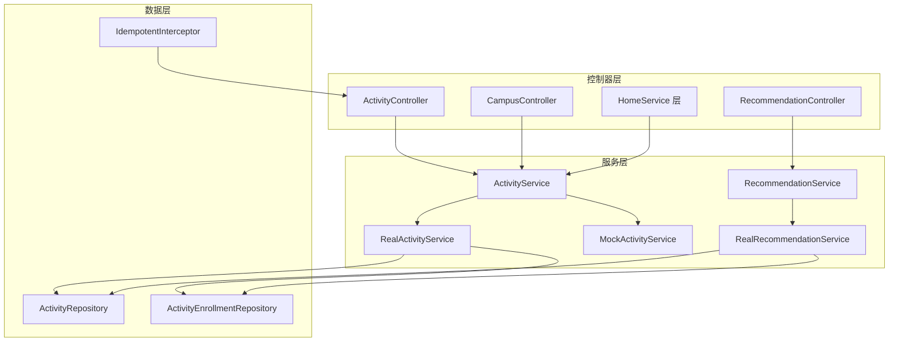

**图表来源**
- [ActivityController.java:36-63](file://apps/api/src/main/java/com/campuslove/api/discover/ActivityController.java#L36-L63)
- [CampusController.java:298-306](file://apps/api/src/main/java/com/campuslove/api/campus/CampusController.java#L298-L306)
- [RealHomeService.java:276-276](file://apps/api/src/main/java/com/campuslove/api/home/RealHomeService.java#L276-L276)
- [RealActivityService.java:31-42](file://apps/api/src/main/java/com/campuslove/api/discover/RealActivityService.java#L31-L42)
- [RecommendationController.java:151-154](file://apps/api/src/main/java/com/campuslove/api/discover/RecommendationController.java#L151-L154)
- [RealRecommendationService.java:101-120](file://apps/api/src/main/java/com/campuslove/api/discover/RealRecommendationService.java#L101-L120)
- [IdempotentInterceptor.java:47-49](file://apps/api/src/main/java/com/campuslove/api/common/IdempotentInterceptor.java#L47-L49)

### 第二条报名实现：RecommendationService.enrollActivity

活动报名在服务层存在**两套并行实现**，口径不同：

| 维度 | `RealActivityService.enrollActivity` / `cancelEnrollment` | `RealRecommendationService.enrollActivity(activityId, enrolled, userId)` |
| --- | --- | --- |
| 入参 | `(Long userId, Long activityId)`，报名与取消拆成两个方法 | `(String activityId, boolean enrolled, Long userId)`，一个方法用布尔量双向切换 |
| ID 处理 | 直接 `Long` | `Long.parseLong` + `NumberFormatException` → `IllegalArgumentException("Invalid activityId format: ...")` |
| `ended` 校验 | 有（`ACTIVITY_ENDED_NO_ENROLL`） | 检索其报名分支未见 `ActivityStatus.ended` 判定 |
| 计数写入 | `activityRepository.incrementEnrollmentCount` | `entityManager.createQuery("UPDATE Activity a SET a.enrollmentCount = a.enrollmentCount + 1, a.updatedAt = :now WHERE a.id = :activityId").executeUpdate()`，随后 `entityManager.detach(activity)` 再 `findById` 重查 |
| `updatedAt` | 不显式设置（由 JPA 审计维护） | 显式 `activity.setUpdatedAt(now)` |
| 单元测试旁路 | 无 | `entityManager == null`（测试直接 `new`）时回退为实体读-改-写 `activity.setEnrollmentCount(+1)` |
| 埋点 | 无 | 注释 `R4-00327：社交升温漏斗埋点——活动参与（L6_SCENE 计数）；埋点失败不影响报名主流程（仅记录日志）` |
| 返回视图 | `ActivityEnrollmentResultView(Long activityId, boolean enrolled, int enrollmentCount)` | `ActivityEnrollmentView(String activityId, boolean enrolled, int enrollmentCount)` |
| HTTP 暴露 | 有（`POST`/`DELETE /api/v1/activities/{id}/enroll`） | **无**：`RecommendationService` 接口声明了该方法，但 `RecommendationController` 内没有任何 `@*Mapping` 调用它；`record EnrollRequest(boolean enrolled)` 在该控制器中声明后同样未被任何方法参数引用 |

`infra R2-00239` 注释解释了 `detach` 的必要性：bulk UPDATE 后若不 detach 并重查实体，事务提交时 flush 会用陈旧值覆盖原子递增结果（脏写覆盖）。`FIN-00040` 注释则记录了从读-改-写迁移到数据库侧原子递增的原因。两套实现的注释编号体系不同，说明它们来自不同的缺陷修复批次。

**章节来源**
- [RealRecommendationService.java:237-301](file://apps/api/src/main/java/com/campuslove/api/discover/RealRecommendationService.java#L237-L301)
- [RealRecommendationService.java:222-235](file://apps/api/src/main/java/com/campuslove/api/discover/RealRecommendationService.java#L222-L235)
- [RecommendationService.java:25-35](file://apps/api/src/main/java/com/campuslove/api/discover/RecommendationService.java#L25-L35)
- [RecommendationController.java:655-690](file://apps/api/src/main/java/com/campuslove/api/discover/RecommendationController.java#L655-L690)
- [RealActivityService.java:139-179](file://apps/api/src/main/java/com/campuslove/api/discover/RealActivityService.java#L139-L179)

### 活动推荐的排序口径

`RealRecommendationService.getActivities()` 的注释块标注为 `// ---- 活动推荐 ----`，其实现是 `findByStatusOrderByActivityDateAsc(ActivityStatus.upcoming, PageRequest.of(0, 10)).getContent()` 后 `map(this::toActivityRecommendationView)`。类文档注释里写的是「返回基于用户偏好与报名热度的活动推荐」，但代码路径中既没有注入 `RecommendationStrategy`/`RecommendationRanker` 到这条方法，也没有按 `enrollmentCount` 排序的比较器——它复用的是与活动列表相同的「状态 + 活动日期升序」查询。

结论要如实写：**热门活动排序（按报名人数）与个性化活动推荐在本仓库尚无实现证据**，`/recommendations/activities` 目前返回的是「未来 10 条 upcoming 活动、按日期升序」，对所有用户一致。`RecommendationRanker`（1039 行）与 `RecommendationStrategy` 服务的是人推荐链路（`rankAndConvert(RecommendationStrategy.RecommendResult)`、`buildHeatLabel(Integer replyCount, int likesCount)` 等），未出现在活动读路径中。视图 `ActivityRecommendationView` 只带 `enrollmentCount` 与 `participantAvatars`，热度信息交由前端自行展示。

**章节来源**
- [RealRecommendationService.java:222-235](file://apps/api/src/main/java/com/campuslove/api/discover/RealRecommendationService.java#L222-L235)
- [RealRecommendationService.java:622-624](file://apps/api/src/main/java/com/campuslove/api/discover/RealRecommendationService.java#L622-L624)
- [RecommendationController.java:143-154](file://apps/api/src/main/java/com/campuslove/api/discover/RecommendationController.java#L143-L154)
- [RecommendationController.java:655-664](file://apps/api/src/main/java/com/campuslove/api/discover/RecommendationController.java#L655-L664)
- [RecommendationRanker.java:384-417](file://apps/api/src/main/java/com/campuslove/api/discover/RecommendationRanker.java#L384-L417)
- [RecommendationRanker.java:757-777](file://apps/api/src/main/java/com/campuslove/api/discover/RecommendationRanker.java#L757-L777)

### OpenAPI 契约与实现的偏差

`docs/openapi/recommendations.yaml` 里活动相关只有 3 个 path：`/recommendations/activities`（`operationId: getActivities`，200 返回 `ActivityRecommendationView` 数组，`security: bearerAuth`）、`/activities/{id}/enroll`（`operationId: enrollActivity`，**`requestBody.required: true`**，schema 为 `EnrollRequest`，`id` 类型 `string`）、`/activities/{id}`（`operationId: getActivityDetail`，`id` 类型 `string`，声明 404 响应）。

与实现对照可得出四点偏差：文档中的 `enroll` 只有一个 `POST` 且要求 body，实现是「无 body 的 `POST` 报名 + 无 body 的 `DELETE` 取消」；`id` 文档为 `string`，实现为 `@Positive Long`；文档没有 `GET /activities` 列表路径，因而控制器列表端点的 `campusName`/`category`/`page`/`size` 与 `@Size`/`@Min`/`@Max` 校验均未对外契约化；文档声明 `404`，而实现抛 `IllegalArgumentException`（由全局异常处理转换），并非 `ResponseStatus(NOT_FOUND)`。`doc/CHANGELOG.md` 记录了这份 spec 曾做过一次对齐（「删除不存在的 `/recommendations/cards*`，补 `/recommendations`、`/quota`、`/discussions`、`/activities`、`/history`…」，条目 R4-00163/R4-00344），说明偏差是被部分修正过但仍未收敛。

**章节来源**
- [recommendations.yaml:205-224](file://docs/openapi/recommendations.yaml#L205-L224)
- [recommendations.yaml:325-379](file://docs/openapi/recommendations.yaml#L325-L379)
- [ActivityController.java:51-106](file://apps/api/src/main/java/com/campuslove/api/discover/ActivityController.java#L51-L106)

## 性能考虑

以下每条都对应源码中可数出的语句或可确认的分支，不做泛化建议。

### 列表接口的读放大与 N+1 消除

`getActivities` 的数据库语句数是固定的 2 条：1 条活动分页查询 + 1 条 `findByUserId` 报名查询，随后 `activities.map(...)` 在 `Page` 上做惰性转换，不会额外发起查询。这是注释「避免逐条 exists N+1」所换来的效果——相对逐条 `existsByActivityIdAndUserId`，最坏情况下省掉 `size` 条查询（默认 20、上限 100）。

代价是读放大的方向变了：`findByUserId` 返回该用户**全部**报名记录的实体列表，再在内存 `stream().map(getActivityId).collect(toSet())`。它不受 `pageable` 限制，也不 select 投影，因此一个报名了 N 个活动的用户每次刷列表都要传输 N 行完整实体。这条路径只用到 `activity_id` 一个字段，索引 `idx_enrollment_user_id` 能覆盖定位，但实体列仍需回表。

### 单次报名的请求成本

`enrollActivity` 在一个事务里最多发起 5 条语句：`findById`（活动存在性）、`existsByActivityIdAndUserId`（去重）、`save`（报名记录）、`incrementEnrollmentCount`（bulk UPDATE）、`findById`（重取 `fresh`）。取消路径同为 5 条（`findById`、`findByActivityIdAndUserId`、`delete`、`decrementEnrollmentCount`、`findById`）。

第 5 条 `findById` 是正确性成本而非冗余：bulk UPDATE 不清空一级缓存，必须重取才能返回权威人数，`RealRecommendationService` 用 `entityManager.detach(activity)` 达到同一目的。两个方法都在 `@Transactional` 内且**不**是 `readOnly`，因此并发报名会在唯一键上排队，`incrementEnrollmentCount` 的 `UPDATE` 会对活动行加行锁——高并发报名同一活动时，行锁序列就是吞吐上限。

### 每请求重复的 JSON 解析

`parseParticipantAvatars` 对每个活动条目调用一次 `objectMapper.readValue`，且没有服务端缓存层可复用（活动链路无 `@Cacheable`）。一页 20 条、每条头像数组长度 m 时，每请求执行 20 次 JSON 解析。异常分支返回空列表而不缓存失败结果，因此脏 JSON 会在每次请求重复触发解析与捕获开销。

### 分页深翻与前端重复

后端 `PageRequest.of(page, size)` 在 Spring Data 分页下会附带 count 查询并执行 offset 扫描，`size` 已被 `@Max(100)` 约束，但 `page` 只受 `@Min(0)` 约束、无上限。前端 store 的 `page` 从 1 开始且 `fetchMoreActivities` 会持续 `+1`；由于推荐端点忽略 `page`，实际行为是「不断重复取前 10 条并 append」，属于必须优先修的功能缺陷，同时也是内存与渲染开销的增长点。

### 已有的性能验证面

`P2PerformanceBenchmark` 对活动链路只做了一件事：以 `buildMockActivities(50)` 反射构造 50 个 `ActivityRecommendationView`（7 参构造：五个 `String` + `int` + `List`），通过 `when(recommendationService.getActivities()).thenAnswer(...)` 桩进 `RecommendationController`，先 warm up 5 次再用 `System.nanoTime()` 计 `ITERATIONS` 次调用耗时。也就是说，被计时的是**控制器方法本身的调用开销，不含数据库与序列化**；`ActivityController` 的四个方法不在该基准覆盖范围内。

测试面同样偏薄：`ActivityControllerTest` 全文 36 行，只有 `constructor_shouldAcceptService` 与 `controller_shouldHaveServiceInjected` 两个 `assertNotNull` 断言，`@Mock private ActivityService activityService` 从未被 stub 或 verify，因此路由、校验注解、`isEnrolled` 批量计算、原子计数这四类行为都没有回归保护。`RealActivityService` 也没有对应的测试类。

**章节来源**
- [RealActivityService.java:57-91](file://apps/api/src/main/java/com/campuslove/api/discover/RealActivityService.java#L57-L91)
- [RealActivityService.java:139-179](file://apps/api/src/main/java/com/campuslove/api/discover/RealActivityService.java#L139-L179)
- [RealActivityService.java:189-221](file://apps/api/src/main/java/com/campuslove/api/discover/RealActivityService.java#L189-L221)
- [RealActivityService.java:243-258](file://apps/api/src/main/java/com/campuslove/api/discover/RealActivityService.java#L243-L258)
- [ActivityRepository.java:51-64](file://apps/api/src/main/java/com/campuslove/api/repository/ActivityRepository.java#L51-L64)
- [ActivityController.java:57-59](file://apps/api/src/main/java/com/campuslove/api/discover/ActivityController.java#L57-L59)
- [activity.ts:211-243](file://apps/client/src/stores/activity.ts#L211-L243)
- [P2PerformanceBenchmark.java:82-84](file://apps/api/src/test/java/com/campuslove/api/P2PerformanceBenchmark.java#L82-L84)
- [P2PerformanceBenchmark.java:153-167](file://apps/api/src/test/java/com/campuslove/api/P2PerformanceBenchmark.java#L153-L167)
- [P2PerformanceBenchmark.java:330-340](file://apps/api/src/test/java/com/campuslove/api/P2PerformanceBenchmark.java#L330-L340)
- [ActivityControllerTest.java:13-36](file://apps/api/src/test/java/com/campuslove/api/discover/ActivityControllerTest.java#L13-L36)

## 故障排查指南

### 按现象定位

| 现象 | 根因（源码位置） | 核对方法 |
| --- | --- | --- |
| 报名返回 409「重复请求已被拦截，请勿使用相同的 Idempotency-Key」 | `IdempotentInterceptor.preHandle` 中 `setIfAbsent` 返回 false（`IdempotentInterceptor.java` L184-L193）；键 TTL 为 4 小时 | 比对两次请求的 `Idempotency-Key` 是否相同；前端应带 `opSeq`（`activity.ts` L286-L305） |
| 报名返回 400 且提示缺少幂等键 | `annotation.required()` 默认 `true`，空/缺失即抛 `InvalidOperationException(ErrorMessages.IDEMPOTENCY_KEY_MISSING)`（L145-L153） | 检查请求头是否含非空 `Idempotency-Key`，长度 ≤ 128（L140-L143） |
| 明明业务失败了，重试仍被 409 拦 | 应为已修复项：`afterCompletion` 在 `response.getStatus() >= 400` 时 `delete(redisKey)`（L241-L264） | 若仍复现，检查 `redisTemplate == null` 早退分支（L244-L246）与释放失败的 warn 日志 |
| 传了 `campusName` 但列表没变化 | 小程序列表请求的是 `/recommendations/activities`，该端点方法签名无参数（`RecommendationController.java` L152），校区只在 `CampusController.getCampusActivities` 内部由用户绑定注入（L299-L305） | 直接请求 `GET /api/v1/activities?campusName=X` 验证服务层过滤是否生效 |
| 分页「加载更多」出现重复活动 | 服务端 `PageRequest.of(0, 10)` 固定首页（`RealRecommendationService.java` L227-L230），前端 `hasMore = data.length >= pageSize` 恒真（`activity.ts` L192、L236） | 观察第 2 页返回是否与第 1 页完全一致 |
| 头像位显示 0 人，但 `enrollmentCount` 不为 0 | `parseParticipantAvatars` 对脏 JSON `catch (JsonProcessingException)` 返回空列表且不抛（`RealActivityService.java` L249-L257）；且 `participant_avatars` 是由活动行自持的列，报名流程不写入它 | 直接查库看 `activities.participant_avatars` 是否为合法 JSON 数组 |
| 已结束活动点报名报「活动已结束」类错误 | `activity.getStatus() == ActivityStatus.ended` → `ErrorMessages.ACTIVITY_ENDED_NO_ENROLL`（`RealActivityService.java` L154-L156，注释 `infra R2-00260`） | 检查 `activities.status` 列取值 |
| 已下架活动仍出现在小程序列表 | 服务层四个查询均不带 `published` 条件（`RealActivityService.java` L64-L78），`published` 只在 `searchForAdmin` 中生效（`ActivityRepository.java` L80-L95） | 把 `published` 置 false 后请求列表，确认是否仍返回 |
| 报名人数偶尔多 1 或少 1 | 计数唯一写入点是两条 JPQL 原子更新（`ActivityRepository.java` L52、L62-L63），递减带 `CASE WHEN > 0 ... ELSE 0` 下限；若绕过服务层直接改实体，会被 `@Version` 拦成 409 | 核对是否有非服务层的 `setEnrollmentCount` 调用 |
| 并发报名同一活动报唯一键冲突 | 代码层 `existsByActivityIdAndUserId` 与写库之间存在竞态，数据库 `UNIQUE KEY uk_enrollment_activity_user` 是最终防线（`V2026.05.23.0001` L8） | 检查异常链是否包含约束名 |
| 详情页拿不到 `category` / `coverImage` | `fetchActivityDetail` 的响应类型与返回对象都不含这两个字段（`activity.ts` L337-L364） | 用接口原始响应确认后端确实下发（`ActivityDetailView.java` L23-L24） |
| 详情/报名返回 401 | `SecurityUtils.getCurrentUserId()`（`ActivityController.java` L74/L89/L104）与 `@PreAuthorize("hasRole('USER')")`（L87/L102）；列表用 `getCurrentUserIdOrNull` 允许匿名 | 区分是匿名访问受限端点还是角色缺失 |
| `id=0` 或负数返回 400 | 三处 `@PathVariable("id") @Positive`（L73/L88/L103），注释溯源 Task 42 / P2.19 | 观察是否为参数校验异常而非业务异常 |
| Mock 环境人数永不增长、重启后报名状态丢失 | `MockActivityService.enrollActivity` 只做 `enrollmentMap.put(key, true)` 并返回 `enrollmentCount() + 1`，`enrollmentMap` 是进程内 `ConcurrentHashMap`（L26、L90-L99） | 确认当前 profile 是 `mock` |
| 匿名请求列表里所有人都是「未报名」 | `userId == null` 时 `enrolledIds = Collections.emptySet()`（L81-L88），Mock 侧硬编码 `false`（L47） | 属预期行为，不是缺陷 |

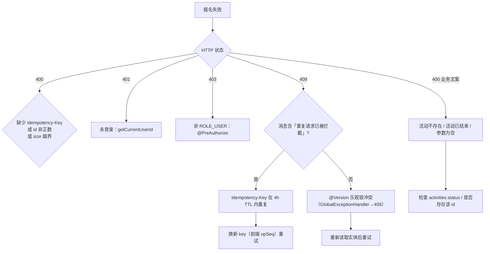

[此图按上表现象—根因对照组织，判定分支的每一个条件都取自表中已列出处，故图表来源见下]

**图表来源**
- [ActivityController.java:51-106](file://apps/api/src/main/java/com/campuslove/api/discover/ActivityController.java#L51-L106)
- [IdempotentInterceptor.java:134-227](file://apps/api/src/main/java/com/campuslove/api/common/IdempotentInterceptor.java#L134-L227)
- [RealActivityService.java:139-179](file://apps/api/src/main/java/com/campuslove/api/discover/RealActivityService.java#L139-L179)
- [Activity.java:109-120](file://apps/api/src/main/java/com/campuslove/api/entity/Activity.java#L109-L120)

**章节来源**
- [Idempotent.java:43-64](file://apps/api/src/main/java/com/campuslove/api/common/Idempotent.java#L43-L64)
- [IdempotentInterceptor.java:241-264](file://apps/api/src/main/java/com/campuslove/api/common/IdempotentInterceptor.java#L241-L264)
- [ActivityRepository.java:51-95](file://apps/api/src/main/java/com/campuslove/api/repository/ActivityRepository.java#L51-L95)
- [activity.ts:168-243](file://apps/client/src/stores/activity.ts#L168-L243)
- [V2026.05.23.0001__create_activity_enrollments.sql:7-10](file://database/flyway/sql/V2026.05.23.0001__create_activity_enrollments.sql#L7-L10)
- [MockActivityService.java:84-117](file://apps/api/src/main/java/com/campuslove/api/discover/MockActivityService.java#L84-L117)

## 附录

### 端点与调用矩阵

| 端点 | 控制器方法 | 服务方法 | 已知调用方 |
| --- | --- | --- | --- |
| `GET /api/v1/activities` | `getActivities` | `ActivityService.getActivities` | `CampusController.getCampusActivities`、`RealHomeService`（进程内复用，非 HTTP）；HTTP 侧无前端调用点 |
| `GET /api/v1/activities/{id}` | `getActivityDetail` | `getActivityDetail` | `activity.ts` `fetchActivityDetail` |
| `POST /api/v1/activities/{id}/enroll` | `enrollActivity` | `enrollActivity` | `activity.ts` `enrollActivity`（`isEnrolled === false` 分支） |
| `DELETE /api/v1/activities/{id}/enroll` | `cancelEnrollment` | `cancelEnrollment` | `activity.ts` `enrollActivity`（`isEnrolled === true` 分支） |
| `GET /recommendations/activities` | `RecommendationController.getActivities` | `RecommendationService.getActivities` | `activity.ts` `fetchActivities` / `fetchMoreActivities` |
| ——（无 HTTP 入口） | —— | `RecommendationService.enrollActivity(String, boolean, Long)` | 未被任何控制器调用 |

### 已声明但仓库中无实现证据的能力

对照 catalog 指令，以下各项在本页取证范围内**没有**对应实现，如实登记而不是推测：

- 活动创建/编辑/删除的对外端点（写能力仅存在于 `ActivityRepository` 的原子计数与 `save`/`delete`，以及后台 `searchForAdmin` 所服务的读取侧）。
- 服务端活动查询缓存（`@Cacheable` 只覆盖人推荐；活动域无缓存注解）。
- 按报名人数的热门活动排序与个性化活动推荐（推荐端点复用日期升序查询）。
- 活动名额上限与「已满员」判定（`Activity` 实体不存在容量字段）。
- `status` 的自动流转（无定时任务或事件监听把 `upcoming` 推进到 `ongoing`/`ended`）。
- 报名者头像写入 `participant_avatars` 的同步逻辑。
- 分布式锁 / 报名互斥（并发控制手段仅为 `@Transactional` + JPQL 原子更新 + `@Version` + 唯一键）。
- `ActivityController` 四个端点的行为级测试（现有测试只做构造断言）。

**章节来源**
- [ActivityController.java:51-106](file://apps/api/src/main/java/com/campuslove/api/discover/ActivityController.java#L51-L106)
- [RecommendationController.java:151-154](file://apps/api/src/main/java/com/campuslove/api/discover/RecommendationController.java#L151-L154)
- [RecommendationService.java:25-35](file://apps/api/src/main/java/com/campuslove/api/discover/RecommendationService.java#L25-L35)
- [Activity.java:28-94](file://apps/api/src/main/java/com/campuslove/api/entity/Activity.java#L28-L94)
- [ActivityControllerTest.java:19-36](file://apps/api/src/test/java/com/campuslove/api/discover/ActivityControllerTest.java#L19-L36)

## 结论

活动管理在后端是一条职责清晰、并发处理到位的窄链路：`ActivityController` 只做路由、校验与身份提取，`ActivityService` 定义 4 个方法，`RealActivityService` 用 profile 与 Mock 实现互换，写路径通过「数据库侧原子增减 + 变更后重查 + `@Version` 乐观锁 + 报名唯一键」四重手段保证人数计数与报名记录的一致性，重复报名与重复取消在业务层被设计成柔性幂等而非报错。分类与封面的引入（`V2026.08.09.0019`）连同关键词回填，让分类标签成为可在服务层精确过滤的维度；`isEnrolled` 的批量计算把列表的 N+1 压成 2 条语句。

同时要承认这一页记录下来的偏差：小程序的活动列表实际走 `/recommendations/activities`，该端点无参数、固定取 10 条并按日期升序，导致 `campusName`/`category`/分页三项能力在真实用户路径上没有被使用；`published` 未进入列表过滤条件，与实体注释承诺的下架隐藏行为不一致；`participant_avatars` 只在读取侧解析且失败静默，与报名写入没有联动；`RecommendationService.enrollActivity` 是一整套并行报名实现但没有 HTTP 入口；OpenAPI 只覆盖 3 个活动路径且与实现的 body、ID 类型、方法与状态码均有偏差；测试与基准只覆盖构造与推荐控制器。

后续维护的优先级因此是明确的：先让列表链路的筛选与分页参数贯通（前端 store 与推荐端点二选一改造），再补 `published` 过滤与 `category` 取值校验，随后收敛两套报名实现为一条，并把 `ActivityController` 的四条路由纳入契约测试。

**章节来源**
- [ActivityController.java:24-107](file://apps/api/src/main/java/com/campuslove/api/discover/ActivityController.java#L24-L107)
- [RealActivityService.java:44-221](file://apps/api/src/main/java/com/campuslove/api/discover/RealActivityService.java#L44-L221)
- [ActivityRepository.java:25-95](file://apps/api/src/main/java/com/campuslove/api/repository/ActivityRepository.java#L25-L95)
- [activity.ts:168-364](file://apps/client/src/stores/activity.ts#L168-L364)
- [V2026.08.09.0019__activity_add_category_cover.sql:12-23](file://database/flyway/sql/V2026.08.09.0019__activity_add_category_cover.sql#L12-L23)

