# 勿扰模式管理

<cite>
**本文引用的文件**
- [DoNotDisturbController.java](file://apps/api/src/main/java/com/campuslove/api/growth/DoNotDisturbController.java)
- [DoNotDisturbService.java](file://apps/api/src/main/java/com/campuslove/api/growth/DoNotDisturbService.java)
- [RealDoNotDisturbService.java](file://apps/api/src/main/java/com/campuslove/api/growth/RealDoNotDisturbService.java)
- [MockDoNotDisturbService.java](file://apps/api/src/main/java/com/campuslove/api/growth/MockDoNotDisturbService.java)
- [DoNotDisturbRequest.java](file://apps/api/src/main/java/com/campuslove/api/growth/DoNotDisturbRequest.java)
- [DoNotDisturbView.java](file://apps/api/src/main/java/com/campuslove/api/growth/DoNotDisturbView.java)
- [DoNotDisturbSetting.java](file://apps/api/src/main/java/com/campuslove/api/entity/DoNotDisturbSetting.java)
- [DoNotDisturbSettingRepository.java](file://apps/api/src/main/java/com/campuslove/api/repository/DoNotDisturbSettingRepository.java)
- [ErrorMessages.java](file://apps/api/src/main/java/com/campuslove/api/common/ErrorMessages.java)
- [V2026.07.25.0012__create_dnd_settings.sql](file://database/flyway/sql/V2026.07.25.0012__create_dnd_settings.sql)
- [dnd.vue](file://apps/client/src/subpackages/profile-extra/settings/dnd.vue)
- [apps/client/src/subpackages/profile-extra/settings/index.vue](file://apps/client/src/subpackages/profile-extra/settings/index.vue)
- [api.ts](file://apps/client/src/services/api.ts)
- [fixtures.ts](file://apps/client/src/services/mocks/fixtures.ts)
- [api-types-supplement.ts](file://apps/client/src/services/generated/api-types-supplement.ts)
- [routes.ts](file://apps/client/src/constants/routes.ts)
- [storage-keys.ts](file://apps/client/src/constants/storage-keys.ts)
- [pages.json](file://apps/client/src/pages.json)
- [zh-CN.ts](file://apps/client/src/i18n/locales/zh-CN.ts)
- [DoNotDisturbControllerTest.java](file://apps/api/src/test/java/com/campuslove/api/growth/DoNotDisturbControllerTest.java)
- [MockAllRepositoriesConfig.java](file://apps/api/src/test/java/com/campuslove/api/testdata/MockAllRepositoriesConfig.java)
- [AdminPermissionTest.java](file://apps/api/src/test/java/com/campuslove/api/admin/AdminPermissionTest.java)
- [settings-index.spec.ts](file://apps/client/src/tests/components/settings-index.spec.ts)
- [native-switch-naming.spec.ts](file://apps/client/src/tests/native-switch-naming.spec.ts)
- [apps/client/src/subpackages/setup/showcase/index.vue](file://apps/client/src/subpackages/setup/showcase/index.vue)
- [R3-ROUND2-ISSUES.tsv](file://archive/audit-round2/R3-ROUND2-ISSUES.tsv)
- [ISSUE-CENSUS-2026-09-25.md](file://.zcode/research/ISSUE-CENSUS-2026-09-25.md)
</cite>

## 目录
1. [简介](#简介)
2. [项目结构](#项目结构)
3. [核心组件](#核心组件)
4. [架构总览](#架构总览)
5. [详细组件分析](#详细组件分析)
6. [接口契约与数据模型](#接口契约与数据模型)
7. [业务规则与冲突检测](#业务规则与冲突检测)
8. [客户端集成与状态同步](#客户端集成与状态同步)
9. [测试与验证](#测试与验证)
10. [依赖关系分析](#依赖关系分析)
11. [性能考虑](#性能考虑)
12. [配置与开关](#配置与开关)
13. [故障排查指南](#故障排查指南)
14. [结论](#结论)

## 简介
本页文档化“勿扰模式管理”能力在仓库中的真实落地范围。该能力归属于成长体系服务，后端入口为 `apps/api/src/main/java/com/campuslove/api/growth/DoNotDisturbController.java`，以 Spring MVC  REST 控制器形式暴露，类级路由前缀 `@RequestMapping("/api/v1/dnd")`，共两个端点方法：`getSetting()` 与 `updateSetting(@Valid @RequestBody DoNotDisturbRequest request)`。

需要明确划清事实边界的是：仓库中的勿扰模式实现是一个**轻量偏好开关存取**能力，而不是 catalog 指令里设想的“勿扰时段设置 + 例外规则 + 节假日 + 定时任务调度 + 监控告警”的完整规则引擎。本页严格按下述口径撰写：

- 凡实现存在且可读的（控制器、请求契约、持久化字段、客户端调用点），给出文件与行号证据并展开说明。
- 凡实现不存在的（时间段冲突检测、优先级处理、通知过滤引擎、节假日日历、调度任务、热更新、告警），在本页对应章节以“仓库无该能力/无接入证据”的结论如实登记，不做任何虚构式设计描述。

这样做的目的是让本页既可作为现有 `/api/v1/dnd` 接口的使用文档，也可作为后续把勿扰能力扩展为规则引擎时的“缺口清单”。

**章节来源**
- [DoNotDisturbController.java:35-72](file://apps/api/src/main/java/com/campuslove/api/growth/DoNotDisturbController.java#L35-L72)

## 项目结构
勿扰模式相关代码在仓库中呈“单控制器 + 契约类 + 客户端调用点”的窄分布，服务端部分集中在 `growth` 包内：

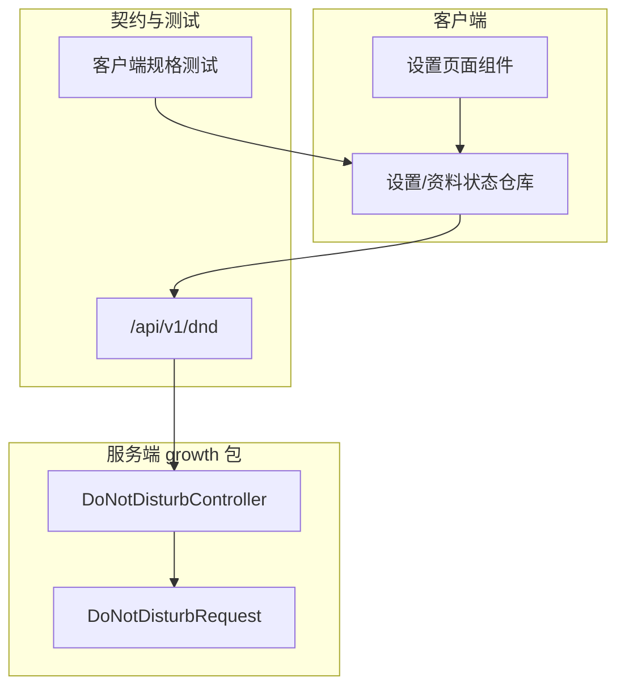

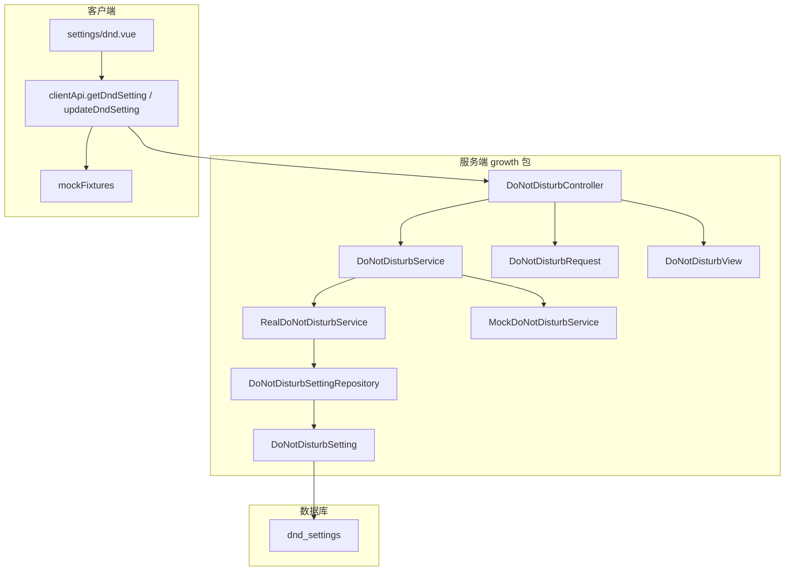

**图表来源**
- [DoNotDisturbController.java:35-77](file://apps/api/src/main/java/com/campuslove/api/growth/DoNotDisturbController.java#L35-L77)
- [DoNotDisturbService.java:15-34](file://apps/api/src/main/java/com/campuslove/api/growth/DoNotDisturbService.java#L15-L34)
- [RealDoNotDisturbService.java:27-42](file://apps/api/src/main/java/com/campuslove/api/growth/RealDoNotDisturbService.java#L27-L42)
- [MockDoNotDisturbService.java:13-18](file://apps/api/src/main/java/com/campuslove/api/growth/MockDoNotDisturbService.java#L13-L18)
- [DoNotDisturbSetting.java:31-34](file://apps/api/src/main/java/com/campuslove/api/entity/DoNotDisturbSetting.java#L31-L34)
- [DoNotDisturbSettingRepository.java:11-19](file://apps/api/src/main/java/com/campuslove/api/repository/DoNotDisturbSettingRepository.java#L11-L19)
- [V2026.07.25.0012__create_dnd_settings.sql:20-33](file://database/flyway/sql/V2026.07.25.0012__create_dnd_settings.sql#L20-L33)
- [dnd.vue:90-117](file://apps/client/src/subpackages/profile-extra/settings/dnd.vue#L90-L117)
- [api.ts:1180-1205](file://apps/client/src/services/api.ts#L1180-L1205)
- [fixtures.ts:2020-2039](file://apps/client/src/services/mocks/fixtures.ts#L2020-L2039)

**章节来源**
- [DoNotDisturbController.java:35-72](file://apps/api/src/main/java/com/campuslove/api/growth/DoNotDisturbController.java#L35-L72)

## 核心组件
勿扰模式由 8 个服务端组件与 4 个客户端组件构成，职责如下（全部为仓库中真实存在的类型）：

- `DoNotDisturbController`：唯一 HTTP 入口，类上标注 `@RestController` 与 `@RequestMapping("/api/v1/dnd")`，仅两个方法 —— `getSetting()`（`@GetMapping`）与 `updateSetting(@Valid @RequestBody DoNotDisturbRequest request)`（`@PutMapping` + `@PreAuthorize("hasRole('USER')")`）。
- `DoNotDisturbService`：服务接口，声明 `getSetting(Long userId)` 与 `updateSetting(Long userId, DoNotDisturbRequest request)`，并在 Javadoc 中约定三条实现契约：首次访问返回默认偏好、更新时 upsert、对时间/枚举做业务校验。
- `RealDoNotDisturbService`：`@Profile("real")` 的真实实现，依赖 `DoNotDisturbSettingRepository`，负责业务校验、CSV 规范化与实体落库。
- `MockDoNotDisturbService`：`@Profile("mock")` 的内存实现，用 `ConcurrentHashMap<Long, DoNotDisturbView>` 缓存偏好，校验规则与 Real 保持子集一致。
- `DoNotDisturbRequest`：入参 record，6 个字段带 Bean Validation 注解（`@NotNull`、`@Pattern`、`@Size`）。
- `DoNotDisturbView`：出参 record，6 个字段，Javadoc 明确「仅返回前端展示所需字段，不暴露实体内部状态」。
- `DoNotDisturbSetting`：JPA 实体，`@Table(name = "dnd_settings")`，含 `@Version` 乐观锁与审计字段。
- `DoNotDisturbSettingRepository`：`JpaRepository`，仅一个查询方法 `findByUserId(Long userId)`。
- 客户端：`dnd.vue` 设置页、`clientApi.getDndSetting()/updateDndSetting()`、`mockFixtures.getDndSetting()/updateDndSetting()`、`api-types-supplement.ts` 中的 `DoNotDisturbView`/`DoNotDisturbRequest` TS 契约。

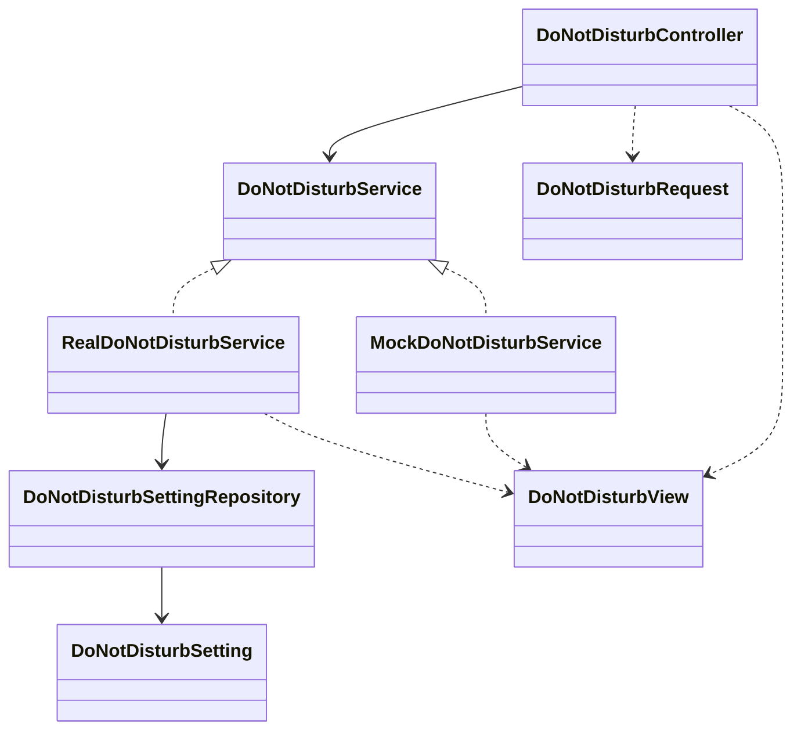

**图表来源**
- [DoNotDisturbController.java:37-77](file://apps/api/src/main/java/com/campuslove/api/growth/DoNotDisturbController.java#L37-L77)
- [DoNotDisturbService.java:15-35](file://apps/api/src/main/java/com/campuslove/api/growth/DoNotDisturbService.java#L15-L35)
- [RealDoNotDisturbService.java:29-42](file://apps/api/src/main/java/com/campuslove/api/growth/RealDoNotDisturbService.java#L29-L42)
- [MockDoNotDisturbService.java:15-18](file://apps/api/src/main/java/com/campuslove/api/growth/MockDoNotDisturbService.java#L15-L18)
- [DoNotDisturbSettingRepository.java:11-20](file://apps/api/src/main/java/com/campuslove/api/repository/DoNotDisturbSettingRepository.java#L11-L20)
- [DoNotDisturbSetting.java:34-91](file://apps/api/src/main/java/com/campuslove/api/entity/DoNotDisturbSetting.java#L34-L91)

**章节来源**
- [DoNotDisturbController.java:35-77](file://apps/api/src/main/java/com/campuslove/api/growth/DoNotDisturbController.java#L35-L77)
- [DoNotDisturbService.java:3-35](file://apps/api/src/main/java/com/campuslove/api/growth/DoNotDisturbService.java#L3-L35)
- [DoNotDisturbRequest.java:8-39](file://apps/api/src/main/java/com/campuslove/api/growth/DoNotDisturbRequest.java#L8-L39)
- [DoNotDisturbView.java:3-23](file://apps/api/src/main/java/com/campuslove/api/growth/DoNotDisturbView.java#L3-L23)
- [MockDoNotDisturbService.java:8-35](file://apps/api/src/main/java/com/campuslove/api/growth/MockDoNotDisturbService.java#L8-L35)
- [DoNotDisturbSetting.java:16-91](file://apps/api/src/main/java/com/campuslove/api/entity/DoNotDisturbSetting.java#L16-L91)
- [DoNotDisturbSettingRepository.java:7-20](file://apps/api/src/main/java/com/campuslove/api/repository/DoNotDisturbSettingRepository.java#L7-L20)
- [api.ts:1172-1205](file://apps/client/src/services/api.ts#L1172-L1205)
- [api-types-supplement.ts:497-525](file://apps/client/src/services/generated/api-types-supplement.ts#L497-L525)

## 架构总览
勿扰模式是「读默认、写 upsert」的单记录偏好模型，请求链路只有一条：客户端页面 → `clientApi` → `/api/v1/dnd` → 控制器 → 服务接口（按 Spring profile 选择 Real/Mock）→ Repository → `dnd_settings` 表。身份来源固定为 `SecurityUtils.getCurrentUserId()`，控制器 Javadoc 明确「不信任客户端传入的 userId 作为身份来源」。

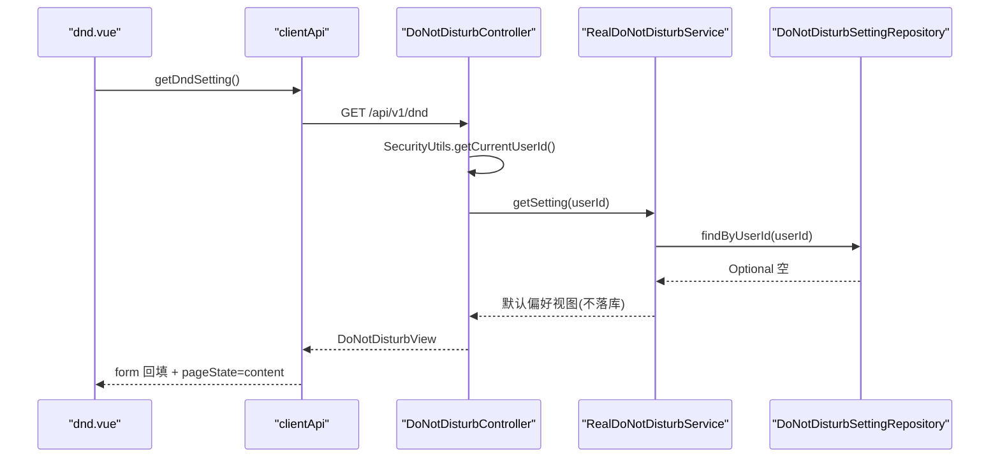

**图表来源**
- [dnd.vue:90-117](file://apps/client/src/subpackages/profile-extra/settings/dnd.vue#L90-L117)
- [api.ts:1180-1185](file://apps/client/src/services/api.ts#L1180-L1185)
- [DoNotDisturbController.java:57-62](file://apps/api/src/main/java/com/campuslove/api/growth/DoNotDisturbController.java#L57-L62)
- [RealDoNotDisturbService.java:52-75](file://apps/api/src/main/java/com/campuslove/api/growth/RealDoNotDisturbService.java#L52-L75)
- [DoNotDisturbSettingRepository.java:19-19](file://apps/api/src/main/java/com/campuslove/api/repository/DoNotDisturbSettingRepository.java#L19-L19)

写入链路在读取链路之上叠加 Bean Validation 与业务校验两层，校验失败在到达 Repository 之前即抛出：

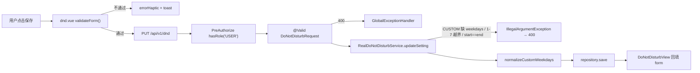

**图表来源**
- [dnd.vue:212-282](file://apps/client/src/subpackages/profile-extra/settings/dnd.vue#L212-L282)
- [DoNotDisturbController.java:70-77](file://apps/api/src/main/java/com/campuslove/api/growth/DoNotDisturbController.java#L70-L77)
- [DoNotDisturbRequest.java:28-38](file://apps/api/src/main/java/com/campuslove/api/growth/DoNotDisturbRequest.java#L28-L38)
- [RealDoNotDisturbService.java:94-155](file://apps/api/src/main/java/com/campuslove/api/growth/RealDoNotDisturbService.java#L94-L155)
- [MockDoNotDisturbService.java:45-76](file://apps/api/src/main/java/com/campuslove/api/growth/MockDoNotDisturbService.java#L45-L76)

双实现由 Spring profile 互斥切换：`@Profile("real")` 与 `@Profile("mock")` 标注在两个 Service 上，控制器只依赖接口，因此 `mock` 环境下的内存实现不会触库。

**章节来源**
- [DoNotDisturbController.java:24-77](file://apps/api/src/main/java/com/campuslove/api/growth/DoNotDisturbController.java#L24-L77)
- [RealDoNotDisturbService.java:27-29](file://apps/api/src/main/java/com/campuslove/api/growth/RealDoNotDisturbService.java#L27-L29)
- [MockDoNotDisturbService.java:13-18](file://apps/api/src/main/java/com/campuslove/api/growth/MockDoNotDisturbService.java#L13-L18)
- [dnd.vue:11-11](file://apps/client/src/subpackages/profile-extra/settings/dnd.vue#L11-L11)

## 详细组件分析

### 控制器层：DoNotDisturbController
控制器共 78 行，结构极简，承担四件事：

1. **路由声明**：`@RestController` + `@RequestMapping("/api/v1/dnd")`，方法级 `@GetMapping`（L57）与 `@PutMapping`（L70）都不带子路径，因此最终路径就是 `/api/v1/dnd` 本身。
2. **授权**：写端点额外标注 `@PreAuthorize("hasRole('USER')")`；读端点仅依赖 `SecurityUtils.getCurrentUserId()`（未认证时由该工具抛 401）。
3. **身份解析**：两个方法都以 `Long userId = SecurityUtils.getCurrentUserId()` 取身份，请求体中没有 userId 字段，杜绝越权改他人偏好。
4. **日志**：`log.debug` 记录读操作的用户 ID；写操作在 `log.debug` 中打印 `enabled/startTime~endTime/repeatMode` 四项，服务层再用 `log.info` 打印落库结果（含 `allowUrgent`），形成 debug/info 两级可观测点。

控制器 Javadoc 声明的错误映射为：未认证 → 401；`@Valid` 失败 → 400；业务校验（如 CUSTOM 模式缺 `customWeekdays`）→ 服务层 `IllegalArgumentException` → 400。

**章节来源**
- [DoNotDisturbController.java:14-77](file://apps/api/src/main/java/com/campuslove/api/growth/DoNotDisturbController.java#L14-L77)

### 服务契约与默认偏好
`DoNotDisturbService` 接口用 Javadoc 固化三条实现方义务：首次访问返回默认偏好（关闭免打扰、22:00-08:00、每天重复、允许紧急穿透）、更新时无记录则自动创建、对 `startTime/endTime/repeatMode` 做业务校验。两个实现都严格采用同一组默认值：Real 在 `getSetting()` 的 `orElseGet` 分支里逐字段 set 出临时实体后转换（L63-L71），Mock 直接 `cache.computeIfAbsent` 构造 `DoNotDisturbView(false, "22:00", "08:00", "EVERYDAY", null, true)`（L32-L34）。

关键差异是持久化副作用：Real 的默认偏好**不落库**，源码注释写明「用户无记录时返回默认偏好，不持久化（避免无谓写入）」；只有 `updateSetting` 才创建记录（L129-L135）。Mock 则把默认值写入内存缓存，进程重启即丢失。

**章节来源**
- [DoNotDisturbService.java:3-34](file://apps/api/src/main/java/com/campuslove/api/growth/DoNotDisturbService.java#L3-L34)
- [RealDoNotDisturbService.java:44-75](file://apps/api/src/main/java/com/campuslove/api/growth/RealDoNotDisturbService.java#L44-L75)
- [MockDoNotDisturbService.java:20-35](file://apps/api/src/main/java/com/campuslove/api/growth/MockDoNotDisturbService.java#L20-L35)
- [DoNotDisturbSetting.java:46-67](file://apps/api/src/main/java/com/campuslove/api/entity/DoNotDisturbSetting.java#L46-L67)

### RealDoNotDisturbService 的校验、规范化与事务边界
`updateSetting` 是全能力中唯一有实质业务逻辑的方法，按顺序执行：

- 空值防御：`userId == null` 与 `request == null` 均抛 `IllegalArgumentException`（L97-L102）。
- CUSTOM 模式必填校验：`customWeekdays` 为 null 或空白 → `ErrorMessages.DND_CUSTOM_WEEKDAYS_REQUIRED`（L105-L108）。
- 星期值域校验：以 `,` 分割后逐项 `Integer.parseInt`，越界（<1 或 >7）抛 `DND_WEEKDAY_RANGE_PREFIX + part`，非数字抛 `DND_WEEKDAY_CSV_PREFIX + part`（L110-L120）。
- 时段有效性：`startTime.equals(endTime)` → `DND_START_EQUALS_END`；注释明确「允许跨天，如 22:00-08:00」（L123-L126）。
- upsert：`findByUserId(userId).orElseGet(新建)`，随后覆盖全部字段；非 CUSTOM 模式强制把 `customWeekdays` 置 null（L144-L145）。
- 时间戳：`setting.setUpdatedAt(LocalDateTime.now(TimeZones.BUSINESS))`，使用业务时区常量而非系统默认时区（L147）。
- 事务：读方法 `@Transactional(readOnly = true)`，写方法 `@Transactional`。

`normalizeCustomWeekdays` 用 `TreeSet<Integer>` 做去重 + 升序，再以 `,` 拼接（例如 `"3,1,1"` → `"1,3"`），源码注释标记其来自 infra 整改项 R2-00275，修复前是「手写 split 直接原样存储，重复/乱序值会残留脏数据」。

**章节来源**
- [RealDoNotDisturbService.java:44-191](file://apps/api/src/main/java/com/campuslove/api/growth/RealDoNotDisturbService.java#L44-L191)
- [ErrorMessages.java:854-875](file://apps/api/src/main/java/com/campuslove/api/common/ErrorMessages.java#L854-L875)

### MockDoNotDisturbService 与前端 mock 双轨
服务端 Mock 与前端 Mock 是两条独立轨道：

- 服务端 `MockDoNotDisturbService`：校验只保留「CUSTOM 必填 weekdays」与「start != end」两条，**没有** Real 的 1-7 值域校验、也没有 CSV 规范化（L54-L73），这是 mock/real 行为不一致点，联调时应知悉。
- 前端 `mockFixtures`：`dndSetting` 变量以模块级状态保存（L752 起），`getDndSetting()` 返回 `clone(dndSetting)`，`updateDndSetting(payload)` 直接合并 payload 后返回 `clone`，请求完全不出网。

`clientApi` 通过 `useMock()` 分流：命中 mock 时调用 fixtures，否则 `request({ url: "/dnd", method: "GET" | "PUT" })`，因此客户端函数签名对两种模式保持一致。

**章节来源**
- [MockDoNotDisturbService.java:8-77](file://apps/api/src/main/java/com/campuslove/api/growth/MockDoNotDisturbService.java#L8-L77)
- [fixtures.ts:750-754](file://apps/client/src/services/mocks/fixtures.ts#L750-L754)
- [fixtures.ts:2020-2039](file://apps/client/src/services/mocks/fixtures.ts#L2020-L2039)
- [api.ts:1172-1205](file://apps/client/src/services/api.ts#L1172-L1205)

### 数据访问层与实体
`DoNotDisturbSettingRepository` 只继承 `JpaRepository<DoNotDisturbSetting, Long>` 并声明一个派生查询 `Optional<DoNotDisturbSetting> findByUserId(Long userId)`，没有任何自定义 SQL、没有批量查询、没有按 `enabled` 的过滤方法。

实体 `DoNotDisturbSetting` 与 DDL 的对应关系：`@Table(name = "dnd_settings")`、`user_id` 上 `unique = true`、时间字段以 `length = 8` 的字符串列存 HH:mm、`repeat_mode` 用长度 16 的字符串列（Javadoc 说明「避免 JPA 枚举映射兼容性问题」），并额外带 `@Version` 乐观锁（注释指明并发冲突抛 `ObjectOptimisticLockingFailureException`，由 GlobalExceptionHandler 转 409）与 `@CreatedDate`/`@LastModifiedDate` 审计字段。

实体字段比 DDL 多两列：`created_at` 与 `version`。它们不在建表脚本里，而由后续迁移补齐（实体注释指向 Flyway `V2026.07.26.0003`），这解释了「DDL 与实体不完全一一对应」的现象。

**章节来源**
- [DoNotDisturbSettingRepository.java:1-20](file://apps/api/src/main/java/com/campuslove/api/repository/DoNotDisturbSettingRepository.java#L1-L20)
- [DoNotDisturbSetting.java:16-91](file://apps/api/src/main/java/com/campuslove/api/entity/DoNotDisturbSetting.java#L16-L91)
- [V2026.07.25.0012__create_dnd_settings.sql:6-33](file://database/flyway/sql/V2026.07.25.0012__create_dnd_settings.sql#L6-L33)

## 接口契约与数据模型

### HTTP 端点
| 方法 | 路径 | 控制器方法 | 授权 | 请求体 | 响应 |
|---|---|---|---|---|---|
| GET | `/api/v1/dnd` | `getSetting()` | 需登录态（`SecurityUtils` 取 userId） | 无 | `DoNotDisturbView` |
| PUT | `/api/v1/dnd` | `updateSetting(DoNotDisturbRequest)` | `@PreAuthorize("hasRole('USER')")` | `DoNotDisturbRequest` | 更新后的 `DoNotDisturbView` |

需要特别提醒的是文档字符串与真实路由不一致：控制器类 Javadoc 与客户端注释都写作 `GET/PUT /api/dnd`，而生效路由是 `@RequestMapping("/api/v1/dnd")` + 方法级空子路径，真实路径为 `/api/v1/dnd`。以路由注解为准。

**章节来源**
- [DoNotDisturbController.java:17-36](file://apps/api/src/main/java/com/campuslove/api/growth/DoNotDisturbController.java#L17-L36)
- [DoNotDisturbController.java:57-77](file://apps/api/src/main/java/com/campuslove/api/growth/DoNotDisturbController.java#L57-L77)
- [api.ts:1172-1204](file://apps/client/src/services/api.ts#L1172-L1204)

### 请求字段与校验规则
`DoNotDisturbRequest` 是 Java record，六个字段的约束全部内联在类型上：

| 字段 | 类型 | 约束 | 校验消息常量 |
|---|---|---|---|
| `enabled` | `Boolean` | `@NotNull` | — |
| `startTime` | `String` | `@NotNull` + `@Pattern("^([01]\\d|2[0-3]):[0-5]\\d$")` | `DND_START_TIME_FORMAT` |
| `endTime` | `String` | `@NotNull` + 同上正则 | `DND_END_TIME_FORMAT` |
| `repeatMode` | `String` | `@NotNull` + `@Pattern("^(EVERYDAY|WEEKDAYS|WEEKENDS|CUSTOM)$")` | `DND_REPEAT_MODE_INVALID` |
| `customWeekdays` | `String` | `@Size(max = 16)`，仅 CUSTOM 模式业务必填 | `DND_CUSTOM_WEEKDAYS_MAX_LENGTH` |
| `allowUrgent` | `Boolean` | `@NotNull` | — |

对应的错误文案集中在 `ErrorMessages`（L854-L875），共 8 条 `DND_*` 常量，覆盖必填、格式、枚举、值域、CSV 非法、长度与时段相同七类失败场景。时间字段是**字符串而非 `LocalTime`**：正则保证 HH:mm 形态，服务层再做等值比较，全链路没有 `LocalTime` 解析与区间运算。

**章节来源**
- [DoNotDisturbRequest.java:8-39](file://apps/api/src/main/java/com/campuslove/api/growth/DoNotDisturbRequest.java#L8-L39)
- [ErrorMessages.java:854-875](file://apps/api/src/main/java/com/campuslove/api/common/ErrorMessages.java#L854-L875)
- [RealDoNotDisturbService.java:104-126](file://apps/api/src/main/java/com/campuslove/api/growth/RealDoNotDisturbService.java#L104-L126)

### 存储模型
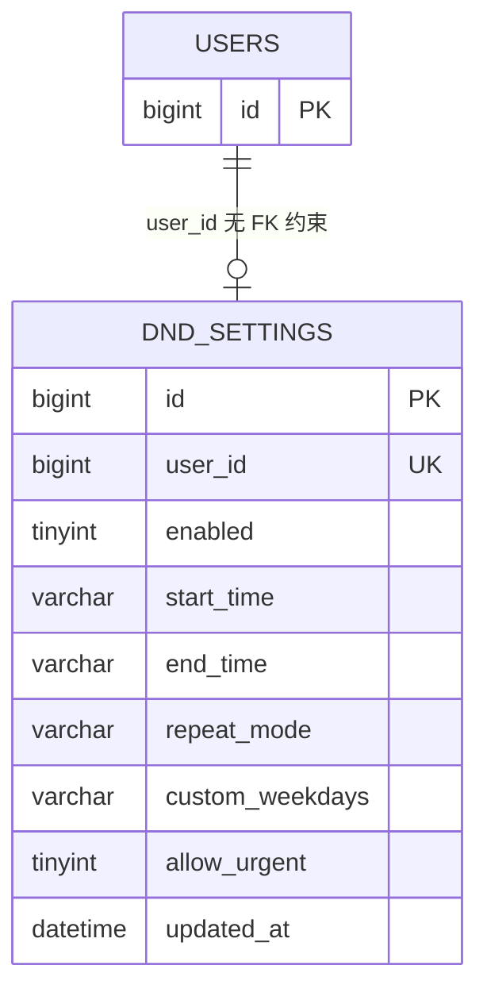

**图表来源**
- [V2026.07.25.0012__create_dnd_settings.sql:20-33](file://database/flyway/sql/V2026.07.25.0012__create_dnd_settings.sql#L20-L33)

表定义要点（均来自建表脚本）：`user_id` 上有唯一键 `uk_dnd_user_id`（一个用户一行，是 upsert 的前提）、`enabled` 上有普通索引 `idx_dnd_enabled`、列默认值即服务层默认偏好（`enabled` 0、`start_time` '22:00'、`end_time` '08:00'、`repeat_mode` 'EVERYDAY'、`allow_urgent` 1）、`updated_at` 带 `ON UPDATE CURRENT_TIMESTAMP`、InnoDB + utf8mb4_0900_ai_ci。

两条已知结构缺陷在仓库审计清单中被登记：`dnd_settings.user_id` 到 `users(id)` **没有外键**（审计 R2-00073，MEDIUM，后果是删除用户会残留免打扰配置）；`V2026.07.28.0005__add_indexes.sql` 又建了与之重复的 `uk_dnd_settings_user`（R2-00083），且该迁移注释把表名写成 `do_not_disturb_settings` 与实际 `dnd_settings` 不符（R2-00084）。这些结论来自归档审计条目对具体 SQL 行号的指认，本轮未重新执行数据库校验。

**章节来源**
- [V2026.07.25.0012__create_dnd_settings.sql:1-33](file://database/flyway/sql/V2026.07.25.0012__create_dnd_settings.sql#L1-L33)
- [R3-ROUND2-ISSUES.tsv:813-824](file://archive/audit-round2/R3-ROUND2-ISSUES.tsv#L813-L824)

### 契约的对外暴露范围
接口契约目前**只存在于代码内**：在 `docs/` 下对 `dnd` 做全文检索无任何匹配，即 OpenAPI YAML 规范里没有 `/dnd` 路径与 operationId；对外契约由 TS 侧的 `DoNotDisturbView`/`DoNotDisturbRequest` interface（含「对应后端 GET /api/dnd 返回的 DoNotDisturbView」注释）与 Java record 双向手工对齐维持。新增字段时必须同时改 4 处：Java record、TS interface、`fixtures.ts` 初值、`dnd.vue` 的 form 初值。

**章节来源**
- [api-types-supplement.ts:497-525](file://apps/client/src/services/generated/api-types-supplement.ts#L497-L525)
- [fixtures.ts:750-754](file://apps/client/src/services/mocks/fixtures.ts#L750-L754)
- [dnd.vue:51-59](file://apps/client/src/subpackages/profile-extra/settings/dnd.vue#L51-L59)

## 业务规则与冲突检测

### 已实现的规则
服务端只在写入时执行 5 条规则，全部可定位到具体行：

1. **身份唯一来源**：`userId` 只从 `SecurityUtils.getCurrentUserId()` 取得，请求体无 userId 字段。
2. **HH:mm 形态**：正则 `^([01]\d|2[0-3]):[0-5]\d$` 拒绝 `9:00`、`24:00`、带秒等写法。
3. **时段非退化**：`startTime.equals(endTime)` 直接判为「无意义的免打扰时段」并拒绝；跨天（22:00-08:00）被显式允许。
4. **枚举白名单**：`repeatMode` 只能是 `EVERYDAY|WEEKDAYS|WEEKENDS|CUSTOM`，其他值 400。
5. **CUSTOM 一致性**：CUSTOM 必须有 `customWeekdays`，逐项落在 1-7；非 CUSTOM 一律清空该列；CUSTOM 下按 `TreeSet` 去重升序规范化后再落库。

规则 3 的实现是字符串等值比较，而不是时间比较：`"08:00"` 与 `"8:00"` 无法比较，但由于规则 2 在 Bean Validation 阶段已强制两位小时，等值比较不会因此漏判。

### 配置项的生效范围
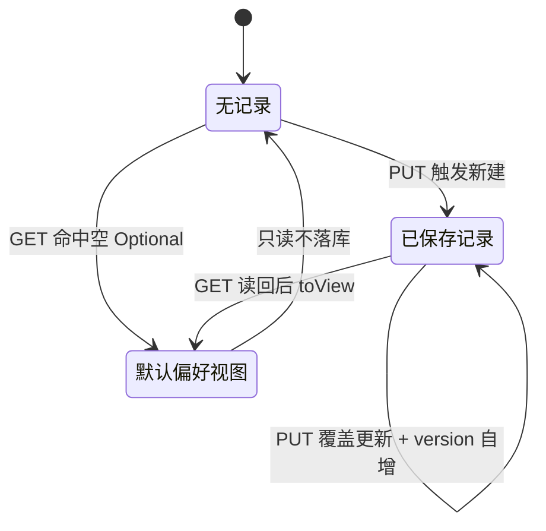

**图表来源**
- [RealDoNotDisturbService.java:52-155](file://apps/api/src/main/java/com/campuslove/api/growth/RealDoNotDisturbService.java#L52-L155)
- [DoNotDisturbSetting.java:76-91](file://apps/api/src/main/java/com/campuslove/api/entity/DoNotDisturbSetting.java#L76-L91)

### 未实现的能力（明确登记为缺口）
以下 catalog 期望项在仓库中**没有实现，也没有接入证据**，描述时不得使用肯定语气：

- **时间段冲突检测**：`dnd_settings` 是「一人一行」模型（唯一键 `uk_dnd_user_id`），不存在多段勿扰规则集合，因此没有可冲突的对象；代码中没有任何区间相交判断。
- **优先级处理**：无规则标识、无排序字段、无优先级枚举，唯一带「取舍」语义的是布尔列 `allow_urgent`。
- **通知过滤机制 / 勿扰规则引擎**：对 `apps/api/src` 全部 Java 源码检索 `DoNotDisturb|dnd_settings`，命中文件仅 11 个（`growth` 包 6 个类 + `entity` 1 个 + `repository` 1 个 + 测试 3 个），其中不含任何消息推送或通知装配类；`allowUrgent`、`repeatMode`、`customWeekdays` 三字段的唯一读端是 `toView()`，即它们被存储、被回显，但没有任何服务端消费点。结论：**勿扰配置目前是纯偏好存储，不参与推送决策**。
- **时间区间计算**：实体与视图中的时段是 HH:mm 字符串，服务层只做等值比较；代码中未出现 `LocalTime`、`Duration` 或区间运算。
- **节假日支持**：无节假日表、无日历依赖，重复方式止步于 `WEEKENDS`（周六周日语义由客户端选项标签承载）。
- **定时任务调度**：无 `@Scheduled`、无队列消费者与该能力相关。
- **配置热更新**：无相关配置中心或刷新端点；`repeatMode` 白名单硬编码在 Bean Validation 正则里，新增取值需改代码并重新部署。

另外需区分：会话级「消息免打扰」（`zh-CN.ts` 中 `mute`/`unmute`/`muteSession`/`sessionMuted` 等文案）是即时通讯侧的另一套能力，与本页的 `/api/v1/dnd` 时段偏好互不相干；本页只文档化后者，前者实现细节不在取证范围内。

**章节来源**
- [DoNotDisturbController.java:57-77](file://apps/api/src/main/java/com/campuslove/api/growth/DoNotDisturbController.java#L57-L77)
- [DoNotDisturbRequest.java:28-38](file://apps/api/src/main/java/com/campuslove/api/growth/DoNotDisturbRequest.java#L28-L38)
- [RealDoNotDisturbService.java:94-155](file://apps/api/src/main/java/com/campuslove/api/growth/RealDoNotDisturbService.java#L94-L155)
- [MockDoNotDisturbService.java:45-76](file://apps/api/src/main/java/com/campuslove/api/growth/MockDoNotDisturbService.java#L45-L76)
- [V2026.07.25.0012__create_dnd_settings.sql:20-33](file://database/flyway/sql/V2026.07.25.0012__create_dnd_settings.sql#L20-L33)
- [DoNotDisturbSetting.java:16-67](file://apps/api/src/main/java/com/campuslove/api/entity/DoNotDisturbSetting.java#L16-L67)
- [zh-CN.ts:1389-1390](file://apps/client/src/i18n/locales/zh-CN.ts#L1389-L1390)
- [zh-CN.ts:2867-2870](file://apps/client/src/i18n/locales/zh-CN.ts#L2867-L2870)

## 客户端集成与状态同步
客户端唯一载体是 `apps/client/src/subpackages/profile-extra/settings/dnd.vue`（860 行，`<script setup lang="ts">` 部分至 L313）。页面头部注释即声明数据来源为「后端 GET/PUT /api/dnd（DoNotDisturbController）」，并列出 mp-weixin 兼容约束：不用 `:hover` 伪类改用 `hover-class`、不直读 `import.meta.env`、不使用无绑定 catch、时间选择使用 uni 模式 picker。

### 三态页面与数据装载
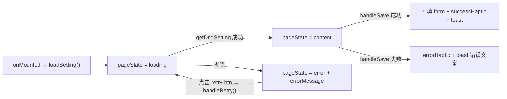

**图表来源**
- [dnd.vue:44-45](file://apps/client/src/subpackages/profile-extra/settings/dnd.vue#L44-L45)
- [dnd.vue:90-117](file://apps/client/src/subpackages/profile-extra/settings/dnd.vue#L90-L117)
- [dnd.vue:243-282](file://apps/client/src/subpackages/profile-extra/settings/dnd.vue#L243-L282)
- [dnd.vue:300-312](file://apps/client/src/subpackages/profile-extra/settings/dnd.vue#L300-L312)
- [dnd.vue:338-357](file://apps/client/src/subpackages/profile-extra/settings/dnd.vue#L338-L357)

状态由三个 ref 承载：`pageState`（`"loading" | "error" | "content"`）、`errorMessage`、`isSaving`；表单 `form` 是一个 `DoNotDisturbView` 形状的可变对象，初值与服务端默认偏好逐字段一致（`enabled:false`、`22:00`、`08:00`、`EVERYDAY`、`customWeekdays:null`、`allowUrgent:true`）。`repeatModeOptions` 与 `weekdayOptions` 是 i18n 驱动的计算属性，星期值 `"1".."7"` 对应周一至周日。

同步策略是**服务端权威**：`loadSetting()` 用响应整体覆盖 `form`，并把 `customWeekdays` 以 `split(",").filter(len>0)` 展开为 `customWeekdaysSelected`；`handleSave()` 成功后同样用返回值回填 `form`，不做乐观更新，因此界面显示的一定是后端规范化之后的值（例如 `"3,1,1"` 会被回显为 `"1,3"`）。401 由 http 拦截器统一处理，页面只在 catch 中把 `error.message` 落入 `errorMessage`，无消息时回退到 `common.networkError` 文案。

### 交互与本地反馈
每个交互处理器都先调用 `lightHaptic()`（开关切换、时间 picker 变更、重复方式选择、星期勾选），保存成功 `successHaptic()`、失败 `errorHaptic()`。`handleWeekdayToggle` 在本地维护选中集合，每次变更后 `sort(Number)` 再 `join(",")`，集为空时写 `null`；`handleRepeatModeSelect` 切离 CUSTOM 时同步清空 `customWeekdaysSelected` 与 `form.customWeekdays`，避免残留值被提交。开关激活色不写死 CSS，而取 `designTokens.color.brand[500]`（注释说明原生 switch 属性不支持 CSS 变量，需与 `--c-brand(#36C99A)` 双源同步）；页面通过 `useMenuButtonRect()` 注入 `--statusbar` 变量。

`goBack()` 带深链兜底：`getCurrentPages().length > 1` 才 `navigateBack`，否则 `switchTab` 回 `/pages/profile/index`，这是审计项 MP-R1-DND-001（深链直达栈为 1 时返回无响应）的修复。保存冷却 `SAVE_COOLDOWN_MS = 800` 针对 MP-R1-C24-001（快击×5 在 311ms 内产生 5 条「设置已保存」toast）：`isSaving` 只在途拦截，`finally` 中延迟 800ms 才复位。

**章节来源**
- [dnd.vue:20-45](file://apps/client/src/subpackages/profile-extra/settings/dnd.vue#L20-L45)
- [dnd.vue:51-78](file://apps/client/src/subpackages/profile-extra/settings/dnd.vue#L51-L78)
- [dnd.vue:104-201](file://apps/client/src/subpackages/profile-extra/settings/dnd.vue#L104-L201)
- [dnd.vue:212-295](file://apps/client/src/subpackages/profile-extra/settings/dnd.vue#L212-L295)
- [dnd.vue:306-335](file://apps/client/src/subpackages/profile-extra/settings/dnd.vue#L306-L335)
- [ISSUE-CENSUS-2026-09-25.md:169-376](file://.zcode/research/ISSUE-CENSUS-2026-09-25.md#L169-L376)
- [R3-ROUND2-ISSUES.tsv:228-263](file://archive/audit-round2/R3-ROUND2-ISSUES.tsv#L228-L263)

### 路由、入口与文案
- 路由常量：`routes.ts:170` 定义 `DND: "/subpackages/profile-extra/settings/dnd"`。
- 页面注册：`pages.json:242` 在 `profile-extra` 分包中注册 `settings/dnd`。
- 入口：`settings/index.vue` 的「通知设置」分组内渲染免打扰菜单项（模板 L551-L562，标题 `t("dnd.title")`、图标 `menuIcons.moon`），点击走 `goToDnd()`（L108 起，先 `lightHaptic()`）。该文件注释「路径已在 pages.json 中注册：pages/settings/dnd」与实际分包路径不一致，属注释漂移，以 `pages.json` 为准。
- 设计走查：`showcase/index.vue:143` 把 `/subpackages/profile-extra/settings/dnd` 列入 profile 分组。
- 文案：`zh-CN.ts` 顶层 `dnd` 命名空间含 `title/pageName/enable/timeRange` 等键（L3278 起），另有 `dnd.repeatEveryday|repeatWeekdays|repeatWeekends|repeatCustom`、`weekdayMon..Sun`、`customWeekdaysRequired`、`invalidTimeRange`、`saveSuccess`、`saveFailed`、`statusOn/statusOff` 被页面直接引用。
- 本地缓存键：`storage-keys.ts:90` 定义了 `DND_SETTING: "dnd_setting"`（注释「免打扰设置（开始/结束时间/重复模式）」）。在已读的 `dnd.vue` L1-L313 中**未见对该键的读写**，页面完全以 GET/PUT 为唯一数据源，因此该常量目前是未被本页使用的预留位。

**章节来源**
- [routes.ts:169-171](file://apps/client/src/constants/routes.ts#L169-L171)
- [pages.json:239-245](file://apps/client/src/pages.json#L239-L245)
- [apps/client/src/subpackages/profile-extra/settings/index.vue:4-10](file://apps/client/src/subpackages/profile-extra/settings/index.vue#L4-L10)
- [apps/client/src/subpackages/profile-extra/settings/index.vue:103-109](file://apps/client/src/subpackages/profile-extra/settings/index.vue#L103-L109)
- [apps/client/src/subpackages/profile-extra/settings/index.vue:548-563](file://apps/client/src/subpackages/profile-extra/settings/index.vue#L548-L563)
- [apps/client/src/subpackages/setup/showcase/index.vue:140-146](file://apps/client/src/subpackages/setup/showcase/index.vue#L140-L146)
- [zh-CN.ts:3278-3283](file://apps/client/src/i18n/locales/zh-CN.ts#L3278-L3283)
- [storage-keys.ts:89-91](file://apps/client/src/constants/storage-keys.ts#L89-L91)
- [dnd.vue:62-79](file://apps/client/src/subpackages/profile-extra/settings/dnd.vue#L62-L79)

## 测试与验证
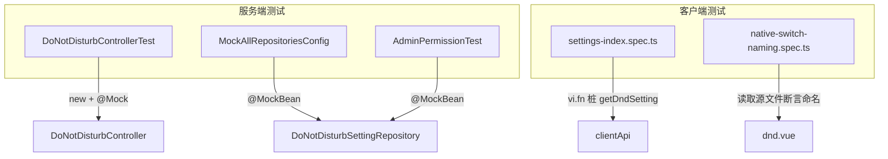

**图表来源**
- [DoNotDisturbControllerTest.java:13-35](file://apps/api/src/test/java/com/campuslove/api/growth/DoNotDisturbControllerTest.java#L13-L35)
- [MockAllRepositoriesConfig.java:24-110](file://apps/api/src/test/java/com/campuslove/api/testdata/MockAllRepositoriesConfig.java#L24-L110)
- [AdminPermissionTest.java:254-258](file://apps/api/src/test/java/com/campuslove/api/admin/AdminPermissionTest.java#L254-L258)
- [settings-index.spec.ts:20-20](file://apps/client/src/tests/components/settings-index.spec.ts#L20-L20)
- [native-switch-naming.spec.ts:9-35](file://apps/client/src/tests/native-switch-naming.spec.ts#L9-L35)

现状与覆盖边界（按检索到的真实断言）：

- `DoNotDisturbControllerTest`（36 行，注释标注为 P7 - Task 7.1.1）只有两个用例：`constructor_shouldAcceptService()` 与 `controller_shouldHaveServiceInjected()`，均只 `assertNotNull`，即**验证依赖注入能构造对象**，不发起 HTTP、不校验 `@Valid`、不触达 `getSetting/updateSetting` 行为。
- `MockAllRepositoriesConfig` 与 `AdminPermissionTest` 只是把 `DoNotDisturbSettingRepository` 作为 `@MockBean` 注入以让上下文启动，前者是全局 mock 仓库装配（L110），后者是权限测试的容器补齐（L256）；两者都不针对勿扰业务规则。
- 客户端 `settings-index.spec.ts:20` 用 `getDndSetting: vi.fn()` 桩掉 API，说明设置页测试关心入口存在性而非勿扰语义；`native-switch-naming.spec.ts` 把 `../subpackages/profile-extra/settings/dnd.vue` 纳入原生开关命名检查（L35），其注释指出该文件此前「零 authored class/id」，属于样式/命名回归防线。
- **没有** `RealDoNotDisturbService` / `MockDoNotDisturbService` 的单元测试类：在 `apps/api/src/test` 检索 `DoNotDisturb` 仅命中上述 3 个文件。因此 CUSTOM 必填、1-7 值域、`start==end` 拒绝、CSV 规范化四条服务端规则目前无自动化断言保护，只能靠 `ErrorMessages` 文案在人工回归时被发现。
- catalog 期望的「勿扰效果验证」「规则测试工具」「监控告警」三项在仓库中**没有对应实现或脚本证据**：勿扰配置没有消费端（见「业务规则与冲突检测」），因此不存在可验证的「效果」；也没有独立的规则试算入口或告警规则文件。

**章节来源**
- [DoNotDisturbControllerTest.java:1-36](file://apps/api/src/test/java/com/campuslove/api/growth/DoNotDisturbControllerTest.java#L1-L36)
- [MockAllRepositoriesConfig.java:22-112](file://apps/api/src/test/java/com/campuslove/api/testdata/MockAllRepositoriesConfig.java#L22-L112)
- [AdminPermissionTest.java:254-258](file://apps/api/src/test/java/com/campuslove/api/admin/AdminPermissionTest.java#L254-L258)
- [settings-index.spec.ts:1-79](file://apps/client/src/tests/components/settings-index.spec.ts#L1-L79)
- [native-switch-naming.spec.ts:9-35](file://apps/client/src/tests/native-switch-naming.spec.ts#L9-L35)
- [ErrorMessages.java:854-875](file://apps/api/src/main/java/com/campuslove/api/common/ErrorMessages.java#L854-L875)

## 依赖关系分析
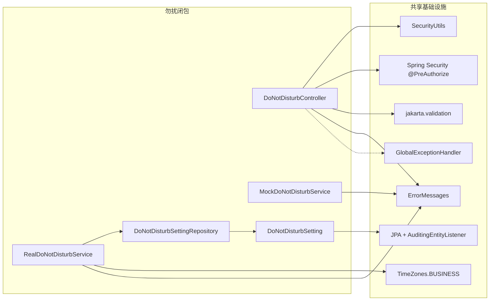

**图表来源**
- [DoNotDisturbController.java:3-12](file://apps/api/src/main/java/com/campuslove/api/growth/DoNotDisturbController.java#L3-L12)
- [DoNotDisturbController.java:57-77](file://apps/api/src/main/java/com/campuslove/api/growth/DoNotDisturbController.java#L57-L77)
- [RealDoNotDisturbService.java:3-12](file://apps/api/src/main/java/com/campuslove/api/growth/RealDoNotDisturbService.java#L3-L12)
- [MockDoNotDisturbService.java:3-6](file://apps/api/src/main/java/com/campuslove/api/growth/MockDoNotDisturbService.java#L3-L6)
- [DoNotDisturbSetting.java:3-14](file://apps/api/src/main/java/com/campuslove/api/entity/DoNotDisturbSetting.java#L3-L14)
- [DoNotDisturbSettingRepository.java:3-5](file://apps/api/src/main/java/com/campuslove/api/repository/DoNotDisturbSettingRepository.java#L3-L5)
- [DoNotDisturbRequest.java:3-6](file://apps/api/src/main/java/com/campuslove/api/growth/DoNotDisturbRequest.java#L3-L6)

上游（谁调用勿扰）：只有客户端 `dnd.vue` 经 `clientApi` 调用；服务端内部没有任何类调用 `DoNotDisturbService`，即该服务是叶子节点。下游（勿扰依赖谁）可归为三类：

- **安全**：`SecurityUtils`（身份）与 `@PreAuthorize("hasRole('USER')")`（写端点角色）。
- **公共常量**：`ErrorMessages` 的 8 条 `DND_*` 文案集中定义在 L854-L875，是错误消息唯一来源；`TimeZones.BUSINESS` 是 `updatedAt` 的时区基准（控制器与两个服务实现都不自行取系统时区）。
- **持久化**：`DoNotDisturbSettingRepository.findByUserId` + `save`，实体经 `@Table(name = "dnd_settings")` 绑定到 Flyway 迁移出的表。

异常出口由横切组件承担而非本模块：`@Valid` 失败与 `IllegalArgumentException` 转 400、`@Version` 冲突转 409 均由全局处理链完成，实体注释直接点名 `GlobalExceptionHandler`。测试侧依赖 `MockAllRepositoriesConfig`/`AdminPermissionTest` 对 Repository 的 `@MockBean` 替身。

**章节来源**
- [DoNotDisturbController.java:3-12](file://apps/api/src/main/java/com/campuslove/api/growth/DoNotDisturbController.java#L3-L12)
- [RealDoNotDisturbService.java:3-12](file://apps/api/src/main/java/com/campuslove/api/growth/RealDoNotDisturbService.java#L3-L12)
- [DoNotDisturbSetting.java:80-91](file://apps/api/src/main/java/com/campuslove/api/entity/DoNotDisturbSetting.java#L80-L91)
- [ErrorMessages.java:854-875](file://apps/api/src/main/java/com/campuslove/api/common/ErrorMessages.java#L854-L875)
- [MockAllRepositoriesConfig.java:108-112](file://apps/api/src/test/java/com/campuslove/api/testdata/MockAllRepositoriesConfig.java#L108-L112)
- [AdminPermissionTest.java:254-258](file://apps/api/src/test/java/com/campuslove/api/admin/AdminPermissionTest.java#L254-L258)
- [api.ts:1172-1205](file://apps/client/src/services/api.ts#L1172-L1205)

## 性能考虑
在已读代码范围内可核实的事实与推论如下：

- **单行读写，无 N+1 风险**：Repository 只有一个按唯一键命中的派生查询 `findByUserId`，`uk_dnd_user_id` 保证最多一行；一次 GET/PUT 恒定产生 1 次 SELECT +（写时）1 次 UPDATE/INSERT。
- **读路径不写库**：无记录时返回内存构造的默认视图，源码注释明确「避免无谓写入」，避免首次访问即产生写入放大。
- **事务边界区分**：读 `@Transactional(readOnly = true)`、写 `@Transactional`，与项目读写分离的事务约定一致。
- **未被使用的索引**：`idx_dnd_enabled` 存在，但 `DoNotDisturbSettingRepository` 没有任何按 `enabled` 过滤的方法，也没有全表扫描式查询，因此该索引在当前代码路径上服务不了任何查询；它的存在与「勿扰配置未被推送侧消费」是同一事实的两面。
- **规范化开销**：`normalizeCustomWeekdays` 每项 split + `TreeSet` 排序，输入上限由 `@Size(max = 16)` 约束（最多约 4 个值），开销可忽略。
- **Mock 实现的内存占用**：`ConcurrentHashMap<Long, DoNotDisturbView>` 以用户 ID 为键持续增长且**没有淘汰逻辑**（L18、L32-L34、L74），仅适用于 mock profile，不可用于生产长进程。
- **客户端请求抑制**：`isSaving` + `SAVE_COOLDOWN_MS = 800` 把一次保存意图压成一次 PUT，消除快击导致的重复写入与重复 toast（MP-R1-C24-001 的整改结果）。
- **内存占用控制与热更新**（catalog 期望项）：无对应机制证据——模块内没有缓存层、没有配置刷新入口，`repeatMode` 白名单写在注解常量里，修改需重新编译部署。

**章节来源**
- [DoNotDisturbSettingRepository.java:11-19](file://apps/api/src/main/java/com/campuslove/api/repository/DoNotDisturbSettingRepository.java#L11-L19)
- [V2026.07.25.0012__create_dnd_settings.sql:31-33](file://database/flyway/sql/V2026.07.25.0012__create_dnd_settings.sql#L31-L33)
- [RealDoNotDisturbService.java:52-75](file://apps/api/src/main/java/com/campuslove/api/growth/RealDoNotDisturbService.java#L52-L75)
- [RealDoNotDisturbService.java:163-173](file://apps/api/src/main/java/com/campuslove/api/growth/RealDoNotDisturbService.java#L163-L173)
- [MockDoNotDisturbService.java:18-74](file://apps/api/src/main/java/com/campuslove/api/growth/MockDoNotDisturbService.java#L18-L74)
- [DoNotDisturbRequest.java:34-37](file://apps/api/src/main/java/com/campuslove/api/growth/DoNotDisturbRequest.java#L34-L37)
- [dnd.vue:238-281](file://apps/client/src/subpackages/profile-extra/settings/dnd.vue#L238-L281)
- [ISSUE-CENSUS-2026-09-25.md:376-376](file://.zcode/research/ISSUE-CENSUS-2026-09-25.md#L376-L376)

## 配置与开关
勿扰能力没有独立的配置文件或运行时开关，其行为由「Spring profile 选择实现 + 客户端 mock 开关 + 多处同步的默认值」三类静态配置决定。

**实现切换**：`@Profile("real")`（`RealDoNotDisturbService`）与 `@Profile("mock")`（`MockDoNotDisturbService`）互斥，同一时刻容器中只存在一个 `DoNotDisturbService` 供控制器注入。real 走 `dnd_settings` 表，mock 走进程内 `ConcurrentHashMap`，两者校验规则不同（mock 少 1-7 值域校验与 CSV 规范化）。

**客户端 mock 开关**：`clientApi.getDndSetting()` 与 `updateDndSetting()` 都以 `if (useMock()) return mockFixtures.xxx()` 分流，命中时不产生任何网络请求。

**默认值的六处冗余**：同一组默认偏好 `(false, "22:00", "08:00", "EVERYDAY", null, true)` 在六个位置各自声明，修改时必须全部同步，否则会出现「服务端返回 22:00 但界面显示其他值」的不一致：

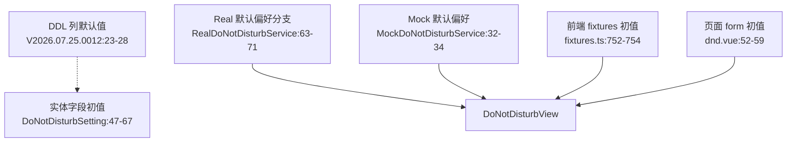

**图表来源**
- [V2026.07.25.0012__create_dnd_settings.sql:23-28](file://database/flyway/sql/V2026.07.25.0012__create_dnd_settings.sql#L23-L28)
- [DoNotDisturbSetting.java:46-67](file://apps/api/src/main/java/com/campuslove/api/entity/DoNotDisturbSetting.java#L46-L67)
- [RealDoNotDisturbService.java:59-72](file://apps/api/src/main/java/com/campuslove/api/growth/RealDoNotDisturbService.java#L59-L72)
- [MockDoNotDisturbService.java:32-34](file://apps/api/src/main/java/com/campuslove/api/growth/MockDoNotDisturbService.java#L32-L34)
- [fixtures.ts:750-754](file://apps/client/src/services/mocks/fixtures.ts#L750-L754)
- [dnd.vue:51-59](file://apps/client/src/subpackages/profile-extra/settings/dnd.vue#L51-L59)

**其余常量型配置**：错误文案集中于 `ErrorMessages`（L854-L875，8 条 `DND_*`）；`repeatMode` 白名单以注解内联正则形式硬编码（`DoNotDisturbRequest.java:34-35`），客户端 `RepeatMode` 联合类型（`dnd.vue:42`）与之重复声明；`updatedAt` 时区取 `TimeZones.BUSINESS`；开关激活色取 `designTokens.color.brand[500]` 而非 CSS 变量（`dnd.vue:29-39` 注释说明双源同步 `--c-brand(#36C99A)`）。

**没有的配置面**：仓库中没有勿扰功能的 feature flag、阈值配置、超时配置或热更新通道；`docs/` 下亦无该接口的规范文件。任何取值域变更（如新增 `MONTHDAYS`）都需要同时修改注解正则、客户端联合类型、i18n 选项与页面选项数组。

**章节来源**
- [RealDoNotDisturbService.java:27-29](file://apps/api/src/main/java/com/campuslove/api/growth/RealDoNotDisturbService.java#L27-L29)
- [MockDoNotDisturbService.java:13-18](file://apps/api/src/main/java/com/campuslove/api/growth/MockDoNotDisturbService.java#L13-L18)
- [api.ts:1180-1204](file://apps/client/src/services/api.ts#L1180-L1204)
- [DoNotDisturbRequest.java:34-35](file://apps/api/src/main/java/com/campuslove/api/growth/DoNotDisturbRequest.java#L34-L35)
- [ErrorMessages.java:854-875](file://apps/api/src/main/java/com/campuslove/api/common/ErrorMessages.java#L854-L875)
- [dnd.vue:29-42](file://apps/client/src/subpackages/profile-extra/settings/dnd.vue#L29-L42)

## 故障排查指南
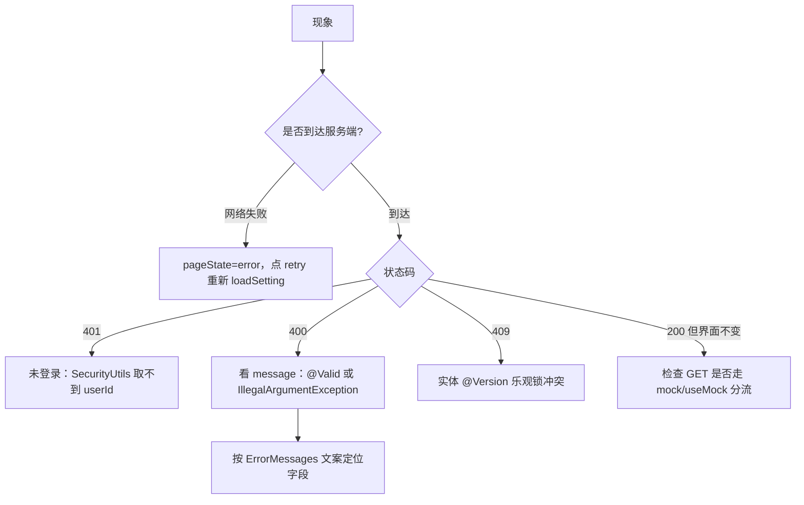

**图表来源**
- [dnd.vue:90-117](file://apps/client/src/subpackages/profile-extra/settings/dnd.vue#L90-L117)
- [DoNotDisturbController.java:27-33](file://apps/api/src/main/java/com/campuslove/api/growth/DoNotDisturbController.java#L27-L33)
- [DoNotDisturbController.java:70-77](file://apps/api/src/main/java/com/campuslove/api/growth/DoNotDisturbController.java#L70-L77)
- [RealDoNotDisturbService.java:94-126](file://apps/api/src/main/java/com/campuslove/api/growth/RealDoNotDisturbService.java#L94-L126)
- [DoNotDisturbSetting.java:80-91](file://apps/api/src/main/java/com/campuslove/api/entity/DoNotDisturbSetting.java#L80-L91)
- [api.ts:1180-1204](file://apps/client/src/services/api.ts#L1180-L1204)

### 按错误消息定位
| 消息（ErrorMessages 常量） | 触发条件 | 出处 |
|---|---|---|
| `DND_START_TIME_FORMAT` / `DND_END_TIME_FORMAT` | 时间不是两位 HH:mm（如 `9:00`、`09:00:00`） | `DoNotDisturbRequest.java:30-33` |
| `DND_REPEAT_MODE_INVALID` | `repeatMode` 不在四个枚举值内 | `DoNotDisturbRequest.java:34-35` |
| `DND_CUSTOM_WEEKDAYS_MAX_LENGTH` | `customWeekdays` 超过 16 字符 | `DoNotDisturbRequest.java:36` |
| `DND_CUSTOM_WEEKDAYS_REQUIRED` | `CUSTOM` 且 weekdays 为空/空白 | `RealDoNotDisturbService.java:105-108` |
| `DND_WEEKDAY_RANGE_PREFIX + 值` | CSV 中出现 <1 或 >7 的数字 | `RealDoNotDisturbService.java:114-115` |
| `DND_WEEKDAY_CSV_PREFIX + 值` | CSV 中存在非数字项（含空段的字母） | `RealDoNotDisturbService.java:117-119` |
| `DND_START_EQUALS_END` | 开始与结束时间字符串完全相同 | `RealDoNotDisturbService.java:123-126` |

排查顺序建议：先看响应体消息命中上表哪一条（前 3 条来自 Bean Validation，后 4 条来自服务层 `IllegalArgumentException`），再对照请求体字段。写端点还要求 `hasRole('USER')`，角色不匹配会被 Spring Security 拦在方法之前；其确切状态码由全局安全链决定，本轮未取证，不在此断言。

### 按现象定位
- **「设置保存成功但推送照旧」**：这是当前实现的预期行为，不是 bug。勿扰配置在服务端只有存取、没有消费点（`DoNotDisturb` 在 `apps/api` 仅 11 个文件命中，无推送/通知类），页面保存的只是偏好数据。
- **「GET 返回 22:00-08:00 但库里没有该行」**：无记录时 Real 返回默认偏好且不落库（`RealDoNotDisturbService.java:59-72`），首次 PUT 后才产生记录。
- **「mock profile 下重启后设置丢失」**：`MockDoNotDisturbService` 用进程内 `ConcurrentHashMap`，无持久化、无淘汰。
- **「mock 环境能通过、real 环境 400」**：mock 校验缺 1-7 值域与 CSV 规范化两条（对比 `MockDoNotDisturbService.java:54-64` 与 `RealDoNotDisturbService.java:105-126`）。
- **「保存后出现多条『设置已保存』toast」**：冷却机制处理，`SAVE_COOLDOWN_MS = 800` 在 `finally` 延迟复位 `isSaving`；历史缺陷编号 MP-R1-C24-001。
- **「从分享/深链进入免打扰页后点返回无反应」**：`goBack()` 在页面栈长度 ≤1 时改走 `switchTab('/pages/profile/index')`；编号 MP-R1-DND-001。
- **「接口 404」**：确认请求路径为 `/api/v1/dnd`（类级 `@RequestMapping` + 方法级空子路径），不要被控制器与客户端注释里的 `/api/dnd` 误导。
- **「页面跳转失败」**：确认 `pages.json:242` 的 `settings/dnd` 注册与 `routes.ts:170` 的 `/subpackages/profile-extra/settings/dnd` 一致；`settings/index.vue:106` 注释写的 `pages/settings/dnd` 是漂移文案，不可当作真值。
- **「并发保存后一方修改被吞」**：实体 `@Version` 会把并发覆盖显式化为乐观锁冲突（转 409），重试即可；`updated_at` 由 `TimeZones.BUSINESS` 写入且 DDL 侧也有 `ON UPDATE CURRENT_TIMESTAMP`，两者取其一生效即可解释时间戳差异。

**章节来源**
- [ErrorMessages.java:854-875](file://apps/api/src/main/java/com/campuslove/api/common/ErrorMessages.java#L854-L875)
- [RealDoNotDisturbService.java:94-155](file://apps/api/src/main/java/com/campuslove/api/growth/RealDoNotDisturbService.java#L94-L155)
- [MockDoNotDisturbService.java:45-76](file://apps/api/src/main/java/com/campuslove/api/growth/MockDoNotDisturbService.java#L45-L76)
- [DoNotDisturbRequest.java:28-38](file://apps/api/src/main/java/com/campuslove/api/growth/DoNotDisturbRequest.java#L28-L38)
- [DoNotDisturbController.java:17-36](file://apps/api/src/main/java/com/campuslove/api/growth/DoNotDisturbController.java#L17-L36)
- [dnd.vue:238-295](file://apps/client/src/subpackages/profile-extra/settings/dnd.vue#L238-L295)
- [V2026.07.25.0012__create_dnd_settings.sql:29-32](file://database/flyway/sql/V2026.07.25.0012__create_dnd_settings.sql#L29-L32)
- [pages.json:241-243](file://apps/client/src/pages.json#L241-L243)
- [routes.ts:169-171](file://apps/client/src/constants/routes.ts#L169-L171)
- [apps/client/src/subpackages/profile-extra/settings/index.vue:103-109](file://apps/client/src/subpackages/profile-extra/settings/index.vue#L103-L109)
- [ISSUE-CENSUS-2026-09-25.md:169-376](file://.zcode/research/ISSUE-CENSUS-2026-09-25.md#L169-L376)

## 结论
勿扰模式管理在当前仓库中的真实形态是一个**边界清晰、实现完整的偏好存取切片**：2 个端点（`GET/PUT /api/v1/dnd`）、1 个服务接口 + real/mock 双实现、1 张一人一行的 `dnd_settings` 表、1 个三态页面，加上集中在 `ErrorMessages` 的 8 条校验文案。它的优点是路径极短、身份来源单一、默认值语义明确、并发冲突显式化（`@Version` → 409）；它的确定性短板也同样来自这个精简设计。

与 catalog 期望的差距可归纳为三条：一是**没有决策侧**——时段、重复方式、紧急穿透三项数据没有任何服务端消费点，因此不存在「勿扰生效」这回事，冲突检测、优先级、通知过滤、时间区间计算、节假日、定时调度、热更新与监控告警均无实现证据；二是**规则缺自动化保护**——`DoNotDisturbControllerTest` 只做注入断言，服务层四条业务规则无单测；三是**契约分散**——接口未进入 `docs/` 的 OpenAPI 规范，默认值与枚举在 6 处冗余声明，任何扩展都要多点同步。

若要把本页描述的切片升级为规则引擎，最小改动路径已经可以从证据中读出：扩展表为多行规则（需先补 `user_id → users(id)` 外键并清理重复唯一键）、把 `repeatMode` 白名单从注解正则迁到枚举与配置、为 `RealDoNotDisturbService` 的校验分支补断言测试，并在通知发送侧建立对 `DoNotDisturbSettingRepository` 的首个消费点。在此之前，本页对该能力的准确定性是：**配置可存可显，效果尚未接入**。

**章节来源**
- [DoNotDisturbController.java:35-77](file://apps/api/src/main/java/com/campuslove/api/growth/DoNotDisturbController.java#L35-L77)
- [DoNotDisturbService.java:3-35](file://apps/api/src/main/java/com/campuslove/api/growth/DoNotDisturbService.java#L3-L35)
- [RealDoNotDisturbService.java:94-191](file://apps/api/src/main/java/com/campuslove/api/growth/RealDoNotDisturbService.java#L94-L191)
- [DoNotDisturbSetting.java:16-91](file://apps/api/src/main/java/com/campuslove/api/entity/DoNotDisturbSetting.java#L16-L91)
- [DoNotDisturbControllerTest.java:10-36](file://apps/api/src/test/java/com/campuslove/api/growth/DoNotDisturbControllerTest.java#L10-L36)
- [V2026.07.25.0012__create_dnd_settings.sql:20-33](file://database/flyway/sql/V2026.07.25.0012__create_dnd_settings.sql#L20-L33)
- [dnd.vue:243-282](file://apps/client/src/subpackages/profile-extra/settings/dnd.vue#L243-L282)
