# 应用配置管理

<cite>
**本文引用的文件**
- [AppConfigController.java](file://apps/api/src/main/java/com/campuslove/api/growth/AppConfigController.java)
- [AppConfigService.java](file://apps/api/src/main/java/com/campuslove/api/growth/AppConfigService.java)
- [RealAppConfigService.java](file://apps/api/src/main/java/com/campuslove/api/growth/RealAppConfigService.java)
- [MockAppConfigService.java](file://apps/api/src/main/java/com/campuslove/api/growth/MockAppConfigService.java)
- [AppConfigView.java](file://apps/api/src/main/java/com/campuslove/api/growth/AppConfigView.java)
- [RealPushSummaryService.java](file://apps/api/src/main/java/com/campuslove/api/growth/RealPushSummaryService.java)
- [AdminConfigController.java](file://apps/api/src/main/java/com/campuslove/api/admin/AdminConfigController.java)
- [AdminConfigService.java](file://apps/api/src/main/java/com/campuslove/api/admin/AdminConfigService.java)
- [RealAdminConfigService.java](file://apps/api/src/main/java/com/campuslove/api/admin/RealAdminConfigService.java)
- [ConfigUpdatedEvent.java](file://apps/api/src/main/java/com/campuslove/api/admin/event/ConfigUpdatedEvent.java)
- [AdminNotifyConfigController.java](file://apps/api/src/main/java/com/campuslove/api/admin/AdminNotifyConfigController.java)
- [AuditAsyncConfig.java](file://apps/api/src/main/java/com/campuslove/api/admin/audit/AuditAsyncConfig.java)
- [SecurityConfig.java](file://apps/api/src/main/java/com/campuslove/api/config/SecurityConfig.java)
- [JwtAuthenticationFilter.java](file://apps/api/src/main/java/com/campuslove/api/config/JwtAuthenticationFilter.java)
- [JwtTokenProvider.java](file://apps/api/src/main/java/com/campuslove/api/config/JwtTokenProvider.java)
- [AccountSecurityController.java](file://apps/api/src/main/java/com/campuslove/api/auth/AccountSecurityController.java)
- [AccountSecurityService.java](file://apps/api/src/main/java/com/campuslove/api/auth/AccountSecurityService.java)
- [RealAccountSecurityService.java](file://apps/api/src/main/java/com/campuslove/api/auth/RealAccountSecurityService.java)
- [AppConfigControllerTest.java](file://apps/api/src/test/java/com/campuslove/api/growth/AppConfigControllerTest.java)
- [JwtAuthenticationFilterTest.java](file://apps/api/src/test/java/com/campuslove/api/config/JwtAuthenticationFilterTest.java)
- [RealAccountSecurityServiceTest.java](file://apps/api/src/test/java/com/campuslove/api/auth/RealAccountSecurityServiceTest.java)
- [AccountSecurityControllerTest.java](file://apps/api/src/test/java/com/campuslove/api/auth/AccountSecurityControllerTest.java)
- [profile-tags.ts](file://apps/client/src/config/profile-tags.ts)
- [profile-svg.ts](file://apps/client/src/config/profile-svg.ts)
- [lighthouserc.json](file://config/lighthouserc.json)
- [feedback-growth-and-auth.yaml](file://docs/openapi/feedback-growth-and-auth.yaml)
</cite>

## 目录
1. [简介](#简介)
2. [项目结构](#项目结构)
3. [核心组件](#核心组件)
4. [架构总览](#架构总览)
5. [详细组件分析](#详细组件分析)
6. [配置项分类与命名](#配置项分类与命名)
7. [访问控制与安全](#访问控制与安全)
8. [能力边界核查](#能力边界核查)
9. [数据模型与统计口径](#数据模型与统计口径)
10. [依赖关系分析](#依赖关系分析)
11. [性能与缓存](#性能与缓存)
12. [验证与测试](#验证与测试)
13. [故障排查指南](#故障排查指南)
14. [结论](#结论)

## 简介

本页文档化「恋爱小程序」后端仓库中与**应用配置管理**相关的真实实现，落点在两个声明依赖类与其相邻的配置文件：

- `AppConfigController`：应用配置读取入口，挂载在 `/api/v1/app-config`，当前对外暴露登录页主视觉配置（`/login-hero`）与整体应用配置两个查询接口。它是**只读**端点集合，不含写入、更新、版本切换能力。
- `RealPushSummaryService`：推送摘要服务，负责按用户维度聚合社交动态、生成推荐刷新提示，并维护摘要的「已发送」标记，是配置之外的运营侧数据产出者。
- 客户端侧配置：`apps/client/src/config/` 下的 `profile-tags.ts`、`profile-svg.ts` 两份 TypeScript 常量清单，承担前端可见的配置项分类与文案映射。

需要明确说明的现状：仓库中**没有**配置中心（Nacos / Apollo）的接入证据，配置项存放于数据库的 `app_switch` / `app_rule` / `app_config` / `app_login_hero_config` 四张表，**动态更新由管理后台的 `PUT /api/v1/admin/configs|rules|switches` 端点完成**（不在 `AppConfigController` 上）；而版本管理、灰度发布、配置模板、批量操作、导入导出、回滚与应用配置值加密在当前代码中**均无落地实现**，本文以「能力边界核查」一节逐项记录该结论及其证据。本页取证范围内也未定位到这四张表的建表 / seed SQL 文件，表名与字段集取自类注释、实体 getter 调用点与 `to*View()` 映射。

**章节来源**
- [AppConfigController.java:14-43](file://apps/api/src/main/java/com/campuslove/api/growth/AppConfigController.java#L14-L43)
- [AppConfigService.java:9-68](file://apps/api/src/main/java/com/campuslove/api/growth/AppConfigService.java#L9-L68)
- [RealPushSummaryService.java:44-45](file://apps/api/src/main/java/com/campuslove/api/growth/RealPushSummaryService.java#L44-L45)
- [AdminConfigController.java:43-155](file://apps/api/src/main/java/com/campuslove/api/admin/AdminConfigController.java#L43-L155)

## 项目结构

应用配置管理的实现集中在后端 `apps/api` 的 `growth` 包（配置读取与推送摘要），配置写入侧由 `admin` 包的管理后台接口承担，配置消费侧由 `apps/client` 的 TypeScript 常量与启动期拉取逻辑承担。

```
apps/api/src/main/java/com/campuslove/api/
├── growth/
│   ├── AppConfigController.java        # /api/v1/app-config 只读端点（43 行）
│   ├── AppConfigService.java           # 配置服务接口 + 开关/规则 Key 常量（69 行）
│   ├── RealAppConfigService.java       # real profile 实现：三表聚合 + 降级（291 行）
│   ├── MockAppConfigService.java       # mock profile 实现
│   ├── AppConfigView.java              # 客户端配置聚合视图 record（29 行）
│   ├── LoginHeroConfigView.java        # 登录主视觉视图
│   └── RealPushSummaryService.java     # 推送摘要服务（323 行）
├── config/
│   └── SecurityConfig.java             # /api/v1/app-config/** 放行规则
└── entity/ repository/                 # AdminAppSwitch / AdminAppRule / AppLoginHeroConfig 及其 Repository

apps/client/src/config/
├── profile-svg.ts                      # 头像底图配置清单（51 行）
└── profile-tags.ts                     # 资料标签分组配置（165 行）
```

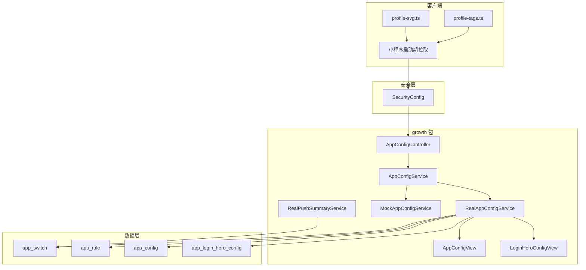

图中 `app_switch` / `app_rule` / `app_config` / `app_login_hero_config` 四张表名取自类注释与 `RealAppConfigService` 的注入 Repository 名称；`RealPushSummaryService` 与开关表的连线仅为示意（该类实际依赖推送相关表，见「数据模型与统计口径」）。

**章节来源**
- [AppConfigController.java:14-43](file://apps/api/src/main/java/com/campuslove/api/growth/AppConfigController.java#L14-L43)
- [AppConfigService.java:7-68](file://apps/api/src/main/java/com/campuslove/api/growth/AppConfigService.java#L7-L68)
- [RealAppConfigService.java:23-89](file://apps/api/src/main/java/com/campuslove/api/growth/RealAppConfigService.java#L23-L89)
- [AppConfigView.java:24-29](file://apps/api/src/main/java/com/campuslove/api/growth/AppConfigView.java#L24-L29)
- [RealPushSummaryService.java:43-45](file://apps/api/src/main/java/com/campuslove/api/growth/RealPushSummaryService.java#L43-L45)
- [SecurityConfig.java:129-129](file://apps/api/src/main/java/com/campuslove/api/config/SecurityConfig.java#L129-L129)
- [profile-tags.ts:25-104](file://apps/client/src/config/profile-tags.ts#L25-L104)
- [profile-svg.ts:13-51](file://apps/client/src/config/profile-svg.ts#L13-L51)

## 核心组件

| 组件 | 类型 | 职责 | 证据位置 |
| --- | --- | --- | --- |
| `AppConfigController` | `@RestController` | 对外暴露 `/api/v1/app-config` 与 `/api/v1/app-config/login-hero` 两个只读查询端点 | `growth/AppConfigController.java` L14-L42 |
| `AppConfigService` | 接口 | 定义 `getLoginHeroConfig()` / `getClientConfig()` / `isSwitchEnabled(String)` 三个方法，并集中声明 7 个功能开关 Key 与 2 个业务规则 Key | `growth/AppConfigService.java` L9-L68 |
| `RealAppConfigService` | `@Profile("real")` `@Service` | 从 `app_switch` / `app_rule` / `app_config` / `app_login_hero_config` 读取并聚合，异常时整体降级为内置默认值 | `growth/RealAppConfigService.java` L23-L198 |
| `MockAppConfigService` | `@Profile("mock")` `@Service` | 与真实实现同接口的内存实现，硬编码同一组默认值且 `isSwitchEnabled()` 恒为 `true`，供前端联调 | `growth/MockAppConfigService.java` L13-L76 |
| `AppConfigView` | Java `record` | 客户端配置聚合视图：`switches` / `rules` / `siteTitle` 三分量 | `growth/AppConfigView.java` L24-L29 |
| `LoginHeroConfigView` | 视图对象 | 登录页主视觉九分量（模式、视频地址、海报、动画主题、主副标题、两行描述、视频回退标记） | 构造点见 `growth/RealAppConfigService.java` L259-L269 |
| `AdminConfigController` | `@RestController` | 管理后台侧配置读写：`GET/PUT /api/v1/admin/configs`、`/rules`、`/switches` | `admin/AdminConfigController.java` L43-L155 |
| `AdminConfigService` / `RealAdminConfigService` | 接口 + 真实实现 | `listConfigs` / `updateConfig` / `listRules` / `updateRule` / `listSwitches` / `updateSwitch`，写操作带 `operatorId` | `admin/AdminConfigService.java` L26-L73、`admin/RealAdminConfigService.java` L52-L244 |
| `ConfigUpdatedEvent` | `ApplicationEvent` | 配置更新事件载体，位于 `admin/event` | `admin/event/ConfigUpdatedEvent.java` L25 |
| `RealPushSummaryService` | `@Profile("real")` `@Service` | 推送摘要生成与发送标记，是配置之外的运营数据产出者 | `growth/RealPushSummaryService.java` L43-L322 |
| `SecurityConfig` | 安全配置 | `.requestMatchers("/api/v1/app-config/**").permitAll()` 使配置端点免登录可达 | `config/SecurityConfig.java` L129 |
| `profile-tags.ts` / `profile-svg.ts` | TS 常量模块 | 客户端侧资料标签分组与头像底图配置清单 | `apps/client/src/config/profile-tags.ts` L25-L148、`profile-svg.ts` L13-L51 |

组件之间关系可以概括为三句话：

1. **读路径**（对客户端）：`AppConfigController` → `AppConfigService` → `RealAppConfigService` → 三张配置表 + Hero 表，产出 `AppConfigView` / `LoginHeroConfigView`。控制器本身只做委托，`getLoginHero()` 与 `getAppConfig()` 各自仅有一行转发调用。
2. **写路径**（对管理后台）：`AdminConfigController` → `AdminConfigService` → `RealAdminConfigService`，以 `PUT /configs/{key}`、`PUT /rules/{id}`、`PUT /switches/{key}` 三种粒度更新，并广播 `ConfigUpdatedEvent`。
3. **强制路径**（对后端业务）：各业务强制点通过 `AppConfigService.isSwitchEnabled(switchKey)` 复用与 `getClientConfig()` 相同的数据源，保证前后端判定口径一致。

**章节来源**
- [AppConfigController.java:14-43](file://apps/api/src/main/java/com/campuslove/api/growth/AppConfigController.java#L14-L43)
- [AppConfigService.java:9-68](file://apps/api/src/main/java/com/campuslove/api/growth/AppConfigService.java#L9-L68)
- [RealAppConfigService.java:23-198](file://apps/api/src/main/java/com/campuslove/api/growth/RealAppConfigService.java#L23-L198)
- [AppConfigView.java:24-29](file://apps/api/src/main/java/com/campuslove/api/growth/AppConfigView.java#L24-L29)
- [AdminConfigController.java:43-155](file://apps/api/src/main/java/com/campuslove/api/admin/AdminConfigController.java#L43-L155)
- [AdminConfigService.java:26-73](file://apps/api/src/main/java/com/campuslove/api/admin/AdminConfigService.java#L26-L73)
- [RealAdminConfigService.java:52-244](file://apps/api/src/main/java/com/campuslove/api/admin/RealAdminConfigService.java#L52-L244)
- [ConfigUpdatedEvent.java:25-25](file://apps/api/src/main/java/com/campuslove/api/admin/event/ConfigUpdatedEvent.java#L25-L25)
- [RealPushSummaryService.java:43-322](file://apps/api/src/main/java/com/campuslove/api/growth/RealPushSummaryService.java#L43-L322)
- [MockAppConfigService.java:13-76](file://apps/api/src/main/java/com/campuslove/api/growth/MockAppConfigService.java#L13-L76)
- [SecurityConfig.java:129-129](file://apps/api/src/main/java/com/campuslove/api/config/SecurityConfig.java#L129-L129)

## 架构总览

配置体系在运行时分为「客户端拉取」与「后台写入」两条互不相交的主链路，两者通过同一组数据表（`app_config` / `app_rule` / `app_switch`）与同一个 Spring Cache 名称（`CacheNames.SYSTEM_CONFIG`）产生耦合。

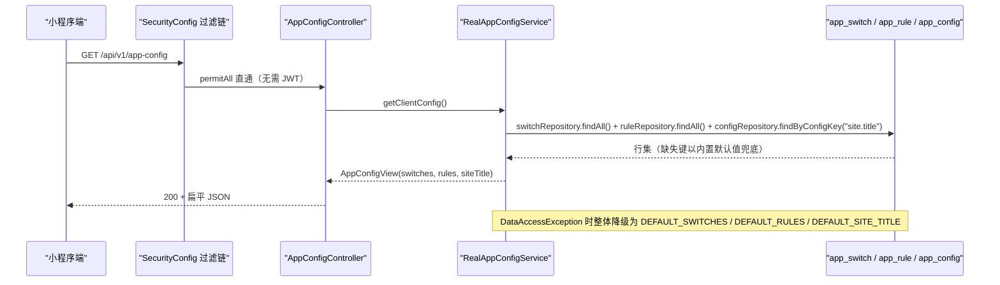

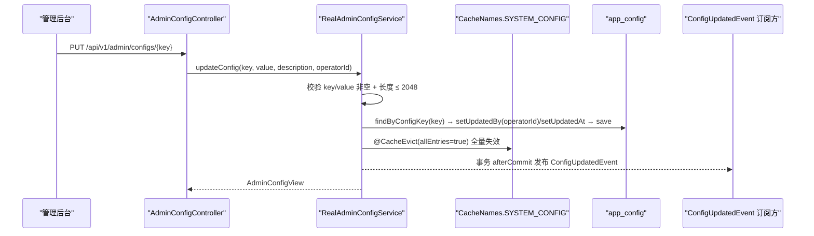

两条链路的关键差异在于：**读链路不做服务端缓存**（`RealAppConfigService` 直接查库以保证「后台改完下一次拉取即生效」），而**后台列表链路使用 `@Cacheable` 缓存 30 分钟**并在写入时 `@CacheEvict(allEntries = true)`。这一不对称是理解「配置何时生效」的核心。

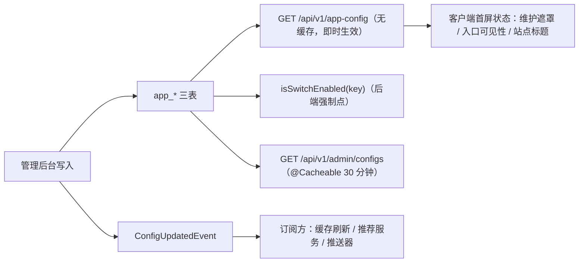

[此图最后一段 flowchart 中订阅方节点来自 `RealAdminConfigService` 类注释对订阅者的描述，具体订阅者实现未在本页取证范围内。]

**图表来源**
- [AppConfigController.java:24-42](file://apps/api/src/main/java/com/campuslove/api/growth/AppConfigController.java#L24-L42)
- [RealAppConfigService.java:138-198](file://apps/api/src/main/java/com/campuslove/api/growth/RealAppConfigService.java#L138-L198)
- [AppConfigView.java:5-29](file://apps/api/src/main/java/com/campuslove/api/growth/AppConfigView.java#L5-L29)
- [RealAdminConfigService.java:86-155](file://apps/api/src/main/java/com/campuslove/api/admin/RealAdminConfigService.java#L86-L155)
- [AdminConfigController.java:56-126](file://apps/api/src/main/java/com/campuslove/api/admin/AdminConfigController.java#L56-L126)
- [SecurityConfig.java:129-129](file://apps/api/src/main/java/com/campuslove/api/config/SecurityConfig.java#L129-L129)

**章节来源**
- [RealAppConfigService.java:26-52](file://apps/api/src/main/java/com/campuslove/api/growth/RealAppConfigService.java#L26-L52)
- [RealAdminConfigService.java:26-49](file://apps/api/src/main/java/com/campuslove/api/admin/RealAdminConfigService.java#L26-L49)
- [AppConfigService.java:47-68](file://apps/api/src/main/java/com/campuslove/api/growth/AppConfigService.java#L47-L68)

## 详细组件分析

### AppConfigController：两个只读端点

`AppConfigController` 全文 43 行，是一个纯委托型控制器：类上标注 `@RestController` 与 `@RequestMapping("/api/v1/app-config")`，构造注入 `AppConfigService`，两个方法各自只有一行转发调用，无参数校验、无响应包装、无异常处理分支。

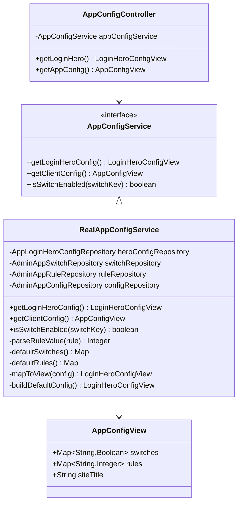

| HTTP | 路径 | 方法 | 返回类型 | 认证要求 |
| --- | --- | --- | --- | --- |
| GET | `/api/v1/app-config/login-hero` | `getLoginHero()` → `AppConfigService.getLoginHeroConfig()` | `LoginHeroConfigView` | 免登录（`/api/v1/app-config/**` permitAll） |
| GET | `/api/v1/app-config` | `getAppConfig()` → `AppConfigService.getClientConfig()` | `AppConfigView` | 免登录 |

两个端点都**没有**写方法：类中不存在 `@PostMapping` / `@PutMapping` / `@DeleteMapping`，因此「动态更新」能力不在 `AppConfigController` 上，而在 `AdminConfigController`（见下文与「能力边界核查」）。

`getLoginHero()` 返回的 `LoginHeroConfigView` 由 `RealAppConfigService.mapToView()` 以九参构造组装，分量顺序为 `heroMode`、`heroVideoUrl`、`heroPosterUrl`、`heroAnimationTheme`、`heroTitle`、`heroSubtitle`、`heroDesc`、`heroDescSub`、`videoFallback`；其中 `videoFallback` 并非来自数据库列——注释明确说明「数据库表中无 video_fallback_to_animation 列」，当前实现统一赋 `DEFAULT_VIDEO_FALLBACK = true`。

### RealAppConfigService：三表聚合与降级兜底

真实实现受 `@Profile("real")` 约束，仅在 real profile 下注册为 Bean；与之并列的 `MockAppConfigService` 标注 `@Profile("mock")` + `@Service`（L13-L15），其 `getClientConfig()`（L50-L64）不做任何数据库读取，而是把与真实实现完全相同的七个开关键、两条规则键和 `"校园恋爱"` 标题硬编码进 `LinkedHashMap` 后返回 `AppConfigView`，`isSwitchEnabled()` 更是无条件 `return true`（L74-L75）。这意味着 **mock profile 下所有功能开关强制点都不会拦截请求**——联调环境观察到的「开关不生效」不是缺陷，而是该实现的约定行为。

`getClientConfig()` 的合并算法是「**内置默认值为底 + DB 行按键覆盖**」：

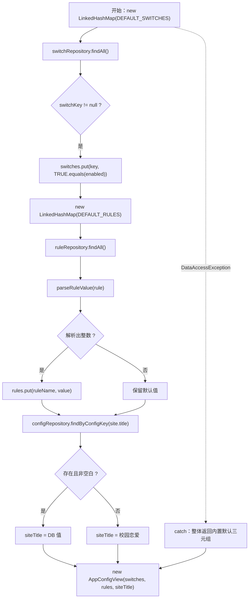

三条降级语义值得单独记录：

1. **开关语义**：`Boolean.TRUE.equals(sw.getEnabled())` 表示 DB 中 `enabled` 为 `NULL` 的行会被判为**关闭**；而 `isSwitchEnabled()` 对「查不到该行」返回 `true`（默认开启）。两者口径不同，前者是「显式行值优先」，后者是「缺行即放行」，调用方必须区分。
2. **规则语义**：`parseRuleValue()` 仅在表达式非空、非空白且 `enabled == TRUE` 时尝试 `Integer.parseInt`；非整数会 `log.warn` 并返回 `null`，调用方保留默认值。因此 `app_rule` 中写入了非法表达式不会导致接口 500，只会静默回落到 `10` / `48`。
3. **异常语义**：`getClientConfig()` 与 `getLoginHeroConfig()` 均 `catch (DataAccessException)` 后返回内置默认值，登录页与首屏在数据库不可用时仍可渲染；`isSwitchEnabled()` 同样在异常时返回 `true`，注释理由是「避免数据库抖动导致业务被误拦截」。

内置默认值来自两个静态工厂：`defaultSwitches()`（`maintenance_mode=false`，其余 6 个开关 `=true`）与 `defaultRules()`（`daily_recommend_limit=10`、`heart_signal_expire_hours=48`），注释标注其与 Flyway seed `V2026.06.25.0005` 保持一致。Hero 默认值为 `animation` / `romantic` / 「遇见对的人」/「校园恋爱，从这里开始」/「慢慢成为特别的人」/「校园里的每一次相遇都有美好记录」，视频与海报 URL 默认为 `null`。

### 管理后台写路径

`AdminConfigController`（`@RequestMapping("/api/v1/admin")`）暴露三组读写端点，请求体以 `record` 形式定义在同类文件内（`UpdateConfigRequest`、`UpdateRuleRequest`、`UpdateSwitchRequest`）：

| HTTP | 路径 | 服务方法 | 缓存动作 |
| --- | --- | --- | --- |
| GET | `/api/v1/admin/configs` | `listConfigs()` | `@Cacheable(SYSTEM_CONFIG, key='all')` |
| PUT | `/api/v1/admin/configs/{key}` | `updateConfig(key, value, description, operatorId)` | `@CacheEvict(SYSTEM_CONFIG, allEntries=true)` |
| GET | `/api/v1/admin/rules` | `listRules()` | `@Cacheable(SYSTEM_CONFIG, key='rules')` |
| PUT | `/api/v1/admin/rules/{id}` | `updateRule(id, expression, enabled, description, operatorId)` | 无（未见 `@CacheEvict`） |
| GET | `/api/v1/admin/switches` | `listSwitches()` | `@Cacheable(SYSTEM_CONFIG, key='switches')` |
| PUT | `/api/v1/admin/switches/{key}` | `updateSwitch(key, enabled, operatorId)` | 无（未见 `@CacheEvict`） |

`RealAdminConfigService.updateConfig()` 是三个写方法中唯一带事件广播的：写入前校验 `key` 非空（`ErrorMessages.CONFIG_KEY_REQUIRED`）、`value` 非空（`CONFIG_VALUE_REQUIRED`）与长度上限 2048（`CONFIG_VALUE_MAX_LENGTH_PREFIX`）；写入时把 `updatedBy = operatorId`、`updatedAt = now(TimeZones.BUSINESS)` 落库；提交后用 `TransactionSynchronizationManager.registerSynchronization(...afterCommit)` 发布 `ConfigUpdatedEvent.of(this, saved, operatorId)`，且事件发布失败只 `log.warn` 不影响主流程。`updateRule()` / `updateSwitch()` 同样写 `updatedBy` / `updatedAt`，但没有事件发布与缓存驱逐代码。

**章节来源**
- [AppConfigController.java:14-43](file://apps/api/src/main/java/com/campuslove/api/growth/AppConfigController.java#L14-L43)
- [AppConfigService.java:9-68](file://apps/api/src/main/java/com/campuslove/api/growth/AppConfigService.java#L9-L68)
- [RealAppConfigService.java:23-290](file://apps/api/src/main/java/com/campuslove/api/growth/RealAppConfigService.java#L23-L290)
- [AppConfigView.java:5-29](file://apps/api/src/main/java/com/campuslove/api/growth/AppConfigView.java#L5-L29)
- [AdminConfigController.java:43-155](file://apps/api/src/main/java/com/campuslove/api/admin/AdminConfigController.java#L43-L155)
- [AdminConfigService.java:26-73](file://apps/api/src/main/java/com/campuslove/api/admin/AdminConfigService.java#L26-L73)
- [RealAdminConfigService.java:26-252](file://apps/api/src/main/java/com/campuslove/api/admin/RealAdminConfigService.java#L26-L252)
- [MockAppConfigService.java:13-76](file://apps/api/src/main/java/com/campuslove/api/growth/MockAppConfigService.java#L13-L76)
- [LoginHeroConfigView.java](file://apps/api/src/main/java/com/campuslove/api/growth/LoginHeroConfigView.java)

### RealPushSummaryService：推送摘要与触达统计

该类 323 行，`@Profile("real")` + `@Service`，实现 `PushSummaryService` 接口，构造注入 8 个 Repository（`PushSummaryRepository`、`PushPreferenceRepository`、`VisitorRepository`、`LikeRepository`、`PostRepository`、`PostLikeRepository`、`CommentRepository`、`RecommendationPreferenceRepository`）。三个公开方法均带 `@Transactional`。

`generateSocialDigest(Long userId)` 的统计口径（**用户触达分析的实际实现**）：

- 时间窗：`LocalDateTime.now(TimeZones.BUSINESS).minusHours(24)`，自然日判定亦使用 `TimeZones.BUSINESS`。
- 访客数：`visitorRepository.findByVisitedUserIdOrderByCreatedAtDesc(userId)` 全量取出后在流内按 `createdAt.isAfter(since24h)` 过滤计数。
- 喜欢数：`likeRepository.findByTargetUserIdAndStatus(userId, LikeStatus.active)` 后同样在内存按 24h 过滤。
- 帖子互动数：遍历 `postRepository.findByAuthorId(userId)`，每个帖子累加 `postLikeRepository.countByPostId(postId)`（**源码注释明确：该计数不按时间过滤，是「使用总数近似」**）与 24h 内评论数。
- 文案分支：三项全为 0 → 标题「今天还没有新动态」；否则标题「你收到了新的社交动态」，正文按「N 人查看了你的主页 / N 人喜欢了你 / 帖子获得 N 次互动」用中文逗号拼接，仅拼接非零项。
- 落库：`summaryType = "social_digest"`，`actionUrl = "/pages/likes/index"`，`isSent = false`，`generatedAt = now(BUSINESS)`。

`generateRecommendRefresh(Long userId)` 的判定链：先查 `PushPreference.getPushEnabled()`（关闭则返回 `null`）→ 查当日是否已有 `recommend_refresh`（有则返回既有行）→ 读 `RecommendationPreference.getPreferredTime()`，缺省 `"12:00"`，格式非法时 `catch DateTimeParseException` 并 `log.warn` 降级为 `12:00` → `now.isBefore(prefTime)` 时返回 `null` → 否则写固定文案（标题「今日推荐已更新」，`actionUrl = "/pages/discover/index"`）。

`markSent(Long summaryId)` 是**唯一带越权校验**的方法：通过 `SecurityUtils.getCurrentUserId()` 取当前用户，与 `summary.getUserId()` 不等时抛 `ErrorMessages.PUSH_SUMMARY_FORBIDDEN`；捕获 `HttpClientErrorException`（未认证）时抛 `IllegalStateException(ErrorMessages.PUSH_MARK_UNAUTHENTICATED)`；成功后置 `isSent = true` 与 `sentAt = now(BUSINESS)`。

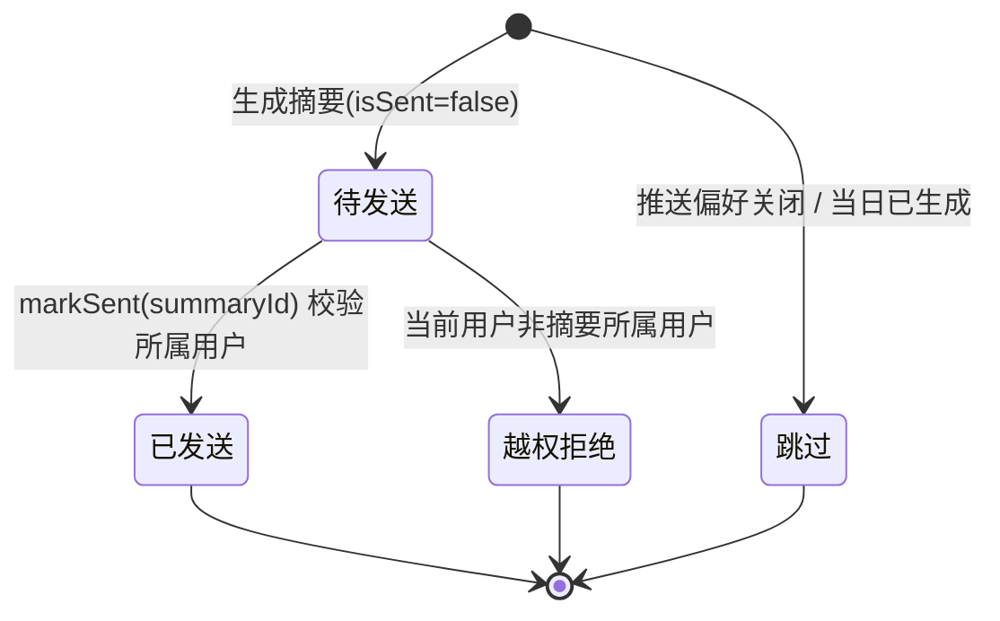

**效果评估报告能力**：本类只落 `isSent` / `sentAt` 两个状态字段，仓库内未见对摘要的点击率、到达率或转化率聚合代码，`generateSocialDigest` 的 `log.info` 是唯一的运行期观测输出。该结论属于「无接入证据」，详见「能力边界核查」。

**章节来源**
- [RealPushSummaryService.java:43-322](file://apps/api/src/main/java/com/campuslove/api/growth/RealPushSummaryService.java#L43-L322)
- [RealPushSummaryService.java:98-199](file://apps/api/src/main/java/com/campuslove/api/growth/RealPushSummaryService.java#L98-L199)
- [RealPushSummaryService.java:213-279](file://apps/api/src/main/java/com/campuslove/api/growth/RealPushSummaryService.java#L213-L279)
- [RealPushSummaryService.java:291-322](file://apps/api/src/main/java/com/campuslove/api/growth/RealPushSummaryService.java#L291-L322)

## 配置项分类与命名

仓库中的配置项按**存储载体 + 值类型 + 消费方**三个维度分成四类，分类边界在代码里是可核查的：

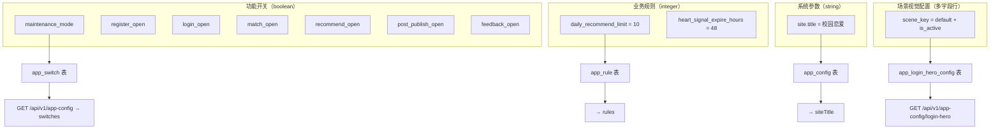

| 类别 | 存储 | 键风格 | Java 常量 | 客户端消费字段 | 缺失时行为 |
| --- | --- | --- | --- | --- | --- |
| 功能开关 | `app_switch`（`switchKey` / `enabled` / `description`） | `snake_case`，语义为「是否开放」 | `AppConfigService.SWITCH_MAINTENANCE_MODE` 等 7 个 | `switches`（`Map<String,Boolean>`） | `getClientConfig()` 用内置默认（仅 `maintenance_mode` 默认 `false`，其余默认 `true`）；`isSwitchEnabled()` 缺行返回 `true` |
| 业务规则 | `app_rule`（`ruleName` / `ruleExpression` / `enabled` / `description`） | `snake_case` | `RULE_DAILY_RECOMMEND_LIMIT`、`RULE_HEART_SIGNAL_EXPIRE_HOURS` | `rules`（`Map<String,Integer>`） | 表达式非整数或行未启用 → 保留默认 `10` / `48` |
| 系统参数 | `app_config`（`configKey` / `configValue` / `description`） | **点分命名空间** `site.title` | `RealAdminConfigService` 与 `RealAppConfigService` 各自声明 `CONFIG_KEY_SITE_TITLE = "site.title"` | `siteTitle`（`String`） | 缺行或空白值 → `"校园恋爱"` |
| 场景视觉配置 | `app_login_hero_config`（`sceneKey` / `isActive` / 8 个 hero 字段） | 场景维度而非键值 | `DEFAULT_SCENE_KEY = "default"` | `LoginHeroConfigView` | 无激活行或查询异常 → `buildDefaultConfig()` |

命名上有一条需要留意的**不一致**：开关与规则使用 `snake_case`，系统参数使用 `site.title` 这类点分键，两种风格在同一套后台界面里并存；且 `site.title` 这个字面量在 `RealAppConfigService` L56 与 `RealAdminConfigService` 的读写路径中分别出现，未上升为共享常量。新增配置项时应遵循「先在 `AppConfigService` 声明常量、再在 seed 中同名落库」的顺序——接口注释明确写了这些 Key「与 app_switch 表 seed 一致」。

客户端侧另有一套**与后端无关的静态配置清单**，同样是「配置管理」的组成部分：`profile-tags.ts` 以 `ProfileTagGroupKey`、`ProfileTagOption`、`ProfileTagGroup` 三个导出类型描述资料标签分组，导出 `profileTagGroups` 常量数组（L70）并提供 `getProfileTagLabel(key)`（L148）做键到文案的映射；`profile-svg.ts` 导出 `profileSvg`（L13）与 `ProfileSvgKey`（L51）。这两份清单是编译期常量，改动需要发版，不属于 `app-config` 接口的动态范围。

**章节来源**
- [AppConfigService.java:9-40](file://apps/api/src/main/java/com/campuslove/api/growth/AppConfigService.java#L9-L40)
- [RealAppConfigService.java:29-66](file://apps/api/src/main/java/com/campuslove/api/growth/RealAppConfigService.java#L29-L66)
- [RealAppConfigService.java:224-244](file://apps/api/src/main/java/com/campuslove/api/growth/RealAppConfigService.java#L224-L244)
- [RealAdminConfigService.java:56-57](file://apps/api/src/main/java/com/campuslove/api/admin/RealAdminConfigService.java#L56-L57)
- [RealAdminConfigService.java:220-252](file://apps/api/src/main/java/com/campuslove/api/admin/RealAdminConfigService.java#L220-L252)
- [AppConfigView.java:11-28](file://apps/api/src/main/java/com/campuslove/api/growth/AppConfigView.java#L11-L28)
- [profile-tags.ts:25-148](file://apps/client/src/config/profile-tags.ts#L25-L148)
- [profile-svg.ts:13-51](file://apps/client/src/config/profile-svg.ts#L13-L51)

## 访问控制与安全

配置读写的鉴权完全由 `SecurityConfig` 的匹配器决定，本页取证到的规则有三条直接相关：

- `.requestMatchers("/api/v1/app-config/**").permitAll()`（L129）——配置读取**面向匿名**，这是小程序冷启动（尚未拿到 token）能拉到维护模式与站点标题的前提。同文件的注释还提到未登录阶段（冷启动 `/app-config`、`/auth/me` 失败）也需要上报能力（L139），与该放行的动机一致。
- `.requestMatchers("/api/v1/admin/**").hasRole("ADMIN")`（L175）——包括 `configs` / `rules` / `switches` 在内的全部管理端读写收敛到 ADMIN 角色，注释明确理由为「防止普通用户越权访问」，且路径在 Task 2.4.1 中统一升级为 `/api/v1/admin/**`。
- `.requestMatchers("/swagger-ui/**", "/swagger-ui.html", "/v3/api-docs/**", "/v3/api-docs.yaml").hasRole("ADMIN")`（L162-L163）与 `.requestMatchers("/actuator/**").hasRole("ADMIN")`（L167，`/actuator/health` 例外 permitAll）——配置文档与运行时指标不外泄。

由此形成一条清晰的**信息分级**：客户端只拿到 `AppConfigView` 的三分量扁平子集（其类注释写明「仅包含对客户端开放的配置子集，与管理后台的 `AdminConfigView` / `AdminSwitchView` / `AdminRuleView` 信封结构解耦」），而含 `updatedBy`、`updatedAt`、`description` 的完整审计字段只在 ADMIN 角色下可见。

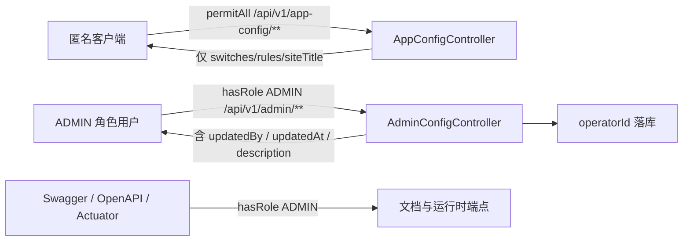

**操作者追溯**：`updateConfig` / `updateRule` / `updateSwitch` 三个写方法都以 `operatorId` 入参，并在保存前 `setUpdatedBy(operatorId)` + `setUpdatedAt(LocalDateTime.now(TimeZones.BUSINESS))`；对应视图记录（`AdminConfigView` 六分量、`AdminRuleView` / `AdminSwitchView` 七分量）也把这两个字段回传前端，构成「谁在什么时候改了哪一项」的最小可追溯单元。

**与认证体系的耦合点**：配置链路本身不自建鉴权，而是复用 JWT 过滤器链。`JwtAuthenticationFilter`（`@Component`，290 行）内部维护 `UserAuthSnapshot`（L97）并暴露 `strictMediaQueryToken` 开关字段（L115）；`JwtTokenProvider`（438 行）提供 `generateToken` / `generateMediaToken` / `getTokenScope` / `validateToken` / `revokeToken` / `isTokenRevoked` / `cleanupExpiredRevokedTokens` 等方法，并通过 `RedissonClient`（L78）把吊销名单外置到 Redis。ADMIN 角色的实际来源即该过滤器写入的认证信息，因此「配置端点越权」类问题的排查顺序应当是：先确认 token 是否被吊销（`isTokenRevoked`），再确认角色声明，最后才看匹配器。

**加密存储的现状**：AES 能力在仓库中确实存在，但落在账号安全链路而非应用配置链路——`RealAccountSecurityServiceTest` 的依赖字段中包含 `AesEncryptor aesEncryptor`（L44）与 `PasswordEncoder`、`DeviceSessionService`、`TokenBlacklistService`，说明加密对象是账号侧敏感字段（如手机号）。相反，`RealAdminConfigService.updateConfig()` 是 `config.setConfigValue(value)` 明文落库、`RealAppConfigService` 是明文读出，**没有任何加密或解密调用**。因此不能声称「配置项加密存储」；能声称的是配置值有 2048 字符长度上限校验（`MAX_CONFIG_VALUE_LENGTH`）以防止超长脏配置入库。

**账号侧的相邻控制**（同属「配置/安全」语义但不在配置表链路上）：`AccountSecurityController` 以 `/api/v1/auth` 提供 `POST /change-password`、`POST /change-phone`、`GET /devices`、`POST /devices/{id}/revoke`、`POST /deactivate` 端点，请求体为 `ChangePasswordRequest`（L163）、`ChangePhoneRequest`（L177）、`DeactivateRequest`（L190）三个内嵌 record；`RealAccountSecurityService` 的 `changePassword(...)` 显式接收 `currentToken`，`deactivateAccount(...)` 额外要求 `confirmationText`，属于「敏感操作二次确认」模式。

**章节来源**
- [SecurityConfig.java:129-176](file://apps/api/src/main/java/com/campuslove/api/config/SecurityConfig.java#L129-L182)
- [AppConfigView.java:6-18](file://apps/api/src/main/java/com/campuslove/api/growth/AppConfigView.java#L6-L18)
- [AdminConfigController.java:43-155](file://apps/api/src/main/java/com/campuslove/api/admin/AdminConfigController.java#L43-L155)
- [RealAdminConfigService.java:56-57](file://apps/api/src/main/java/com/campuslove/api/admin/RealAdminConfigService.java#L56-L57)
- [RealAdminConfigService.java:108-128](file://apps/api/src/main/java/com/campuslove/api/admin/RealAdminConfigService.java#L108-L128)
- [RealAdminConfigService.java:167-218](file://apps/api/src/main/java/com/campuslove/api/admin/RealAdminConfigService.java#L167-L218)
- [RealAdminConfigService.java:220-252](file://apps/api/src/main/java/com/campuslove/api/admin/RealAdminConfigService.java#L220-L252)
- [JwtAuthenticationFilter.java:47-115](file://apps/api/src/main/java/com/campuslove/api/config/JwtAuthenticationFilter.java#L47-L115)
- [JwtTokenProvider.java:37-78](file://apps/api/src/main/java/com/campuslove/api/config/JwtTokenProvider.java#L37-L78)
- [JwtTokenProvider.java:265-387](file://apps/api/src/main/java/com/campuslove/api/config/JwtTokenProvider.java#L265-L387)
- [RealAccountSecurityServiceTest.java:37-45](file://apps/api/src/test/java/com/campuslove/api/auth/RealAccountSecurityServiceTest.java#L37-L45)
- [RealAccountSecurityService.java:32-169](file://apps/api/src/main/java/com/campuslove/api/auth/RealAccountSecurityService.java#L32-L169)
- [AccountSecurityController.java:33-190](file://apps/api/src/main/java/com/campuslove/api/auth/AccountSecurityController.java#L33-L190)
- [AccountSecurityService.java:10-52](file://apps/api/src/main/java/com/campuslove/api/auth/AccountSecurityService.java#L10-L52)

## 能力边界核查

生成指令要求覆盖「动态更新、版本管理、灰度发布、变更审计、回滚、缓存策略、配置模板、批量操作、导入导出、加密存储」。下表逐项给出**仓库现状与证据**，凡未取到证据的能力一律标注为无接入证据，不虚构机制。

| 能力 | 仓库现状 | 证据 / 缺口说明 |
| --- | --- | --- |
| 配置项查询 | **已实现** | 客户端：`GET /api/v1/app-config`、`GET /api/v1/app-config/login-hero`；后台：`GET /api/v1/admin/configs`、`/rules`、`/switches` |
| 动态更新（免发版生效） | **已实现（写入侧）** | `PUT /api/v1/admin/configs/{key}` 等三个写端点；读侧不缓存，注释明确「管理后台更新后客户端下一次拉取即为最新值」 |
| 缓存策略 | **部分实现** | 仅后台列表读走 `@Cacheable(CacheNames.SYSTEM_CONFIG)`（`'all'` / `'rules'` / `'switches'` 三个 key，类注释标 TTL 30 分钟），写侧只有 `updateConfig` 带 `@CacheEvict(allEntries = true)`；`updateRule` / `updateSwitch` **未见** 缓存驱逐 |
| 变更事件广播 | **部分实现** | `ConfigUpdatedEvent.of(this, saved, operatorId)` 在 `afterCommit` 发布，异常吞掉并 `log.warn`；但订阅方实现与监听器未在本页取证范围内出现 |
| 版本管理 | **无接入证据** | 配置实体只有 `updatedBy` / `updatedAt` 两个「最后一次修改」字段（`AdminConfigView` 六分量），无版本号列、无历史表读写代码、无按版本读取的端点 |
| 配置模板管理 | **无接入证据** | 未出现模板实体/模板端点；最接近的是内置默认值 `DEFAULT_SWITCHES` / `DEFAULT_RULES` / `buildDefaultConfig()`，它们是**兜底常量**而非可维护模板 |
| 批量操作 | **无接入证据（app-config 链路）** | `AdminConfigController` 的三个写端点均为单条（`{key}` / `{id}`）。注：相邻的通知配置控制器存在 `NotifyConfigBatchUpdateRequest`（`AdminNotifyConfigController.java` L150），说明「批量」模式在仓库其他配置域已使用，但未覆盖 app-config |
| 导入 / 导出 | **无接入证据** | `AdminConfigController` 与 `AdminConfigService` 中不存在 CSV/JSON 上传下载端点或服务方法 |
| 回滚机制 | **无接入证据** | 无历史快照可取，因而无回滚入口；唯一「恢复默认」路径是把值改写为与内置默认一致的字符串 |
| 加密存储 | **配置链路无；账号链路有** | `updateConfig` 明文 `setConfigValue`；`AesEncryptor` 出现在账号安全服务测试依赖中（L44） |
| 灰度发布 | **无接入证据** | 7 个开关均为全局布尔值（`switchKey` 唯一），无用户分群、百分比、白名单维度；`AppConfigView` 的 `switches` 是「全量布尔表」，对所有客户端同值返回 |
| 定时/延迟生效 | **无接入证据** | 写入即改行，无生效时间列、无调度任务 |

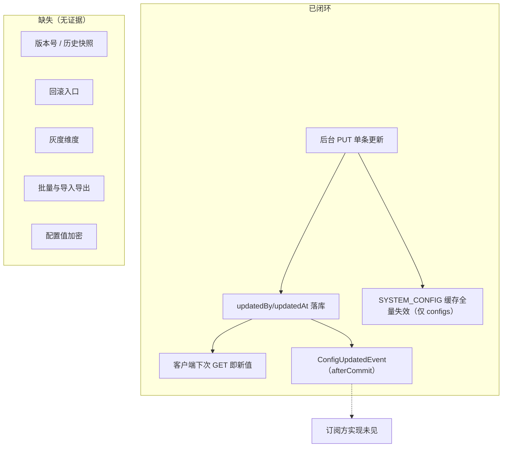

对这套边界的工程解读：**「配置中心化 + 实时刷新」目前是「单值覆盖 + 默认值兜底」模型**，可靠性靠降级而非靠回滚。当某项配置被写坏时，系统不会自动退回旧值（没有旧值可退），只会因为 `parseRuleValue` 的解析失败或 `DataAccessException` 而回落到内置默认。因此**写操作的输入校验是唯一的实际防线**，这也是 `updateConfig` 里长度上限 2048 与 key/value 非空校验被单独写进 infra 编号（`infra R2-00274`）的原因。

**章节来源**
- [AppConfigController.java:24-42](file://apps/api/src/main/java/com/campuslove/api/growth/AppConfigController.java#L24-L42)
- [RealAppConfigService.java:53-66](file://apps/api/src/main/java/com/campuslove/api/growth/RealAppConfigService.java#L53-L66)
- [RealAppConfigService.java:124-219](file://apps/api/src/main/java/com/campuslove/api/growth/RealAppConfigService.java#L124-L219)
- [AppConfigView.java:6-18](file://apps/api/src/main/java/com/campuslove/api/growth/AppConfigView.java#L6-L18)
- [AdminConfigController.java:56-155](file://apps/api/src/main/java/com/campuslove/api/admin/AdminConfigController.java#L56-L155)
- [AdminConfigService.java:26-73](file://apps/api/src/main/java/com/campuslove/api/admin/AdminConfigService.java#L26-L73)
- [RealAdminConfigService.java:36-49](file://apps/api/src/main/java/com/campuslove/api/admin/RealAdminConfigService.java#L36-L49)
- [RealAdminConfigService.java:85-155](file://apps/api/src/main/java/com/campuslove/api/admin/RealAdminConfigService.java#L85-L155)
- [RealAdminConfigService.java:157-218](file://apps/api/src/main/java/com/campuslove/api/admin/RealAdminConfigService.java#L157-L218)
- [ConfigUpdatedEvent.java:25-25](file://apps/api/src/main/java/com/campuslove/api/admin/event/ConfigUpdatedEvent.java#L25-L25)
- [AdminNotifyConfigController.java:134-150](file://apps/api/src/main/java/com/campuslove/api/admin/AdminNotifyConfigController.java#L134-L150)
- [RealAccountSecurityServiceTest.java:44-44](file://apps/api/src/test/java/com/campuslove/api/auth/RealAccountSecurityServiceTest.java#L44-L44)

## 数据模型与统计口径

### 配置侧实体与字段

四张配置表的表名证据来自 `RealAppConfigService` 构造注释（「功能开关表数据访问层（app_switch）」「业务规则表数据访问层（app_rule）」「系统参数表数据访问层（app_config）」）与 `RealAdminConfigService` 类注释（「从数据库 app_config / app_rule / app_switch 表读写配置」）；Hero 表名 `app_login_hero_config` 同样来自类注释。字段集合取自实体 getter 调用点与三个 `to*View()` 映射方法，本页取证范围内**未定位到这些表的 DDL 文件**，因此不描述索引、约束与列类型。

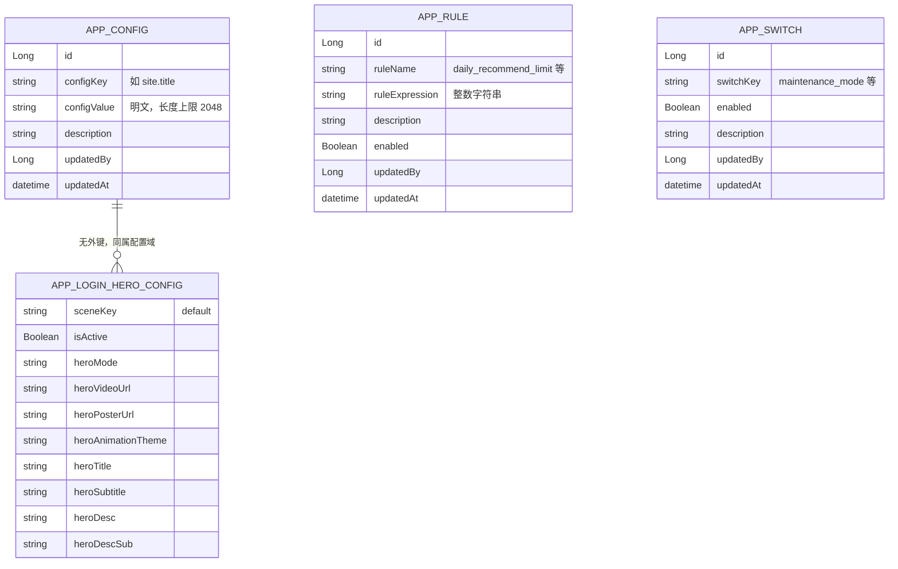

**图表来源**
- [RealAppConfigService.java:67-89](file://apps/api/src/main/java/com/campuslove/api/growth/RealAppConfigService.java#L67-L89)
- [RealAdminConfigService.java:59-73](file://apps/api/src/main/java/com/campuslove/api/admin/RealAdminConfigService.java#L59-L73)
- [RealAdminConfigService.java:220-252](file://apps/api/src/main/java/com/campuslove/api/admin/RealAdminConfigService.java#L220-L252)
- [RealPushSummaryService.java:51-80](file://apps/api/src/main/java/com/campuslove/api/growth/RealPushSummaryService.java#L51-L80)

连线只表达「同一服务内的读取关系」，配置四表之间在取证范围内没有外键证据，也没有跨表 JOIN。

`app_login_hero_config` 无 `video_fallback_to_animation` 列（`mapToView()` 注释明示），因此响应中的 `videoFallback` 是**服务端推导值**而非存储值。三个 `Admin*View` 记录的分量顺序即字段清单：`AdminConfigView(id, configKey, configValue, description, updatedBy, updatedAt)`、`AdminRuleView(id, ruleName, ruleExpression, description, enabled, updatedBy, updatedAt)`、`AdminSwitchView(id, switchKey, enabled, description, updatedBy, updatedAt)`。

### 推送摘要侧

`RealPushSummaryService` 读写的实体（按代码出现的 getter）：

| 实体 | 观察到的字段 | 用途 |
| --- | --- | --- |
| `PushSummary` | `userId`、`summaryType`、`title`、`content`、`actionUrl`、`isSent`、`generatedAt`、`sentAt` | 摘要行本体；`summaryType` 取值仅见 `"social_digest"` 与 `"recommend_refresh"` 两个字面量 |
| `PushPreference` | `userId`、`pushEnabled` | 生成前置门禁，`findByUserId(userId)` |
| `RecommendationPreference` | `userId`、`preferredTime`（`HH:mm` 字符串） | 推荐刷新触发时刻，缺省 `"12:00"` |
| `Visitor` | `visitedUserId`、`createdAt` | 访客计数源 |
| `Like` | `targetUserId`、`status`（`LikeStatus.active`）、`createdAt` | 喜欢计数源 |
| `Post` | `id`、`authorId` | 互动统计的遍历根 |
| `Comment` | `postId`、`createdAt` | 评论计数源 |

### 统计口径（必须按源码口径而非直觉口径理解）

| 指标 | 计算方式 | 已知偏差 |
| --- | --- | --- |
| 24h 访客数 | 全量取出该用户的访客记录后，内存流过滤 `createdAt.isAfter(now-24h)` | 无时间下推查询，数据量大时是「全表按用户扫描」 |
| 24h 喜欢数 | `findByTargetUserIdAndStatus(userId, active)` 后内存过滤时间 | 同上 |
| 24h 帖子互动数 | `Σ(countByPostId(post) + 24h内评论数)` | **点赞项不按时间过滤**，源码注释写作「使用 PostLike 总数近似」，因此该指标是累计值而非 24h 增量 |
| 摘要去重 | 查 `findByUserIdAndGeneratedAtAfter(userId, 今日 00:00)`，判断是否存在同 `summaryType` 行 | 「自然日」以 `TimeZones.BUSINESS` 为基准；重复调用会返回既有行而不是新建 |
| 推送触达 | `isSent` 布尔 + `sentAt` 时间戳 | 仅表示「已标记发送」，无渠道回执、无点击回执，因此**不构成到达率统计** |
| 效果评估 | 无 | 未出现聚合查询、报表端点或指标表；唯一观测是 `log.info` 的三个计数 |

**章节来源**
- [RealAppConfigService.java:72-89](file://apps/api/src/main/java/com/campuslove/api/growth/RealAppConfigService.java#L72-L89)
- [RealAppConfigService.java:18-52](file://apps/api/src/main/java/com/campuslove/api/growth/RealAppConfigService.java#L18-L52)
- [RealAppConfigService.java:246-290](file://apps/api/src/main/java/com/campuslove/api/growth/RealAppConfigService.java#L246-L290)
- [RealAdminConfigService.java:220-252](file://apps/api/src/main/java/com/campuslove/api/admin/RealAdminConfigService.java#L220-L252)
- [RealPushSummaryService.java:104-151](file://apps/api/src/main/java/com/campuslove/api/growth/RealPushSummaryService.java#L104-L151)
- [RealPushSummaryService.java:186-199](file://apps/api/src/main/java/com/campuslove/api/growth/RealPushSummaryService.java#L186-L199)
- [RealPushSummaryService.java:219-279](file://apps/api/src/main/java/com/campuslove/api/growth/RealPushSummaryService.java#L219-L279)
- [RealPushSummaryService.java:291-322](file://apps/api/src/main/java/com/campuslove/api/growth/RealPushSummaryService.java#L291-L322)

### 对外接口契约

`docs/openapi/feedback-growth-and-auth.yaml` 中登记了 `/app-config/login-hero`（`get`，`tags: [home]`，`summary: "Get login hero configuration"`，`operationId: getLoginHeroConfig`，`security: bearerAuth`）。这里存在一处**规格与实现的不一致**：契约声明需要 Bearer，而 `SecurityConfig` 对 `/api/v1/app-config/**` 是 `permitAll`。同一文件还登记了 `loginAsAdmin`（「Authenticates an admin account and returns a JWT with the ADMIN role」）与 `logoutAsAdmin`（附带管理会话审计日志），这两条是 ADMIN 角色 token 的取得与释放入口，也是 `/api/v1/admin/configs` 系列端点的前置条件。仓库内未检索到 `/api/v1/app-config`（聚合根路径）与 admin 配置端点的 OpenAPI 条目，因此聚合视图的响应示例只能以 `AppConfigView` 的 record 分量为权威定义。

**章节来源**
- [feedback-growth-and-auth.yaml:33-41](file://docs/openapi/feedback-growth-and-auth.yaml#L33-L41)
- [feedback-growth-and-auth.yaml:151-183](file://docs/openapi/feedback-growth-and-auth.yaml#L151-L183)
- [AppConfigView.java:24-29](file://apps/api/src/main/java/com/campuslove/api/growth/AppConfigView.java#L24-L29)
- [SecurityConfig.java:129-163](file://apps/api/src/main/java/com/campuslove/api/config/SecurityConfig.java#L129-L169)

## 依赖关系分析

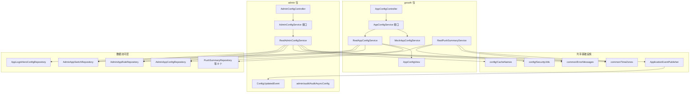

**图表来源**
- [AppConfigController.java:16-42](file://apps/api/src/main/java/com/campuslove/api/growth/AppConfigController.java#L16-L42)
- [RealAppConfigService.java:67-89](file://apps/api/src/main/java/com/campuslove/api/growth/RealAppConfigService.java#L67-L89)
- [RealAdminConfigService.java:3-24](file://apps/api/src/main/java/com/campuslove/api/admin/RealAdminConfigService.java#L3-L24)
- [RealAdminConfigService.java:59-73](file://apps/api/src/main/java/com/campuslove/api/admin/RealAdminConfigService.java#L59-L73)
- [RealPushSummaryService.java:3-33](file://apps/api/src/main/java/com/campuslove/api/growth/RealPushSummaryService.java#L3-L33)
- [RealPushSummaryService.java:51-80](file://apps/api/src/main/java/com/campuslove/api/growth/RealPushSummaryService.java#L51-L80)

四条结构事实：

1. **依赖倒置只到接口层**。`AppConfigController` 依赖 `AppConfigService` 接口而非实现；实现选择由 `@Profile("real")` / mock profile 在容器启动时决定。`RealPushSummaryService` 与 `RealAdminConfigService` 同样标注 `@Profile("real")`，意味着**在 mock profile 下这些真实读写全部不注册**，配置值来自 Mock 实现。
2. **写路径不依赖读路径**。`RealAdminConfigService` 与 `RealAppConfigService` 之间没有任何引用，两者只是各自注入同一组 Repository。这意味着两条链路对同一张表的语义解释（例如 `NULL` 的 `enabled` 如何解读）是**独立演化**的，改动其中一处不会自动同步另一处。
3. **配置强制点是单向消费**。`AppConfigService.isSwitchEnabled()` 的注释声明其用途为「供后端各业务强制点（发帖 / 登录 / 注册 / 推荐等）统一调用，与 `getClientConfig()` 同一数据源，保证前后端口径一致」。本页取证范围内没有逐一列举调用点，仅能确认该方法的实现语义（缺行 / 异常 → `true`）。
4. **事件耦合是松散的**。`RealAdminConfigService` 只依赖 `ApplicationEventPublisher` 与 `ConfigUpdatedEvent` 类本身，`admin/audit` 包内另有 `AuditAsyncConfig`（L23），但两者之间未在本页证据链中形成直接调用关系。

跨包依赖的方向是严格的单向：`growth` / `admin` → `entity` / `repository` / `config` / `common`，未观察到反向引用，也未观察到配置模块内部的循环依赖。

**章节来源**
- [AppConfigService.java:58-68](file://apps/api/src/main/java/com/campuslove/api/growth/AppConfigService.java#L58-L68)
- [RealAppConfigService.java:187-198](file://apps/api/src/main/java/com/campuslove/api/growth/RealAppConfigService.java#L187-L198)
- [RealAdminConfigService.java:50-73](file://apps/api/src/main/java/com/campuslove/api/admin/RealAdminConfigService.java#L50-L73)
- [AuditAsyncConfig.java:23-23](file://apps/api/src/main/java/com/campuslove/api/admin/audit/AuditAsyncConfig.java#L23-L23)
- [AppConfigView.java:6-18](file://apps/api/src/main/java/com/campuslove/api/growth/AppConfigView.java#L6-L18)
- [AppConfigController.java:18-22](file://apps/api/src/main/java/com/campuslove/api/growth/AppConfigController.java#L18-L22)

## 性能与缓存

### 缓存区域与失效面

三个后台列表方法共用同一个缓存区域名 `CacheNames.SYSTEM_CONFIG`，以不同 key 区分：

| 方法 | 注解 | key | 说明 |
| --- | --- | --- | --- |
| `listConfigs()` | `@Cacheable(SYSTEM_CONFIG, key = "'all'")` | `all` | 无参方法的固定 key；类注释标注 TTL 30 分钟 |
| `listRules()` | `@Cacheable(SYSTEM_CONFIG, key = "'rules'")` | `rules` | 同上 |
| `listSwitches()` | `@Cacheable(SYSTEM_CONFIG, key = "'switches'")` | `switches` | 同上 |
| `updateConfig(...)` | `@CacheEvict(SYSTEM_CONFIG, allEntries = true)` | — | **清空整个区域**，因此 `rules` / `switches` 两条缓存也一并失效 |
| `updateRule(...)` | 无缓存注解 | — | 依赖 30 分钟 TTL 自然过期 |
| `updateSwitch(...)` | 无缓存注解 | — | 同上 |

由此可推出一个可验证的行为差异：**改完规则或开关后，后台列表页可能仍显示旧值**（除非期间有人调用过 `updateConfig` 触发全量驱逐），而客户端 `GET /api/v1/app-config` 不受影响，因为它根本不读缓存。这是「读侧无缓存 + 写侧选择性驱逐」组合的直接后果，而不是缺陷描述——它恰好保证了面向用户的配置即时生效。

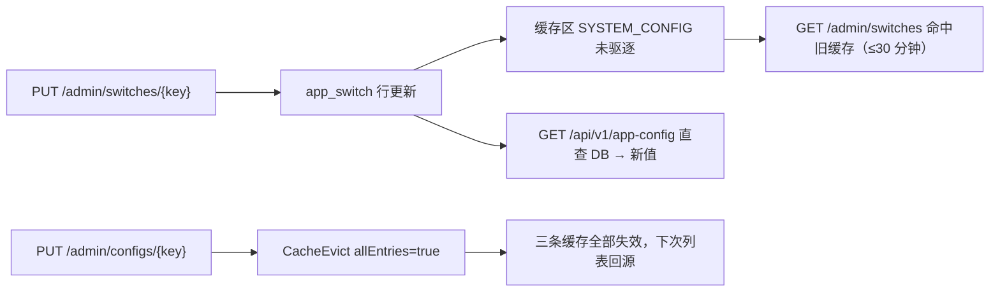

**图表来源**
- [RealAdminConfigService.java:85-91](file://apps/api/src/main/java/com/campuslove/api/admin/RealAdminConfigService.java#L85-L91)
- [RealAdminConfigService.java:105-108](file://apps/api/src/main/java/com/campuslove/api/admin/RealAdminConfigService.java#L105-L108)
- [RealAdminConfigService.java:157-163](file://apps/api/src/main/java/com/campuslove/api/admin/RealAdminConfigService.java#L157-L163)
- [RealAdminConfigService.java:165-167](file://apps/api/src/main/java/com/campuslove/api/admin/RealAdminConfigService.java#L165-L167)
- [RealAdminConfigService.java:191-201](file://apps/api/src/main/java/com/campuslove/api/admin/RealAdminConfigService.java#L191-L201)
- [AppConfigController.java:29-42](file://apps/api/src/main/java/com/campuslove/api/growth/AppConfigController.java#L29-L42)

缓存管理器本身的实现（本地 Caffeine 还是 Redis）未在本页取证范围内确认，`CacheNames` 仅以常量集中区域名；`RealAppConfigService` 一侧没有任何 Spring Cache 注解，说明面向客户端的聚合读路径完全走数据库。

### 读放大点

- `getClientConfig()`：每次请求触发 `switchRepository.findAll()` + `ruleRepository.findAll()` + `configRepository.findByConfigKey(...)`，即两次全表读加一次键查。按 seed 规模（7 个开关、2 条规则）成本很低，但该端点 `permitAll` 且被客户端启动期/切 Tab 调用，属于**高频匿名端点**，需要关注是否被刷。
- `getLoginHeroConfig()`：单行查询 `findBySceneKeyAndIsActive("default", true)`，异常与缺失都回落默认值，无额外开销。
- `isSwitchEnabled()`：单次 `findBySwitchKey`，无缓存，调用频次取决于各业务强制点。
- `generateSocialDigest()`：是本页范围内最重的一段——先全量取访客、再全量取喜欢，然后 `for (Post post : userPosts)` 内每帖执行 `countByPostId` 与 `findByPostIdOrderByCreatedAtDesc` 两次查询。用户有 M 条帖子时查询数约为 `2M + 常数`，且时间过滤在内存流中完成。帖子量大的用户会放大该成本，代码注释本身承认点赞计数「不按时间过滤，使用总数近似」。
- `generateRecommendRefresh()`：两次存在性查询 + 一次偏好读取，量级可控。

### 前端性能预算

`config/lighthouserc.json`（24 行，顶层 `ci` 含 `collect` / `assert` / `upload` 三段）是 CI 侧的性能断言入口，属于配置管理在构建链上的落点；它与 `app-config` 接口无直接调用关系，但共享「配置驱动行为」这一治理思路。

**章节来源**
- [RealAppConfigService.java:138-176](file://apps/api/src/main/java/com/campuslove/api/growth/RealAppConfigService.java#L138-L176)
- [RealAppConfigService.java:98-122](file://apps/api/src/main/java/com/campuslove/api/growth/RealAppConfigService.java#L98-L122)
- [RealAppConfigService.java:187-198](file://apps/api/src/main/java/com/campuslove/api/growth/RealAppConfigService.java#L187-L198)
- [RealPushSummaryService.java:124-151](file://apps/api/src/main/java/com/campuslove/api/growth/RealPushSummaryService.java#L124-L151)
- [RealPushSummaryService.java:219-260](file://apps/api/src/main/java/com/campuslove/api/growth/RealPushSummaryService.java#L219-L260)
- [AppConfigController.java:24-42](file://apps/api/src/main/java/com/campuslove/api/growth/AppConfigController.java#L24-L42)
- [lighthouserc.json:1-24](file://config/lighthouserc.json#L1-L24)

## 验证与测试

`AppConfigControllerTest`（P7 - Task 7.1.1，全文 36 行）是配置域的直接测试，其内容仅两处断言：

```java
@Mock private AppConfigService appConfigService;
@BeforeEach void setUp() { MockitoAnnotations.openMocks(this); controller = new AppConfigController(appConfigService); }
@Test void constructor_shouldAcceptService() { assertNotNull(new AppConfigController(appConfigService)); }
@Test void controller_shouldHaveServiceInjected() { assertNotNull(controller); }
```

也就是说，测试验证的是**装配可行性**（构造器能接收 mock 服务、字段能被注入），没有验证 `getLoginHero()` / `getAppConfig()` 的返回值转发，也没有覆盖默认值兜底、`NULL` 开关判定、规则解析失败等真实分支。

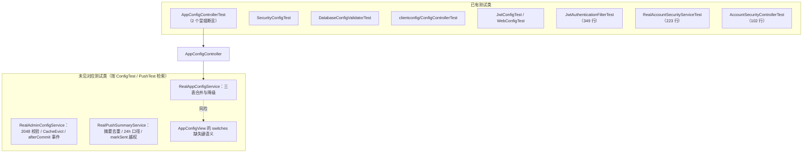

[上图右侧「未见对应测试类」节点是检索结果而非源码实体，故不逐条给出行号引用。]

与配置同属安全/认证域、且被事实包收录的测试有三份，可作为改动 `SecurityConfig` 匹配器后的回归护栏参考：`JwtAuthenticationFilterTest`（349 行）以 `@Mock` 组合 `JwtTokenProvider`、`UserRepository`、`TokenBlacklistService`、`HttpServletRequest`、`HttpServletResponse`、`FilterChain` 与被测 `JwtAuthenticationFilter`，是无 Spring 容器的纯单元式过滤器测试；`RealAccountSecurityServiceTest`（223 行）注入 `UserRepository`、`PasswordEncoder`、`DeviceSessionService`、`TokenBlacklistService`、`JwtTokenProvider`、`AesEncryptor` 与被测服务；`AccountSecurityControllerTest`（102 行）直接持有 `AccountSecurityController controller` 字段。

**建议的最小验证清单**（针对本页描述的语义，按可断言性排序）：

1. 断言 `getClientConfig()` 在 `switchRepository.findBySwitchKey` 缺行时返回 `true`、在 `enabled = NULL` 的行上返回 `false` —— 这是当前最容易写错的两种语义。
2. 断言 `app_rule.ruleExpression` 为 `"abc"` 时结果仍为默认 `10`，并产生 `log.warn`。
3. 断言 `updateConfig()` 传入 2049 字符时抛 `IllegalArgumentException` 且 message 含上限值。
4. 断言 `updateSwitch()` 后 `SYSTEM_CONFIG` 区域**未被驱逐**（与 `updateConfig()` 形成对照），把该行为固化为已知约定。
5. 断言 `markSent()` 在非所属用户下抛 `ErrorMessages.PUSH_SUMMARY_FORBIDDEN`。
6. 断言 `generateSocialDigest()` 当日重复调用返回同一行而不新增。

**章节来源**
- [AppConfigControllerTest.java:13-35](file://apps/api/src/test/java/com/campuslove/api/growth/AppConfigControllerTest.java#L13-L35)
- [JwtAuthenticationFilterTest.java:50-70](file://apps/api/src/test/java/com/campuslove/api/config/JwtAuthenticationFilterTest.java#L50-L70)
- [RealAccountSecurityServiceTest.java:37-45](file://apps/api/src/test/java/com/campuslove/api/auth/RealAccountSecurityServiceTest.java#L37-L45)
- [AccountSecurityControllerTest.java:22-27](file://apps/api/src/test/java/com/campuslove/api/auth/AccountSecurityControllerTest.java#L22-L27)
- [RealAppConfigService.java:138-219](file://apps/api/src/main/java/com/campuslove/api/growth/RealAppConfigService.java#L138-L219)
- [RealAdminConfigService.java:105-155](file://apps/api/src/main/java/com/campuslove/api/admin/RealAdminConfigService.java#L105-L155)
- [RealPushSummaryService.java:96-199](file://apps/api/src/main/java/com/campuslove/api/growth/RealPushSummaryService.java#L96-L199)
- [RealPushSummaryService.java:289-322](file://apps/api/src/main/java/com/campuslove/api/growth/RealPushSummaryService.java#L289-L322)
- [ConfigControllerTest.java](file://apps/api/src/test/java/com/campuslove/api/clientconfig/ConfigControllerTest.java)
- [SecurityConfigTest.java](file://apps/api/src/test/java/com/campuslove/api/config/SecurityConfigTest.java)
- [DatabaseConfigValidatorTest.java](file://apps/api/src/test/java/com/campuslove/api/config/DatabaseConfigValidatorTest.java)

## 故障排查指南

### 按症状定位

| 症状 | 第一判据 | 根因位置 | 处置 |
| --- | --- | --- | --- |
| 后台改了开关，客户端首屏无变化 | 直接 `GET /api/v1/app-config` 看返回值 | `getClientConfig()` 是「默认值为底 + DB 覆盖」，若 DB 行为 `NULL` 则显示 `false`；若开关键拼错则永远命中默认 `true` | 核对 `switchKey` 与 `AppConfigService` 常量逐字一致 |
| 后台列表页显示旧值（≤30 分钟） | 是否只调用过 `PUT /admin/switches` 或 `/admin/rules` | `updateSwitch()` / `updateRule()` 无 `@CacheEvict`，只有 `updateConfig()` 全量驱逐 | 调用一次 `PUT /admin/configs/{key}` 触发区域驱逐，或等待 TTL |
| 登录页显示「遇见对的人」而非运营配置 | 日志出现「数据库中未找到 scene_key='default' 的激活配置，使用内置默认值」 | `findBySceneKeyAndIsActive("default", true)` 未命中 | 检查该行 `is_active` 是否为真、`scene_key` 是否为 `default` |
| 全部配置都回落默认值 | 日志「查询客户端配置聚合失败，降级使用默认配置」（`log.error`） | `catch (DataAccessException)` | 查 DB 连接与表存在性，此时接口仍返回 200，前端无从察觉 |
| 业务被开关误拦 | 无异常日志，但 `isSwitchEnabled()` 返回 `false` | 该行 `enabled` 显式为 `false` | 该方法的兜底只在**缺行/异常**时生效，显式关闭会被尊重 |
| 规则值不生效（如推荐上限仍是 10） | 日志「业务规则表达式非整数，忽略该行: ruleName=..., expression=...」 | `parseRuleValue()` 要求非空且 `enabled = TRUE` 且可 `parseInt` | 修正 `rule_expression` 为整数字符串并置 `enabled` |
| 保存配置返回 400 | 响应 message | `CONFIG_KEY_REQUIRED` / `CONFIG_VALUE_REQUIRED` / `CONFIG_VALUE_MAX_LENGTH_PREFIX + 2048` / `RULE_ID_REQUIRED` / `SWITCH_KEY_REQUIRED` / `SWITCH_VALUE_REQUIRED` / 「配置项不存在: {key}」 | 服务层抛 `IllegalArgumentException`，由 Controller 转 400（类注释约定） |
| 管理端点 403 | token 中是否含 ADMIN 角色 | `SecurityConfig` `.requestMatchers("/api/v1/admin/**").hasRole("ADMIN")` | 用 `loginAsAdmin` 重新取 token；确认 `isTokenRevoked()` 未命中吊销名单 |
| 配置端点意外需要登录 | 与 OpenAPI 契约对照 | 契约对 `/app-config/login-hero` 声明 `security: bearerAuth`，而实现是 `permitAll` | 以 `SecurityConfig` 为准；契约需同步修正 |
| 推送摘要没生成 | `log.debug` 三类跳过原因 | 推送偏好关闭 / 当日已生成同类型 / 未到偏好时间 | 检查 `PushPreference.pushEnabled`、当日 `generatedAt`、`preferredTime` |
| 摘要文案里互动数虚高 | 对比 `countByPostId` 与 24h 窗口 | 源码注释：帖子点赞计数**不按时间过滤**，为累计近似 | 属已知口径，勿按 24h 解读 |
| 标记已发送失败 | `log.warn` 「尝试标记非所属摘要...操作已拒绝」 | `SecurityUtils.getCurrentUserId()` 与 `summary.getUserId()` 不等 | 抛 `PUSH_SUMMARY_FORBIDDEN`；未认证场景抛 `IllegalStateException(PUSH_MARK_UNAUTHENTICATED)` |

### 日志关键字速查

配置链路的全部可观测点都是 SLF4J 文本日志，无指标埋点。按级别归类：

- `ERROR`：`查询登录主视觉配置失败，降级使用默认配置`、`查询客户端配置聚合失败，降级使用默认配置` —— 两者出现即代表**当前所有客户端都在看内置默认值**。
- `WARN`：`查询功能开关失败，默认视为开启: switchKey={}`、`业务规则表达式非整数，忽略该行`、`配置更新事件发布失败: key={}, error={}`、`用户[{}]推荐偏好时间格式无效: {}, 使用默认 12:00`、`用户[{}]尝试标记非所属摘要[...]`、`无法获取当前用户ID，拒绝标记推送摘要[...]`。
- `INFO`：`SubTask 5.3.3 配置更新事件已发布: key={}, operatorId={}`（写成功的确认信号）、`用户[{}]社交动态摘要已生成: visitor={}, like={}, interaction={}`、`用户[{}]推荐刷新通知已生成: preferredTime={}`、`数据库中未找到 scene_key='default' 的激活配置，使用内置默认值`。
- `DEBUG`：各类「跳过」判定（推送关闭、当日已生成、未到刷新时间）、`从数据库读取到登录主视觉配置`、`推送摘要[{}]已标记为已发送`。

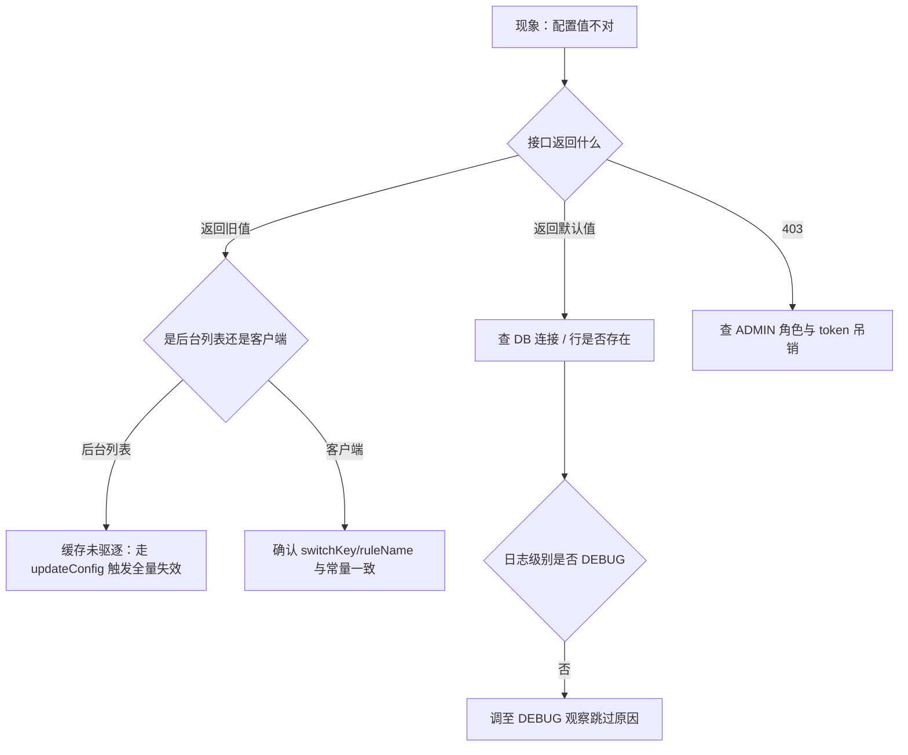

### 变更前的自检顺序

1. 新增开关：先在 `AppConfigService` 加 `SWITCH_*` 常量 → 再落 `app_switch` seed 行 → 再在 `defaultSwitches()` 补默认值（三处任一遗漏都会造成前后台口径分裂）。
2. 新增规则：同上要动 `defaultRules()`，且注意 `parseRuleValue()` 只接受整数，小数与布尔会被静默丢弃。
3. 修改写端点：确认是否需要新增 `@CacheEvict`；若只改 `updateRule` / `updateSwitch`，缓存陈旧行为不变。
4. 发布 `ConfigUpdatedEvent` 的订阅方：注意 `afterCommit` 语义——订阅方若同步执行长任务，虽然不再拉长事务，但会阻塞发布线程。

**章节来源**
- [RealAppConfigService.java:98-198](file://apps/api/src/main/java/com/campuslove/api/growth/RealAppConfigService.java#L98-L198)
- [RealAppConfigService.java:200-244](file://apps/api/src/main/java/com/campuslove/api/growth/RealAppConfigService.java#L200-L244)
- [RealAdminConfigService.java:56-57](file://apps/api/src/main/java/com/campuslove/api/admin/RealAdminConfigService.java#L56-L57)
- [RealAdminConfigService.java:105-155](file://apps/api/src/main/java/com/campuslove/api/admin/RealAdminConfigService.java#L105-L155)
- [RealAdminConfigService.java:165-218](file://apps/api/src/main/java/com/campuslove/api/admin/RealAdminConfigService.java#L165-L218)
- [RealPushSummaryService.java:99-129](file://apps/api/src/main/java/com/campuslove/api/growth/RealPushSummaryService.java#L99-L129)
- [RealPushSummaryService.java:196-198](file://apps/api/src/main/java/com/campuslove/api/growth/RealPushSummaryService.java#L196-L198)
- [RealPushSummaryService.java:219-278](file://apps/api/src/main/java/com/campuslove/api/growth/RealPushSummaryService.java#L219-L278)
- [RealPushSummaryService.java:300-321](file://apps/api/src/main/java/com/campuslove/api/growth/RealPushSummaryService.java#L300-L321)
- [SecurityConfig.java:162-175](file://apps/api/src/main/java/com/campuslove/api/config/SecurityConfig.java#L168-L181)
- [JwtTokenProvider.java:342-387](file://apps/api/src/main/java/com/campuslove/api/config/JwtTokenProvider.java#L342-L387)
- [feedback-growth-and-auth.yaml:33-41](file://docs/openapi/feedback-growth-and-auth.yaml#L33-L41)
- [feedback-growth-and-auth.yaml:151-183](file://docs/openapi/feedback-growth-and-auth.yaml#L151-L183)

## 结论

应用配置管理在本仓库是一套**「读端无缓存 + 默认值兜底 + 后台单条覆写 + 操作者留痕」**的轻量体系，而不是一套配置中心。它的四个真实特征：

1. **接口面极小但职责清晰**。面向客户端只有 2 个 GET（`/api/v1/app-config`、`/api/v1/app-config/login-hero`），控制器 43 行、零校验、零包装；面向后台有 3 组 GET/PUT；配置值对业务的强制通过 `isSwitchEnabled()` 复用同一数据源。
2. **可用性优先于一致性**。三处降级（Hero 缺行、聚合查询异常、开关查询异常）都选择返回内置默认值而不是报错，代价是「配置错误」会静默表现为「看起来像默认配置」，只能靠 `ERROR`/`WARN` 日志发现。
3. **即时生效靠的是「不缓存」**。`AppConfigView` 与 `getClientConfig()` 的注释把这一点写成了契约；与之相对，后台列表用 `SYSTEM_CONFIG` 区域缓存 30 分钟且只有 `updateConfig()` 做全量驱逐，`updateRule()` / `updateSwitch()` 存在最长 30 分钟的列表陈旧窗口。
4. **可追溯性只有「最后一次」**。`updatedBy` / `updatedAt` 是唯一的留痕字段，没有历史表、没有版本号、没有回滚入口；变更审计的雏形是 `ConfigUpdatedEvent` 的 `afterCommit` 广播，但订阅方实现未在取证范围内出现。

生成指令中的版本管理、灰度发布、配置模板、批量操作、导入导出、回滚、配置值加密在 app-config 链路上**均无接入证据**，本页以核查表形式如实记录，而不是描述为已具备的能力。其中「批量」在同仓库的 `AdminNotifyConfigController`（`NotifyConfigBatchUpdateRequest`）里已有先例，若要对 `app-config` 补批量能力，可直接复用其请求体形态。

推送摘要侧（`RealPushSummaryService`）与配置体系的交集只有一处语义：**摘要生成读的是用户级推送偏好**（`PushPreference.pushEnabled`），而非全局开关。也就是说，当前无法用 `app_switch` 一键关停摘要生成，只能在业务调用侧做门禁。数据统计口径完整可用（访客/喜欢/互动三项 + 每日去重 + 发送标记），但「效果评估」层次缺失：既没有到达与点击回执，也没有聚合报表。

后续若要补齐「配置中心化」的最后一环，最小可行改动顺序是：为 `app_config` 增加历史行或快照表 → 在三个 `update*` 方法统一加 `@CacheEvict` 与事件发布 → 把 `site.title` 这类点分键上升为共享常量 → 为降级路径增加可观测指标（当前只有日志文本）。

**章节来源**
- [AppConfigController.java:14-43](file://apps/api/src/main/java/com/campuslove/api/growth/AppConfigController.java#L14-L43)
- [AppConfigService.java:9-68](file://apps/api/src/main/java/com/campuslove/api/growth/AppConfigService.java#L9-L68)
- [RealAppConfigService.java:124-198](file://apps/api/src/main/java/com/campuslove/api/growth/RealAppConfigService.java#L124-L198)
- [AppConfigView.java:6-29](file://apps/api/src/main/java/com/campuslove/api/growth/AppConfigView.java#L6-L29)
- [RealAdminConfigService.java:26-49](file://apps/api/src/main/java/com/campuslove/api/admin/RealAdminConfigService.java#L26-L49)
- [RealAdminConfigService.java:105-155](file://apps/api/src/main/java/com/campuslove/api/admin/RealAdminConfigService.java#L105-L155)
- [RealAdminConfigService.java:165-218](file://apps/api/src/main/java/com/campuslove/api/admin/RealAdminConfigService.java#L165-L218)
- [RealPushSummaryService.java:98-129](file://apps/api/src/main/java/com/campuslove/api/growth/RealPushSummaryService.java#L98-L129)
- [AdminNotifyConfigController.java:134-150](file://apps/api/src/main/java/com/campuslove/api/admin/AdminNotifyConfigController.java#L134-L150)

