# 成长体系服务

<cite>
**本文引用的文件**
- [SocialProgressController.java](file://apps/api/src/main/java/com/campuslove/api/growth/SocialProgressController.java)
- [CheckInController.java](file://apps/api/src/main/java/com/campuslove/api/growth/CheckInController.java)
- [DoNotDisturbController.java](file://apps/api/src/main/java/com/campuslove/api/growth/DoNotDisturbController.java)
- [AppConfigController.java](file://apps/api/src/main/java/com/campuslove/api/growth/AppConfigController.java)
- [RealSocialProgressService.java](file://apps/api/src/main/java/com/campuslove/api/growth/RealSocialProgressService.java)
- [RealCheckInService.java](file://apps/api/src/main/java/com/campuslove/api/growth/RealCheckInService.java)
- [RealPushSummaryService.java](file://apps/api/src/main/java/com/campuslove/api/growth/RealPushSummaryService.java)
- [SocialProgressService.java](file://apps/api/src/main/java/com/campuslove/api/growth/SocialProgressService.java)
- [CheckInService.java](file://apps/api/src/main/java/com/campuslove/api/growth/CheckInService.java)
- [DoNotDisturbService.java](file://apps/api/src/main/java/com/campuslove/api/growth/DoNotDisturbService.java)
- [AppConfigService.java](file://apps/api/src/main/java/com/campuslove/api/growth/AppConfigService.java)
- [PushSummaryService.java](file://apps/api/src/main/java/com/campuslove/api/growth/PushSummaryService.java)
- [PushPreferenceService.java](file://apps/api/src/main/java/com/campuslove/api/growth/PushPreferenceService.java)
- [RealDoNotDisturbService.java](file://apps/api/src/main/java/com/campuslove/api/growth/RealDoNotDisturbService.java)
- [RealAppConfigService.java](file://apps/api/src/main/java/com/campuslove/api/growth/RealAppConfigService.java)
- [MockAppConfigService.java](file://apps/api/src/main/java/com/campuslove/api/growth/MockAppConfigService.java)
- [MockCheckInService.java](file://apps/api/src/main/java/com/campuslove/api/growth/MockCheckInService.java)
- [RecommendQuotaService.java](file://apps/api/src/main/java/com/campuslove/api/growth/RecommendQuotaService.java)
- [WeChatPushService.java](file://apps/api/src/main/java/com/campuslove/api/growth/WeChatPushService.java)
- [SocialProgressView.java](file://apps/api/src/main/java/com/campuslove/api/growth/SocialProgressView.java)
- [CheckInResultView.java](file://apps/api/src/main/java/com/campuslove/api/growth/CheckInResultView.java)
- [CheckInStatusView.java](file://apps/api/src/main/java/com/campuslove/api/growth/CheckInStatusView.java)
- [MakeUpCheckInRequest.java](file://apps/api/src/main/java/com/campuslove/api/growth/MakeUpCheckInRequest.java)
- [MakeUpCheckInResultView.java](file://apps/api/src/main/java/com/campuslove/api/growth/MakeUpCheckInResultView.java)
- [DoNotDisturbRequest.java](file://apps/api/src/main/java/com/campuslove/api/growth/DoNotDisturbRequest.java)
- [DoNotDisturbView.java](file://apps/api/src/main/java/com/campuslove/api/growth/DoNotDisturbView.java)
- [AppConfigView.java](file://apps/api/src/main/java/com/campuslove/api/growth/AppConfigView.java)
- [LoginHeroConfigView.java](file://apps/api/src/main/java/com/campuslove/api/growth/LoginHeroConfigView.java)
- [CheckIn.java](file://apps/api/src/main/java/com/campuslove/api/entity/CheckIn.java)
- [DailyBenefit.java](file://apps/api/src/main/java/com/campuslove/api/entity/DailyBenefit.java)
- [MakeUpQuota.java](file://apps/api/src/main/java/com/campuslove/api/entity/MakeUpQuota.java)
- [SocialProgress.java](file://apps/api/src/main/java/com/campuslove/api/entity/SocialProgress.java)
- [DoNotDisturbSetting.java](file://apps/api/src/main/java/com/campuslove/api/entity/DoNotDisturbSetting.java)
- [PushSummary.java](file://apps/api/src/main/java/com/campuslove/api/entity/PushSummary.java)
- [CheckInConfig.java](file://apps/api/src/main/java/com/campuslove/api/config/CheckInConfig.java)
- [SecurityConfig.java](file://apps/api/src/main/java/com/campuslove/api/config/SecurityConfig.java)
- [TimeZones.java](file://apps/api/src/main/java/com/campuslove/api/common/TimeZones.java)
- [Idempotent.java](file://apps/api/src/main/java/com/campuslove/api/common/Idempotent.java)
- [IdempotentInterceptor.java](file://apps/api/src/main/java/com/campuslove/api/common/IdempotentInterceptor.java)
- [CampusLoveApplication.java](file://apps/api/src/main/java/com/campuslove/api/CampusLoveApplication.java)
- [RealMatchService.java](file://apps/api/src/main/java/com/campuslove/api/match/RealMatchService.java)
- [RealPrivateMessageService.java](file://apps/api/src/main/java/com/campuslove/api/chat/RealPrivateMessageService.java)
- [RecommendationCacheManager.java](file://apps/api/src/main/java/com/campuslove/api/discover/RecommendationCacheManager.java)
- [RealRecommendationService.java](file://apps/api/src/main/java/com/campuslove/api/discover/RealRecommendationService.java)
- [RealCircleService.java](file://apps/api/src/main/java/com/campuslove/api/discover/RealCircleService.java)
- [ConfigController.java](file://apps/api/src/main/java/com/campuslove/api/clientconfig/ConfigController.java)
- [ClientDbConfigController.java](file://apps/api/src/main/java/com/campuslove/api/clientconfig/ClientDbConfigController.java)
- [RealHomeService.java](file://apps/api/src/main/java/com/campuslove/api/home/RealHomeService.java)
- [RecommendationController.java](file://apps/api/src/main/java/com/campuslove/api/discover/RecommendationController.java)
- [application.yml](file://apps/api/src/main/resources/application.yml)
- [pom.xml](file://apps/api/pom.xml)
- [CheckInControllerTest.java](file://apps/api/src/test/java/com/campuslove/api/growth/CheckInControllerTest.java)
- [MockSocialProgressServiceTest.java](file://apps/api/src/test/java/com/campuslove/api/growth/MockSocialProgressServiceTest.java)
- [SocialProgressControllerTest.java](file://apps/api/src/test/java/com/campuslove/api/growth/SocialProgressControllerTest.java)
- [DoNotDisturbControllerTest.java](file://apps/api/src/test/java/com/campuslove/api/growth/DoNotDisturbControllerTest.java)
- [AppConfigControllerTest.java](file://apps/api/src/test/java/com/campuslove/api/growth/AppConfigControllerTest.java)
- [V2026.05.23.0002__create_check_ins.sql](file://database/flyway/sql/V2026.05.23.0002__create_check_ins.sql)
- [V2026.05.28.0002__create_social_progress.sql](file://database/flyway/sql/V2026.05.28.0002__create_social_progress.sql)
- [V2026.05.28.0007__create_push_system.sql](file://database/flyway/sql/V2026.05.28.0007__create_push_system.sql)
- [V2026.05.28.0008__create_daily_benefits.sql](file://database/flyway/sql/V2026.05.28.0008__create_daily_benefits.sql)
- [V2026.06.25.0005__create_admin_configs.sql](file://database/flyway/sql/V2026.06.25.0005__create_admin_configs.sql)
- [V2026.07.25.0012__create_dnd_settings.sql](file://database/flyway/sql/V2026.07.25.0012__create_dnd_settings.sql)
- [V2026.07.25.0013__add_check_in_make_up.sql](file://database/flyway/sql/V2026.07.25.0013__add_check_in_make_up.sql)
- [社交进度追踪.md](file://.qoder/repowiki/zh/content/后端API服务/核心业务服务/成长体系服务/社交进度追踪.md)
- [每日签到系统.md](file://.qoder/repowiki/zh/content/后端API服务/核心业务服务/成长体系服务/每日签到系统.md)
- [勿扰模式管理.md](file://.qoder/repowiki/zh/content/后端API服务/核心业务服务/成长体系服务/勿扰模式管理.md)
- [应用配置管理.md](file://.qoder/repowiki/zh/content/后端API服务/核心业务服务/成长体系服务/应用配置管理.md)
</cite>

## 目录
1. [简介](#简介)
2. [项目结构](#项目结构)
3. [核心组件](#核心组件)
4. [架构总览](#架构总览)
5. [子页面导航与覆盖范围](#子页面导航与覆盖范围)
6. [模块边界与职责划分](#模块边界与职责划分)
7. [端到端数据流](#端到端数据流)
8. [详细组件分析](#详细组件分析)
9. [跨模块协作关系](#跨模块协作关系)
10. [依赖关系分析](#依赖关系分析)
11. [配置与开关](#配置与开关)
12. [数据模型](#数据模型)
13. [性能考虑](#性能考虑)
14. [故障排查指南](#故障排查指南)
15. [能力缺口登记](#能力缺口登记)
16. [结论](#结论)

## 简介

`com.campuslove.api.growth` 包是恋爱小程序后端"成长体系"这一分组的落点，由 4 个 `@RestController` 与 7 套"接口 + Mock 实现 + Real 实现"的服务构成，对外暴露 `/api/v1/growth`、`/api/v1/check-in`、`/api/v1/dnd`、`/api/v1/app-config` 四组 REST 端点。本页是**分组总览页**：它不重复 4 个子页面的实现细节，而是给出子页面清单与覆盖范围、模块边界、整体数据流、跨模块协作关系与统一的排查入口。

本页的定位来自三处客观事实：控制器与 `@RequestMapping` 前缀（[SocialProgressController.java:21-23](file://apps/api/src/main/java/com/campuslove/api/growth/SocialProgressController.java#L21-L23)、[CheckInController.java:21-23](file://apps/api/src/main/java/com/campuslove/api/growth/CheckInController.java#L21-L23)）；服务接口与 `Real*` / `Mock*` 双实现的同包共存；以及事实包中登记的方法签名（如 `getProgress`、`recordLike`、`makeUp`）。凡这些证据覆盖不到的能力，集中在 [能力缺口登记](#能力缺口登记) 逐条说明。

**章节来源**
- [SocialProgressController.java:21-23](file://apps/api/src/main/java/com/campuslove/api/growth/SocialProgressController.java#L21-L23)
- [CheckInController.java:21-23](file://apps/api/src/main/java/com/campuslove/api/growth/CheckInController.java#L21-L23)

## 项目结构

分组下的物理结构为"一个总览页 + 四个子页面"，页面目录与被索引的源码包一一对应：

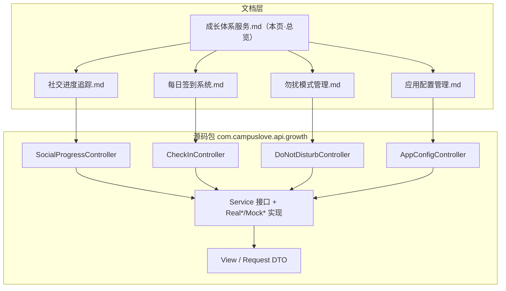

**图表来源**
- [SocialProgressController.java:21-23](file://apps/api/src/main/java/com/campuslove/api/growth/SocialProgressController.java#L21-L23)
- [CheckInController.java:21-23](file://apps/api/src/main/java/com/campuslove/api/growth/CheckInController.java#L21-L23)
- [DoNotDisturbController.java:35-37](file://apps/api/src/main/java/com/campuslove/api/growth/DoNotDisturbController.java#L35-L37)
- [AppConfigController.java:14-16](file://apps/api/src/main/java/com/campuslove/api/growth/AppConfigController.java#L14-L16)

## 核心组件

分组内的可交付单元分三层：**HTTP 入口层**（4 个 `@RestController`）、**服务层**（接口 + `Real*` / `Mock*` 双实现）、**视图与请求 DTO 层**。以下清单全部来自 `apps/api/src/main/java/com/campuslove/api/growth/` 目录实测与源码声明行。

### HTTP 入口层（4 个控制器）

| 控制器 | 前缀 | 端点 | 鉴权 / 幂等 | 返回信封 |
| --- | --- | --- | --- | --- |
| `SocialProgressController` | `/api/v1/growth` | `GET /social-progress` | 无 `@PreAuthorize`，用户 ID 取 `SecurityUtils.getCurrentUserId()` | 裸 `SocialProgressView` |
| `CheckInController` | `/api/v1/check-in` | `POST`（签到）、`GET /status`、`POST /make-up` | 写端点带 `@Idempotent` + `@PreAuthorize("hasRole('USER')")` | `ApiResponse<T>` |
| `DoNotDisturbController` | `/api/v1/dnd` | `GET`、`PUT` | `PUT` 带 `@PreAuthorize("hasRole('USER')")` + `@Valid` | 裸 `DoNotDisturbView` |
| `AppConfigController` | `/api/v1/app-config` | `GET /login-hero`、`GET`（聚合配置） | 无（`SecurityConfig` 已对 `/api/v1/app-config/**` 放行） | 裸 `LoginHeroConfigView` / `AppConfigView` |

入口证据：[SocialProgressController.java:36-40](file://apps/api/src/main/java/com/campuslove/api/growth/SocialProgressController.java#L36-L40)、[CheckInController.java:35-41](file://apps/api/src/main/java/com/campuslove/api/growth/CheckInController.java#L35-L41)、[CheckInController.java:79-85](file://apps/api/src/main/java/com/campuslove/api/growth/CheckInController.java#L79-L85)、[DoNotDisturbController.java:57-77](file://apps/api/src/main/java/com/campuslove/api/growth/DoNotDisturbController.java#L57-L77)、[AppConfigController.java:24-42](file://apps/api/src/main/java/com/campuslove/api/growth/AppConfigController.java#L24-L42)。

`SocialProgressController` 是走查补漏产物：类注释明确说明前端 `services/api.ts` 已调用 `GET /api/v1/growth/social-progress`，而后端此前只有服务实现、没有控制器，导致 Real 模式 404；补齐后响应结构与前端 `SocialProgressData` 字段一一对齐（[SocialProgressController.java:8-20](file://apps/api/src/main/java/com/campuslove/api/growth/SocialProgressController.java#L8-L20)）。

### 服务层：接口 + Real/Mock 双实现

同包内的 6 组"接口 / `@Profile("real")` 实现 / Mock 实现"构成成长体系的业务主体，另有 2 个无接口的协作服务：

- `SocialProgressService`（7 个方法：1 查询 + 6 记录）↔ `RealSocialProgressService`（324 行）/ `MockSocialProgressService`（171 行）
- `CheckInService`（3 个方法：`checkIn` / `getCheckInStatus` / `makeUp`）↔ `RealCheckInService`（818 行）/ `MockCheckInService`（194 行）
- `DoNotDisturbService`（2 个方法）↔ `RealDoNotDisturbService`（191 行）/ `MockDoNotDisturbService`（77 行）
- `AppConfigService`（3 个方法 + 7 个开关常量 + 2 个规则常量）↔ `RealAppConfigService`（291 行）/ `MockAppConfigService`（77 行）
- `PushSummaryService` ↔ `RealPushSummaryService`（322 行）/ `MockPushSummaryService`（113 行）
- `PushPreferenceService` ↔ `RealPushPreferenceService`（104 行）/ `MockPushPreferenceService`（55 行）
- 无接口协作服务：`RecommendQuotaService`（170 行）、`WeChatPushService`（411 行）

接口契约证据：[SocialProgressService.java:7-57](file://apps/api/src/main/java/com/campuslove/api/growth/SocialProgressService.java#L7-L57)、[CheckInService.java:9-43](file://apps/api/src/main/java/com/campuslove/api/growth/CheckInService.java#L9-L43)、[DoNotDisturbService.java:15-34](file://apps/api/src/main/java/com/campuslove/api/growth/DoNotDisturbService.java#L15-L34)、[AppConfigService.java:7-69](file://apps/api/src/main/java/com/campuslove/api/growth/AppConfigService.java#L7-L69)。

### 视图与请求 DTO 层

| 类型 | 形态 | 关键字段 |
| --- | --- | --- |
| `SocialProgressView` | 类（含静态映射表） | `currentTier` / `tierLabel` / 6 个计数字段 / `nextAction`，`getProgressPercentage()` 派生 |
| `CheckInResultView` | record | `success` / `consecutiveDays` / `extraQuota` / `extraRecommendQuota` / `hotTopicsUnlocked` / `newUsersUnlocked` / `hotTopicCount` / `newUserCount` / `points` |
| `CheckInStatusView` | record | `checkedInToday` / `consecutiveDays` / `extraQuota` / `points` |
| `MakeUpCheckInRequest` / `MakeUpCheckInResultView` | record | 请求体 `date`；结果含连续天数与配额用量 |
| `DoNotDisturbRequest` | record（校验注解） | `enabled` / `startTime` / `endTime` / `repeatMode` / `customWeekdays` / `allowUrgent` |
| `DoNotDisturbView` | record | 免打扰设置回显 |
| `AppConfigView` | record | `switches` / `rules` / `siteTitle` |
| `LoginHeroConfigView` | record | 9 个 Hero 字段（模式、视频、海报、动画主题、标题、副标题、描述、兜底） |

DTO 证据：[SocialProgressView.java:9-98](file://apps/api/src/main/java/com/campuslove/api/growth/SocialProgressView.java#L9-L98)、[CheckInResultView.java:7-24](file://apps/api/src/main/java/com/campuslove/api/growth/CheckInResultView.java#L7-L24)、[CheckInStatusView.java:7-13](file://apps/api/src/main/java/com/campuslove/api/growth/CheckInStatusView.java#L7-L13)、[DoNotDisturbRequest.java:28-39](file://apps/api/src/main/java/com/campuslove/api/growth/DoNotDisturbRequest.java#L28-L39)、[AppConfigView.java:24-29](file://apps/api/src/main/java/com/campuslove/api/growth/AppConfigView.java#L24-L29)、[LoginHeroConfigView.java:3-14](file://apps/api/src/main/java/com/campuslove/api/growth/LoginHeroConfigView.java#L3-L14)。

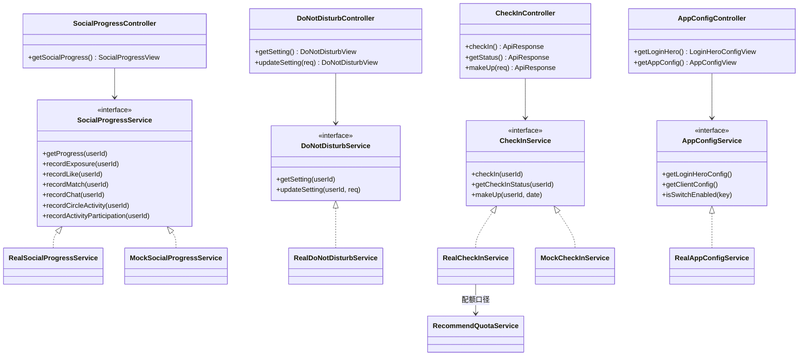

**图表来源**
- [SocialProgressService.java:7-57](file://apps/api/src/main/java/com/campuslove/api/growth/SocialProgressService.java#L7-L57)
- [CheckInService.java:9-43](file://apps/api/src/main/java/com/campuslove/api/growth/CheckInService.java#L9-L43)
- [DoNotDisturbService.java:15-34](file://apps/api/src/main/java/com/campuslove/api/growth/DoNotDisturbService.java#L15-L34)
- [AppConfigService.java:7-69](file://apps/api/src/main/java/com/campuslove/api/growth/AppConfigService.java#L7-L69)
- [RealSocialProgressService.java:27-42](file://apps/api/src/main/java/com/campuslove/api/growth/RealSocialProgressService.java#L27-L42)
- [RealCheckInService.java:58-60](file://apps/api/src/main/java/com/campuslove/api/growth/RealCheckInService.java#L58-L60)

**章节来源**
- [SocialProgressController.java:8-40](file://apps/api/src/main/java/com/campuslove/api/growth/SocialProgressController.java#L8-L40)
- [CheckInController.java:14-85](file://apps/api/src/main/java/com/campuslove/api/growth/CheckInController.java#L14-L85)
- [DoNotDisturbController.java:14-77](file://apps/api/src/main/java/com/campuslove/api/growth/DoNotDisturbController.java#L14-L77)
- [AppConfigController.java:7-42](file://apps/api/src/main/java/com/campuslove/api/growth/AppConfigController.java#L7-L42)
- [SocialProgressView.java:39-98](file://apps/api/src/main/java/com/campuslove/api/growth/SocialProgressView.java#L39-L98)
- [MakeUpCheckInRequest.java:1-20](file://apps/api/src/main/java/com/campuslove/api/growth/MakeUpCheckInRequest.java#L1-L20)
- [MakeUpCheckInResultView.java:1-29](file://apps/api/src/main/java/com/campuslove/api/growth/MakeUpCheckInResultView.java#L1-L29)
- [DoNotDisturbView.java:1-23](file://apps/api/src/main/java/com/campuslove/api/growth/DoNotDisturbView.java#L1-L23)
- [PushSummaryService.java:1-41](file://apps/api/src/main/java/com/campuslove/api/growth/PushSummaryService.java#L1-L41)
- [PushPreferenceService.java:1-31](file://apps/api/src/main/java/com/campuslove/api/growth/PushPreferenceService.java#L1-L31)

## 架构总览

分组遵循"**接口定契约、Profile 选实现、控制器只转发**"的三层结构。Real 侧把状态写进 JPA 实体表，并把成长奖励接到钱包与 MQ；Mock 侧用内存桩保证无数据库也能跑通前端联调。

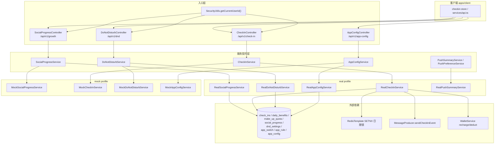

**图表来源**
- [SocialProgressController.java:21-40](file://apps/api/src/main/java/com/campuslove/api/growth/SocialProgressController.java#L21-L40)
- [CheckInController.java:21-85](file://apps/api/src/main/java/com/campuslove/api/growth/CheckInController.java#L21-L85)
- [DoNotDisturbController.java:35-77](file://apps/api/src/main/java/com/campuslove/api/growth/DoNotDisturbController.java#L35-L77)
- [AppConfigController.java:14-42](file://apps/api/src/main/java/com/campuslove/api/growth/AppConfigController.java#L14-L42)
- [RealCheckInService.java:58-175](file://apps/api/src/main/java/com/campuslove/api/growth/RealCheckInService.java#L58-L175)
- [RealDoNotDisturbService.java:27-42](file://apps/api/src/main/java/com/campuslove/api/growth/RealDoNotDisturbService.java#L27-L42)
- [RealSocialProgressService.java:27-42](file://apps/api/src/main/java/com/campuslove/api/growth/RealSocialProgressService.java#L27-L42)

三条结构性事实决定了本分组的行为边界：

1. **实现选择靠 Spring Profile，不靠配置项。** `RealCheckInService`、`RealDoNotDisturbService`、`RealSocialProgressService` 均在类上标注 `@Profile("real")`（[RealCheckInService.java:58-60](file://apps/api/src/main/java/com/campuslove/api/growth/RealCheckInService.java#L58-L60)、[RealDoNotDisturbService.java:27-29](file://apps/api/src/main/java/com/campuslove/api/growth/RealDoNotDisturbService.java#L27-L29)、[RealSocialProgressService.java:27-29](file://apps/api/src/main/java/com/campuslove/api/growth/RealSocialProgressService.java#L27-L29)），Mock 实现承担另一套 profile；控制器只依赖接口，因此切换实现不需要改控制器。
2. **身份来源单一。** 四个控制器一律用 `SecurityUtils.getCurrentUserId()` 取用户，不信任请求参数中的 userId（[SocialProgressController.java:38](file://apps/api/src/main/java/com/campuslove/api/growth/SocialProgressController.java#L38)、[CheckInController.java:39-84](file://apps/api/src/main/java/com/campuslove/api/growth/CheckInController.java#L39-L84)、[DoNotDisturbController.java:59-73](file://apps/api/src/main/java/com/campuslove/api/growth/DoNotDisturbController.java#L59-L73)），`DoNotDisturbController` 的类注释把这条写成安全约束（[DoNotDisturbController.java:24-25](file://apps/api/src/main/java/com/campuslove/api/growth/DoNotDisturbController.java#L24-L25)）。
3. **写入路径带防御纵深。** 以签到为例，同一次请求依次经过 Redis SETNX 日限锁 → DB 唯一约束（`user_id + check_in_date`）→ `@Transactional` 事务边界 → 钱包 `orderId` 幂等（[RealCheckInService.java:203-259](file://apps/api/src/main/java/com/campuslove/api/growth/RealCheckInService.java#L203-L259)、[RealCheckInService.java:280-295](file://apps/api/src/main/java/com/campuslove/api/growth/RealCheckInService.java#L280-L295)）。Redis 缺席时 `@Autowired(required = false)` 让应用照常启动，降级为仅 DB 检查（[RealCheckInService.java:130-141](file://apps/api/src/main/java/com/campuslove/api/growth/RealCheckInService.java#L130-L141)）。

**章节来源**
- [RealCheckInService.java:58-141](file://apps/api/src/main/java/com/campuslove/api/growth/RealCheckInService.java#L58-L141)
- [RealCheckInService.java:194-319](file://apps/api/src/main/java/com/campuslove/api/growth/RealCheckInService.java#L194-L319)
- [RealSocialProgressService.java:52-104](file://apps/api/src/main/java/com/campuslove/api/growth/RealSocialProgressService.java#L52-L104)
- [RealDoNotDisturbService.java:52-75](file://apps/api/src/main/java/com/campuslove/api/growth/RealDoNotDisturbService.java#L52-L75)
- [AppConfigController.java:29-38](file://apps/api/src/main/java/com/campuslove/api/growth/AppConfigController.java#L29-L38)

## 子页面导航与覆盖范围

本目录下的 4 个子页面各自负责一条业务线的实现细节。总览页**不重复**它们的内容，只做导航、边界声明与跨线协作说明。子页面的实际章节结构（按下述行号可核对）决定了本页应当止步于哪里。

| 子页面 | 覆盖的代码资产 | 子页面已承接的深度章节 | 本页只负责的部分 |
| --- | --- | --- | --- |
| [社交进度追踪](./社交进度追踪.md) | `SocialProgressController` + `SocialProgressService` + `Real/MockSocialProgressService` + `SocialProgressView` + `SocialProgress` 实体 | 社交进度数据模型、进度计算与等级晋升规则、缓存与异步处理、接口契约与前端接入 | 六层漏斗与外部埋点方的关系 |
| [每日签到系统](./每日签到系统.md) | `CheckInController` + `CheckInService` + `Real/MockCheckInService` + `CheckIn`/`DailyBenefit`/`MakeUpQuota` 实体 + `CheckInConfig` | 签到状态数据模型、奖励规则与积分累积机制、客户端接入与页面流程、并发控制与事务管理、配置与开关 | 签到与钱包/MQ/推荐配额的外部联动 |
| [勿扰模式管理](./勿扰模式管理.md) | `DoNotDisturbController` + `DoNotDisturbService` + `Real/MockDoNotDisturbService` + `DoNotDisturbRequest`/`DoNotDisturbView` + `DoNotDisturbSetting` 实体 | 接口契约与数据模型、业务规则与冲突检测、客户端集成与状态同步、测试与验证、配置与开关 | DND 与推送链路的判定时机 |
| [应用配置管理](./应用配置管理.md) | `AppConfigController` + `AppConfigService` + `Real/MockAppConfigService` + `AppConfigView`/`LoginHeroConfigView` + `app_switch`/`app_rule`/`app_config`/`app_login_hero_config` 表 | 配置项分类与命名、访问控制与安全、能力边界核查、数据模型与统计口径 | 开关被其他模块读取的强制点分布 |

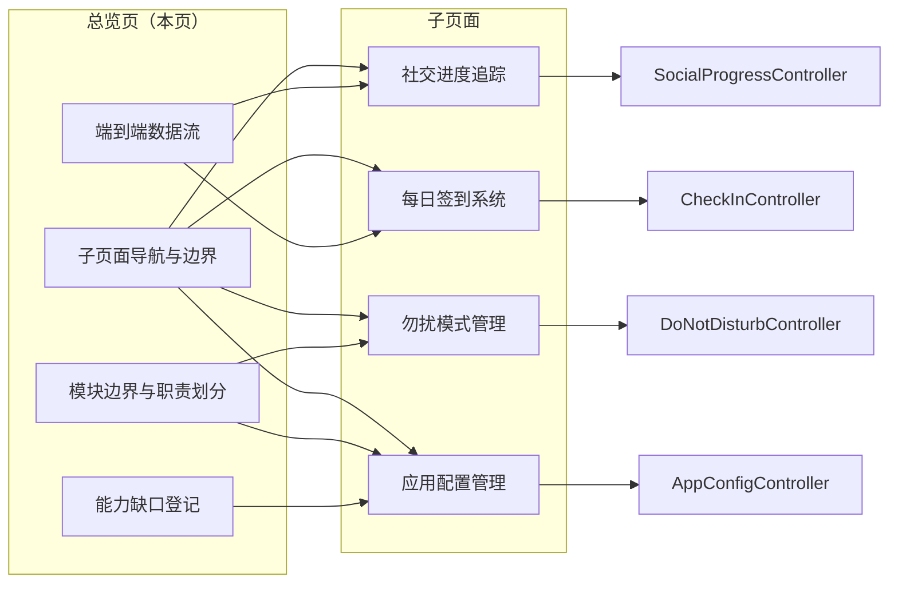

[此图为文档导航关系图，描述页面之间的职责划分而非代码调用，故不提供图表来源]

子页面锚点核对（用于确认边界没有被重复覆盖）：

- 社交进度追踪：`进度计算与等级晋升规则`、`缓存与异步处理` 已展开层级判定与埋点异步化，本页仅保留跨模块调用方清单（[社交进度追踪.md:332-408](file://.qoder/repowiki/zh/content/后端API服务/核心业务服务/成长体系服务/社交进度追踪.md#L332-L408)、[社交进度追踪.md:409-463](file://.qoder/repowiki/zh/content/后端API服务/核心业务服务/成长体系服务/社交进度追踪.md#L409-L463)）
- 每日签到系统：`并发控制与事务管理`、`配置与开关` 已展开 Redis 锁与 `app.checkin` 配置，本页只给出一条签到请求的完整时序（[每日签到系统.md:539-591](file://.qoder/repowiki/zh/content/后端API服务/核心业务服务/成长体系服务/每日签到系统.md#L539-L591)、[每日签到系统.md:592-647](file://.qoder/repowiki/zh/content/后端API服务/核心业务服务/成长体系服务/每日签到系统.md#L592-L647)）
- 勿扰模式管理：`业务规则与冲突检测` 已展开 CUSTOM 星期与跨天时段校验，本页不重述（[勿扰模式管理.md:388-438](file://.qoder/repowiki/zh/content/后端API服务/核心业务服务/成长体系服务/勿扰模式管理.md#L388-L438)）
- 应用配置管理：`能力边界核查`、`访问控制与安全` 已展开配置能力核查，本页的 `能力缺口登记` 只登记**分组层面**（跨子页）缺失项，避免与其逐条重复（[应用配置管理.md:453-496](file://.qoder/repowiki/zh/content/后端API服务/核心业务服务/成长体系服务/应用配置管理.md#L453-L496)、[应用配置管理.md:497-549](file://.qoder/repowiki/zh/content/后端API服务/核心业务服务/成长体系服务/应用配置管理.md#L497-L549)）

同目录的 4 个子页面文件均已存在（`每日签到系统.md`、`社交进度追踪.md`、`勿扰模式管理.md`、`应用配置管理.md`），本页与它们共同构成"成长体系"分组的文档集合；相邻分组 `用户资料服务` 负责资料字段本身，成长体系只消费其行为事件（[用户资料服务.md](file://.qoder/repowiki/zh/content/后端API服务/核心业务服务/用户资料服务.md)）。

**章节来源**
- [社交进度追踪.md:32-47](file://.qoder/repowiki/zh/content/后端API服务/核心业务服务/成长体系服务/社交进度追踪.md#L32-L47)
- [每日签到系统.md:42-58](file://.qoder/repowiki/zh/content/后端API服务/核心业务服务/成长体系服务/每日签到系统.md#L42-L58)
- [勿扰模式管理.md:34-49](file://.qoder/repowiki/zh/content/后端API服务/核心业务服务/成长体系服务/勿扰模式管理.md#L34-L49)
- [应用配置管理.md:33-48](file://.qoder/repowiki/zh/content/后端API服务/核心业务服务/成长体系服务/应用配置管理.md#L33-L48)
- [SocialProgressController.java:11-15](file://apps/api/src/main/java/com/campuslove/api/growth/SocialProgressController.java#L11-L15)
- [CheckInController.java:14-20](file://apps/api/src/main/java/com/campuslove/api/growth/CheckInController.java#L14-L20)
- [DoNotDisturbController.java:14-22](file://apps/api/src/main/java/com/campuslove/api/growth/DoNotDisturbController.java#L14-L22)
- [AppConfigController.java:7-13](file://apps/api/src/main/java/com/campuslove/api/growth/AppConfigController.java#L7-L13)

## 模块边界与职责划分

成长体系处在一个"事件下游 + 配额上游"的中间位置：它自己不产生社交行为，只把其他模块的行为事件累计成层级；同时它把签到换来的配额与积分交给别的模块消费。边界按调用方向切分如下。

### 进入成长体系的方向（上游埋点方）

`SocialProgressService` 的 6 个 `record*` 方法没有一个被 growth 包内的控制器调用，全部由外部模块注入触发，这构成"谁负责埋点"的边界：

| 埋点方法 | 调用方（模块） | 触发上下文 |
| --- | --- | --- |
| `recordExposure` | `discover/RecommendationCacheManager` | 推荐结果缓存命中并返回视图后计数（[RecommendationCacheManager.java:110-112](file://apps/api/src/main/java/com/campuslove/api/discover/RecommendationCacheManager.java#L110-L112)、[RecommendationCacheManager.java:231-233](file://apps/api/src/main/java/com/campuslove/api/discover/RecommendationCacheManager.java#L231-L233)） |
| `recordActivityParticipation` | `discover/RealRecommendationService` | 推荐链路中的活动参与维度（[RealRecommendationService.java:293-295](file://apps/api/src/main/java/com/campuslove/api/discover/RealRecommendationService.java#L293-L295)） |
| `recordCircleActivity` | `discover/RealCircleService` | 圈子互动写入成功后（[RealCircleService.java:284-286](file://apps/api/src/main/java/com/campuslove/api/discover/RealCircleService.java#L284-L286)） |
| `recordLike` / `recordMatch` | `match/RealMatchService` | 喜欢与匹配落库后（[RealMatchService.java:355-374](file://apps/api/src/main/java/com/campuslove/api/match/RealMatchService.java#L355-L374)） |
| `recordChat` | `chat/RealPrivateMessageService` | 私信发出后以发送者身份计数（[RealPrivateMessageService.java:300-302](file://apps/api/src/main/java/com/campuslove/api/chat/RealPrivateMessageService.java#L300-L302)） |

调用方一律采用"`@Autowired` 字段 + null 判定 + try/catch"的软依赖写法，而不是构造器强依赖（例如 [RealMatchService.java:85](file://apps/api/src/main/java/com/campuslove/api/match/RealMatchService.java#L85) 声明字段、[RecommendationCacheManager.java:53](file://apps/api/src/main/java/com/campuslove/api/discover/RecommendationCacheManager.java#L53) 声明字段）。这条边界的意义是：埋点失败不会让主业务失败，成长统计是尽力而为的旁路。

### 离开成长体系的方向（下游消费方）

- **钱包（wallet 包）**：签到奖励入账走 `WalletService.recharge`，补签扣费走 `WalletService.deduct`，流水类型分别是 `RELATED_TYPE_CHECKIN` 与 `RELATED_TYPE_CHECKIN_MAKEUP`（[RealCheckInService.java:280-295](file://apps/api/src/main/java/com/campuslove/api/growth/RealCheckInService.java#L280-L295)、[RealCheckInService.java:443-457](file://apps/api/src/main/java/com/campuslove/api/growth/RealCheckInService.java#L443-L457)）。积分余额本身由钱包模块持有，成长体系只产生流水。
- **消息队列（mq 包）**：签到成功后 `MessageProducer.sendCheckInEvent` 异步派发 `CheckInEventMessage`，通知发送不占用签到事务（[RealCheckInService.java:306-312](file://apps/api/src/main/java/com/campuslove/api/growth/RealCheckInService.java#L306-L312)）。
- **推荐配额（discover 侧消费）**：`RecommendQuotaService`（growth 包内、`@Profile("real")`）把签到赠送的 `extraQuota` 与 `app.recommendation.daily-limit` 合成每日配额，用 Redis `recommend-quota:{userId}:{yyyyMMdd}` 计数（[RecommendQuotaService.java:35-65](file://apps/api/src/main/java/com/campuslove/api/growth/RecommendQuotaService.java#L35-L65)、[RecommendQuotaService.java:73-86](file://apps/api/src/main/java/com/campuslove/api/growth/RecommendQuotaService.java#L73-L86)）。它的类注释把边界写得很明确：本服务只提供 growth 侧配额计算与原子扣减能力（`tryConsume` / `getRemainingQuota`），实际接入点应落在 `discover/RealRecommendationService#getRecommendations`，而该文件由另一组负责（[RecommendQuotaService.java:29-33](file://apps/api/src/main/java/com/campuslove/api/growth/RecommendQuotaService.java#L29-L33)）。
- **推送摘要与微信触达**：`RealPushSummaryService` 读取 `Visitor` / `Like` / `Post` / `Comment` / `PushPreference` / `RecommendationPreference` 等实体仓储生成摘要并落 `push_summaries`（[RealPushSummaryService.java:3-45](file://apps/api/src/main/java/com/campuslove/api/growth/RealPushSummaryService.java#L3-L45)、[RealPushSummaryService.java:98-104](file://apps/api/src/main/java/com/campuslove/api/growth/RealPushSummaryService.java#L98-L104)），同包 `WeChatPushService` 负责实际下发。
- **配置读取方**：`AppConfigService.isSwitchEnabled` 是供后端各业务强制点统一调用的出口，与 `getClientConfig()` 同一数据源，保证前后端口径一致（[AppConfigService.java:58-68](file://apps/api/src/main/java/com/campuslove/api/growth/AppConfigService.java#L58-L68)、[RealAppConfigService.java:187-198](file://apps/api/src/main/java/com/campuslove/api/growth/RealAppConfigService.java#L187-L198)）。

### 不属于本分组的能力

| 能力 | 归属 | 判据 |
| --- | --- | --- |
| 用户资料字段、资料完成度 | `用户资料服务` 分组 | 成长体系只消费行为计数，不写资料表 |
| 匹配算法与推荐排序策略 | `discover` / `match` 包 | 埋点方与实现方分属不同包，见上表 |
| 交友币余额、充值与账单 | `wallet` 包 | 签到只调用 `recharge` / `deduct` |
| 通知下发的渠道细节与订阅消息模板 | `WeChatPushService` 与 mq 消费端 | growth 侧只产生事件与摘要记录 |
| 管理后台配置信封（`AdminConfigView` / `AdminSwitchView` / `AdminRuleView`） | 后台管理分组 | `AppConfigView` 注释明确与后台信封解耦（[AppConfigView.java:8-15](file://apps/api/src/main/java/com/campuslove/api/growth/AppConfigView.java#L8-L15)） |

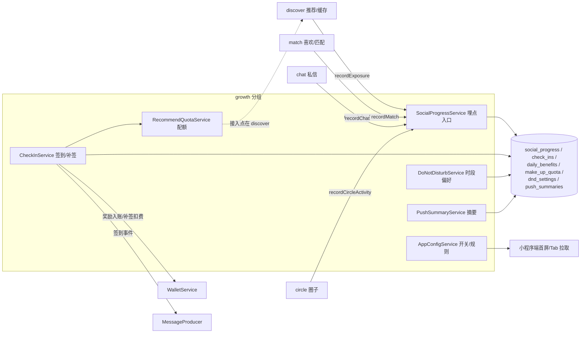

**图表来源**
- [RecommendationCacheManager.java:110-112](file://apps/api/src/main/java/com/campuslove/api/discover/RecommendationCacheManager.java#L110-L112)
- [RealMatchService.java:355-374](file://apps/api/src/main/java/com/campuslove/api/match/RealMatchService.java#L355-L374)
- [RealPrivateMessageService.java:300-302](file://apps/api/src/main/java/com/campuslove/api/chat/RealPrivateMessageService.java#L300-L302)
- [RealCircleService.java:284-286](file://apps/api/src/main/java/com/campuslove/api/discover/RealCircleService.java#L284-L286)
- [RealCheckInService.java:280-312](file://apps/api/src/main/java/com/campuslove/api/growth/RealCheckInService.java#L280-L312)
- [RecommendQuotaService.java:29-65](file://apps/api/src/main/java/com/campuslove/api/growth/RecommendQuotaService.java#L29-L65)
- [RealPushSummaryService.java:98-104](file://apps/api/src/main/java/com/campuslove/api/growth/RealPushSummaryService.java#L98-L104)

**章节来源**
- [SocialProgressService.java:17-57](file://apps/api/src/main/java/com/campuslove/api/growth/SocialProgressService.java#L17-L57)
- [RealSocialProgressService.java:83-104](file://apps/api/src/main/java/com/campuslove/api/growth/RealSocialProgressService.java#L83-L104)
- [RealAppConfigService.java:139-198](file://apps/api/src/main/java/com/campuslove/api/growth/RealAppConfigService.java#L139-L198)
- [CheckInConfig.java:12-20](file://apps/api/src/main/java/com/campuslove/api/config/CheckInConfig.java#L12-L20)

## 端到端数据流

以"用户完成一次签到并看到社交进度"这条最常用的链路为例，把四个子页面的入口串成一张时序图。图中每一步都对应真实代码行，不含推测节点。

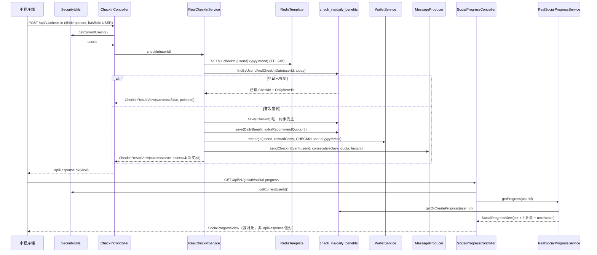

**图表来源**
- [CheckInController.java:35-41](file://apps/api/src/main/java/com/campuslove/api/growth/CheckInController.java#L35-L41)
- [RealCheckInService.java:196-319](file://apps/api/src/main/java/com/campuslove/api/growth/RealCheckInService.java#L196-L319)
- [SocialProgressController.java:36-40](file://apps/api/src/main/java/com/campuslove/api/growth/SocialProgressController.java#L36-L40)
- [RealSocialProgressService.java:52-76](file://apps/api/src/main/java/com/campuslove/api/growth/RealSocialProgressService.java#L52-L76)
- [CheckInResultView.java:7-24](file://apps/api/src/main/java/com/campuslove/api/growth/CheckInResultView.java#L7-L24)

链路上有四个值得单独记住的口径事实：

1. **信封不统一。** `CheckInController` 三个端点都返回 `ApiResponse<T>`（[CheckInController.java:38-84](file://apps/api/src/main/java/com/campuslove/api/growth/CheckInController.java#L38-L84)），而 `SocialProgressController`、`DoNotDisturbController`、`AppConfigController` 直接返回视图对象（[SocialProgressController.java:37](file://apps/api/src/main/java/com/campuslove/api/growth/SocialProgressController.java#L37)、[DoNotDisturbController.java:58-72](file://apps/api/src/main/java/com/campuslove/api/growth/DoNotDisturbController.java#L58-L72)、[AppConfigController.java:25-40](file://apps/api/src/main/java/com/campuslove/api/growth/AppConfigController.java#L25-L40)）。前端解析时必须区分两类响应形态。
2. **同一天多次 POST 的语义是"幂等返回"而不是"报错"。** 重复签到分支返回 `success=false` 且 `points=0`，源码注释写明这是防止前端 `pointsBalance += pointsEarned` 双计（[RealCheckInService.java:226-235](file://apps/api/src/main/java/com/campuslove/api/growth/RealCheckInService.java#L226-L235)、[CheckInResultView.java:16-23](file://apps/api/src/main/java/com/campuslove/api/growth/CheckInResultView.java#L16-L23)）。
3. **`getProgress` 可能是写操作。** 因为内部 `getOrCreateProgress` 会懒创建记录，`@Transactional(readOnly = true)` 被显式改成读写事务，注释记录了改动原因（[RealSocialProgressService.java:52-62](file://apps/api/src/main/java/com/campuslove/api/growth/RealSocialProgressService.java#L52-L62)、[RealSocialProgressService.java:232-248](file://apps/api/src/main/java/com/campuslove/api/growth/RealSocialProgressService.java#L232-L248)）。
4. **层级只升不降。** `evaluateAndUpgradeTier` 只在 `determineTier` 结果与旧值不同时写入新值，`determineTier` 从 L6 到 L1 逐级回落判定，因此任何计数减少都不会把层级降回去（[RealSocialProgressService.java:266-299](file://apps/api/src/main/java/com/campuslove/api/growth/RealSocialProgressService.java#L266-L299)）。

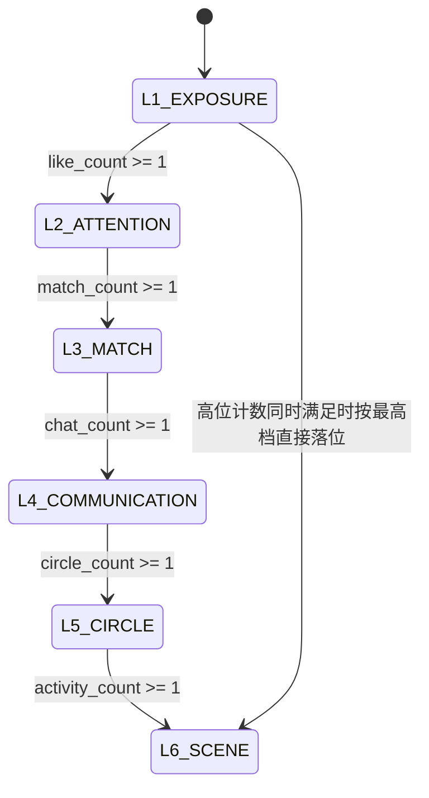

状态迁移条件与 `determineTier` 的六个 `if` 完全一致，进度百分比由 `SocialProgressView.TIER_INDEX_MAP` 与 `TOTAL_TIERS = 6` 推导（L1=17%、L2=33%、L3=50%、L4=67%、L5=83%、L6=100%）（[RealSocialProgressService.java:282-299](file://apps/api/src/main/java/com/campuslove/api/growth/RealSocialProgressService.java#L282-L299)、[SocialProgressView.java:48-98](file://apps/api/src/main/java/com/campuslove/api/growth/SocialProgressView.java#L48-L98)）。

**图表来源**
- [RealSocialProgressService.java:106-220](file://apps/api/src/main/java/com/campuslove/api/growth/RealSocialProgressService.java#L106-L220)
- [RealSocialProgressService.java:266-299](file://apps/api/src/main/java/com/campuslove/api/growth/RealSocialProgressService.java#L266-L299)
- [SocialProgressView.java:39-98](file://apps/api/src/main/java/com/campuslove/api/growth/SocialProgressView.java#L39-L98)

**章节来源**
- [RealCheckInService.java:194-319](file://apps/api/src/main/java/com/campuslove/api/growth/RealCheckInService.java#L194-L319)
- [RealCheckInService.java:333-344](file://apps/api/src/main/java/com/campuslove/api/growth/RealCheckInService.java#L333-L344)
- [CheckIn.java:18-48](file://apps/api/src/main/java/com/campuslove/api/entity/CheckIn.java#L18-L48)
- [DailyBenefit.java:28-53](file://apps/api/src/main/java/com/campuslove/api/entity/DailyBenefit.java#L28-L53)
- [SocialProgress.java:23-72](file://apps/api/src/main/java/com/campuslove/api/entity/SocialProgress.java#L23-L72)
- [PushSummaryService.java:11-33](file://apps/api/src/main/java/com/campuslove/api/growth/PushSummaryService.java#L11-L33)

## 详细组件分析

本节按"入口 → 契约 → 实现要点 → 落点表"的顺序概括 4 条业务线，每条只保留总览页需要的判定信息；分支穷举、字段表与前端组件流程在对应子页面。

### 社交升温漏斗（SocialProgressController）

- 入口只有一个只读端点：`GET /api/v1/growth/social-progress`，方法体两行——取当前用户、转发 `socialProgressService.getProgress(userId)`（[SocialProgressController.java:36-40](file://apps/api/src/main/java/com/campuslove/api/growth/SocialProgressController.java#L36-L40)）。
- 契约有 7 个方法，其中 6 个是 `void record*` 埋点（[SocialProgressService.java:15-57](file://apps/api/src/main/java/com/campuslove/api/growth/SocialProgressService.java#L15-L57)）。
- Real 实现把 6 个计数保存在 `social_progress` 表对应实体的字段上（`exposureCount` / `likeCount` / `matchCount` / `chatCount` / `circleCount` / `activityCount`，`currentTier` 默认 `L1_EXPOSURE`，带 `version` 乐观锁）（[SocialProgress.java:23-84](file://apps/api/src/main/java/com/campuslove/api/entity/SocialProgress.java#L23-L84)）。
- `recordExposure` 的事务传播被显式改为 `REQUIRES_NEW`，注释给出了原因：推荐链路在 `@Transactional(readOnly = true)` 外层事务里调用埋点，`REQUIRED` 会并入只读事务导致懒创建 INSERT 被 MySQL 拒绝，并把事务标记为 rollback-only，最终在外层提交阶段抛 `UnexpectedRollbackException` 变成 500（[RealSocialProgressService.java:83-104](file://apps/api/src/main/java/com/campuslove/api/growth/RealSocialProgressService.java#L83-L104)）。其余 5 个 `record*` 仍用普通 `@Transactional`（[RealSocialProgressService.java:111-220](file://apps/api/src/main/java/com/campuslove/api/growth/RealSocialProgressService.java#L111-L220)）。
- 行动建议文案在服务端生成，6 个层级各一句，未匹配层级有兜底句（[RealSocialProgressService.java:307-324](file://apps/api/src/main/java/com/campuslove/api/growth/RealSocialProgressService.java#L307-L324)）；层级中文名在视图类里以静态 Map 固化（[SocialProgressView.java:39-46](file://apps/api/src/main/java/com/campuslove/api/growth/SocialProgressView.java#L39-L46)）。

### 每日签到（CheckInController）

三个端点对应 `CheckInService` 的三个方法：`POST /api/v1/check-in`（`@Idempotent` + `hasRole('USER')`）、`GET /api/v1/check-in/status`、`POST /api/v1/check-in/make-up`（`@Idempotent` + `@Valid @RequestBody MakeUpCheckInRequest`）（[CheckInController.java:35-85](file://apps/api/src/main/java/com/campuslove/api/growth/CheckInController.java#L35-L85)）。

Real 侧的固定数值口径（均可在源码中定位）：

| 口径 | 取值 | 证据 |
| --- | --- | --- |
| 单次签到赠送推荐配额 | 5 | [CheckInConfig.java:16-17](file://apps/api/src/main/java/com/campuslove/api/config/CheckInConfig.java#L16-L17)、[RealCheckInService.java:263-274](file://apps/api/src/main/java/com/campuslove/api/growth/RealCheckInService.java#L263-L274) |
| 单次签到交友币奖励 | 50 分（默认，可用 `app.checkin.reward-cents-per-check-in` 覆盖） | [CheckInConfig.java:19-20](file://apps/api/src/main/java/com/campuslove/api/config/CheckInConfig.java#L19-L20)、[RealCheckInService.java:283-292](file://apps/api/src/main/java/com/campuslove/api/growth/RealCheckInService.java#L283-L292) |
| 补签可回溯范围 | 昨日及之前 7 天内 | [RealCheckInService.java:64-65](file://apps/api/src/main/java/com/campuslove/api/growth/RealCheckInService.java#L64-L65)、[RealCheckInService.java:398-408](file://apps/api/src/main/java/com/campuslove/api/growth/RealCheckInService.java#L398-L408) |
| 补签月度配额 | 3 次（`MakeUpQuota.DEFAULT_LIMIT`） | [MakeUpQuota.java:28-51](file://apps/api/src/main/java/com/campuslove/api/entity/MakeUpQuota.java#L28-L51)、[RealCheckInService.java:416-434](file://apps/api/src/main/java/com/campuslove/api/growth/RealCheckInService.java#L416-L434) |
| 补签费用 | 首次免费，其后每次 50 积分（`COST_POINTS_AFTER_FREE`） | [MakeUpQuota.java:31](file://apps/api/src/main/java/com/campuslove/api/entity/MakeUpQuota.java#L31)、[RealCheckInService.java:436-457](file://apps/api/src/main/java/com/campuslove/api/growth/RealCheckInService.java#L436-L457) |
| 签到 Redis 日限锁 | key `checkin:{userId}:{yyyyMMdd}`，TTL 24h，值 `"1"` | [RealCheckInService.java:70-92](file://apps/api/src/main/java/com/campuslove/api/growth/RealCheckInService.java#L70-L92)、[RealCheckInService.java:203-211](file://apps/api/src/main/java/com/campuslove/api/growth/RealCheckInService.java#L203-L211) |
| 补签记录来源标记 | `check_ins.source = MAKE_UP`（默认 `NORMAL`） | [CheckIn.java:51-78](file://apps/api/src/main/java/com/campuslove/api/entity/CheckIn.java#L51-L78)、[RealCheckInService.java:465-471](file://apps/api/src/main/java/com/campuslove/api/growth/RealCheckInService.java#L465-L471) |

并发控制采用"Redis 抢锁 + DB 唯一约束 + 原子递增配额"三段：签到写库失败（`DataIntegrityViolationException`）时会**释放** Redis 锁以便用户重试（[RealCheckInService.java:248-259](file://apps/api/src/main/java/com/campuslove/api/growth/RealCheckInService.java#L248-L259)）；补签配额递增改为单条 `UPDATE ... WHERE used_count < limit_count`，影响行数为 0 即视为并发耗尽（[RealCheckInService.java:482-491](file://apps/api/src/main/java/com/campuslove/api/growth/RealCheckInService.java#L482-L491)）。连续天数计算由逐日回查改成一次批量取日期集合再内存判定（`SELECT c.checkInDate FROM CheckIn c WHERE c.userId = :userId AND c.checkInDate <= :today ORDER BY ... DESC`），补签日期在集合中视为已签到（[RealCheckInService.java:516-538](file://apps/api/src/main/java/com/campuslove/api/growth/RealCheckInService.java#L516-L538)）。

Mock 实现独立维护同一组常量（`MAKE_UP_LIMIT = 3`、`MAKE_UP_COST_POINTS = 50`、`MAKE_UP_MAX_DAYS_BACK = 7`，`@Profile("mock")`），两条实现线不共享常量，属于需要人工对齐的重复口径（[MockCheckInService.java:18-46](file://apps/api/src/main/java/com/campuslove/api/growth/MockCheckInService.java#L18-L46)）。

### 勿扰模式（DoNotDisturbController）

- `GET /api/v1/dnd` 无 `@PreAuthorize`（读自身配置），`PUT /api/v1/dnd` 带 `@PreAuthorize("hasRole('USER')")` 和 `@Valid`，控制器用 `log.debug` 记录本次改动的四个关键字段（[DoNotDisturbController.java:57-77](file://apps/api/src/main/java/com/campuslove/api/growth/DoNotDisturbController.java#L57-L77)）。
- 请求体校验集中在 record 的注解上：`enabled` / `startTime` / `endTime` / `repeatMode` / `allowUrgent` 必填，时间用 `^([01]\d|2[0-3]):[0-5]\d$`，`repeatMode` 用 `^(EVERYDAY|WEEKDAYS|WEEKENDS|CUSTOM)$`，`customWeekdays` 最长 16（[DoNotDisturbRequest.java:28-39](file://apps/api/src/main/java/com/campuslove/api/growth/DoNotDisturbRequest.java#L28-L39)）。
- Real 侧补充三条注解无法表达的业务校验：CUSTOM 模式必须有 `customWeekdays`、每个值落在 1-7、`startTime` 与 `endTime` 不能相同（允许跨天如 `22:00-08:00`）；落库前把 CSV 规范化为去重升序（`"3,1,1"` → `"1,3"`），非 CUSTOM 模式一律写 `null`（[RealDoNotDisturbService.java:104-152](file://apps/api/src/main/java/com/campuslove/api/growth/RealDoNotDisturbService.java#L104-L152)、[RealDoNotDisturbService.java:163-173](file://apps/api/src/main/java/com/campuslove/api/growth/RealDoNotDisturbService.java#L163-L173)）。
- 无记录时返回默认偏好**且不持久化**：关闭免打扰、`22:00-08:00`、`EVERYDAY`、允许紧急穿透（[RealDoNotDisturbService.java:52-75](file://apps/api/src/main/java/com/campuslove/api/growth/RealDoNotDisturbService.java#L52-L75)、[DoNotDisturbService.java:8-13](file://apps/api/src/main/java/com/campuslove/api/growth/DoNotDisturbService.java#L8-L13)）。实体表 `dnd_settings` 的字段默认值与之一致（[DoNotDisturbSetting.java:33-67](file://apps/api/src/main/java/com/campuslove/api/entity/DoNotDisturbSetting.java#L33-L67)）。

### 应用配置（AppConfigController）

两个只读端点：`GET /api/v1/app-config/login-hero`、`GET /api/v1/app-config`，返回 `LoginHeroConfigView` 与扁平的 `AppConfigView{switches, rules, siteTitle}`（[AppConfigController.java:24-42](file://apps/api/src/main/java/com/campuslove/api/growth/AppConfigController.java#L24-L42)）。控制器注释与 `AppConfigService` 常量给出配置项全集：

- 开关 7 个：`maintenance_mode`、`register_open`、`login_open`、`match_open`、`recommend_open`、`post_publish_open`、`feedback_open`；内置默认除维护模式为 `false` 外全部 `true`（[AppConfigService.java:9-30](file://apps/api/src/main/java/com/campuslove/api/growth/AppConfigService.java#L9-L30)、[RealAppConfigService.java:221-234](file://apps/api/src/main/java/com/campuslove/api/growth/RealAppConfigService.java#L221-L234)）
- 规则 2 个：`daily_recommend_limit` 默认 10、`heart_signal_expire_hours` 默认 48（[AppConfigService.java:32-38](file://apps/api/src/main/java/com/campuslove/api/growth/AppConfigService.java#L32-L38)、[RealAppConfigService.java:236-244](file://apps/api/src/main/java/com/campuslove/api/growth/RealAppConfigService.java#L236-L244)）
- 站点标题读 `app_config` 的 `site.title`，缺失或异常回落到「校园恋爱」（[RealAppConfigService.java:53-59](file://apps/api/src/main/java/com/campuslove/api/growth/RealAppConfigService.java#L53-L59)、[RealAppConfigService.java:158-167](file://apps/api/src/main/java/com/campuslove/api/growth/RealAppConfigService.java#L158-L167)）
- 合并策略：以内置默认为底、DB 行按 key 覆盖；规则表达式非整数或该行未启用则忽略并保留默认（[RealAppConfigService.java:139-176](file://apps/api/src/main/java/com/campuslove/api/growth/RealAppConfigService.java#L139-L176)、[RealAppConfigService.java:200-219](file://apps/api/src/main/java/com/campuslove/api/growth/RealAppConfigService.java#L200-L219)）
- Hero 配置读 `app_login_hero_config` 中 `scene_key='default'` 且 `is_active=true` 的行，无数据或 `DataAccessException` 时回落到内置默认（`heroMode=animation`、`heroAnimationTheme=romantic`、`heroTitle=遇见对的人` 等，视频/海报 URL 默认为 `null`）（[RealAppConfigService.java:28-51](file://apps/api/src/main/java/com/campuslove/api/growth/RealAppConfigService.java#L28-L51)、[RealAppConfigService.java:98-122](file://apps/api/src/main/java/com/campuslove/api/growth/RealAppConfigService.java#L98-L122)、[RealAppConfigService.java:272-290](file://apps/api/src/main/java/com/campuslove/api/growth/RealAppConfigService.java#L272-L290)）

### 辅助组件（不属于 4 个子页面但被本分组持有）

- `RecommendQuotaService`：`getDailyQuota` = 基础额度 + 签到 `extraQuota`，`tryConsume` 用 Redis `INCR` 并在超限时 `DECR` 回滚，Redis 不可用时降级为 `ConcurrentHashMap` + `synchronized`；每日 key TTL 36 小时（[RecommendQuotaService.java:98-159](file://apps/api/src/main/java/com/campuslove/api/growth/RecommendQuotaService.java#L98-L159)）
- `RealPushSummaryService`：`generateSocialDigest` / `generateRecommendRefresh` / `markSent`，按用户偏好 `PushPreference` 控制频次，同一自然日同类型只生成一条（[PushSummaryService.java:11-41](file://apps/api/src/main/java/com/campuslove/api/growth/PushSummaryService.java#L11-L41)、[RealPushSummaryService.java:98-104](file://apps/api/src/main/java/com/campuslove/api/growth/RealPushSummaryService.java#L98-L104)、[RealPushSummaryService.java:213-219](file://apps/api/src/main/java/com/campuslove/api/growth/RealPushSummaryService.java#L213-L219)）

`RealPushSummaryService` 是成长数据离开本分组的唯一出口，其边界行为有四条可在源码逐条核对：

- **注入面**：构造期注入 8 个 Repository（`PushSummary`、`PushPreference`、`Visitor`、`Like`、`Post`、`PostLike`、`Comment`、`RecommendationPreference`），跨社区与资料域只读聚合后写 `push_summaries`；import 与字段两处都不含任何免打扰相关类（[RealPushSummaryService.java:14-21](file://apps/api/src/main/java/com/campuslove/api/growth/RealPushSummaryService.java#L14-L21)、[RealPushSummaryService.java:51-58](file://apps/api/src/main/java/com/campuslove/api/growth/RealPushSummaryService.java#L51-L58)）。
- **日去重靠查询而非唯一键**：两类摘要都先用 `findByUserIdAndGeneratedAtAfter(userId, todayStart)` 取当日记录、再按 `summaryType` 过滤，命中即**返回已有记录**而不是重新生成；`push_summaries` 上只有 `INDEX idx_user_sent`，没有 user 维度唯一约束，去重语义完全在服务层（[RealPushSummaryService.java:111-122](file://apps/api/src/main/java/com/campuslove/api/growth/RealPushSummaryService.java#L111-L122)、[RealPushSummaryService.java:227-235](file://apps/api/src/main/java/com/campuslove/api/growth/RealPushSummaryService.java#L227-L235)、[V2026.05.28.0007__create_push_system.sql:14-26](file://database/flyway/sql/V2026.05.28.0007__create_push_system.sql#L14-L26)）。
- **抑制条件是"不生成"而不是"生成后不发"**：`PushPreference.pushEnabled` 为 `false` 时两个方法直接 `return null`；`generateRecommendRefresh` 还额外读 `RecommendationPreference.preferredTime`，解析失败降级 `12:00`（`log.warn`），未到偏好时间同样返回 `null`（[RealPushSummaryService.java:103-108](file://apps/api/src/main/java/com/campuslove/api/growth/RealPushSummaryService.java#L103-L108)、[RealPushSummaryService.java:240-260](file://apps/api/src/main/java/com/campuslove/api/growth/RealPushSummaryService.java#L240-L260)）。
- **`markSent` 是唯一带身份收口的写操作**：比对摘要归属，非本人抛 `IllegalArgumentException(ErrorMessages.PUSH_SUMMARY_FORBIDDEN)`，取不到当前用户（`HttpClientErrorException`）转抛 `IllegalStateException(ErrorMessages.PUSH_MARK_UNAUTHENTICATED)`；跳转路径是硬编码串 `/pages/likes/index` 与 `/pages/discover/index`（[RealPushSummaryService.java:300-314](file://apps/api/src/main/java/com/campuslove/api/growth/RealPushSummaryService.java#L300-L314)、[RealPushSummaryService.java:184-188](file://apps/api/src/main/java/com/campuslove/api/growth/RealPushSummaryService.java#L184-L188)、[RealPushSummaryService.java:265-269](file://apps/api/src/main/java/com/campuslove/api/growth/RealPushSummaryService.java#L265-L269)）。

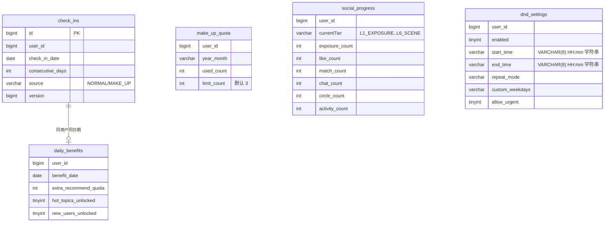

**图表来源**
- [CheckIn.java:32-97](file://apps/api/src/main/java/com/campuslove/api/entity/CheckIn.java#L32-L97)
- [DailyBenefit.java:28-60](file://apps/api/src/main/java/com/campuslove/api/entity/DailyBenefit.java#L28-L60)
- [MakeUpQuota.java:24-60](file://apps/api/src/main/java/com/campuslove/api/entity/MakeUpQuota.java#L24-L60)
- [SocialProgress.java:23-72](file://apps/api/src/main/java/com/campuslove/api/entity/SocialProgress.java#L23-L72)
- [DoNotDisturbSetting.java:33-79](file://apps/api/src/main/java/com/campuslove/api/entity/DoNotDisturbSetting.java#L33-L79)
- [V2026.07.25.0012__create_dnd_settings.sql:23-27](file://database/flyway/sql/V2026.07.25.0012__create_dnd_settings.sql#L23-L27)

> 注意 `dnd_settings` 的 `start_time` / `end_time` **不是时间类型**：DDL 声明为 `VARCHAR(8) NOT NULL DEFAULT '22:00'` 与 `VARCHAR(8) NOT NULL DEFAULT '08:00'`（[V2026.07.25.0012__create_dnd_settings.sql:24-25](file://database/flyway/sql/V2026.07.25.0012__create_dnd_settings.sql#L24-L25)），实体侧同样以字符串承载——`private String startTime = "22:00"`、`private String endTime = "08:00"`，并标注 `@Column(length = 8)`（[DoNotDisturbSetting.java:49-55](file://apps/api/src/main/java/com/campuslove/api/entity/DoNotDisturbSetting.java#L49-L55)）。实体类注释写明设计意图是"HH:mm 格式字符串，前端 picker 直接绑定"（[DoNotDisturbSetting.java:25](file://apps/api/src/main/java/com/campuslove/api/entity/DoNotDisturbSetting.java#L25)），数据库层不做任何时间语义约束。

**章节来源**
- [SocialProgressController.java:21-40](file://apps/api/src/main/java/com/campuslove/api/growth/SocialProgressController.java#L21-L40)
- [RealSocialProgressService.java:83-324](file://apps/api/src/main/java/com/campuslove/api/growth/RealSocialProgressService.java#L83-L324)
- [CheckInController.java:14-85](file://apps/api/src/main/java/com/campuslove/api/growth/CheckInController.java#L14-L85)
- [RealCheckInService.java:64-92](file://apps/api/src/main/java/com/campuslove/api/growth/RealCheckInService.java#L64-L92)
- [RealCheckInService.java:383-501](file://apps/api/src/main/java/com/campuslove/api/growth/RealCheckInService.java#L383-L501)
- [DoNotDisturbController.java:35-77](file://apps/api/src/main/java/com/campuslove/api/growth/DoNotDisturbController.java#L35-L77)
- [AppConfigController.java:14-42](file://apps/api/src/main/java/com/campuslove/api/growth/AppConfigController.java#L14-L42)
- [RecommendQuotaService.java:41-96](file://apps/api/src/main/java/com/campuslove/api/growth/RecommendQuotaService.java#L41-L96)

## 跨模块协作关系

分组与其他模块之间不是直接方法耦合，而是通过 5 类**共享约定**协作。每类约定都有明确的定义位置，改动时需要同步评估两侧。

### 1. 安全上下文约定（身份）

四个控制器的 userId 全部来自 `SecurityUtils.getCurrentUserId()`，而该工具同时也是 401 的抛出点（[DoNotDisturbController.java:24-25](file://apps/api/src/main/java/com/campuslove/api/growth/DoNotDisturbController.java#L24-L25)、[CheckInController.java:67](file://apps/api/src/main/java/com/campuslove/api/growth/CheckInController.java#L67)）。`AppConfigController` 是唯一不做身份解析的控制器，因为 `SecurityConfig` 与 `MockSecurityConfig` 都把 `/api/v1/app-config/**` 设为 `permitAll`——注释记录了原因：未登录用户在冷启动时也要拉取该配置，认证要求会让首屏直接失败（[SecurityConfig.java:127-129](file://apps/api/src/main/java/com/campuslove/api/config/SecurityConfig.java#L127-L129)、[MockSecurityConfig.java:189](file://apps/api/src/main/java/com/campuslove/api/config/MockSecurityConfig.java#L192)）。

### 2. 幂等约定（写端点）

`POST /api/v1/check-in` 与 `POST /api/v1/check-in/make-up` 标注 `@Idempotent`，由 `IdempotentInterceptor` 实现：Redis key 形如 `idempotent:{key}:{userId}`，按用户隔离，默认 TTL 为 4 小时（`DEFAULT_TTL_SECONDS = 4L * 3600`），未认证时以 `anonymous` 兜底；Redis 不可用（例如 mock profile）时 `redisTemplate` 可能为 null 并走降级（[Idempotent.java:41-54](file://apps/api/src/main/java/com/campuslove/api/common/Idempotent.java#L41-L54)、[IdempotentInterceptor.java:27-57](file://apps/api/src/main/java/com/campuslove/api/common/IdempotentInterceptor.java#L27-L57)、[IdempotentInterceptor.java:156-159](file://apps/api/src/main/java/com/campuslove/api/common/IdempotentInterceptor.java#L156-L159)）。这条约定与签到内部的 Redis 日限锁是**两层不同机制**，前者防重复提交、后者防同日重复入账（[CheckInController.java:35-37](file://apps/api/src/main/java/com/campuslove/api/growth/CheckInController.java#L35-L37)、[RealCheckInService.java:70-92](file://apps/api/src/main/java/com/campuslove/api/growth/RealCheckInService.java#L70-L92)）。

### 3. 时间约定（自然日边界）

分组内所有"今天"的判定统一使用 `TimeZones.BUSINESS`（`Asia/Shanghai`）：签到日期、补签范围、权益日期、连续天数、配额 TTL key、记录更新时间都基于它（[TimeZones.java:8](file://apps/api/src/main/java/com/campuslove/api/common/TimeZones.java#L8)、[RealCheckInService.java:201](file://apps/api/src/main/java/com/campuslove/api/growth/RealCheckInService.java#L201)、[RealCheckInService.java:398](file://apps/api/src/main/java/com/campuslove/api/growth/RealCheckInService.java#L398)、[RealSocialProgressService.java:100](file://apps/api/src/main/java/com/campuslove/api/growth/RealSocialProgressService.java#L100)、[RealDoNotDisturbService.java:147](file://apps/api/src/main/java/com/campuslove/api/growth/RealDoNotDisturbService.java#L147)）。换时区会同时改变签到、补签、配额三条线的一致性，因此不允许在业务代码里改用 `ZoneId.systemDefault()`。

### 4. 事件与账务约定（钱与消息）

签到既产生 DB 记录也产生账务事件：奖励走 `WalletService.recharge`，`orderId` 由 `(userId, yyyyMMdd)` 拼成以保证同日不重复入账；补签成本走 `WalletService.deduct`，余额不足时把 `InsufficientBalanceException` 转成业务可读的 `IllegalArgumentException`（[RealCheckInService.java:280-295](file://apps/api/src/main/java/com/campuslove/api/growth/RealCheckInService.java#L280-L295)、[RealCheckInService.java:443-457](file://apps/api/src/main/java/com/campuslove/api/growth/RealCheckInService.java#L443-L457)）。账务失败对签到主流程是非致命的——钱包异常只记日志不回滚签到（`try/catch` + `log.warn`），而补签扣费失败则直接终止补签。两种相反的处理策略是刻意区分：签到是用户当日动作、不可因下游抖动而失败；补签涉及扣费、必须强一致（[RealCheckInService.java:293-295](file://apps/api/src/main/java/com/campuslove/api/growth/RealCheckInService.java#L293-L295)、[RealCheckInService.java:451-455](file://apps/api/src/main/java/com/campuslove/api/growth/RealCheckInService.java#L451-L455)）。

### 5. 降级与容错约定

- **配置读不到就用默认值**：`getClientConfig()` 与 `getLoginHeroConfig()` 捕获 `DataAccessException` 后返回内置默认；`isSwitchEnabled` 在异常时返回 `true`（宁可放行不误伤）（[RealAppConfigService.java:117-122](file://apps/api/src/main/java/com/campuslove/api/growth/RealAppConfigService.java#L117-L122)、[RealAppConfigService.java:168-175](file://apps/api/src/main/java/com/campuslove/api/growth/RealAppConfigService.java#L168-L175)、[RealAppConfigService.java:187-198](file://apps/api/src/main/java/com/campuslove/api/growth/RealAppConfigService.java#L187-L198)）。
- **埋点失败不传染主链路**：`recordExposure` 用 `REQUIRES_NEW` 把埋点事务从外层只读事务里摘出来（[RealSocialProgressService.java:84-92](file://apps/api/src/main/java/com/campuslove/api/growth/RealSocialProgressService.java#L84-L92)）。
- **Redis 缺席照常启动**：`RealCheckInService.redisTemplate` 与 `RecommendQuotaService.redisTemplate` 都是 `@Autowired(required = false)`，后者退化为进程内 `ConcurrentHashMap`（[RealCheckInService.java:130-141](file://apps/api/src/main/java/com/campuslove/api/growth/RealCheckInService.java#L130-L141)、[RecommendQuotaService.java:53-60](file://apps/api/src/main/java/com/campuslove/api/growth/RecommendQuotaService.java#L53-L60)）。
- **外部触达带熔断**：`WeChatPushService` 引入 Resilience4j 的 `@CircuitBreaker` / `@RateLimiter` / `@Retry`，并对日志中的 openId 做脱敏，access_token 提前 300 秒刷新（[WeChatPushService.java:22-38](file://apps/api/src/main/java/com/campuslove/api/growth/WeChatPushService.java#L22-L38)）。

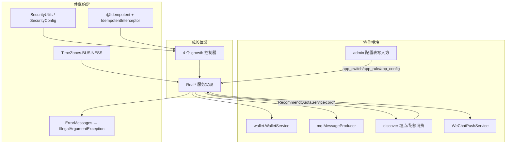

**图表来源**
- [SecurityConfig.java:127-129](file://apps/api/src/main/java/com/campuslove/api/config/SecurityConfig.java#L127-L129)
- [IdempotentInterceptor.java:27-57](file://apps/api/src/main/java/com/campuslove/api/common/IdempotentInterceptor.java#L27-L57)
- [TimeZones.java:8](file://apps/api/src/main/java/com/campuslove/api/common/TimeZones.java#L8)
- [RealCheckInService.java:280-312](file://apps/api/src/main/java/com/campuslove/api/growth/RealCheckInService.java#L280-L312)
- [RealAppConfigService.java:139-198](file://apps/api/src/main/java/com/campuslove/api/growth/RealAppConfigService.java#L139-L198)
- [WeChatPushService.java:22-38](file://apps/api/src/main/java/com/campuslove/api/growth/WeChatPushService.java#L22-L38)

错误语义也属于协作约定的一部分：4 个控制器把服务层抛出的 `IllegalArgumentException` 统一交给全局异常处理转成 400，`CheckInController` 的注释逐项列出了补签的 4 类 400 触发条件（日期格式无效、超出范围、已签到过、超出月配额）（[CheckInController.java:69-74](file://apps/api/src/main/java/com/campuslove/api/growth/CheckInController.java#L69-L74)、[RealCheckInService.java:401-414](file://apps/api/src/main/java/com/campuslove/api/growth/RealCheckInService.java#L401-L414)、[RealDoNotDisturbService.java:104-126](file://apps/api/src/main/java/com/campuslove/api/growth/RealDoNotDisturbService.java#L104-L126)）。文案集中在 `ErrorMessages`，控制器与服务层不各自硬编码提示串（[DoNotDisturbRequest.java:3-37](file://apps/api/src/main/java/com/campuslove/api/growth/DoNotDisturbRequest.java#L3-L37)）。

**章节来源**
- [CheckInController.java:35-85](file://apps/api/src/main/java/com/campuslove/api/growth/CheckInController.java#L35-L85)
- [DoNotDisturbController.java:24-77](file://apps/api/src/main/java/com/campuslove/api/growth/DoNotDisturbController.java#L24-L77)
- [AppConfigController.java:10-13](file://apps/api/src/main/java/com/campuslove/api/growth/AppConfigController.java#L10-L13)
- [RecommendQuotaService.java:16-60](file://apps/api/src/main/java/com/campuslove/api/growth/RecommendQuotaService.java#L16-L60)

## 依赖关系分析

### 包内依赖

`com.campuslove.api.growth` 是自洽的一层：控制器只 import 同包的服务接口与视图，服务实现才向下触达实体与仓储。这一约束在源码 import 上可直接核对——`SocialProgressController` 只引入 `com.campuslove.api.config.SecurityUtils` 与 Spring Web 注解（[SocialProgressController.java:1-6](file://apps/api/src/main/java/com/campuslove/api/growth/SocialProgressController.java#L1-L6)），`AppConfigController` 甚至只有 3 条 Spring import（[AppConfigController.java:1-5](file://apps/api/src/main/java/com/campuslove/api/growth/AppConfigController.java#L1-L5)），而 `RealCheckInService` 的 import 块横跨 common、config、entity、mq、repository、wallet 六个包（[RealCheckInService.java:3-41](file://apps/api/src/main/java/com/campuslove/api/growth/RealCheckInService.java#L3-L41)）。

包内实际依赖清单（以被 `Real*` 实现直接引用为准）：

| 依赖方向 | 具体对象 | 引用点 |
| --- | --- | --- |
| 仓储 | `CheckInRepository`、`DailyBenefitRepository`、`MakeUpQuotaRepository`、`PostRepository`、`CircleTopicRepository`、`CircleMembershipRepository` | [RealCheckInService.java:96-107](file://apps/api/src/main/java/com/campuslove/api/growth/RealCheckInService.java#L96-L107) |
| 仓储 | `SocialProgressRepository` | [RealSocialProgressService.java:33-42](file://apps/api/src/main/java/com/campuslove/api/growth/RealSocialProgressService.java#L33-L42) |
| 仓储 | `DoNotDisturbSettingRepository` | [RealDoNotDisturbService.java:33-42](file://apps/api/src/main/java/com/campuslove/api/growth/RealDoNotDisturbService.java#L33-L42) |
| 仓储 | `AppLoginHeroConfigRepository`、`AdminAppSwitchRepository`、`AdminAppRuleRepository`、`AdminAppConfigRepository` | [RealAppConfigService.java:6-10](file://apps/api/src/main/java/com/campuslove/api/growth/RealAppConfigService.java#L6-L10)、[RealAppConfigService.java:67-89](file://apps/api/src/main/java/com/campuslove/api/growth/RealAppConfigService.java#L67-L89) |
| 仓储 | `VisitorRepository`、`LikeRepository`、`PostLikeRepository`、`CommentRepository`、`PushSummaryRepository`、`PushPreferenceRepository`、`RecommendationPreferenceRepository` | [RealPushSummaryService.java:14-21](file://apps/api/src/main/java/com/campuslove/api/growth/RealPushSummaryService.java#L14-L21) |
| 实体 | `CheckIn`、`DailyBenefit`、`MakeUpQuota`、`SocialProgress`、`DoNotDisturbSetting`、`PushSummary`、`PushPreference` | [RealCheckInService.java:6-11](file://apps/api/src/main/java/com/campuslove/api/growth/RealCheckInService.java#L6-L11)、[RealPushSummaryService.java:6-13](file://apps/api/src/main/java/com/campuslove/api/growth/RealPushSummaryService.java#L6-L13) |
| 配置类 | `CheckInConfig`（`app.checkin`）、`RecommendationConfig`、`WeChatConfig`、`SecurityUtils` | [RealCheckInService.java:5](file://apps/api/src/main/java/com/campuslove/api/growth/RealCheckInService.java#L5)、[RecommendQuotaService.java:4](file://apps/api/src/main/java/com/campuslove/api/growth/RecommendQuotaService.java#L4)、[WeChatPushService.java:5](file://apps/api/src/main/java/com/campuslove/api/growth/WeChatPushService.java#L5) |
| 公共 | `ApiResponse`、`Idempotent`、`ErrorMessages`、`TimeZones` | [CheckInController.java:3-5](file://apps/api/src/main/java/com/campuslove/api/growth/CheckInController.java#L3-L5)、[DoNotDisturbRequest.java:3](file://apps/api/src/main/java/com/campuslove/api/growth/DoNotDisturbRequest.java#L3) |
| 跨模块 | `WalletService`、`WalletTransactionLog`、`InsufficientBalanceException` | [RealCheckInService.java:20-21](file://apps/api/src/main/java/com/campuslove/api/growth/RealCheckInService.java#L20-L21)、[RealCheckInService.java:451](file://apps/api/src/main/java/com/campuslove/api/growth/RealCheckInService.java#L451) |
| 跨模块 | `MessageProducer`、`CheckInEventMessage` | [RealCheckInService.java:12-13](file://apps/api/src/main/java/com/campuslove/api/growth/RealCheckInService.java#L12-L13) |

反向依赖（谁引用 growth）集中在 `SocialProgressService` 一个接口上：`discover/RecommendationCacheManager`、`discover/RealRecommendationService`、`discover/RealCircleService`、`match/RealMatchService`、`chat/RealPrivateMessageService` 各自 import 并字段注入该接口（[RealRecommendationService.java:21](file://apps/api/src/main/java/com/campuslove/api/discover/RealRecommendationService.java#L21)、[RealCircleService.java:21](file://apps/api/src/main/java/com/campuslove/api/discover/RealCircleService.java#L21)、[RealMatchService.java:25](file://apps/api/src/main/java/com/campuslove/api/match/RealMatchService.java#L25)、[RealPrivateMessageService.java:18](file://apps/api/src/main/java/com/campuslove/api/chat/RealPrivateMessageService.java#L18)）。除该接口外，外部模块不引用 growth 内的控制器或 `Real*` 类，这使分组可以被整体替换实现而不影响调用方。

### 外部依赖（构建层）

`apps/api` 是 Maven 工程（`campus-love-api`，Java 17），本分组用到的能力对应的 starter 为：web、validation、security、data-jpa、data-redis、amqp、aop、actuator，加上 `flyway-core`/`flyway-mysql`、`mysql-connector-j`、`resilience4j-reactor` 与测试侧的 `spring-boot-starter-test`、`mockito-core`（[pom.xml:14-20](file://apps/api/pom.xml#L14-L20)、[pom.xml:33-45](file://apps/api/pom.xml#L33-L45)、[pom.xml:108-135](file://apps/api/pom.xml#L108-L135)、[pom.xml:164-181](file://apps/api/pom.xml#L164-L181)）。签到链路的 MQ 事件依赖 `spring-boot-starter-amqp`，配额与幂等依赖 `spring-boot-starter-data-redis`，微信推送的熔断依赖 resilience4j 注解（[WeChatPushService.java:9-11](file://apps/api/src/main/java/com/campuslove/api/growth/WeChatPushService.java#L9-L11)）。

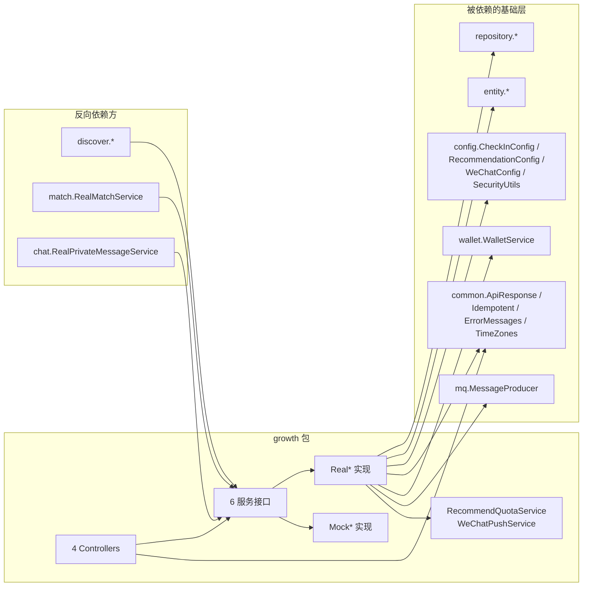

**图表来源**
- [RealCheckInService.java:3-41](file://apps/api/src/main/java/com/campuslove/api/growth/RealCheckInService.java#L3-L41)
- [RealAppConfigService.java:3-16](file://apps/api/src/main/java/com/campuslove/api/growth/RealAppConfigService.java#L3-L16)
- [RealPushSummaryService.java:3-21](file://apps/api/src/main/java/com/campuslove/api/growth/RealPushSummaryService.java#L3-L21)
- [RealMatchService.java:25](file://apps/api/src/main/java/com/campuslove/api/match/RealMatchService.java#L25)
- [RealPrivateMessageService.java:18](file://apps/api/src/main/java/com/campuslove/api/chat/RealPrivateMessageService.java#L18)
- [RecommendationCacheManager.java:5](file://apps/api/src/main/java/com/campuslove/api/discover/RecommendationCacheManager.java#L5)

### 测试侧依赖

分组有 5 个测试类，覆盖策略是"控制器用 Mockito 桩 + `mockStatic(SecurityUtils.class)`，服务层用 Mock 实现断言业务口径"：`CheckInControllerTest`（128 行，5 个用例：签到委托、状态委托、补签委托、未认证传播 401、构造函数注入）、`SocialProgressControllerTest`（55 行）、`MockSocialProgressServiceTest`（131 行）、`AppConfigControllerTest`（36 行）、`DoNotDisturbControllerTest`（36 行）（[CheckInControllerTest.java:23-44](file://apps/api/src/test/java/com/campuslove/api/growth/CheckInControllerTest.java#L23-L44)、[CheckInControllerTest.java:109-121](file://apps/api/src/test/java/com/campuslove/api/growth/CheckInControllerTest.java#L109-L121)、[AppConfigControllerTest.java:13-17](file://apps/api/src/test/java/com/campuslove/api/growth/AppConfigControllerTest.java#L13-L17)）。补签用例直接构造 `MakeUpCheckInResultView(true, date, 6, 1, 50, 0)`，把"连续 6 天 / 已用 1 次 / 上限 50"当作位置参数传入，说明视图字段顺序是测试契约的一部分（[CheckInControllerTest.java:90-105](file://apps/api/src/test/java/com/campuslove/api/growth/CheckInControllerTest.java#L90-L105)、[MakeUpCheckInResultView.java:9-28](file://apps/api/src/main/java/com/campuslove/api/growth/MakeUpCheckInResultView.java#L9-L28)）。

**章节来源**
- [SocialProgressController.java:1-6](file://apps/api/src/main/java/com/campuslove/api/growth/SocialProgressController.java#L1-L6)
- [AppConfigController.java:1-5](file://apps/api/src/main/java/com/campuslove/api/growth/AppConfigController.java#L1-L5)
- [RealCheckInService.java:94-175](file://apps/api/src/main/java/com/campuslove/api/growth/RealCheckInService.java#L94-L175)
- [RealDoNotDisturbService.java:3-12](file://apps/api/src/main/java/com/campuslove/api/growth/RealDoNotDisturbService.java#L3-L12)
- [RealSocialProgressService.java:3-11](file://apps/api/src/main/java/com/campuslove/api/growth/RealSocialProgressService.java#L3-L11)
- [MockCheckInService.java:3-19](file://apps/api/src/main/java/com/campuslove/api/growth/MockCheckInService.java#L3-L19)

## 配置与开关

分组的可配置面分三档：**启动期档位**（决定用哪套实现）、**`app.*` 属性档位**（决定数值口径）、**数据库配置档位**（决定运行期开关与规则）。三档的生效时机不同，排查时不要混用。

### 启动期档位：Profile 决定实现

`@Profile("real")` / `@Profile("mock")` 是唯一的实现选择机制，没有"成长体系开关"这类配置项参与。为防止漏配 profile 而误以 mock 模式启动，入口类在 Spring 启动前做 fail-fast 校验：激活值可来自 `--spring.profiles.active=`、`-Dspring.profiles.active` 或环境变量 `SPRING_PROFILES_ACTIVE`，为空或不在 `Set.of("mock","real","prod","dev","local","wechat")` 内即拒绝启动（[CampusLoveApplication.java:32](file://apps/api/src/main/java/com/campuslove/api/CampusLoveApplication.java#L32)、[CampusLoveApplication.java:61-80](file://apps/api/src/main/java/com/campuslove/api/CampusLoveApplication.java#L61-L80)、[CampusLoveApplication.java:87-95](file://apps/api/src/main/java/com/campuslove/api/CampusLoveApplication.java#L87-L95)）。`application.yml` 里 `spring.profiles.default: mock` 仅服务测试引导，注释明确指出 mock 下 `MockSecurityConfig` 免真实认证、属生产禁用项（[application.yml:4-15](file://apps/api/src/main/resources/application.yml#L4-L15)）。

Mock 与 Real 的类级标注互为镜像：`RealCheckInService` / `MockCheckInService` 分别带 `@Profile("real")` 与 `@Profile("mock")`（[RealCheckInService.java:58](file://apps/api/src/main/java/com/campuslove/api/growth/RealCheckInService.java#L58)、[MockCheckInService.java:18](file://apps/api/src/main/java/com/campuslove/api/growth/MockCheckInService.java#L18)）。

### 数值档位：`app.checkin.*`

签到数值被外置为 `@ConfigurationProperties(prefix = "app.checkin")`，含两个键：

| 键 | 类内默认 | `application.yml` 实际值 | 可覆盖方式 |
| --- | --- | --- | --- |
| `app.checkin.extra-quota-per-check-in` | 5 | **3** | 环境变量未绑定，需改 yml 或启动参数 |
| `app.checkin.reward-cents-per-check-in` | 50 | `${CHECKIN_REWARD_CENTS:50}` | 环境变量 `CHECKIN_REWARD_CENTS` |

（[CheckInConfig.java:12-20](file://apps/api/src/main/java/com/campuslove/api/config/CheckInConfig.java#L12-L20)、[application.yml:329-332](file://apps/api/src/main/resources/application.yml#L329-L332)）

两处需要留意的口径冲突，均在代码层可复核：

1. `extra-quota-per-check-in` 的 yml 值是 3，而 `CheckInConfig` 字段默认是 5、`DailyBenefit.extraRecommendQuota` 实体默认也是 5，`RealCheckInService` 的行内注释与 `RecommendQuotaService` 的类注释同样写作"+5"（[application.yml:330](file://apps/api/src/main/resources/application.yml#L330)、[CheckInConfig.java:17](file://apps/api/src/main/java/com/campuslove/api/config/CheckInConfig.java#L17)、[DailyBenefit.java:45](file://apps/api/src/main/java/com/campuslove/api/entity/DailyBenefit.java#L45)、[RealCheckInService.java:263-274](file://apps/api/src/main/java/com/campuslove/api/growth/RealCheckInService.java#L263-L274)）。运行时生效值取 yml（3），注释与实体默认描述的是历史口径。
2. 每日推荐配额的上限有两个来源：`RecommendQuotaService` 读 `RecommendationConfig`，其 yml 值为 `app.recommendation.daily-limit: ${APP_RECOMMENDATION_DAILY_LIMIT:30}`；而 `app_rule` 的 `daily_recommend_limit` 内置默认是 10，`RecommendQuotaService` 的类注释也写作"默认 10 次"（[RecommendQuotaService.java:19-24](file://apps/api/src/main/java/com/campuslove/api/growth/RecommendQuotaService.java#L19-L24)、[application.yml:302](file://apps/api/src/main/resources/application.yml#L302)、[RealAppConfigService.java:239-244](file://apps/api/src/main/java/com/campuslove/api/growth/RealAppConfigService.java#L239-L244)）。客户端拿到的是 `app_rule` 口径，服务端扣减用的是 `RecommendationConfig` 口径。

### 运行期档位：数据库开关与规则

`app_switch` / `app_rule` / `app_config` 三张表构成"管理后台改一行、客户端下次拉取即生效"的通道。合并顺序如下：

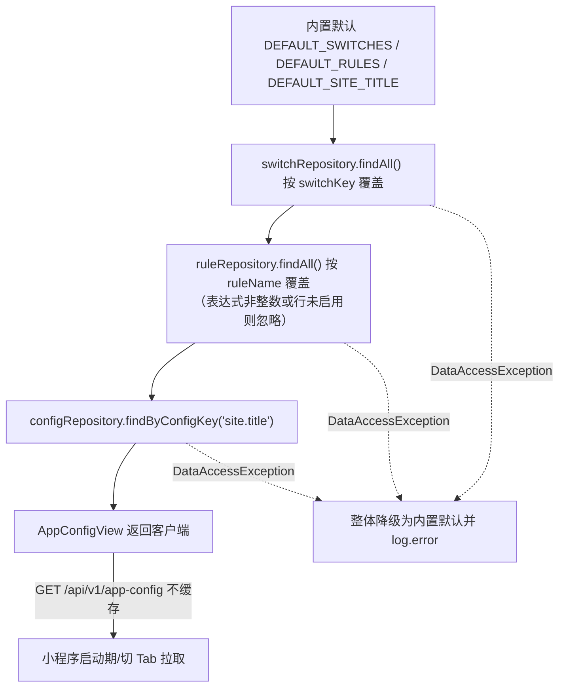

**图表来源**
- [RealAppConfigService.java:139-176](file://apps/api/src/main/java/com/campuslove/api/growth/RealAppConfigService.java#L139-L176)
- [RealAppConfigService.java:200-244](file://apps/api/src/main/java/com/campuslove/api/growth/RealAppConfigService.java#L200-L244)
- [AppConfigController.java:29-42](file://apps/api/src/main/java/com/campuslove/api/growth/AppConfigController.java#L29-L42)

开关语义有三条硬约定，写在接口与方法注释里：**默认值以 seed 为准**（维护模式默认关闭、其余默认开启）、**开关缺失视为开启**（`isSwitchEnabled` 的 `orElse(TRUE)`）、**查询异常也视为开启**（避免数据库抖动误伤业务）（[AppConfigService.java:11-12](file://apps/api/src/main/java/com/campuslove/api/growth/AppConfigService.java#L11-L12)、[RealAppConfigService.java:181-198](file://apps/api/src/main/java/com/campuslove/api/growth/RealAppConfigService.java#L181-L198)）。"不缓存（或实现内短 TTL）"是接口层的要求，Real 实现选择了完全不缓存（[AppConfigService.java:47-56](file://apps/api/src/main/java/com/campuslove/api/growth/AppConfigService.java#L47-L56)、[AppConfigView.java:17-18](file://apps/api/src/main/java/com/campuslove/api/growth/AppConfigView.java#L17-L18)）。

与开关相邻的两个 TTL 型配置同样属于运行期档位，但键在 Redis 而非数据库：签到日限锁 `checkin:{userId}:{yyyyMMdd}`（TTL 24h）与配额计数 `recommend-quota:{userId}:{yyyyMMdd}`（TTL 36h，首次 INCR 时设置）（[RealCheckInService.java:83-92](file://apps/api/src/main/java/com/campuslove/api/growth/RealCheckInService.java#L83-L92)、[RecommendQuotaService.java:41-48](file://apps/api/src/main/java/com/campuslove/api/growth/RecommendQuotaService.java#L41-L48)、[RecommendQuotaService.java:136-139](file://apps/api/src/main/java/com/campuslove/api/growth/RecommendQuotaService.java#L136-L139)）。

**章节来源**
- [RealAppConfigService.java:28-89](file://apps/api/src/main/java/com/campuslove/api/growth/RealAppConfigService.java#L28-L89)
- [MockAppConfigService.java:1-20](file://apps/api/src/main/java/com/campuslove/api/growth/MockAppConfigService.java#L1-L20)
- [AppConfigService.java:9-68](file://apps/api/src/main/java/com/campuslove/api/growth/AppConfigService.java#L9-L68)
- [CheckInConfig.java:6-36](file://apps/api/src/main/java/com/campuslove/api/config/CheckInConfig.java#L6-L36)

## 数据模型

「详细组件分析 → 辅助组件」的 ER 图给出的是实体级字段；本节补齐只有读 Flyway 脚本才能得到的落库事实——唯一约束名、外键有无与列的 DDL 类型。本分组**直接读写六张表**（`social_progress`、`check_ins`、`daily_benefits`、`make_up_quota`、`dnd_settings`、`push_summaries`），另**只读四张配置表**（`app_switch`、`app_rule`、`app_config`、`app_login_hero_config`），由 `RealAppConfigService` 注入的四个 Repository 承载（[RealAppConfigService.java:6-9](file://apps/api/src/main/java/com/campuslove/api/growth/RealAppConfigService.java#L6-L9)）。业务表的共同特征是"一人一行 / 一人一日一行 / 一人一月一行"，分组内没有明细流水表。

| 表 | 唯一约束 | 指向 `users` 的外键 | DDL 关键列类型 | 迁移脚本 |
| --- | --- | --- | --- | --- |
| `social_progress` | `uk_social_progress_user_id (user_id)` | 有（`FOREIGN KEY (user_id) REFERENCES users(id)`） | `current_tier VARCHAR(20) NOT NULL DEFAULT 'L1_EXPOSURE'`；六个计数列 `INT NOT NULL DEFAULT 0` | [V2026.05.28.0002__create_social_progress.sql:7-20](file://database/flyway/sql/V2026.05.28.0002__create_social_progress.sql#L7-L20) |
| `check_ins` | `uk_checkin_user_date (user_id, check_in_date)` | **无** | `check_in_date DATE NOT NULL`；`consecutive_days INT DEFAULT 1`；另有 `idx_checkin_user_id`、`idx_checkin_date` | [V2026.05.23.0002__create_check_ins.sql:1-11](file://database/flyway/sql/V2026.05.23.0002__create_check_ins.sql#L1-L11) |
| `daily_benefits` | `uk_user_date (user_id, benefit_date)` | 有（`fk_daily_benefits_user`） | `extra_recommend_quota INT NOT NULL DEFAULT 0`；`hot_topics_unlocked` / `new_users_unlocked` 均为 `BOOLEAN NOT NULL DEFAULT TRUE` | [V2026.05.28.0008__create_daily_benefits.sql:4-14](file://database/flyway/sql/V2026.05.28.0008__create_daily_benefits.sql#L4-L14) |
| `make_up_quota` | `uk_makeup_user_month (user_id, year_month)` | **无** | `` `year_month` VARCHAR(7) ``（存 `yyyy-MM`）、`used_count INT DEFAULT 0`、`limit_count INT DEFAULT 3` | [V2026.07.25.0013__add_check_in_make_up.sql:15-25](file://database/flyway/sql/V2026.07.25.0013__add_check_in_make_up.sql#L15-L25) |
| `dnd_settings` | `uk_dnd_user_id (user_id)` | **无** | `start_time` / `end_time` 为 `VARCHAR(8)`（默认 `'22:00'` / `'08:00'`）、`repeat_mode VARCHAR(16)`、`custom_weekdays VARCHAR(16)`、`enabled` / `allow_urgent` 为 `TINYINT(1)` | [V2026.07.25.0012__create_dnd_settings.sql:20-33](file://database/flyway/sql/V2026.07.25.0012__create_dnd_settings.sql#L20-L33) |
| `push_summaries` | **无 user 维度唯一键**，仅 `INDEX idx_user_sent (user_id, is_sent)` | 有 | `summary_type VARCHAR(50)`（`social_digest` / `recommend_refresh`）、`is_sent BOOLEAN NOT NULL DEFAULT FALSE` | [V2026.05.28.0007__create_push_system.sql:14-26](file://database/flyway/sql/V2026.05.28.0007__create_push_system.sql#L14-L26) |

四点取舍与后果，均可回到上表的脚本行号核对：

1. **唯一键与服务层异常分支一一对应。** `RealCheckInService` 有三处 `catch (DataIntegrityViolationException e)`：签到写 `check_ins`（对应 `uk_checkin_user_date`）、写 `daily_benefits`（对应 `uk_user_date`）、补签写 `check_ins`（再次对应 `uk_checkin_user_date`）。三处都保留了 `findByUserIdAndCheckInDate` 的先查作为快速路径，但真正的并发兜底是数据库唯一键本身（[RealCheckInService.java:249-251](file://apps/api/src/main/java/com/campuslove/api/growth/RealCheckInService.java#L249-L251)、[RealCheckInService.java:273-275](file://apps/api/src/main/java/com/campuslove/api/growth/RealCheckInService.java#L273-L275)、[RealCheckInService.java:474-476](file://apps/api/src/main/java/com/campuslove/api/growth/RealCheckInService.java#L474-L476)）。
2. **`social_progress` 把事件压缩成六个计数列。** 层级判定只看计数是否 `>= 1`，`determineTier` 从 L6 到 L1 短路返回，因此升级逻辑不需要历史流水回放，这也是分组内没有明细表的直接原因（[RealSocialProgressService.java:282-299](file://apps/api/src/main/java/com/campuslove/api/growth/RealSocialProgressService.java#L282-L299)）。
3. **`make_up_quota` 用 `VARCHAR(7)` 承载 `yyyy-MM`。** "每月 N 次"因此是一个行级状态（跨月自然落到新的一行），而不是从签到记录反推出来的派生值；`limit_count` 的 DDL 默认 3 与实体常量 `MakeUpQuota.DEFAULT_LIMIT = 3` 同口径（[MakeUpQuota.java:28-28](file://apps/api/src/main/java/com/campuslove/api/entity/MakeUpQuota.java#L28-L28)）。补签来源则通过 `ALTER TABLE check_ins ADD COLUMN source VARCHAR(16) NOT NULL DEFAULT 'NORMAL' AFTER consecutive_days` 追加，并同步 `ADD INDEX idx_checkin_source (source)` 供按来源统计——建表脚本与改表脚本分属两个迁移文件，读单看 `create_check_ins.sql` 会得到"没有 source 列"的错误结论（[V2026.07.25.0013__add_check_in_make_up.sql:6-11](file://database/flyway/sql/V2026.07.25.0013__add_check_in_make_up.sql#L6-L11)）。
4. **外键与类型一致性两处不齐。** 其一，`check_ins`、`make_up_quota`、`dnd_settings` 三张表恰恰是写入最频繁的三张，却都没有声明指向 `users` 的外键，孤儿行只能靠应用层保证；其二，`dnd_settings` 的 `start_time` / `end_time` 是 `VARCHAR(8)` 字符串而非 `TIME`（实体侧同为 `String startTime = "22:00"` 并标注 `@Column(length = 8)`），时段合法性完全依赖 Bean Validation 的 `^([01]\d|2[0-3]):[0-5]\d$` 与服务层校验，数据库层不参与时间语义（[DoNotDisturbSetting.java:49-55](file://apps/api/src/main/java/com/campuslove/api/entity/DoNotDisturbSetting.java#L49-L55)、[V2026.07.25.0012__create_dnd_settings.sql:24-25](file://database/flyway/sql/V2026.07.25.0012__create_dnd_settings.sql#L24-L25)、[DoNotDisturbRequest.java:30-33](file://apps/api/src/main/java/com/campuslove/api/growth/DoNotDisturbRequest.java#L30-L33)）。同理 `repeat_mode` 是 `VARCHAR(16)` 枚举串而非数据库枚举类型，`custom_weekdays` 是长度 16 的 CSV 字符串。

`push_summaries` 值得单独一句：它的"同日同类型只有一条"语义**不来自约束**，而来自服务层的 `findByUserIdAndGeneratedAtAfter` 时间窗查询（见「详细组件分析 → 辅助组件」小节的注入面与去重说明），因此并发下可能产生同类型多条记录，这与 `check_ins` 靠唯一键兜底的做法是两种强度不同的实现（[V2026.05.28.0007__create_push_system.sql:24-24](file://database/flyway/sql/V2026.05.28.0007__create_push_system.sql#L24-L24)、[RealPushSummaryService.java:111-122](file://apps/api/src/main/java/com/campuslove/api/growth/RealPushSummaryService.java#L111-L122)）。

**章节来源**
- [V2026.05.23.0002__create_check_ins.sql:1-11](file://database/flyway/sql/V2026.05.23.0002__create_check_ins.sql#L1-L11)
- [V2026.05.28.0002__create_social_progress.sql:7-20](file://database/flyway/sql/V2026.05.28.0002__create_social_progress.sql#L7-L20)
- [V2026.05.28.0007__create_push_system.sql:14-26](file://database/flyway/sql/V2026.05.28.0007__create_push_system.sql#L14-L26)
- [V2026.05.28.0008__create_daily_benefits.sql:4-14](file://database/flyway/sql/V2026.05.28.0008__create_daily_benefits.sql#L4-L14)
- [V2026.06.25.0005__create_admin_configs.sql:22-53](file://database/flyway/sql/V2026.06.25.0005__create_admin_configs.sql#L22-L53)
- [V2026.07.25.0012__create_dnd_settings.sql:20-33](file://database/flyway/sql/V2026.07.25.0012__create_dnd_settings.sql#L20-L33)
- [V2026.07.25.0013__add_check_in_make_up.sql:6-25](file://database/flyway/sql/V2026.07.25.0013__add_check_in_make_up.sql#L6-L25)
- [RealCheckInService.java:249-275](file://apps/api/src/main/java/com/campuslove/api/growth/RealCheckInService.java#L249-L275)
- [RealAppConfigService.java:6-9](file://apps/api/src/main/java/com/campuslove/api/growth/RealAppConfigService.java#L6-L9)
- [PushSummary.java:18-18](file://apps/api/src/main/java/com/campuslove/api/entity/PushSummary.java#L18-L18)

## 性能考虑

本分组的性能特征几乎全部集中在 `POST /api/v1/check-in` 一条写路径上，其余端点是单表读写。以下每条都对应源码中可定位的实现选择。

### 查询次数从"逐日回查"收敛到"一次批量"

三处历史实现被显式改写，注释保留了原方案与新方案的对比：

| 方法 | 原实现 | 现实现 | 位置 |
| --- | --- | --- | --- |
| `calculateConsecutiveDays` | 从起始日逐日回查（连续 N 天即 N 次查询） | 一次查询该用户 `<= startDate` 的全部签到日期并倒序，内存中计算连续段 | [RealCheckInService.java:700-723](file://apps/api/src/main/java/com/campuslove/api/growth/RealCheckInService.java#L700-L723) |
| `calculateConsecutiveDaysAfterMakeUp` | 从 today 逐日回查 N 次 | 同一批查询 + `HashSet` 判定，补签日期直接加入集合 | [RealCheckInService.java:516-538](file://apps/api/src/main/java/com/campuslove/api/growth/RealCheckInService.java#L516-L538) |
| `getMonthlyCalendar` | 逐日 `findByUserIdAndCheckInDate`（最多 31 次） | `BETWEEN :start AND :end` 一次范围查询后取 `dayOfMonth` | [RealCheckInService.java:582-596](file://apps/api/src/main/java/com/campuslove/api/growth/RealCheckInService.java#L582-L596) |
| `getNewCircleUserCount` | `findAll()` 全表加载后内存过滤 | `SELECT COUNT(DISTINCT m.userId) FROM CircleMembership m WHERE m.joinedAt >= :since` | [RealCheckInService.java:665-672](file://apps/api/src/main/java/com/campuslove/api/growth/RealCheckInService.java#L665-L672) |

签到日期读取依赖 `check_ins` 上的四个索引：`uk_checkin_user_date(user_id, check_in_date)` 联合唯一、`idx_checkin_user_id`、`idx_checkin_date`、`idx_check_ins_user_created_at(user_id, created_at)`（[CheckIn.java:24-48](file://apps/api/src/main/java/com/campuslove/api/entity/CheckIn.java#L24-L48)）。上述批量查询的过滤条件正是 `user_id + check_in_date` 组合，能落在唯一索引上。

### 签到路径的读放大

一次成功签到在同一个事务里串联：Redis `SETNX` → 查今日签到 → 计算连续天数（1 次批量查询）→ 写 `check_ins` → 写 `daily_benefits` → 钱包 `recharge` → `calculateTotalExtraQuota`（1 次 `findTopByUserIdOrderByCheckInDateDesc`）→ `getHotTopicCount`（2 次 top-20 分页查询 + 内存过滤）→ `getNewCircleUserCount`（1 次聚合查询）→ MQ 发送 → 返回（[RealCheckInService.java:196-319](file://apps/api/src/main/java/com/campuslove/api/growth/RealCheckInService.java#L196-L319)、[RealCheckInService.java:614-650](file://apps/api/src/main/java/com/campuslove/api/growth/RealCheckInService.java#L614-L650)）。其中两个"权益展示型"统计（热门话题、新入圈用户）是同步执行且每次都全量重算，属于该路径上最明显的可缓存点；源码对它们的态度是失败即降级返回 0/忽略，说明业务上接受其不准（[RealCheckInService.java:631-647](file://apps/api/src/main/java/com/campuslove/api/growth/RealCheckInService.java#L631-L647)、[RealCheckInService.java:673-683](file://apps/api/src/main/java/com/campuslove/api/growth/RealCheckInService.java#L673-L683)）。

### 事务与自调用

`getHotTopicCount` 与 `getNewCircleUserCount` 都标注 `@Transactional(readOnly = true)`，但它们在 `checkIn()` 内部被**自调用**，Spring AOP 自调用不经过代理，`readOnly` 提示实际失效，方法运行在 `checkIn` 的读写事务里；注释给出了复核结论：保留降级 catch、不加 `setRollbackOnly`，否则会污染外层事务导致签到整体失败（FIN-00114）（[RealCheckInService.java:674-681](file://apps/api/src/main/java/com/campuslove/api/growth/RealCheckInService.java#L674-L681)）。

同理，`getProgress` 因可能懒创建记录而从 `readOnly` 改为读写事务（[RealSocialProgressService.java:52-56](file://apps/api/src/main/java/com/campuslove/api/growth/RealSocialProgressService.java#L52-L56)），`recordExposure` 用 `REQUIRES_NEW` 把自己从外层只读事务剥离（[RealSocialProgressService.java:84-92](file://apps/api/src/main/java/com/campuslove/api/growth/RealSocialProgressService.java#L84-L92)）。这三处是同一类问题：**只读优化不能想当然，要看方法是否携带懒写入或被谁调用**。

### 锁与配额的成本

签到锁用单条 `setIfAbsent(key, "1", 24h)`，只在 DB 写入失败时显式删除，正常情况下靠 TTL 自然过期（[RealCheckInService.java:777-818](file://apps/api/src/main/java/com/campuslove/api/growth/RealCheckInService.java#L777-L818)）。补签配额递增是单条 `UPDATE ... WHERE used_count < limit_count`，避免读-改-写竞态（[RealCheckInService.java:482-489](file://apps/api/src/main/java/com/campuslove/api/growth/RealCheckInService.java#L482-L489)）。推荐配额计数走 `INCR`，超限时 `DECR` 回滚，首次设置 36h TTL；Redis 不可用时退化为进程内 `ConcurrentHashMap` + `synchronized`——该降级只在单实例内保证原子性（[RecommendQuotaService.java:129-159](file://apps/api/src/main/java/com/campuslove/api/growth/RecommendQuotaService.java#L129-L159)）。

`app-config` 两个端点显式选择**不缓存**，代价是每次客户端拉取都执行 `switchRepository.findAll()`、`ruleRepository.findAll()` 与一次 `findByConfigKey`（[AppConfigView.java:17-18](file://apps/api/src/main/java/com/campuslove/api/growth/AppConfigView.java#L17-L18)、[RealAppConfigService.java:141-167](file://apps/api/src/main/java/com/campuslove/api/growth/RealAppConfigService.java#L141-L167)）。接口层把这一点写成契约要求："不缓存（或实现内短 TTL），保证管理后台更新后尽快生效"（[AppConfigService.java:47-56](file://apps/api/src/main/java/com/campuslove/api/growth/AppConfigService.java#L47-L56)）。

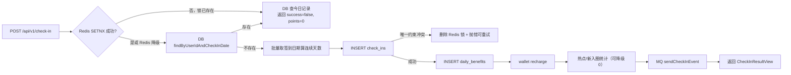

**图表来源**
- [RealCheckInService.java:196-319](file://apps/api/src/main/java/com/campuslove/api/growth/RealCheckInService.java#L196-L319)
- [RealCheckInService.java:700-723](file://apps/api/src/main/java/com/campuslove/api/growth/RealCheckInService.java#L700-L723)
- [RealCheckInService.java:777-818](file://apps/api/src/main/java/com/campuslove/api/growth/RealCheckInService.java#L777-L818)

### 并发一致性

`check_ins`、`daily_benefits`、`make_up_quota`、`social_progress`、`dnd_settings` 五个实体都带 `version` 字段用于乐观锁（[CheckIn.java:86-97](file://apps/api/src/main/java/com/campuslove/api/entity/CheckIn.java#L86-L97)、[MakeUpQuota.java:72](file://apps/api/src/main/java/com/campuslove/api/entity/MakeUpQuota.java#L72)、[SocialProgress.java:84](file://apps/api/src/main/java/com/campuslove/api/entity/SocialProgress.java#L84)、[DoNotDisturbSetting.java:91](file://apps/api/src/main/java/com/campuslove/api/entity/DoNotDisturbSetting.java#L91)）。但 `record*` 系列是"读实体 → 内存 +1 → save"的计数模式，未使用原子自增 SQL，因此同一用户并发埋点时计数存在丢失更新的风险窗口；这是当前实现与签到/补签路径（均用唯一约束或原子 UPDATE）之间的明显差别（[RealSocialProgressService.java:98-101](file://apps/api/src/main/java/com/campuslove/api/growth/RealSocialProgressService.java#L98-L101)、[RealSocialProgressService.java:142-147](file://apps/api/src/main/java/com/campuslove/api/growth/RealSocialProgressService.java#L142-L147)）。

**章节来源**
- [RealCheckInService.java:540-743](file://apps/api/src/main/java/com/campuslove/api/growth/RealCheckInService.java#L540-L743)
- [RealSocialProgressService.java:52-104](file://apps/api/src/main/java/com/campuslove/api/growth/RealSocialProgressService.java#L52-L104)
- [RecommendQuotaService.java:98-169](file://apps/api/src/main/java/com/campuslove/api/growth/RecommendQuotaService.java#L98-L169)
- [RealAppConfigService.java:139-176](file://apps/api/src/main/java/com/campuslove/api/growth/RealAppConfigService.java#L139-L176)
- [DailyBenefit.java:41-45](file://apps/api/src/main/java/com/campuslove/api/entity/DailyBenefit.java#L41-L45)

## 故障排查指南

排查顺序固定为四步：**确认 profile → 确认端点与信封 → 确认日志关键串 → 确认数据落点**。下表给出每一步的判据与源码位置。

### 端点级症状对照

| 症状 | 首查点 | 判据（源码） |
| --- | --- | --- |
| `GET /api/v1/growth/social-progress` 404 | 是否部署了含 `SocialProgressController` 的版本 | 该类注释即"补齐缺失端点"的修复记录（[SocialProgressController.java:11-15](file://apps/api/src/main/java/com/campuslove/api/growth/SocialProgressController.java#L11-L15)） |
| 签到返回 `success=false` 但 HTTP 200 | 今日已签到，属正常幂等分支 | 日志 `用户[x]今日已签到，重复签到被拒绝`，`points` 固定 0（[RealCheckInService.java:215-235](file://apps/api/src/main/java/com/campuslove/api/growth/RealCheckInService.java#L215-L235)） |
| 签到 500 / `CHECKIN_FAILED_RETRY` | 并发唯一约束冲突 | 日志 `签到时发生唯一约束冲突，可能为并发重复签到`，随后 Redis 锁被释放允许重试（[RealCheckInService.java:251-258](file://apps/api/src/main/java/com/campuslove/api/growth/RealCheckInService.java#L251-L258)） |
| 推荐接口 500 `UnexpectedRollbackException` | 埋点事务传播配置 | `recordExposure` 的 `REQUIRES_NEW` 注释即为该问题的修复说明（[RealSocialProgressService.java:84-92](file://apps/api/src/main/java/com/campuslove/api/growth/RealSocialProgressService.java#L84-L92)） |
| 补签 400 | 四类原因依次排查：日期格式 / 非昨日之前 / 超 7 天 / 已签到 / 月配额用尽 | 每个分支抛 `IllegalArgumentException` 并带 `ErrorMessages` 文案（[RealCheckInService.java:391-434](file://apps/api/src/main/java/com/campuslove/api/growth/RealCheckInService.java#L391-L434)） |
| 补签提示"积分不足，本次补签需 50 积分" | 钱包余额而非成长模块故障 | `InsufficientBalanceException` 被转写为业务提示（[RealCheckInService.java:451-455](file://apps/api/src/main/java/com/campuslove/api/growth/RealCheckInService.java#L451-L455)） |
| 免打扰 400 | `CUSTOM` 模式缺 `customWeekdays`、星期不在 1-7、CSV 非法、起止时间相同 | 四条校验各自抛错，注解层与实现层分担不同校验（[DoNotDisturbRequest.java:29-37](file://apps/api/src/main/java/com/campuslove/api/growth/DoNotDisturbRequest.java#L29-L37)、[RealDoNotDisturbService.java:104-126](file://apps/api/src/main/java/com/campuslove/api/growth/RealDoNotDisturbService.java#L104-L126)） |
| `/api/v1/app-config` 返回默认标题「校园恋爱」而后台已改 | 数据库查询异常被吞并降级 | 日志 `查询客户端配置聚合失败，降级使用默认配置`（[RealAppConfigService.java:168-175](file://apps/api/src/main/java/com/campuslove/api/growth/RealAppConfigService.java#L168-L175)） |
| 登录页 Hero 与后台设置不一致 | 未找到 `scene_key='default'` 且 `is_active=true` 的行 | 日志 `数据库中未找到 scene_key='default' 的激活配置，使用内置默认值`（[RealAppConfigService.java:113-121](file://apps/api/src/main/java/com/campuslove/api/growth/RealAppConfigService.java#L113-L121)） |
| 应用启动即退出并提示未指定 profile | fail-fast 校验 | 激活来源三类逐一检查（[CampusLoveApplication.java:61-80](file://apps/api/src/main/java/com/campuslove/api/CampusLoveApplication.java#L61-L80)） |

### 数据落点核对

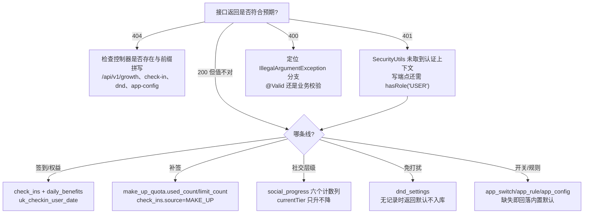

[此图为排查决策流程，节点取自多份源码事实，不直接对应单一源文件，故不提供图表来源]

数据核对的可靠锚点：签到记录在 `check_ins`（含 `source` 区分 `NORMAL` / `MAKE_UP`）、权益在 `daily_benefits`（`extra_recommend_quota`、两个 `*_unlocked`）、补签配额在 `make_up_quota`（`year_month`、`used_count`、`limit_count`）、社交漏斗在 `social_progress`（六个计数 + `current_tier`）、免打扰在 `dnd_settings`（[CheckIn.java:51-78](file://apps/api/src/main/java/com/campuslove/api/entity/CheckIn.java#L51-L78)、[DailyBenefit.java:37-53](file://apps/api/src/main/java/com/campuslove/api/entity/DailyBenefit.java#L37-L53)、[MakeUpQuota.java:39-51](file://apps/api/src/main/java/com/campuslove/api/entity/MakeUpQuota.java#L39-L51)、[SocialProgress.java:32-60](file://apps/api/src/main/java/com/campuslove/api/entity/SocialProgress.java#L32-L60)、[DoNotDisturbSetting.java:43-67](file://apps/api/src/main/java/com/campuslove/api/entity/DoNotDisturbSetting.java#L43-L67)）。

### 容易误判的三件事

1. **层级"没升级"往往不是进度模块的问题。** 6 个 `record*` 全部由外部模块调用，且调用方在 `socialProgressService == null` 或异常时静默跳过（[RealMatchService.java:355-374](file://apps/api/src/main/java/com/campuslove/api/match/RealMatchService.java#L355-L374)、[RecommendationCacheManager.java:110-112](file://apps/api/src/main/java/com/campuslove/api/discover/RecommendationCacheManager.java#L110-L112)）。要判定埋点是否发生，应看 growth 侧 `log.info("用户[x]喜欢次数+1...")` 是否出现（[RealSocialProgressService.java:126-127](file://apps/api/src/main/java/com/campuslove/api/growth/RealSocialProgressService.java#L126-L127)）。
2. **额外推荐配额与注释不一致时以配置为准。** `getProgress`/`getCheckInStatus` 的 `extraQuota` 等于 `consecutiveDays × app.checkin.extra-quota-per-check-in`，而该键在 `application.yml` 里是 3、类默认与注释是 5（[RealCheckInService.java:735-743](file://apps/api/src/main/java/com/campuslove/api/growth/RealCheckInService.java#L735-L743)、[application.yml:329-332](file://apps/api/src/main/resources/application.yml#L329-L332)）。
3. **mock 与 real 下同一端点的响应能力不同。** Mock 实现基于内存态（`MockRuntimeState`），重启即丢，且 mock profile 使用免真实认证的 `MockSecurityConfig`（[MockAppConfigService.java:9-24](file://apps/api/src/main/java/com/campuslove/api/growth/MockAppConfigService.java#L9-L24)、[application.yml:5-14](file://apps/api/src/main/resources/application.yml#L5-L14)）。用 mock 环境复现 real 环境的数值问题会得出错误结论。

回归验证入口是 5 个测试类，控制器委托关系与未认证 401 传播在其中有独立用例（[CheckInControllerTest.java:23-44](file://apps/api/src/test/java/com/campuslove/api/growth/CheckInControllerTest.java#L23-L44)、[CheckInControllerTest.java:109-127](file://apps/api/src/test/java/com/campuslove/api/growth/CheckInControllerTest.java#L109-L127)、[SocialProgressControllerTest.java:1-55](file://apps/api/src/test/java/com/campuslove/api/growth/SocialProgressControllerTest.java#L1-L55)、[MockSocialProgressServiceTest.java:1-131](file://apps/api/src/test/java/com/campuslove/api/growth/MockSocialProgressServiceTest.java#L1-L131)、[DoNotDisturbControllerTest.java:1-36](file://apps/api/src/test/java/com/campuslove/api/growth/DoNotDisturbControllerTest.java#L1-L36)）。

**章节来源**
- [CheckInController.java:69-74](file://apps/api/src/main/java/com/campuslove/api/growth/CheckInController.java#L69-L74)
- [DoNotDisturbController.java:27-33](file://apps/api/src/main/java/com/campuslove/api/growth/DoNotDisturbController.java#L27-L33)
- [RealCheckInService.java:203-218](file://apps/api/src/main/java/com/campuslove/api/growth/RealCheckInService.java#L203-L218)
- [RealCheckInService.java:614-650](file://apps/api/src/main/java/com/campuslove/api/growth/RealCheckInService.java#L614-L650)
- [RealAppConfigService.java:98-122](file://apps/api/src/main/java/com/campuslove/api/growth/RealAppConfigService.java#L98-L122)
- [RealDoNotDisturbService.java:52-75](file://apps/api/src/main/java/com/campuslove/api/growth/RealDoNotDisturbService.java#L52-L75)
- [TimeZones.java:8](file://apps/api/src/main/java/com/campuslove/api/common/TimeZones.java#L8)

## 能力缺口登记

catalog 指令要求覆盖的若干能力在仓库中**没有对应实现**。以下逐条登记判定依据，每条都给出可复现的检索口径与命中的源码位置，避免把"未实现"误写成"未文档化"。

| 指令要求 | 结论 | 判定依据 |
| --- | --- | --- |
| 灰度发布支持 | **不存在** | 全 `apps/api/src/main/java` 检索"灰度 / gray / grayscale / rollout / canary / feature_flag"无任何命中；`app_switch` 表模型只有 `switchKey` + `enabled` 布尔两列语义，无用户维度、比例维度或名单维度字段（[AppConfigService.java:9-30](file://apps/api/src/main/java/com/campuslove/api/growth/AppConfigService.java#L9-L30)、[RealAppConfigService.java:141-146](file://apps/api/src/main/java/com/campuslove/api/growth/RealAppConfigService.java#L141-L146)）。开关是全局一刀切，不是分流 |
| 配置热更新 | **仅被动生效，无服务端主动刷新** | 生效机制是"不缓存 → 客户端下一次拉取拿到新值"，`getClientConfig()` 每次都执行三次表查询，没有本地缓存、监听器或配置变更广播（[AppConfigService.java:47-56](file://apps/api/src/main/java/com/campuslove/api/growth/AppConfigService.java#L47-L56)、[AppConfigView.java:17-18](file://apps/api/src/main/java/com/campuslove/api/growth/AppConfigView.java#L17-L18)、[RealAppConfigService.java:139-176](file://apps/api/src/main/java/com/campuslove/api/growth/RealAppConfigService.java#L139-L176)）。`app.checkin.*` 属于 `@ConfigurationProperties`，改动需要重启（[CheckInConfig.java:12-20](file://apps/api/src/main/java/com/campuslove/api/config/CheckInConfig.java#L12-L20)）。未见 `@RefreshScope` 或 actuator refresh 端点被本分组使用 |
| 勿扰时段的执行侧生效 | **只有配置读写，没有抑制逻辑** | `DoNotDisturbSettingRepository` 的引用者只有 `RealDoNotDisturbService`，`dnd_settings` 在 growth 包外无任何读取方（[RealDoNotDisturbService.java:6](file://apps/api/src/main/java/com/campuslove/api/growth/RealDoNotDisturbService.java#L6)、[RealDoNotDisturbService.java:33-42](file://apps/api/src/main/java/com/campuslove/api/growth/RealDoNotDisturbService.java#L33-L42)）。负责下发的 `WeChatPushService` 不引用 DND、也不引用 `PushPreference`，其内容只涉及 access_token、订阅消息与 Resilience4j 容错（[WeChatPushService.java:22-38](file://apps/api/src/main/java/com/campuslove/api/growth/WeChatPushService.java#L22-L38)）。结论：用户设置的 `22:00-08:00` 时段当前不会拦截任何一条推送 |
| 个性化推送策略 | **实现存在但未接线** | `PushSummaryService` 与 `PushPreferenceService` 的引用者集合只包含各自的接口与 `Real*`/`Mock*` 实现，`PushSummaryRepository` 只被 `RealPushSummaryService` 使用；growth 包内 `@Scheduled` 命中 0 次，`generateSocialDigest` / `generateRecommendRefresh` 无调用方。频次模型（`pushFrequency` 每日最大次数、`activeHours` 活跃时段）只写在接口注释里（[PushSummaryService.java:11-41](file://apps/api/src/main/java/com/campuslove/api/growth/PushSummaryService.java#L11-L41)、[PushPreferenceService.java:9-31](file://apps/api/src/main/java/com/campuslove/api/growth/PushPreferenceService.java#L9-L31)）。本分组也没有暴露推送相关的 REST 端点（4 个控制器前缀见 [AppConfigController.java:15](file://apps/api/src/main/java/com/campuslove/api/growth/AppConfigController.java#L15)） |
| 数据统计分析 / 用户行为洞察 | **只有原始计数，无分析层** | 分组持有的度量仅 `social_progress` 的 6 个计数字段、`check_ins` 的逐日记录与 `getHotTopicCount()` / `getNewCircleUserCount()` 两个"当日快照"数值（[SocialProgress.java:36-60](file://apps/api/src/main/java/com/campuslove/api/entity/SocialProgress.java#L36-L60)、[RealCheckInService.java:614-684](file://apps/api/src/main/java/com/campuslove/api/growth/RealCheckInService.java#L614-L684)）。没有时间区间聚合、分群维度、留存或漏斗转化率计算，也没有分析端点；`getProgress` 的百分比是层级序号除以常量 6，不是基于行为量的统计结果（[SocialProgressView.java:95-98](file://apps/api/src/main/java/com/campuslove/api/growth/SocialProgressView.java#L95-L98)） |
| 月度签到日历对外能力 | **已实现但无法被前端访问** | `getStreakDays(Long)` 与 `getMonthlyCalendar(Long, YearMonth)` 是 `RealCheckInService` 上的 public 方法，但既不在 `CheckInService` 接口中（接口只有 3 个方法，[CheckInService.java:9-43](file://apps/api/src/main/java/com/campuslove/api/growth/CheckInService.java#L9-L43)），`CheckInController` 也只注入接口（[CheckInController.java:25-29](file://apps/api/src/main/java/com/campuslove/api/growth/CheckInController.java#L25-L29)）；全仓库对这两个方法的调用点为 0（[RealCheckInService.java:554](file://apps/api/src/main/java/com/campuslove/api/growth/RealCheckInService.java#L554)、[RealCheckInService.java:571](file://apps/api/src/main/java/com/campuslove/api/growth/RealCheckInService.java#L571)）。结论：日历与独立连续天数查询当前是死代码路径 |
| 奖励机制的"等级/权益"扩展维度 | **只有配额与交友币两种奖励** | 签到奖励的可证据构成是：额外推荐配额 `app.checkin.extra-quota-per-check-in` + 交友币 `app.checkin.reward-cents-per-check-in` + 两个布尔解锁位（热门话题、新入圈用户）（[RealCheckInService.java:263-292](file://apps/api/src/main/java/com/campuslove/api/growth/RealCheckInService.java#L263-L292)、[DailyBenefit.java:41-53](file://apps/api/src/main/java/com/campuslove/api/entity/DailyBenefit.java#L41-L53)）。源码明确注释连续天数"仅作视觉标识，无积分/等级影响"（[RealCheckInService.java:549](file://apps/api/src/main/java/com/campuslove/api/growth/RealCheckInService.java#L549)），因此不存在"连续 N 天解锁阶梯奖励"这类机制 |
| Mock 与 Real 的口径一致性 | **靠人工同步，无共享常量** | 补签的 7 天窗口、月 3 次、50 积分在两侧各自定义：`RealCheckInService.MAKE_UP_MAX_DAYS_BACK` + `MakeUpQuota.DEFAULT_LIMIT/COST_POINTS_AFTER_FREE` 与 `MockCheckInService.MAKE_UP_LIMIT/MAKE_UP_COST_POINTS/MAKE_UP_MAX_DAYS_BACK`（[RealCheckInService.java:64-65](file://apps/api/src/main/java/com/campuslove/api/growth/RealCheckInService.java#L64-L65)、[MakeUpQuota.java:28-31](file://apps/api/src/main/java/com/campuslove/api/entity/MakeUpQuota.java#L28-L31)、[MockCheckInService.java:37-43](file://apps/api/src/main/java/com/campuslove/api/growth/MockCheckInService.java#L37-L43)）。无单一来源约束，任一侧改动都会造成两套 profile 行为分叉 |

另有两处**注释与实现不同步**，登记以免后续按注释推断行为：

- `RecommendQuotaService` 类注释仍写"接入点在 `discover/RealRecommendationService#getRecommendations`，待主线程协调后由 discover 组注入"，而实际装配已经发生在别处：`RealRecommendationService` 明确注明"本类不再持有 `RecommendQuotaService`"，注入点改为 `RecommendationCacheManager` 字段、`RecommendationController` 字段以及 `home/RealHomeService`（[RecommendQuotaService.java:29-33](file://apps/api/src/main/java/com/campuslove/api/growth/RecommendQuotaService.java#L29-L33)、[RealRecommendationService.java:75](file://apps/api/src/main/java/com/campuslove/api/discover/RealRecommendationService.java#L75)、[RecommendationCacheManager.java:46](file://apps/api/src/main/java/com/campuslove/api/discover/RecommendationCacheManager.java#L46)、[RecommendationController.java:64](file://apps/api/src/main/java/com/campuslove/api/discover/RecommendationController.java#L64)、[RealHomeService.java:66](file://apps/api/src/main/java/com/campuslove/api/home/RealHomeService.java#L66)）。
- 签到赠送配额 "+5" 的注释口径与 `application.yml` 的 `extra-quota-per-check-in: 3` 不一致（[application.yml:329-332](file://apps/api/src/main/resources/application.yml#L329-L332)、[RealCheckInService.java:263-274](file://apps/api/src/main/java/com/campuslove/api/growth/RealCheckInService.java#L263-L274)）。

配置类能力还需注意**前缀分域**：本分组只负责 `/api/v1/app-config/**`，客户端静态字典与数据库驱动的另一组配置端点在 `clientconfig` 包下（`/api/v1/config`，含 `/legal`、`/notify-config` 等），两者不是同一套契约，排查时不要串用（[ConfigController.java:38-119](file://apps/api/src/main/java/com/campuslove/api/clientconfig/ConfigController.java#L38-L119)、[ClientDbConfigController.java:47-111](file://apps/api/src/main/java/com/campuslove/api/clientconfig/ClientDbConfigController.java#L47-L111)、[SecurityConfig.java:129](file://apps/api/src/main/java/com/campuslove/api/config/SecurityConfig.java#L129)）。

**章节来源**
- [AppConfigService.java:9-68](file://apps/api/src/main/java/com/campuslove/api/growth/AppConfigService.java#L9-L68)
- [RealAppConfigService.java:139-198](file://apps/api/src/main/java/com/campuslove/api/growth/RealAppConfigService.java#L139-L198)
- [PushSummaryService.java:9-41](file://apps/api/src/main/java/com/campuslove/api/growth/PushSummaryService.java#L9-L41)
- [PushPreferenceService.java:9-31](file://apps/api/src/main/java/com/campuslove/api/growth/PushPreferenceService.java#L9-L31)
- [RealDoNotDisturbService.java:27-75](file://apps/api/src/main/java/com/campuslove/api/growth/RealDoNotDisturbService.java#L27-L75)
- [WeChatPushService.java:22-38](file://apps/api/src/main/java/com/campuslove/api/growth/WeChatPushService.java#L22-L38)
- [CheckInService.java:9-43](file://apps/api/src/main/java/com/campuslove/api/growth/CheckInService.java#L9-L43)
- [RealCheckInService.java:540-600](file://apps/api/src/main/java/com/campuslove/api/growth/RealCheckInService.java#L540-L600)
- [MockCheckInService.java:18-46](file://apps/api/src/main/java/com/campuslove/api/growth/MockCheckInService.java#L18-L46)
- [MakeUpQuota.java:24-51](file://apps/api/src/main/java/com/campuslove/api/entity/MakeUpQuota.java#L24-L51)
- [SocialProgressView.java:87-98](file://apps/api/src/main/java/com/campuslove/api/growth/SocialProgressView.java#L87-L98)

## 结论

成长体系分组由 4 个控制器、6 组"接口 + Real/Mock 双实现"与 2 个无接口的协作服务构成，对外只暴露 4 组 REST 前缀：`/api/v1/growth`、`/api/v1/check-in`、`/api/v1/dnd`、`/api/v1/app-config`（[SocialProgressController.java:21-23](file://apps/api/src/main/java/com/campuslove/api/growth/SocialProgressController.java#L21-L23)、[CheckInController.java:21-23](file://apps/api/src/main/java/com/campuslove/api/growth/CheckInController.java#L21-L23)、[DoNotDisturbController.java:35-37](file://apps/api/src/main/java/com/campuslove/api/growth/DoNotDisturbController.java#L35-L37)、[AppConfigController.java:14-16](file://apps/api/src/main/java/com/campuslove/api/growth/AppConfigController.java#L14-L16)）。四条业务线的成熟度并不对称，这是本页最重要的结论：

- **签到线最成熟**：并发、幂等、账务、消息四路都有实现与注释说明，且带 5 个用例的控制器测试（[RealCheckInService.java:194-319](file://apps/api/src/main/java/com/campuslove/api/growth/RealCheckInService.java#L194-L319)、[CheckInControllerTest.java:23-128](file://apps/api/src/test/java/com/campuslove/api/growth/CheckInControllerTest.java#L23-L128)）。
- **社交进度线依赖他人**：唯一的写入路径是外部埋点，层级只升不降、阈值恒为 `>= 1`，进度百分比由层级序号推导而非行为量推导（[RealSocialProgressService.java:266-299](file://apps/api/src/main/java/com/campuslove/api/growth/RealSocialProgressService.java#L266-L299)、[SocialProgressView.java:95-98](file://apps/api/src/main/java/com/campuslove/api/growth/SocialProgressView.java#L95-L98)）。
- **免打扰线只有配置面**：校验、默认值、CSV 规范化和落库完整，但设置结果当前不参与任何推送判定（[RealDoNotDisturbService.java:52-155](file://apps/api/src/main/java/com/campuslove/api/growth/RealDoNotDisturbService.java#L52-L155)）。
- **配置线是"读多写零"**：只读端点 + 全链路降级，写入口在管理后台所属的表侧；灰度发布与热更新两项指令要求在本分组内不成立（[RealAppConfigService.java:98-198](file://apps/api/src/main/java/com/campuslove/api/growth/RealAppConfigService.java#L98-L198)）。

跨线一致性依赖三条共享约定：`SecurityUtils` 单一身份来源、`TimeZones.BUSINESS`（`Asia/Shanghai`）单一自然日定义、`ErrorMessages` + `IllegalArgumentException` 单一错误语义（[TimeZones.java:8](file://apps/api/src/main/java/com/campuslove/api/common/TimeZones.java#L8)、[CheckInController.java:69-74](file://apps/api/src/main/java/com/campuslove/api/growth/CheckInController.java#L69-L74)）。任何一条被局部绕过，都会表现为"同一天在不同端点返回不同状态"这类难以复现的问题。

改动本分组时的最小检查清单：新增端点要先确认返回信封选型（`ApiResponse<T>` 还是裸视图，两类现状并存）；新增计数写入要沿用 `REQUIRES_NEW` 以免污染调用方只读事务；新增可配置数值要同时落到 `app.*` 属性、`CheckInConfig` 类默认值与实体默认值三处并保持一致；新增开关只需在 `app_switch` 加行、在 `AppConfigService` 加常量、在 `defaultSwitches()` 加默认值，客户端与后端强制点即可共用同一口径（[AppConfigService.java:9-30](file://apps/api/src/main/java/com/campuslove/api/growth/AppConfigService.java#L9-L30)、[RealAppConfigService.java:221-244](file://apps/api/src/main/java/com/campuslove/api/growth/RealAppConfigService.java#L221-L244)）。

本页作为分组总览到此为止：单条业务线的分支穷举、字段级数据模型与前端接入流程分别由 4 个子页面承担，链接见 [子页面导航与覆盖范围](#子页面导航与覆盖范围)；未在仓库找到实现证据的指令要求集中在 [能力缺口登记](#能力缺口登记)，其中"勿扰未参与推送判定""推送摘要未接线""月度签到日历未暴露"三项属于功能缺失而非文档缺失，需要在实现层面消化。

**章节来源**
- [SocialProgressService.java:7-57](file://apps/api/src/main/java/com/campuslove/api/growth/SocialProgressService.java#L7-L57)
- [AppConfigService.java:47-68](file://apps/api/src/main/java/com/campuslove/api/growth/AppConfigService.java#L47-L68)
- [RealCheckInService.java:700-743](file://apps/api/src/main/java/com/campuslove/api/growth/RealCheckInService.java#L700-L743)
- [RecommendQuotaService.java:16-34](file://apps/api/src/main/java/com/campuslove/api/growth/RecommendQuotaService.java#L16-L34)
- [application.yml:4-15](file://apps/api/src/main/resources/application.yml#L4-L15)
- [CampusLoveApplication.java:61-80](file://apps/api/src/main/java/com/campuslove/api/CampusLoveApplication.java#L61-L80)
