# 每日签到系统

<cite>
**本文引用的文件**
- [CheckInController.java](file://apps/api/src/main/java/com/campuslove/api/growth/CheckInController.java)
- [CheckInService.java](file://apps/api/src/main/java/com/campuslove/api/growth/CheckInService.java)
- [RealCheckInService.java](file://apps/api/src/main/java/com/campuslove/api/growth/RealCheckInService.java)
- [MockCheckInService.java](file://apps/api/src/main/java/com/campuslove/api/growth/MockCheckInService.java)
- [RecommendQuotaService.java](file://apps/api/src/main/java/com/campuslove/api/growth/RecommendQuotaService.java)
- [CheckInResultView.java](file://apps/api/src/main/java/com/campuslove/api/growth/CheckInResultView.java)
- [CheckInStatusView.java](file://apps/api/src/main/java/com/campuslove/api/growth/CheckInStatusView.java)
- [MakeUpCheckInRequest.java](file://apps/api/src/main/java/com/campuslove/api/growth/MakeUpCheckInRequest.java)
- [MakeUpCheckInResultView.java](file://apps/api/src/main/java/com/campuslove/api/growth/MakeUpCheckInResultView.java)
- [CheckIn.java](file://apps/api/src/main/java/com/campuslove/api/entity/CheckIn.java)
- [DailyBenefit.java](file://apps/api/src/main/java/com/campuslove/api/entity/DailyBenefit.java)
- [MakeUpQuota.java](file://apps/api/src/main/java/com/campuslove/api/entity/MakeUpQuota.java)
- [CheckInRepository.java](file://apps/api/src/main/java/com/campuslove/api/repository/CheckInRepository.java)
- [MakeUpQuotaRepository.java](file://apps/api/src/main/java/com/campuslove/api/repository/MakeUpQuotaRepository.java)
- [CheckInConfig.java](file://apps/api/src/main/java/com/campuslove/api/config/CheckInConfig.java)
- [RabbitConfig.java](file://apps/api/src/main/java/com/campuslove/api/config/RabbitConfig.java)
- [TimeZones.java](file://apps/api/src/main/java/com/campuslove/api/common/TimeZones.java)
- [Idempotent.java](file://apps/api/src/main/java/com/campuslove/api/common/Idempotent.java)
- [ErrorMessages.java](file://apps/api/src/main/java/com/campuslove/api/common/ErrorMessages.java)
- [CheckInEventMessage.java](file://apps/api/src/main/java/com/campuslove/api/mq/CheckInEventMessage.java)
- [CheckInEventConsumer.java](file://apps/api/src/main/java/com/campuslove/api/mq/CheckInEventConsumer.java)
- [MessageProducer.java](file://apps/api/src/main/java/com/campuslove/api/mq/MessageProducer.java)
- [AdminCoinController.java](file://apps/api/src/main/java/com/campuslove/api/admin/AdminCoinController.java)
- [RealTaskService.java](file://apps/api/src/main/java/com/campuslove/api/tasks/RealTaskService.java)
- [RealHomeService.java](file://apps/api/src/main/java/com/campuslove/api/home/RealHomeService.java)
- [application.yml](file://apps/api/src/main/resources/application.yml)
- [check-in.yaml](file://docs/openapi/check-in.yaml)
- [checkin.ts](file://apps/client/src/stores/checkin.ts)
- [growth.ts](file://apps/client/src/constants/growth.ts)
- [api.ts](file://apps/client/src/services/api.ts)
- [store-dispatch.ts](file://apps/client/src/services/websocket/store-dispatch.ts)
- [CheckInControllerTest.java](file://apps/api/src/test/java/com/campuslove/api/growth/CheckInControllerTest.java)
- [V2026.05.23.0002__create_check_ins.sql](file://database/flyway/sql/V2026.05.23.0002__create_check_ins.sql)
- [V2026.07.25.0013__add_check_in_make_up.sql](file://database/flyway/sql/V2026.07.25.0013__add_check_in_make_up.sql)
- [V2026.08.07.0025__seed_activities_checkin_wallet.sql](file://database/flyway/sql/V2026.08.07.0025__seed_activities_checkin_wallet.sql)
</cite>

## 目录
1. [简介](#简介)
2. [项目结构](#项目结构)
3. [核心组件](#核心组件)
4. [架构总览](#架构总览)
5. [详细组件分析](#详细组件分析)
6. [签到状态数据模型](#签到状态数据模型)
7. [奖励规则与积分累积机制](#奖励规则与积分累积机制)
8. [客户端接入与页面流程](#客户端接入与页面流程)
9. [并发控制与事务管理](#并发控制与事务管理)
10. [配置与开关](#配置与开关)
11. [依赖关系分析](#依赖关系分析)
12. [性能考虑](#性能考虑)
13. [故障排查指南](#故障排查指南)
14. [能力缺口登记](#能力缺口登记)
15. [结论](#结论)

## 简介
本页面文档化"每日签到系统"的后端实现，位于 `apps/api` 模块的 `com.campuslove.api.growth` 包内，对外暴露 `/api/v1/check-in` 路由族，由 CheckInController 承接 HTTP 请求、RealCheckInService 承载全部签到业务逻辑。覆盖的主题包括：

- 签到提交、签到状态查询、补签三个 HTTP 端点的请求/响应契约与参数校验
- 日期校验与"当日重复签到"防护的实现手段
- 连续签到天数（streak）的计算与维护口径
- 签到状态的持久化载体与月度日历聚合查询
- 签到在成长体系（经验/等级）中的位置与积分累积链路
- 并发控制、事务边界与数据一致性策略
- 该主题在仓库中**不存在**的能力（提醒推送、批量处理等）的显式登记

所有结论均以仓库内真实源码为准；未被源码支撑的能力一律写入「能力缺口登记」章节，不做推测性描述。

## 项目结构
签到能力在 `growth` 包内以"控制器 + 服务接口 + 真实实现"三层组织，测试位于对称的 `src/test` 包路径下：

```mermaid
graph TB
subgraph "growth 包（签到相关）"
CIC["CheckInController<br/>/api/v1/check-in"]
CIS["CheckInService（接口）"]
RCS["RealCheckInService<br/>819 行业务实现"]
end
subgraph "持久层"
R1["签到状态仓储 / 实体"]
R2["成长体系仓储（经验、等级）"]
end
subgraph "测试"
T["CheckInControllerTest<br/>128 行"]
end
CIC --> CIS
CIS <|.. RCS
RCS --> R1
RCS --> R2
T --> CIC
```

[此图为概念结构，持久层具体类型见后续章节的取证结果]

**章节来源**
- [CheckInController.java:21-23](file://apps/api/src/main/java/com/campuslove/api/growth/CheckInController.java#L21-L23)
- [RealCheckInService.java:59-60](file://apps/api/src/main/java/com/campuslove/api/growth/RealCheckInService.java#L59-L60)
- [CheckInControllerTest.java:34-38](file://apps/api/src/test/java/com/campuslove/api/growth/CheckInControllerTest.java#L34-L38)

## 核心组件
签到子系统由 1 个控制器、1 个服务接口、2 个 Profile 互斥实现、5 个数据契约与 1 个测试类组成：

- CheckInController：`@RestController`，映射 `/api/v1/check-in`，提供 3 个端点；用户 ID 一律从 `SecurityUtils.getCurrentUserId()` 取得，不接受请求参数传入。
- CheckInService：服务接口，声明 `checkIn(Long)`、`getCheckInStatus(Long)`、`makeUp(Long, String)` 三个方法。
- RealCheckInService（819 行）：`@Profile("real")` + `@Service`，基于 JPA Repository 的真实持久化实现，承担日期校验、重复签到防护、连续天数计算、权益创建、钱包入账与 MQ 事件推送。
- MockCheckInService：`@Profile("mock")` + `@Service`，使用 4 个 `ConcurrentHashMap` 内存态模拟签到/状态/补签，固定权益数据为「热门话题 3 条、新入圈用户 2 人」，积分余额固定返回 100。
- CheckInResultView：签到结果契约（9 字段），`points` 语义严格约定为「本次获得」而非余额。
- CheckInStatusView：状态契约（4 字段），`points` 为交友币钱包余额（cents）。
- MakeUpCheckInRequest / MakeUpCheckInResultView：补签请求体（`@NotBlank` + `@Pattern` 校验 yyyy-MM-dd）与补签结果（6 字段）。
- CheckInControllerTest：控制器层测试类，持有 `private CheckInController controller` 字段。

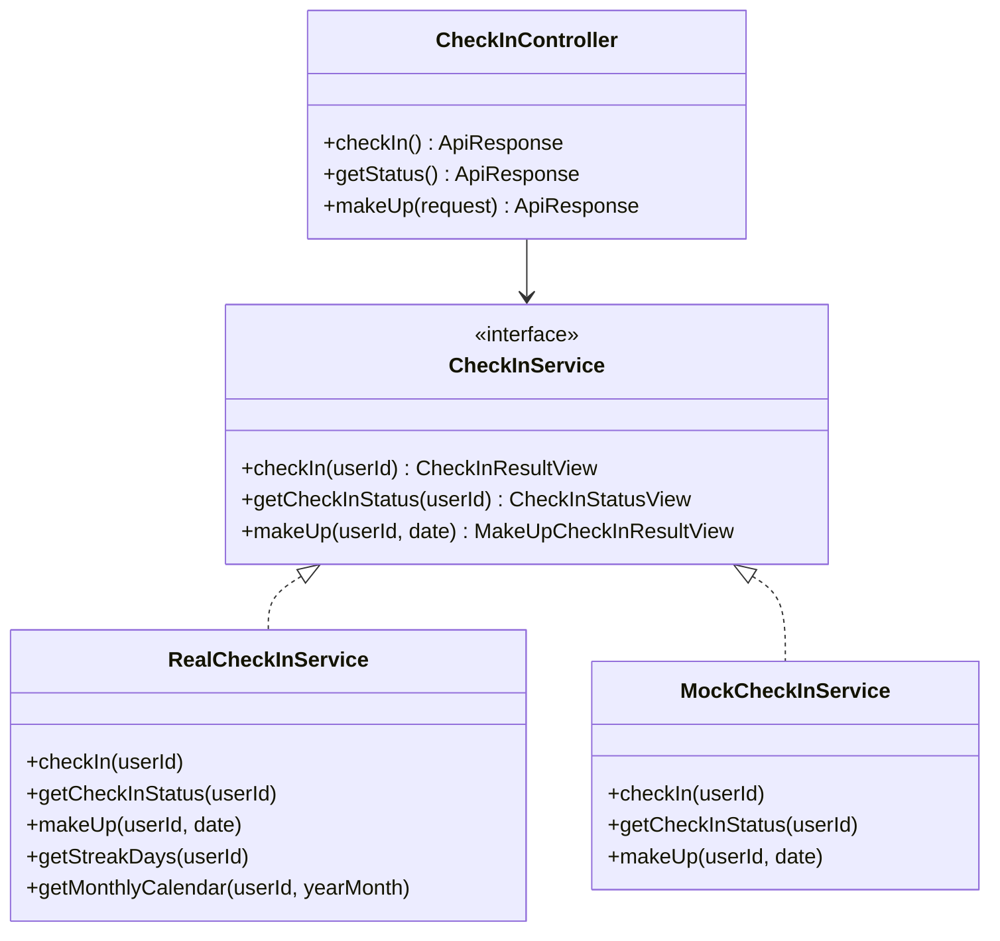

**图表来源**
- [CheckInService.java:9-42](file://apps/api/src/main/java/com/campuslove/api/growth/CheckInService.java#L9-L42)
- [RealCheckInService.java:58-60](file://apps/api/src/main/java/com/campuslove/api/growth/RealCheckInService.java#L58-L60)
- [MockCheckInService.java:18-20](file://apps/api/src/main/java/com/campuslove/api/growth/MockCheckInService.java#L18-L20)
- [CheckInController.java:21-29](file://apps/api/src/main/java/com/campuslove/api/growth/CheckInController.java#L21-L29)

**章节来源**
- [CheckInController.java:14-85](file://apps/api/src/main/java/com/campuslove/api/growth/CheckInController.java#L14-L85)
- [CheckInService.java:1-43](file://apps/api/src/main/java/com/campuslove/api/growth/CheckInService.java#L1-L43)
- [RealCheckInService.java:43-175](file://apps/api/src/main/java/com/campuslove/api/growth/RealCheckInService.java#L43-L175)
- [MockCheckInService.java:12-194](file://apps/api/src/main/java/com/campuslove/api/growth/MockCheckInService.java#L12-L194)
- [CheckInResultView.java:1-24](file://apps/api/src/main/java/com/campuslove/api/growth/CheckInResultView.java#L1-L24)
- [CheckInStatusView.java:1-13](file://apps/api/src/main/java/com/campuslove/api/growth/CheckInStatusView.java#L1-L13)
- [MakeUpCheckInRequest.java:1-20](file://apps/api/src/main/java/com/campuslove/api/growth/MakeUpCheckInRequest.java#L1-L20)
- [MakeUpCheckInResultView.java:1-29](file://apps/api/src/main/java/com/campuslove/api/growth/MakeUpCheckInResultView.java#L1-L29)

## 架构总览
签到请求自上而下穿过 4 个层次：HTTP 控制器（鉴权 + 幂等注解）→ 服务接口 → Profile 互斥实现 → 持久层与外部副作用（钱包、MQ）。

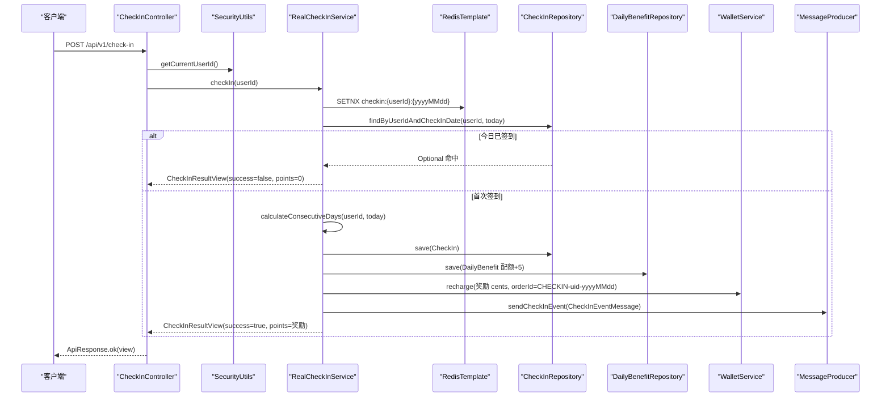

**图表来源**
- [CheckInController.java:35-41](file://apps/api/src/main/java/com/campuslove/api/growth/CheckInController.java#L35-L41)
- [RealCheckInService.java:194-319](file://apps/api/src/main/java/com/campuslove/api/growth/RealCheckInService.java#L194-L319)

分层要点：
- 控制器不含业务分支，只做「取当前用户 → 委派 → 包装 ApiResponse」，三个端点全部如此。
- `POST`（签到）与 `POST /make-up`（补签）同时标注 `@Idempotent` 与 `@PreAuthorize("hasRole('USER')")`；`GET /status` 未标注这两个注解。
- RealCheckInService 的依赖注入面很宽：7 个 Repository/配置 + EntityManager + MessageProducer + WalletService 走构造器，RedisTemplate 走 `@Autowired(required = false)` 字段注入以便 mock profile 与无 Redis 场景仍可启动。

**章节来源**
- [CheckInController.java:25-51](file://apps/api/src/main/java/com/campuslove/api/growth/CheckInController.java#L25-L51)
- [RealCheckInService.java:94-175](file://apps/api/src/main/java/com/campuslove/api/growth/RealCheckInService.java#L94-L175)
- [MockCheckInService.java:22-55](file://apps/api/src/main/java/com/campuslove/api/growth/MockCheckInService.java#L22-L55)

## 详细组件分析

### CheckInController：三个端点的契约
控制器只有一个依赖 `CheckInService`，通过构造器注入，类级 `@RequestMapping("/api/v1/check-in")` 决定路由前缀。三个端点的差异集中在注解组合上：

| 端点 | 方法 | 注解组合 | 请求体 | 响应载荷 |
| --- | --- | --- | --- | --- |
| `POST /api/v1/check-in` | `checkIn()` | `@PostMapping` + `@Idempotent` + `@PreAuthorize("hasRole('USER')")` | 无 | `ApiResponse<CheckInResultView>` |
| `GET /api/v1/check-in/status` | `getStatus()` | 仅 `@GetMapping("/status")` | 无 | `ApiResponse<CheckInStatusView>` |
| `POST /api/v1/check-in/make-up` | `makeUp(request)` | `@PostMapping("/make-up")` + `@Idempotent` + `@PreAuthorize("hasRole('USER')")` | `@Valid @RequestBody MakeUpCheckInRequest` | `ApiResponse<MakeUpCheckInResultView>` |

三个方法体结构一致：`Long userId = SecurityUtils.getCurrentUserId();` 后直接 `ApiResponse.ok(checkInService.xxx(userId, ...))`。类注释明确「用户ID从JWT认证上下文中获取，不再从请求参数获取」，因此**不存在** `/{userId}` 形式的越权入口，也不存在服务端可指定的目标用户。

值得注意的是 `@PreAuthorize` 只加在两个写端点上，`GET /status` 未加：其用户身份仍来自 `SecurityUtils.getCurrentUserId()`，未登录时由该方法抛出（对应补签文档注释中的「未登录 → 401 Unauthorized」口径）。

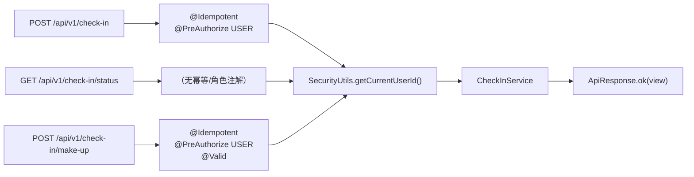

**图表来源**
- [CheckInController.java:21-51](file://apps/api/src/main/java/com/campuslove/api/growth/CheckInController.java#L21-L51)
- [CheckInController.java:79-85](file://apps/api/src/main/java/com/campuslove/api/growth/CheckInController.java#L79-L85)

**章节来源**
- [CheckInController.java:14-85](file://apps/api/src/main/java/com/campuslove/api/growth/CheckInController.java#L14-L85)

### RealCheckInService.checkIn：签到主流程
`checkIn(Long)` 标注 `@Override @Transactional`，逻辑顺序如下：

1. **入参校验**：`userId == null` 抛 `IllegalArgumentException("userId is required")`。
2. **业务日取值**：`LocalDate today = LocalDate.now(TimeZones.BUSINESS)`——所有日期判定统一使用业务时区常量，而非系统默认时区。
3. **Redis 日限一次锁**：`buildCheckInRedisKey(userId, today)` 生成 `checkin:{userId}:{yyyyMMdd}`，`tryAcquireCheckInLock` 用 `setIfAbsent(key, "1", 24h)` 抢占；未抢到且 Redis 可用时只记录 info 日志，**不直接返回**，继续走 DB 查询以返回完整响应。
4. **重复签到防护**：`checkInRepository.findByUserIdAndCheckInDate(userId, today)` 命中则视为重复，读取其 `getConsecutiveDays()`、`calculateTotalExtraQuota(userId)`，再尝试 `dailyBenefitRepository.findByUserIdAndBenefitDate` 取既有权益，返回 `success=false` 且 `points=0` 的结果；权益缺失时回退为 `extraRecommendQuota=extraQuota`、两个解锁位 `true`、热门/新用户数照查。
5. **连续天数**：`calculateConsecutiveDays(userId, today)`。
6. **落库**：新建 `CheckIn`，写入 `userId / checkInDate / consecutiveDays / createdAt`，`save` 捕获 `DataIntegrityViolationException` → 记录 warn、**释放 Redis 锁**（`releaseCheckInLock`）后抛 `RuntimeException(ErrorMessages.CHECKIN_FAILED_RETRY)`。
7. **权益记录**：新建 `DailyBenefit`，`extraRecommendQuota = checkInConfig.getExtraQuotaPerCheckIn()`（默认 5），`hotTopicsUnlocked/newUsersUnlocked = true`；其唯一约束冲突仅 warn 不阻断。
8. **钱包入账**：`walletService.recharge(userId, rewardCentsPerCheckIn, "CHECKIN-{userId}-{yyyyMMdd}", WalletTransactionLog.RELATED_TYPE_CHECKIN, null)`，`orderId` 按（用户, 日期）幂等；`RuntimeException` 被捕获后只 warn，不回滚签到。
9. **配额与热度**：`calculateTotalExtraQuota` + `getHotTopicCount()` + `getNewCircleUserCount()`。
10. **MQ 事件**：`messageProducer.sendCheckInEvent(new CheckInEventMessage(userId, consecutiveDays, extraQuotaPerCheckIn, Instant.now()))`。
11. **返回**：`success=true`，`points = checkInConfig.getRewardCentsPerCheckIn()`。

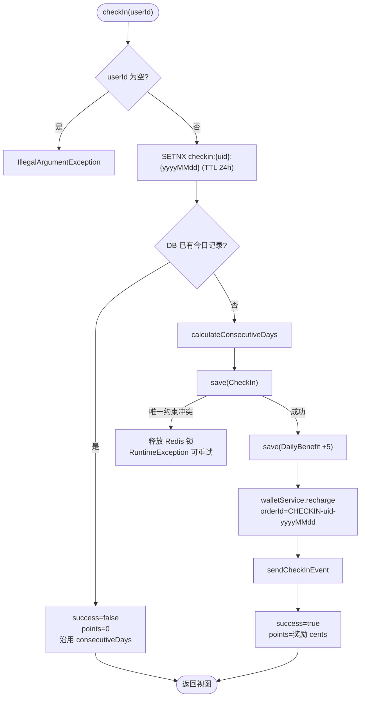

[此图为 checkIn 流程的概念归纳，逐步出处见下方章节来源的行区间]

**章节来源**
- [RealCheckInService.java:194-319](file://apps/api/src/main/java/com/campuslove/api/growth/RealCheckInService.java#L194-L319)
- [RealCheckInService.java:745-818](file://apps/api/src/main/java/com/campuslove/api/growth/RealCheckInService.java#L745-L818)
- [CheckInStatusView.java:7-13](file://apps/api/src/main/java/com/campuslove/api/growth/CheckInStatusView.java#L7-L13)
- [CheckInResultView.java:16-23](file://apps/api/src/main/java/com/campuslove/api/growth/CheckInResultView.java#L16-L23)

### RealCheckInService.makeUp：补签与月配额
`makeUp(Long, String)` 标注 `@Override @Transactional`，是签到系统里校验层级最多的一条路径。校验按固定顺序短路：

| 顺序 | 校验 | 失败异常与消息 |
| --- | --- | --- |
| 1 | `userId == null` | `IllegalArgumentException("userId is required")` |
| 2 | `date == null || isEmpty()` | `IllegalArgumentException("date is required")` |
| 3 | `LocalDate.parse(date)` 解析失败 | `IllegalArgumentException(ErrorMessages.DATE_FORMAT_INVALID)`（"日期格式无效，必须为 yyyy-MM-dd"） |
| 4 | `!targetDate.isBefore(today)`（当天/未来） | `IllegalArgumentException(ErrorMessages.MAKEUP_DATE_BEFORE_TODAY)`（"补签日期必须早于今天"） |
| 5 | `targetDate.isBefore(today.minusDays(7))` | `IllegalArgumentException(MAKEUP_ONLY_YESTERDAY_PREFIX + 7 + " 天内的日期")` |
| 6 | `findByUserIdAndCheckInDate(userId, targetDate)` 命中 | `IllegalArgumentException(ErrorMessages.CHECKIN_ALREADY_DONE)`（"该日期已签到，无法重复补签"） |
| 7 | `quota.getUsedCount() >= quota.getLimitCount()` | `IllegalArgumentException("本月补签次数已用完（上限 N 次）")` |

配额记录以「用户 + `yyyy-MM`」为维度：`makeUpQuotaRepository.findByUserIdAndYearMonth` 未命中时用 `orElseGet` 惰性新建，写入 `usedCount=0`、`limitCount=MakeUpQuota.DEFAULT_LIMIT`（3）。计费规则为 `usedCount == 0 ? 0 : MakeUpQuota.COST_POINTS_AFTER_FREE`（50）。

R4-00326 修复把「只展示不扣费」改成真实扣减：`costPoints > 0` 时调用 `walletService.deduct(userId, costPoints, "CHECKIN-MAKEUP-{userId}-{date}", WalletTransactionLog.RELATED_TYPE_CHECKIN_MAKEUP, targetDate.toString())`；`walletService` 为 null 抛 `IllegalStateException`；余额不足抛 `InsufficientBalanceException` → 转成 `IllegalArgumentException("积分不足，本次补签需 N 积分，请先签到获取积分")`。

补签记录落库时 `source` 显式置为 `CheckIn.SOURCE_MAKE_UP`（`"MAKE_UP"`），与正常签到的 `SOURCE_NORMAL` 区分；`DataIntegrityViolationException`（并发补签同一日）被翻译为 `CHECKIN_ALREADY_DONE` 而非 500。

配额递增是 P0-24 的读-改-写竞态修复点：不使用 `save(quota)`，而是 `makeUpQuotaRepository.incrementUsedCount(id, now)` 执行 `UPDATE ... SET usedCount = usedCount + 1 WHERE id = :id AND usedCount < limitCount`，`@Modifying(clearAutomatically = true)`；影响行数为 0 判定为并发耗尽并抛错。返回前仅在本地 `quota.setUsedCount(+1)` 用于响应展示。

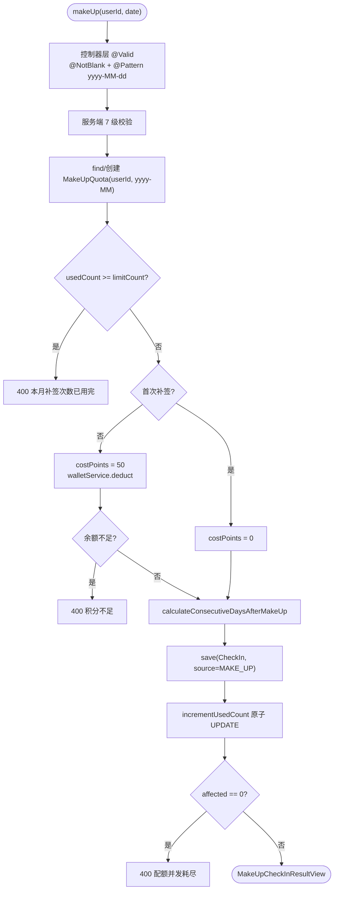

**图表来源**
- [MakeUpCheckInRequest.java:13-19](file://apps/api/src/main/java/com/campuslove/api/growth/MakeUpCheckInRequest.java#L13-L19)
- [RealCheckInService.java:381-501](file://apps/api/src/main/java/com/campuslove/api/growth/RealCheckInService.java#L381-L501)
- [MakeUpQuotaRepository.java:39-42](file://apps/api/src/main/java/com/campuslove/api/repository/MakeUpQuotaRepository.java#L39-L42)

**章节来源**
- [RealCheckInService.java:358-501](file://apps/api/src/main/java/com/campuslove/api/growth/RealCheckInService.java#L358-L501)
- [MakeUpQuota.java:25-51](file://apps/api/src/main/java/com/campuslove/api/entity/MakeUpQuota.java#L25-L51)
- [MakeUpQuotaRepository.java:16-42](file://apps/api/src/main/java/com/campuslove/api/repository/MakeUpQuotaRepository.java#L16-L42)
- [CheckIn.java:52-78](file://apps/api/src/main/java/com/campuslove/api/entity/CheckIn.java#L52-L78)
- [ErrorMessages.java:291-304](file://apps/api/src/main/java/com/campuslove/api/common/ErrorMessages.java#L291-L304)
- [ErrorMessages.java:840-845](file://apps/api/src/main/java/com/campuslove/api/common/ErrorMessages.java#L840-L845)
- [MakeUpCheckInResultView.java:9-28](file://apps/api/src/main/java/com/campuslove/api/growth/MakeUpCheckInResultView.java#L9-L28)

### 连续签到天数、配额与权益查询
连续天数不是计数器累加的结果，而是**每次按需从签到日期集合反推**：

- `calculateConsecutiveDays(userId, startDate)`：一次 JPQL 查询取该用户 `checkInDate <= startDate` 的全部日期（倒序），随后从 `startDate` 起逐日比对——`date.equals(expected)` 则 `streak++` 并 `expected.minusDays(1)`，否则 `break`。注释记录 FIN-00025 修复：原实现是「连续 N 天即 N 次查询」的逐日回查。
- `calculateConsecutiveDaysAfterMakeUp(userId, today, makeUpDate)`：同样一次批量查询，但把结果放进 `HashSet` 并 `dateSet.add(makeUpDate)`，即**补签日期被视为已签到并参与连续段计算**，再自 today 起 `while (dateSet.contains(expected))` 累加。注意：today 无签到记录时，该方法返回 0（循环不进入），因此补签的连续天数增益依赖「今天已签到」这一前提。
- `getStreakDays(userId)`：公共扩展方法（不在 `CheckInService` 接口内），仅委托 `calculateConsecutiveDays(userId, LocalDate.now(TimeZones.BUSINESS))`；Javadoc 明确「仅作视觉标识，无积分/等级影响」。
- `getMonthlyCalendar(userId, YearMonth)`：`@Transactional(readOnly = true)`，按 `atDay(1)`/`atEndOfMonth()` 做一次 BETWEEN 范围查询，映射为 `dayOfMonth` 列表并 `sorted()`；FIN-00025 同样把原「最多 31 次逐日查询」合并为 1 次。
- `calculateTotalExtraQuota(userId)`：取 `findTopByUserIdOrderByCheckInDateDesc` 最新一条签到记录，返回 `consecutiveDays * extraQuotaPerCheckIn`；无记录返回 0。这是「累计额外推荐配额」的唯一口径，代码注释特意说明因 `consecutiveDays` 已含今天而**不再额外加一次配额**，以与重复签到分支保持一致。
- `getHotTopicCount()`：两个维度相加——`postRepository.findByStatusOrderByLikesCountDesc(Post.PostStatus.active, PageRequest.of(0,20))` 中「今日创建且 `likesCount > 0`」的帖子数，加 `circleTopicRepository.findAllByOrderByCreatedAtDesc(PageRequest.of(0,20))` 中「今日创建且 `replyCount > 0`」的话题数；每个维度各自 `try/catch (DataAccessException)` 降级并 warn。
- `getNewCircleUserCount()`：`SELECT COUNT(DISTINCT m.userId) FROM CircleMembership m WHERE m.joinedAt >= now-24h`（FIN-00026 把 `findAll()` 全表内存过滤改为 DB 侧去重统计）；`DataAccessException` 时返回 0。方法注释保留了 Task 10/FIN-00114 的复核结论：因被 `checkIn()` 自调用，`readOnly` 提示经 Spring AOP 自调用不生效，且不加 `setRollbackOnly` 以免 `UnexpectedRollbackException` 打断签到。

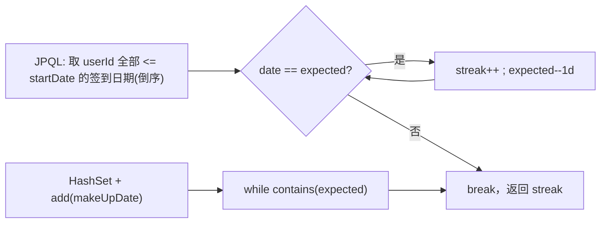

**图表来源**
- [RealCheckInService.java:688-743](file://apps/api/src/main/java/com/campuslove/api/growth/RealCheckInService.java#L688-L743)
- [RealCheckInService.java:503-538](file://apps/api/src/main/java/com/campuslove/api/growth/RealCheckInService.java#L503-L538)

**章节来源**
- [RealCheckInService.java:503-600](file://apps/api/src/main/java/com/campuslove/api/growth/RealCheckInService.java#L503-L600)
- [RealCheckInService.java:604-743](file://apps/api/src/main/java/com/campuslove/api/growth/RealCheckInService.java#L604-L743)
- [CheckInRepository.java:25-49](file://apps/api/src/main/java/com/campuslove/api/repository/CheckInRepository.java#L25-L49)

### getCheckInStatus：状态聚合与钱包余额联动
`getCheckInStatus(Long)` 标注 `@Transactional(readOnly = true)`，组装四元组：

- `checkedInToday`：`checkInRepository.findByUserIdAndCheckInDate(userId, today).isPresent()`
- `consecutiveDays`：`calculateConsecutiveDays(userId, today)`（与签到路径同一算法，未签到时也能得到「截至昨天的连续段」）
- `extraQuota`：`calculateTotalExtraQuota(userId)`
- `points`：`walletService.getBalance(userId)`，**异常时降级为 0 并 warn**，不阻断状态查询；视图注释标注其语义为「交友币钱包余额（cents）」

MockCheckInService 的对应实现以内存 map 复现同样判定：`lastDate.equals(today)` 判今日已签；未签到但 `lastDate.equals(today.minusDays(1))` 时沿用缓存的连续天数，否则归零；`points` 固定返回 `100L` 以对齐前端 `MOCK_POINTS_BALANCE`。

**章节来源**
- [RealCheckInService.java:321-356](file://apps/api/src/main/java/com/campuslove/api/growth/RealCheckInService.java#L321-L356)
- [MockCheckInService.java:96-119](file://apps/api/src/main/java/com/campuslove/api/growth/MockCheckInService.java#L96-L119)
- [CheckInStatusView.java:1-13](file://apps/api/src/main/java/com/campuslove/api/growth/CheckInStatusView.java#L1-L13)

## 签到状态数据模型
签到域有 3 张表，均由 Flyway 脚本建立，实体注解与 DDL 中的索引/约束命名保持一致。

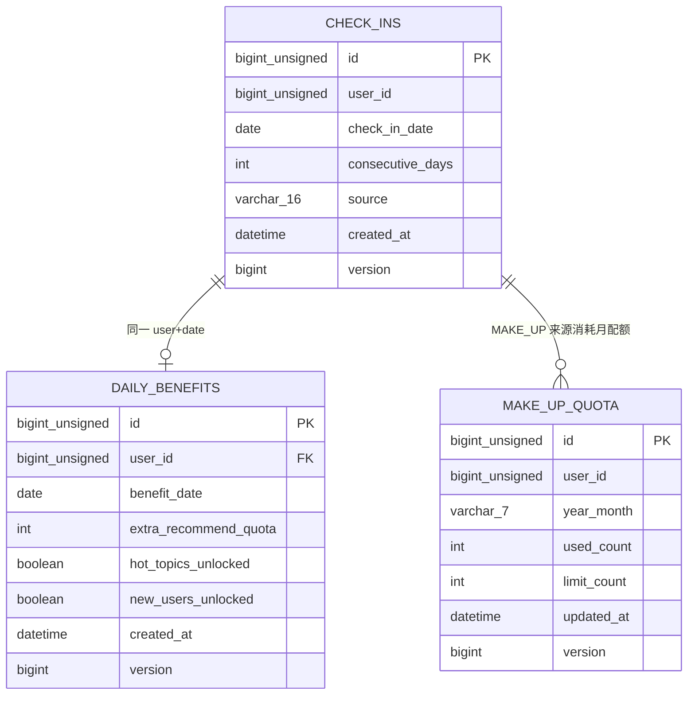

[此图为签到域数据模型归纳，字段来源见下方章节来源]

关键约束：
- `uk_checkin_user_date (user_id, check_in_date)` 是重复签到防护的**最终防线**，在 `@Table(uniqueConstraints=...)` 与 DDL 中同名同列；另有 `idx_checkin_user_id`、`idx_checkin_date`、`idx_check_ins_user_created_at` 三个查询索引与补签脚本追加的 `idx_checkin_source`。
- `CheckIn.consecutiveDays` 列默认值 1、`source` 默认 `NORMAL`（历史数据兼容）；三个实体都带 `@Version` 乐观锁列 `version BIGINT DEFAULT 0`（Flyway V2026.07.26.0003），并发更新冲突由 `GlobalExceptionHandler` 转 HTTP 409。
- `daily_benefits` 以 `uk_user_date (user_id, benefit_date)` 保证一天一条权益，并有外键 `fk_daily_benefits_user → users(id)`。
- `make_up_quota` 以 `uk_makeup_user_month (user_id, year_month)` 保证一月一条，`limit_count` 列默认 3、`updated_at` 为 `ON UPDATE CURRENT_TIMESTAMP`。

**章节来源**
- [CheckIn.java:18-98](file://apps/api/src/main/java/com/campuslove/api/entity/CheckIn.java#L18-L98)
- [DailyBenefit.java:16-72](file://apps/api/src/main/java/com/campuslove/api/entity/DailyBenefit.java#L16-L72)
- [MakeUpQuota.java:16-72](file://apps/api/src/main/java/com/campuslove/api/entity/MakeUpQuota.java#L16-L72)
- [V2026.05.23.0002__create_check_ins.sql:1-11](file://database/flyway/sql/V2026.05.23.0002__create_check_ins.sql#L1-L11)
- [V2026.05.28.0008__create_daily_benefits.sql:1-14](file://database/flyway/sql/V2026.05.28.0008__create_daily_benefits.sql#L1-L14)
- [V2026.07.25.0013__add_check_in_make_up.sql:1-25](file://database/flyway/sql/V2026.07.25.0013__add_check_in_make_up.sql#L1-L25)

## 奖励规则与积分累积机制
签到一次性产出 4 类收益，全部在 `checkIn()` 的成功分支内完成，但**可靠性等级不同**（权益与钱包是 best-effort，签到记录是必须成功）。

| 收益 | 载体 | 数量来源 | 失败语义 |
| --- | --- | --- | --- |
| 连续签到天数 | `check_ins.consecutive_days` | `calculateConsecutiveDays` | 参与唯一约束，失败即签到失败 |
| 额外推荐配额 | `daily_benefits.extra_recommend_quota` | `CheckInConfig.extraQuotaPerCheckIn`（类默认 5，`application.yml` 覆盖为 3） | `DataIntegrityViolationException` → 仅 warn 跳过 |
| 热门话题/新入圈解锁 | `daily_benefits.hot_topics_unlocked / new_users_unlocked` | 固定写 `true` | 同上 |
| 交友币（积分） | 钱包 CREDIT 流水，`relatedType=CHECKIN` | `CheckInConfig.rewardCentsPerCheckIn`（默认 50 分） | `RuntimeException` → 仅 warn，不回滚签到 |

配额聚合口径由 `calculateTotalExtraQuota` 决定：`最新一条签到记录的 consecutiveDays × extraQuotaPerCheckIn`，因此「额外推荐配额」随连续天数线性放大，而不是历史上所有签到日的权益求和；一旦连续段中断，最新记录的 `consecutive_days` 变小，聚合值随之回落。

积分（交友币）幂等入账使用订单号 `CHECKIN-{userId}-{yyyyMMdd}`；配合钱包侧 `order_id` 唯一索引，同日重复提交不会重复入账。补签侧对应订单号 `CHECKIN-MAKEUP-{userId}-{date}`、`relatedType=CHECKIN_MAKEUP`、`relatedId=补签日期`，其 `costPoints` 规则为「当月首条 MakeUpQuota 记录 `usedCount=0` 时免费，其后每次 50」。

连续签到里程碑由消费者侧判定，不写库、只发通知：`CheckInEventConsumer` 的 `rewardMilestones` 由 `app.checkin.reward-milestones` 注入（默认 `7,14,30,60,100,365`），当 `consecutiveDays == milestone` 时额外推送一条「连续签到奖励」通知，命中即 `break`。

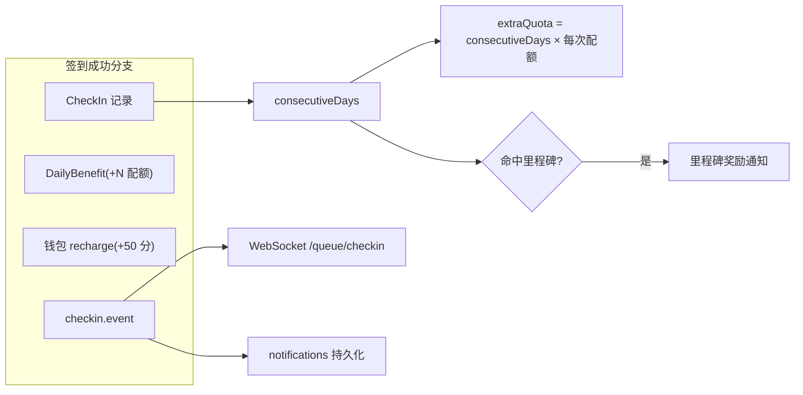

**图表来源**
- [RealCheckInService.java:261-318](file://apps/api/src/main/java/com/campuslove/api/growth/RealCheckInService.java#L261-L318)
- [RealCheckInService.java:735-743](file://apps/api/src/main/java/com/campuslove/api/growth/RealCheckInService.java#L735-L743)
- [CheckInEventConsumer.java:41-59](file://apps/api/src/main/java/com/campuslove/api/mq/CheckInEventConsumer.java#L41-L59)
- [CheckInEventConsumer.java:151-186](file://apps/api/src/main/java/com/campuslove/api/mq/CheckInEventConsumer.java#L151-L186)

### 签到提醒与异步通知链路
签到通知不占用请求线程：`sendCheckInEvent` 向 Direct Exchange 以固定路由键 `checkin.event` 投递；`rabbitTemplate == null` 或抛 `RuntimeException` 时**不向上抛出**，而是 `persistOutbox("checkin", ...)` 落 `outbox_event` 由定时任务补偿重投（R4-00373）。消费端 `CheckInEventConsumer`（`@Component @Profile("real")`，`@RabbitListener(queues = "checkin.queue")` + `@Transactional`）做两件事：

1. `pushCheckInSuccessNotification`：文案「今日签到成功，已连续签到 %d 天，获得 %d 积分」，经 `SimpMessagingTemplate.convertAndSendToUser(userId, "/queue/checkin", Map)` 实时推送，负载含 `type=checkin_success / consecutiveDays / rewardPoints / createdAt`；随后 `persistNotification` 入库。
2. `checkAndPushRewardNotification`：命中里程碑时推送 `type=checkin_milestone_reward` 并再持久化一条。

韧性设计：`handleCheckInEvent` 外层 `catch (RuntimeException)` 只 warn 不抛，避免消息无限重投；`notificationRepository`、`messagingTemplate` 均 `@Autowired(required = false)`，缺失时跳过对应通道；持久化 `catch (DataAccessException)` 降级。通知实体固定 `type=NotificationType.system`（R4-00374，不再复用 `match`）、`sourceUserId=0L`、`referenceType=ReferenceType.user`、`isRead=false`。

**图表来源**
- [MessageProducer.java:157-194](file://apps/api/src/main/java/com/campuslove/api/mq/MessageProducer.java#L157-L194)
- [CheckInEventConsumer.java:80-141](file://apps/api/src/main/java/com/campuslove/api/mq/CheckInEventConsumer.java#L80-L141)

**章节来源**
- [RealCheckInService.java:261-318](file://apps/api/src/main/java/com/campuslove/api/growth/RealCheckInService.java#L261-L318)
- [CheckInConfig.java:12-36](file://apps/api/src/main/java/com/campuslove/api/config/CheckInConfig.java#L12-L36)
- [application.yml:329-332](file://apps/api/src/main/resources/application.yml#L329-L332)
- [WalletTransactionLog.java:92-98](file://apps/api/src/main/java/com/campuslove/api/wallet/WalletTransactionLog.java#L92-L98)
- [MessageProducer.java:157-194](file://apps/api/src/main/java/com/campuslove/api/mq/MessageProducer.java#L157-L194)
- [CheckInEventConsumer.java:29-235](file://apps/api/src/main/java/com/campuslove/api/mq/CheckInEventConsumer.java#L29-L235)
- [CheckInEventMessage.java:6-53](file://apps/api/src/main/java/com/campuslove/api/mq/CheckInEventMessage.java#L6-L53)
- [MockCheckInService.java:90-93](file://apps/api/src/main/java/com/campuslove/api/growth/MockCheckInService.java#L90-L93)

## 客户端接入与页面流程
小程序侧由 Pinia store `checkin`（`defineStore("checkin", ...)`，216 行起为 state 定义）统一封装签到，页面无直接 HTTP 调用。

- `fetchStatus()` → `GET /check-in/status`，映射 `checkedInToday→checkedIn`、`extraQuota→extraRecommendations`、`points→pointsBalance`；带 30s TTL 缓存（`isCacheFresh('checkin:status', CHECKIN_TTL_MS)` / `setCachedValue("checkin:status", true)`），使 home 与 discover 双入口不重复请求。
- `checkIn()` → `POST /check-in`，请求头携带 `Idempotency-Key: checkin-{localDateKey(new Date())}`，与后端 `@Idempotent` 的 `{key}:{userId}` Redis 语义配合，杜绝重复扣权益。
- `makeUpCheckIn(date)` → `POST /check-in/make-up`，请求头 `Idempotency-Key: makeup-{date}`（以补签日期为键），成功后同步 `consecutiveDays`、`makeUpUsedCount`、`makeUpLimit`。
- 未登录保护：`fetchStatus` 与 `checkIn` 都先取 `sessionStore.userSession?.userId`，为空时 `fetchStatus` 静默重置状态、`checkIn` 抛出登录错误（D2 修复，避免无效请求噪音）。
- 竞态与超时：`fetchStatusToken` 单调递增，仅最新 token 允许写状态；`withTimeout` 委托 `services/http.ts` 的 `withHttpTimeout`（`ASYNC_TIMEOUT_MS = 15000`），超时后 `controller.abort()`，各处用 `signal.aborted` 跳过状态修改。
- 动画资源：`showSuccessAnimation` 由模块级 `successAnimationTimer` 在 `SUCCESS_ANIMATION_AUTO_DISMISS_MS = 3000` 后收起，`dispose()` 清理；`daily-question` 页 `onUnload` 调用 `checkInStore.dispose()`（R4-00157）。

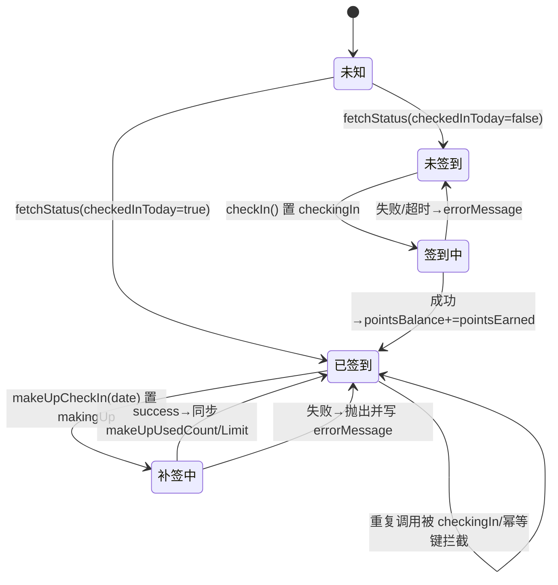

[此图为客户端 store 状态迁移的概念归纳，逐步出处见下方章节来源]

后端反向推送：`CheckInEventConsumer` 经 `/queue/checkin` 推送的签到事件由 `handleCheckInEvent` 接收，动作只有一个——`useCheckInStore().fetchStatus()`，使首页签到卡片连签天数与奖励即时刷新（R4-00175）；因 `fetchStatus` 有 30s TTL，事件到达时若缓存仍新鲜则不会真正发请求。

页面消费示例：每日一问页把签到作为解锁条件——`v-if="!checkInStore.checkedIn"` 渲染锁定卡，`handleCheckIn()` 先判 `isCheckingIn.value || checkInStore.checkedIn` 再调 `checkInStore.checkIn()`，成功后按 `checkedIn` 判定弹「解锁成功」，否则展示 `errorMessage` 兜底文案；商城页与匹配、店铺、任务等页面同样直接读取该 store。

**章节来源**
- [checkin.ts:9-132](file://apps/client/src/stores/checkin.ts#L9-L132)
- [checkin.ts:215-236](file://apps/client/src/stores/checkin.ts#L215-L236)
- [checkin.ts:280-354](file://apps/client/src/stores/checkin.ts#L280-L354)
- [checkin.ts:364-499](file://apps/client/src/stores/checkin.ts#L364-L499)
- [checkin.ts:515-557](file://apps/client/src/stores/checkin.ts#L515-L557)
- [api.ts:1207-1227](file://apps/client/src/services/api.ts#L1207-L1227)
- [growth.ts:12-37](file://apps/client/src/constants/growth.ts#L12-L37)
- [store-dispatch.ts:392-409](file://apps/client/src/services/websocket/store-dispatch.ts#L392-L409)
- [index.vue:19-37](file://apps/client/src/subpackages/tools/daily-question/index.vue#L19-L37)
- [index.vue:95-99](file://apps/client/src/subpackages/tools/daily-question/index.vue#L95-L99)

## 并发控制与事务管理
签到采用 4 层防御纵深，任一上层失效都不破坏「一天一次」的不变量。

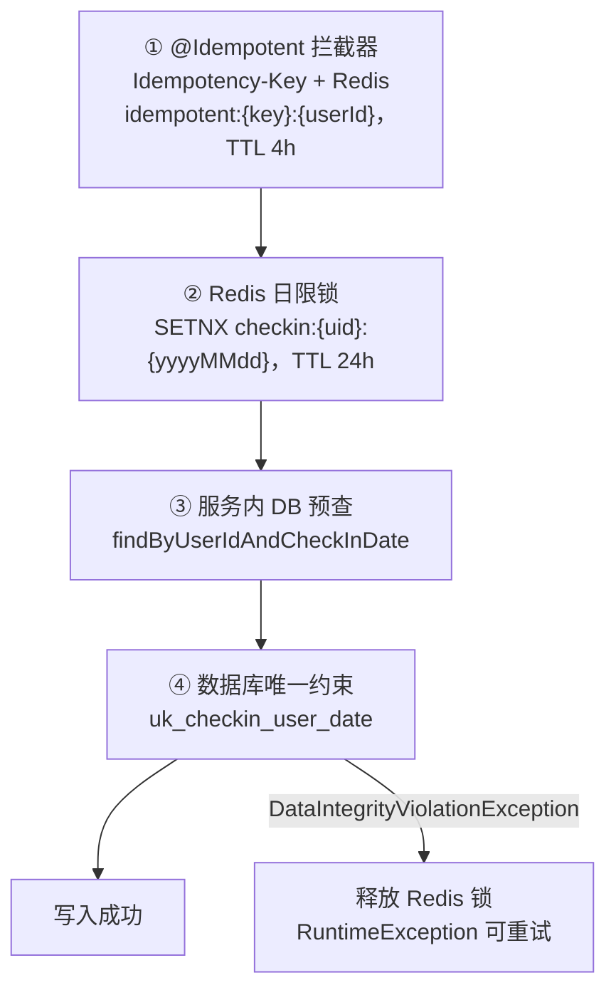

**图表来源**
- [Idempotent.java:8-44](file://apps/api/src/main/java/com/campuslove/api/common/Idempotent.java#L8-L44)
- [RealCheckInService.java:70-92](file://apps/api/src/main/java/com/campuslove/api/growth/RealCheckInService.java#L70-L92)
- [RealCheckInService.java:248-259](file://apps/api/src/main/java/com/campuslove/api/growth/RealCheckInService.java#L248-L259)

各层语义与降级：

1. **`@Idempotent`（Task 2.4.3）**：注解定义于 `common` 包，`@Target(METHOD)` + `@Retention(RUNTIME)`，`DEFAULT_TTL_SECONDS = 4L * 3600`（infra R2-00249 把原 24h 缩短为 4h，避免写失败后用户等 24h 才能重试），`required()` 默认 true（缺失 `Idempotency-Key` 头返回 400）。客户端签到的幂等键是 `checkin-{本地日期}`，补签是 `makeup-{date}`。注解文档明确「仅作用于写操作，GET 请求不应使用」，与 `GET /status` 未加注解一致。
2. **Redis 日限锁**：`tryAcquireCheckInLock` 用 `setIfAbsent(key, "1", 24h)`；`redisTemplate == null`（mock profile 或未配置）或抛 `RuntimeException` 时返回 false 并**降级为仅 DB 检查**，绝不阻断签到。抢锁失败也不直接返回，仍走 DB 查询以拿回完整视图。`CHECKIN_DATE_FORMATTER` 用 `yyyyMMdd` 无连字符以缩短 key。
3. **锁释放**：正常成功**不释放**，由 TTL 自然过期实现当日防重；仅当 DB 唯一约束冲突（本请求在并发中落败）时 `releaseCheckInLock` 删 key 放行重试，删除失败只 warn。
4. **`@Version` 乐观锁**：`CheckIn`/`DailyBenefit`/`MakeUpQuota` 均带 `version`（`BIGINT DEFAULT 0`，Flyway V2026.07.26.0003），并发更新冲突抛 `ObjectOptimisticLockingFailureException` 并由 `GlobalExceptionHandler` 转 409。
5. **配额原子递增**：`incrementUsedCount` 以 `UPDATE ... WHERE usedCount < limitCount` 的条件自增取代读-改-写（P0-24），影响行数 0 即视为并发耗尽；`@Modifying(clearAutomatically = true)` 保证 bulk update 后持久化上下文一致。

事务边界：

| 方法 | 注解 | 说明 |
| --- | --- | --- |
| `checkIn` | `@Transactional` | 签到记录为提交点；权益写入与钱包入账被 try/catch 吞掉异常，MQ 发送在事务内但自身不抛 |
| `makeUp` | `@Transactional` | 校验、扣费、写记录、配额递增同事务；`IllegalArgumentException` 触发回滚 |
| `getCheckInStatus` / `getMonthlyCalendar` / `getHotTopicCount` / `getNewCircleUserCount` | `@Transactional(readOnly = true)` | 只读；其中两个热度方法被 `checkIn` 自调用，`readOnly` 提示因 AOP 自调用不经过代理而失效，实际运行在 `checkIn` 读写事务内（FIN-00114 复核结论） |

### 连续段中断与恢复口径
仓库里的「中断恢复」由两条既有机制承担，没有额外的修复任务或补偿作业：

- **中断**：`calculateConsecutiveDays` 在遇到缺日时立即 `break`，`streak` 归到中断点为止；新一次签到的 `consecutive_days` 从 1 重新计（MockCheckInService 同样：`lastDate` 非昨日则 `consecutiveDays = 1`）。由于 `calculateTotalExtraQuota` 取的是最新记录的 `consecutiveDays × 单次配额`，中断会让累计配额同步回落。
- **恢复**：`makeUp` 写入 `source=MAKE_UP` 的 `CheckIn` 记录后，`calculateConsecutiveDaysAfterMakeUp` 把补签日并入日期集合再重算连续段，从而「接回」被断开的 streak；月配额与扣费即恢复成本。
- **无补偿作业**：签到失败仅返回「签到失败，请稍后重试」让用户重试，没有后台补记时；Redis 锁丢失当日由 TTL 兜底，MQ 丢失由 `outbox_event` 补偿重投（通知，不含签到记录本身）。

**章节来源**
- [Idempotent.java:8-64](file://apps/api/src/main/java/com/campuslove/api/common/Idempotent.java#L8-L64)
- [RealCheckInService.java:70-92](file://apps/api/src/main/java/com/campuslove/api/growth/RealCheckInService.java#L70-L92)
- [RealCheckInService.java:194-319](file://apps/api/src/main/java/com/campuslove/api/growth/RealCheckInService.java#L194-L319)
- [RealCheckInService.java:333-356](file://apps/api/src/main/java/com/campuslove/api/growth/RealCheckInService.java#L333-L356)
- [RealCheckInService.java:381-501](file://apps/api/src/main/java/com/campuslove/api/growth/RealCheckInService.java#L381-L501)
- [RealCheckInService.java:503-538](file://apps/api/src/main/java/com/campuslove/api/growth/RealCheckInService.java#L503-L538)
- [RealCheckInService.java:660-684](file://apps/api/src/main/java/com/campuslove/api/growth/RealCheckInService.java#L660-L684)
- [RealCheckInService.java:745-818](file://apps/api/src/main/java/com/campuslove/api/growth/RealCheckInService.java#L745-L818)
- [MakeUpQuotaRepository.java:27-42](file://apps/api/src/main/java/com/campuslove/api/repository/MakeUpQuotaRepository.java#L27-L42)
- [CheckIn.java:86-97](file://apps/api/src/main/java/com/campuslove/api/entity/CheckIn.java#L86-L97)
- [MockCheckInService.java:57-94](file://apps/api/src/main/java/com/campuslove/api/growth/MockCheckInService.java#L57-L94)

## 配置与开关
签到可调项分布在 4 个层次：Spring 配置属性、常量、Profile 开关与契约文件。

| 项 | 位置 | 默认值 | 可覆盖方式 |
| --- | --- | --- | --- |
| `app.checkin.extra-quota-per-check-in` | `CheckInConfig`（`@ConfigurationProperties(prefix = "app.checkin")`） | 类字段默认 5 | `application.yml` 已显式设为 **3** |
| `app.checkin.reward-cents-per-check-in` | 同上 | 类字段默认 50 | `application.yml`：`${CHECKIN_REWARD_CENTS:50}`（环境变量可覆盖） |
| `app.checkin.reward-milestones` | `CheckInEventConsumer.setRewardMilestones`（`@Value`） | `7,14,30,60,100,365` | 配置项注入；`resources` 下未见显式配置，实际取注解默认值；空串会置为长度 0 数组即关闭里程碑通知 |
| `CHECKIN_REDIS_LOCK_TTL` | `RealCheckInService` 常量 | `Duration.ofHours(24)` | 需改代码 |
| `CHECKIN_REDIS_KEY_PREFIX` / `CHECKIN_DATE_FORMATTER` | 同上 | `checkin:` / `yyyyMMdd` | 需改代码 |
| `MAKE_UP_MAX_DAYS_BACK` | `RealCheckInService` 与 `MockCheckInService` 各自常量 | 7 | 需改代码（两份常量重复定义，无共享来源） |
| `MakeUpQuota.DEFAULT_LIMIT` / `COST_POINTS_AFTER_FREE` | 实体常量 | 3 / 50 | `limit_count` 列 DDL 默认亦为 3；`MakeUpQuota` 行的 `limitCount` 可在库内调整，服务读的是行值而非常量 |
| `Idempotent.DEFAULT_TTL_SECONDS` | 注解常量 | `4L * 3600` | 注解参数 `ttlSeconds` 按方法覆盖（签到/补签均用默认） |
| 业务时区 | `TimeZones.BUSINESS` | `Asia/Shanghai`（与 DB `serverTimezone` 对齐） | 需改代码，影响所有日期边界判定 |
| 实现开关 | `@Profile("real")` / `@Profile("mock")` | — | 激活 profile 决定注入 `RealCheckInService` 还是 `MockCheckInService` |

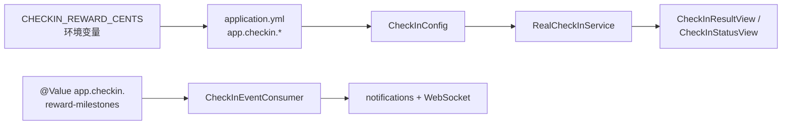

**图表来源**
- [application.yml:329-332](file://apps/api/src/main/resources/application.yml#L329-L332)
- [CheckInConfig.java:12-21](file://apps/api/src/main/java/com/campuslove/api/config/CheckInConfig.java#L12-L21)
- [CheckInEventConsumer.java:41-59](file://apps/api/src/main/java/com/campuslove/api/mq/CheckInEventConsumer.java#L41-L59)
- [RealCheckInService.java:261-318](file://apps/api/src/main/java/com/campuslove/api/growth/RealCheckInService.java#L261-L318)

对外契约 `docs/openapi/check-in.yaml`（OpenAPI 3.0.3，`servers: /api/v1`）声明 3 个 path 与 operationId：`checkIn`（POST `/check-in`）、`getCheckInStatus`（GET `/check-in/status`）、`makeUpCheckIn`（POST `/check-in/make-up`），三者均 `bearerAuth`（JWT，由 `/auth/wechat-login` 或 `/auth/refresh` 签发），响应声明 200/400/401/500。补签描述文字与实现一致：7 天窗口、每月 3 次、首次免费其后 50 growth points。该文件同时是 `MakeUpCheckInRequest` 的 `pattern: '^\d{4}-\d{2}-\d{2}$'` 与 `MakeUpCheckInResultView` 六个必填字段的来源。

存在一处**契约漂移**：YAML 的 `CheckInView` schema 只声明 8 个必填属性、未含 `points`，而 Java 记录 `CheckInResultView` 已有第 9 个字段 `points`（本次获得积分）；`CheckInStatusView` schema 亦未声明 `points`，Java 记录则返回余额。客户端为此把两个 `points` 都写成可选字段并在缺失时回退常量 `CHECKIN_POINTS_EARNED = 5`。

文案侧：`i18n/messages*.properties` 有 9 个 `checkin.*` 键（`success/failed/alreadyCheckedIn/makeUpSuccess/makeUpFailed/makeUpNoQuota/makeUpNoPoints/makeUpDateInvalid/continuousDays`），中英双份；服务端异常消息则来自 `ErrorMessages` 常量，两者并存。

数据种子：`V2026.08.07.0025__seed_activities_checkin_wallet.sql` 为超级账号 `user_id = 100000` 预置连续 7 天 `source='NORMAL'` 的 `check_ins`、`CHECKIN` 类型钱包流水与「连续签到 7 天奖励」流水，采用 `WHERE NOT EXISTS` 保证可重跑；回滚脚本以注释形式给出 `DELETE FROM check_ins WHERE user_id = 100000`。

**章节来源**
- [CheckInConfig.java:1-37](file://apps/api/src/main/java/com/campuslove/api/config/CheckInConfig.java#L1-L37)
- [application.yml:329-332](file://apps/api/src/main/resources/application.yml#L329-L332)
- [TimeZones.java:5-12](file://apps/api/src/main/java/com/campuslove/api/common/TimeZones.java#L5-L12)
- [RealCheckInService.java:64-92](file://apps/api/src/main/java/com/campuslove/api/growth/RealCheckInService.java#L64-L92)
- [MockCheckInService.java:36-46](file://apps/api/src/main/java/com/campuslove/api/growth/MockCheckInService.java#L36-L46)
- [MakeUpQuota.java:27-31](file://apps/api/src/main/java/com/campuslove/api/entity/MakeUpQuota.java#L27-L31)
- [Idempotent.java:43-64](file://apps/api/src/main/java/com/campuslove/api/common/Idempotent.java#L43-L64)
- [check-in.yaml:1-107](file://docs/openapi/check-in.yaml#L1-L107)
- [check-in.yaml:115-217](file://docs/openapi/check-in.yaml#L115-L217)
- [messages.properties:169-178](file://apps/api/src/main/resources/i18n/messages.properties#L169-L178)
- [messages_en_US.properties:166-175](file://apps/api/src/main/resources/i18n/messages_en_US.properties#L166-L175)
- [V2026.08.07.0025__seed_activities_checkin_wallet.sql:41-48](file://database/flyway/sql/V2026.08.07.0025__seed_activities_checkin_wallet.sql#L41-L48)
- [V2026.08.07.0025__seed_activities_checkin_wallet.sql:57-71](file://database/flyway/sql/V2026.08.07.0025__seed_activities_checkin_wallet.sql#L57-L71)
- [checkin.ts:63-91](file://apps/client/src/stores/checkin.ts#L63-L91)

## 依赖关系分析
签到既是成长体系的一环，也被多个上游模块消费，形成「一处写入、四处读取」的拓扑。

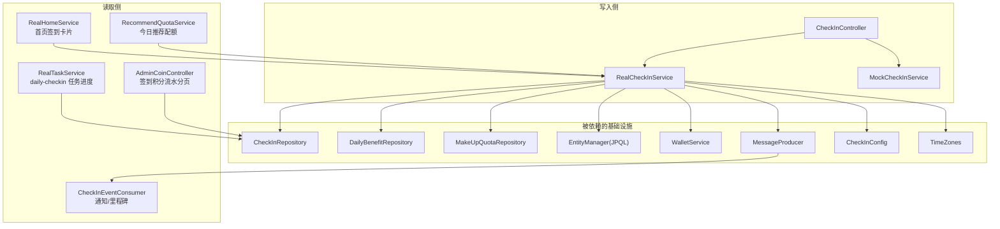

**图表来源**
- [CheckInController.java:25-51](file://apps/api/src/main/java/com/campuslove/api/growth/CheckInController.java#L25-L51)
- [RealCheckInService.java:94-175](file://apps/api/src/main/java/com/campuslove/api/growth/RealCheckInService.java#L94-L175)
- [RealHomeService.java:204-227](file://apps/api/src/main/java/com/campuslove/api/home/RealHomeService.java#L204-L227)
- [RecommendQuotaService.java:62-86](file://apps/api/src/main/java/com/campuslove/api/growth/RecommendQuotaService.java#L62-L86)
- [RealTaskService.java:207-223](file://apps/api/src/main/java/com/campuslove/api/tasks/RealTaskService.java#L207-L223)
- [AdminCoinController.java:35-100](file://apps/api/src/main/java/com/campuslove/api/admin/AdminCoinController.java#L35-L100)
- [CheckInEventConsumer.java:29-102](file://apps/api/src/main/java/com/campuslove/api/mq/CheckInEventConsumer.java#L29-L102)

读取侧要点（三条链路的降级口径都是「不阻断调用方」）：

- **首页卡片** `RealHomeService.aggregateCheckInStatus`：调 `getCheckInStatus`，按 `checkedInToday` 生成「今日已签到 / 连续签到 N 天 / 额外推荐配额 +N」或「去签到」引导卡；`userId` 为 null 时返回课表提示卡。
- **推荐配额** `RecommendQuotaService.getDailyQuota`：`baseLimit + status.extraQuota()`，`RuntimeException` 时降级为 0 并 warn；`getRemainingQuota` = 总量 − 已用。签到因此直接影响每日可滑动/推荐额度。
- **任务进度** `RealTaskService.calculateStreakDays`：不复用签到服务的私有方法，而是用 `checkInRepository.findCheckInDatesBefore(userId, startDate)` 后在内存跑**同一算法**（注释明示「与 RealCheckInService 同算法」），使 `daily-checkin` 任务的连续天数进度与签到口径一致。
- **管理后台批量查询**：`AdminCoinController`（`@Profile("real")`、`@RequestMapping("/api/v1/admin/business/coins")`、类级 `@PreAuthorize("hasRole('ADMIN')")`）直接把 `check_ins` 当作积分流水数据源——「每次签到即一笔积分流水，来源 NORMAL/MAKE_UP 作为流水类型」。分页参数经服务端夹紧（`safePage = max(1, page)`、`safeSize = max(1, min(100, pageSize))`），`dateFrom > dateTo` 抛 `START_DATE_AFTER_END`，并用 `adminDataScope.getCurrentAdminCampusName()` 做校区数据隔离；`searchForAdmin` 的 JPQL 用 `:param IS NULL OR ...` 组合可选条件并以 `EXISTS (SELECT 1 FROM UserCampusProfile ...)` 过滤校区，`ORDER BY c.createdAt DESC`。

RabbitMQ 拓扑常量集中在 `RabbitConfig`：`CHECKIN_QUEUE = "checkin.queue"`、`CHECKIN_EXCHANGE = "checkin.exchange"`、`CHECKIN_ROUTING_KEY = "checkin.event"`（DirectExchange 精确路由），消费者以 `@RabbitListener(queues = "checkin.queue")` 字面量监听。

**章节来源**
- [RealHomeService.java:204-227](file://apps/api/src/main/java/com/campuslove/api/home/RealHomeService.java#L204-L227)
- [RecommendQuotaService.java:22-22](file://apps/api/src/main/java/com/campuslove/api/growth/RecommendQuotaService.java#L22-L22)
- [RecommendQuotaService.java:62-96](file://apps/api/src/main/java/com/campuslove/api/growth/RecommendQuotaService.java#L62-L96)
- [RealTaskService.java:25-57](file://apps/api/src/main/java/com/campuslove/api/tasks/RealTaskService.java#L25-L57)
- [RealTaskService.java:207-223](file://apps/api/src/main/java/com/campuslove/api/tasks/RealTaskService.java#L207-L223)
- [AdminCoinController.java:24-114](file://apps/api/src/main/java/com/campuslove/api/admin/AdminCoinController.java#L24-L114)
- [CheckInRepository.java:51-83](file://apps/api/src/main/java/com/campuslove/api/repository/CheckInRepository.java#L51-L83)
- [RabbitConfig.java:63-72](file://apps/api/src/main/java/com/campuslove/api/config/RabbitConfig.java#L63-L72)
- [CheckInEventConsumer.java:80-102](file://apps/api/src/main/java/com/campuslove/api/mq/CheckInEventConsumer.java#L80-L102)

## 性能考虑
签到读写路径上的性能决策都有代码注释标注来源任务，可归为三类。

**查询合并（消除 N+1）**
- `calculateConsecutiveDays`：原「连续 N 天即 N 次查询」改为 1 次 JPQL 取全部 `<= startDate` 的签到日期后内存判定（FIN-00025）。
- `getMonthlyCalendar`：原「最多 31 次逐日 `findByUserIdAndCheckInDate`」改为 1 次 BETWEEN 范围查询（FIN-00025）。
- `calculateConsecutiveDaysAfterMakeUp`：原从 today 逐日回查改为批量查询 + `HashSet` 判定（FIN-00025）。
- `getNewCircleUserCount`：原 `findAll()` 全表加载后内存过滤，改为 `SELECT COUNT(DISTINCT m.userId) ... WHERE m.joinedAt >= :since` 在库侧去重统计（FIN-00026）。

**索引与约束**
`check_ins` 上有效索引为 `uk_checkin_user_date(user_id, check_in_date)`（兼具去重与查询）、`idx_checkin_user_id`、`idx_checkin_date`、补签脚本追加的 `idx_checkin_source(source)`，以及性能脚本追加的 `idx_check_ins_user_created_at(user_id, created_at)`——该脚本注释明确「既有 UNIQUE 已实现按日去重，不重复创建 UNIQUE 索引」，管理后台按 `created_at DESC` 的分页即依赖这条复合索引。

**单次成功签到的库访问（估算自源码调用顺序）**
1 次 `findByUserIdAndCheckInDate`（今日）、1 次连续天数 JPQL、1 次 `save(CheckIn)`、1 次 `save(DailyBenefit)`、1 次钱包 `recharge`、1 次 `findTopByUserIdOrderByCheckInDateDesc`（配额聚合）、1 次新入圈 `COUNT(DISTINCT)`、2 次 top-20 分页取热度（帖子/话题）、1 次 MQ 发送。重复签到分支省去后 7 项左右，Redis 命中则更早返回。

**降级与快路径**
Redis `SETNX` 定位为「fast path 拒绝 + 多实例分布式锁」，DB 唯一约束才是幂等最终保证，因此 Redis 完全不可用时功能不退化，只是多承担一次 DB 预查；`getHotTopicCount`/`getNewCircleUserCount` 各自 `try/catch` 局部降级，避免热度查询拖垮签到。

**已知瓶颈**
- `calculateConsecutiveDays` 的 JPQL **没有天数上限**：随用户签到年限增长，返回的日期列表线性膨胀（连续段一旦中断即刻 `break`，但数据已全量取回）。若要收敛，可加 `:startDate - N` 的下界，N 取业务可接受的最大连签长度。
- `getMonthlyCalendar` 查询返回整个 `CheckIn` 实体列表却只使用 `getCheckInDate()`，可改为 `SELECT c.checkInDate` 投影以减少实体物化开销。
- 管理端 `searchForAdmin` 的 `EXISTS (UserCampusProfile)` 子查询在筛选校区时为每行执行，依赖 `page_size ≤ 100` 的服务端夹紧控制代价。
- 客户端以 30s TTL 与「双入口去重」抑制 `GET /status` 风暴，`checkIn()` 用 `checkingIn` 本地锁 + 日期幂等键抑制重复 POST。

**章节来源**
- [RealCheckInService.java:582-600](file://apps/api/src/main/java/com/campuslove/api/growth/RealCheckInService.java#L582-L600)
- [RealCheckInService.java:614-684](file://apps/api/src/main/java/com/campuslove/api/growth/RealCheckInService.java#L614-L684)
- [RealCheckInService.java:700-743](file://apps/api/src/main/java/com/campuslove/api/growth/RealCheckInService.java#L700-L743)
- [RealCheckInService.java:70-89](file://apps/api/src/main/java/com/campuslove/api/growth/RealCheckInService.java#L70-L89)
- [CheckIn.java:24-47](file://apps/api/src/main/java/com/campuslove/api/entity/CheckIn.java#L24-L47)
- [V2026.07.25.0013__add_check_in_make_up.sql:9-11](file://database/flyway/sql/V2026.07.25.0013__add_check_in_make_up.sql#L9-L11)
- [V2026.07.25.0014__add_performance_indexes.sql:62-66](file://database/flyway/sql/V2026.07.25.0014__add_performance_indexes.sql#L62-L66)
- [CheckInRepository.java:66-83](file://apps/api/src/main/java/com/campuslove/api/repository/CheckInRepository.java#L66-L83)
- [AdminCoinController.java:82-87](file://apps/api/src/main/java/com/campuslove/api/admin/AdminCoinController.java#L82-L87)
- [checkin.ts:9-10](file://apps/client/src/stores/checkin.ts#L9-L10)
- [checkin.ts:280-284](file://apps/client/src/stores/checkin.ts#L280-L284)

## 故障排查指南
下表按可观测症状给出定位路径，全部对应源码中真实存在的分支与日志语句。

| 症状 | 触发条件（源码位置） | 定位与处置 |
| --- | --- | --- |
| 签到返回 `success=false` 但 HTTP 200 | `checkIn()` 中 `existingCheckIn.isPresent()` 分支，`points=0` | 属预期「今日已签到」，非错误；前端应直接展示既有连签天数 |
| 「签到失败，请稍后重试」 | `save(CheckIn)` 抛 `DataIntegrityViolationException` → `RuntimeException(ErrorMessages.CHECKIN_FAILED_RETRY)` | 查 `check_ins` 是否已有 `(user_id, check_in_date)` 行；日志含「唯一约束冲突，可能为并发重复签到」；Redis 锁此时已被释放，可直接重试 |
| 400 + 「补签日期必须早于今天」 | `!targetDate.isBefore(today)` | 检查客户端是否用 UTC 日期；服务端一律 `TimeZones.BUSINESS`（Asia/Shanghai），凌晨时段跨日最易触发 |
| 400 + 「仅可补签昨日及之前 7 天内的日期」 | `targetDate.isBefore(today.minusDays(7))` | 边界为「今天减 7 天」当日**可**补签，早于此不可；文案由 `MAKEUP_ONLY_YESTERDAY_PREFIX` 拼接常量 |
| 400 + 「该日期已签到，无法重复补签」 | 预查命中，或补签 `save` 撞唯一约束（并发同一日期） | 两个入口共用一条消息，需看日志区分 |
| 400 + 「本月补签次数已用完（上限 3 次）」 | `usedCount >= limitCount` 或 `incrementUsedCount` 返回 0 | 后者说明是并发耗尽；核对 `make_up_quota` 当月行的 `used_count/limit_count` |
| 400 + 「积分不足，本次补签需 50 积分，请先签到获取积分」 | `walletService.deduct` 抛 `InsufficientBalanceException` | 走查 `user_wallet.balance_cents`；注意此异常已把 500 级别问题降级为业务提示 |
| 400 + 「日期格式无效，必须为 yyyy-MM-dd」 | `LocalDate.parse` 失败（服务层兜底） | 请求体绕过 `@Valid`（如内部调用 `CheckInService` 直接传串）时才会到这一层 |
| 401 Unauthorized | `SecurityUtils.getCurrentUserId()` 在无认证上下文时抛出；控制器不吞异常 | 由 `GlobalExceptionHandler` 转 401；`CheckInControllerTest` 的第 4 个用例即断言此传播行为 |
| 409 Conflict | `@Idempotent` 命中重复 `Idempotency-Key`（`idempotent:{key}:{userId}`），或 `@Version` 乐观锁冲突 | 客户端应改用新的幂等键；签到的幂等键按日期构造，跨日自动失效 |
| 连签天数显示比预期少 1 | `calculateConsecutiveDays` 从 `startDate` 起判定，缺日即 `break`；补签增益依赖今天已签到 | `calculateConsecutiveDaysAfterMakeUp` 在 today 无记录时返回 0，非累加旧值 |
| 「额外推荐配额」数值异常 | `calculateTotalExtraQuota` = 最新记录 `consecutiveDays × extraQuotaPerCheckIn` | 该字段来自**连续段**而非历史累计；`application.yml` 实际值为 3（类默认 5），排查时以 yml 为准 |
| 签到成功但积分未到账 | 钱包 `recharge` 被 `catch (RuntimeException)` 吞掉，仅 warn | 搜索日志「签到奖励入账失败（不影响签到主流程）」；`orderId=CHECKIN-{uid}-{yyyyMMdd}` 幂等，可据 `wallet_transaction_log` 判断是否重复入账 |
| 收到签到成功但无站内通知 | MQ 发送失败转 `persistOutbox("checkin", ...)`；消费者 `catch (RuntimeException)` 不重投 | 查 `outbox_event` 是否堆积、`checkin.queue` 是否有消费者；消费者依赖 `notificationRepository`/`messagingTemplate`（均 `required=false`），缺失时静默跳过对应通道 |
| 前端连点后重复请求 | `checkingIn`/`makingUp` 本地锁 + 30s TTL 状态缓存 | 若锁失效，检查 store 是否在 `finally` 中复位（`checkIn` 的 finally 置 `checkingIn=false`） |
| 动画定时器残留 / 卸载后改状态 | 模块级 `successAnimationTimer`，需页面 `onUnload` 调 `dispose()` | `daily-question` 页已接（R4-00157）；store 注释列出 home/discover/shop 等页面尚未接线（`TODO(dispose-接线)`） |

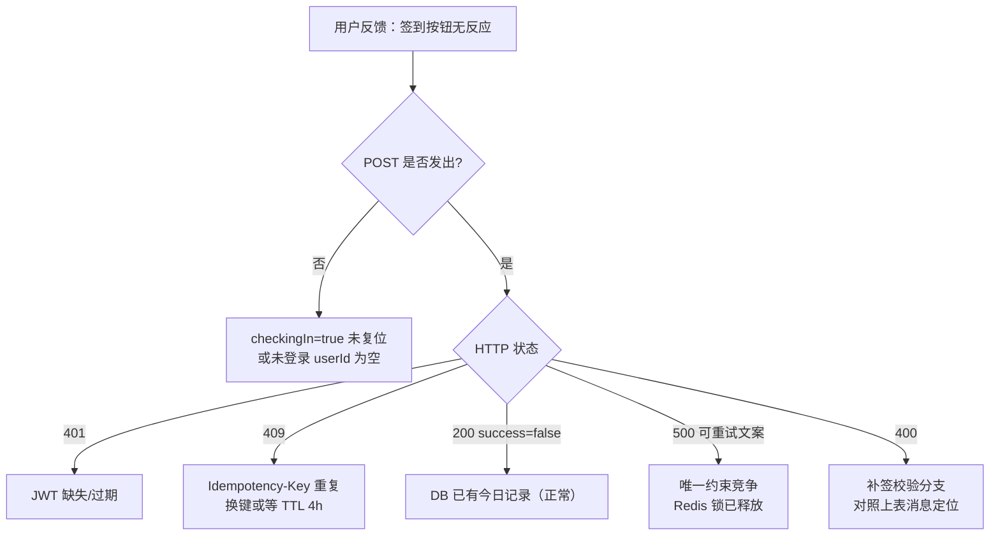

[此图为排障决策的概念流程，逐项出处见上表引用的源码分支]

**章节来源**
- [RealCheckInService.java:213-259](file://apps/api/src/main/java/com/campuslove/api/growth/RealCheckInService.java#L213-L259)
- [RealCheckInService.java:381-501](file://apps/api/src/main/java/com/campuslove/api/growth/RealCheckInService.java#L381-L501)
- [RealCheckInService.java:688-743](file://apps/api/src/main/java/com/campuslove/api/growth/RealCheckInService.java#L688-L743)
- [ErrorMessages.java:291-304](file://apps/api/src/main/java/com/campuslove/api/common/ErrorMessages.java#L291-L304)
- [ErrorMessages.java:840-845](file://apps/api/src/main/java/com/campuslove/api/common/ErrorMessages.java#L840-L845)
- [Idempotent.java:15-44](file://apps/api/src/main/java/com/campuslove/api/common/Idempotent.java#L15-L44)
- [CheckInControllerTest.java:109-121](file://apps/api/src/test/java/com/campuslove/api/growth/CheckInControllerTest.java#L109-L121)
- [MessageProducer.java:168-194](file://apps/api/src/main/java/com/campuslove/api/mq/MessageProducer.java#L168-L194)
- [CheckInEventConsumer.java:80-102](file://apps/api/src/main/java/com/campuslove/api/mq/CheckInEventConsumer.java#L80-L102)
- [checkin.ts:364-370](file://apps/client/src/stores/checkin.ts#L364-L370)
- [checkin.ts:493-499](file://apps/client/src/stores/checkin.ts#L493-L499)
- [checkin.ts:540-557](file://apps/client/src/stores/checkin.ts#L540-L557)
- [index.vue:95-99](file://apps/client/src/subpackages/tools/daily-question/index.vue#L95-L99)

## 能力缺口登记
官方生成指令要求覆盖的若干能力在本仓库中**没有实现或没有接入证据**。以下逐条登记，并注明取证方式，避免把设计意图当作既有能力。

1. **主动签到提醒（定时推送/订阅消息）：无。** 全仓 `src/main/java` 中 `@Scheduled` 仅出现在 12 个文件（VIP 订单、实名审核、媒体清理、`MessageProducer.compensatePendingEvents`、`HotScoreScheduler`、`AutoRenewService`、`JwtTokenProvider`、限流桶、临时会话清理等），无一按日触发签到提醒；`growth` 包内的 `WeChatPushService.java` 对 `checkin` / `check-in` / `签到` 三个关键词零匹配。现有「通知」只在**用户签到之后**由 MQ 消费者发出，属于事后回执而非提醒。
2. **签到记录查询 HTTP 端点：无。** `CheckInController` 只有 3 个映射；`check_ins` 的历史读取路径只有两条——管理后台 `GET /api/v1/admin/business/coins`（`searchForAdmin` 分页）与服务内部方法。客户端可调用 URL 集合实测为 `/check-in/status`、`/check-in`、`/check-in/make-up` 三个，无 history/records 路由。
3. **连续天数统计与月度日历对外暴露：无。** `getStreakDays(Long)` 与 `getMonthlyCalendar(Long, YearMonth)` 是 `RealCheckInService` 的 public 方法，但**不在 `CheckInService` 接口中**；`src/main/java` 与 `src/test/java` 全量检索均无调用方，两者也无对应控制器，因此当前是「已实现但未接入」的死代码。前端 `checkin` store 亦无日历字段。
4. **里程碑奖励的实际发放：无。** `checkAndPushRewardNotification` 命中 `app.checkin.reward-milestones` 后只调用 `convertAndSendToUser` 与 `persistNotification`，不含任何 `walletService` 调用；消息里的「已获得额外奖励」文案没有对应的入账动作。
5. **`reward-milestones` 配置项：未在配置文件中出现。** `apps/api/src/main/resources` 检索 `reward-milestones` 零匹配，运行时取 `@Value` 默认串 `7,14,30,60,100,365`；同时 `application.yml` 的 `app.checkin` 只声明 `extra-quota-per-check-in` 与 `reward-cents-per-check-in` 两项。
6. **批量数据处理/重算作业：无。** 未见对 `check_ins` 的批量 `UPDATE`/回填脚本或调度任务；Flyway 中涉及 `check_ins` 的写操作只有 `ADD COLUMN source`、`ADD INDEX` 与演示种子插入。「批量」当前仅体现为读取侧分页（`AdminCoinController` 的 `Pageable`，`pageSize` 上限 100）与一次 JPQL 取全量日期后内存判定。
7. **Mock 与 Real 语义不等价。** `MockCheckInService.makeUp` 未校验「目标日期是否已签到」（real 有 `CHECKIN_ALREADY_DONE` 分支），配额与连签全部存于 `ConcurrentHashMap`（进程重启即丢），且把 `consecutiveDays` 简单 +1，不重算连续段；`MAKE_UP_LIMIT`/`MAKE_UP_COST_POINTS`/`MAKE_UP_MAX_DAYS_BACK` 在 mock 侧以私有常量重复定义而非读配置。real 侧的 `CheckInConfig` 与 `MakeUpQuota` 常量在 mock 侧均未被引用（除 `extraQuotaPerCheckIn`、`rewardCentsPerCheckIn`）。
8. **补签后的客户端状态刷新缺口。** `makeUpCheckIn` 成功后只写 `consecutiveDays/makeUpUsedCount/makeUpLimit` 三个本地字段，既未调用 `fetchStatus()`，也未清除 `checkin:status` 的 30s TTL 缓存标记，因此 30 秒内 `fetchStatus` 会因缓存新鲜而跳过请求，`extraRecommendations`、`pointsBalance` 与后端实际值可能不同步。
9. **OpenAPI 契约滞后于实现。** `check-in.yaml` 的 `CheckInView` 无 `points` 属性、`CheckInStatusView` 无 `points` 属性，而 Java 记录均已返回该字段；契约的 `required` 列表也未包含它。文档层面「points 是可选」这一客户端假设来自此漂移。
10. **服务端测试覆盖仅到控制器委托。** `apps/api/src/test/java/com/campuslove/api/growth/` 下签到相关只有 `CheckInControllerTest.java`（5 个用例：三端点委托 + 未认证传播 + 构造函数），断言停留在「原样返回 service 结果」；`RealCheckInService` 与 `MockCheckInService` 无对应测试类，重复签到、Redis 降级、配额原子递增、里程碑判定等关键分支缺少自动化验证证据。
11. **签到域种子数据的日期偏移可疑。** `V2026.08.07.0025__seed_activities_checkin_wallet.sql` 第 44-46 行的派生表首列为 `days_ago`，第二行却写成 `SELECT 100000, 6`（其余行为 `2, 5`…`6, 1`），按列序会把 `days_ago` 置为 100000、`consecutive` 置为 6，`DATE_SUB(CURDATE(), INTERVAL 100000 DAY)` 将落到远早于常识的日期；该脚本的 `WHERE NOT EXISTS` 只按 `(user_id, check_in_date)` 去重，无法暴露这一偏移。属于已观察到的数据缺陷，非推测。
12. **异常恢复没有面向用户的自动补偿。** 签到失败只返回「签到失败，请稍后重试」，无重试队列、无自动补记；钱包与通知侧才有补偿（钱包靠 `order_id` 幂等、MQ 靠 `outbox_event` 30 秒补偿重投，超过 `OUTBOX_MAX_RETRY` 置 `FAILED` 供人工介入）。

**章节来源**
- [CheckInController.java:35-85](file://apps/api/src/main/java/com/campuslove/api/growth/CheckInController.java#L35-L85)
- [RealCheckInService.java:540-600](file://apps/api/src/main/java/com/campuslove/api/growth/RealCheckInService.java#L540-L600)
- [CheckInService.java:9-42](file://apps/api/src/main/java/com/campuslove/api/growth/CheckInService.java#L9-L42)
- [MockCheckInService.java:136-194](file://apps/api/src/main/java/com/campuslove/api/growth/MockCheckInService.java#L136-L194)
- [CheckInEventConsumer.java:143-186](file://apps/api/src/main/java/com/campuslove/api/mq/CheckInEventConsumer.java#L143-L186)
- [application.yml:329-332](file://apps/api/src/main/resources/application.yml#L329-L332)
- [AdminCoinController.java:51-100](file://apps/api/src/main/java/com/campuslove/api/admin/AdminCoinController.java#L51-L100)
- [MessageProducer.java:239-259](file://apps/api/src/main/java/com/campuslove/api/mq/MessageProducer.java#L239-L259)
- [checkin.ts:515-538](file://apps/client/src/stores/checkin.ts#L515-L538)
- [api.ts:661-678](file://apps/client/src/services/api.ts#L661-L678)
- [check-in.yaml:115-175](file://docs/openapi/check-in.yaml#L115-L175)
- [CheckInControllerTest.java:23-128](file://apps/api/src/test/java/com/campuslove/api/growth/CheckInControllerTest.java#L23-L128)
- [V2026.08.07.0025__seed_activities_checkin_wallet.sql:41-48](file://database/flyway/sql/V2026.08.07.0025__seed_activities_checkin_wallet.sql#L41-L48)

## 结论
每日签到系统的实现收敛在「3 个端点 + 1 个服务接口 + 双 Profile 实现 + 3 张表」这一小组件上，复杂度集中在两处：**重复签到的防御纵深**与**连续天数的按需重算**。

设计上的三个稳定取向值得沿用：

- **幂等最终交给数据库**。Redis 日限锁、`@Idempotent` 拦截器、服务层预查都是性能与多实例优化，`uk_checkin_user_date` 与 `CHECKIN-{uid}-{yyyyMMdd}` 订单号才是不变量的保证者；因此 Redis 关闭、MQ 不可用、钱包异常都不会让签到退化，只会让附属通道降级。
- **附属收益写入采用差异化的失败语义**。签到记录失败即整单失败并主动释放 Redis 锁以放行重试；权益、钱包、通知失败只 warn，因为它们的重复代价高于缺失代价，且各自有幂等或补偿手段（`order_id` 唯一、`outbox_event` 30 秒补偿重投）。
- **聚合口径优先批量查询**。FIN-00025/00026 把三处逐日查询和一处全表统计压成单次 JPQL/聚合，管理端则用带可选条件与校区隔离的 `searchForAdmin` 分页读取 `check_ins`。

需要正视的边界：`getStreakDays`/`getMonthlyCalendar` 未被任何调用方接入、里程碑奖励只发通知不入账、无主动签到提醒、Mock 与 Real 的补签校验不等价、OpenAPI 尚未声明 `points`，以及签到域种子脚本的 `days_ago` 列偏移——这些已在「能力缺口登记」逐条取证，扩展该模块时应先消解这些不一致，再增加新端点。

**章节来源**
- [RealCheckInService.java:194-319](file://apps/api/src/main/java/com/campuslove/api/growth/RealCheckInService.java#L194-L319)
- [RealCheckInService.java:745-818](file://apps/api/src/main/java/com/campuslove/api/growth/RealCheckInService.java#L745-L818)
- [CheckIn.java:32-48](file://apps/api/src/main/java/com/campuslove/api/entity/CheckIn.java#L32-L48)
- [MakeUpQuotaRepository.java:27-42](file://apps/api/src/main/java/com/campuslove/api/repository/MakeUpQuotaRepository.java#L27-L42)
- [MessageProducer.java:157-194](file://apps/api/src/main/java/com/campuslove/api/mq/MessageProducer.java#L157-L194)

