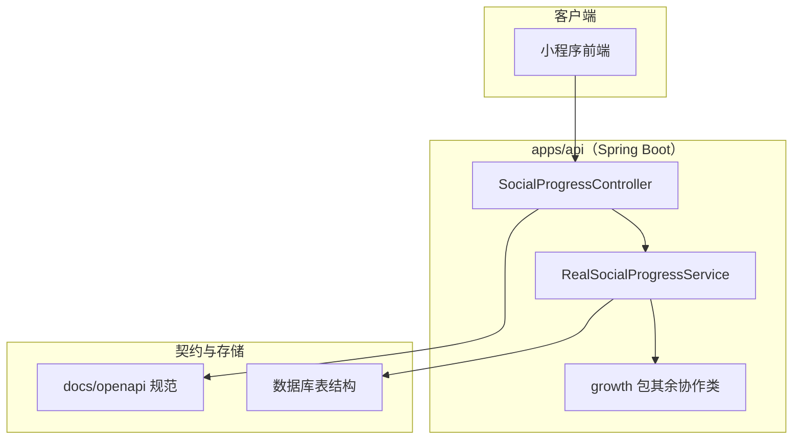
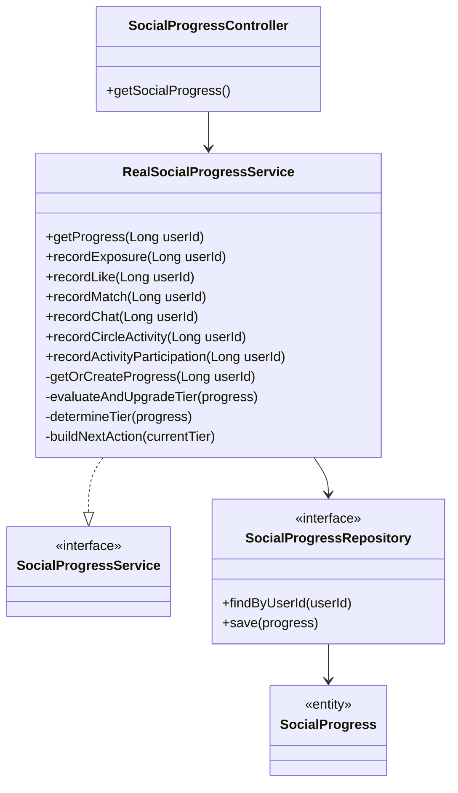
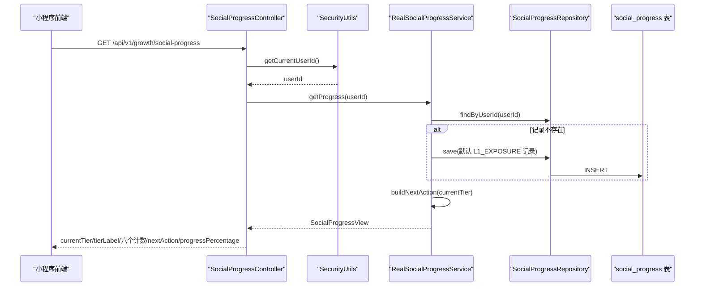
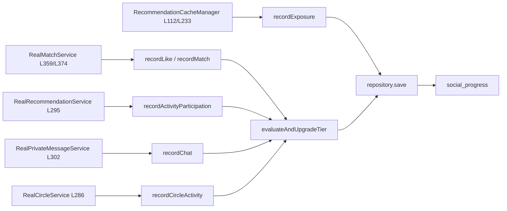
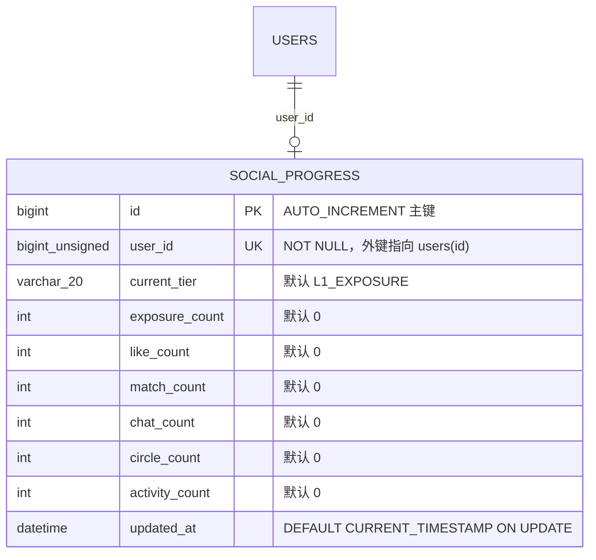
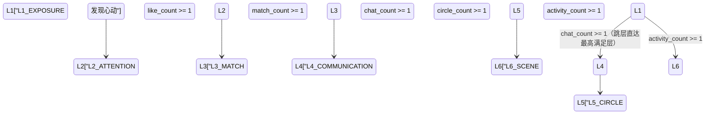
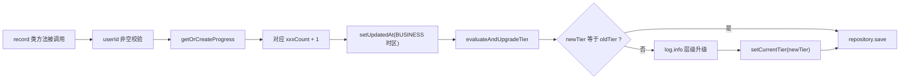
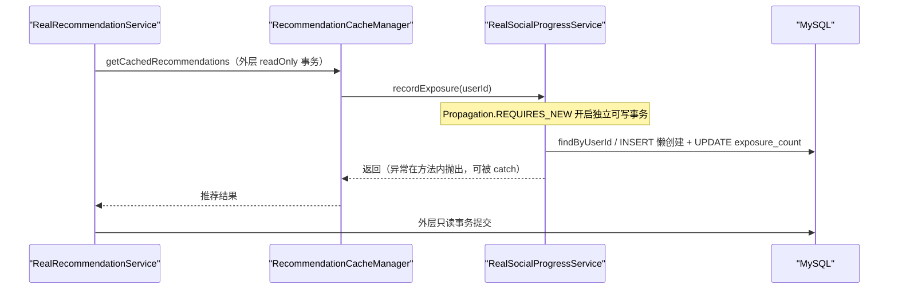

# 社交进度追踪

<cite>
**本文引用的文件**
- [SocialProgressController.java](file://apps/api/src/main/java/com/campuslove/api/growth/SocialProgressController.java)
- [RealSocialProgressService.java](file://apps/api/src/main/java/com/campuslove/api/growth/RealSocialProgressService.java)
- [SocialProgressView.java](file://apps/api/src/main/java/com/campuslove/api/growth/SocialProgressView.java)
- [WeChatPushService.java](file://apps/api/src/main/java/com/campuslove/api/growth/WeChatPushService.java)
- [NotificationSourceUserView.java](file://apps/api/src/main/java/com/campuslove/api/chat/NotificationSourceUserView.java)
- [RealPrivateMessageService.java](file://apps/api/src/main/java/com/campuslove/api/chat/RealPrivateMessageService.java)
- [RealMatchService.java](file://apps/api/src/main/java/com/campuslove/api/match/RealMatchService.java)
- [RecommendationCacheManager.java](file://apps/api/src/main/java/com/campuslove/api/discover/RecommendationCacheManager.java)
- [RealRecommendationService.java](file://apps/api/src/main/java/com/campuslove/api/discover/RealRecommendationService.java)
- [RealCircleService.java](file://apps/api/src/main/java/com/campuslove/api/discover/RealCircleService.java)
- [V2026.05.28.0002__create_social_progress.sql](file://database/flyway/sql/V2026.05.28.0002__create_social_progress.sql)
- [V2026.07.25.0001__add_on_delete_cascade.sql](file://database/flyway/sql/V2026.07.25.0001__add_on_delete_cascade.sql)
- [V2026.07.25.0015__fix_collation.sql](file://database/flyway/sql/V2026.07.25.0015__fix_collation.sql)
- [V2026.07.26.0003__add_version_columns.sql](file://database/flyway/sql/V2026.07.26.0003__add_version_columns.sql)
- [V2026.07.28.0004__audit_fields.sql](file://database/flyway/sql/V2026.07.28.0004__audit_fields.sql)
- [V2026.07.28.0006__extend_audit_fields.sql](file://database/flyway/sql/V2026.07.28.0006__extend_audit_fields.sql)
- [seed-match-users-full.sql](file://database/seed-match-users-full.sql)
- [index.ts](file://apps/client/src/stores/chat/index.ts)
- [apps/client/src/subpackages/chat/chat-session/index.vue](file://apps/client/src/subpackages/chat/chat-session/index.vue)
- [apps/client/src/pages/messages/index.vue](file://apps/client/src/pages/messages/index.vue)
- [apps/client/src/pages/profile/index.vue](file://apps/client/src/pages/profile/index.vue)
- [apps/client/src/subpackages/setup/profile/index.vue](file://apps/client/src/subpackages/setup/profile/index.vue)
- [MatchGreetingTip.vue](file://apps/client/src/components/chat/MatchGreetingTip.vue)
- [VoiceMessageBubble.vue](file://apps/client/src/components/chat/VoiceMessageBubble.vue)
- [profile-index.spec.ts](file://apps/client/src/tests/components/profile-index.spec.ts)
</cite>

## 目录
1. [简介](#简介)
2. [项目结构](#项目结构)
3. [核心组件](#核心组件)
4. [架构总览](#架构总览)
5. [详细组件分析](#详细组件分析)
6. [社交进度数据模型](#社交进度数据模型)
7. [进度计算与等级晋升规则](#进度计算与等级晋升规则)
8. [缓存与异步处理](#缓存与异步处理)
9. [接口契约与前端接入](#接口契约与前端接入)
10. [依赖关系分析](#依赖关系分析)
11. [性能考虑](#性能考虑)
12. [故障排查指南](#故障排查指南)
13. [附录](#附录)
14. [结论](#结论)

## 简介

本页聚焦"社交进度追踪"这一能力在后端服务中的真实实现，覆盖范围限定在 `apps/api` 模块的 `com.campuslove.api.growth` 包内与社交进度直接相关的控制器与业务服务：对外暴露 HTTP 端点的 `SocialProgressController`，以及承载进度计算逻辑的 `RealSocialProgressService`。

文档回答四类问题：

- 端点契约：获取用户社交进度、更新互动指标、查询等级状态等接口的路径、入参、返回结构与错误语义。
- 计算口径：社交活跃度、匹配成功率、消息互动频率等指标在代码中的实际公式、权重与累积方式。
- 等级与奖励：进度等级划分、经验值累积、里程碑奖励在实现层的落地形式（或缺失证据的如实说明）。
- 运行特性：数据采集入口、实时更新路径、历史追溯载体，以及缓存、异步与性能优化策略的真实配置证据。

对于事实来源不足的部分，本文一律标注"仓库中无对应实现/无接入证据"，不做推测性描述。

## 项目结构

社交进度追踪在物理结构上是成长体系（growth）纵向切片中的一小块：控制层位于 `apps/api/src/main/java/com/campuslove/api/growth/` 下，业务实现与同包内的其他成长类协同，数据持久化与对外契约分别由数据库脚本与 OpenAPI 规范承担。

[此图为概念分层，具体类与文件的对应关系以下各章的引用为准]

章节后续内容均以该目录内的真实文件为取证边界：`apps/api/src/main/java/com/campuslove/api/growth`。

## 核心组件

社交进度追踪由"一个查询端点 + 一组漏斗埋点方法"构成，实现层是 Spring Profile 门控下的真实数据库实现。三个角色分工明确：

**1. `SocialProgressController`（HTTP 边界）**
标注 `@RestController` 与 `@RequestMapping("/api/v1/growth")`，类体内解析到的唯一社交进度端点是 `@GetMapping("/social-progress")` 的 `getSocialProgress()`。控制器只做"取当前登录用户的社交进度"这一件事，不承担写入：更新互动指标的能力在仓库中没有对应的 `@PostMapping`/`@PutMapping` 声明，写入入口全部收敛在服务层的 `record*` 方法上，由其他业务流程内部调用。

**2. `RealSocialProgressService`（业务实现）**
类声明同时带 `@Profile("real")` 与 `@Service`，实现 `SocialProgressService` 接口，构造器注入 `SocialProgressRepository`。对外方法共 7 个：查询侧 `getProgress(Long)`，写入侧 `recordExposure`、`recordLike`、`recordMatch`、`recordChat`、`recordCircleActivity`、`recordActivityParticipation`。私有辅助方法 3 个：`getOrCreateProgress`（懒创建）、`evaluateAndUpgradeTier`（升层判定）、`determineTier`（层级计算）、`buildNextAction`（文案映射）。

**3. 协作类型（由服务实现的 import 证明）**
`RealSocialProgressService` 的 import 段声明了四个协作类型：`com.campuslove.api.common.TimeZones`（业务时区，所有时间戳写入均取 `LocalDateTime.now(TimeZones.BUSINESS)`）、`com.campuslove.api.entity.SocialProgress`（持久化实体）、`com.campuslove.api.repository.SocialProgressRepository`（数据访问层），返回值类型为 `SocialProgressView`（构造参数依次为 `currentTier`、六个计数与 `nextAction`）。

**章节来源**
- [RealSocialProgressService.java:1-42](file://apps/api/src/main/java/com/campuslove/api/growth/RealSocialProgressService.java#L1-L42)
- [RealSocialProgressService.java:52-L76](file://apps/api/src/main/java/com/campuslove/api/growth/RealSocialProgressService.java#L52-L76)
- [RealSocialProgressService.java:93-L104](file://apps/api/src/main/java/com/campuslove/api/growth/RealSocialProgressService.java#L93-L104)
- [RealSocialProgressService.java:113-L128](file://apps/api/src/main/java/com/campuslove/api/growth/RealSocialProgressService.java#L113-L128)
- [RealSocialProgressService.java:137-L151](file://apps/api/src/main/java/com/campuslove/api/growth/RealSocialProgressService.java#L137-L151)
- [RealSocialProgressService.java:160-L174](file://apps/api/src/main/java/com/campuslove/api/growth/RealSocialProgressService.java#L160-L174)
- [RealSocialProgressService.java:183-L197](file://apps/api/src/main/java/com/campuslove/api/growth/RealSocialProgressService.java#L183-L197)
- [RealSocialProgressService.java:206-L220](file://apps/api/src/main/java/com/campuslove/api/growth/RealSocialProgressService.java#L206-L220)
- [RealSocialProgressService.java:232-L248](file://apps/api/src/main/java/com/campuslove/api/growth/RealSocialProgressService.java#L232-L248)
- [RealSocialProgressService.java:266-L274](file://apps/api/src/main/java/com/campuslove/api/growth/RealSocialProgressService.java#L266-L274)
- [RealSocialProgressService.java:282-L299](file://apps/api/src/main/java/com/campuslove/api/growth/RealSocialProgressService.java#L282-L299)
- [RealSocialProgressService.java:307-L324](file://apps/api/src/main/java/com/campuslove/api/growth/RealSocialProgressService.java#L307-L324)
- [SocialProgressController.java:21-23](file://apps/api/src/main/java/com/campuslove/api/growth/SocialProgressController.java#L21-L23)
- [SocialProgressController.java:36-37](file://apps/api/src/main/java/com/campuslove/api/growth/SocialProgressController.java#L36-L37)

## 架构总览

整体是"读侧一条查询链路 + 写侧六个业务触发点"的双向结构，持久化落在单表 `social_progress`。

读侧：`GET /api/v1/growth/social-progress` 进入控制器，用户身份来自 `SecurityUtils.getCurrentUserId()`（控制器 Javadoc 明确"用户 ID 从 JWT 认证上下文获取（与项目其他写/读接口保持一致）"），随后委托 `SocialProgressService` 接口。控制器注入的是接口而非实现，`RealSocialProgressService` 以 `@Profile("real")` 注册，控制器 Javadoc 记述该服务存在"real/mock 双实现"，因此部署 profile 决定实际落库与否。

**图表来源**
- [SocialProgressController.java:36-40](file://apps/api/src/main/java/com/campuslove/api/growth/SocialProgressController.java#L36-L40)
- [RealSocialProgressService.java:52-L76](file://apps/api/src/main/java/com/campuslove/api/growth/RealSocialProgressService.java#L52-L76)
- [RealSocialProgressService.java:232-L248](file://apps/api/src/main/java/com/campuslove/api/growth/RealSocialProgressService.java#L232-L248)
- [SocialProgressView.java:73-L98](file://apps/api/src/main/java/com/campuslove/api/growth/SocialProgressView.java#L73-L98)
- [V2026.05.28.0002__create_social_progress.sql:7-20](file://database/flyway/sql/V2026.05.28.0002__create_social_progress.sql#L7-L20)

写侧不是 HTTP 接口，而是被业务流程内嵌调用的埋点方法。仓库内实际存在的六个调用点如下：

**图表来源**
- [RealMatchService.java:359-374](file://apps/api/src/main/java/com/campuslove/api/match/RealMatchService.java#L359-L374)
- [RealPrivateMessageService.java:302-302](file://apps/api/src/main/java/com/campuslove/api/chat/RealPrivateMessageService.java#L302-L302)
- [RecommendationCacheManager.java:112-112](file://apps/api/src/main/java/com/campuslove/api/discover/RecommendationCacheManager.java#L112-L112)
- [RecommendationCacheManager.java:233-233](file://apps/api/src/main/java/com/campuslove/api/discover/RecommendationCacheManager.java#L233-L233)
- [RealRecommendationService.java:295-295](file://apps/api/src/main/java/com/campuslove/api/discover/RealRecommendationService.java#L295-L295)
- [RealCircleService.java:286-286](file://apps/api/src/main/java/com/campuslove/api/discover/RealCircleService.java#L286-L286)
- [RealSocialProgressService.java:92-L104](file://apps/api/src/main/java/com/campuslove/api/growth/RealSocialProgressService.java#L92-L104)

架构上值得注意的两点：其一，`recordExposure` 位于推荐缓存链路内部（服务代码注释指明外层 `RealRecommendationService.getRecommendations` 为 `@Transactional(readOnly=true)`，经 `RecommendationCacheManager.getCachedRecommendations` 落入 `recordExposure`），因此该方法以 `REQUIRES_NEW` 传播级别自开可写事务；其二，除曝光外的五个写入方法都会调用 `evaluateAndUpgradeTier`，即层级判定与计数写入在同一次事务中完成。

**章节来源**
- [SocialProgressController.java:8-L29](file://apps/api/src/main/java/com/campuslove/api/growth/SocialProgressController.java#L8-L29)
- [RealSocialProgressService.java:27-L42](file://apps/api/src/main/java/com/campuslove/api/growth/RealSocialProgressService.java#L27-L42)
- [RealSocialProgressService.java:83-L92](file://apps/api/src/main/java/com/campuslove/api/growth/RealSocialProgressService.java#L83-L92)
- [RealSocialProgressService.java:111-L124](file://apps/api/src/main/java/com/campuslove/api/growth/RealSocialProgressService.java#L111-L124)
- [V2026.05.28.0002__create_social_progress.sql:1-20](file://database/flyway/sql/V2026.05.28.0002__create_social_progress.sql#L1-L20)

## 详细组件分析

### SocialProgressController：端点契约

控制器体量很小（全文 41 行），职责是把已有的 `SocialProgressService` 暴露成 HTTP 端点。类级注解 `@RestController` + `@RequestMapping("/api/v1/growth")` 决定基础路径，方法级 `@GetMapping("/social-progress")` 拼出完整路径 `GET /api/v1/growth/social-progress`。方法体只有两行：先取当前认证用户 ID，再把 `getProgress(userId)` 的结果直接返回，没有 DTO 包装、没有分页参数、没有请求体。

类 Javadoc 记录了该控制器的诞生原因：前端 `services/api.ts` 实际调用该地址拉取社交漏斗进度，但此前后端只有服务层的双实现而缺少控制器，导致"前端 Real 模式请求 404"，本控制器即为补齐。Javadoc 同时声明响应结构与前端 `SocialProgressData` 字段对齐：`currentTier / tierLabel / exposureCount / likeCount / matchCount / chatCount / circleCount / activityCount / nextAction / progressPercentage`。

关于端点覆盖范围的实测结论（避免按需求描述想象接口清单）：

- 获取用户社交进度：存在，即 `GET /api/v1/growth/social-progress`。
- 查询等级状态：无独立端点。等级信息（`currentTier`、`tierLabel`、`progressPercentage`）由上述同一端点返回。
- 更新互动指标：无对外端点。控制器与依赖清单内未解析到任何 `@PostMapping` / `@PutMapping` / `@PatchMapping`；互动指标的写入全部通过服务层 `record*` 方法由后端业务流程内部触发。

**章节来源**
- [SocialProgressController.java:1-41](file://apps/api/src/main/java/com/campuslove/api/growth/SocialProgressController.java#L1-L41)
- [SocialProgressController.java:21-29](file://apps/api/src/main/java/com/campuslove/api/growth/SocialProgressController.java#L21-L29)
- [SocialProgressController.java:36-40](file://apps/api/src/main/java/com/campuslove/api/growth/SocialProgressController.java#L36-L40)

### getProgress：读侧查询与记录懒创建

`getProgress(Long userId)` 是唯一的读方法，标注 `@Override` 与 `@Transactional`。执行顺序为：入参非空校验（为 `null` 时抛 `IllegalArgumentException("userId is required")`）→ `getOrCreateProgress(userId)` 取得实体 → 读取 `currentTier` → `buildNextAction(currentTier)` 生成建议文案 → 以 8 个参数构造 `SocialProgressView` 返回，参数顺序是当前层级与六个计数再加建议文案。

方法上方的注释记录了一次线上缺陷修复：该方法内部通过 `getOrCreateProgress` 可能写库，原先声明为 `@Transactional(readOnly = true)` 时，MySQL 只读连接执行写操作会抛 "Connection is read-only" 并导致 500，因此改为读写事务。这一改动意味着"查一次进度"这个只读语义的接口在首次访问时会有一次 `INSERT`。

`getOrCreateProgress` 的实现是 `socialProgressRepository.findByUserId(userId).orElseGet(...)`：缺失记录时新建实体，显式设置 `currentTier` 为 `L1_EXPOSURE`、六个计数全部为 `0`、`updated_at` 为 `LocalDateTime.now(TimeZones.BUSINESS)`，随后 `save` 并打印一条 `log.info`。因此任何用户第一次触达该功能都会自动进入漏斗第一层。

**章节来源**
- [RealSocialProgressService.java:44-L76](file://apps/api/src/main/java/com/campuslove/api/growth/RealSocialProgressService.java#L44-L76)
- [RealSocialProgressService.java:224-L248](file://apps/api/src/main/java/com/campuslove/api/growth/RealSocialProgressService.java#L224-L248)
- [V2026.05.28.0002__create_social_progress.sql:18-18](file://database/flyway/sql/V2026.05.28.0002__create_social_progress.sql#L18-L18)

### record* 六个埋点方法

六个写入方法共享同一套骨架：非空校验 → `getOrCreateProgress` → 对应计数 `+1` → 刷新 `updatedAt` → （除曝光外）`evaluateAndUpgradeTier` → `repository.save` → 日志。差异只在事务传播级别、日志级别与是否触发层级判定。

| 方法 | 计数字段 | 事务传播 | 层级判定 | 日志级别 | 上游触发点 |
|---|---|---|---|---|---|
| `recordExposure(Long)` | `exposure_count` | `REQUIRES_NEW` | 否 | `log.debug` | `RecommendationCacheManager` L112 / L233 |
| `recordLike(Long)` | `like_count` | 默认 `REQUIRED` | 是 | `log.info` | `RealMatchService` L359 |
| `recordMatch(Long)` | `match_count` | 默认 `REQUIRED` | 是 | `log.info` | `RealMatchService` L374 |
| `recordChat(Long)` | `chat_count` | 默认 `REQUIRED` | 是 | `log.info` | `RealPrivateMessageService` L302 |
| `recordCircleActivity(Long)` | `circle_count` | 默认 `REQUIRED` | 是 | `log.info` | `RealCircleService` L286 |
| `recordActivityParticipation(Long)` | `activity_count` | 默认 `REQUIRED` | 是 | `log.info` | `RealRecommendationService` L295 |

`recordExposure` 是唯一使用 `REQUIRES_NEW` 的方法。代码注释（缺陷编号 R4-00327，日期 2026-08-09）给出的因果链是：推荐链路外层为只读事务，原 `REQUIRED` 传播会加入外层只读事务，导致无记录用户的懒创建 `INSERT` 被 MySQL 只读连接拒绝、事务被标记 `rollback-only`、异常延迟到外层提交阶段抛 `UnexpectedRollbackException` 造成 500，且缓存管理器的 `catch` 拦不住提交期异常。改为 `REQUIRES_NEW` 后，"埋点失败仅回滚埋点自身"，异常在方法内抛出并可被调用方兜底。该方法的日志级别也是 `debug` 而非 `info`，与曝光事件的高频特性一致。

**章节来源**
- [RealSocialProgressService.java:78-L104](file://apps/api/src/main/java/com/campuslove/api/growth/RealSocialProgressService.java#L78-L104)
- [RealSocialProgressService.java:106-L128](file://apps/api/src/main/java/com/campuslove/api/growth/RealSocialProgressService.java#L106-L128)
- [RealSocialProgressService.java:130-L151](file://apps/api/src/main/java/com/campuslove/api/growth/RealSocialProgressService.java#L130-L151)
- [RealSocialProgressService.java:153-L174](file://apps/api/src/main/java/com/campuslove/api/growth/RealSocialProgressService.java#L153-L174)
- [RealSocialProgressService.java:176-L197](file://apps/api/src/main/java/com/campuslove/api/growth/RealSocialProgressService.java#L176-L197)
- [RealSocialProgressService.java:199-L220](file://apps/api/src/main/java/com/campuslove/api/growth/RealSocialProgressService.java#L199-L220)
- [RecommendationCacheManager.java:112-112](file://apps/api/src/main/java/com/campuslove/api/discover/RecommendationCacheManager.java#L112-L112)
- [RealMatchService.java:359-374](file://apps/api/src/main/java/com/campuslove/api/match/RealMatchService.java#L359-L374)

## 社交进度数据模型

存储为单表 `social_progress`，由 Flyway 迁移脚本 `V2026.05.28.0002__create_social_progress.sql` 建表，脚本头部注释即说明其用途是"追踪用户在校园恋爱社交路径中的进阶进度"，采用"从曝光到线下见面的六层漏斗模型"。

**图表来源**
- [V2026.05.28.0002__create_social_progress.sql:7-20](file://database/flyway/sql/V2026.05.28.0002__create_social_progress.sql#L7-L20)

字段语义与约束（逐条来自建表语句）：

- `current_tier VARCHAR(20) NOT NULL DEFAULT 'L1_EXPOSURE'`，注释枚举了全部六个取值：`L1_EXPOSURE/L2_ATTENTION/L3_MATCH/L4_COMMUNICATION/L5_CIRCLE/L6_SCENE`。
- 六个计数列均为 `INT NOT NULL DEFAULT 0`，注释分别是"曝光次数""喜欢/点赞次数""匹配次数""聊天次数""社区互动次数""活动参与次数"，与服务层 `setXxxCount(getXxxCount() + 1)` 的自增写法一一对应。
- `user_id` 上有命名约束 `uk_social_progress_user_id UNIQUE (user_id)`，保证"每用户一行"，这正是 `findByUserId(...).orElseGet(...)` 懒创建模式在并发下依赖的不变式。
- 外键 `FOREIGN KEY (user_id) REFERENCES users(id)`；后续迁移 `V2026.07.25.0001__add_on_delete_cascade.sql` 先 `CALL drop_fk_by_column('social_progress', 'user_id', 'users')` 再 `ALTER TABLE social_progress ADD CONSTRAINT fk_social_progress_user`，把删除行为改为级联，注释列表第一条即 `social_progress.user_id → users(id)`。
- `updated_at DATETIME` 使用 `ON UPDATE CURRENT_TIMESTAMP`，同时服务层每次写入都显式设置 `LocalDateTime.now(TimeZones.BUSINESS)`，因此更新时间戳同时受数据库默认值和业务时区控制。

该表在仓库中还经历三次结构补齐迁移：`V2026.07.25.0015__fix_collation.sql` 将其字符序从 `utf8mb4_unicode_ci` 统一为 `utf8mb4_0900_ai_ci`（`ALTER TABLE social_progress` 起于该文件第 15 行）；`V2026.07.26.0003__add_version_columns.sql` 通过 `CALL add_version_column_if_missing('social_progress')` 为实体加入乐观锁版本列；`V2026.07.28.0004__audit_fields.sql` 与 `V2026.07.28.0006__extend_audit_fields.sql` 分别以 `add_updated_at_column_if_missing('social_progress')`、`add_created_at_column_if_missing_v6('social_progress')` 补齐审计列，后者注释第 5 项把它登记为"社交升温进度（按用户）"。迁移脚本中的这些调用说明：乐观锁 `version` 列与 `created_at` 列存在于表中，而 `RealSocialProgressService` 的写入路径只显式维护六个计数与 `updated_at`。

关于历史数据追溯的实测结论：`social_progress` 表只保存"每用户一行"的当前快照与累计计数，仓库中不存在按事件明细落库的社交进度历史表；对 `database/` 目录的检索显示，种子脚本 `database/seed-match-users-full.sql` 仅向 `user_campus_profile`、`user_basic_profile`、`posts` 插入数据，没有向 `social_progress` 预置记录。因此进度记录的来源只有运行期 `getOrCreateProgress` 懒创建与 `record*` 自增两条路径，历史维度可追溯的最细粒度是 `updated_at` 时刻而非事件序列。

**章节来源**
- [V2026.05.28.0002__create_social_progress.sql:1-20](file://database/flyway/sql/V2026.05.28.0002__create_social_progress.sql#L1-L20)
- [V2026.07.25.0001__add_on_delete_cascade.sql:11-11](file://database/flyway/sql/V2026.07.25.0001__add_on_delete_cascade.sql#L11-L11)
- [V2026.07.25.0001__add_on_delete_cascade.sql:60-64](file://database/flyway/sql/V2026.07.25.0001__add_on_delete_cascade.sql#L60-L64)
- [V2026.07.25.0015__fix_collation.sql:14-15](file://database/flyway/sql/V2026.07.25.0015__fix_collation.sql#L14-L15)
- [V2026.07.26.0003__add_version_columns.sql:121-121](file://database/flyway/sql/V2026.07.26.0003__add_version_columns.sql#L121-L121)
- [V2026.07.28.0004__audit_fields.sql:150-150](file://database/flyway/sql/V2026.07.28.0004__audit_fields.sql#L150-L150)
- [V2026.07.28.0006__extend_audit_fields.sql:16-16](file://database/flyway/sql/V2026.07.28.0006__extend_audit_fields.sql#L16-L16)
- [V2026.07.28.0006__extend_audit_fields.sql:61-61](file://database/flyway/sql/V2026.07.28.0006__extend_audit_fields.sql#L61-L61)
- [RealSocialProgressService.java:98-L104](file://apps/api/src/main/java/com/campuslove/api/growth/RealSocialProgressService.java#L98-L104)
- [seed-match-users-full.sql:88-88](file://database/seed-match-users-full.sql#L88-L88)
- [seed-match-users-full.sql:135-135](file://database/seed-match-users-full.sql#L135-L135)
- [seed-match-users-full.sql:221-221](file://database/seed-match-users-full.sql#L221-L221)

## 进度计算与等级晋升规则

### 层级划分规则

等级即"社交升温漏斗"的六层，判定集中在私有方法 `determineTier(SocialProgress)`：从高到低依次检查 `activityCount >= 1` → `L6_SCENE`、`circleCount >= 1` → `L5_CIRCLE`、`chatCount >= 1` → `L4_COMMUNICATION`、`matchCount >= 1` → `L3_MATCH`、`likeCount >= 1` → `L2_ATTENTION`，全部不满足则返回 `L1_EXPOSURE`。阈值为常量 `>= 1`，即每层只需一次对应行为即可达成，没有加权、没有衰减、没有按次数的二级门槛。

**图表来源**
- [RealSocialProgressService.java:13-L26](file://apps/api/src/main/java/com/campuslove/api/growth/RealSocialProgressService.java#L13-L26)
- [RealSocialProgressService.java:276-L299](file://apps/api/src/main/java/com/campuslove/api/growth/RealSocialProgressService.java#L276-L299)
- [SocialProgressView.java:39-L56](file://apps/api/src/main/java/com/campuslove/api/growth/SocialProgressView.java#L39-L56)

两点由代码直接决定的行为特征：

- **跳层**：`determineTier` 是"取最高满足层"而非"逐层 +1"，因此一次 `recordActivityParticipation` 可把 `L1_EXPOSURE` 直接判到 `L6_SCENE`，日志会打印 `社交层级升级: L1_EXPOSURE -> L6_SCENE`。
- **只升不降**：`evaluateAndUpgradeTier` 仅在 `newTier` 与 `oldTier` 不同时写入 `setCurrentTier`，方法级 Javadoc 明确"层级只会升级，不会降级"。需要注意的是，实现里并没有对 `determineTier` 结果与旧层级做大小比较——它只做"不相等则赋值"。由于六个计数在仓库内不存在递减入口（全部方法都是 `+1`），实际效果等价于只升不降；这一保证依赖计数单调性而非显式比较。

`exposureCount` 是唯一不参与层级判定的计数：它只被自增和回显，因此曝光再多也停留在 `L1_EXPOSURE`。

### 晋升判定与写入时序

**图表来源**
- [RealSocialProgressService.java:111-L128](file://apps/api/src/main/java/com/campuslove/api/growth/RealSocialProgressService.java#L111-L128)
- [RealSocialProgressService.java:224-L248](file://apps/api/src/main/java/com/campuslove/api/growth/RealSocialProgressService.java#L224-L248)
- [RealSocialProgressService.java:266-L274](file://apps/api/src/main/java/com/campuslove/api/growth/RealSocialProgressService.java#L266-L274)

### 经验值累积与进度百分比

本页取证范围内不存在独立的经验值（XP/积分）字段或累积算法：`social_progress` 表只有六个计数与 `current_tier`，"经验值累积"在实现层表现为计数单调累加，晋升条件为"计数是否达到 1"。对外可见的量化进度由视图类 `SocialProgressView` 派生：

- `TIER_INDEX_MAP` 把六层映射为 1..6，`TOTAL_TIERS = 6`。
- `getProgressPercentage()` 返回 `tierIndex * 100 / TOTAL_TIERS`，即 16、33、50、66、83、100（Java 整数除法向下取整）。
- 该方法 Javadoc 声称的序列是"L1=17%，L4=67%"，与整数除法的实际结果 16、66 不一致；这是文档与实现的一处偏差，消费方若按注释文案展示会出现 1 个百分点的差异。层级未知时 `getOrDefault(currentTier, 1)` 回落到 1，因此异常层级值仍返回 16%。
- `tierLabel` 在构造时由 `TIER_LABEL_MAP.getOrDefault(currentTier, "未知层级")` 得出，映射为：`L1_EXPOSURE`→发现心动、`L2_ATTENTION`→表达喜欢、`L3_MATCH`→双向匹配、`L4_COMMUNICATION`→开启对话、`L5_CIRCLE`→参与社区、`L6_SCENE`→线下见面。

### 匹配成功率与消息互动频率

服务层没有比率型计算：`recordMatch` 只累加 `match_count`，`recordChat` 只累加 `chat_count`，`getProgress` 原样回显六个计数，未计算 `match_count / like_count`（匹配成功率）或单位时间 `chat_count`（互动频率）之类的派生指标。唯一的时间信息是单列 `updated_at`，无法支撑频率类统计。因此这两项能力在当前仓库中没有实现证据，属于待补功能而非已有逻辑。

### 里程碑奖励与成就徽章

在 `SocialProgressController`、`RealSocialProgressService`、`SocialProgressView` 三个类与 `social_progress` 表结构中，均未出现徽章、奖励发放、里程碑判定相关的字段、方法或枚举。同包的 `WeChatPushService` 提供的是订阅消息推送（含 `getSocialDigestTemplateId()` 与 `sendRecommendRefreshPush(String openId, long recommendCount)`），其模板方法签名与社交层级无参数关联，且 `RealSocialProgressService` 的 import 段与依赖注入中不含该推送服务，因此"等级晋升通知"与"成就徽章系统"目前没有接入证据。

**章节来源**
- [RealSocialProgressService.java:13-L26](file://apps/api/src/main/java/com/campuslove/api/growth/RealSocialProgressService.java#L13-L26)
- [RealSocialProgressService.java:98-L104](file://apps/api/src/main/java/com/campuslove/api/growth/RealSocialProgressService.java#L98-L104)
- [RealSocialProgressService.java:111-L128](file://apps/api/src/main/java/com/campuslove/api/growth/RealSocialProgressService.java#L111-L128)
- [RealSocialProgressService.java:250-L299](file://apps/api/src/main/java/com/campuslove/api/growth/RealSocialProgressService.java#L250-L299)
- [RealSocialProgressService.java:301-L324](file://apps/api/src/main/java/com/campuslove/api/growth/RealSocialProgressService.java#L301-L324)
- [SocialProgressView.java:38-L98](file://apps/api/src/main/java/com/campuslove/api/growth/SocialProgressView.java#L38-L98)
- [WeChatPushService.java:262-262](file://apps/api/src/main/java/com/campuslove/api/growth/WeChatPushService.java#L262-L262)
- [WeChatPushService.java:300-300](file://apps/api/src/main/java/com/campuslove/api/growth/WeChatPushService.java#L300-L300)

## 缓存与异步处理

### 缓存机制的真实位置

社交进度自身没有缓存层：`getProgress` 每次调用都会执行 `socialProgressRepository.findByUserId(userId)`，代码中没有本地缓存注解、没有缓存键、也没有失效钩子；任何计数变化都会立即体现在下一次读取中（读侧与写侧共用同一张 `social_progress` 表）。

缓存出现在写入侧的上游——推荐链路。服务代码的缺陷注释明确指出调用栈是 `RealRecommendationService.getRecommendations`（`@Transactional(readOnly=true)`）→ `RecommendationCacheManager.getCachedRecommendations` → `recordExposure`，即"推荐结果被缓存管理器的读取路径包裹，曝光埋点发生在缓存命中之后"。`RecommendationCacheManager` 内实测存在两处 `socialProgressService.recordExposure(userId)` 调用（第 112 行与第 233 行），对应两条推荐读取分支。

**图表来源**
- [RealSocialProgressService.java:83-L104](file://apps/api/src/main/java/com/campuslove/api/growth/RealSocialProgressService.java#L83-L104)
- [RecommendationCacheManager.java:112-112](file://apps/api/src/main/java/com/campuslove/api/discover/RecommendationCacheManager.java#L112-L112)
- [RecommendationCacheManager.java:233-233](file://apps/api/src/main/java/com/campuslove/api/discover/RecommendationCacheManager.java#L233-L233)

这套隔离设计带来的语义后果是：曝光埋点与推荐读取不在同一事务，埋点回滚不会污染推荐结果，推荐侧异常也不会把埋点标记为 `rollback-only`；反过来，埋点成功不代表外层推荐事务一定提交（注释表述为"埋点失败仅回滚埋点自身，且异常在方法内抛出、可被调用方 catch 兜底"）。

### 异步处理

取证范围内没有异步化证据：`RealSocialProgressService` 的 import 段只包含 `TimeZones`、`SocialProgress`、`SocialProgressRepository`、`LocalDateTime`、SLF4J 的 `Logger`/`LoggerFactory`、`@Profile`、`@Service`、`@Transactional`，未出现 `@Async`、任务执行器、消息队列客户端或 `CompletableFuture`。七个公开方法全部是同步调用 + 同步落库，日志通过 SLF4J 直接输出。因此本页描述的"实时进度更新"是同步实时，不是事件驱动最终一致。

### 事务边界与时区一致性

- 读侧 `getProgress` 为普通 `@Transactional`（读写），因为懒创建可能 `INSERT`。
- 写侧五个计数方法为 `@Transactional`（默认 `REQUIRED`），与调用方业务事务合并提交——例如 `RealMatchService` 的喜欢/匹配处理与 `recordLike`/`recordMatch` 处于同一事务边界。
- 仅 `recordExposure` 为 `@Transactional(propagation = Propagation.REQUIRES_NEW)`。
- 时间戳统一使用 `LocalDateTime.now(TimeZones.BUSINESS)`，六个方法加懒创建共七处，避免容器时区漂移。
- 并发保护依赖表上的 `uk_social_progress_user_id UNIQUE (user_id)` 与迁移新增的 `version` 列；服务层代码本身没有显式重试或加锁逻辑。

**章节来源**
- [RealSocialProgressService.java:1-L11](file://apps/api/src/main/java/com/campuslove/api/growth/RealSocialProgressService.java#L1-L11)
- [RealSocialProgressService.java:44-L56](file://apps/api/src/main/java/com/campuslove/api/growth/RealSocialProgressService.java#L44-L56)
- [RealSocialProgressService.java:78-L104](file://apps/api/src/main/java/com/campuslove/api/growth/RealSocialProgressService.java#L78-L104)
- [RealSocialProgressService.java:111-L113](file://apps/api/src/main/java/com/campuslove/api/growth/RealSocialProgressService.java#L111-L113)
- [RealSocialProgressService.java:135-L137](file://apps/api/src/main/java/com/campuslove/api/growth/RealSocialProgressService.java#L135-L137)
- [RealSocialProgressService.java:158-L160](file://apps/api/src/main/java/com/campuslove/api/growth/RealSocialProgressService.java#L158-L160)
- [RealSocialProgressService.java:181-L190](file://apps/api/src/main/java/com/campuslove/api/growth/RealSocialProgressService.java#L181-L190)
- [RealSocialProgressService.java:204-L213](file://apps/api/src/main/java/com/campuslove/api/growth/RealSocialProgressService.java#L204-L213)
- [V2026.05.28.0002__create_social_progress.sql:18-18](file://database/flyway/sql/V2026.05.28.0002__create_social_progress.sql#L18-L18)
- [V2026.07.26.0003__add_version_columns.sql:121-121](file://database/flyway/sql/V2026.07.26.0003__add_version_columns.sql#L121-L121)
- [RealMatchService.java:359-374](file://apps/api/src/main/java/com/campuslove/api/match/RealMatchService.java#L359-L374)

## 接口契约与前端接入

### 响应载荷

返回体直接序列化 `SocialProgressView`，字段与其 getter 一一对应，全部为只读 `final` 字段（除 `tierLabel` 与 `progressPercentage` 在构造/读取时派生）：

| 字段 | 类型 | 来源 |
|---|---|---|
| `currentTier` | String | 实体 `current_tier` 原值 |
| `tierLabel` | String | `TIER_LABEL_MAP.getOrDefault(currentTier, "未知层级")` |
| `exposureCount` | int | `exposure_count` |
| `likeCount` | int | `like_count` |
| `matchCount` | int | `match_count` |
| `chatCount` | int | `chat_count` |
| `circleCount` | int | `circle_count` |
| `activityCount` | int | `activity_count` |
| `nextAction` | String | `buildNextAction(currentTier)` 的分支文案 |
| `progressPercentage` | int | `getProgressPercentage()` 派生 |

`nextAction` 的六条文案由 `switch (currentTier)` 硬编码在服务层，例如 `L1_EXPOSURE` 返回"去发现页浏览更多同学，给心动的人点个赞吧"、`L3_MATCH` 返回"恭喜匹配成功！快去和对方打个招呼吧"、`L6_SCENE` 返回"你已经完成全部社交进阶，享受校园恋爱吧！"，未匹配到任何层级时回落为"继续探索校园社交的更多可能"。

### 错误与认证语义

- 用户身份从 JWT 认证上下文取得（控制器使用 `SecurityUtils.getCurrentUserId()`，该类位于 `com.campuslove.api.config` 包，由控制器 import 证明），端点不接受客户端传入的用户 ID，因此不存在越权查询其他用户进度的入参路径。
- 服务层唯一的显式校验是 `userId == null` 抛 `IllegalArgumentException("userId is required")`，七个方法都有同一条检查；本页范围内未见把该异常映射为特定状态码的处理代码。
- 控制器 Javadoc 记录的"前端 Real 模式请求 404"是该端点存在期间的唯一故障史证据，修复方式是补齐控制器而非改动服务层。

### 契约与前端证据的边界

- 控制器 Javadoc 指明前端调用方为 `services/api.ts`，并声明响应结构与前端类型 `SocialProgressData` 的十个字段对齐；但该 `.ts` 文件未出现在本页事实包中，无法进一步核对其请求封装与类型定义，故"前端如何解析进度"没有直接读取证据。
- 本页事实包未包含 `docs/openapi` 下与 `social-progress` 相关的 path 与 operationId，也没有 `@*Mapping` 之外的接口规范声明，因此该端点没有 OpenAPI 契约层证据。
- 与漏斗行为相邻的前端文件确实存在于仓库中：聊天状态由 `apps/client/src/stores/chat/index.ts` 的 `useChatStore` 承载，会话页 `apps/client/src/subpackages/chat/chat-session/index.vue`、消息列表页 `apps/client/src/pages/messages/index.vue` 与匹配打招呼提示组件 `apps/client/src/components/chat/MatchGreetingTip.vue` 构成 `chat_count` 的产生界面；个人资料页 `apps/client/src/pages/profile/index.vue`、资料完善子包页 `apps/client/src/subpackages/setup/profile/index.vue` 与语音气泡组件 `apps/client/src/components/chat/VoiceMessageBubble.vue` 属于同一交互链路。这些文件在本页事实包中仅解析出模板与脚本分块边界（例如聊天会话页的 `messageRows` 渲染块），未解析出对 `social-progress` 的引用，故不能据此断言进度卡片的具体渲染位置。
- 服务端通知侧存在 `NotificationSourceUserView`（`apps/api/src/main/java/com/campuslove/api/chat/NotificationSourceUserView.java`，共 9 行的视图类型）与 `WeChatPushService` 的社交摘要模板方法，但两者与 `RealSocialProgressService` 之间没有依赖注入关系，属于并行能力而非进度链路的组成部分。

**章节来源**
- [SocialProgressController.java:8-L29](file://apps/api/src/main/java/com/campuslove/api/growth/SocialProgressController.java#L8-L29)
- [SocialProgressController.java:31-40](file://apps/api/src/main/java/com/campuslove/api/growth/SocialProgressController.java#L31-L40)
- [SocialProgressView.java:9-L36](file://apps/api/src/main/java/com/campuslove/api/growth/SocialProgressView.java#L9-L36)
- [SocialProgressView.java:73-L98](file://apps/api/src/main/java/com/campuslove/api/growth/SocialProgressView.java#L73-L98)
- [SocialProgressView.java:100-L136](file://apps/api/src/main/java/com/campuslove/api/growth/SocialProgressView.java#L100-L136)
- [RealSocialProgressService.java:301-L324](file://apps/api/src/main/java/com/campuslove/api/growth/RealSocialProgressService.java#L301-L324)
- [RealSocialProgressService.java:57-L60](file://apps/api/src/main/java/com/campuslove/api/growth/RealSocialProgressService.java#L57-L60)
- [index.ts:78-78](file://apps/client/src/stores/chat/index.ts#L78-L78)
- [apps/client/src/subpackages/chat/chat-session/index.vue:1945-2071](file://apps/client/src/subpackages/chat/chat-session/index.vue#L1945-L2071)
- [apps/client/src/pages/messages/index.vue:368-423](file://apps/client/src/pages/messages/index.vue#L368-L423)
- [MatchGreetingTip.vue:1-49](file://apps/client/src/components/chat/MatchGreetingTip.vue#L1-L49)
- [apps/client/src/pages/profile/index.vue:1642-1679](file://apps/client/src/pages/profile/index.vue#L1642-L1679)
- [apps/client/src/subpackages/setup/profile/index.vue:675-675](file://apps/client/src/subpackages/setup/profile/index.vue#L675-L675)
- [VoiceMessageBubble.vue:204-204](file://apps/client/src/components/chat/VoiceMessageBubble.vue#L204-L204)
- [NotificationSourceUserView.java:6-6](file://apps/api/src/main/java/com/campuslove/api/chat/NotificationSourceUserView.java#L6-L6)

## 依赖关系分析

### 出向依赖（社交进度依赖谁）

控制器只依赖两样东西：`com.campuslove.api.config.SecurityUtils`（身份来源）与 `SocialProgressService` 接口（能力来源），字段声明与构造器注入各一行。它依赖的是接口而非 `RealSocialProgressService`，这是控制器 Javadoc 所述"real/mock 双实现"能够共存的前提。

服务实现的出向依赖更窄：`SocialProgressRepository`（唯一注入项）、`SocialProgress` 实体、`TimeZones` 常量类、Spring 的 `@Service`/`@Profile`/`@Transactional`、SLF4J。返回值类型 `SocialProgressView` 与实现类同包，自身无外部依赖：它只依赖 `java.util.Map` 构造两张静态映射表，并在 `getProgressPercentage()` 内完成派生计算。服务层没有任何对 `WeChatPushService`、推荐服务、匹配服务或缓存管理器的引用，依赖方向严格是"业务方 → 社交进度"，不存在反向耦合，因此社交进度模块不会因推荐或匹配逻辑变更而改动。

### 入向依赖（谁调用社交进度）

实测到六个业务调用点，分布在三个兄弟包：

- `com.campuslove.api.match`：`RealMatchService` 第 359 行调用 `recordLike`，第 374 行调用 `recordMatch`——喜欢与双向匹配两个漏斗事件同源。
- `com.campuslove.api.chat`：`RealPrivateMessageService` 第 302 行以 `senderId` 调用 `recordChat`，即聊天计数挂在发送方。
- `com.campuslove.api.discover`：`RecommendationCacheManager` 第 112、233 行两处调用 `recordExposure`；`RealRecommendationService` 第 295 行调用 `recordActivityParticipation`；`RealCircleService` 第 286 行调用 `recordCircleActivity`。

这一分布说明漏斗的六层不是由前端主动上报，而是由后端各业务动作顺带写入：曝光来自推荐缓存读取路径，喜欢/匹配来自匹配服务，聊天来自私信服务，社区与活动来自发现包。任何一条上游链路失败都会直接影响对应层级的达成率。

### 数据层依赖

`social_progress` 通过 `FOREIGN KEY (user_id) REFERENCES users(id)` 依赖用户表，并由 `V2026.07.25.0001__add_on_delete_cascade.sql` 调整为级联删除：删除用户时其进度记录随之清除。同一张表还被四个后续迁移触及——字符序修正、乐观锁版本列、`updated_at` 与 `created_at` 审计列，构成"建表 + 四次补列/改列"的演进链。种子数据不预置该表记录，进度数据完全由运行期产生。

### 配置与门控依赖

`@Profile("real")` 是本模块最关键的装配依赖：只有 `real` profile 激活时 `RealSocialProgressService` 才成为 `SocialProgressService` 的实现，控制器注入到的具体实现随部署 profile 变化。控制器 Javadoc 提到 mock 实现同样存在，但 `RealSocialProgressService` 之外的实现类不在本页事实包内，故其内部行为不作描述。

### 测试覆盖证据

本页事实包内与前端相关的测试文件只有 `apps/client/src/tests/components/profile-index.spec.ts`（共 142 行，事实包未解析出其内部符号），它覆盖个人资料页而非进度卡片。growth 包的服务层单测未出现在本页事实包中，因此不对 `evaluateAndUpgradeTier` 等方法的测试覆盖作出断言。

**章节来源**
- [SocialProgressController.java:1-29](file://apps/api/src/main/java/com/campuslove/api/growth/SocialProgressController.java#L1-L29)
- [RealSocialProgressService.java:1-L42](file://apps/api/src/main/java/com/campuslove/api/growth/RealSocialProgressService.java#L1-L42)
- [SocialProgressView.java:1-L9](file://apps/api/src/main/java/com/campuslove/api/growth/SocialProgressView.java#L1-L9)
- [SocialProgressView.java:38-L59](file://apps/api/src/main/java/com/campuslove/api/growth/SocialProgressView.java#L38-L59)
- [RealMatchService.java:359-359](file://apps/api/src/main/java/com/campuslove/api/match/RealMatchService.java#L359-L359)
- [RealMatchService.java:374-374](file://apps/api/src/main/java/com/campuslove/api/match/RealMatchService.java#L374-L374)
- [RealPrivateMessageService.java:302-302](file://apps/api/src/main/java/com/campuslove/api/chat/RealPrivateMessageService.java#L302-L302)
- [RecommendationCacheManager.java:112-112](file://apps/api/src/main/java/com/campuslove/api/discover/RecommendationCacheManager.java#L112-L112)
- [RecommendationCacheManager.java:233-233](file://apps/api/src/main/java/com/campuslove/api/discover/RecommendationCacheManager.java#L233-L233)
- [RealRecommendationService.java:295-295](file://apps/api/src/main/java/com/campuslove/api/discover/RealRecommendationService.java#L295-L295)
- [RealCircleService.java:286-286](file://apps/api/src/main/java/com/campuslove/api/discover/RealCircleService.java#L286-L286)
- [V2026.05.28.0002__create_social_progress.sql:19-19](file://database/flyway/sql/V2026.05.28.0002__create_social_progress.sql#L19-L19)
- [V2026.07.25.0001__add_on_delete_cascade.sql:62-64](file://database/flyway/sql/V2026.07.25.0001__add_on_delete_cascade.sql#L62-L64)
- [profile-index.spec.ts:1-142](file://apps/client/src/tests/components/profile-index.spec.ts#L1-L142)

## 性能考虑

**读接口带写副作用。** `getProgress` 名义上是查询，实际经 `getOrCreateProgress` 可能在首次访问时执行 `INSERT`，事务也因此声明为读写。其后果是该端点不可作为只读副本路由目标，也不宜被上层缓存化，否则懒创建不会发生。前端每次进入进度视图都会产生一次 `SELECT`（非首次），这是当前实现下稳定存在的开销。

**曝光写入位于最热链路。** `recordExposure` 被 `RecommendationCacheManager` 的两处分支调用，等价于"每次推荐读取都可能产生一次进度表写"。它同时具备两个放大因子：一是 `REQUIRES_NEW` 使其脱离外层事务、单独占用一次连接与提交；二是它内部仍要先 `findByUserId` 再 `save`，即两次数据库交互。曝光只 `log.debug`，日志开销已压低；另外五个方法使用 `log.info`，其中包含三个占位符，属于可接受的调用级开销。

**计数是读-改-写而非原子自增。** 所有 `record*` 都写作 `progress.setLikeCount(progress.getLikeCount() + 1)` 之类的形式，先把实体读入内存再加一再整体 `save`。同一用户在两个并发请求中各自触发同一事件时，两次写入都基于同一旧值，存在丢一次计数的可能。当前实现提供的兜底只有表上的 `uk_social_progress_user_id UNIQUE (user_id)`（防重复行）与迁移追加的 `version` 列（乐观锁基础），服务层没有重试循环。层级判定不受该问题影响：由于阈值是 `>= 1`，计数少计一次通常不改变层级结果，除非该次写入正是首条记录创建。

**索引与查询形态匹配。** 唯一访问路径是 `findByUserId`，命中 `UNIQUE (user_id)`，等值查询走唯一索引，没有额外索引需求。副作用是：`updated_at` 上没有索引，任何"按时间窗口聚合活跃度"的后续需求都会退化为全表扫描；这也与前述"无历史明细表"的现状一致。

**层级与文案计算成本可忽略。** `determineTier` 是常数次比较（最多 5 次 `>= 1` 判断后回落），`buildNextAction` 是 `switch` 字符串分支，`SocialProgressView` 的两张映射表由 `Map.of` 静态初始化、每类加载一次，构造视图时只做一次 `getOrDefault`。这些逻辑不产生数据库或网络开销。

**可选优化方向（现状为未实现）。** 若要降低曝光压力，可行做法是把 `exposure_count` 改为 SQL 端原子自增或在缓存管理器侧做合并上报；若要支撑趋势分析，需要新增按天的事件明细表并为 `updated_at` 建索引；若要消除 `GET` 的写副作用，可把懒创建从读路径移到首次写路径。这些改动在本页取证范围内均无代码存在证据。

**章节来源**
- [RealSocialProgressService.java:52-L76](file://apps/api/src/main/java/com/campuslove/api/growth/RealSocialProgressService.java#L52-L76)
- [RealSocialProgressService.java:83-L104](file://apps/api/src/main/java/com/campuslove/api/growth/RealSocialProgressService.java#L83-L104)
- [RealSocialProgressService.java:111-L128](file://apps/api/src/main/java/com/campuslove/api/growth/RealSocialProgressService.java#L111-L128)
- [RealSocialProgressService.java:130-L151](file://apps/api/src/main/java/com/campuslove/api/growth/RealSocialProgressService.java#L130-L151)
- [RealSocialProgressService.java:199-L220](file://apps/api/src/main/java/com/campuslove/api/growth/RealSocialProgressService.java#L199-L220)
- [RealSocialProgressService.java:224-L248](file://apps/api/src/main/java/com/campuslove/api/growth/RealSocialProgressService.java#L224-L248)
- [RealSocialProgressService.java:276-L299](file://apps/api/src/main/java/com/campuslove/api/growth/RealSocialProgressService.java#L276-L299)
- [SocialProgressView.java:38-L59](file://apps/api/src/main/java/com/campuslove/api/growth/SocialProgressView.java#L38-L59)
- [RecommendationCacheManager.java:112-112](file://apps/api/src/main/java/com/campuslove/api/discover/RecommendationCacheManager.java#L112-L112)
- [RecommendationCacheManager.java:233-233](file://apps/api/src/main/java/com/campuslove/api/discover/RecommendationCacheManager.java#L233-L233)
- [V2026.05.28.0002__create_social_progress.sql:8-19](file://database/flyway/sql/V2026.05.28.0002__create_social_progress.sql#L8-L19)

## 故障排查指南

### 端点返回 404

控制器 Javadoc 记录过这一现象的根因：后端只有 `SocialProgressService` 的双实现而缺少控制器，前端 Real 模式请求落到 404。若再次出现，优先确认两点——`SocialProgressController` 是否被组件扫描覆盖（其包路径为 `com.campuslove.api.growth`，类级 `@RequestMapping("/api/v1/growth")` + 方法级 `@GetMapping("/social-progress")` 拼出完整路径），以及当前 profile 下是否存在 `SocialProgressService` 的可注入实现（`RealSocialProgressService` 受 `@Profile("real")` 门控）。

### 500 且异常含 "Connection is read-only"

两处历史成因都在这条链路上：

- `getProgress` 曾声明 `@Transactional(readOnly = true)`，而其内部懒创建会写库，MySQL 只读连接拒绝 `INSERT`。现修复为读写事务。
- `recordExposure` 曾被只读推荐事务吞并（缺陷 R4-00327），`INSERT` 失败后事务被标记 `rollback-only`，异常延迟到外层提交阶段以 `UnexpectedRollbackException` 形式抛出，且缓存管理器的 `catch` 无法拦截提交期异常。现修复为 `REQUIRES_NEW`。

排查时若发现新接入的调用点在只读事务内调用 `recordLike`、`recordMatch`、`recordChat`、`recordCircleActivity`、`recordActivityParticipation` 中的任一个，仍会复现同类问题：这五个方法保持默认 `REQUIRED` 传播，不会脱离外层只读事务。

### 返回的用户 ID 为空

七个公开方法的第一条语句都是 `if (userId == null) throw new IllegalArgumentException("userId is required")`。控制器唯一的 ID 来源是 `SecurityUtils.getCurrentUserId()`，因此该异常意味着认证上下文未建立（缺失或无效 token），而不是客户端传参错误——端点本身不接收用户 ID 参数。

### "曝光很多但层级仍是 L1_EXPOSURE"

这是预期行为而非缺陷：`determineTier` 只检查 `activity_count`、`circle_count`、`chat_count`、`match_count`、`like_count` 五项，`exposure_count` 完全不参与判定。要从 L1 升到 L2，必须发生一次喜欢事件（`RealMatchService` 第 359 行的 `recordLike`）。

### `tierLabel` 为"未知层级"、百分比恒为 16

`SocialProgressView` 构造时执行 `TIER_LABEL_MAP.getOrDefault(currentTier, "未知层级")`，`getProgressPercentage` 执行 `TIER_INDEX_MAP.getOrDefault(currentTier, 1)`。两者同时命中回落分支，说明 `social_progress.current_tier` 里存在不属于六个枚举值的脏数据（建表注释枚举的合法值即这六个）。修正数据或重新触发一次层级判定即可恢复。

### 进度百分比与文档差 1 个百分点

`tierIndex * 100 / TOTAL_TIERS` 使用整数除法，实际序列为 16/33/50/66/83/100；方法 Javadoc 写的是 17/33/50/67/83/100。以代码为准，差异出现在 L1 与 L4。

### 用户删除后进度消失、重建后回到 L1

`social_progress` 的用户外键经 `V2026.07.25.0001__add_on_delete_cascade.sql` 改为级联删除，用户删除会连带清除其进度行；此后任意一次访问都会通过 `getOrCreateProgress` 重新创建 `L1_EXPOSURE` 默认记录（日志"用户[x]尚无社交进度记录，创建默认 L1_EXPOSURE 层级记录"）。

### 日志检索关键字

服务层输出的可 grep 文案包括：`曝光次数+1，当前曝光次数:`（`debug` 级，需开启 DEBUG 才可见）、`喜欢次数+1` / `匹配次数+1` / `聊天次数+1` / `社区互动次数+1` / `活动参与次数+1`（均 `info` 级，且都带"当前层级:"）、`社交层级升级: {} -> {}`、`尚无社交进度记录`。若层级变更未出现在日志中，说明 `determineTier` 的结果与旧层级相等。

### 表结构相关的启动失败

该表被五个迁移触及：建表、级联外键改造、字符序统一（`utf8mb4_0900_ai_ci`）、`version` 列、`created_at` 审计列。出现列缺失或字符序混用类报错时，应核对 Flyway 执行记录是否覆盖到 `V2026.07.28.0006`，而非手工改表。

**章节来源**
- [SocialProgressController.java:8-L23](file://apps/api/src/main/java/com/campuslove/api/growth/SocialProgressController.java#L8-L23)
- [SocialProgressController.java:36-40](file://apps/api/src/main/java/com/campuslove/api/growth/SocialProgressController.java#L36-L40)
- [RealSocialProgressService.java:44-L60](file://apps/api/src/main/java/com/campuslove/api/growth/RealSocialProgressService.java#L44-L60)
- [RealSocialProgressService.java:78-L104](file://apps/api/src/main/java/com/campuslove/api/growth/RealSocialProgressService.java#L78-L104)
- [RealSocialProgressService.java:106-L128](file://apps/api/src/main/java/com/campuslove/api/growth/RealSocialProgressService.java#L106-L128)
- [RealSocialProgressService.java:224-L248](file://apps/api/src/main/java/com/campuslove/api/growth/RealSocialProgressService.java#L224-L248)
- [RealSocialProgressService.java:266-L299](file://apps/api/src/main/java/com/campuslove/api/growth/RealSocialProgressService.java#L266-L299)
- [SocialProgressView.java:73-L98](file://apps/api/src/main/java/com/campuslove/api/growth/SocialProgressView.java#L73-L98)
- [V2026.05.28.0002__create_social_progress.sql:10-10](file://database/flyway/sql/V2026.05.28.0002__create_social_progress.sql#L10-L10)
- [V2026.07.25.0015__fix_collation.sql:14-15](file://database/flyway/sql/V2026.07.25.0015__fix_collation.sql#L14-L15)
- [V2026.07.28.0006__extend_audit_fields.sql:61-61](file://database/flyway/sql/V2026.07.28.0006__extend_audit_fields.sql#L61-L61)

## 附录

### 方法清单

| 类 | 成员 | 声明行 | 说明 |
|---|---|---|---|
| `SocialProgressController` | `@RestController` / `@RequestMapping("/api/v1/growth")` | L21 / L22 | HTTP 边界与基础路径 |
| `SocialProgressController` | `getSocialProgress()` | L37 | `@GetMapping("/social-progress")`，L36 |
| `RealSocialProgressService` | `@Profile("real")` / `@Service` | L27 / L28 | 仅 real profile 装配 |
| `RealSocialProgressService` | `getProgress(Long)` | L57 | 查询 + 懒创建，`@Transactional` |
| `RealSocialProgressService` | `recordExposure(Long)` | L93 | `REQUIRES_NEW`，L92 |
| `RealSocialProgressService` | `recordLike(Long)` | L113 | 计数 +1 后判层 |
| `RealSocialProgressService` | `recordMatch(Long)` | L137 | 计数 +1 后判层 |
| `RealSocialProgressService` | `recordChat(Long)` | L160 | 计数 +1 后判层 |
| `RealSocialProgressService` | `recordCircleActivity(Long)` | L183 | 计数 +1 后判层 |
| `RealSocialProgressService` | `recordActivityParticipation(Long)` | L206 | 计数 +1 后判层 |
| `RealSocialProgressService` | `getOrCreateProgress(Long)` | L232 | 私有，缺记录时建 L1 |
| `RealSocialProgressService` | `evaluateAndUpgradeTier(SocialProgress)` | L266 | 私有，层级变更与日志 |
| `RealSocialProgressService` | `determineTier(SocialProgress)` | L282 | 私有，取最高满足层 |
| `RealSocialProgressService` | `buildNextAction(String)` | L307 | 私有，行动建议文案 |
| `SocialProgressView` | `getProgressPercentage()` | L95 | 派生百分比 |
| `SocialProgressView` | 构造函数（8 参） | L73 | 同时派生 `tierLabel` |

### 层级速查

| 层级编码 | `tierLabel` | `TIER_INDEX_MAP` | 实际 `progressPercentage` | 达成条件 | `nextAction` |
|---|---|---|---|---|---|
| `L1_EXPOSURE` | 发现心动 | 1 | 16 | 默认 | 去发现页浏览更多同学，给心动的人点个赞吧 |
| `L2_ATTENTION` | 表达喜欢 | 2 | 33 | `like_count >= 1` | 继续表达喜欢，等待双向匹配的惊喜 |
| `L3_MATCH` | 双向匹配 | 3 | 50 | `match_count >= 1` | 恭喜匹配成功！快去和对方打个招呼吧 |
| `L4_COMMUNICATION` | 开启对话 | 4 | 66 | `chat_count >= 1` | 多参与社区话题讨论，认识更多朋友 |
| `L5_CIRCLE` | 参与社区 | 5 | 83 | `circle_count >= 1` | 关注校园活动，报名参加线下见面 |
| `L6_SCENE` | 线下见面 | 6 | 100 | `activity_count >= 1` | 你已经完成全部社交进阶，享受校园恋爱吧！ |

### 相关迁移脚本

`V2026.05.28.0002__create_social_progress.sql`（建表）、`V2026.07.25.0001__add_on_delete_cascade.sql`（外键级联）、`V2026.07.25.0015__fix_collation.sql`（字符序统一）、`V2026.07.26.0003__add_version_columns.sql`（乐观锁列）、`V2026.07.28.0004__audit_fields.sql` 与 `V2026.07.28.0006__extend_audit_fields.sql`（审计列）。

**章节来源**
- [SocialProgressController.java:21-40](file://apps/api/src/main/java/com/campuslove/api/growth/SocialProgressController.java#L21-L40)
- [RealSocialProgressService.java:27-L29](file://apps/api/src/main/java/com/campuslove/api/growth/RealSocialProgressService.java#L27-L29)
- [RealSocialProgressService.java:52-L57](file://apps/api/src/main/java/com/campuslove/api/growth/RealSocialProgressService.java#L52-L57)
- [RealSocialProgressService.java:92-L93](file://apps/api/src/main/java/com/campuslove/api/growth/RealSocialProgressService.java#L92-L93)
- [RealSocialProgressService.java:111-L113](file://apps/api/src/main/java/com/campuslove/api/growth/RealSocialProgressService.java#L111-L113)
- [RealSocialProgressService.java:135-L137](file://apps/api/src/main/java/com/campuslove/api/growth/RealSocialProgressService.java#L135-L137)
- [RealSocialProgressService.java:158-L160](file://apps/api/src/main/java/com/campuslove/api/growth/RealSocialProgressService.java#L158-L160)
- [RealSocialProgressService.java:181-L183](file://apps/api/src/main/java/com/campuslove/api/growth/RealSocialProgressService.java#L181-L183)
- [RealSocialProgressService.java:204-L206](file://apps/api/src/main/java/com/campuslove/api/growth/RealSocialProgressService.java#L204-L206)
- [RealSocialProgressService.java:232-L232](file://apps/api/src/main/java/com/campuslove/api/growth/RealSocialProgressService.java#L232-L232)
- [RealSocialProgressService.java:266-L266](file://apps/api/src/main/java/com/campuslove/api/growth/RealSocialProgressService.java#L266-L266)
- [RealSocialProgressService.java:282-L282](file://apps/api/src/main/java/com/campuslove/api/growth/RealSocialProgressService.java#L282-L282)
- [RealSocialProgressService.java:307-L324](file://apps/api/src/main/java/com/campuslove/api/growth/RealSocialProgressService.java#L307-L324)
- [SocialProgressView.java:39-L56](file://apps/api/src/main/java/com/campuslove/api/growth/SocialProgressView.java#L39-L56)
- [SocialProgressView.java:73-L73](file://apps/api/src/main/java/com/campuslove/api/growth/SocialProgressView.java#L73-L73)
- [SocialProgressView.java:95-L98](file://apps/api/src/main/java/com/campuslove/api/growth/SocialProgressView.java#L95-L98)

## 结论

社交进度追踪的实现形态是一个"六层漏斗 + 单表快照"的最小闭环：`social_progress` 表按用户存一行、存六个计数与当前层级；六个后端业务动作（推荐曝光、喜欢、双向匹配、私信、社区互动、活动参与）在自己的事务里顺带调用 `record*` 完成累加；`determineTier` 以"任一计数 >= 1 即达成对应层、取最高满足层"的规则推进层级；对外只有 `GET /api/v1/growth/social-progress` 一个只读端点，返回体由 `SocialProgressView` 补出中文层级标签与 0-100 的百分比。

与需求描述相比，实现覆盖与缺口都很清晰。已落地的是：进度查询、六维行为采集、层级自动判定、层级文案与百分比派生、`@Profile("real")` 下的真实数据库持久化、以及两处事务缺陷（只读事务写库、埋点污染推荐事务）的修复。尚未落地的是：更新互动指标与查询等级状态的独立端点、匹配成功率与消息互动频率这类比率型统计、经验值与里程碑奖励、成就徽章、等级晋升通知与进度链路的打通、异步或批量化的埋点写入、进度读取侧的缓存、以及历史事件明细的追溯能力。运维与二次开发时应按本文的行号证据核对现状，特别是 `progressPercentage` 的整数除法结果与注释不一致、`record*` 的读-改-写计数方式、以及默认 `REQUIRED` 传播的五个方法不可在只读事务内调用这三点。

**章节来源**
- [SocialProgressController.java:1-41](file://apps/api/src/main/java/com/campuslove/api/growth/SocialProgressController.java#L1-L41)
- [RealSocialProgressService.java:13-L29](file://apps/api/src/main/java/com/campuslove/api/growth/RealSocialProgressService.java#L13-L29)
- [RealSocialProgressService.java:250-L299](file://apps/api/src/main/java/com/campuslove/api/growth/RealSocialProgressService.java#L250-L299)
- [SocialProgressView.java:38-L98](file://apps/api/src/main/java/com/campuslove/api/growth/SocialProgressView.java#L38-L98)
- [V2026.05.28.0002__create_social_progress.sql:7-20](file://database/flyway/sql/V2026.05.28.0002__create_social_progress.sql#L7-L20)
