# 核心业务服务

<cite>
**本文引用的文件**
- [RecommendationController.java](file://apps/api/src/main/java/com/campuslove/api/discover/RecommendationController.java)
- [RealRecommendationService.java](file://apps/api/src/main/java/com/campuslove/api/discover/RealRecommendationService.java)
- [MockRecommendationService.java](file://apps/api/src/main/java/com/campuslove/api/discover/MockRecommendationService.java)
- [RecommendationRanker.java](file://apps/api/src/main/java/com/campuslove/api/discover/RecommendationRanker.java)
- [RecommendationCacheManager.java](file://apps/api/src/main/java/com/campuslove/api/discover/RecommendationCacheManager.java)
- [RecommendQuotaService.java](file://apps/api/src/main/java/com/campuslove/api/growth/RecommendQuotaService.java)
- [UserProfileController.java](file://apps/api/src/main/java/com/campuslove/api/profile/UserProfileController.java)
- [UserProfileDTO.java](file://apps/api/src/main/java/com/campuslove/api/profile/UserProfileDTO.java)
- [FollowService.java](file://apps/api/src/main/java/com/campuslove/api/profile/FollowService.java)
- [MockProfileService.java](file://apps/api/src/main/java/com/campuslove/api/profile/MockProfileService.java)
- [UserWallet.java](file://apps/api/src/main/java/com/campuslove/api/wallet/UserWallet.java)
- [WalletService.java](file://apps/api/src/main/java/com/campuslove/api/wallet/WalletService.java)
- [WalletController.java](file://apps/api/src/main/java/com/campuslove/api/wallet/WalletController.java)
- [WalletTransactionLog.java](file://apps/api/src/main/java/com/campuslove/api/wallet/WalletTransactionLog.java)
- [RealWalletUnlockService.java](file://apps/api/src/main/java/com/campuslove/api/wallet/RealWalletUnlockService.java)
- [RecommendationService.java](file://apps/api/src/main/java/com/campuslove/api/discover/RecommendationService.java)
- [RecommendationStrategy.java](file://apps/api/src/main/java/com/campuslove/api/discover/RecommendationStrategy.java)
- [AppConfigService.java](file://apps/api/src/main/java/com/campuslove/api/growth/AppConfigService.java)
- [CheckInService.java](file://apps/api/src/main/java/com/campuslove/api/growth/CheckInService.java)
- [ProfileQueryService.java](file://apps/api/src/main/java/com/campuslove/api/profile/ProfileQueryService.java)
- [MockProfileController.java](file://apps/api/src/main/java/com/campuslove/api/profile/MockProfileController.java)
- [TaskController.java](file://apps/api/src/main/java/com/campuslove/api/tasks/TaskController.java)
- [TaskService.java](file://apps/api/src/main/java/com/campuslove/api/tasks/TaskService.java)
- [RealTaskService.java](file://apps/api/src/main/java/com/campuslove/api/tasks/RealTaskService.java)
- [FeedbackController.java](file://apps/api/src/main/java/com/campuslove/api/feedback/FeedbackController.java)
- [FeedbackService.java](file://apps/api/src/main/java/com/campuslove/api/feedback/FeedbackService.java)
- [FeedbackTicketType.java](file://apps/api/src/main/java/com/campuslove/api/feedback/FeedbackTicketType.java)
- [SubmissionStatus.java](file://apps/api/src/main/java/com/campuslove/api/feedback/SubmissionStatus.java)
- [RealFeedbackService.java](file://apps/api/src/main/java/com/campuslove/api/feedback/RealFeedbackService.java)
- [MockFeedbackService.java](file://apps/api/src/main/java/com/campuslove/api/feedback/MockFeedbackService.java)
- [RealProfileService.java](file://apps/api/src/main/java/com/campuslove/api/profile/RealProfileService.java)
- [ProfileUpdateService.java](file://apps/api/src/main/java/com/campuslove/api/profile/ProfileUpdateService.java)
- [ProfileController.java](file://apps/api/src/main/java/com/campuslove/api/profile/ProfileController.java)
- [ProfileVisitorController.java](file://apps/api/src/main/java/com/campuslove/api/profile/ProfileVisitorController.java)
- [RealSocialProgressService.java](file://apps/api/src/main/java/com/campuslove/api/growth/RealSocialProgressService.java)
- [RealCheckInService.java](file://apps/api/src/main/java/com/campuslove/api/growth/RealCheckInService.java)
- [WeChatPushService.java](file://apps/api/src/main/java/com/campuslove/api/growth/WeChatPushService.java)
- [DoNotDisturbController.java](file://apps/api/src/main/java/com/campuslove/api/growth/DoNotDisturbController.java)
- [RealDoNotDisturbService.java](file://apps/api/src/main/java/com/campuslove/api/growth/RealDoNotDisturbService.java)
- [RealPushPreferenceService.java](file://apps/api/src/main/java/com/campuslove/api/growth/RealPushPreferenceService.java)
- [RealPushSummaryService.java](file://apps/api/src/main/java/com/campuslove/api/growth/RealPushSummaryService.java)
- [AppConfigController.java](file://apps/api/src/main/java/com/campuslove/api/growth/AppConfigController.java)
- [RealConfigService.java](file://apps/api/src/main/java/com/campuslove/api/clientconfig/RealConfigService.java)
- [WalletServiceImpl.java](file://apps/api/src/main/java/com/campuslove/api/wallet/WalletServiceImpl.java)
- [WalletUnlockService.java](file://apps/api/src/main/java/com/campuslove/api/wallet/WalletUnlockService.java)
- [WalletUnlock.java](file://apps/api/src/main/java/com/campuslove/api/wallet/WalletUnlock.java)
- [UserWalletRepository.java](file://apps/api/src/main/java/com/campuslove/api/wallet/UserWalletRepository.java)
- [WalletUnlockRepository.java](file://apps/api/src/main/java/com/campuslove/api/wallet/WalletUnlockRepository.java)
- [WalletTransactionLogRepository.java](file://apps/api/src/main/java/com/campuslove/api/wallet/WalletTransactionLogRepository.java)
- [TaskClaim.java](file://apps/api/src/main/java/com/campuslove/api/entity/TaskClaim.java)
- [Post.java](file://apps/api/src/main/java/com/campuslove/api/entity/Post.java)
- [CampusCertification.java](file://apps/api/src/main/java/com/campuslove/api/entity/CampusCertification.java)
- [CampusLoveApplication.java](file://apps/api/src/main/java/com/campuslove/api/CampusLoveApplication.java)
- [AsyncConfig.java](file://apps/api/src/main/java/com/campuslove/api/config/AsyncConfig.java)
- [CacheNames.java](file://apps/api/src/main/java/com/campuslove/api/config/CacheNames.java)
- [CaffeineCacheConfig.java](file://apps/api/src/main/java/com/campuslove/api/config/CaffeineCacheConfig.java)
- [RedisConfig.java](file://apps/api/src/main/java/com/campuslove/api/config/RedisConfig.java)
- [CacheErrorHandlerConfig.java](file://apps/api/src/main/java/com/campuslove/api/config/CacheErrorHandlerConfig.java)
- [JwtTokenProvider.java](file://apps/api/src/main/java/com/campuslove/api/config/JwtTokenProvider.java)
- [VipOrderService.java](file://apps/api/src/main/java/com/campuslove/api/vip/VipOrderService.java)
- [AutoRenewService.java](file://apps/api/src/main/java/com/campuslove/api/vip/AutoRenewService.java)
- [RealRealNameCertificationService.java](file://apps/api/src/main/java/com/campuslove/api/verification/RealRealNameCertificationService.java)
- [RealNameMediaPurgeService.java](file://apps/api/src/main/java/com/campuslove/api/verification/RealNameMediaPurgeService.java)
- [CacheTest.java](file://apps/api/src/test/java/com/campuslove/api/config/CacheTest.java)
</cite>

## 目录
1. [简介](#简介)
2. [项目结构](#项目结构)
3. [核心组件](#核心组件)
4. [架构总览](#架构总览)
5. [子页索引与模块边界](#子页索引与模块边界)
6. [详细组件分析](#详细组件分析)
7. [跨服务协作与业务编排](#跨服务协作与业务编排)
8. [业务流程编排与状态流转](#业务流程编排与状态流转)
9. [异步处理、定时任务与批处理](#异步处理定时任务与批处理)
10. [数据模型](#数据模型)
11. [配置与开关](#配置与开关)
12. [业务指标与统计支持](#业务指标与统计支持)
13. [扩展点与第三方集成](#扩展点与第三方集成)
14. [依赖关系分析](#依赖关系分析)
15. [性能考虑](#性能考虑)
16. [故障排查指南](#故障排查指南)
17. [能力缺口登记](#能力缺口登记)
18. [结论](#结论)

## 简介
本页是「后端API服务 / 核心业务服务」分组的总览页，负责串联该目录下的六个业务子页，说明它们的模块边界、职责划分与整体数据流，而不重复子页的实现细节。

覆盖范围：
- 用户资料服务：`com.campuslove.api.profile` 包，基本资料/校园资料/课表资料的读写、媒体上传、关注关系与个人主页聚合。
- 发现推荐服务：`com.campuslove.api.discover` 包，`/api/v1/recommendations/**` 端点族、推荐策略编排、结果排序、缓存与话题/活动子能力。
- 成长体系服务：`com.campuslove.api.growth` 包，签到、应用配置、免打扰、推送偏好与推荐额度。
- 钱包解锁服务：`com.campuslove.api.wallet` 包，余额账户、交易流水与内容解锁。
- 任务系统服务：`com.campuslove.api.tasks` 包，任务列表与完成状态。
- 反馈收集服务：`com.campuslove.api.feedback` 包，工单类型、提交记录与状态流转。

六个子域共同构成 App 的业务主干：用户在 profile 域建立身份，在 discover 域被推荐与消费内容，在 growth 域完成每日活跃与配置，在 wallet 域完成付费解锁，tasks 与 feedback 提供活跃激励与问题回收通道。

**章节来源**
- [RecommendationController.java:36-102](file://apps/api/src/main/java/com/campuslove/api/discover/RecommendationController.java#L36-L102)
- [UserProfileController.java:33-72](file://apps/api/src/main/java/com/campuslove/api/profile/UserProfileController.java#L33-L72)
- [UserWallet.java:37-86](file://apps/api/src/main/java/com/campuslove/api/wallet/UserWallet.java#L37-L86)

## 项目结构
六个业务子域各占一个 Java 包，包内统一遵循「Controller → Service 接口 → Real/Mock 双实现 → （可选）子服务/缓存/排序器 → Repository」的纵向切分，包之间只通过服务接口横向调用。

| 包 | 职责边界 | 对外入口 | 关键协作对象 |
| --- | --- | --- | --- |
| `profile` | 身份与资料：基本资料/校园资料/课表读写、媒体上传、关注关系、他人视角主页聚合 | `UserProfileController`（`/api/v1/profile`）、`MockProfileController`（`/api/v1/profile`） | `FollowService`、`ProfileQueryService`、`UserRepository`、`UserBasicProfileRepository`、`UserCampusProfileRepository` |
| `discover` | 内容分发：`/api/v1/recommendations/**` 端点族、话题/活动子能力、推荐偏好、排序与缓存 | `RecommendationController`（`/api/v1`） | `RecommendationService`、`RecommendationCacheManager`、`RecommendationRanker`、`WalletService`、`RecommendQuotaService` |
| `growth` | 活跃与配置：签到/补签、客户端配置与功能开关、免打扰、推送偏好、每日推荐配额 | `CheckInController`、`AppConfigController`、`DoNotDisturbController` | `CheckInService`、`AppConfigService`、`RecommendQuotaService`、`RedisTemplate` |
| `wallet` | 资金账本：余额账户、交易流水、内容解锁扣费 | `WalletController`（`/api/v1/wallet`） | `WalletService`、`WalletUnlockService`、`UserWalletRepository`、`WalletTransactionLogRepository` |
| `tasks` | 活跃激励：任务定义、完成度聚合、奖励领取 | `TaskController`（`/api/v1/tasks`） | `TaskService`、`TaskClaimRepository`、`WalletService`、`ProfileQueryService` |
| `feedback` | 问题回收：三类工单提交、我的提交、管理端回复与提案转化、图片附件 | `FeedbackController` | `FeedbackService`、`AppConfigService`（开关校验） |

Real/Mock 双实现是全分组的统一约定：`Real*` 实现标注 `@Profile("real")`（如 `RealTaskService`），Mock 实现服务于前端联调与演示数据（如 `MockRecommendationService`、`MockProfileService` 提供固定结构的资料与推荐载荷）。控制器对协作者普遍使用 `@Autowired(required = false)` 可选注入，使 mock profile 下缺失依赖时能优雅降级而不是启动失败。

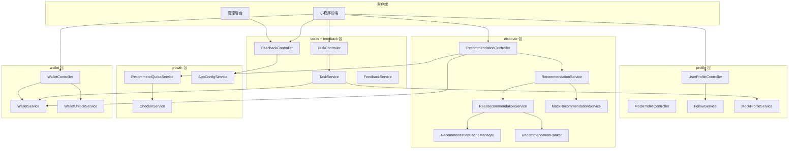

**图表来源**
- [UserProfileController.java:33-72](file://apps/api/src/main/java/com/campuslove/api/profile/UserProfileController.java#L33-L72)
- [MockProfileController.java:17-47](file://apps/api/src/main/java/com/campuslove/api/profile/MockProfileController.java#L17-L47)
- [RecommendationController.java:36-102](file://apps/api/src/main/java/com/campuslove/api/discover/RecommendationController.java#L36-L102)
- [RealRecommendationService.java:46-118](file://apps/api/src/main/java/com/campuslove/api/discover/RealRecommendationService.java#L46-L118)
- [RecommendationCacheManager.java:33-61](file://apps/api/src/main/java/com/campuslove/api/discover/RecommendationCacheManager.java#L33-L61)
- [TaskController.java:16-38](file://apps/api/src/main/java/com/campuslove/api/tasks/TaskController.java#L16-L38)
- [FeedbackController.java:26-52](file://apps/api/src/main/java/com/campuslove/api/feedback/FeedbackController.java#L26-L52)
- [RecommendQuotaService.java:35-65](file://apps/api/src/main/java/com/campuslove/api/growth/RecommendQuotaService.java#L35-L65)
- [WalletService.java:6-44](file://apps/api/src/main/java/com/campuslove/api/wallet/WalletService.java#L6-L44)

**章节来源**
- [UserProfileController.java:36-46](file://apps/api/src/main/java/com/campuslove/api/profile/UserProfileController.java#L36-L46)
- [MockProfileController.java:17-47](file://apps/api/src/main/java/com/campuslove/api/profile/MockProfileController.java#L17-L47)
- [RecommendationService.java:11-51](file://apps/api/src/main/java/com/campuslove/api/discover/RecommendationService.java#L11-L51)
- [RealRecommendationService.java:46-118](file://apps/api/src/main/java/com/campuslove/api/discover/RealRecommendationService.java#L46-L118)
- [AppConfigService.java:7-68](file://apps/api/src/main/java/com/campuslove/api/growth/AppConfigService.java#L7-L68)
- [TaskController.java:16-38](file://apps/api/src/main/java/com/campuslove/api/tasks/TaskController.java#L16-L38)
- [RealTaskService.java:26-68](file://apps/api/src/main/java/com/campuslove/api/tasks/RealTaskService.java#L26-L68)
- [FeedbackController.java:26-52](file://apps/api/src/main/java/com/campuslove/api/feedback/FeedbackController.java#L26-L52)
- [WalletService.java:6-44](file://apps/api/src/main/java/com/campuslove/api/wallet/WalletService.java#L6-L44)

## 核心组件
本节只列出跨子域复用的「骨架级」组件与其契约，具体实现细节由对应子页承担。

- 推荐编排组件：`RecommendationService` 定义 11 个契约方法（讨论推荐、活动推荐、报名、活动详情、偏好读写、人物推荐三份重载、游客推荐、推荐历史），`RealRecommendationService` 与 `MockRecommendationService` 分别以 `@Profile("real")` / `@Profile("mock")` 注册为唯一实现。
- 推荐支撑组件：`RecommendationCacheManager`（Spring Cache 读写与失效 + 耗时埋点）、`RecommendationRanker`（打分排序、悄悄话文案池、热度标签、历史构建）、`RecommendationFilter`（身高/学历/感情状态/籍贯/未来城市/关键词的内存过滤）。
- 资料组件：`UserProfileController` 直连 `UserRepository`、`UserBasicProfileRepository`、`UserCampusProfileRepository`、`LikeRepository`、`ProfileVisitorRepository`、`PostRepository` 与 `UserPreferenceCalculator`，聚合出 `UserProfileDTO`（Basic/Identity/Intro/Relationship/Media/Relation/Post/Story 八个内嵌结构）；`FollowService` 独立承担关注关系的写入与自关注/重复关注校验。
- 成长组件：`CheckInService`（签到、状态查询、补签）、`AppConfigService`（登录主视觉、客户端配置聚合、7 个功能开关与 2 个业务规则 Key）、`RecommendQuotaService`（每日推荐配额的计算与原子占用）。
- 钱包组件：`WalletService` 提供 `deduct` / `recharge` / `getBalance` / `listTransactions` 四个原语，`WalletUnlockService` 在其上实现 liked-me / visitor 两类内容解锁，`UserWallet` 为余额实体（`balanceCents`、`frozenCents`、`version` 乐观锁字段）。
- 任务组件：`TaskService` 以常量表方式内置 4 个任务编码与 4 档奖励（+5 / +50 / +20 / +100），`RealTaskService` 把签到、资料完善度、动态数、校园认证四个数据源聚合成 `TaskView` 与 `TaskProgressView`。
- 反馈组件：`FeedbackService` 定义 7 个方法（提交、我的列表、管理列表、提案转化、管理员回复、图片上传、详情查询），`SubmissionStatus` 提供 5 态工单状态枚举。

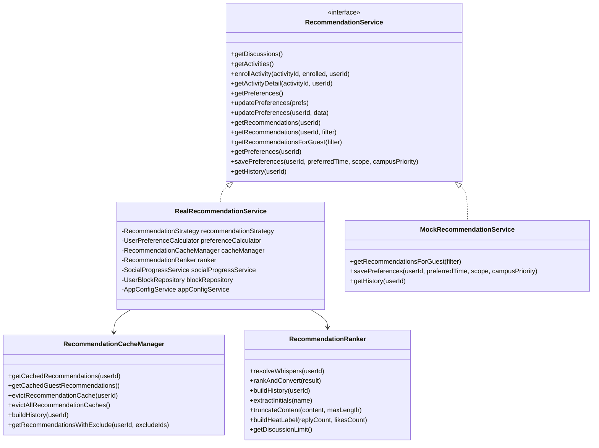

**图表来源**
- [RecommendationService.java:11-140](file://apps/api/src/main/java/com/campuslove/api/discover/RecommendationService.java#L11-L140)
- [RealRecommendationService.java:46-118](file://apps/api/src/main/java/com/campuslove/api/discover/RealRecommendationService.java#L46-L118)
- [MockRecommendationService.java:20-159](file://apps/api/src/main/java/com/campuslove/api/discover/MockRecommendationService.java#L20-L159)
- [RecommendationCacheManager.java:33-61](file://apps/api/src/main/java/com/campuslove/api/discover/RecommendationCacheManager.java#L33-L61)
- [RecommendationRanker.java:60-130](file://apps/api/src/main/java/com/campuslove/api/discover/RecommendationRanker.java#L60-L130)

**章节来源**
- [RecommendationService.java:11-140](file://apps/api/src/main/java/com/campuslove/api/discover/RecommendationService.java#L11-L140)
- [MockRecommendationService.java:111-159](file://apps/api/src/main/java/com/campuslove/api/discover/MockRecommendationService.java#L111-L159)
- [RecommendationRanker.java:757-777](file://apps/api/src/main/java/com/campuslove/api/discover/RecommendationRanker.java#L757-L777)
- [UserProfileController.java:33-72](file://apps/api/src/main/java/com/campuslove/api/profile/UserProfileController.java#L33-L72)
- [UserProfileDTO.java:8-36](file://apps/api/src/main/java/com/campuslove/api/profile/UserProfileDTO.java#L8-L36)
- [FollowService.java:36-135](file://apps/api/src/main/java/com/campuslove/api/profile/FollowService.java#L36-L135)
- [CheckInService.java:9-43](file://apps/api/src/main/java/com/campuslove/api/growth/CheckInService.java#L9-L43)
- [AppConfigService.java:9-68](file://apps/api/src/main/java/com/campuslove/api/growth/AppConfigService.java#L9-L68)
- [TaskService.java:20-127](file://apps/api/src/main/java/com/campuslove/api/tasks/TaskService.java#L20-L127)
- [FeedbackService.java:13-106](file://apps/api/src/main/java/com/campuslove/api/feedback/FeedbackService.java#L13-L106)
- [SubmissionStatus.java:3-9](file://apps/api/src/main/java/com/campuslove/api/feedback/SubmissionStatus.java#L3-L9)
- [WalletService.java:26-85](file://apps/api/src/main/java/com/campuslove/api/wallet/WalletService.java#L26-L85)
- [UserWallet.java:49-90](file://apps/api/src/main/java/com/campuslove/api/wallet/UserWallet.java#L49-L90)

## 架构总览
六个子域共用同一条请求骨架：Spring Security 过滤器把 JWT 主体放入 `SecurityContext`，控制器通过 `SecurityUtils.getCurrentUserId()` 取当前用户，鉴权注解 `@PreAuthorize("hasRole('USER')")` / `hasRole('ADMIN')` 先行拦截，随后进入按 profile 选定的服务实现，最终由 JPA Repository 落库；写类端点统一叠加 `@Idempotent`，易被刷量的端点叠加 `@RateLimit`。

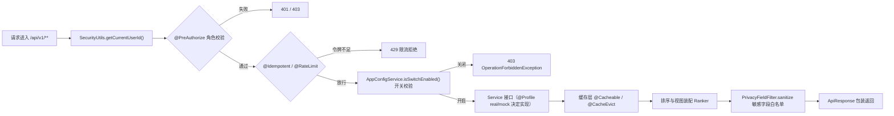

**图表来源**
- [TaskController.java:46-79](file://apps/api/src/main/java/com/campuslove/api/tasks/TaskController.java#L46-L79)
- [FeedbackController.java:43-100](file://apps/api/src/main/java/com/campuslove/api/feedback/FeedbackController.java#L43-L100)
- [RecommendationController.java:264-296](file://apps/api/src/main/java/com/campuslove/api/discover/RecommendationController.java#L264-L296)
- [RecommendationCacheManager.java:67-131](file://apps/api/src/main/java/com/campuslove/api/discover/RecommendationCacheManager.java#L67-L131)
- [AppConfigService.java:58-68](file://apps/api/src/main/java/com/campuslove/api/growth/AppConfigService.java#L58-L68)

三层职责在分组内的一致性可以概括为：

- 控制器层只做「取身份 + 校验开关 + 参数装配 + 视图裁剪」。`RecommendationController` 的 `/recommendations/people` 在拿到服务结果后依次执行 `filterOnlineOnly`、`PrivacyFieldFilter.sanitize`、`filterByDistanceMax`，把在线筛选与距离上限这类展示口径留在控制器；`getSubmissionDetail` 之类的端点则只把 `userId` 与路径参数交给服务层。
- 服务层承载业务规则与状态推进。`RealRecommendationService` 组合 `RecommendationStrategy`（算法）、`UserPreferenceCalculator`（偏好）与 `RecommendationCacheManager`（缓存），`RealTaskService` 组合四个 Repository 与 `WalletService` 完成奖励发放，`RealWalletUnlockService` 在 `WalletService.deduct` 之上写 `wallet_unlocks` 解锁记录。
- 缓存/排序/过滤器是无状态支撑件。`RecommendationCacheManager` 因为 Spring Cache 基于代理 AOP，`@Cacheable` 必须挂在独立 Bean 的方法上才生效，因此缓存读写从服务实现中剥离到该组件。

**章节来源**
- [RecommendationController.java:264-296](file://apps/api/src/main/java/com/campuslove/api/discover/RecommendationController.java#L264-L296)
- [RecommendationController.java:298-346](file://apps/api/src/main/java/com/campuslove/api/discover/RecommendationController.java#L298-L346)
- [RealRecommendationService.java:46-118](file://apps/api/src/main/java/com/campuslove/api/discover/RealRecommendationService.java#L46-L118)
- [RecommendationCacheManager.java:20-34](file://apps/api/src/main/java/com/campuslove/api/discover/RecommendationCacheManager.java#L20-L34)
- [RealWalletUnlockService.java:49-111](file://apps/api/src/main/java/com/campuslove/api/wallet/RealWalletUnlockService.java#L49-L111)
- [RealTaskService.java:117-164](file://apps/api/src/main/java/com/campuslove/api/tasks/RealTaskService.java#L117-L164)
- [FeedbackController.java:198-202](file://apps/api/src/main/java/com/campuslove/api/feedback/FeedbackController.java#L198-L202)

## 子页索引与模块边界
本页向下分发到六个子页。下表给出每个子页的归属包、入口端点族与「不归它管」的边界，避免与同级已生成页面（服务架构与配置、用户认证与安全、匹配系统、聊天与消息系统、社区圈子功能、数据访问层）重复。

| 子页 | 归属包 | 主要入口 | 边界：不负责的部分 |
| --- | --- | --- | --- |
| 用户资料服务 | `profile` | `/api/v1/profile/me`、`/api/v1/profile/{userId}`、`/api/v1/profile/stats`、`/basic`、`/campus`、`/schedule` | 认证主体如何进入 `SecurityContext`（见「用户认证与安全」）、Repository 与实体映射细节（见「数据访问层」） |
| 发现推荐服务 | `discover` | `/api/v1/recommendations/quota`、`/discussions`、`/activities`、`/preferences`、`/preferences/me`、`/people` 与 `/recommendations`、`/history`、`/{userId}/profile`、`/{userId}/whisper`、`/{userId}/whisper/unlock` | 打分算法本体（属匹配系统）、缓存基础设施配置（属服务架构与配置） |
| 成长体系服务 | `growth` | 签到/补签、客户端配置聚合、免打扰、推送偏好、`RecommendQuotaService` 配额计算 | 推荐流的消费顺序与展示裁剪（属发现推荐服务） |
| 钱包解锁服务 | `wallet` | `/api/v1/wallet/balance`、`/transactions`、`/recharge`、`/unlock`、`/deduct` | 任务奖励的达成条件（属任务系统服务）、VIP 自动续费的调度（属同级 VIP 相关页面） |
| 任务系统服务 | `tasks` | `/api/v1/tasks`、`/api/v1/tasks/{code}/claim`、`/api/v1/tasks/progress` | 余额入账的并发控制（属钱包解锁服务） |
| 反馈收集服务 | `feedback` | `POST /api/v1/feedback/issues`、`/suggestions`、`/activity-proposals`、`/images`、`GET /my-submissions`、`/my-submissions/{id}`、`GET /api/v1/admin/feedback`、`PUT /api/v1/admin/feedback/{id}/reply`、`POST /api/v1/admin/activity-proposals/{id}/convert` | 活动提案转化为活动后的活动生命周期（属发现推荐服务的活动子能力） |

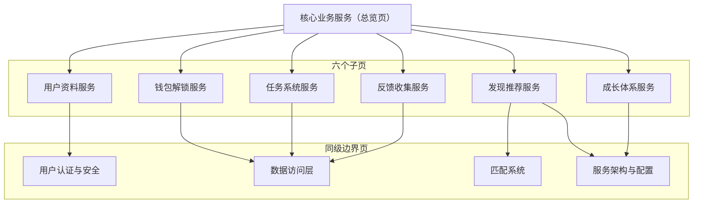

**图表来源**
- [UserProfileController.java:34-73](file://apps/api/src/main/java/com/campuslove/api/profile/UserProfileController.java#L34-L73)
- [MockProfileController.java:17-47](file://apps/api/src/main/java/com/campuslove/api/profile/MockProfileController.java#L17-L47)
- [RecommendationController.java:115-212](file://apps/api/src/main/java/com/campuslove/api/discover/RecommendationController.java#L115-L212)
- [WalletController.java:201-260](file://apps/api/src/main/java/com/campuslove/api/wallet/WalletController.java#L201-L260)
- [TaskController.java:29-79](file://apps/api/src/main/java/com/campuslove/api/tasks/TaskController.java#L29-L79)
- [FeedbackController.java:60-202](file://apps/api/src/main/java/com/campuslove/api/feedback/FeedbackController.java#L60-L202)

判定边界时可以直接落到注解：`RecommendationController` 的类级 `@RequestMapping("/api/v1")` 决定了推荐端点族的完整前缀，而 `WalletController`、`TaskController`、`UserProfileController`、`MockProfileController` 各自使用带子路径的类级映射；`FeedbackController` 是唯一不写类级 `@RequestMapping`、在方法上写全路径的控制器，且其 `/api/v1/admin/**` 端点直接返回裸对象而非 `ApiResponse` 包装，供管理后台按数组/对象消费。

**章节来源**
- [RecommendationController.java:36-102](file://apps/api/src/main/java/com/campuslove/api/discover/RecommendationController.java#L36-L102)
- [WalletController.java:67-69](file://apps/api/src/main/java/com/campuslove/api/wallet/WalletController.java#L67-L69)
- [WalletController.java:419-452](file://apps/api/src/main/java/com/campuslove/api/wallet/WalletController.java#L419-L452)
- [TaskController.java:29-79](file://apps/api/src/main/java/com/campuslove/api/tasks/TaskController.java#L29-L79)
- [FeedbackController.java:102-138](file://apps/api/src/main/java/com/campuslove/api/feedback/FeedbackController.java#L102-L138)
- [FeedbackController.java:198-202](file://apps/api/src/main/java/com/campuslove/api/feedback/FeedbackController.java#L198-L202)
- [UserProfileController.java:33-72](file://apps/api/src/main/java/com/campuslove/api/profile/UserProfileController.java#L33-L72)

## 详细组件分析
本节给出六个子域的「契约级」骨架：入口方法、关键规则、状态推进与异常语义。算法推导与字段级映射留在各自子页。

### 用户资料服务（profile）
`UserProfileController` 以 `@RequestMapping("/api/v1") + /profile` 暴露 `/me` 与 `/{userId}` 两个查询入口，返回 `UserProfileDTO`；其构造依赖是 6 个 Repository（`UserRepository`、`UserBasicProfileRepository`、`UserCampusProfileRepository`、`LikeRepository`、`ProfileVisitorRepository`、`PostRepository`）加上 `UserPreferenceCalculator`，属于「控制器直连仓储」的聚合查询形态。`UserProfileDTO` 用 8 个内嵌结构划分视角：`Basic`、`Identity`、`Intro`、`Relationship`、`Media`、`Relation`、`Post`、`Story`，同一份 DTO 同时服务自己视角与他人视角。

`MockProfileController` 在同一个 `/api/v1/profile` 前缀下提供只读演示端点 `/stats`、`/basic`、`/campus`、`/schedule`，对应 `MockProfileService` 的读写方法族：`getBasicProfile` / `saveBasicProfile`、`getCampusProfile` / `saveCampusProfile`、`getScheduleProfile` / `saveScheduleProfile`、`getProfileStats`，媒体侧含 `uploadBackground`、`uploadAvatar`、`uploadPhoto(file, index)`、`deletePhoto(index)`、`uploadVideo`、`uploadHalfBody`，关系侧含 `followUser`、`unfollowUser`、`getFollowers`（含分页重载）、`getFollowing`（含分页重载）、`isFollowing`。

`FollowService` 是资料域唯一的事务写组件：`followUser` 校验「userId 与目标 ID 必填」「不可关注自己」「重复关注」，`unfollowUser` 校验「未关注则报错」，两者均以 `@Transactional` 包裹并同时写入 `NotificationRepository`，即关注动作会派生站内通知。

### 发现推荐服务（discover）
`RecommendationController` 是分组内端点密度最高的控制器（11 个方法级映射 + 8 个视图 record），其推荐主链路 `GET {"/recommendations/people", "/recommendations"}` 按登录态分叉：游客走 `getRecommendationsForGuest(filter)`，登录用户走 `getRecommendations(userId, filter)`，两条路径都经过 `filterOnlineOnly` → `PrivacyFieldFilter.sanitize` → `filterByDistanceMax` 的顺序处理；控制器注释明确指出 `sanitize` 会在白名单之外出现敏感字段时抛 `IllegalStateException`，作为「未来有人向 record 误加敏感字段」的防线。

`RecommendationCacheManager` 用 Spring Cache 把一次计算的结果复用：登录用户命中 `CacheNames.MATCH_RECOMMEND`、key 为 `'v2:' + #userId`，TTL 由 `CacheNames` 配置决定（默认 5 分钟），从而让同一 TTL 内的多次拉取共享一次计算、只扣一次配额；游客命中 `CacheNames.GUEST_RECOMMEND`、key 为 `'guest:v1'`、TTL 60 秒，以 1 分钟的可见性窗口换取不挂 `@CacheEvict` 的简洁性；失效侧提供 `evictRecommendationCache(userId)` 与 `evictAllRecommendationCaches()`（`allEntries = true`），方法体为空实现、完全依赖注解触发；三处出口都会调用 `matchMetrics.recordRecommendLatency(durationMs)` 记录耗时。

`RecommendationRanker` 是排序与视图装配组件：持有 `RecommendationConfig`、5 个资料/圈子仓储、`HeartSignalRepository`、`LikeRepository`、`CampusCertificationService`、`UserPreferenceCalculator`、`WalletTransactionLogRepository`、`MediaAssetService` 与可选 `GeoService`；排序以 `scoredUsers.sort(Comparator.comparingInt(ScoredUser::score).reversed())` 取前 N；文案侧维护静态 `WHISPER_POOL` 与 `WHISPER_COUNT = 3`，`resolveWhispers(userId)` 据此产出悄悄话；标签侧用 `HEAT_HIGH_THRESHOLD = 100` / `HEAT_RISING_THRESHOLD = 20` 生成热度标签，并有 `truncateContent(content, maxLength)`、`extractInitials(name)`、`buildHeatLabel(replyCount, likesCount)`、`getDiscussionLimit()` 等纯函数。

`MockRecommendationService` 与 `RealRecommendationService` 实现同一 `RecommendationService` 契约，前者以 `@Profile("mock")` 注册、提供固定讨论/活动/偏好载荷与偏好读写占位，后者以真实仓储 + `RecommendationStrategy` + `UserPreferenceCalculator` 计算候选，并按需读取 `SocialProgressService`、`UserBlockRepository`、`AppConfigService`（三者均为 `@Autowired(required = false)` 可选注入）。

### 成长体系服务（growth）
`RecommendQuotaService` 是跨域配额枢纽：每日基础额度取 `RecommendationConfig.getDailyLimit()`（配置项 `app.recommendation.daily-limit`，默认 10 次），签到赠送额度取 `CheckInService.getCheckInStatus(userId).extraQuota()`，查询失败时降级为 0 而不阻断配额计算；每日计数落在 Redis key `recommend-quota:{userId}:{yyyyMMdd}`，`tryConsume` 用 `INCR` 返回值判断，首次递增设置 36 小时 TTL，超限时回滚递减以保证计数不漂移；`redisTemplate` 为可选注入，缺失或异常时切换到 `ConcurrentHashMap` 本地计数并在 `synchronized (localCount)` 临界区内判定。

`CheckInService` 契约含 `checkIn`、`getCheckInStatus`、`makeUp` 三个方法，补签规则为「仅可补签昨日及之前 7 天内」「不可补签未来或当天」「不可补签已签到日期」「每月补签次数上限默认 3 次（`MakeUpQuota.limitCount`）」「首次免费、其后每次消耗 50 积分」。

`AppConfigService` 定义 7 个功能开关 Key（`maintenance_mode`、`register_open`、`login_open`、`match_open`、`recommend_open`、`post_publish_open`、`feedback_open`）与 2 个业务规则 Key（`daily_recommend_limit`、`heart_signal_expire_hours`），`getClientConfig()` 聚合 `app_switch` / `app_rule` / `app_config` 三表，`isSwitchEnabled()` 作为后端各业务强制点，开关缺失或查询异常时默认返回 true 以保可用。

### 钱包解锁服务（wallet）
`WalletService` 提供四个原语：`deduct` 与 `recharge` 以 `orderId` 为幂等键（服务层先查后写 + 唯一索引兜底），通过 `findByUserIdForUpdate` 悲观锁锁住钱包行，扣减/充值与 `wallet_transaction_log` 流水写入在同一 `@Transactional` 内提交并记录 `balanceAfter`；`getBalance` 在钱包不存在时返回 0 且不自动创建，避免读操作产生副作用；`listTransactions` 按创建时间倒序分页。`UserWallet` 实体含 `balanceCents`、`frozenCents`、`version`（乐观锁版本）与 `createdAt` / `updatedAt` 时间戳。

`RealWalletUnlockService` 在其上实现内容解锁：单价由 `@Value("${app.unlock-price.liked-me:...}")` 与 `${app.unlock-price.visitor:...}` 注入（默认值取 `WalletUnlock.DEFAULT_UNLOCK_PRICE_CENTS`），`orderId` 采用 `UNLOCK-{type}-{userId}-{targetId}` 格式（2026-10-05 修复：原格式缺少 `userId` 会导致跨用户幂等冲突），支持类型之外抛「不支持的解锁类型」，并写入 `wallet_unlocks` 记录、以 `RELATED_TYPE_UNLOCK_LIKED_ME` / `RELATED_TYPE_UNLOCK_VISITOR` 记账；`findUnlockedTargetIds` 用于批量判断已解锁集合。`WalletController` 则把余额、流水、充值、解锁、扣减五个端点对外暴露（`/balance`、`/transactions`、`/recharge`、`/unlock`、`/deduct`）。

`WalletTransactionLog` 以常量表集中登记关联业务类型，已含 `VIP_RENEW`、`VIP_PURCHASE`、`RED_PACKET_SEND` / `CLAIM` / `REFUND`、`WALLET_RECHARGE`、`CHECKIN`、`CHECKIN_MAKEUP`、`UNLOCK_LIKED_ME`、`UNLOCK_VISITOR`、`SWEET_TALK`、`MESSAGE_UNLOCK`、`WHISPER_UNLOCK`、`WHISPER_SEND`、`TASK_REWARD`、`INVITE_REWARD`，构成分组内所有资金事件的口径来源。

悄悄话解锁是 discover 与 wallet 两个子域最直接的耦合点：

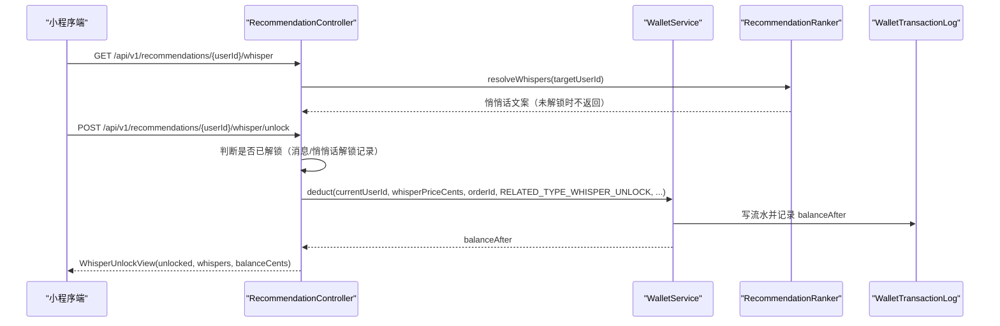

**图表来源**
- [RecommendationController.java:534-585](file://apps/api/src/main/java/com/campuslove/api/discover/RecommendationController.java#L534-L585)
- [RecommendationController.java:600-646](file://apps/api/src/main/java/com/campuslove/api/discover/RecommendationController.java#L600-L646)
- [RecommendationRanker.java:95-215](file://apps/api/src/main/java/com/campuslove/api/discover/RecommendationRanker.java#L95-L215)
- [WalletService.java:28-44](file://apps/api/src/main/java/com/campuslove/api/wallet/WalletService.java#L28-L44)
- [WalletTransactionLog.java:100-124](file://apps/api/src/main/java/com/campuslove/api/wallet/WalletTransactionLog.java#L100-L124)

### 任务系统服务（tasks）
`TaskController` 暴露三个端点：`GET /api/v1/tasks`（任务列表）、`POST /api/v1/tasks/{code}/claim`（领取，带 `@Idempotent`）、`GET /api/v1/tasks/progress`（进度聚合），全部 `hasRole('USER')`。`TaskService` 以接口常量表定义任务：`daily-checkin` +5、`complete-profile` +50、`first-post` +20、`campus-verify` +100，奖励口径与前端 `pages/profile/tasks.vue` 对齐，并声明「本项目无独立积分概念，积分即交友币钱包余额（1 积分 = 1 分）」。

`RealTaskService` 的 `claim` 是四步编排：`resolveTaskDefinition` 用 `switch (taskCode)` 解析定义并在未达标时抛 `TASK_NOT_COMPLETED`、未知编码时抛带前缀的未知编码错误；随后按「每日任务以 `existsByUserIdAndTaskCodeAndClaimDate(userId, code, today)`、一次性任务以 `existsByUserIdAndTaskCode`」判定重复领取并抛 `TASK_ALREADY_CLAIMED`；再以 `saveAndFlush` 先落 `TaskClaim` 领取记录（`(user_id, task_code, claim_date)` 唯一约束兜底并发）；最后调用 `walletService.recharge(userId, rewardPoints, orderId, RELATED_TYPE_TASK_REWARD, taskCode)`，`orderId` 为 `TASK-{code}-{userId}`（每日任务追加 `-yyyyMMdd`）；入账异常会记录日志并包装为「奖励入账失败」异常，由事务回滚领取记录。读取侧 `listTasks` 用 `@Transactional(readOnly = true)`，完成度来源分别为连续签到天数（与 `RealCheckInService` 同算法的 `calculateStreakDays`）、`ProfileQueryService.calculateProfileCompletion`（0-100）、`PostRepository.countByAuthorIdAndStatus(userId, active)`、`CampusCertificationRepository` 状态是否 `APPROVED`。

### 反馈收集服务（feedback）
`FeedbackController` 的三个提交端点 `/api/v1/feedback/issues`、`/suggestions`、`/activity-proposals` 结构完全一致：`@ResponseStatus(ACCEPTED)` + `@RateLimit(capacity = 10, refillTokens = 0.1, key = "#request.remoteAddr")`（按 IP 令牌桶，10 秒补 1 个令牌）+ `@Idempotent` + `hasRole('USER')`，并在方法体首行调用 `ensureFeedbackOpen()`，当 `feedback_open` 关闭时抛 `OperationForbiddenException` 返回 403；`appConfigService` 为可选注入，mock profile 下为 null 即跳过校验。工单类型由 `FeedbackTicketType` 三值枚举决定（`FEEDBACK` / `SUGGESTION` / `ACTIVITY_PROPOSAL`），提交时由控制器指定类型、服务层复用同一 `submit` 方法。

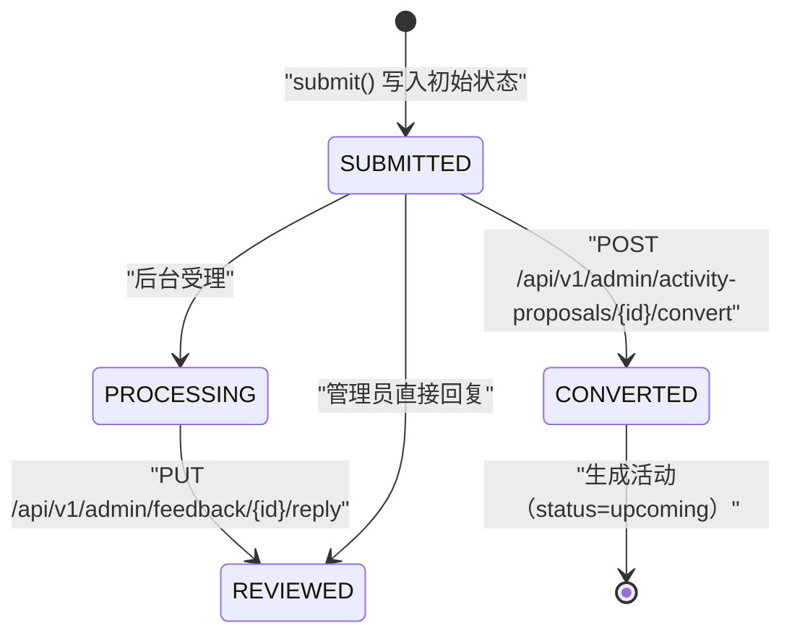

**图表来源**
- [SubmissionStatus.java:3-9](file://apps/api/src/main/java/com/campuslove/api/feedback/SubmissionStatus.java#L3-L9)
- [FeedbackTicketType.java:3-7](file://apps/api/src/main/java/com/campuslove/api/feedback/FeedbackTicketType.java#L3-L7)
- [FeedbackController.java:60-138](file://apps/api/src/main/java/com/campuslove/api/feedback/FeedbackController.java#L60-L138)
- [FeedbackService.java:29-66](file://apps/api/src/main/java/com/campuslove/api/feedback/FeedbackService.java#L29-L66)

附件与详情能力同样在契约里写明：`FEEDBACK_IMAGE_MAX_BYTES = 5MB` 作为 Real/Mock 双实现共用常量（比 `MediaStorageService` 默认 10MB 更严格），允许格式 jpg/png/webp，存储路径 `uploads/{userId}/{yyyyMM}/{uuid}.{ext}`；`getSubmissionDetail(userId, id)` 仅返回当前用户的详情（含完整 `content`、解析后的 `attachments` 数组、`latestReplyContent`），越权与不存在都以 `IllegalArgumentException` 归一为 400。`MockFeedbackService` 与 `RealFeedbackService` 分别以 `@Profile("mock")` / `@Profile("real")` 实现同一 `FeedbackService` 契约。

**章节来源**
- [UserProfileController.java:33-72](file://apps/api/src/main/java/com/campuslove/api/profile/UserProfileController.java#L33-L72)
- [UserProfileDTO.java:8-36](file://apps/api/src/main/java/com/campuslove/api/profile/UserProfileDTO.java#L8-L36)
- [MockProfileController.java:17-47](file://apps/api/src/main/java/com/campuslove/api/profile/MockProfileController.java#L17-L47)
- [MockProfileService.java:25-272](file://apps/api/src/main/java/com/campuslove/api/profile/MockProfileService.java#L25-L272)
- [FollowService.java:36-135](file://apps/api/src/main/java/com/campuslove/api/profile/FollowService.java#L36-L135)
- [RecommendationController.java:115-212](file://apps/api/src/main/java/com/campuslove/api/discover/RecommendationController.java#L115-L212)
- [RecommendationController.java:264-296](file://apps/api/src/main/java/com/campuslove/api/discover/RecommendationController.java#L264-L296)
- [RecommendationController.java:409-472](file://apps/api/src/main/java/com/campuslove/api/discover/RecommendationController.java#L409-L472)
- [RecommendationController.java:473-533](file://apps/api/src/main/java/com/campuslove/api/discover/RecommendationController.java#L473-L533)
- [RecommendationCacheManager.java:67-189](file://apps/api/src/main/java/com/campuslove/api/discover/RecommendationCacheManager.java#L67-L189)
- [RecommendationRanker.java:60-130](file://apps/api/src/main/java/com/campuslove/api/discover/RecommendationRanker.java#L60-L130)
- [RecommendationRanker.java:241-310](file://apps/api/src/main/java/com/campuslove/api/discover/RecommendationRanker.java#L241-L310)
- [RecommendationRanker.java:733-777](file://apps/api/src/main/java/com/campuslove/api/discover/RecommendationRanker.java#L733-L777)
- [RecommendationService.java:74-139](file://apps/api/src/main/java/com/campuslove/api/discover/RecommendationService.java#L74-L139)
- [MockRecommendationService.java:111-159](file://apps/api/src/main/java/com/campuslove/api/discover/MockRecommendationService.java#L111-L159)
- [RealRecommendationService.java:425-549](file://apps/api/src/main/java/com/campuslove/api/discover/RealRecommendationService.java#L425-L549)
- [RecommendQuotaService.java:16-159](file://apps/api/src/main/java/com/campuslove/api/growth/RecommendQuotaService.java#L16-L159)
- [CheckInService.java:9-43](file://apps/api/src/main/java/com/campuslove/api/growth/CheckInService.java#L9-L43)
- [AppConfigService.java:9-68](file://apps/api/src/main/java/com/campuslove/api/growth/AppConfigService.java#L9-L68)
- [WalletService.java:6-85](file://apps/api/src/main/java/com/campuslove/api/wallet/WalletService.java#L6-L85)
- [UserWallet.java:49-90](file://apps/api/src/main/java/com/campuslove/api/wallet/UserWallet.java#L49-L90)
- [RealWalletUnlockService.java:25-148](file://apps/api/src/main/java/com/campuslove/api/wallet/RealWalletUnlockService.java#L25-L148)
- [WalletController.java:201-260](file://apps/api/src/main/java/com/campuslove/api/wallet/WalletController.java#L201-L260)
- [WalletTransactionLog.java:75-124](file://apps/api/src/main/java/com/campuslove/api/wallet/WalletTransactionLog.java#L75-L124)
- [TaskService.java:20-127](file://apps/api/src/main/java/com/campuslove/api/tasks/TaskService.java#L20-L127)
- [RealTaskService.java:26-234](file://apps/api/src/main/java/com/campuslove/api/tasks/RealTaskService.java#L26-L234)
- [FeedbackService.java:13-130](file://apps/api/src/main/java/com/campuslove/api/feedback/FeedbackService.java#L13-L130)
- [FeedbackController.java:140-202](file://apps/api/src/main/java/com/campuslove/api/feedback/FeedbackController.java#L140-L202)

## 跨服务协作与业务编排
六个子域之间没有共享的服务总线，协作全部通过「显式注入 + 约定的 `orderId` 命名空间 + 常量表」完成，因而可以从代码里直接读出编排链路。

- 活跃 → 配额 → 推荐（三段式）：`RecommendQuotaService.getDailyQuota` 把 `app.recommendation.daily-limit` 与 `CheckInStatusView.extraQuota()` 相加得到当日总量，`RecommendationController.getRecommendationQuota` 以 `Map<String, Object>` 形式返回 `dailyLimit` 与 `used`，`RecommendationCacheManager.getCachedRecommendations` 的注释进一步声明「缓存 TTL 内共享一次计算、只扣一次配额，配额耗尽返回空列表」。类注释同时记录了一个跨模块协调项：配额消费接入点位于 `discover/RealRecommendationService#getRecommendations`，由 discover 侧注入 growth 侧服务调用 `tryConsume` / `getRemainingQuota`。
- 达成 → 领取 → 入账：`RealTaskService.claim` 在同一事务内先写 `task_claim` 再调 `WalletService.recharge`，异常时包装为「奖励入账失败」并依赖事务回滚领取记录；`orderId` 的命名空间 `TASK-{code}-{userId}[-yyyyMMdd]` 与解锁的 `UNLOCK-{type}-{userId}-{targetId}`、钱包充值的业务订单号互不重叠，使同一账本可以按 `orderId` 前缀回溯来源。
- 付费内容解锁：`RecommendationController` 直接注入 `WalletService` 与 `WalletTransactionLogRepository`，以 `whisperPriceCents`（`@Value` 注入，字段位于控制器 L102）作为单价，用 `RELATED_TYPE_WHISPER_UNLOCK` 记账；`RealWalletUnlockService` 则用 `RELATED_TYPE_UNLOCK_LIKED_ME` / `RELATED_TYPE_UNLOCK_VISITOR` 覆盖「喜欢我」与「访客」两类解锁，两者共用同一 `wallet_unlocks` 记录语义。
- 配置开关作为统一闸门：`FeedbackController` 在三个提交端点前调用 `ensureFeedbackOpen()`，其数据源与小程序启动期拉取的 `getClientConfig()` 完全一致（同为 `app_switch` / `app_rule` / `app_config` 三表聚合），保证「前后端同一口径」；`RealRecommendationService` 同样以可选方式持有 `AppConfigService`，在 mock profile 下依赖缺失即不生效。
- 工单 → 活动的转化：`RealFeedbackService.convertProposal` 先把已 `CONVERTED` 的提案拒绝重复转化，再生成 `status = upcoming` 的活动记录，最后把工单置为 `CONVERTED`，是 feedback 与 discover 两个子域唯一的写路径交接。

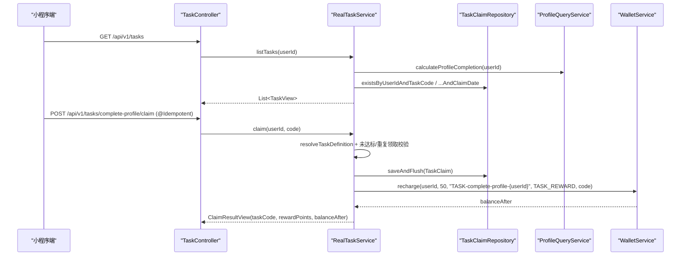

**图表来源**
- [TaskController.java:46-79](file://apps/api/src/main/java/com/campuslove/api/tasks/TaskController.java#L46-L79)
- [RealTaskService.java:70-164](file://apps/api/src/main/java/com/campuslove/api/tasks/RealTaskService.java#L70-L164)
- [WalletService.java:46-61](file://apps/api/src/main/java/com/campuslove/api/wallet/WalletService.java#L46-L61)
- [ProfileQueryService.java:488-488](file://apps/api/src/main/java/com/campuslove/api/profile/ProfileQueryService.java#L488-L488)

幂等编排在本分组内是双层的：HTTP 层由 `@Idempotent` 拦截重复请求（任务领取、三类反馈提交、解锁、充值、提案转化均带该注解），账本层由 `orderId` 唯一性兜底，因此即使前端重试或缓存穿透也不会产生第二次资金变动。

**章节来源**
- [RecommendQuotaService.java:67-96](file://apps/api/src/main/java/com/campuslove/api/growth/RecommendQuotaService.java#L67-L96)
- [RecommendationController.java:115-137](file://apps/api/src/main/java/com/campuslove/api/discover/RecommendationController.java#L115-L137)
- [RecommendationCacheManager.java:67-103](file://apps/api/src/main/java/com/campuslove/api/discover/RecommendationCacheManager.java#L67-L103)
- [RealTaskService.java:117-164](file://apps/api/src/main/java/com/campuslove/api/tasks/RealTaskService.java#L117-L164)
- [RealWalletUnlockService.java:55-148](file://apps/api/src/main/java/com/campuslove/api/wallet/RealWalletUnlockService.java#L55-L148)
- [FeedbackController.java:43-100](file://apps/api/src/main/java/com/campuslove/api/feedback/FeedbackController.java#L43-L100)
- [AppConfigService.java:47-68](file://apps/api/src/main/java/com/campuslove/api/growth/AppConfigService.java#L47-L68)
- [RealFeedbackService.java:170-195](file://apps/api/src/main/java/com/campuslove/api/feedback/RealFeedbackService.java#L170-L195)
- [WalletTransactionLog.java:98-124](file://apps/api/src/main/java/com/campuslove/api/wallet/WalletTransactionLog.java#L98-L124)

## 业务流程编排与状态流转
本节把散在六个包里的规则形态、编排位置、状态推进与事务约束收拢为可核对清单，逐条给出代码行号。规则引擎与工作流框架的缺失判定依据见「能力缺口登记」，这里只登记规则的真实载体。

- 规则形态只有五种，全部硬编码在方法体内：阈值比较 `progressCurrent >= progressTarget`（`RealTaskService` L174-L176）、`switch` 分派任务编码（L179-L192，未知编码走 L191 的 `TASK_CODE_UNKNOWN_PREFIX`）、枚举比较（`Post.PostStatus.active` 用在 L80 与 L187、`Set.of("APPROVED")` 在 L229-L233、`WalletTransactionLog.TransactionType` 声明在自身类 L67）、金额与额度常量（`RecommendationController.whisperPriceCents` L102、`RecommendQuotaService` 的额度计算与判定 L73-L167）、参数校验（`WalletServiceImpl.validateParams` L328）。没有规则文件、没有 DSL、没有热加载策略表。
- 编排在方法体内：推荐主链由 `RecommendationController` 的字段注入串起（配额 L64、应用配置 L68、排序器 L75、钱包 L79、流水仓储 L83、三个仓储 L87-L95、单价 L102），任务领取链五步写在一个 `@Transactional` 方法里（`RealTaskService` L118 注解、L117-L164 方法体）。没有工作流编排框架参与。
- 工单状态是「枚举取值 + 触发端点」的隐式机，五个声明里只有三个状态有真实写入点：提交置 `SUBMITTED`（`RealFeedbackService` L95）、管理员回复置 `REVIEWED`（L338，端点 `FeedbackController` L125）、提案转化置 `CONVERTED`（L195，端点 L133；已 `CONVERTED` 时拒绝重复转化 L170，转化出的活动以 `Activity.ActivityStatus.upcoming` 落库 L187）；`PROCESSING` 与 `PLANNED` 只出现在 `MockFeedbackService` 的种子数据（L46、L64），没有推进路径。枚举 5 值声明于 `SubmissionStatus` L3-L9。
- 任务态不是状态字段而是三维组合：`claimed`（`RealTaskService` L83-L87、L129-L131）、`completed`（L202）与「可领取」位 `completed && !claimed`（L204），`daily` 标志区分每日复位与终身一次（L140、L131）。
- 事务编排三律：其一，读写分属两 Bean，查询侧统一 `@Transactional(readOnly = true)`（`ProfileQueryService` L154、L329），写入侧统一 `@Transactional`（`ProfileUpdateService` L128、L515），`FollowService` 的关注与取关各自带事务（L61、L125）；其二，只读事务里不能写——`RealSocialProgressService` L54 记录「原 `readOnly = true` 在 MySQL 只读连接下执行写操作会抛异常」，L56 改为读写事务，L85-L92 说明被推荐只读链（`RealRecommendationService` 的 `@Transactional(readOnly = true)`，L424、L483、L504）调用时须用 `REQUIRES_NEW` 独立传播（L92）；其三，自调用使注解失效——`RealProfileService` L58-L61 记录「双实例并存导致 `@Transactional`/`@Cacheable` 在 new 出的实例上失效」，`RealCheckInService` L674 记录同类复核结论。

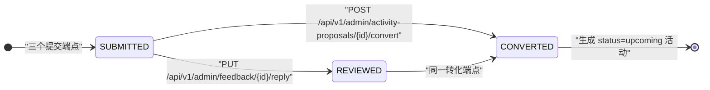

> 只画有写入点的三条转移：`SUBMITTED`/`REVIEWED`/`CONVERTED` 分别由 `RealFeedbackService` L95、L338、L195 赋值；`PROCESSING` 与 `PLANNED` 不入图，因为六个包内无写入点。仓库内没有声明式转换表。

**图表来源**
- [SubmissionStatus.java:3-9](file://apps/api/src/main/java/com/campuslove/api/feedback/SubmissionStatus.java#L3-L9)
- [FeedbackController.java:60-133](file://apps/api/src/main/java/com/campuslove/api/feedback/FeedbackController.java#L60-L133)
- [RealFeedbackService.java:90-100](file://apps/api/src/main/java/com/campuslove/api/feedback/RealFeedbackService.java#L90-L100)
- [RealFeedbackService.java:170-195](file://apps/api/src/main/java/com/campuslove/api/feedback/RealFeedbackService.java#L170-L195)
- [RealFeedbackService.java:330-340](file://apps/api/src/main/java/com/campuslove/api/feedback/RealFeedbackService.java#L330-L340)
- [MockFeedbackService.java:25-64](file://apps/api/src/main/java/com/campuslove/api/feedback/MockFeedbackService.java#L25-L64)

**章节来源**
- [RealTaskService.java:117-234](file://apps/api/src/main/java/com/campuslove/api/tasks/RealTaskService.java#L117-L234)
- [RecommendationController.java:64-116](file://apps/api/src/main/java/com/campuslove/api/discover/RecommendationController.java#L64-L116)
- [WalletServiceImpl.java:328-349](file://apps/api/src/main/java/com/campuslove/api/wallet/WalletServiceImpl.java#L328-L349)
- [RecommendQuotaService.java:73-167](file://apps/api/src/main/java/com/campuslove/api/growth/RecommendQuotaService.java#L73-L167)
- [RealSocialProgressService.java:54-92](file://apps/api/src/main/java/com/campuslove/api/growth/RealSocialProgressService.java#L54-L92)
- [RealRecommendationService.java:424-504](file://apps/api/src/main/java/com/campuslove/api/discover/RealRecommendationService.java#L424-L504)
- [RealProfileService.java:58-63](file://apps/api/src/main/java/com/campuslove/api/profile/RealProfileService.java#L58-L63)
- [RealCheckInService.java:674-674](file://apps/api/src/main/java/com/campuslove/api/growth/RealCheckInService.java#L674-L674)
- [ProfileQueryService.java:154-329](file://apps/api/src/main/java/com/campuslove/api/profile/ProfileQueryService.java#L154-L329)
- [ProfileUpdateService.java:128-515](file://apps/api/src/main/java/com/campuslove/api/profile/ProfileUpdateService.java#L128-L515)
- [FollowService.java:61-125](file://apps/api/src/main/java/com/campuslove/api/profile/FollowService.java#L61-L125)

## 异步处理、定时任务与批处理
- 关键事实：六个核心包内没有 `@Async` 与 `@Scheduled`（逐包检索 0 命中）。调度代码只在包外——`VipOrderService` L526（`fixedDelay = 60_000, initialDelay = 120_000`）、`AutoRenewService` L183（`cron = "0 0 */6 * * *"`）、`JwtTokenProvider` L386（过期令牌清理，L372 说明每小时一次）、`RealRealNameCertificationService` L229（`cron = "0 30 4 * * *"`），后者与 `RealNameMediaPurgeService` L19 的类注释互相印证：实名认证媒体清理由该 `@Scheduled` 调用，清理服务自身不带调度注解。
- 调度总开关：`@EnableScheduling` 是 `CampusLoveApplication` 的类级注解（L25，导入在 L14，启用动机写在 L17 类注释）；`JwtTokenProvider` L384 与 `RealRealNameCertificationService` L225 两处注释都指回这一处装配，是包外代码引用调度开关的唯一路径。
- 线程池已就位未使用：`AsyncConfig` 带 `@EnableAsync`（L43）并定义 `taskExecutor` Bean（`@Bean(name = "taskExecutor")` L88-L90），用法说明在 L31-L32；本组若要异步化无需新增配置，只需在方法上加注解。
- 缓存取代预热任务：`CacheNames` L27（推荐短 TTL 与主动失效）、L43（帖子 `allEntries`）、L66、L75、L84、L95、L108 逐条以注解失效代替作业；装配见 `CaffeineCacheConfig` L33 与 `RedisConfig` L48（默认 TTL 30 分钟，L39），故障保护 `CacheErrorHandlerConfig` L18-L31。
- 批处理以批查询形态存在，而非作业：`...IdIn` 批量取数（`WalletUnlockRepository` L34、`WalletTransactionLogRepository` L88）、后台分页（`searchForAdmin`，流水 L113、钱包 `UserWalletRepository` L80）、游客单一路径（`RealRecommendationService` L505 配 `RecommendationCacheManager.getCachedGuestRecommendations` L144）。

**章节来源**
- [CampusLoveApplication.java:14-25](file://apps/api/src/main/java/com/campuslove/api/CampusLoveApplication.java#L14-L25)
- [VipOrderService.java:526-526](file://apps/api/src/main/java/com/campuslove/api/vip/VipOrderService.java#L526-L526)
- [AutoRenewService.java:183-183](file://apps/api/src/main/java/com/campuslove/api/vip/AutoRenewService.java#L183-L183)
- [JwtTokenProvider.java:372-386](file://apps/api/src/main/java/com/campuslove/api/config/JwtTokenProvider.java#L372-L386)
- [RealRealNameCertificationService.java:225-229](file://apps/api/src/main/java/com/campuslove/api/verification/RealRealNameCertificationService.java#L225-L229)
- [RealNameMediaPurgeService.java:19-19](file://apps/api/src/main/java/com/campuslove/api/verification/RealNameMediaPurgeService.java#L19-L19)
- [AsyncConfig.java:31-90](file://apps/api/src/main/java/com/campuslove/api/config/AsyncConfig.java#L31-L90)
- [CacheNames.java:27-108](file://apps/api/src/main/java/com/campuslove/api/config/CacheNames.java#L27-L108)
- [CaffeineCacheConfig.java:24-33](file://apps/api/src/main/java/com/campuslove/api/config/CaffeineCacheConfig.java#L24-L33)
- [RedisConfig.java:39-48](file://apps/api/src/main/java/com/campuslove/api/config/RedisConfig.java#L39-L48)
- [CacheErrorHandlerConfig.java:18-31](file://apps/api/src/main/java/com/campuslove/api/config/CacheErrorHandlerConfig.java#L18-L31)
- [WalletUnlockRepository.java:13-34](file://apps/api/src/main/java/com/campuslove/api/wallet/WalletUnlockRepository.java#L13-L34)
- [WalletTransactionLogRepository.java:24-113](file://apps/api/src/main/java/com/campuslove/api/wallet/WalletTransactionLogRepository.java#L24-L113)
- [UserWalletRepository.java:25-80](file://apps/api/src/main/java/com/campuslove/api/wallet/UserWalletRepository.java#L25-L80)
- [RecommendationCacheManager.java:142-144](file://apps/api/src/main/java/com/campuslove/api/discover/RecommendationCacheManager.java#L142-L144)

## 数据模型
业务侧落库实体集中在 `entity` 与 `wallet` 两处，契约层一律是 `record`；金额以「分」为单位的 `Long` 存储，日期口径统一走 `TimeZones.BUSINESS`。

- `UserWallet`（`@Entity` L37、类声明 L49）：`balanceCents`（L61）、`frozenCents`（L65）、`version`（L78，乐观锁版本位）、`createdAt`/`updatedAt`（L82、L86）；访问层提供行锁取账 `findByUserIdForUpdate`（`UserWalletRepository` L42-L44）与后台分页 `searchForAdmin`（L70-L80）。
- `WalletUnlock`（类 L33，访问器 L80-L120）：`userId` + `targetType` + `targetId` 构成解锁复合自然键，单条查重走 `findByUserIdAndTargetTypeAndTargetId`（`WalletUnlockRepository` L23-L24），批量走 `findByUserIdAndTargetTypeAndTargetIdIn`（L34-L35）。
- `WalletTransactionLog`（类 L64、内嵌枚举 `TransactionType` L67）：`type`/`amount`/`balanceAfter`/`relatedType`/`relatedId`/`orderId`/`remark` 的访问器集中在 L195-L243；`orderId` 是幂等键（`findByOrderId`，`WalletTransactionLogRepository` L49），`relatedType`/`relatedId` 回指业务来源（L60、L74-L75），`RELATED_TYPE_TASK_REWARD` 由任务侧写入（`RealTaskService` L153）。
- `TaskClaim`（`entity` 包，`RealTaskService` L7 导入）：`userId`/`taskCode`/`claimDate` 三列定义在 `TaskClaim.java` L41-L50，任务侧赋值在 `RealTaskService` L138-L140，唯一约束 `(user_id, task_code, claim_date)` 同时写在实体注解（`TaskClaim.java` L30-L32）与服务注释（`RealTaskService` L39）。
- 跨包实体引用三处：`Post.PostStatus.active`（枚举声明 `Post.java` L68-L69，动态计数于 `RealTaskService` L80、L187）、`CampusCertification.getStatus()`（`CampusCertification.java` L141，认证判定于 `RealTaskService` L228-L234）、`Feedback.getAttachments()`（JSON 字符串列，读取与解析在 `RealFeedbackService` L364 与 L393-L398）。
- 契约层类型：`UserProfileDTO` 八个内嵌 `record`（L22-L36）、推荐七个视图与请求类型（`RecommendationController` L638-L699）、钱包八个请求与视图类型（`WalletController` L515-L593）、任务三个视图类型（`TaskService` L81、L104、L122）；反馈侧例外——`SubmissionRecordView`、`SubmissionDetailView`、`FeedbackSubmissionRequest` 是三个独立 `record` 文件，而契约内嵌的 `UploadedImageResult` 是普通类（`FeedbackService` L113、构造器 L123）。
- 日期口径：`LocalDate.now(TimeZones.BUSINESS)`（`RealTaskService` L76、L123）与领取记录的 `claim_date` 同源，避免跨时区重复领取。

**章节来源**
- [UserWallet.java:37-143](file://apps/api/src/main/java/com/campuslove/api/wallet/UserWallet.java#L37-L143)
- [WalletUnlock.java:33-120](file://apps/api/src/main/java/com/campuslove/api/wallet/WalletUnlock.java#L33-L120)
- [WalletTransactionLog.java:64-259](file://apps/api/src/main/java/com/campuslove/api/wallet/WalletTransactionLog.java#L64-L259)
- [TaskClaim.java:30-50](file://apps/api/src/main/java/com/campuslove/api/entity/TaskClaim.java#L30-L50)
- [RealTaskService.java:1-47](file://apps/api/src/main/java/com/campuslove/api/tasks/RealTaskService.java#L1-L47)
- [Post.java:68-69](file://apps/api/src/main/java/com/campuslove/api/entity/Post.java#L68-L69)
- [CampusCertification.java:141-141](file://apps/api/src/main/java/com/campuslove/api/entity/CampusCertification.java#L141-L141)
- [UserProfileDTO.java:8-36](file://apps/api/src/main/java/com/campuslove/api/profile/UserProfileDTO.java#L8-L36)
- [RecommendationController.java:638-699](file://apps/api/src/main/java/com/campuslove/api/discover/RecommendationController.java#L638-L699)
- [WalletController.java:515-593](file://apps/api/src/main/java/com/campuslove/api/wallet/WalletController.java#L515-L593)
- [TaskService.java:81-122](file://apps/api/src/main/java/com/campuslove/api/tasks/TaskService.java#L81-L122)
- [FeedbackService.java:86-131](file://apps/api/src/main/java/com/campuslove/api/feedback/FeedbackService.java#L86-L131)
- [RealFeedbackService.java:364-398](file://apps/api/src/main/java/com/campuslove/api/feedback/RealFeedbackService.java#L364-L398)

## 配置与开关
- 计价与阈值：悄悄话单价 `whisperPriceCents`（`RecommendationController` L102）、讨论条数上限 `getDiscussionLimit()`（`RecommendationRanker` L777）、每日额度基数与已用量（`RecommendQuotaService` L73、L104）、四个任务奖励常量成对出现在任务表（`RealTaskService` L89-L98）与 `switch` 定义（L181-L190），换算口径「1 积分 = 1 分」写在类注释（L37）。
- 用户自助开关：免打扰（`DoNotDisturbController` L36 挂 `/api/v1/dnd`，服务侧只读 `RealDoNotDisturbService` L53、写 L95）、推送偏好（`RealPushPreferenceService` 只读 L42、写 L71）、推送摘要（`RealPushSummaryService` 三个写事务方法 L97、L212、L290）；字段可见性由 `PrivacyFieldFilter` 与 `RecommendationFilter` 裁剪，悄悄话按解锁态取舍（`RecommendationRanker.resolveWhispers` L171）。
- 运营配置：`AppConfigController` 的 `/login-hero`（方法级 L24、类级映射 L15）输出 `LoginHeroConfigView`；`clientconfig` 按分键缓存五类启动期配置（`RealConfigService` L180 `'campuses'`、L204 `'match_preferences'`、L210 `'filter_options'`、L217 `'hero_banners'`、L223 `'unlock_guide_steps'`），配合 `CacheNames` L95、L108 的 `allEntries` 强制刷新语义；反馈闸门 `ensureFeedbackOpen()`（`FeedbackController` L48）。属性层配置见《服务架构与配置》。

**章节来源**
- [RecommendationController.java:102-102](file://apps/api/src/main/java/com/campuslove/api/discover/RecommendationController.java#L102-L102)
- [RecommendationRanker.java:171-777](file://apps/api/src/main/java/com/campuslove/api/discover/RecommendationRanker.java#L171-L777)
- [RecommendQuotaService.java:73-104](file://apps/api/src/main/java/com/campuslove/api/growth/RecommendQuotaService.java#L73-L104)
- [RealTaskService.java:32-190](file://apps/api/src/main/java/com/campuslove/api/tasks/RealTaskService.java#L32-L190)
- [DoNotDisturbController.java:36-36](file://apps/api/src/main/java/com/campuslove/api/growth/DoNotDisturbController.java#L36-L36)
- [RealDoNotDisturbService.java:53-96](file://apps/api/src/main/java/com/campuslove/api/growth/RealDoNotDisturbService.java#L53-L96)
- [RealPushPreferenceService.java:42-72](file://apps/api/src/main/java/com/campuslove/api/growth/RealPushPreferenceService.java#L42-L72)
- [RealPushSummaryService.java:97-291](file://apps/api/src/main/java/com/campuslove/api/growth/RealPushSummaryService.java#L97-L291)
- [AppConfigController.java:15-24](file://apps/api/src/main/java/com/campuslove/api/growth/AppConfigController.java#L15-L24)
- [RealConfigService.java:180-223](file://apps/api/src/main/java/com/campuslove/api/clientconfig/RealConfigService.java#L180-L223)
- [CacheNames.java:95-108](file://apps/api/src/main/java/com/campuslove/api/config/CacheNames.java#L95-L108)
- [FeedbackController.java:43-48](file://apps/api/src/main/java/com/campuslove/api/feedback/FeedbackController.java#L43-L48)

## 业务指标与统计支持
统计一律是查询期聚合 + 视图字段，供客户端渲染；本组无报表文件、无导出接口、无后端图表面板（`报表`/`Excel`/`导出`/`dashboard`/`可视化` 在六个包内 0 命中，判定过程见「能力缺口登记」）。

- 资料完整度 0-100：`calculateProfileCompletion`（`RealTaskService` L79、L184，口径写在类注释 L32），同时是任务判据与进度条数据源。
- 资料与社交：`getProfileStats`（`ProfileQueryService` L216 与 `MockProfileService` L225 两侧同签名）经 `GET /profile/stats`（`ProfileController` L68，类级映射 L53）暴露；访客读写在 `ProfileVisitorController` L107（列表）与 L182（上报）；社交证明独立成 `ProfileSocialProofView`。
- 额度指标：`getDailyQuota`/`getRemainingQuota`/`getUsedCount`/`isExhausted`（`RecommendQuotaService` L73、L94、L104、L167），端点 `/recommendations/quota`（`RecommendationController` L115）。
- 内容热度：`buildHeatLabel(Integer, int)`（`RecommendationRanker` L757）按回复数与点赞数分档，`getDiscussionLimit`（L777）限条数，`truncateContent`（L743）控体量。
- 任务漏斗：`getProgress` 一次算完成数、领取数、已领与总额及整数百分比（`RealTaskService` L105-L112，零分母退 0），端点 `/tasks/progress`（`TaskController` L74）。
- 财务口径：时间序分页流水（`WalletController` L214、`PageRequest.of` L219；`findByUserIdOrderByCreatedAtDesc` 在 `WalletTransactionLogRepository` L35）携带 `type`/`amount`/`balanceAfter`，跨用户检索只有两个 `searchForAdmin`（流水 L113、钱包 `UserWalletRepository` L80）。
- 延迟指标：`match.recommend.latency` 三处埋点（`RecommendationCacheManager` L121、L159、L242），是本组唯一的指标出口。
- 日粒度：每日一问的 `@Cacheable` 与 `@CacheEvict` 共用日期维度 key（`CacheTest` L243-L252），题目与回答天然按日切片。

**章节来源**
- [RealTaskService.java:79-115](file://apps/api/src/main/java/com/campuslove/api/tasks/RealTaskService.java#L79-L115)
- [RecommendQuotaService.java:73-167](file://apps/api/src/main/java/com/campuslove/api/growth/RecommendQuotaService.java#L73-L167)
- [RecommendationRanker.java:733-777](file://apps/api/src/main/java/com/campuslove/api/discover/RecommendationRanker.java#L733-L777)
- [WalletController.java:214-220](file://apps/api/src/main/java/com/campuslove/api/wallet/WalletController.java#L214-L220)
- [WalletTransactionLogRepository.java:35-113](file://apps/api/src/main/java/com/campuslove/api/wallet/WalletTransactionLogRepository.java#L35-L113)
- [RecommendationCacheManager.java:121-242](file://apps/api/src/main/java/com/campuslove/api/discover/RecommendationCacheManager.java#L121-L242)
- [ProfileQueryService.java:216-216](file://apps/api/src/main/java/com/campuslove/api/profile/ProfileQueryService.java#L216-L216)
- [ProfileController.java:53-68](file://apps/api/src/main/java/com/campuslove/api/profile/ProfileController.java#L53-L68)
- [ProfileVisitorController.java:107-182](file://apps/api/src/main/java/com/campuslove/api/profile/ProfileVisitorController.java#L107-L182)
- [CacheTest.java:243-252](file://apps/api/src/test/java/com/campuslove/api/config/CacheTest.java#L243-L252)

## 扩展点与第三方集成
- 主扩展点是接口实现替换：服务契约全是 interface（`WalletService` L26、`WalletUnlockService` L20、`TaskService` L20、`FeedbackService` L13，`growth` 包另有六个接口 `AppConfigService`、`CheckInService`、`DoNotDisturbService`、`PushPreferenceService`、`PushSummaryService`、`SocialProgressService`），控制器只依赖接口，新增数据源即新增一个带 `@Profile` 的实现；`profile` 还把读（`ProfileQueryService` L61-L63）与写（`ProfileUpdateService` L52-L54）拆成两 Bean，替换互不影响。`RecommendQuotaService` 不在该范式内——它是 `@Service` 具体类（L37），没有 Mock 对偶。
- 算法扩展点是策略结果：`rankAndConvert(RecommendationStrategy.RecommendResult)`（`RecommendationRanker` L384）只消费结果对象，`buildHistory`（L417）同理；过滤扩展位是 `RecommendationFilter`（作为 `RealRecommendationService` L484、L505 的形参）与 `PrivacyFieldFilter`。
- 缓存名是注册式扩展点：`CacheNames` L6 集中管理，新增缓存须在此登记，`@EnableCaching`（`CaffeineCacheConfig` L33、`RedisConfig` L48）与错误保护（`CacheErrorHandlerConfig` L18-L31）自动覆盖。
- 无插件架构：六个包内 `ServiceLoader`、`plugin`、`扩展点`、`SPI` 0 命中（命中的 8 行全是 `isPinned` 一类子串噪声，不构成能力证据），扩展一律经 Bean 替换完成。
- 第三方集成只有一处链路：`WeChatPushService`（`@Profile("real")` L31，三个写事务 L183、L275、L299）配 `RealPushPreferenceService` 与 `RealPushSummaryService` 构成「偏好—摘要—下发」；支付渠道与订单调度在 `vip` 包（`VipOrderService` L526、`AutoRenewService` L183），本组资金侧只有记账端点（`WalletController` `/recharge` L249、`/deduct` L447），未对接支付网关。

**章节来源**
- [WalletService.java:26-85](file://apps/api/src/main/java/com/campuslove/api/wallet/WalletService.java#L26-L85)
- [WalletUnlockService.java:20-20](file://apps/api/src/main/java/com/campuslove/api/wallet/WalletUnlockService.java#L20-L20)
- [TaskService.java:20-20](file://apps/api/src/main/java/com/campuslove/api/tasks/TaskService.java#L20-L20)
- [FeedbackService.java:13-13](file://apps/api/src/main/java/com/campuslove/api/feedback/FeedbackService.java#L13-L13)
- [RecommendQuotaService.java:37-37](file://apps/api/src/main/java/com/campuslove/api/growth/RecommendQuotaService.java#L37-L37)
- [ProfileQueryService.java:61-63](file://apps/api/src/main/java/com/campuslove/api/profile/ProfileQueryService.java#L61-L63)
- [ProfileUpdateService.java:52-54](file://apps/api/src/main/java/com/campuslove/api/profile/ProfileUpdateService.java#L52-L54)
- [RecommendationRanker.java:384-417](file://apps/api/src/main/java/com/campuslove/api/discover/RecommendationRanker.java#L384-L417)
- [RealRecommendationService.java:484-505](file://apps/api/src/main/java/com/campuslove/api/discover/RealRecommendationService.java#L484-L505)
- [CacheNames.java:6-6](file://apps/api/src/main/java/com/campuslove/api/config/CacheNames.java#L6-L6)
- [CaffeineCacheConfig.java:32-33](file://apps/api/src/main/java/com/campuslove/api/config/CaffeineCacheConfig.java#L32-L33)
- [RedisConfig.java:47-48](file://apps/api/src/main/java/com/campuslove/api/config/RedisConfig.java#L47-L48)
- [CacheErrorHandlerConfig.java:18-31](file://apps/api/src/main/java/com/campuslove/api/config/CacheErrorHandlerConfig.java#L18-L31)
- [WeChatPushService.java:31-299](file://apps/api/src/main/java/com/campuslove/api/growth/WeChatPushService.java#L31-L299)
- [WalletController.java:249-447](file://apps/api/src/main/java/com/campuslove/api/wallet/WalletController.java#L249-L447)

## 依赖关系分析
把六个子包的 import 关系展开，可以得到一张方向明确的依赖图：业务包横向依赖只允许「调用方的服务接口」，仓储与实体则下沉到公共包。

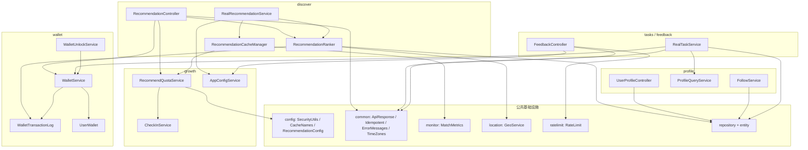

**图表来源**
- [RecommendationController.java:64-102](file://apps/api/src/main/java/com/campuslove/api/discover/RecommendationController.java#L64-L102)
- [RealRecommendationService.java:46-118](file://apps/api/src/main/java/com/campuslove/api/discover/RealRecommendationService.java#L46-L118)
- [RecommendationCacheManager.java:3-61](file://apps/api/src/main/java/com/campuslove/api/discover/RecommendationCacheManager.java#L3-L61)
- [RecommendationRanker.java:115-130](file://apps/api/src/main/java/com/campuslove/api/discover/RecommendationRanker.java#L115-L130)
- [RecommendQuotaService.java:1-65](file://apps/api/src/main/java/com/campuslove/api/growth/RecommendQuotaService.java#L1-L65)
- [RealTaskService.java:1-68](file://apps/api/src/main/java/com/campuslove/api/tasks/RealTaskService.java#L1-L68)
- [FeedbackController.java:1-52](file://apps/api/src/main/java/com/campuslove/api/feedback/FeedbackController.java#L1-L52)
- [RealWalletUnlockService.java:25-49](file://apps/api/src/main/java/com/campuslove/api/wallet/RealWalletUnlockService.java#L25-L49)
- [UserProfileController.java:36-46](file://apps/api/src/main/java/com/campuslove/api/profile/UserProfileController.java#L36-L46)
- [FollowService.java:41-53](file://apps/api/src/main/java/com/campuslove/api/profile/FollowService.java#L41-L53)

三类依赖形态在分组内各有明确用途。强依赖（构造器注入）用于完成业务必需动作：`RealTaskService` 的 6 个构造参数（4 个 Repository + `ProfileQueryService` + `WalletService`）缺任一即无法判定达成或无法发奖。可选依赖（`@Autowired(required = false)`）用于跨 profile 降级：`RealRecommendationService` 的 `SocialProgressService`、`UserBlockRepository`、`AppConfigService`，`RecommendQuotaService` 的 `RedisTemplate`，`RecommendationController` 的 `recommendQuotaService` 与 `walletService`，`FeedbackController` 的 `AppConfigService`；控制器在 `walletService == null` 时直接返回「视为已解锁、余额为 null」的宽容结果，从而让演示环境不阻塞内容浏览。字段级依赖则集中在 `RecommendationRanker`，它把 5 个资料/圈子仓储与 `HeartSignalRepository`、`LikeRepository`、`MediaAssetService` 等一并纳入装配，构成排序视图的完整输入。

**章节来源**
- [RealTaskService.java:49-68](file://apps/api/src/main/java/com/campuslove/api/tasks/RealTaskService.java#L49-L68)
- [RealRecommendationService.java:82-118](file://apps/api/src/main/java/com/campuslove/api/discover/RealRecommendationService.java#L82-L118)
- [RecommendQuotaService.java:53-65](file://apps/api/src/main/java/com/campuslove/api/growth/RecommendQuotaService.java#L53-L65)
- [RecommendationController.java:560-585](file://apps/api/src/main/java/com/campuslove/api/discover/RecommendationController.java#L560-L585)
- [RecommendationController.java:620-624](file://apps/api/src/main/java/com/campuslove/api/discover/RecommendationController.java#L620-L624)
- [RecommendationRanker.java:71-130](file://apps/api/src/main/java/com/campuslove/api/discover/RecommendationRanker.java#L71-L130)
- [FeedbackController.java:43-52](file://apps/api/src/main/java/com/campuslove/api/feedback/FeedbackController.java#L43-L52)

## 性能考虑
分组内的性能手段全部体现在可读的代码约定上，按热点路径归类如下。

- 推荐读的三条缓存路径：登录用户 `@Cacheable(cacheNames = CacheNames.MATCH_RECOMMEND, key = "'v2:' + #userId")`（TTL 由 `CacheNames` 决定，默认 5 分钟），游客 `@Cacheable(cacheNames = CacheNames.GUEST_RECOMMEND, key = "'guest:v1'")`（TTL 60 秒、全局共享单 key），失效走 `evictRecommendationCache` 与 `evictAllRecommendationCaches(allEntries = true)`。缓存命中即跳过候选打分，同时把配额消费频次压到「一个 TTL 窗口一次」。
- 耗时可观测：`getCachedRecommendations`、`getCachedGuestRecommendations`、`getRecommendationsWithExclude` 三处出口都调用 `matchMetrics.recordRecommendLatency(durationMs)`，是分组内唯一的推荐延迟指标来源。
- 批量装载替代逐条查询：`ProfileQueryService.batchLoadUsers(userIds)` 把关注/取关列表的用户加载合并为一次批量查询（列表侧 L281、L317 两处调用），避免粉丝/关注列表的 N+1。
- 读写事务分离：`RealTaskService.listTasks` 与 `getProgress` 标注 `@Transactional(readOnly = true)`，`claim` 使用可写事务；钱包侧 `deduct` / `recharge` 通过 `findByUserIdForUpdate` 悲观锁串行化同一用户余额变更，`UserWallet.version` 字段提供乐观锁版本位。
- 配额计数的原子性与降级：Redis `INCR` 单次往返完成「判定 + 占用」，超限用 `decrement` 回滚避免计数漂移，`TTL 36 小时`覆盖跨自然日并防止 key 无限增长；Redis 不可用时退化为 `ConcurrentHashMap` + `synchronized` 临界区，单实例内仍保证原子但不再跨节点共享。
- 视图装配成本控制：`RecommendationRanker` 用 `truncateContent(content, maxLength)` 限制文案长度、`extractInitials(name)` 生成头像占位、`getDiscussionLimit()` 控制讨论条数、`WHISPER_COUNT = 3` 固定悄悄话条数，把响应体大小收敛在常数级。
- 入口侧限流：反馈三个提交端点使用 `@RateLimit(capacity = 10, refillTokens = 0.1, key = "#request.remoteAddr")`，按 IP 令牌桶防止刷量占用服务层与仓储连接。

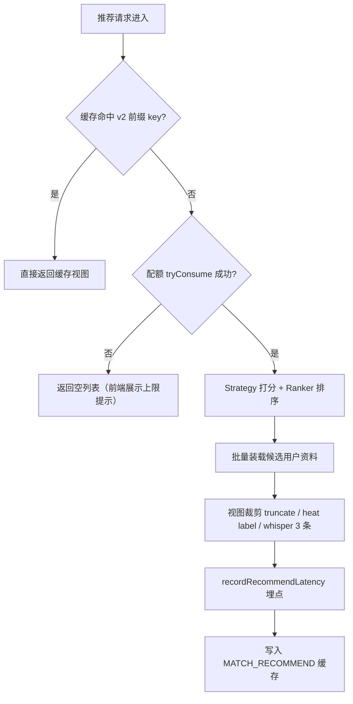

**图表来源**
- [RecommendationCacheManager.java:67-131](file://apps/api/src/main/java/com/campuslove/api/discover/RecommendationCacheManager.java#L67-L131)
- [RecommendationCacheManager.java:133-201](file://apps/api/src/main/java/com/campuslove/api/discover/RecommendationCacheManager.java#L133-L201)
- [RecommendQuotaService.java:120-159](file://apps/api/src/main/java/com/campuslove/api/growth/RecommendQuotaService.java#L120-L159)
- [RecommendationRanker.java:241-310](file://apps/api/src/main/java/com/campuslove/api/discover/RecommendationRanker.java#L241-L310)
- [RecommendationRanker.java:733-777](file://apps/api/src/main/java/com/campuslove/api/discover/RecommendationRanker.java#L733-L777)
- [ProfileQueryService.java:281-317](file://apps/api/src/main/java/com/campuslove/api/profile/ProfileQueryService.java#L281-L317)
- [WalletService.java:6-25](file://apps/api/src/main/java/com/campuslove/api/wallet/WalletService.java#L6-L25)

上图为「缓存优先 + 配额闸门 + 排序装配」的热点路径示意，其中「配额未通过即返回空列表」的语义取自缓存管理器注释，实际短路顺序以代码为准。

**章节来源**
- [RecommendationCacheManager.java:20-34](file://apps/api/src/main/java/com/campuslove/api/discover/RecommendationCacheManager.java#L20-L34)
- [RecommendationCacheManager.java:133-168](file://apps/api/src/main/java/com/campuslove/api/discover/RecommendationCacheManager.java#L133-L168)
- [RecommendQuotaService.java:41-60](file://apps/api/src/main/java/com/campuslove/api/growth/RecommendQuotaService.java#L41-L60)
- [ProfileQueryService.java:488-488](file://apps/api/src/main/java/com/campuslove/api/profile/ProfileQueryService.java#L488-L488)
- [RealTaskService.java:70-115](file://apps/api/src/main/java/com/campuslove/api/tasks/RealTaskService.java#L70-L115)
- [UserWallet.java:74-90](file://apps/api/src/main/java/com/campuslove/api/wallet/UserWallet.java#L74-L90)
- [FeedbackController.java:54-100](file://apps/api/src/main/java/com/campuslove/api/feedback/FeedbackController.java#L54-L100)

## 故障排查指南
分组内所有业务异常都通过少数几个运行时异常类型表达，先按状态码定位，再按消息常量确认规则来源。

| 症状 | 触发条件 | 代码出处 | 排查动作 |
| --- | --- | --- | --- |
| 反馈提交 403 | `app_switch.feedback_open` 为 false | `FeedbackController.ensureFeedbackOpen()` 抛 `OperationForbiddenException(ErrorMessages.FEEDBACK_CLOSED)` | 检查后台开关与 `getClientConfig()` 口径是否一致 |
| 反馈提交 429 | 同一 IP 令牌桶（容量 10、0.1/s）耗尽 | `@RateLimit(capacity = 10, refillTokens = 0.1, key = "#request.remoteAddr")` | 确认调用方是否共享出口 IP；必要时放宽端点配置 |
| 领取奖励 400 | 任务编码未知 / 未达标 / 已领取 | `TASK_CODE_UNKNOWN_PREFIX`、`TASK_NOT_COMPLETED`、`TASK_ALREADY_CLAIMED` | 先调 `GET /api/v1/tasks/progress` 看完成度与 `claimed` |
| 奖励已记录但余额未变 | 入账异常触发回滚 | `catch (RuntimeException)` 后抛 `TASK_REWARD_CREDIT_FAILED`，可写事务整体回滚 | 查 `wallet_transaction_log` 是否存在 `orderId = TASK-{code}-{userId}` 的流水 |
| 解锁失败余额不足 | 余额小于单价 | `WalletService.deduct` 抛 `InsufficientBalanceException` | 核对 `UserWallet.balanceCents` 与 `app.unlock-price.*` / `whisperPriceCents` 配置 |
| 解锁重复扣费 | `orderId` 冲突判定为已处理 | `UNLOCK-{type}-{userId}-{targetId}`（历史缺 `userId` 的旧格式已修复） | 比对流水 `orderId` 是否含 `userId` 段 |
| 推荐列表空但配额未耗尽 | 配额耗尽分支或缓存空值 | 缓存注释「配额耗尽返回空列表」；`isExhausted()` | 调 `GET /api/v1/recommendations/quota` 看 `dailyLimit` / `used` |
| 偏好更新后推荐不变 | 缓存 TTL 未过期 | `MATCH_RECOMMEND` key `v2:{userId}`，默认 5 分钟 | 触发 `evictRecommendationCache(userId)` 或等待 TTL |
| 响应缺失敏感字段异常 | 视图 record 多出白名单外字段 | `PrivacyFieldFilter.sanitize` 抛 `IllegalStateException` | 检查新增字段是否需要进入白名单 |
| 关注接口 400 | 自关注 / 重复关注 / 未关注却取关 | `CANNOT_FOLLOW_SELF`、`ALREADY_FOLLOWING`、`NOT_FOLLOWING` | 先查 `isFollowing` 再决定按钮态 |
| 游客看到付费内容 | mock 环境无钱包依赖 | `walletService == null` 时返回 `WhisperUnlockView(true, ..., null)` | 属演示语义；real profile 需确认 `WalletService` Bean 存在 |
| 多实例配额超发 | Redis 不可用退化为本地计数 | `localCount` + `synchronized`，日志 warn 降级 | 检查 Redis 连通性与 `RedisTemplate` 注入 |

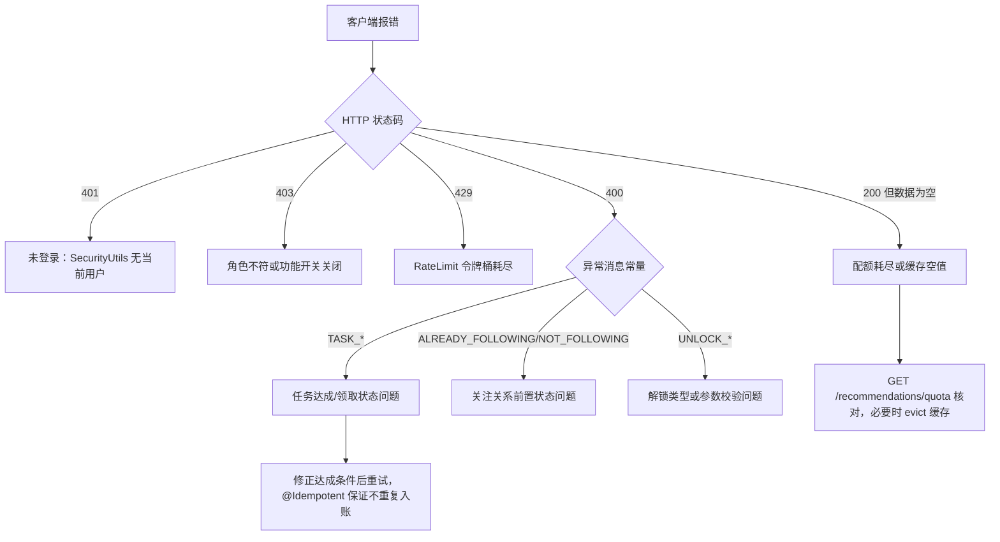

**图表来源**
- [FeedbackController.java:43-100](file://apps/api/src/main/java/com/campuslove/api/feedback/FeedbackController.java#L43-L100)
- [RealTaskService.java:117-164](file://apps/api/src/main/java/com/campuslove/api/tasks/RealTaskService.java#L117-L164)
- [RealWalletUnlockService.java:55-148](file://apps/api/src/main/java/com/campuslove/api/wallet/RealWalletUnlockService.java#L55-L148)
- [FollowService.java:61-135](file://apps/api/src/main/java/com/campuslove/api/profile/FollowService.java#L61-L135)
- [RecommendationController.java:560-585](file://apps/api/src/main/java/com/campuslove/api/discover/RecommendationController.java#L560-L585)
- [RecommendationCacheManager.java:170-201](file://apps/api/src/main/java/com/campuslove/api/discover/RecommendationCacheManager.java#L170-L201)
- [RecommendQuotaService.java:104-159](file://apps/api/src/main/java/com/campuslove/api/growth/RecommendQuotaService.java#L104-L159)

**章节来源**
- [FeedbackController.java:140-202](file://apps/api/src/main/java/com/campuslove/api/feedback/FeedbackController.java#L140-L202)
- [FeedbackService.java:54-106](file://apps/api/src/main/java/com/campuslove/api/feedback/FeedbackService.java#L54-L106)
- [WalletService.java:28-61](file://apps/api/src/main/java/com/campuslove/api/wallet/WalletService.java#L28-L61)
- [TaskService.java:56-67](file://apps/api/src/main/java/com/campuslove/api/tasks/TaskService.java#L56-L67)
- [RecommendationController.java:280-296](file://apps/api/src/main/java/com/campuslove/api/discover/RecommendationController.java#L280-L296)
- [UserProfileController.java:36-46](file://apps/api/src/main/java/com/campuslove/api/profile/UserProfileController.java#L36-L46)

## 能力缺口登记
本节登记 catalog 指令中在本分组代码里找不到实现证据的要求。每条给出判定依据（检索范围、检索词、命中情况），不做任何推测性描述。检索范围统一为 `apps/api/src/main/java/com/campuslove/api/{profile,discover,growth,wallet,tasks,feedback}` 六个包，大小写不敏感、逐词计数。

- 异步任务处理。判定依据：`@Async`、`@EventListener` 在六个包内均 0 命中；带该注解的类为 `admin/AdminAuditLogService`、`admin/audit/AuditAsyncConfig`、`admin/RealAdminConfigService`、`admin/SensitiveWordImportService`、`admin/event/ConfigUpdatedEvent`、`config/AsyncConfig`，全部在管理后台与基础设施包内，不属于核心业务服务。结论：本分组六个服务的业务方法都是同步调用链，无异步任务通道可文档化。
- 定时任务与批处理作业。判定依据：`@Scheduled`、`Scheduled`、`cron`、`Quartz`、`XXL`、`kafka`、`rocketmq`、`批处理`、`Batch` 在六个包内 0 命中（`Batch` 仅命中 `ProfileQueryService.batchLoadUsers` 等「批量查询」语义与 `RealCircleService.deleteAllInBatch`，属一次性数据访问而非作业）。仓库确有调度器，但位于其他包：`CampusLoveApplication`（`@EnableScheduling`）、`chat/TempChatCleanupService`、`village/HotScoreScheduler`、`vip/AutoRenewService`、`vip/VipOrderService`、`verification/RealNameMediaPurgeService`、`ratelimit/RateLimitBucketRegistry`、`mq/MessageProducer`。结论：本分组内不存在定时任务与批处理作业，相关能力属同级其他页面。
- 业务规则引擎。判定依据：`规则引擎`、`Drools`、`easy-rules`、`LiteFlow`、`策略扩展` 均 0 命中。真实形态是「接口常量表 + `switch` 表达式 + 配置 Key」：`TaskService` 用 `TASK_*` 与 `REWARD_*` 常量声明任务规则，`RealTaskService.resolveTaskDefinition` 以 `switch (taskCode)` 分派，`AppConfigService` 以 `RULE_DAILY_RECOMMEND_LIMIT` / `RULE_HEART_SIGNAL_EXPIRE_HOURS` 两个 Key 把规则外置到 `app_rule` 表。结论：无独立规则引擎组件，仅有硬编码规则与配置化规则 Key。
- 状态机设计。判定依据：`状态机`、`StateMachine`、`责任链`、`Chain` 均 0 命中。真实形态是枚举 + 显式 `setStatus` 调用点：`SubmissionStatus` 声明 5 个状态，`RealFeedbackService` 在三处推进状态（提交置 `SUBMITTED`、管理员回复置 `REVIEWED`、提案转化置 `CONVERTED`，并在已 `CONVERTED` 时拒绝重复转化），`PROCESSING` 与 `PLANNED` 在六个包内没有写入点。结论：不存在状态机框架，只有枚举状态与分散的状态赋值。
- 业务指标统计、报表生成与数据可视化。判定依据：`报表`、`可视化`、`dashboard`、`chart`、`Chart`、`Excel`、`导出`、`邮件` 在六个包内 0 命中（`BI`、`Email` 等短词的命中经逐行复核为 `business`、`visible`、`description` 一类子串噪声，不构成能力证据）。唯二的指标类证据是 `RecommendationCacheManager` 通过 `MatchMetrics.recordRecommendLatency(durationMs)` 记录 `match.recommend.latency`，且三处埋点均显式「监控逻辑失败忽略，不影响主流程」；`RecommendationStrategy` 中的「活跃度指标」指的是候选用户发帖数的批量预加载，属算法输入而非统计报表。结论：本分组只有 1 项延迟指标，无报表生成、无数据可视化实现。
- 业务扩展点与插件架构。判定依据：`扩展点`、`插件化`、`plugin`、`Plugin`、`ServiceLoader` 均 0 命中。真实扩展机制是「接口契约 + `@Profile("real")` / `@Profile("mock")` 双实现 + 可选注入」：`ProfileService`、`RecommendationService`、`FeedbackService`、`TaskService`、`WalletService`、`WalletUnlockService`、`AppConfigService`、`CheckInService` 每个接口各有 Real 与 Mock 两份实现，运行时按激活 profile 选一份；跨域能力（配额、钱包、开关、Redis）通过 `@Autowired(required = false)` 注入以便缺失时降级。结论：不存在插件式扩展点注册表，扩展等于新增一个接口实现 Bean。
- 第三方服务集成。判定依据：`SMS`、`webhook` 在六个包内 0 命中；`支付` 的命中全部是「尚未接入」的自述——`WalletController` 注释写明 `/recharge` 为「演示/模拟充值：无支付网关直接入账」、演示入账以独立类型与真实支付 `WALLET_RECHARGE` 区分、该端点默认关闭且「生产环境必须接入支付网关（微信支付/支付宝）+ 支付回调验签」。仓库中第三方账号体系位于 `auth/ThirdPartyAuthController`、`auth/ThirdPartyAuthService` 与 `entity/ThirdPartyAccount`，属同级「用户认证与安全」页面范围。结论：本分组唯一的第三方集成是 `growth` 包的微信订阅消息推送——`WeChatPushService`（L23-L24 类注释「负责调用微信订阅消息接口」）以 `RestClient`（L19 导入、L58 字段）调用 `api.weixin.qq.com` 的取令牌 URL（L47）与订阅消息发送 URL（L54），二者均可经 `app.wechat.*` 外部化覆盖；除此之外本分组无 SMS、无 webhook、无支付网关对接，只有待接入的支付网关说明与演示充值路径。

上述缺口不影响本页已文档化的内容：接口契约、规则实现、状态推进、缓存与配额、账本幂等等均有代码证据。

**章节来源**
- [RecommendationCacheManager.java:78-131](file://apps/api/src/main/java/com/campuslove/api/discover/RecommendationCacheManager.java#L78-L131)
- [RecommendationCacheManager.java:155-168](file://apps/api/src/main/java/com/campuslove/api/discover/RecommendationCacheManager.java#L155-L168)
- [RecommendationStrategy.java:190-210](file://apps/api/src/main/java/com/campuslove/api/discover/RecommendationStrategy.java#L190-L210)
- [RecommendationStrategy.java:597-610](file://apps/api/src/main/java/com/campuslove/api/discover/RecommendationStrategy.java#L597-L610)
- [WalletController.java:41-131](file://apps/api/src/main/java/com/campuslove/api/wallet/WalletController.java#L41-L131)
- [WalletController.java:225-240](file://apps/api/src/main/java/com/campuslove/api/wallet/WalletController.java#L225-L240)
- [RealFeedbackService.java:90-100](file://apps/api/src/main/java/com/campuslove/api/feedback/RealFeedbackService.java#L90-L100)
- [RealFeedbackService.java:170-195](file://apps/api/src/main/java/com/campuslove/api/feedback/RealFeedbackService.java#L170-L195)
- [RealFeedbackService.java:330-340](file://apps/api/src/main/java/com/campuslove/api/feedback/RealFeedbackService.java#L330-L340)
- [SubmissionStatus.java:3-9](file://apps/api/src/main/java/com/campuslove/api/feedback/SubmissionStatus.java#L3-L9)
- [TaskService.java:20-38](file://apps/api/src/main/java/com/campuslove/api/tasks/TaskService.java#L20-L38)
- [AppConfigService.java:32-56](file://apps/api/src/main/java/com/campuslove/api/growth/AppConfigService.java#L32-L56)
- [ProfileQueryService.java:480-488](file://apps/api/src/main/java/com/campuslove/api/profile/ProfileQueryService.java#L480-L488)
- [WeChatPushService.java:23-58](file://apps/api/src/main/java/com/campuslove/api/growth/WeChatPushService.java#L23-L58)

## 结论
核心业务服务分组由六个 Java 包构成一条完整的用户侧业务链：`profile` 建立身份与可被推荐的数据基础，`discover` 把身份转成推荐流与付费内容曝光，`growth` 用签到、开关与配额给这条链提供节奏与闸门，`wallet` 承担所有资金变动并记录审计流水，`tasks` 把外部动作折算为余额奖励，`feedback` 则把使用中的问题回流到运营侧并可转化为活动。

三条一致性约定支撑起整个分组的可维护性。其一是「接口 + Real/Mock 双 profile 实现」，使同一份契约能在联调与生产之间切换而不改调用点；其二是「可选注入 + 缺失即降级」，让跨域依赖（配额、钱包、开关、Redis、屏蔽关系）在任一缺失时只丢失增强能力而非接口可用性；其三是「集中常量表」，任务编码与奖励、工单类型与状态、钱包交易关联类型、功能开关与业务规则 Key 都以常量或枚举集中声明，使跨模块口径可以静态核对。

阅读顺序建议：先读本页的依赖关系与跨服务编排两节确认边界，再按子页深入（用户资料服务 → 发现推荐服务 → 成长体系服务 → 钱包解锁服务 → 任务系统服务 → 反馈收集服务）；涉及鉴权主体、实体映射、缓存基础设施与匹配算法本体时，转到同级的「用户认证与安全」「数据访问层」「服务架构与配置」「匹配系统」四页。异步任务与定时作业（六个业务包内）、报表可视化与插件式扩展点在本分组内没有实现证据，已在「能力缺口登记」逐条给出判定依据，读者不应在这些标题下预期包内内容；包外调度器坐标、已就位未使用的线程池、批查询形态的「批处理」以及唯一的第三方链路（微信订阅消息推送）分别见「异步处理、定时任务与批处理」与「扩展点与第三方集成」两节。

**章节来源**
- [RecommendationService.java:11-140](file://apps/api/src/main/java/com/campuslove/api/discover/RecommendationService.java#L11-L140)
- [RealRecommendationService.java:46-118](file://apps/api/src/main/java/com/campuslove/api/discover/RealRecommendationService.java#L46-L118)
- [RecommendationCacheManager.java:20-34](file://apps/api/src/main/java/com/campuslove/api/discover/RecommendationCacheManager.java#L20-L34)
- [RecommendQuotaService.java:16-65](file://apps/api/src/main/java/com/campuslove/api/growth/RecommendQuotaService.java#L16-L65)
- [AppConfigService.java:7-68](file://apps/api/src/main/java/com/campuslove/api/growth/AppConfigService.java#L7-L68)
- [WalletService.java:6-44](file://apps/api/src/main/java/com/campuslove/api/wallet/WalletService.java#L6-L44)
- [RealWalletUnlockService.java:25-81](file://apps/api/src/main/java/com/campuslove/api/wallet/RealWalletUnlockService.java#L25-L81)
- [TaskService.java:5-38](file://apps/api/src/main/java/com/campuslove/api/tasks/TaskService.java#L5-L38)
- [RealTaskService.java:26-68](file://apps/api/src/main/java/com/campuslove/api/tasks/RealTaskService.java#L26-L68)
- [FeedbackService.java:13-30](file://apps/api/src/main/java/com/campuslove/api/feedback/FeedbackService.java#L13-L30)
- [FeedbackTicketType.java:3-7](file://apps/api/src/main/java/com/campuslove/api/feedback/FeedbackTicketType.java#L3-L7)
- [FollowService.java:33-53](file://apps/api/src/main/java/com/campuslove/api/profile/FollowService.java#L33-L53)
- [UserProfileDTO.java:8-36](file://apps/api/src/main/java/com/campuslove/api/profile/UserProfileDTO.java#L8-L36)
