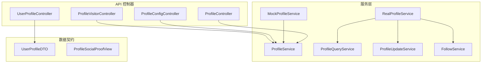
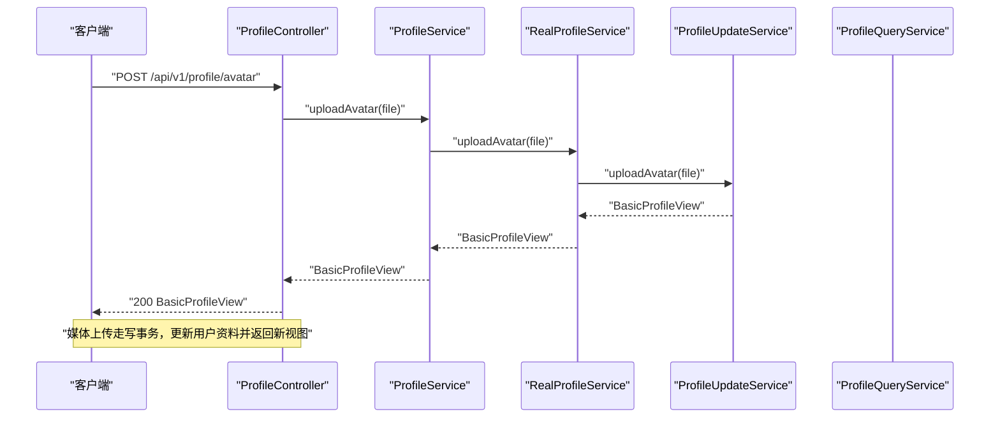
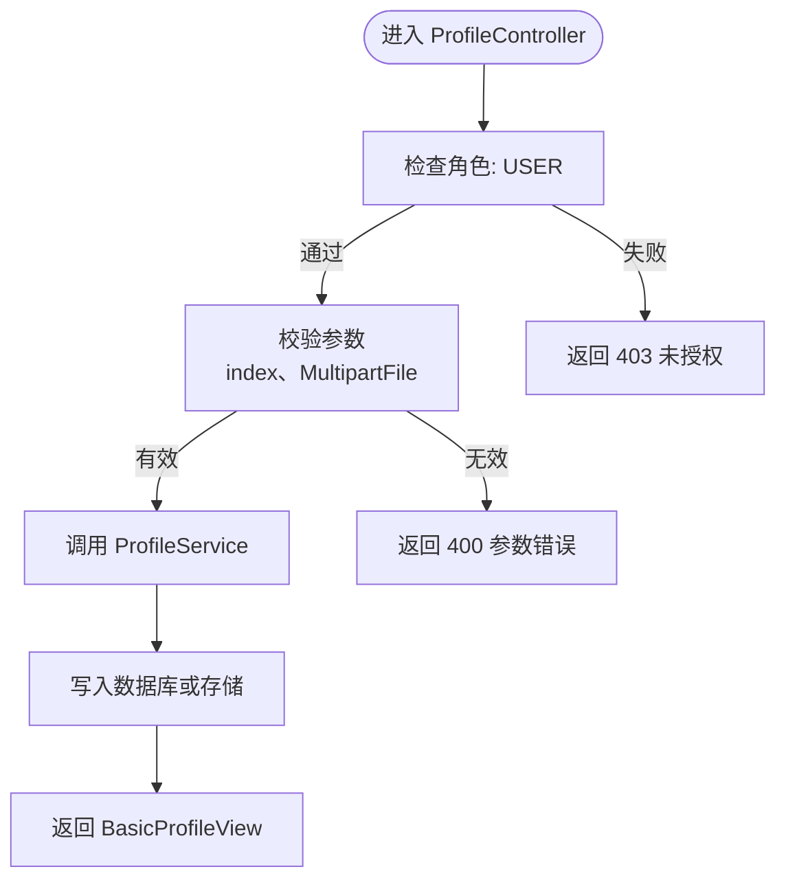
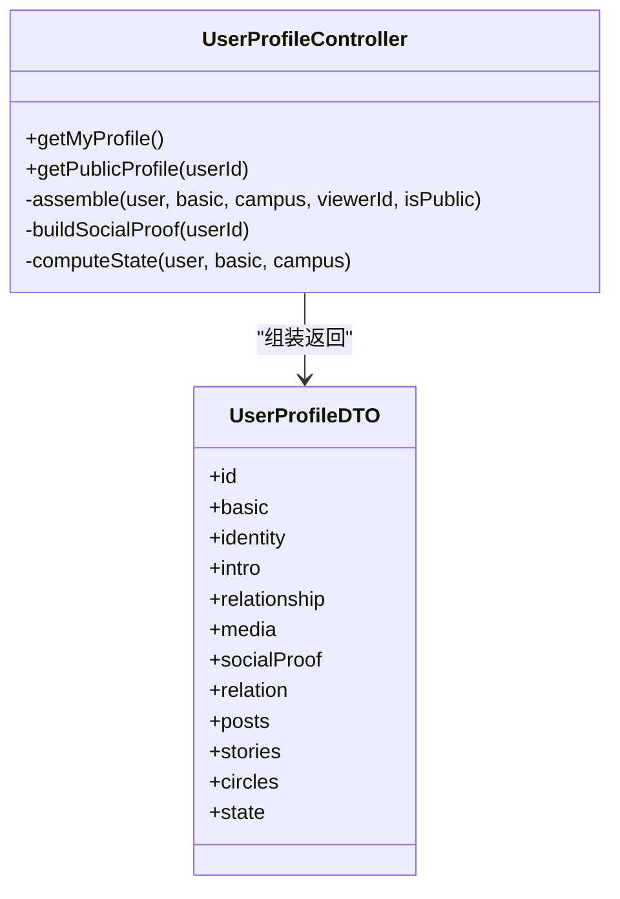
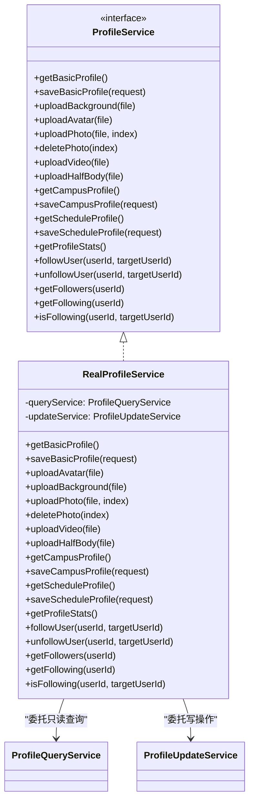
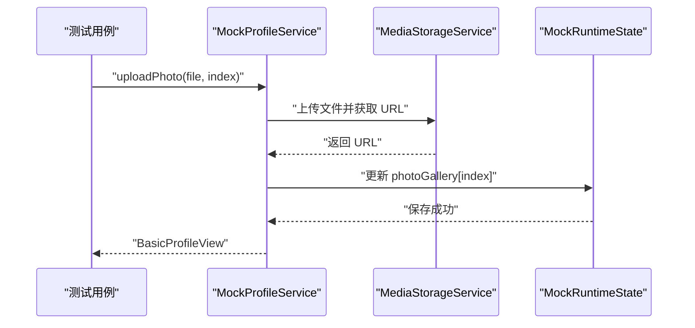
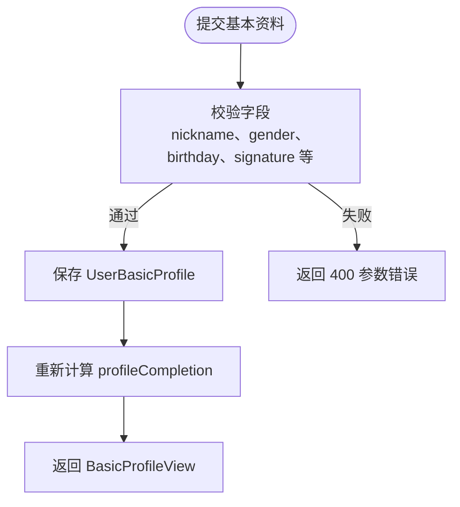
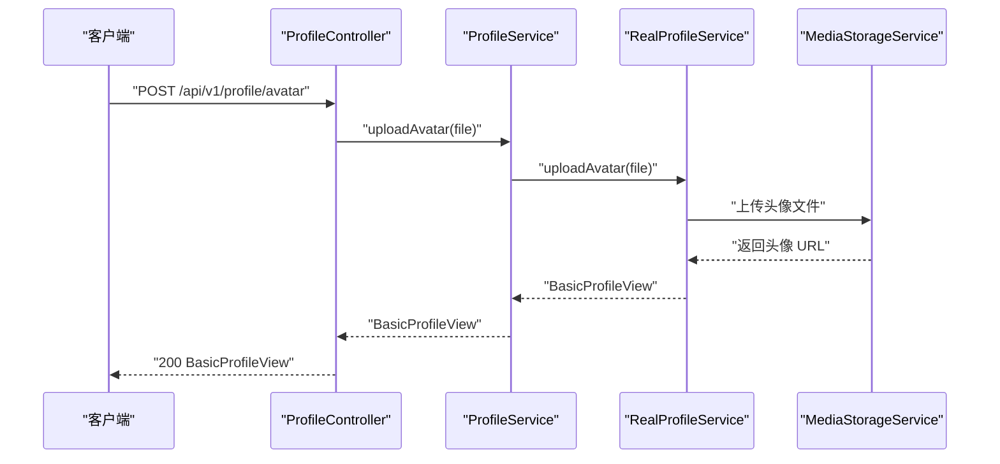
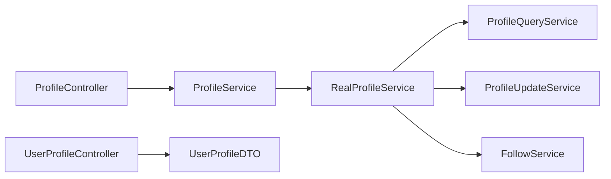

# 用户资料服务

<cite>
**本文引用的文件**   
- [ProfileController.java](file://apps/api/src/main/java/com/campuslove/api/profile/ProfileController.java)
- [UserProfileController.java](file://apps/api/src/main/java/com/campuslove/api/profile/UserProfileController.java)
- [ProfileService.java](file://apps/api/src/main/java/com/campuslove/api/profile/ProfileService.java)
- [RealProfileService.java](file://apps/api/src/main/java/com/campuslove/api/profile/RealProfileService.java)
- [MockProfileService.java](file://apps/api/src/main/java/com/campuslove/api/profile/MockProfileService.java)
- [UserProfileDTO.java](file://apps/api/src/main/java/com/campuslove/api/profile/UserProfileDTO.java)
- [ProfileQueryService.java](file://apps/api/src/main/java/com/campuslove/api/profile/ProfileQueryService.java)
- [ProfileUpdateService.java](file://apps/api/src/main/java/com/campuslove/api/profile/ProfileUpdateService.java)
- [ProfileSocialProofView.java](file://apps/api/src/main/java/com/campuslove/api/profile/ProfileSocialProofView.java)
- [ProfileConfigController.java](file://apps/api/src/main/java/com/campuslove/api/profile/ProfileConfigController.java)
- [ProfileVisitorController.java](file://apps/api/src/main/java/com/campuslove/api/profile/ProfileVisitorController.java)
- [FollowService.java](file://apps/api/src/main/java/com/campuslove/api/profile/FollowService.java)
- [MediaUploadCategory.java](file://apps/api/src/main/java/com/campuslove/api/media/MediaUploadCategory.java)
- [MediaUploadController.java](file://apps/api/src/main/java/com/campuslove/api/media/MediaUploadController.java)
- [MediaAssetService.java](file://apps/api/src/main/java/com/campuslove/api/media/MediaAssetService.java)
- [MediaAccessService.java](file://apps/api/src/main/java/com/campuslove/api/media/MediaAccessService.java)
- [MediaAccessController.java](file://apps/api/src/main/java/com/campuslove/api/media/MediaAccessController.java)
- [LocalMediaStorageService.java](file://apps/api/src/main/java/com/campuslove/api/media/LocalMediaStorageService.java)
- [MediaAsset.java](file://apps/api/src/main/java/com/campuslove/api/entity/MediaAsset.java)
- [MediaAssetRepository.java](file://apps/api/src/main/java/com/campuslove/api/repository/MediaAssetRepository.java)
- [RealNameMediaPurgeService.java](file://apps/api/src/main/java/com/campuslove/api/verification/RealNameMediaPurgeService.java)
- [RealNameCertificationRepository.java](file://apps/api/src/main/java/com/campuslove/api/verification/RealNameCertificationRepository.java)
- [RealRealNameCertificationService.java](file://apps/api/src/main/java/com/campuslove/api/verification/RealRealNameCertificationService.java)
- [RealAccountSecurityService.java](file://apps/api/src/main/java/com/campuslove/api/auth/RealAccountSecurityService.java)
- [GlobalExceptionHandler.java](file://apps/api/src/main/java/com/campuslove/api/config/GlobalExceptionHandler.java)
- [V2026.10.05.0001__add_media_asset_category.sql](file://database/flyway/sql/V2026.10.05.0001__add_media_asset_category.sql)
- [application.yml](file://apps/api/src/main/resources/application.yml)
- [real-name.vue](file://apps/client/src/subpackages/profile-extra/verification/real-name.vue)
- [api.ts](file://apps/client/src/services/api.ts)
</cite>

## 目录
1. [简介](#简介)
2. [项目结构](#项目结构)
3. [核心组件](#核心组件)
4. [架构总览](#架构总览)
5. [详细组件分析](#详细组件分析)
6. [实名照片保留策略与媒体分类授权](#实名照片保留策略与媒体分类授权)
7. [依赖关系分析](#依赖关系分析)
8. [性能与可扩展性](#性能与可扩展性)
9. [故障排查指南](#故障排查指南)
10. [结论](#结论)

## 简介
本技术文档聚焦“用户资料服务”，覆盖以下关键主题：
- 用户资料的增删改查（CRUD）与访问控制
- 隐私设置、访客查看机制与他人视角的数据裁剪
- ProfileController 与 UserProfileController 的职责分工
- RealProfileService 的业务编排与 MockProfileService 的测试支持
- 用户资料数据模型设计、字段校验规则与权限策略
- 个人资料编辑流程、头像上传处理、兴趣标签管理
- API 接口规范、错误处理与性能优化建议
- 资料完整性检查与推荐算法输入数据处理

该服务位于后端 API 模块中，围绕 Spring MVC 控制器与分层服务实现，提供基本资料、校园资料、课表资料、媒体资源、关注关系、社交证明以及个人主页聚合查询能力。

## 项目结构
与用户资料相关的代码主要位于 `apps/api/src/main/java/com/campuslove/api/profile` 包内，核心文件包括：
- 控制器层：ProfileController、UserProfileController、ProfileConfigController、ProfileVisitorController
- 服务层接口与实现：ProfileService、RealProfileService、MockProfileService
- 子服务：ProfileQueryService、ProfileUpdateService、FollowService
- 数据契约：UserProfileDTO、ProfileSocialProofView

**图表来源**
- [ProfileController.java:1-200](file://apps/api/src/main/java/com/campuslove/api/profile/ProfileController.java#L1-L200)
- [UserProfileController.java:1-200](file://apps/api/src/main/java/com/campuslove/api/profile/UserProfileController.java#L1-L200)
- [ProfileService.java:1-193](file://apps/api/src/main/java/com/campuslove/api/profile/ProfileService.java#L1-L193)
- [RealProfileService.java:1-200](file://apps/api/src/main/java/com/campuslove/api/profile/RealProfileService.java#L1-L200)
- [MockProfileService.java:1-200](file://apps/api/src/main/java/com/campuslove/api/profile/MockProfileService.java#L1-L200)
- [ProfileQueryService.java](file://apps/api/src/main/java/com/campuslove/api/profile/ProfileQueryService.java)
- [ProfileUpdateService.java](file://apps/api/src/main/java/com/campuslove/api/profile/ProfileUpdateService.java)
- [FollowService.java](file://apps/api/src/main/java/com/campuslove/api/profile/FollowService.java)
- [UserProfileDTO.java:1-37](file://apps/api/src/main/java/com/campuslove/api/profile/UserProfileDTO.java#L1-L37)
- [ProfileSocialProofView.java](file://apps/api/src/main/java/com/campuslove/api/profile/ProfileSocialProofView.java)

**章节来源**
- [ProfileController.java:1-200](file://apps/api/src/main/java/com/campuslove/api/profile/ProfileController.java#L1-L200)
- [UserProfileController.java:1-200](file://apps/api/src/main/java/com/campuslove/api/profile/UserProfileController.java#L1-L200)
- [ProfileService.java:1-193](file://apps/api/src/main/java/com/campuslove/api/profile/ProfileService.java#L1-L193)

## 核心组件
- ProfileController：负责当前用户的资料读写与媒体上传；标注 `@Profile("real")`，仅在生产真实环境激活。
- UserProfileController：统一个人主页视图端点 `/api/v1/profile/me` 与 `/api/v1/profile/{userId}`，组装并返回 UserProfileDTO。
- ProfileService：定义资料相关接口，涵盖基本资料、校园资料、课表资料、媒体上传、统计与关注关系。
- RealProfileService：真实环境实现，按读/写方法划分事务边界，委托 ProfileQueryService 与 ProfileUpdateService。
- MockProfileService：Mock 模式实现，使用内存状态模拟资料与媒体操作，便于前端联调与测试。
- ProfileQueryService：只读查询职责，如基本资料、校园资料、课表资料、统计、关注列表等。
- ProfileUpdateService：写操作职责，如保存资料、媒体上传、关注/取关。
- FollowService：封装关注关系业务逻辑。
- UserProfileDTO：个人主页统一数据契约，包含基本信息、身份、介绍、关系、媒体、社交证明、帖子等。
- ProfileSocialProofView：社交证明数据，含获赞数、点赞数、访客数、互赞数。

**章节来源**
- [ProfileController.java:1-200](file://apps/api/src/main/java/com/campuslove/api/profile/ProfileController.java#L1-L200)
- [UserProfileController.java:1-200](file://apps/api/src/main/java/com/campuslove/api/profile/UserProfileController.java#L1-L200)
- [ProfileService.java:1-193](file://apps/api/src/main/java/com/campuslove/api/profile/ProfileService.java#L1-L193)
- [RealProfileService.java:1-200](file://apps/api/src/main/java/com/campuslove/api/profile/RealProfileService.java#L1-L200)
- [MockProfileService.java:1-200](file://apps/api/src/main/java/com/campuslove/api/profile/MockProfileService.java#L1-L200)
- [UserProfileDTO.java:1-37](file://apps/api/src/main/java/com/campuslove/api/profile/UserProfileDTO.java#L1-L37)
- [ProfileSocialProofView.java](file://apps/api/src/main/java/com/campuslove/api/profile/ProfileSocialProofView.java)

## 架构总览
用户资料服务的典型请求流分为两条主线：
- 当前用户资料编辑与媒体上传：由 ProfileController 接收请求，调用 ProfileService，再由 RealProfileService 委派到 ProfileUpdateService 或 ProfileQueryService。
- 个人主页聚合展示：由 UserProfileController 组装 UserProfileDTO，从多个 Repository 读取用户、基本资料、校园资料、点赞、访客、帖子等信息，并计算关系与社交证明。

**图表来源**
- [ProfileController.java:1-200](file://apps/api/src/main/java/com/campuslove/api/profile/ProfileController.java#L1-L200)
- [ProfileService.java:1-193](file://apps/api/src/main/java/com/campuslove/api/profile/ProfileService.java#L1-L193)
- [RealProfileService.java:1-200](file://apps/api/src/main/java/com/campuslove/api/profile/RealProfileService.java#L1-L200)
- [ProfileUpdateService.java](file://apps/api/src/main/java/com/campuslove/api/profile/ProfileUpdateService.java)

## 详细组件分析

### ProfileController 职责与接口
- 基础功能：获取与保存基本资料、上传头像、背景图、照片墙图片、视频、半身照，删除照片墙图片。
- 权限控制：多数写操作要求 `hasRole('USER')`，通过 Spring Security 前置授权。
- 参数校验：使用 Jakarta Validation 注解对索引范围、必填字段进行校验。
- 响应包装：统一使用 ApiResponse 包裹结果，并通过 OpenAPI 注解描述接口。

**图表来源**
- [ProfileController.java:1-200](file://apps/api/src/main/java/com/campuslove/api/profile/ProfileController.java#L1-L200)

**章节来源**
- [ProfileController.java:1-200](file://apps/api/src/main/java/com/campuslove/api/profile/ProfileController.java#L1-L200)

### UserProfileController 职责与数据组装
- 统一入口：`GET /api/v1/profile/me` 与 `GET /api/v1/profile/{userId}`。
- 数据组装：合并 User、UserBasicProfile、UserCampusProfile，计算年龄、位置、学生身份、认证状态、MBTI、个性标签、兴趣标签、封面、照片、视频、语音介绍。
- 关系计算：他人视角下计算是否已喜欢、是否匹配、共同兴趣、匹配分数与原因。
- 社交证明：聚合点赞、访客、互赞等统计数据。
- 帖子过滤：他人视角仅展示审核通过的帖子，作者本人保留全部。

**图表来源**
- [UserProfileController.java:1-200](file://apps/api/src/main/java/com/campuslove/api/profile/UserProfileController.java#L1-L200)
- [UserProfileDTO.java:1-37](file://apps/api/src/main/java/com/campuslove/api/profile/UserProfileDTO.java#L1-L37)

**章节来源**
- [UserProfileController.java:1-200](file://apps/api/src/main/java/com/campuslove/api/profile/UserProfileController.java#L1-L200)
- [UserProfileDTO.java:1-37](file://apps/api/src/main/java/com/campuslove/api/profile/UserProfileDTO.java#L1-L37)

### RealProfileService 业务编排
- 角色定位：作为 ProfileService 的真实实现，将读方法与写方法分别委托给 ProfileQueryService 与 ProfileUpdateService。
- 事务边界：只读方法标注 `readOnly = true`，写方法开启写事务，确保缓存与事务注解生效。
- 扩展能力：支持媒体上传（背景图、头像、照片墙、视频、半身照）、校园资料与课表资料读写、关注关系管理、统计查询。

**图表来源**
- [ProfileService.java:1-193](file://apps/api/src/main/java/com/campuslove/api/profile/ProfileService.java#L1-L193)
- [RealProfileService.java:1-200](file://apps/api/src/main/java/com/campuslove/api/profile/RealProfileService.java#L1-L200)
- [ProfileQueryService.java](file://apps/api/src/main/java/com/campuslove/api/profile/ProfileQueryService.java)
- [ProfileUpdateService.java](file://apps/api/src/main/java/com/campuslove/api/profile/ProfileUpdateService.java)

**章节来源**
- [ProfileService.java:1-193](file://apps/api/src/main/java/com/campuslove/api/profile/ProfileService.java#L1-L193)
- [RealProfileService.java:1-200](file://apps/api/src/main/java/com/campuslove/api/profile/RealProfileService.java#L1-L200)

### MockProfileService 测试支持
- 运行环境：以 `@Profile("mock")` 激活，配合 MockRuntimeState 提供固定模拟数据。
- 媒体上传：通过 MediaStorageService 执行真实文件上传并更新 mock 状态，便于前端联调。
- 数据一致性：保持与真实服务一致的接口签名，确保单元测试与集成测试可复用。

**图表来源**
- [MockProfileService.java:1-200](file://apps/api/src/main/java/com/campuslove/api/profile/MockProfileService.java#L1-L200)

**章节来源**
- [MockProfileService.java:1-200](file://apps/api/src/main/java/com/campuslove/api/profile/MockProfileService.java#L1-L200)

### 个人资料编辑流程
编辑基本资料时，控制器接收请求体，校验字段后调用服务层，服务层根据读/写语义委派相应子服务，最终返回新的基本资料视图。

**图表来源**
- [ProfileController.java:1-200](file://apps/api/src/main/java/com/campuslove/api/profile/ProfileController.java#L1-L200)
- [RealProfileService.java:1-200](file://apps/api/src/main/java/com/campuslove/api/profile/RealProfileService.java#L1-L200)

**章节来源**
- [ProfileController.java:1-200](file://apps/api/src/main/java/com/campuslove/api/profile/ProfileController.java#L1-L200)
- [RealProfileService.java:1-200](file://apps/api/src/main/java/com/campuslove/api/profile/RealProfileService.java#L1-L200)

### 头像上传处理
头像上传流程包括：
- 控制器接收 multipart 文件并进行 MIME 类型与 magic bytes 校验。
- 服务层调用媒体存储服务完成上传，返回 URL。
- 将头像 URL 写入用户记录，并返回更新后的基本资料视图。

**图表来源**
- [ProfileController.java:1-200](file://apps/api/src/main/java/com/campuslove/api/profile/ProfileController.java#L1-L200)
- [ProfileService.java:1-193](file://apps/api/src/main/java/com/campuslove/api/profile/ProfileService.java#L1-L193)
- [RealProfileService.java:1-200](file://apps/api/src/main/java/com/campuslove/api/profile/RealProfileService.java#L1-L200)

**章节来源**
- [ProfileController.java:1-200](file://apps/api/src/main/java/com/campuslove/api/profile/ProfileController.java#L1-L200)

### 兴趣标签管理
- 兴趣标签来源于 UserBasicProfile 中的 interestTags 字段，由 UserPreferenceCalculator 解析为字符串列表。
- 在 UserProfileController 组装过程中，兴趣标签用于关系计算与共同兴趣展示。
- 未来可结合推荐算法输入数据进行匹配评分与理由生成。

**章节来源**
- [UserProfileController.java:1-200](file://apps/api/src/main/java/com/campuslove/api/profile/UserProfileController.java#L1-L200)
- [UserProfileDTO.java:1-37](file://apps/api/src/main/java/com/campuslove/api/profile/UserProfileDTO.java#L1-L37)

### 隐私设置与访问控制
- 控制器层面：ProfileController 与 UserProfileController 均要求 `hasRole('USER')`，未登录或无权限访问将被拒绝。
- 数据层面：他人视角下仅展示审核通过的帖子，避免泄露待审内容；敏感字段如身份证号仅在认证状态中体现。
- 访客记录：ProfileVisitorController 负责访客记录的写入与统计，ProfileController 提供资料统计与访客相关能力。

**章节来源**
- [ProfileController.java:1-200](file://apps/api/src/main/java/com/campuslove/api/profile/ProfileController.java#L1-L200)
- [UserProfileController.java:1-200](file://apps/api/src/main/java/com/campuslove/api/profile/UserProfileController.java#L1-L200)
- [ProfileVisitorController.java](file://apps/api/src/main/java/com/campuslove/api/profile/ProfileVisitorController.java)

## 依赖关系分析
ProfileController 与 UserProfileController 依赖 ProfileService、Repository 与外部服务（媒体存储、认证、偏好计算）。RealProfileService 依赖 ProfileQueryService 与 ProfileUpdateService，形成清晰的读/写分离。

**图表来源**
- [ProfileController.java:1-200](file://apps/api/src/main/java/com/campuslove/api/profile/ProfileController.java#L1-L200)
- [UserProfileController.java:1-200](file://apps/api/src/main/java/com/campuslove/api/profile/UserProfileController.java#L1-L200)
- [ProfileService.java:1-193](file://apps/api/src/main/java/com/campuslove/api/profile/ProfileService.java#L1-L193)
- [RealProfileService.java:1-200](file://apps/api/src/main/java/com/campuslove/api/profile/RealProfileService.java#L1-L200)

**章节来源**
- [ProfileController.java:1-200](file://apps/api/src/main/java/com/campuslove/api/profile/ProfileController.java#L1-L200)
- [UserProfileController.java:1-200](file://apps/api/src/main/java/com/campuslove/api/profile/UserProfileController.java#L1-L200)
- [ProfileService.java:1-193](file://apps/api/src/main/java/com/campuslove/api/profile/ProfileService.java#L1-L193)

## 性能与可扩展性
- 聚合查询优化：UserProfileController 对点赞、访客、互赞等统计采用 COUNT/SUM 聚合查询，避免 N+1 全量拉取导致的页面假死。
- 事务边界清晰：RealProfileService 对只读方法启用 readOnly 事务，提升缓存命中率与事务效率。
- 分页与限流：关注/粉丝列表提供分页接口，防止大数据集导致响应缓慢。
- 媒体上传：建议在 MediaStorageService 层引入异步任务与缩略图生成，降低同步阻塞。

[本节为通用性能建议，不直接分析具体文件]

## 故障排查指南
- 参数校验失败：ProfileController 对 index、MultipartFile 等进行校验，错误返回 400。
- 权限不足：未登录或无 USER 角色将返回 403。
- 乐观锁冲突：保存基本资料可能因并发修改返回 409。
- 文件过大或格式不支持：头像、背景图等上传返回 413 或 400。
- 数据不存在：访问他人主页时目标用户不存在会抛出异常，需在前端捕获并友好提示。

**章节来源**
- [ProfileController.java:1-200](file://apps/api/src/main/java/com/campuslove/api/profile/ProfileController.java#L1-L200)
- [UserProfileController.java:1-200](file://apps/api/src/main/java/com/campuslove/api/profile/UserProfileController.java#L1-L200)

## 结论
用户资料服务通过控制器与服务层分层设计，实现了资料 CRUD、媒体上传、关注关系、社交证明与个人主页聚合查询。ProfileController 专注当前用户资料编辑与媒体上传，UserProfileController 负责统一主页数据组装。RealProfileService 通过 ProfileQueryService 与 ProfileUpdateService 实现读/写分离，MockProfileService 提供可靠的测试支持。系统在权限控制、隐私保护与性能优化方面具备良好实践，适合继续扩展推荐算法输入数据与更精细的隐私策略。