# 钱包解锁服务

<cite>
**本文引用的文件**
- [WalletController.java](file://apps/api/src/main/java/com/campuslove/api/wallet/WalletController.java)
- [WalletServiceImpl.java](file://apps/api/src/main/java/com/campuslove/api/wallet/WalletServiceImpl.java)
- [WalletService.java](file://apps/api/src/main/java/com/campuslove/api/wallet/WalletService.java)
- [WalletUnlockService.java](file://apps/api/src/main/java/com/campuslove/api/wallet/WalletUnlockService.java)
- [RealWalletUnlockService.java](file://apps/api/src/main/java/com/campuslove/api/wallet/RealWalletUnlockService.java)
- [MockWalletUnlockService.java](file://apps/api/src/main/java/com/campuslove/api/wallet/MockWalletUnlockService.java)
- [MockWalletServiceImpl.java](file://apps/api/src/main/java/com/campuslove/api/wallet/MockWalletServiceImpl.java)
- [UserWallet.java](file://apps/api/src/main/java/com/campuslove/api/wallet/UserWallet.java)
- [WalletTransactionLog.java](file://apps/api/src/main/java/com/campuslove/api/wallet/WalletTransactionLog.java)
- [WalletUnlock.java](file://apps/api/src/main/java/com/campuslove/api/wallet/WalletUnlock.java)
- [JwtAuthenticationEntryPoint.java](file://apps/api/src/main/java/com/campuslove/api/auth/JwtAuthenticationEntryPoint.java)
- [VipBill.java](file://apps/api/src/main/java/com/campuslove/api/entity/VipBill.java)
- [BillingService.java](file://apps/api/src/main/java/com/campuslove/api/vip/BillingService.java)
- [AutoRenewService.java](file://apps/api/src/main/java/com/campuslove/api/vip/AutoRenewService.java)
- [RecommendationController.java](file://apps/api/src/main/java/com/campuslove/api/discover/RecommendationController.java)
- [RecommendationRanker.java](file://apps/api/src/main/java/com/campuslove/api/discover/RecommendationRanker.java)
- [RealWhisperService.java](file://apps/api/src/main/java/com/campuslove/api/whisper/RealWhisperService.java)
- [WalletServiceConcurrencyTest.java](file://apps/api/src/test/java/com/campuslove/api/wallet/WalletServiceConcurrencyTest.java)
- [RealWalletUnlockServiceTest.java](file://apps/api/src/test/java/com/campuslove/api/wallet/RealWalletUnlockServiceTest.java)
- [V2026.07.28.0003__wallet_tables.sql](file://database/flyway/sql/V2026.07.28.0003__wallet_tables.sql)
- [V2026.08.08.0001__wallet_unlocks.sql](file://database/flyway/sql/V2026.08.08.0001__wallet_unlocks.sql)
- [V2026.07.28.0008__add_money_foreign_keys.sql](file://database/flyway/sql/V2026.07.28.0008__add_money_foreign_keys.sql)
- [V2026.07.25.0005__create_vip_bills.sql](file://database/flyway/sql/V2026.07.25.0005__create_vip_bills.sql)
- [V2026.07.27.0002__vip_billing_log.sql](file://database/flyway/sql/V2026.07.27.0002__vip_billing_log.sql)
- [V2026.08.09.0006__remove_red_packet.sql](file://database/flyway/sql/V2026.08.09.0006__remove_red_packet.sql)
- [feedback-growth-and-auth.yaml](file://docs/openapi/feedback-growth-and-auth.yaml)
- [vip-billing.ts](file://apps/client/src/stores/vip-billing.ts)
- [bills.vue](file://apps/client/src/subpackages/vip/bills.vue)
- [api.ts](file://apps/client/src/services/api.ts)
- [VipBills.vue](file://apps/admin/src/views/business/VipBills.vue)
- [R3-ROUND2-ISSUES.tsv](file://archive/audit-round2/R3-ROUND2-ISSUES.tsv)
- [WxPayProperties.java](file://apps/api/src/main/java/com/campuslove/api/wxpay/WxPayProperties.java)
- [WxPayConfig.java](file://apps/api/src/main/java/com/campuslove/api/wxpay/WxPayConfig.java)
- [WxPayBootstrapChecker.java](file://apps/api/src/main/java/com/campuslove/api/wxpay/WxPayBootstrapChecker.java)
- [WxPayModels.java](file://apps/api/src/main/java/com/campuslove/api/wxpay/WxPayModels.java)
- [WxPayRequestSigner.java](file://apps/api/src/main/java/com/campuslove/api/wxpay/WxPayRequestSigner.java)
- [WxPayCallbackGuard.java](file://apps/api/src/main/java/com/campuslove/api/wxpay/WxPayCallbackGuard.java)
- [WxPayCallbackVerifier.java](file://apps/api/src/main/java/com/campuslove/api/wxpay/WxPayCallbackVerifier.java)
- [WxPayJsapiService.java](file://apps/api/src/main/java/com/campuslove/api/wxpay/WxPayJsapiService.java)
- [WxPayRefundNotifyController.java](file://apps/api/src/main/java/com/campuslove/api/wxpay/WxPayRefundNotifyController.java)
- [WxPayApiException.java](file://apps/api/src/main/java/com/campuslove/api/wxpay/WxPayApiException.java)
- [WxPayDisabledException.java](file://apps/api/src/main/java/com/campuslove/api/wxpay/WxPayDisabledException.java)
- [BillingController.java](file://apps/api/src/main/java/com/campuslove/api/vip/BillingController.java)
- [PaymentCallbackLog.java](file://apps/api/src/main/java/com/campuslove/api/entity/PaymentCallbackLog.java)
- [PaymentMetrics.java](file://apps/api/src/main/java/com/campuslove/api/monitor/PaymentMetrics.java)
- [SecurityConfig.java](file://apps/api/src/main/java/com/campuslove/api/config/SecurityConfig.java)
- [MockSecurityConfig.java](file://apps/api/src/main/java/com/campuslove/api/config/MockSecurityConfig.java)
- [SecurityConfigTest.java](file://apps/api/src/test/java/com/campuslove/api/config/SecurityConfigTest.java)
- [application-real.yml](file://apps/api/src/main/resources/application-real.yml)
- [V2026.10.05.0012__extend_payment_callback_log.sql](file://database/flyway/sql/V2026.10.05.0012__extend_payment_callback_log.sql)
</cite>

## 目录
1. [简介](#简介)
2. [项目结构](#项目结构)
3. [核心组件](#核心组件)
4. [架构总览](#架构总览)
5. [详细组件分析](#详细组件分析)
6. [接口设计](#接口设计)
7. [核心业务逻辑](#核心业务逻辑)
8. [解锁算法实现](#解锁算法实现)
9. [Mock 与真实实现切换](#mock-与真实实现切换)
10. [数据模型](#数据模型)
11. [权限粒度与安全校验](#权限粒度与安全校验)
12. [消费记录与使用统计](#消费记录与使用统计)
13. [并发控制与防刷机制](#并发控制与防刷机制)
14. [配置与开关](#配置与开关)
15. [性能考虑](#性能考虑)
16. [故障排查指南](#故障排查指南)
17. [依赖关系分析](#依赖关系分析)
18. [微信支付 APIv3 支付管道](#微信支付-apiv3-支付管道)
19. [结论](#结论)

## 简介

钱包解锁服务是 `campuslove` 后端 API 中负责虚拟钱包（金币/余额）与「内容解锁」两条主线的能力集合，位于包 `com.campuslove.api.wallet` 下，对外统一以 `/api/v1/wallet` 前缀暴露 REST 接口。

从仓库真实代码看，本服务由四个核心类构成：

- `WalletController`（599 行，`@RestController` + `@RequestMapping("/api/v1/wallet")`）承载余额查询、流水查询、充值、解锁、扣款五类端点，并内联定义了 8 个视图/请求记录类型。
- `WalletServiceImpl`（365 行，`@Service`）实现余额扣减 `deduct`、充值 `recharge`、余额查询 `getBalance`、流水分页 `listTransactions` 四个账务原语。
- `RealWalletUnlockService`（150 行，`@Service`）提供真实环境下的解锁实现，含 `unlock` 与 `findUnlockedTargetIds` 两个方法。
- `MockWalletUnlockService`（99 行，`@Service`）提供本地开发用的解锁实现，方法与真实实现同名同签名，便于按配置切换。

需要说明的边界：本页面只描述仓库中确实存在的实现。事实与代码中未出现的能力（例如「余额冻结/解冻」的独立接口、「解锁任务队列」的持久化调度、「失败重试」的定时补偿作业）在当前仓库中没有对应代码证据，本文不做推断性描述，并在相应章节如实标注"无接入证据"。

**章节来源**
- [WalletController.java:66-69](file://apps/api/src/main/java/com/campuslove/api/wallet/WalletController.java#L66-L69)
- [WalletController.java:201-202](file://apps/api/src/main/java/com/campuslove/api/wallet/WalletController.java#L201-L202)
- [WalletServiceImpl.java:51-52](file://apps/api/src/main/java/com/campuslove/api/wallet/WalletServiceImpl.java#L51-L52)
- [RealWalletUnlockService.java:33-34](file://apps/api/src/main/java/com/campuslove/api/wallet/RealWalletUnlockService.java#L33-L34)
- [MockWalletUnlockService.java:22-23](file://apps/api/src/main/java/com/campuslove/api/wallet/MockWalletUnlockService.java#L22-L23)

## 项目结构

钱包解锁服务在仓库中的物理布局遵循「后端按业务分包 + 数据库按 Flyway 版本化 + 前端按端分离」的组织方式。本节给出与本主题直接相关的目录位置。

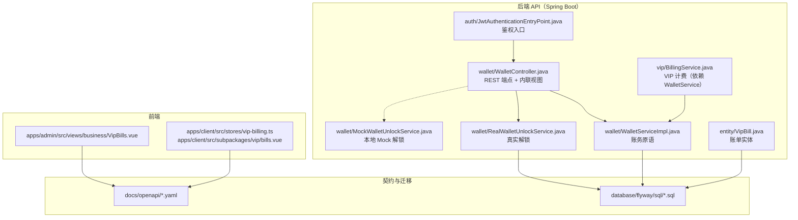

[此图为概念结构，节点级路径来自下表所列真实文件，边表示本文后续章节论证出的调用与依赖方向]

| 层 | 路径 | 规模（总行数） | 职责 |
| --- | --- | --- | --- |
| 接口层 | `apps/api/src/main/java/com/campuslove/api/wallet/WalletController.java` | 599 | `/api/v1/wallet` 五个端点、视图与请求体定义、演示充值限额 |
| 服务层 | `apps/api/src/main/java/com/campuslove/api/wallet/WalletServiceImpl.java` | 365 | 扣款、充值、余额、流水四个账务原语 |
| 服务层 | `apps/api/src/main/java/com/campuslove/api/wallet/RealWalletUnlockService.java` | 150 | 真实解锁写路径与批量解锁判定 |
| 服务层 | `apps/api/src/main/java/com/campuslove/api/wallet/MockWalletUnlockService.java` | 99 | 本地 Mock 解锁，签名与真实实现一致 |
| 安全层 | `apps/api/src/main/java/com/campuslove/api/auth/JwtAuthenticationEntryPoint.java` | 116 | 未认证请求的入口处理 |
| 领域实体 | `apps/api/src/main/java/com/campuslove/api/entity/VipBill.java` | 280 | VIP 账单实体，含 `BillType` / `BillStatus` |
| 关联服务 | `apps/api/src/main/java/com/campuslove/api/vip/BillingService.java` | 395 | 注入 `WalletService`，把钱包作为支付方式之一 |
| 迁移脚本 | `database/flyway/sql/V2026.07.25.0005__create_vip_bills.sql` | 48 | 账单表建表 |
| 迁移脚本 | `database/flyway/sql/V2026.07.27.0002__vip_billing_log.sql` | 37 | 计费日志表 |
| 契约 | `docs/openapi/feedback-growth-and-auth.yaml` | 2501 | 认证/会话相关 path 与 operationId |
| 前端管理端 | `apps/admin/src/views/business/VipBills.vue` | 499 | 账单列表视图 |
| 前端小程序 | `apps/client/src/stores/vip-billing.ts` | 254 | `useVipBillingStore` 与账单类型定义 |
| 前端小程序 | `apps/client/src/subpackages/vip/bills.vue` | 536 | 账单页面模板与样式 |

**章节来源**
- [WalletController.java:66-69](file://apps/api/src/main/java/com/campuslove/api/wallet/WalletController.java#L66-L69)
- [WalletServiceImpl.java:51-52](file://apps/api/src/main/java/com/campuslove/api/wallet/WalletServiceImpl.java#L51-L52)
- [RealWalletUnlockService.java:33-34](file://apps/api/src/main/java/com/campuslove/api/wallet/RealWalletUnlockService.java#L33-L34)
- [MockWalletUnlockService.java:22-23](file://apps/api/src/main/java/com/campuslove/api/wallet/MockWalletUnlockService.java#L22-L23)
- [VipBill.java:48-64](file://apps/api/src/main/java/com/campuslove/api/entity/VipBill.java#L48-L64)
- [BillingService.java:39-66](file://apps/api/src/main/java/com/campuslove/api/vip/BillingService.java#L39-L66)

## 核心组件

- **WalletController**：`@RestController`，类级映射 `@RequestMapping("/api/v1/wallet")`（L66-L67）。暴露 `getBalance`（`@GetMapping("/balance")` L201）、`listTransactions`（`@GetMapping("/transactions")` L214）、`recharge`（`@PostMapping("/recharge")` L249）、`unlock`（`@PostMapping("/unlock")` L419）、`deduct`（`@PostMapping("/deduct")` L447）五个端点；文件尾部内联声明了 `WalletBalanceView`、`WalletDeductView`、`DeductRequest`、`WalletTransactionItemView`、`WalletTransactionListView`、`WalletRechargeView`、`RechargeRequest`、`UnlockRequest` 八个类型（L515-L599）。控制器还持有演示充值的三项限额字段与四类解锁单价字段（L135-L172）。
- **WalletServiceImpl**：`@Service`（L51），实现 `WalletService` 契约的四个账务原语——`deduct(Long userId, Long amountCents, String orderId, String relatedType, String relatedId)`（L112）、`recharge(...)` 同形参（L204）、`getBalance(Long userId)`（L280）、`listTransactions(Long userId, Pageable pageable)`（L296）。
- **WalletUnlockService（接口）**：解锁能力的统一抽象，被真实与 Mock 两个实现同时 `implements`，方法为 `unlock(userId, targetType, targetId)` 与 `findUnlockedTargetIds(userId, targetType, targetIds)`，返回类型分别为 `WalletUnlockView` 与 `Set<Long>`。
- **RealWalletUnlockService**：`@Profile("real")` + `@Service`（L32-L34），构造注入 `WalletService` 与 `WalletUnlockRepository`（L49-L52），按配置单价 `app.unlock-price.liked-me` / `app.unlock-price.visitor`（L42-L47）完成「查已解锁 → 幂等扣费 → 写解锁记录」的三步写路径（L56-L108）。
- **MockWalletUnlockService**：`@Profile("mock")` + `@Service`（L21-L23），仅注入 `WalletService`（L40-L42），用 `ConcurrentHashMap.newKeySet()` 构成的内存集合 `unlockRecords` 替代 `wallet_unlocks` 表（L38、L85-L87）。
- **JwtAuthenticationEntryPoint**：`@Component`（L55-L56），安全链上未通过认证请求的入口处理器，是 `/api/v1/wallet/**` 端点鉴权失败时的响应来源。
- **VipBill / BillingService**：账单实体与计费服务。`BillingService` 字段级注入 `WalletService walletService`（L66），说明钱包余额同时作为 VIP 购买的支付通道被消费；账单实体 `VipBill` 定义 `BillType`（L67）与 `BillStatus`（L77）两个内嵌类型。
- **前端配套**：`apps/client/src/stores/vip-billing.ts` 导出 `BillType`、`BillStatus`、`BillView`、`BillListResponse`、`BillListParams` 与 `useVipBillingStore`；管理端 `VipBills.vue` 提供账单列表视图。

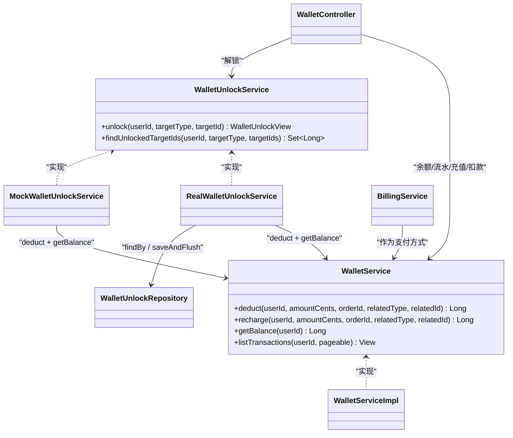

**图表来源**
- [WalletController.java:201-202](file://apps/api/src/main/java/com/campuslove/api/wallet/WalletController.java#L201-L202)
- [WalletController.java:419-423](file://apps/api/src/main/java/com/campuslove/api/wallet/WalletController.java#L419-L423)
- [WalletServiceImpl.java:112-112](file://apps/api/src/main/java/com/campuslove/api/wallet/WalletServiceImpl.java#L112-L112)
- [WalletServiceImpl.java:280-296](file://apps/api/src/main/java/com/campuslove/api/wallet/WalletServiceImpl.java#L280-L296)
- [RealWalletUnlockService.java:49-56](file://apps/api/src/main/java/com/campuslove/api/wallet/RealWalletUnlockService.java#L49-L56)
- [MockWalletUnlockService.java:40-45](file://apps/api/src/main/java/com/campuslove/api/wallet/MockWalletUnlockService.java#L40-L45)

**章节来源**
- [WalletController.java:135-172](file://apps/api/src/main/java/com/campuslove/api/wallet/WalletController.java#L135-L172)
- [WalletController.java:515-599](file://apps/api/src/main/java/com/campuslove/api/wallet/WalletController.java#L515-L599)
- [WalletServiceImpl.java:51-52](file://apps/api/src/main/java/com/campuslove/api/wallet/WalletServiceImpl.java#L51-L52)
- [RealWalletUnlockService.java:32-52](file://apps/api/src/main/java/com/campuslove/api/wallet/RealWalletUnlockService.java#L32-L52)
- [MockWalletUnlockService.java:21-42](file://apps/api/src/main/java/com/campuslove/api/wallet/MockWalletUnlockService.java#L21-L42)
- [BillingService.java:39-66](file://apps/api/src/main/java/com/campuslove/api/vip/BillingService.java#L39-L66)
- [VipBill.java:48-77](file://apps/api/src/main/java/com/campuslove/api/entity/VipBill.java#L48-L77)
- [JwtAuthenticationEntryPoint.java:55-56](file://apps/api/src/main/java/com/campuslove/api/auth/JwtAuthenticationEntryPoint.java#L55-L56)

## 架构总览

本服务在运行时呈「一个控制器 + 两组服务契约」的形态：账务侧由 `WalletService`（实现 `WalletServiceImpl`）负责余额与流水，解锁侧由 `WalletUnlockService`（实现 `RealWalletUnlockService` / `MockWalletUnlockService`）负责解锁判定与记录。解锁服务并不直接操作余额，而是反向调用账务侧的 `deduct` 与 `getBalance`，从而把「扣费」这件事收敛到唯一的悲观锁 + 幂等键入口。

一次 `/api/v1/wallet/unlock` 请求在 real profile 下的完整链路如下：

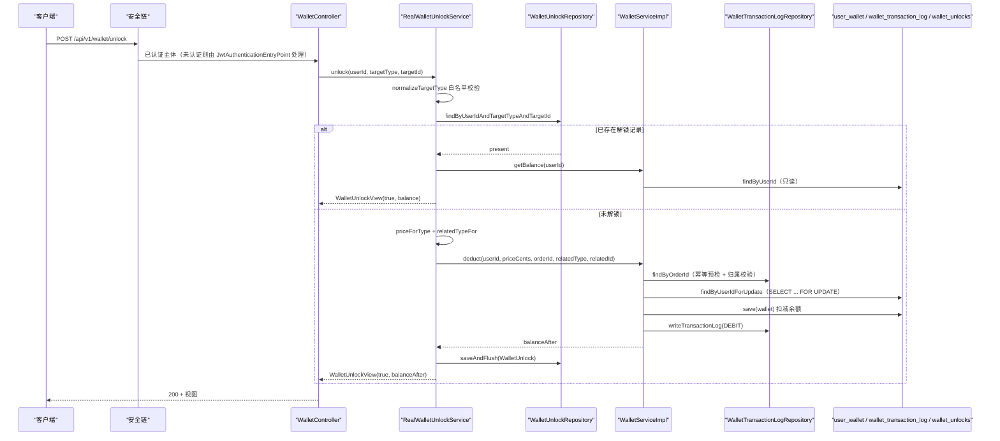

**图表来源**
- [RealWalletUnlockService.java:56-108](file://apps/api/src/main/java/com/campuslove/api/wallet/RealWalletUnlockService.java#L56-L108)
- [RealWalletUnlockService.java:110-124](file://apps/api/src/main/java/com/campuslove/api/wallet/RealWalletUnlockService.java#L110-L124)
- [WalletServiceImpl.java:110-192](file://apps/api/src/main/java/com/campuslove/api/wallet/WalletServiceImpl.java#L110-L192)
- [WalletServiceImpl.java:278-301](file://apps/api/src/main/java/com/campuslove/api/wallet/WalletServiceImpl.java#L278-L301)
- [MockWalletUnlockService.java:44-72](file://apps/api/src/main/java/com/campuslove/api/wallet/MockWalletUnlockService.java#L44-L72)
- [JwtAuthenticationEntryPoint.java:55-56](file://apps/api/src/main/java/com/campuslove/api/auth/JwtAuthenticationEntryPoint.java#L55-L56)

三条设计要点值得单独强调：

1. **解锁不重复扣费**。`RealWalletUnlockService.unlock` 的第一步是查 `wallet_unlocks` 是否已有记录，命中即直接返回 `{unlocked:true, balance}` 且不产生任何流水（L66-L70）。批量场景由 `findUnlockedTargetIds` 承担，供列表页一次性判定哪些目标已解锁，避免逐项调用（L110-L124）。
2. **扣费唯一入口是 `deduct`**。`unlock` 不写 SQL、不改余额，只把「单价、幂等订单号、业务类型、关联 ID」四元组交给 `WalletService.deduct`（L84），所有余额一致性由账务侧的三重保障负责（`WalletServiceImpl` 类注释 L23-L34）。
3. **profile 二选一**。账务实现 `WalletServiceImpl` 与真实解锁实现同为 `@Profile("real")`（`WalletServiceImpl.java` L50、`RealWalletUnlockService.java` L32），而 `MockWalletUnlockService` 为 `@Profile("mock")`（L21）：mock 环境下解锁走内存集合，real 环境走仓储，两者对控制器暴露同一接口。

**章节来源**
- [RealWalletUnlockService.java:16-31](file://apps/api/src/main/java/com/campuslove/api/wallet/RealWalletUnlockService.java#L16-L31)
- [RealWalletUnlockService.java:54-124](file://apps/api/src/main/java/com/campuslove/api/wallet/RealWalletUnlockService.java#L54-L124)
- [MockWalletUnlockService.java:14-23](file://apps/api/src/main/java/com/campuslove/api/wallet/MockWalletUnlockService.java#L14-L23)
- [WalletServiceImpl.java:18-52](file://apps/api/src/main/java/com/campuslove/api/wallet/WalletServiceImpl.java#L18-L52)

## 详细组件分析

本节先给出四个核心类的成员级清单（方法名与定义行均取自源码），随后各专项章节分别展开其中一块。

### 成员清单

| 类 | 定义行 | 公开成员（定义行） | 私有成员（定义行） |
| --- | --- | --- | --- |
| `WalletController` | L69 | `getBalance`（L201-L202）、`listTransactions`（L214-L215）、`recharge`（L249-L253）、`unlock`（L419-L423）、`deduct`（L447-L451） | `tryConsumeDemoRechargeTotalQuota`（L293）、`tryIncrementDemoRechargeCount`（L340）、`tryIncrementLocalDemoRechargeCount`（L375）、`resolveServerPrice`（L489）、`toItemView`（L500） |
| `WalletServiceImpl` | L52 | `deduct`（L112）、`recharge`（L204）、`getBalance`（L280）、`listTransactions`（L296） | `initWallet`（L311）、`validateParams`（L328）、`writeTransactionLog`（L349） |
| `RealWalletUnlockService` | L34 | `unlock`（L56）、`findUnlockedTargetIds`（L112） | `normalizeTargetType`（L127）、`priceForType`（L139）、`relatedTypeFor`（L145） |
| `MockWalletUnlockService` | L23 | `unlock`（L45）、`findUnlockedTargetIds`（L75） | `memKey`（L85）、`normalizeTargetType`（L89） |

契约类型集中在控制器文件尾部：`WalletBalanceView`（L515）、`WalletDeductView`（L519）、`DeductRequest`（L534）、`WalletTransactionItemView`（L546）、`WalletTransactionListView`（L559）、`WalletRechargeView`（L568）、`RechargeRequest`（L580）、`UnlockRequest`（L593）。

### 职责切分依据

- 控制器只做**身份提取、语义校验、定价去信任、限额风控与视图装配**，不含任何余额算术：`getBalance` 与 `listTransactions` 是两行转发（L202-L205、L218-L223），`unlock` 是单行转发（L424-L425）。
- 账务服务只做**余额算术与流水落库**，不含业务语义判断：业务类型校验靠白名单集合（L71-L82），单价由调用方传入。
- 解锁服务只做**类型归一化、计价、判重与记录写入**，扣费外包给 `WalletService.deduct`（`RealWalletUnlockService.java` L84）。
- 这一分工使「新增一种解锁场景」的改动面可枚举：加 `WalletUnlock.TARGET_TYPE_*` 常量与 `WalletTransactionLog.RELATED_TYPE_*` 常量、扩 `normalizeTargetType` / `priceForType` / `relatedTypeFor` 三个私有分支（L127-L149）、若走 `/wallet/deduct` 直调还需同时扩两张白名单（`WalletController.java` L112-L117、`WalletServiceImpl.java` L71-L82）。

**章节来源**
- [WalletController.java:189-224](file://apps/api/src/main/java/com/campuslove/api/wallet/WalletController.java#L189-L224)
- [WalletController.java:249-253](file://apps/api/src/main/java/com/campuslove/api/wallet/WalletController.java#L249-L253)
- [WalletController.java:293-293](file://apps/api/src/main/java/com/campuslove/api/wallet/WalletController.java#L293-L293)
- [WalletController.java:340-340](file://apps/api/src/main/java/com/campuslove/api/wallet/WalletController.java#L340-L340)
- [WalletController.java:375-375](file://apps/api/src/main/java/com/campuslove/api/wallet/WalletController.java#L375-L375)
- [WalletController.java:419-423](file://apps/api/src/main/java/com/campuslove/api/wallet/WalletController.java#L419-L423)
- [WalletController.java:447-451](file://apps/api/src/main/java/com/campuslove/api/wallet/WalletController.java#L447-L451)
- [WalletController.java:489-515](file://apps/api/src/main/java/com/campuslove/api/wallet/WalletController.java#L489-L515)
- [WalletController.java:519-599](file://apps/api/src/main/java/com/campuslove/api/wallet/WalletController.java#L519-L599)
- [WalletServiceImpl.java:52-52](file://apps/api/src/main/java/com/campuslove/api/wallet/WalletServiceImpl.java#L52-L52)
- [WalletServiceImpl.java:71-82](file://apps/api/src/main/java/com/campuslove/api/wallet/WalletServiceImpl.java#L71-L82)
- [WalletServiceImpl.java:112-112](file://apps/api/src/main/java/com/campuslove/api/wallet/WalletServiceImpl.java#L112-L112)
- [WalletServiceImpl.java:204-204](file://apps/api/src/main/java/com/campuslove/api/wallet/WalletServiceImpl.java#L204-L204)
- [WalletServiceImpl.java:280-280](file://apps/api/src/main/java/com/campuslove/api/wallet/WalletServiceImpl.java#L280-L280)
- [WalletServiceImpl.java:296-296](file://apps/api/src/main/java/com/campuslove/api/wallet/WalletServiceImpl.java#L296-L296)
- [WalletServiceImpl.java:311-349](file://apps/api/src/main/java/com/campuslove/api/wallet/WalletServiceImpl.java#L311-L349)
- [RealWalletUnlockService.java:34-34](file://apps/api/src/main/java/com/campuslove/api/wallet/RealWalletUnlockService.java#L34-L34)
- [RealWalletUnlockService.java:56-149](file://apps/api/src/main/java/com/campuslove/api/wallet/RealWalletUnlockService.java#L56-L149)
- [MockWalletUnlockService.java:23-23](file://apps/api/src/main/java/com/campuslove/api/wallet/MockWalletUnlockService.java#L23-L23)
- [MockWalletUnlockService.java:45-98](file://apps/api/src/main/java/com/campuslove/api/wallet/MockWalletUnlockService.java#L45-L98)

## 接口设计

`WalletController` 是本服务唯一的 HTTP 入口。类上依次标注 `@RestController`、`@RequestMapping("/api/v1/wallet")`、`@Validated`（L66-L69）。构造注入两个契约：`WalletService walletService` 与 `WalletUnlockService walletUnlockService`（L119-L125、L189-L192）。

### 端点清单

| 方法 | 完整路径 | 注解栈 | 返回类型 | 关键约束 |
| --- | --- | --- | --- | --- |
| GET | `/api/v1/wallet/balance` | `@GetMapping("/balance")` | `WalletBalanceView(Long balanceCents)` | 无请求参数，用户身份取自 JWT 上下文（L201-L205） |
| GET | `/api/v1/wallet/transactions` | `@GetMapping("/transactions")` | `WalletTransactionListView` | `page` 默认 0 且 `@Min(0)`；`size` 默认 20 且 `@Min(1) @Max(100)`（L214-L224） |
| POST | `/api/v1/wallet/recharge` | `@PostMapping` + `@FeatureSwitch(FeatureSwitchKeys.COMMERCE_COIN)` + `@Idempotent` + `@PreAuthorize("hasRole('USER')")` | `WalletRechargeView` | 请求体 `RechargeRequest`，`@Valid`（L249-L253） |
| POST | `/api/v1/wallet/unlock` | 同上四注解组合 | `WalletUnlockView` | 请求体 `UnlockRequest`（L419-L423） |
| POST | `/api/v1/wallet/deduct` | 同上四注解组合 | `WalletDeductView` | 请求体 `DeductRequest`（L447-L451） |

三个写端点共享同一套横切注解：`@FeatureSwitch(FeatureSwitchKeys.COMMERCE_COIN)` 把整个「金币商业化」能力挂在功能开关下，`@Idempotent` 要求客户端携带 `Idempotency-Key` 请求头，`@PreAuthorize("hasRole('USER')")` 限定普通用户角色。两个只读端点（`/balance`、`/transactions`）没有这三个注解，仅依赖安全链与 `SecurityUtils.getCurrentUserId()`。

### 请求与响应契约

控制器文件末尾以 Java `record` 形式声明了 8 个契约类型（L514-L599）：

- `WalletBalanceView(Long balanceCents)`：余额视图，单位为分（L515）。
- `WalletDeductView(Long balanceAfterCents, Long amountCents, String orderId)`：扣费结果，`amountCents` 返回的是**服务端实际扣减金额**而非客户端提交值（L519-L523、L477）。
- `DeductRequest(amountCents, orderId, relatedType, relatedId)`：`amountCents` 需 `@NotNull @Min(1) @Max(MAX_SINGLE_AMOUNT_CENTS)`；`relatedType` 需 `@NotNull`（L534-L543）。自 2026-10-05 起 `amountCents` 降级为「建议值」。
- `WalletTransactionItemView(id, type, amount, balanceAfter, relatedType, relatedId, orderId, remark, createdAt)`：字段与 `WalletTransactionLog` 逐一对齐，由静态映射 `toItemView` 生成（L499-L511、L546-L556）。
- `WalletTransactionListView(items, total, page, size, totalPages)`：分页结构刻意对齐 VIP 账单的 `BillListResponse`（L558-L565）。
- `WalletRechargeView(balanceAfterCents, amountCents, orderId, relatedType)`（L568-L573）。
- `RechargeRequest(amountCents)`：`@NotNull @Min(1) @Max(MAX_SINGLE_AMOUNT_CENTS)`（L580-L585）。
- `UnlockRequest(targetType, targetId)`：`targetType` `@NotNull`；`targetId` `@NotNull @Min(1)`（L593-L599）。

金额上限常量 `MAX_SINGLE_AMOUNT_CENTS = 100_000_000L`（100 万元，单位分）在 L105 声明，被两个请求体的 `@Max` 直接引用（L537、L583），校验消息取自 `ErrorMessages` 常量。

### /wallet/deduct 的三层金额防线

`deduct` 端点是本服务安全设计最密集的一处，其代码路径（L451-L478）依次执行：

1. **客户端类型白名单**：`CLIENT_DEDUCT_RELATED_TYPE_WHITELIST` 仅含 `MESSAGE_UNLOCK`、`VISITORS_UNLOCK`、`LIKES_UNLOCK`、`WHISPER_UNLOCK` 四项（L112-L117）；不在名单内直接抛 `IllegalArgumentException`，阻止客户端伪造 `ADMIN_ADJUST`、`SWEET_TALK` 等管理/预留语义（L455-L459）。
2. **服务端价格目录**：`resolveServerPrice` 以 `switch` 按 `relatedType` 取注入的定价字段，配置值 `<= 0` 时回退内置默认价（`MESSAGE_UNLOCK` 100、`VISITORS_UNLOCK` 300、`LIKES_UNLOCK` 300、`WHISPER_UNLOCK` 200 分），名单外类型返回 0（L489-L497）。定价为 0 时拒绝扣费（L462-L466）。
3. **客户端金额不信任**：当 `request.amountCents() != serverPrice` 时仅记录 warn 日志，**以服务端价为准**继续扣费，使调价无需客户端发版协同（L467-L471）。

订单号缺省时服务端生成 `"UNLOCK-" + UUID.randomUUID()`（L472-L474），随后调用 `walletService.deduct(userId, serverPrice, orderId, relatedType, relatedId)`（L475-L476）。

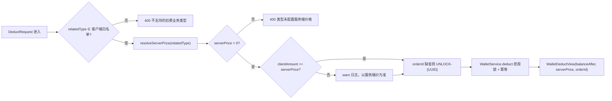

**图表来源**
- [WalletController.java:112-117](file://apps/api/src/main/java/com/campuslove/api/wallet/WalletController.java#L112-L117)
- [WalletController.java:451-478](file://apps/api/src/main/java/com/campuslove/api/wallet/WalletController.java#L451-L478)
- [WalletController.java:489-497](file://apps/api/src/main/java/com/campuslove/api/wallet/WalletController.java#L489-L497)
- [WalletServiceImpl.java:110-118](file://apps/api/src/main/java/com/campuslove/api/wallet/WalletServiceImpl.java#L110-L118)

**章节来源**
- [WalletController.java:66-69](file://apps/api/src/main/java/com/campuslove/api/wallet/WalletController.java#L66-L69)
- [WalletController.java:105-125](file://apps/api/src/main/java/com/campuslove/api/wallet/WalletController.java#L105-L125)
- [WalletController.java:189-224](file://apps/api/src/main/java/com/campuslove/api/wallet/WalletController.java#L189-L224)
- [WalletController.java:249-253](file://apps/api/src/main/java/com/campuslove/api/wallet/WalletController.java#L249-L253)
- [WalletController.java:419-423](file://apps/api/src/main/java/com/campuslove/api/wallet/WalletController.java#L419-L423)
- [WalletController.java:447-599](file://apps/api/src/main/java/com/campuslove/api/wallet/WalletController.java#L447-L599)
- [WalletServiceImpl.java:110-118](file://apps/api/src/main/java/com/campuslove/api/wallet/WalletServiceImpl.java#L110-L118)

## 核心业务逻辑

`WalletServiceImpl` 标注 `@Profile("real")` + `@Service`，实现 `WalletService` 接口（L50-L52），构造注入 `UserWalletRepository` 与 `WalletTransactionLogRepository`（L84-L91）。它是钱包侧唯一的资金写入口。

### 余额计算口径

余额以「分」为最小单位存于 `user_wallet.balance_cents`，Java 侧对应 `UserWallet.getBalanceCents()`。计算规则完全由两个方法体内的两行算术决定：

- 扣减：`newBalance = wallet.getBalanceCents() - amountCents`，随后 `setBalanceCents(newBalance)` 并刷新 `updatedAt`（L153-L156）。
- 充值：`currentBalance = balanceCents == null ? 0L : balanceCents`，`newBalance = currentBalance + amountCents`（L231-L234）。
- 查询：`getBalance` 走 `findByUserId` 映射 `UserWallet::getBalanceCents`，钱包不存在时 `orElse(0L)`，且**读操作不创建钱包记录**（L278-L287）。

`frozenCents`（冻结金额）字段在 `initWallet` 中被初始化为 `0L`（L315），对应 DDL 里的 `frozen_cents BIGINT NOT NULL DEFAULT 0 COMMENT '冻结金额（分，预留）'`；在当前钱包扣减/充值路径中没有任何方法读写该字段，仓库中**不存在余额冻结/解冻的业务接口**，它仅作为表结构与实体的预留列存在。

### 扣减流程

`deduct` 的事务边界被刻意声明为 `@Transactional(noRollbackFor = DataIntegrityViolationException.class)`（L111），这是 FIN HIGH-16 修复的结果：原实现在事务内捕获唯一约束冲突后继续提交，而事务已被标记 rollback-only，提交时抛 `UnexpectedRollbackException`，导致「用户收到失败但资金已处理」（L105-L108）。完整五步流程（L113-L166）：

1. `validateParams(userId, amountCents, orderId, relatedType)`：四个必填项分别校验，`amountCents <= 0`、`orderId` 空白、`relatedType` 空白各自抛 `IllegalArgumentException`（L328-L341）。
2. **服务层 relatedType 白名单**：`DEDUCT_RELATED_TYPE_WHITELIST`（L71-L82）是比控制器客户端白名单更宽的一层，它同时容纳服务端内部类型——`RELATED_TYPE_VIP_RENEW`、`RELATED_TYPE_UNLOCK_LIKED_ME`、`RELATED_TYPE_UNLOCK_VISITOR`、`RELATED_TYPE_SWEET_TALK`、`"ADMIN_ADJUST"`、四个客户端解锁类型与 `RELATED_TYPE_WHISPER_SEND`。名单外类型记 warn 后抛错（L114-L118）。
3. **幂等预检**：`transactionLogRepository.findByOrderId(orderId)` 命中即返回既有 `balanceAfter`；命中前必须校验流水归属用户，`logEntry.getUserId()` 与入参 `userId` 不一致时抛 `"orderId 已存在但归属用户不一致"`（infra R2-00266，L121-L132）。
4. **悲观锁取钱包**：`findByUserIdForUpdate(userId)`（`SELECT ... FOR UPDATE`），缺失时经 `orElseGet` 调 `initWallet` 建余额 0 的记录（L136-L142）。
5. **余额校验与落库**：`balanceCents < amountCents` 抛 `InsufficientBalanceException(userId, amountCents, currentBalance)`（L145-L150）；否则保存余额、写 `DEBIT` 流水，remark 为 `"扣减：" + relatedType + " orderId=" + orderId`（L152-L162）。

### 充值流程

`recharge` 与 `deduct` 同形参、同事务注解（L202-L204），方向相反、写 `CREDIT` 流水（L239-L241），并有三点差异：

- 不做 relatedType 白名单校验（白名单只约束扣费方向）。
- 不做余额充足性校验。
- 幂等命中分支与冲突重查分支都补齐了归属用户校验（R4-00331，L211-L216、L252-L257），与 `deduct` 的 R2-00266 对齐；`deduct` 的冲突重查分支未重复该校验。

### 异常处理矩阵

| 触发条件 | 抛出类型 | 事务结局 | 出处 |
| --- | --- | --- | --- |
| 余额不足 | `InsufficientBalanceException` | 回滚（未产生变更） | L145-L150、L167-L169 |
| 幂等冲突且重查命中 | 不抛，返回 `balanceAfter` | 提交 | L170-L178、L246-L259 |
| 幂等冲突且重查为空 | `RuntimeException(WALLET_DEDUCT_ROLLBACK / WALLET_RECHARGE_ROLLBACK)` | 显式 `setRollbackOnly()` 强制回滚（P0-16） | L179-L187、L261-L266 |
| 数据库访问异常 | `RuntimeException(WALLET_*_FAILED_RETRY)` | 回滚 | L188-L191、L267-L270 |
| relatedType 不在白名单 | `IllegalArgumentException(UNSUPPORTED_DEDUCT_TYPE_PREFIX + ...)` | 回滚 | L114-L118 |

P0-16 的强制回滚分支值得强调：它通过 `TransactionAspectSupport.currentTransactionStatus().setRollbackOnly()` 配合抛异常「双保险」，避免出现「余额已 flush 但流水未写入」的中间态——那种状态下 `orderId` 幂等键失效，同一订单重试会二次扣款（L179-L183）。

**章节来源**
- [WalletServiceImpl.java:18-52](file://apps/api/src/main/java/com/campuslove/api/wallet/WalletServiceImpl.java#L18-L52)
- [WalletServiceImpl.java:56-91](file://apps/api/src/main/java/com/campuslove/api/wallet/WalletServiceImpl.java#L56-L91)
- [WalletServiceImpl.java:93-192](file://apps/api/src/main/java/com/campuslove/api/wallet/WalletServiceImpl.java#L93-L192)
- [WalletServiceImpl.java:194-271](file://apps/api/src/main/java/com/campuslove/api/wallet/WalletServiceImpl.java#L194-L271)
- [WalletServiceImpl.java:273-301](file://apps/api/src/main/java/com/campuslove/api/wallet/WalletServiceImpl.java#L273-L301)
- [WalletServiceImpl.java:303-364](file://apps/api/src/main/java/com/campuslove/api/wallet/WalletServiceImpl.java#L303-L364)

## 解锁算法实现

`RealWalletUnlockService` 是 `WalletUnlockService` 在 real profile 下的实现，`@Profile("real")` + `@Service`，声明 `implements WalletUnlockService`（L32-L34）。它构造注入 `WalletService` 与 `WalletUnlockRepository`（L38-L52），自身不持有任何余额字段。

### 单价与幂等订单号

两个单价字段直接由配置注入，默认值取自实体常量 `WalletUnlock.DEFAULT_UNLOCK_PRICE_CENTS`（该常量在 `WalletUnlock.java` L46 定义为 `300`，即 3 元）：

- `likedMePriceCents` ← `app.unlock-price.liked-me`（L42-L43）
- `visitorPriceCents` ← `app.unlock-price.visitor`（L46-L47）

订单号生成规则是这段算法的核心，也是本服务历史上出过资金事故的地方：

```java
String orderId = "UNLOCK-" + normalizedType + "-" + userId + "-" + targetId;
```

L75-L81 的注释记录了 2026-10-05 的修复：原格式 `UNLOCK-{type}-{targetId}` 缺少 `userId`，而 `wallet_transaction_log.order_id` 是**全局唯一索引**，导致其他用户解锁同一目标时命中同一 `orderId` 被幂等吞掉（扣费静默失败），同时解锁记录也写不进去。新格式天然与历史数据不冲突，不同用户解锁同一目标对应不同订单，各自独立扣费与解锁。

### 解锁状态机

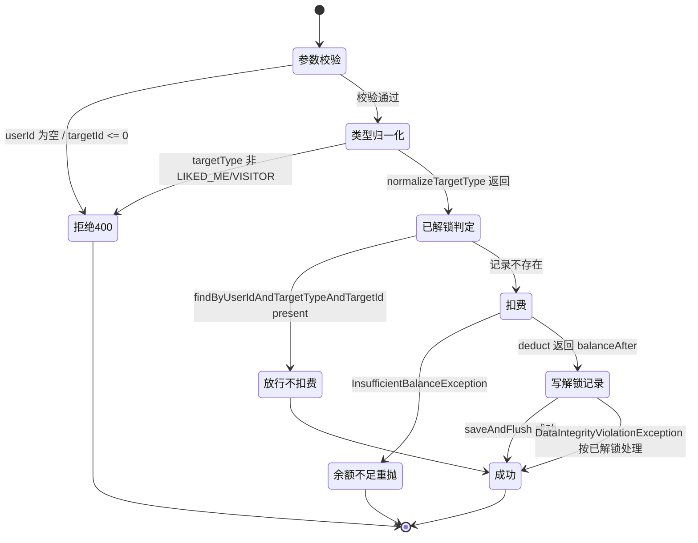

**图表来源**
- [RealWalletUnlockService.java:54-108](file://apps/api/src/main/java/com/campuslove/api/wallet/RealWalletUnlockService.java#L54-L108)
- [WalletServiceImpl.java:144-150](file://apps/api/src/main/java/com/campuslove/api/wallet/WalletServiceImpl.java#L144-L150)

方法 `unlock` 标注 `@Transactional`（L54-L56），其执行序列为：

1. `userId == null` → 抛 `ErrorMessages.USER_ID_CN_REQUIRED`；`targetId == null || targetId <= 0` → 抛 `ErrorMessages.UNLOCK_TARGET_ID_POSITIVE`（L57-L62）。
2. `normalizeTargetType(targetType)` 做白名单归一化：仅接受 `WalletUnlock.TARGET_TYPE_LIKED_ME`（常量值 `"LIKED_ME"`，`WalletUnlock.java` L36）与 `TARGET_TYPE_VISITOR`，否则抛 `UNSUPPORTED_UNLOCK_TYPE_PREFIX + targetType + ", 仅支持: LIKED_ME / VISITOR"`（L127-L136）。
3. 幂等放行：`unlockRepository.findByUserIdAndTargetTypeAndTargetId(...).isPresent()` 时记 info 并直接返回 `new WalletUnlockView(true, walletService.getBalance(userId))`（L66-L70）。
4. 计价与映射：`priceForType` 按类型取单价，`relatedTypeFor` 映射到流水业务类型 `RELATED_TYPE_UNLOCK_LIKED_ME`（常量值 `"UNLOCK_LIKED_ME"`，`WalletTransactionLog.java` L100）或 `RELATED_TYPE_UNLOCK_VISITOR`（L138-L149）。
5. 扣费：`walletService.deduct(userId, priceCents, orderId, relatedType, String.valueOf(targetId))`；捕获 `InsufficientBalanceException` 记 warn 后**原样重抛**（L82-L89）。
6. 写解锁记录：构造 `WalletUnlock` 设置 `userId` / `targetType` / `targetId` / `amountCents` 后 `saveAndFlush`；捕获 `DataIntegrityViolationException` 视为并发重复解锁，按幂等语义吞掉并记 info（L91-L103）。
7. 返回 `new WalletUnlockView(true, balanceAfter)`（L105-L107）。

第 6 步的「扣费成功但解锁记录唯一键冲突」被判定为并发重复解锁，因此不回滚——`unlock` 方法上没有 `noRollbackFor`，但该异常在方法内被 catch 且 Spring 事务不会因已捕获异常回滚；这一处理依赖 `uk_user_target (user_id, target_type, target_id)` 约束（DDL 见 `V2026.08.08.0001__wallet_unlocks.sql` L15，实体侧 `@UniqueConstraint(name = "uk_user_target", ...)` 见 `WalletUnlock.java` L30）。

### 批量解锁判定

`findUnlockedTargetIds` 是只读方法，标注 `@Transactional(readOnly = true)`（L110-L112）。它的短路顺序与去重策略（L113-L124）：

- `userId == null`、`targetIds == null` 或空集合 → 返回 `Set.of()`，**不做类型校验**，因此对非法类型也返回空集而不抛错。
- 流式过滤 `Objects::nonNull` 后 `distinct()` 再去 `toList()`；若去重后为空同样返回 `Set.of()`。
- 通过 `findByUserIdAndTargetTypeAndTargetIdIn(userId, normalizedType, distinctIds)` 一次查询取回记录，`map(WalletUnlock::getTargetId)` 收集为 `Set<Long>`。

该方法是列表页（喜欢我 / 访客）渲染「已解锁 / 待解锁」徽标的能力基础：一次批量查询替代 N 次单条判定，避免为同一页用户重复扣费。

**章节来源**
- [RealWalletUnlockService.java:16-34](file://apps/api/src/main/java/com/campuslove/api/wallet/RealWalletUnlockService.java#L16-L34)
- [RealWalletUnlockService.java:38-52](file://apps/api/src/main/java/com/campuslove/api/wallet/RealWalletUnlockService.java#L38-L52)
- [RealWalletUnlockService.java:54-149](file://apps/api/src/main/java/com/campuslove/api/wallet/RealWalletUnlockService.java#L54-L149)
- [WalletUnlock.java:30-30](file://apps/api/src/main/java/com/campuslove/api/wallet/WalletUnlock.java#L30-L30)
- [WalletUnlock.java:36-46](file://apps/api/src/main/java/com/campuslove/api/wallet/WalletUnlock.java#L36-L46)
- [WalletTransactionLog.java:100-100](file://apps/api/src/main/java/com/campuslove/api/wallet/WalletTransactionLog.java#L100-L100)
- [V2026.08.08.0001__wallet_unlocks.sql:15-15](file://database/flyway/sql/V2026.08.08.0001__wallet_unlocks.sql#L15-L15)

## Mock 与真实实现切换

解锁能力有两个可互换实现，控制器只依赖 `WalletUnlockService` 接口（`WalletController.java` L125），由 Spring profile 决定注入哪一个：

| 维度 | `RealWalletUnlockService` | `MockWalletUnlockService` |
| --- | --- | --- |
| profile 注解 | `@Profile("real")`（L32） | `@Profile("mock")`（L21） |
| 依赖 | `WalletService` + `WalletUnlockRepository`（L49-L52） | 仅 `WalletService`（L40-L42） |
| 解锁记录存储 | `wallet_unlocks` 表 | `ConcurrentHashMap.newKeySet()` 内存集合 `unlockRecords`（L38） |
| 记录键 | `(user_id, target_type, target_id)` 唯一约束 | 字符串 `userId + ":" + targetType + ":" + targetId`（L85-L87） |
| 事务注解 | `@Transactional` / `@Transactional(readOnly = true)`（L55、L111） | 无事务注解（L44、L74） |
| 幂等订单号 | `UNLOCK-{type}-{userId}-{targetId}`（L81） | `UNLOCK-{type}-{targetId}`（L65） |
| 已解锁判定 | 仓储 `findByUserIdAndTargetTypeAndTargetId`（L67） | `unlockRecords.contains(memKey(...))`（L55） |
| 唯一约束冲突处理 | catch `DataIntegrityViolationException` 按已解锁处理（L99-L103） | 不存在该分支（内存集合天然无约束） |
| 单价配置 | `app.unlock-price.liked-me` / `.visitor`，默认 `WalletUnlock.DEFAULT_UNLOCK_PRICE_CENTS`（L42-L47） | 同名配置键、同一默认常量（L30、L34） |
| 类型白名单 | `normalizeTargetType` 私有方法（L127-L136） | 逻辑逐字一致的 `normalizeTargetType`（L89-L98） |

两个实现的公开行为被刻意对齐：类注释明确「与 `RealWalletUnlockService`（real）行为对齐：已解锁放行 / 未解锁扣费记录」（`MockWalletUnlockService.java` L17-L19），mock 下的 `unlock` 同样先查已解锁、命中则调 `walletService.getBalance` 返回 `WalletUnlockView(true, balance)`，未命中则按单价调 `walletService.deduct` 后把键加入内存集合（L52-L71）。

值得记录的实现差异是**订单号格式**。real 侧在 2026-10-05 修复后把 `userId` 编入 `orderId`（`RealWalletUnlockService.java` L75-L81），mock 侧仍是修复前的 `"UNLOCK-" + normalizedType + "-" + targetId`（L65）。这不影响 mock 的本地演示语义（内存实现按 `memKey` 判重，不依赖 `orderId` 唯一索引），但在 `MockWalletServiceImpl` 的内存流水实现下跨用户同目标解锁仍会共享同一 `orderId`。因此 Mock 实现只能用于本地演示，不可作为真实幂等行为的验证依据。

解锁侧的 profile 切换与账务侧是配套的：`WalletServiceImpl` 同样标注 `@Profile("real")`（L50），而钱包控制器的类注释说明 mock 走 `MockWalletServiceImpl`（内存），使「展示版/本地开发可完整演示钱包流程」（`WalletController.java` L63-L64）。因此 mock profile 下 `/wallet/unlock` 的调用链为 `WalletController → MockWalletUnlockService → MockWalletServiceImpl`，不触达任何数据库表。

**章节来源**
- [MockWalletUnlockService.java:14-42](file://apps/api/src/main/java/com/campuslove/api/wallet/MockWalletUnlockService.java#L14-L42)
- [MockWalletUnlockService.java:44-83](file://apps/api/src/main/java/com/campuslove/api/wallet/MockWalletUnlockService.java#L44-L83)
- [MockWalletUnlockService.java:85-98](file://apps/api/src/main/java/com/campuslove/api/wallet/MockWalletUnlockService.java#L85-L98)
- [RealWalletUnlockService.java:32-52](file://apps/api/src/main/java/com/campuslove/api/wallet/RealWalletUnlockService.java#L32-L52)
- [RealWalletUnlockService.java:54-112](file://apps/api/src/main/java/com/campuslove/api/wallet/RealWalletUnlockService.java#L54-L112)
- [WalletController.java:63-64](file://apps/api/src/main/java/com/campuslove/api/wallet/WalletController.java#L63-L64)
- [WalletController.java:119-125](file://apps/api/src/main/java/com/campuslove/api/wallet/WalletController.java#L119-L125)
- [WalletServiceImpl.java:50-52](file://apps/api/src/main/java/com/campuslove/api/wallet/WalletServiceImpl.java#L50-L52)
- [WalletUnlockService.java:13-13](file://apps/api/src/main/java/com/campuslove/api/wallet/WalletUnlockService.java#L13-L13)
- [MockWalletServiceImpl.java:27-27](file://apps/api/src/main/java/com/campuslove/api/wallet/MockWalletServiceImpl.java#L27-L27)

## 数据模型

解锁与账务链路共涉及三张 InnoDB 表（`utf8mb4` / `utf8mb4_0900_ai_ci`），全部由 Flyway 迁移创建。

### user_wallet（用户钱包账户主表）

DDL 位于 `V2026.07.28.0003__wallet_tables.sql` L34-L44：

| 列 | 类型 | 约束 | 语义 |
| --- | --- | --- | --- |
| `id` | `BIGINT UNSIGNED` | `PRIMARY KEY AUTO_INCREMENT` | 主键 |
| `user_id` | `BIGINT UNSIGNED` | `NOT NULL` | 用户 ID |
| `balance_cents` | `BIGINT` | `NOT NULL DEFAULT 0` | 可用余额（分） |
| `frozen_cents` | `BIGINT` | `NOT NULL DEFAULT 0` | 冻结金额（分，预留） |
| `version` | `BIGINT` | `NOT NULL DEFAULT 0` | 乐观锁版本号 |
| `created_at` | `TIMESTAMP` | `NOT NULL DEFAULT CURRENT_TIMESTAMP` | 创建时间 |
| `updated_at` | `TIMESTAMP` | `NOT NULL DEFAULT CURRENT_TIMESTAMP ON UPDATE CURRENT_TIMESTAMP` | 更新时间 |

键：`UNIQUE KEY uk_user_wallet_user (user_id)` 保证「一用户一钱包」，另有显式 `INDEX idx_user_wallet_user (user_id)`（L42-L43）。实体侧 `UserWallet.java` 以 `@Table(name = "user_wallet")`（L39）加 `@UniqueConstraint(name = "uk_user_wallet_user", columnNames = {"user_id"})`（L42）与 `@Index(name = "idx_user_wallet_user", columnList = "user_id")`（L46）镜像同一结构。迁移尾部还有一段 `INSERT IGNORE INTO user_wallet ... `（L77-L81）为存量用户补建余额 0 的钱包行，避免 `deduct` 走 `initWallet` 分支。

### wallet_transaction_log（钱包交易流水表）

DDL 位于同文件 L46-L62，共 10 列：`id`、`user_id`、`type`（`VARCHAR(16) NOT NULL`，注释标明取值 `DEBIT(扣减)/CREDIT(充值)`）、`amount`（`BIGINT NOT NULL`，分）、`balance_after`（`BIGINT`，交易后余额，便于审计追溯）、`related_type`（`VARCHAR(32) NOT NULL`）、`related_id`（`VARCHAR(64)`）、`order_id`（`VARCHAR(128) NOT NULL`，注释「业务订单号（幂等键）」）、`remark`（`VARCHAR(200)`）、`created_at`、`updated_at`。

四个键承担四种查询（L58-L61）：`UNIQUE KEY uk_wallet_transaction_log_order (order_id)` 是全服务幂等根基；`INDEX idx_wallet_log_user_created (user_id, created_at)` 支撑 `/wallet/transactions` 的「按用户 + 创建时间倒序」分页；`INDEX idx_wallet_log_related (related_type)` 与 `INDEX idx_wallet_log_related_id (related_id)` 支撑按业务类型的对账统计。实体侧 `WalletTransactionLog.java` 标注表名（L49）与唯一约束 `uk_wallet_transaction_log_order`（L52）。

`related_type` 列的建表注释仍写有 `RED_PACKET_SEND/RED_PACKET_CLAIM/RED_PACKET_REFUND`（L52），而 `V2026.08.09.0006__remove_red_packet.sql` L13 说明红包功能已移除但历史流水按对账需要保留常量与数据——这是列注释与实际取值集合不一致的一处历史痕迹。当前代码中真实写入的取值由两个白名单集合界定（服务层 `DEDUCT_RELATED_TYPE_WHITELIST`，`WalletServiceImpl.java` L71-L82；充值侧的 `WALLET_DEMO_RECHARGE`，`WalletController.java` L99）。

### wallet_unlocks（商业化解锁记录表）

DDL 位于 `V2026.08.08.0001__wallet_unlocks.sql` L7-L16，共 6 列：`id`（`BIGINT NOT NULL AUTO_INCREMENT`）、`user_id`（`BIGINT NOT NULL`，解锁用户 ID）、`target_type`（`VARCHAR(32) NOT NULL`，注释 `LIKED_ME-喜欢我列表 / VISITOR-访客列表`）、`target_id`（`BIGINT NOT NULL DEFAULT 0`，注释说明「列表级解锁时可为 0」）、`amount_cents`（`BIGINT NOT NULL`，解锁扣费金额）、`created_at`（`DATETIME NOT NULL`）。主键 `PRIMARY KEY (id)`，唯一键 `UNIQUE KEY uk_user_target (user_id, target_type, target_id)`（L14-L15），文件头注释 L6 明确该唯一键的用途是「防止重复扣费/重复解锁」。

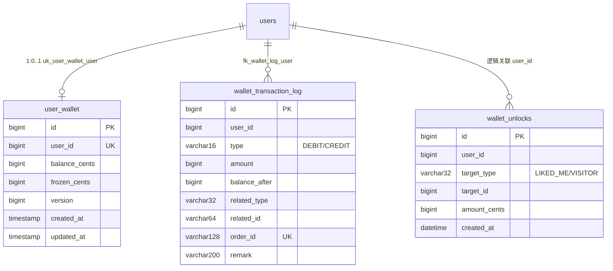

**图表来源**
- [V2026.07.28.0003__wallet_tables.sql:34-62](file://database/flyway/sql/V2026.07.28.0003__wallet_tables.sql#L34-L62)
- [V2026.08.08.0001__wallet_unlocks.sql:7-16](file://database/flyway/sql/V2026.08.08.0001__wallet_unlocks.sql#L7-L16)
- [V2026.07.28.0008__add_money_foreign_keys.sql:57-58](file://database/flyway/sql/V2026.07.28.0008__add_money_foreign_keys.sql#L57-L58)
- [UserWallet.java:39-46](file://apps/api/src/main/java/com/campuslove/api/wallet/UserWallet.java#L39-L46)
- [WalletUnlock.java:28-30](file://apps/api/src/main/java/com/campuslove/api/wallet/WalletUnlock.java#L28-L30)

`wallet_unlocks` 与 `user_wallet`、`wallet_transaction_log` 之间**没有数据库外键**：补外键的迁移 `V2026.07.28.0008__add_money_foreign_keys.sql` 只对两张资金表调用 `add_fk_if_missing('user_wallet', 'user_id', 'fk_user_wallet_user', 'users', 'id', 'RESTRICT')` 与 `add_fk_if_missing('wallet_transaction_log', 'user_id', 'fk_wallet_log_user', 'users', 'id', 'RESTRICT')`（L57-L58），其文件头注释 L6-L7 列出的对象也只有这两张表；`wallet_unlocks` 建表晚于该迁移（2026.08.08 vs 2026.07.28），仓库中没有为它补外键的迁移证据。

### 与 VIP 账单模型的关系

账单侧的 `VipBill`（`@Entity` + `@Table`，L48-L50）定义了 `id`、`userId`、`planId`、`planName`、`amount`、`originalAmount`、`type`（默认 `"SUBSCRIBE"`）、`status`（默认 `"SUCCESS"`）、`paymentMethod`（默认 `"WECHAT"`）、`transactionId`、`periodStart`、`periodEnd`、`remark`、`createdAt` 与 `version`（默认 `0L`）字段（L88-L155），并内嵌 `BillType`（L67）与 `BillStatus`（L77）两个类型；建表脚本为 `V2026.07.25.0005__create_vip_bills.sql`（L25 起 `CREATE TABLE IF NOT EXISTS`），计费日志表为 `V2026.07.27.0002__vip_billing_log.sql`（L22）。

两套模型是**并列而非从属**：`wallet_transaction_log` 记录余额的每一笔变动，`vip_bills` 记录一次 VIP 购买/订阅事实；`BillingService` 同时持有 `WalletService walletService`（L66）与账单视图方法 `listBills(Long userId, Integer page, Integer size)`（L194），因此用钱包余额购买 VIP 时，一次业务会在两侧各留一条记录。`WalletTransactionLog.RELATED_TYPE_VIP_RENEW` 出现在扣费白名单中（`WalletServiceImpl.java` L72），说明自动续费扣的是钱包余额。

**章节来源**
- [V2026.07.28.0003__wallet_tables.sql:20-28](file://database/flyway/sql/V2026.07.28.0003__wallet_tables.sql#L20-L28)
- [V2026.07.28.0003__wallet_tables.sql:34-62](file://database/flyway/sql/V2026.07.28.0003__wallet_tables.sql#L34-L62)
- [V2026.07.28.0003__wallet_tables.sql:77-81](file://database/flyway/sql/V2026.07.28.0003__wallet_tables.sql#L77-L81)
- [V2026.08.08.0001__wallet_unlocks.sql:6-16](file://database/flyway/sql/V2026.08.08.0001__wallet_unlocks.sql#L6-L16)
- [V2026.07.28.0008__add_money_foreign_keys.sql:6-7](file://database/flyway/sql/V2026.07.28.0008__add_money_foreign_keys.sql#L6-L7)
- [V2026.08.09.0006__remove_red_packet.sql:13-13](file://database/flyway/sql/V2026.08.09.0006__remove_red_packet.sql#L13-L13)
- [UserWallet.java:15-46](file://apps/api/src/main/java/com/campuslove/api/wallet/UserWallet.java#L15-L46)
- [WalletTransactionLog.java:18-52](file://apps/api/src/main/java/com/campuslove/api/wallet/WalletTransactionLog.java#L18-L52)
- [WalletTransactionLog.java:100-100](file://apps/api/src/main/java/com/campuslove/api/wallet/WalletTransactionLog.java#L100-L100)
- [WalletUnlock.java:16-46](file://apps/api/src/main/java/com/campuslove/api/wallet/WalletUnlock.java#L16-L46)
- [VipBill.java:48-155](file://apps/api/src/main/java/com/campuslove/api/entity/VipBill.java#L48-L155)
- [BillingService.java:39-66](file://apps/api/src/main/java/com/campuslove/api/vip/BillingService.java#L39-L66)
- [BillingService.java:194-194](file://apps/api/src/main/java/com/campuslove/api/vip/BillingService.java#L194-L194)
- [V2026.07.25.0005__create_vip_bills.sql:25-25](file://database/flyway/sql/V2026.07.25.0005__create_vip_bills.sql#L25-L25)
- [V2026.07.27.0002__vip_billing_log.sql:22-22](file://database/flyway/sql/V2026.07.27.0002__vip_billing_log.sql#L22-L22)
- [WalletServiceImpl.java:71-82](file://apps/api/src/main/java/com/campuslove/api/wallet/WalletServiceImpl.java#L71-L82)

## 权限粒度与安全校验

本服务的权限模型可以拆成「身份来源、角色门槛、能力开关、语义白名单、目标粒度」五层，逐层都有代码出处。

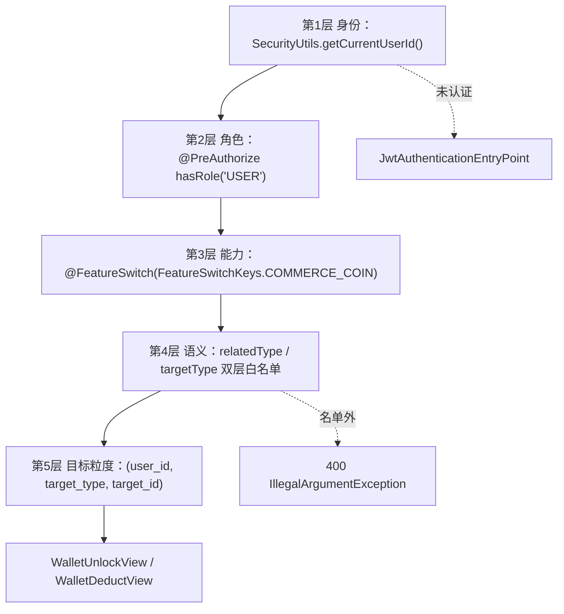

[此图为概念流程，各层节点的实现出处见下表与下方来源列表，故不提供图表来源]

| 层 | 实现 | 适用端点 | 出处 |
| --- | --- | --- | --- |
| 身份来源 | `SecurityUtils.getCurrentUserId()` | 全部五个端点 | `WalletController.java` L203、L218、L254、L424、L452 |
| 角色门槛 | `@PreAuthorize("hasRole('USER')")` | `recharge` / `unlock` / `deduct` | L252、L422、L450 |
| 能力开关 | `@FeatureSwitch(FeatureSwitchKeys.COMMERCE_COIN)` | 同上三个写端点 | L250、L420、L448 |
| 请求幂等 | `@Idempotent`（客户端需带 `Idempotency-Key` 头） | 同上三个写端点 | L251、L421、L449；约定见类注释 L59-L60 |
| 参数校验 | `@Valid @RequestBody` + `@Validated` + `@Min/@Max/@NotNull` | 三个写端点 + `transactions` 的分页参数 | L68、L216-L217、L253、L423、L451 |
| 语义白名单（服务端层） | `DEDUCT_RELATED_TYPE_WHITELIST` | `WalletService.deduct` 全部调用方 | `WalletServiceImpl.java` L71-L82、L114-L118 |
| 语义白名单（客户端层） | `CLIENT_DEDUCT_RELATED_TYPE_WHITELIST` | `/wallet/deduct` 直调 | `WalletController.java` L112-L117、L455-L459 |
| 解锁类型白名单 | `normalizeTargetType` 仅放行 `LIKED_ME` / `VISITOR` | `/wallet/unlock` | `RealWalletUnlockService.java` L127-L136、`MockWalletUnlockService.java` L89-L98 |

### 粒度控制的实际颗粒

- **解锁粒度是「用户 × 目标类型 × 目标 ID」三元组**。`uk_user_target (user_id, target_type, target_id)` 既是判重键也是权限键（`V2026.08.08.0001__wallet_unlocks.sql` L15）：同一用户对同一目标只付一次费，不同用户对同一目标各自独立付费——这正是 `orderId` 补入 `userId` 后才成立的前提（`RealWalletUnlockService.java` L75-L81）。表注释还允许 `target_id` 取 `0` 表示「列表级解锁」，即整个列表一次付费的粗粒度形态（L11）。
- **读取侧粒度由 `findUnlockedTargetIds` 表达**：以 `(userId, targetType, targetIds)` 为入参返回已解锁 ID 集合，未解锁项不出现在结果中，因此调用方只能凭该集合判断可见性，无法反向枚举他人解锁状态（`RealWalletUnlockService.java` L110-L124）。
- **管理语义与客户端语义被强制隔离**。服务层白名单包含 `"ADMIN_ADJUST"`（后台余额调整）与 `SWEET_TALK`（AI 情话解锁，注释标注「预留，仅服务端内部调用，客户端不可传」），客户端白名单则不含二者；`VIP_RENEW` 与 `UNLOCK_*` 同样只允许服务端内部使用（`WalletController.java` L108-L111、`WalletServiceImpl.java` L56-L70）。
- **金额去信任**。客户端提交的 `amountCents` 只作建议值，服务端按 `relatedType` 查定价目录为准（`WalletController.java` L439-L442、L460-L471），防止改包 1 分钱解锁。

### 认证与会话

`/api/v1/wallet/**` 依赖 JWT 会话。契约侧在 `docs/openapi/feedback-growth-and-auth.yaml` 中登记了会话生命周期：`GET /auth/me`（`operationId: getCurrentSession`，L52-L57）、`POST /auth/wechat-login`（`loginWithWechat`，L73-L81）、`POST /auth/refresh`（`refreshToken`，L105-L112）、`POST /auth/logout`（`logout`，L128-L133），管理端另有 `POST /auth/admin/login`（`loginAsAdmin`，L149-L154）与 `POST /auth/admin/logout`（`logoutAsAdmin`，L177-L182）。认证失败时由 `JwtAuthenticationEntryPoint`（`@Component`，L55-L56）产出响应，因此余额与流水两个只读端点即便不带 `@PreAuthorize` 也不会匿名可访。

**章节来源**
- [WalletController.java:59-68](file://apps/api/src/main/java/com/campuslove/api/wallet/WalletController.java#L59-L68)
- [WalletController.java:108-117](file://apps/api/src/main/java/com/campuslove/api/wallet/WalletController.java#L108-L117)
- [WalletController.java:201-224](file://apps/api/src/main/java/com/campuslove/api/wallet/WalletController.java#L201-L224)
- [WalletController.java:249-253](file://apps/api/src/main/java/com/campuslove/api/wallet/WalletController.java#L249-L253)
- [WalletController.java:419-423](file://apps/api/src/main/java/com/campuslove/api/wallet/WalletController.java#L419-L423)
- [WalletController.java:439-471](file://apps/api/src/main/java/com/campuslove/api/wallet/WalletController.java#L439-L471)
- [WalletController.java:447-451](file://apps/api/src/main/java/com/campuslove/api/wallet/WalletController.java#L447-L451)
- [WalletServiceImpl.java:56-82](file://apps/api/src/main/java/com/campuslove/api/wallet/WalletServiceImpl.java#L56-L82)
- [WalletServiceImpl.java:114-118](file://apps/api/src/main/java/com/campuslove/api/wallet/WalletServiceImpl.java#L114-L118)
- [RealWalletUnlockService.java:75-81](file://apps/api/src/main/java/com/campuslove/api/wallet/RealWalletUnlockService.java#L75-L81)
- [RealWalletUnlockService.java:110-136](file://apps/api/src/main/java/com/campuslove/api/wallet/RealWalletUnlockService.java#L110-L136)
- [MockWalletUnlockService.java:89-98](file://apps/api/src/main/java/com/campuslove/api/wallet/MockWalletUnlockService.java#L89-L98)
- [V2026.08.08.0001__wallet_unlocks.sql:11-15](file://database/flyway/sql/V2026.08.08.0001__wallet_unlocks.sql#L11-L15)
- [feedback-growth-and-auth.yaml:52-57](file://docs/openapi/feedback-growth-and-auth.yaml#L52-L57)
- [feedback-growth-and-auth.yaml:73-81](file://docs/openapi/feedback-growth-and-auth.yaml#L73-L81)
- [feedback-growth-and-auth.yaml:105-112](file://docs/openapi/feedback-growth-and-auth.yaml#L105-L112)
- [feedback-growth-and-auth.yaml:149-154](file://docs/openapi/feedback-growth-and-auth.yaml#L149-L154)
- [JwtAuthenticationEntryPoint.java:55-56](file://apps/api/src/main/java/com/campuslove/api/auth/JwtAuthenticationEntryPoint.java#L55-L56)

## 消费记录与使用统计

### 流水查询链路

账单读取是一条纯只读、无副作用的短链路：

```mermaid
graph LR
  Q["GET /api/v1/wallet/transactions?page=0&amp;size=20"] --> C1["WalletController.listTransactions"]
  C1 --> C2["SecurityUtils.getCurrentUserId()"]
  C2 --> S1["WalletService.listTransactions(userId, PageRequest.of(page,size))"]
  S1 --> R1["WalletTransactionLogRepository.findByUserIdOrderByCreatedAtDesc"]
  R1 --> M1["toItemView 逐条映射 9 字段"]
  M1 --> V1["WalletTransactionListView(items,total,page,size,totalPages)"]
```

**图表来源**
- [WalletController.java:214-224](file://apps/api/src/main/java/com/campuslove/api/wallet/WalletController.java#L214-L224)
- [WalletController.java:499-511](file://apps/api/src/main/java/com/campuslove/api/wallet/WalletController.java#L499-L511)
- [WalletServiceImpl.java:289-301](file://apps/api/src/main/java/com/campuslove/api/wallet/WalletServiceImpl.java#L289-L301)

分页语义由三处共同约束：控制器参数 `page` 默认 0、`@Min(0)`，`size` 默认 20、`@Min(1) @Max(100)`（L216-L217）；服务层标注 `@Transactional(readOnly = true)` 且 `userId` 为空即抛错（`WalletServiceImpl.java` L294-L299）；仓储方法名 `findByUserIdOrderByCreatedAtDesc` 固定了排序，数据库侧由 `idx_wallet_log_user_created (user_id, created_at)` 复合索引支撑（`V2026.07.28.0003__wallet_tables.sql` L59）。

流水项视图 `WalletTransactionItemView` 暴露 `id / type / amount / balanceAfter / relatedType / relatedId / orderId / remark / createdAt` 九个字段（L546-L556），由 `toItemView` 从实体逐字段映射（L499-L511）。分页外壳 `WalletTransactionListView` 的结构刻意对齐 VIP 账单的 `BillListResponse`（`items / total / page / size / totalPages`，`page` 从 0 开始），使前端账单类页面能复用同一渲染结构（L57 类注释、L558-L565）。

### 消费事实的两条读取路径

仓库中「是否已解锁」的判定事实并非只有一处来源，两条路径并存且适用场景不同：

| 判定路径 | 依据 | 使用方 |
| --- | --- | --- |
| `wallet_unlocks` 表 | `(user_id, target_type, target_id)` 记录 | `RealWalletUnlockService.findUnlockedTargetIds`（L110-L124） |
| `wallet_transaction_log` 流水 | 存在 `relatedType ∈ {MESSAGE_UNLOCK, WHISPER_UNLOCK}` 的行 | `RecommendationController` 判定「当前用户已为该目标付费解锁」（L527、L598）、`RecommendationRanker` 的 R4-00315 信号（L333、L638） |

`apps/client/src/services/api.ts` L1081 的注释同样以「`wallet_transaction_log` 存在 `MESSAGE_UNLOCK` / `WHISPER_UNLOCK` 流水」作为前端可见的解锁条件描述；`RealWhisperService` 的退款链路则强调「保证退款事实可从 `wallet_transaction_log` 对账」，把流水表当作唯一可对账事实（L223），并且状态落库失败不阻断退款主路径，仅依赖流水可对账（L267）。这意味着流水表在本仓库中同时承担**账单展示**与**跨模块对账事实**两个职责。

### 统计与聚合能力

- **余额侧**：无独立统计端点。可用读取手段只有 `GET /balance`（单值 `balanceCents`）与 `GET /transactions`（分页明细），消费合计需由客户端对 `type == "DEBIT"` 的 `amount` 自行累加；服务端未提供按 `relatedType` 聚合的金额统计接口。
- **索引侧预留**：`idx_wallet_log_related (related_type)` 与 `idx_wallet_log_related_id (related_id)`（L60-L61）为按业务类型 / 关联实体的统计查询准备了访问路径，但仓库中未见消费这些聚合的控制器端点。
- **VIP 账单侧**：`BillingService.listBills(Long userId, Integer page, Integer size)`（L194）返回 `BillListResponse`（L374），视图类型 `BillView`（L327）与 `PurchaseResultView`（L355）；账单字段 `type` / `status` / `paymentMethod` 默认值分别为 `SUBSCRIBE` / `SUCCESS` / `WECHAT`（`VipBill.java` L112-L120）。
- **前端消费方**：`apps/client/src/stores/vip-billing.ts` 以 `useVipBillingStore`（L127）为入口，导出 `BillType`（L18）、`BillStatus`（L21）、`BillView`（L24）、`BillListResponse`（L42）、`BillListParams`（L55）；页面 `apps/client/src/subpackages/vip/bills.vue`（共 536 行）模板起于 L168、样式起于 L276；管理端 `apps/admin/src/views/business/VipBills.vue`（共 499 行）`<script setup lang="ts">` 起于 L1、模板起于 L216、样式起于 L368。

**章节来源**
- [WalletController.java:207-224](file://apps/api/src/main/java/com/campuslove/api/wallet/WalletController.java#L207-L224)
- [WalletController.java:499-511](file://apps/api/src/main/java/com/campuslove/api/wallet/WalletController.java#L499-L511)
- [WalletController.java:545-565](file://apps/api/src/main/java/com/campuslove/api/wallet/WalletController.java#L545-L565)
- [WalletServiceImpl.java:289-301](file://apps/api/src/main/java/com/campuslove/api/wallet/WalletServiceImpl.java#L289-L301)
- [V2026.07.28.0003__wallet_tables.sql:59-61](file://database/flyway/sql/V2026.07.28.0003__wallet_tables.sql#L59-L61)
- [RealWalletUnlockService.java:110-124](file://apps/api/src/main/java/com/campuslove/api/wallet/RealWalletUnlockService.java#L110-L124)
- [RecommendationController.java:527-527](file://apps/api/src/main/java/com/campuslove/api/discover/RecommendationController.java#L527-L527)
- [RecommendationController.java:598-598](file://apps/api/src/main/java/com/campuslove/api/discover/RecommendationController.java#L598-L598)
- [RecommendationRanker.java:333-333](file://apps/api/src/main/java/com/campuslove/api/discover/RecommendationRanker.java#L333-L333)
- [RecommendationRanker.java:638-638](file://apps/api/src/main/java/com/campuslove/api/discover/RecommendationRanker.java#L638-L638)
- [RealWhisperService.java:223-223](file://apps/api/src/main/java/com/campuslove/api/whisper/RealWhisperService.java#L223-L223)
- [RealWhisperService.java:267-267](file://apps/api/src/main/java/com/campuslove/api/whisper/RealWhisperService.java#L267-L267)
- [api.ts:1081-1081](file://apps/client/src/services/api.ts#L1081-L1081)
- [BillingService.java:194-194](file://apps/api/src/main/java/com/campuslove/api/vip/BillingService.java#L194-L194)
- [BillingService.java:327-374](file://apps/api/src/main/java/com/campuslove/api/vip/BillingService.java#L327-L374)
- [vip-billing.ts:18-55](file://apps/client/src/stores/vip-billing.ts#L18-L55)
- [vip-billing.ts:127-127](file://apps/client/src/stores/vip-billing.ts#L127-L127)
- [bills.vue:168-168](file://apps/client/src/subpackages/vip/bills.vue#L168-L168)
- [VipBills.vue:216-216](file://apps/admin/src/views/business/VipBills.vue#L216-L216)

## 并发控制与防刷机制

### 三重幂等防线

`WalletServiceImpl` 的类注释把并发安全概括为三重保障（L23-L34），代码里能逐条对应：

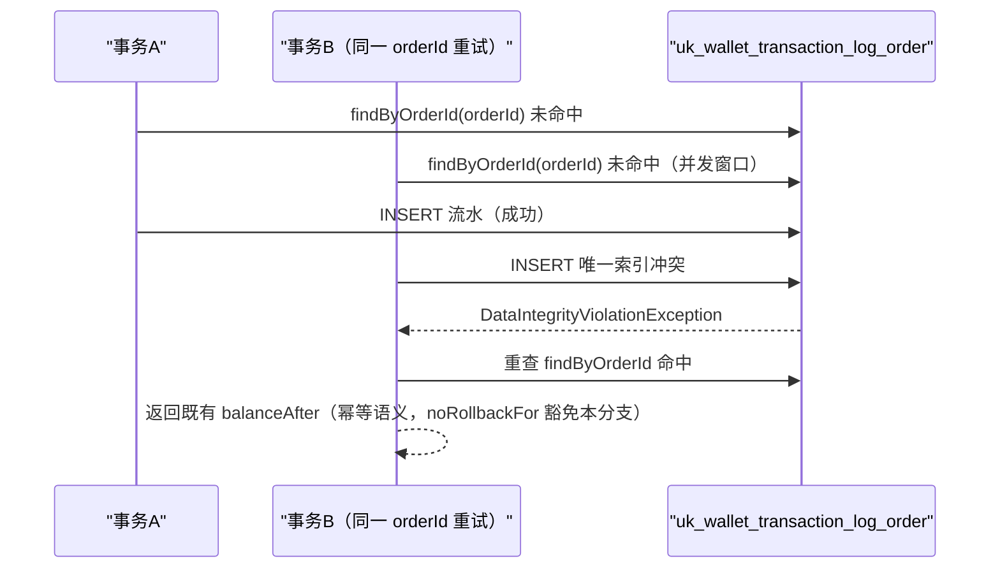

**图表来源**
- [WalletServiceImpl.java:23-34](file://apps/api/src/main/java/com/campuslove/api/wallet/WalletServiceImpl.java#L23-L34)
- [WalletServiceImpl.java:111-132](file://apps/api/src/main/java/com/campuslove/api/wallet/WalletServiceImpl.java#L111-L132)
- [WalletServiceImpl.java:170-187](file://apps/api/src/main/java/com/campuslove/api/wallet/WalletServiceImpl.java#L170-L187)
- [V2026.07.28.0003__wallet_tables.sql:58-58](file://database/flyway/sql/V2026.07.28.0003__wallet_tables.sql#L58-L58)

1. **悲观锁**：`deduct` / `recharge` 均通过 `UserWalletRepository.findByUserIdForUpdate` 锁住钱包行，同一用户同时只有一个事务能修改余额（L25-L27、L136、L224）。
2. **幂等键**：`wallet_transaction_log.order_id` 唯一索引（DDL `uk_wallet_transaction_log_order`，L58），先查后写 + 冲突重查（L121-L132、L170-L178）。
3. **事务原子性**：`@Transactional` 保证「余额变更 + 流水写入」同生共死，任一步失败全回滚（L32-L33）；`noRollbackFor = DataIntegrityViolationException.class` 只豁免幂等冲突分支（L111、L203）。

解锁侧再叠一层记录约束：`uk_user_target (user_id, target_type, target_id)`（`V2026.08.08.0001__wallet_unlocks.sql` L15）。并发重复解锁时后插入者约束冲突，`RealWalletUnlockService` 捕获 `DataIntegrityViolationException` 后按已解锁处理（L91-L103），控制器的接口注释把这条与 `@Idempotent`、`order_id` 唯一索引并列为「三重保障，重复解锁不重复扣费」（`WalletController.java` L413-L414）。`UserWallet` 还保留 `version` 乐观锁列（`BIGINT NOT NULL DEFAULT 0 COMMENT '乐观锁版本号'`，DDL L39；建表注释 L21 写明「配合悲观锁双重防护」；`initWallet` 初始化为 `0L`，`WalletServiceImpl.java` L316）。

仓库中存在针对这一层的并发测试 `apps/api/src/test/java/com/campuslove/api/wallet/WalletServiceConcurrencyTest.java`，其注释同样描述「`wallet_transaction_log.order_id` 唯一索引 + 服务层先查后写」的幂等设计（L36）；`RealWalletUnlockServiceTest.java` L30 则记录了 `orderId` 缺 `userId` 时全局唯一约束下的串号事故回归点。

### 演示充值防刷

`/wallet/recharge` 在无支付网关的前提下直接入账，因此配了三层限额（`WalletController.java` L234-L241、L256-L271）：

| 控制 | 配置键 / 常量 | 默认值 | 超限响应 |
| --- | --- | --- | --- |
| 总开关 | `app.demo-recharge.enabled` | `false`（L134） | `IllegalStateException(DEMO_RECHARGE_DISABLED)`（L256-L259） |
| 每用户每日次数 | `app.demo-recharge.daily-limit` | `5`（`DEFAULT_DEMO_RECHARGE_DAILY_LIMIT`，L86、L138-L139） | `DailyLimitExceededException`（L261-L266） |
| 每用户累计金额 | `app.demo-recharge.total-limit-cents` / `APP_DEMO_RECHARGE_TOTAL_LIMIT_CENTS` | `50_000` 分 = 500 元（L92、L146-L148） | `OperationForbiddenException`（L268-L271） |

额度扣减的实现细节（L282-L399）：

- **每日计数**：Redis key `demo-recharge:count:{userId}:{yyyyMMdd}`，`INCR` 返回值超过限额时**回滚递减**并返回 false（L348-L358）；首次递增设 36 小时 TTL（`DEMO_RECHARGE_COUNT_TTL_HOURS = 36L`，L83、L351-L353）覆盖跨自然日，避免键无限增长。日期取 `LocalDate.now(TimeZones.BUSINESS)`（L341）。
- **累计金额**：Redis key `demo-recharge:total:{userId}` 终身累计（无 TTL），`increment(key, amount)` 预留后若超限立即 `increment(key, -amount)` 回滚（L309-L319）；上限配置 `<= 0` 视为不限制（L294-L297）。
- **fail-closed 语义**：R4-00330 之后，Redis 存在但运行时故障时**拒绝本次充值**而非降级本地内存（L360-L366、L320-L324）——原实现降级本地计数会在多实例部署下被各实例独立计数突破每日限额。仅当 `redisTemplate` 未注入（`@Autowired(required = false)`，L180-L181）即 mock 单实例本地演示时，才使用 `synchronized` 保护的 `localDemoRechargeCount` / `localDemoRechargeTotal`（L184-L187、L298-L308、L342-L346）。
- **本地计数自清理**：`tryIncrementLocalDemoRechargeCount` 在集合规模超过 10_000 时按日期键移除陈旧条目（L375-L399）。
- **演示流水隔离**：入账 `relatedType` 固定为 `WALLET_DEMO_RECHARGE`（L99、L276-L277），与未来真实支付入账的 `WALLET_RECHARGE` 在账单与对账层面互不污染；`orderId` 为 `"WALLET-RECHARGE-" + UUID.randomUUID()`（L275）。

### 限流与重试的缺失说明

仓库中没有针对 `/wallet/**` 的独立限流器、令牌桶或漏桶实现，频控仅存在于上述演示充值路径；同样没有解锁失败的定时补偿作业或重试队列——`deduct` 抛出的 `InsufficientBalanceException` 被解锁服务原样重抛（`RealWalletUnlockService.java` L85-L89），重试责任留给客户端与 `@Idempotent` 语义。`ErrorMessages.WALLET_DEDUCT_FAILED_RETRY` 只是异常文案常量，不代表服务端自动重试（`WalletServiceImpl.java` L188-L191）。

**章节来源**
- [WalletController.java:73-99](file://apps/api/src/main/java/com/campuslove/api/wallet/WalletController.java#L73-L99)
- [WalletController.java:134-148](file://apps/api/src/main/java/com/campuslove/api/wallet/WalletController.java#L134-L148)
- [WalletController.java:180-187](file://apps/api/src/main/java/com/campuslove/api/wallet/WalletController.java#L180-L187)
- [WalletController.java:234-241](file://apps/api/src/main/java/com/campuslove/api/wallet/WalletController.java#L234-L241)
- [WalletController.java:249-399](file://apps/api/src/main/java/com/campuslove/api/wallet/WalletController.java#L249-L399)
- [WalletController.java:413-414](file://apps/api/src/main/java/com/campuslove/api/wallet/WalletController.java#L413-L414)
- [WalletServiceImpl.java:23-34](file://apps/api/src/main/java/com/campuslove/api/wallet/WalletServiceImpl.java#L23-L34)
- [WalletServiceImpl.java:105-132](file://apps/api/src/main/java/com/campuslove/api/wallet/WalletServiceImpl.java#L105-L132)
- [WalletServiceImpl.java:170-192](file://apps/api/src/main/java/com/campuslove/api/wallet/WalletServiceImpl.java#L170-L192)
- [WalletServiceImpl.java:202-224](file://apps/api/src/main/java/com/campuslove/api/wallet/WalletServiceImpl.java#L202-L224)
- [WalletServiceImpl.java:311-321](file://apps/api/src/main/java/com/campuslove/api/wallet/WalletServiceImpl.java#L311-L321)
- [RealWalletUnlockService.java:29-31](file://apps/api/src/main/java/com/campuslove/api/wallet/RealWalletUnlockService.java#L29-L31)
- [RealWalletUnlockService.java:82-103](file://apps/api/src/main/java/com/campuslove/api/wallet/RealWalletUnlockService.java#L82-L103)
- [V2026.07.28.0003__wallet_tables.sql:20-28](file://database/flyway/sql/V2026.07.28.0003__wallet_tables.sql#L20-L28)
- [V2026.07.28.0003__wallet_tables.sql:39-39](file://database/flyway/sql/V2026.07.28.0003__wallet_tables.sql#L39-L39)
- [V2026.07.28.0003__wallet_tables.sql:58-58](file://database/flyway/sql/V2026.07.28.0003__wallet_tables.sql#L58-L58)
- [V2026.08.08.0001__wallet_unlocks.sql:6-15](file://database/flyway/sql/V2026.08.08.0001__wallet_unlocks.sql#L6-L15)
- [WalletServiceConcurrencyTest.java:36-36](file://apps/api/src/test/java/com/campuslove/api/wallet/WalletServiceConcurrencyTest.java#L36-L36)
- [RealWalletUnlockServiceTest.java:30-30](file://apps/api/src/test/java/com/campuslove/api/wallet/RealWalletUnlockServiceTest.java#L30-L30)

## 配置与开关

本服务的可调项全部通过 Spring `@Value` 注入，键名与默认值成对写在字段注解里，因此「配置键 + 兜底默认值」本身就是可从源码读出的契约。

### 解锁定价

| 配置键 | 注入字段 | 默认值来源 | 生效实现 |
| --- | --- | --- | --- |
| `app.unlock-price.liked-me` | `likedMePriceCents`（`int`） | `WalletUnlock.DEFAULT_UNLOCK_PRICE_CENTS` = 300 分 | `RealWalletUnlockService.java` L42-L43、`MockWalletUnlockService.java` L30-L31 |
| `app.unlock-price.visitor` | `visitorPriceCents`（`int`） | 同上常量 300 分 | `RealWalletUnlockService.java` L46-L47、`MockWalletUnlockService.java` L34-L35 |

两个实现共用同一默认常量（mock 侧注释 L29、L33 明确「与 Real 实现共用常量」），保证 mock 与 real 的展示价格一致。

### 通用扣费价格目录

`/wallet/deduct` 的四类客户端解锁类型各有独立配置键，且都支持环境变量二级回退（`${app.wallet.price.X:${APP_WALLET_PRICE_X:默认}}`）：

| 配置键 | 环境变量回退 | 注入字段 | 代码内置兜底 |
| --- | --- | --- | --- |
| `app.wallet.price.MESSAGE_UNLOCK` | `APP_WALLET_PRICE_MESSAGE_UNLOCK` | `priceMessageUnlock`（L159-L160） | 100 分（L491） |
| `app.wallet.price.VISITORS_UNLOCK` | `APP_WALLET_PRICE_VISITORS_UNLOCK` | `priceVisitorsUnlock`（L163-L164） | 300 分（L492） |
| `app.wallet.price.LIKES_UNLOCK` | `APP_WALLET_PRICE_LIKES_UNLOCK` | `priceLikesUnlock`（L167-L168） | 300 分（L493） |
| `app.wallet.price.WHISPER_UNLOCK` | `APP_WALLET_PRICE_WHISPER_UNLOCK` | `priceWhisperUnlock`（L171-L172） | 200 分（L494） |

`resolveServerPrice` 的兜底逻辑是「配置值 `> 0` 用配置值，否则用内置默认价」，白名单外的类型返回 `0L` 并由调用方拒绝（L480-L497）。注释 L150-L156 说明了默认价的口径来源：`LIKES_UNLOCK` / `VISITORS_UNLOCK` 与 `app.unlock-price.*` 的 300 分对齐，`WHISPER_UNLOCK` 与 `app.unlock-price.whisper` 的 200 分对齐，`MESSAGE_UNLOCK` 无既有定价故取 100 分。

### 演示充值开关组

| 配置键 | 字段 | 默认 | 说明 |
| --- | --- | --- | --- |
| `app.demo-recharge.enabled` | `demoRechargeEnabled` | `false` | R4-00312：默认关闭，仅 mock profile 默认开启（见 `application-mock.yml`，由 `WalletController.java` L127-L135 的注释指明）；生产严禁以 `APP_DEMO_RECHARGE_ENABLED=true` 打开直接入账 |
| `app.demo-recharge.daily-limit` | `demoRechargeDailyLimit` | `5` | 常量 `DEFAULT_DEMO_RECHARGE_DAILY_LIMIT`（L85-L86、L137-L139） |
| `app.demo-recharge.total-limit-cents` / `APP_DEMO_RECHARGE_TOTAL_LIMIT_CENTS` | `demoRechargeTotalLimitCents` | `50_000`（500 元） | `<= 0` 视为不限制（L141-L148、L294-L297） |

### 能力开关与 profile

- **功能开关**：三个写端点均标注 `@FeatureSwitch(FeatureSwitchKeys.COMMERCE_COIN)`（L250、L420、L448），整个金币商业化能力（充值、解锁、扣费）可在开关层面统一关闭；两个只读端点不受该开关约束。
- **profile 选择**：`real` → `WalletServiceImpl`（`@Profile("real")` L50）+ `RealWalletUnlockService`（L32）；`mock` → `MockWalletServiceImpl` + `MockWalletUnlockService`（`@Profile("mock")` L21）。控制器侧的 `redisTemplate` 为 `@Autowired(required = false)`（L180-L181），mock 无 Redis 时自动落到本地内存计数分支。
- **金额上限常量**：`MAX_SINGLE_AMOUNT_CENTS = 100_000_000L` 是 `public static final`（L105），被 `RechargeRequest` 与 `DeductRequest` 的 `@Max` 直接引用（L537、L583），不是外部可配置项。
- **Redis 键前缀**：`demo-recharge:count:` 与 `demo-recharge:total:` 为 `private static final` 常量（L74、L77），日期键格式 `yyyyMMdd`（L80），每日计数 TTL 36 小时（L83）。

**章节来源**
- [WalletController.java:73-83](file://apps/api/src/main/java/com/campuslove/api/wallet/WalletController.java#L73-L83)
- [WalletController.java:99-105](file://apps/api/src/main/java/com/campuslove/api/wallet/WalletController.java#L99-L105)
- [WalletController.java:127-172](file://apps/api/src/main/java/com/campuslove/api/wallet/WalletController.java#L127-L172)
- [WalletController.java:180-181](file://apps/api/src/main/java/com/campuslove/api/wallet/WalletController.java#L180-L181)
- [WalletController.java:249-280](file://apps/api/src/main/java/com/campuslove/api/wallet/WalletController.java#L249-L280)
- [WalletController.java:419-451](file://apps/api/src/main/java/com/campuslove/api/wallet/WalletController.java#L419-L451)
- [WalletController.java:480-497](file://apps/api/src/main/java/com/campuslove/api/wallet/WalletController.java#L480-L497)
- [WalletController.java:534-543](file://apps/api/src/main/java/com/campuslove/api/wallet/WalletController.java#L534-L543)
- [WalletController.java:580-585](file://apps/api/src/main/java/com/campuslove/api/wallet/WalletController.java#L580-L585)
- [RealWalletUnlockService.java:41-47](file://apps/api/src/main/java/com/campuslove/api/wallet/RealWalletUnlockService.java#L41-L47)
- [MockWalletUnlockService.java:29-35](file://apps/api/src/main/java/com/campuslove/api/wallet/MockWalletUnlockService.java#L29-L35)
- [WalletUnlock.java:46-46](file://apps/api/src/main/java/com/campuslove/api/wallet/WalletUnlock.java#L46-L46)
- [WalletServiceImpl.java:50-52](file://apps/api/src/main/java/com/campuslove/api/wallet/WalletServiceImpl.java#L50-L52)

## 性能考虑

以下每一条都对应源码中可定位的设计选择，不含推测性基准数字。

**1. 悲观锁把同一用户的写操作串行化。** `deduct` 与 `recharge` 都以 `findByUserIdForUpdate` 取钱包行（`WalletServiceImpl.java` L136、L224），并配 `uk_user_wallet_user` 保证一人一行（`V2026.07.28.0003__wallet_tables.sql` L42）。同一用户的并发扣费/充值因此在行锁上排队；`unlock` 自身也是 `@Transactional`（`RealWalletUnlockService.java` L55），`deduct` 加入同一事务，行锁持有区间从扣减点一直延伸到解锁记录 `saveAndFlush` 之后提交（L82-L103），即「扣费 + 写解锁记录」期间钱包行锁不释放。这是资金一致性的必要代价，也意味着**单用户高频解锁会自我限流**。

**2. 读路径不取锁。** `getBalance` 用 `findByUserId` 而非 `ForUpdate` 变体，且 `@Transactional(readOnly = true)`，钱包不存在时直接返回 `0L` 不创建记录（L278-L287）；`listTransactions` 同样只读（L294-L301）。余额与账单轮询不会阻塞扣费。

**3. 批量判定优于逐条判定。** `findUnlockedTargetIds` 先 `filter(Objects::nonNull).distinct()` 去重，再一次 `findByUserIdAndTargetTypeAndTargetIdIn` 查询（L116-L121）。列表页用它可以把 N 次存在性查询压成 1 次 IN 查询，同时天然规避「循环调用 `unlock` 造成 N 次扣费」的误用。

**4. 幂等预检依赖唯一索引。** 每次扣费/充值先做一次 `findByOrderId`（L121、L208），命中即返回，未命中才进入锁与写流程；`order_id` 上的 `uk_wallet_transaction_log_order`（`V2026.07.28.0003__wallet_tables.sql` L58，实体侧 `WalletTransactionLog.java` L52）既是正确性兜底也是该查询的访问路径。列宽 `VARCHAR(128)` 限制了订单号长度，`UNLOCK-{type}-{userId}-{targetId}` 与 `WALLET-RECHARGE-{uuid}` 两种格式都在该预算内。

**5. 分页排序有索引覆盖。** `/wallet/transactions` 的排序由仓储方法名固定为 `findByUserIdOrderByCreatedAtDesc`（`WalletServiceImpl.java` L300），数据库侧对应复合索引 `idx_wallet_log_user_created (user_id, created_at)`（L59），避免 filesort；`size` 由控制器 `@Max(100)` 封顶（`WalletController.java` L217）。

**6. `saveAndFlush` 是刻意选择的。** 解锁记录写入用 `saveAndFlush` 而非 `save`（`RealWalletUnlockService.java` L98），目的是把唯一约束冲突在当前事务内立刻暴露成 `DataIntegrityViolationException` 从而被 catch（L99-L103）。代价是多一次 flush 往返，换来的是并发重复解锁的确定性幂等语义。

**7. 风控计数的存储与规模。** 每日计数键 `demo-recharge:count:{userId}:{yyyyMMdd}` 带 36 小时 TTL（`WalletController.java` L82-L83、L349-L353），键数量随用户数线性但有自动清理；累计额度键 `demo-recharge:total:{userId}` 无 TTL 终身保留（L285-L286），每用户一键。本地内存计数在规模超过 10_000 时按日期键清理（L379-L391）。

**8. Mock 实现的内存集合无上限。** `unlockRecords` 是 `ConcurrentHashMap.newKeySet()`（`MockWalletUnlockService.java` L38），无容量上限、无淘汰、进程重启即清空；只适用于本地演示，不能作为容量评估对象。

**9. 金额一律用整型分。** `balance_cents` / `amount` / `balance_after` 均为 `BIGINT`，Java 侧为 `Long`（`WalletServiceImpl.java` L112、L280 等），杜绝浮点误差；上限常量 `MAX_SINGLE_AMOUNT_CENTS = 100_000_000L` 与 `@Max` 校验同源（`WalletController.java` L105、L537、L583）。

**10. 无缓存层。** 余额查询每次直读数据库，代码中未见余额缓存或本地快照；`@Cacheable` 一类注解在本服务文件中不存在，扩容时应关注 `user_wallet` 行锁热点而非缓存失效。

**章节来源**
- [WalletController.java:105-105](file://apps/api/src/main/java/com/campuslove/api/wallet/WalletController.java#L105-L105)
- [WalletController.java:214-224](file://apps/api/src/main/java/com/campuslove/api/wallet/WalletController.java#L214-L224)
- [WalletController.java:282-286](file://apps/api/src/main/java/com/campuslove/api/wallet/WalletController.java#L282-L286)
- [WalletController.java:340-399](file://apps/api/src/main/java/com/campuslove/api/wallet/WalletController.java#L340-L399)
- [WalletController.java:515-523](file://apps/api/src/main/java/com/campuslove/api/wallet/WalletController.java#L515-L523)
- [WalletServiceImpl.java:110-136](file://apps/api/src/main/java/com/campuslove/api/wallet/WalletServiceImpl.java#L110-L136)
- [WalletServiceImpl.java:194-234](file://apps/api/src/main/java/com/campuslove/api/wallet/WalletServiceImpl.java#L194-L234)
- [WalletServiceImpl.java:273-301](file://apps/api/src/main/java/com/campuslove/api/wallet/WalletServiceImpl.java#L273-L301)
- [RealWalletUnlockService.java:54-124](file://apps/api/src/main/java/com/campuslove/api/wallet/RealWalletUnlockService.java#L54-L124)
- [MockWalletUnlockService.java:37-38](file://apps/api/src/main/java/com/campuslove/api/wallet/MockWalletUnlockService.java#L37-L38)
- [V2026.07.28.0003__wallet_tables.sql:42-61](file://database/flyway/sql/V2026.07.28.0003__wallet_tables.sql#L42-L61)
- [WalletTransactionLog.java:49-52](file://apps/api/src/main/java/com/campuslove/api/wallet/WalletTransactionLog.java#L49-L52)

## 故障排查指南

### 错误分类与定位路径

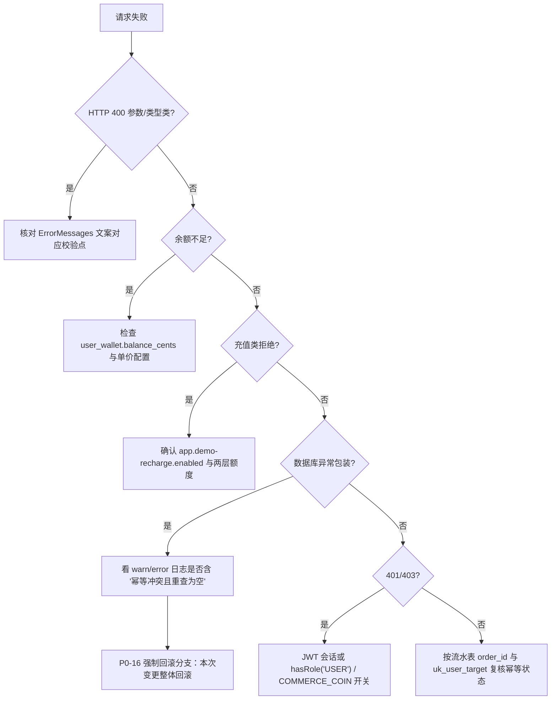

**图表来源**
- [WalletServiceImpl.java:114-118](file://apps/api/src/main/java/com/campuslove/api/wallet/WalletServiceImpl.java#L114-L118)
- [WalletServiceImpl.java:144-191](file://apps/api/src/main/java/com/campuslove/api/wallet/WalletServiceImpl.java#L144-L191)
- [WalletController.java:249-271](file://apps/api/src/main/java/com/campuslove/api/wallet/WalletController.java#L249-L271)
- [RealWalletUnlockService.java:57-103](file://apps/api/src/main/java/com/campuslove/api/wallet/RealWalletUnlockService.java#L57-L103)

### 常见症状对照表

| 症状 / 异常消息片段 | 触发点 | 首查项 |
| --- | --- | --- |
| `不支持的扣费业务类型: {relatedType}` | 控制器客户端白名单（`WalletController.java` L455-L459） | 客户端是否传了 `ADMIN_ADJUST` / `SWEET_TALK` / `UNLOCK_*` 等仅服务端可用的类型（L108-L117） |
| 扣费类型未配置服务端价格 | `resolveServerPrice` 返回 0 后拒绝（L462-L466、L489-L497） | `app.wallet.price.*` 是否被配成 `<= 0` |
| `ErrorMessages.UNSUPPORTED_DEDUCT_TYPE_PREFIX + relatedType` | 服务层白名单（`WalletServiceImpl.java` L114-L118） | 新增业务类型时是否同步登记 `DEDUCT_RELATED_TYPE_WHITELIST`（L71-L82） |
| `仅支持: LIKED_ME / VISITOR` | 解锁类型归一化（`RealWalletUnlockService.java` L127-L136、`MockWalletUnlockService.java` L89-L98） | 客户端 `targetType` 拼写；注意是 `VISITOR` 而非 `VISITORS` |
| 余额不足 | `InsufficientBalanceException(userId, amountCents, currentBalance)`（`WalletServiceImpl.java` L145-L150），解锁侧记 warn 后原样重抛（`RealWalletUnlockService.java` L85-L89） | `user_wallet.balance_cents`、`app.unlock-price.*` 单价 |
| 演示充值被禁用 | `IllegalStateException(ErrorMessages.DEMO_RECHARGE_DISABLED)`（`WalletController.java` L256-L259） | `app.demo-recharge.enabled`；生产应保持 `false`（L127-L135） |
| 每日限额提示 | `DailyLimitExceededException`（L261-L266），限额来自 `app.demo-recharge.daily-limit` | Redis 键 `demo-recharge:count:{userId}:{yyyyMMdd}` 当前值 |
| 累计金额已达上限提示 | `OperationForbiddenException`（L268-L271） | Redis 键 `demo-recharge:total:{userId}`、`APP_DEMO_RECHARGE_TOTAL_LIMIT_CENTS` |
| `orderId 已存在但归属用户不一致` | 幂等命中/冲突重查的归属校验（`WalletServiceImpl.java` L125-L128、L213-L216、L254-L257） | 客户端是否跨用户复用了同一 `orderId` |
| `ErrorMessages.WALLET_DEDUCT_ROLLBACK` / `WALLET_RECHARGE_ROLLBACK` | 幂等冲突但重查为空，走 P0-16 强制回滚（L179-L187、L261-L266） | 非 `order_id` 的其他约束冲突；本次变更已整体回滚，可安全重试 |
| `ErrorMessages.WALLET_DEDUCT_FAILED_RETRY` / `WALLET_RECHARGE_FAILED_RETRY` | `DataAccessException` 包装（L188-L191、L267-L270） | 数据库连接与事务超时；堆栈已在日志中记录但不外泄给客户端（类注释 L43） |
| 充值返回但余额未增加 | Redis fail-closed 拒绝（L320-L324、L360-L366） | 日志 `写入 Redis 演示充值…失败，拒绝本次演示充值（fail-closed）` |
| 解锁成功但他人解锁同目标时扣费异常 | `orderId` 缺 `userId` 的历史缺陷（`RealWalletUnlockService.java` L75-L81；回归点 `RealWalletUnlockServiceTest.java` L30） | real 实现已修复为 `UNLOCK-{type}-{userId}-{targetId}`；mock 仍是旧格式（`MockWalletUnlockService.java` L65），不要以 mock 验证幂等 |

### 日志关键字

服务层与解锁层的 info/warn 文案可直接用于 grep 定位，且各自携带 `userId`、`orderId`、`type`、`targetId` 维度：

- 解锁链：`解锁命中已解锁记录，直接放行`（L68）、`解锁扣费失败，余额不足`（L86-L87）、`解锁记录唯一约束冲突（并发重复解锁），按已解锁处理`（L101-L102）、`解锁成功：userId=…, balanceAfter=…`（L105-L106）；mock 侧为 `Mock 解锁成功`（`MockWalletUnlockService.java` L69-L70）。
- 账务链：`钱包扣减幂等命中`（L129-L130）、`钱包扣减被拒绝：relatedType 不在白名单`（L116）、`钱包扣减失败，余额不足`（L147-L148）、`钱包扣减成功`（L164-L165）、`钱包扣减幂等冲突，重新查询`（L173）、`钱包扣减幂等冲突且重查为空，强制回滚`（L184）、`用户钱包不存在，自动初始化`（L140、L226）；充值侧同构（L217-L218、L243-L244、L249、L263、L268）。
- 控制器侧：`钱包扣减被拒绝：relatedType 不在客户端白名单`（`WalletController.java` L456-L457）、`钱包扣减金额与服务端定价不符，以服务端为准`（L468-L470）、`演示充值已被配置禁用`（L257）。

### 数据一致性核对

- **一用户一钱包**：`uk_user_wallet_user (user_id)`（`V2026.07.28.0003__wallet_tables.sql` L42）。若某用户扣费持续失败，先确认 `user_wallet` 是否存在该行；服务层会在缺失时 `initWallet` 建 0 余额行，随后必然因余额不足抛错（`WalletServiceImpl.java` L136-L150）。
- **流水与余额是否匹配**：每条流水都携带 `balance_after`（DDL L51，写入见 `writeTransactionLog` L349-L363），可用「上一条 `balance_after` ± 本条 `amount` == 本条 `balance_after`」做逐行校验；`type` 只允许 `DEBIT` / `CREDIT`（`WalletTransactionLog.TransactionType`，`WalletServiceImpl.java` L160、L239；DDL 注释 L49）。
- **重复扣费排查**：按 `order_id` 查 `wallet_transaction_log`（唯一索引，L58）；同一 `(user_id, target_type, target_id)` 在 `wallet_unlocks` 至多一行（L15）。
- **外键覆盖范围**：`V2026.07.28.0008__add_money_foreign_keys.sql` L57-L58 仅对 `user_wallet`、`wallet_transaction_log` 补了指向 `users(id)` 的 `RESTRICT` 外键（文件头 L6-L7 也仅列这两张表）。审计报告 `archive/audit-round2/R3-ROUND2-ISSUES.tsv` L803-L804 记录了两张表原始缺失外键的问题（R2-00063 / R2-00064，HIGH）；`wallet_unlocks` 不在补 FK 范围内，排查孤儿解锁记录需自行按 `user_id` 关联 `users`。

### 装配问题

账务与解锁实现都受 profile 约束：`WalletServiceImpl` 为 `@Profile("real")`（L50）、`RealWalletUnlockService` 为 `@Profile("real")`（L32）、`MockWalletUnlockService` 为 `@Profile("mock")`（L21）。控制器以构造参数强制注入 `WalletService` 与 `WalletUnlockService` 两个契约（`WalletController.java` L189-L192），若运行环境未激活 `real` 或 `mock` profile，则接口无候选实现，装配阶段即失败——这类问题的表现是应用启动报错而非接口 500。

**章节来源**
- [WalletController.java:108-117](file://apps/api/src/main/java/com/campuslove/api/wallet/WalletController.java#L108-L117)
- [WalletController.java:249-280](file://apps/api/src/main/java/com/campuslove/api/wallet/WalletController.java#L249-L280)
- [WalletController.java:282-399](file://apps/api/src/main/java/com/campuslove/api/wallet/WalletController.java#L282-L399)
- [WalletController.java:401-426](file://apps/api/src/main/java/com/campuslove/api/wallet/WalletController.java#L401-L426)
- [WalletController.java:428-497](file://apps/api/src/main/java/com/campuslove/api/wallet/WalletController.java#L428-L497)
- [WalletServiceImpl.java:36-52](file://apps/api/src/main/java/com/campuslove/api/wallet/WalletServiceImpl.java#L36-L52)
- [WalletServiceImpl.java:71-150](file://apps/api/src/main/java/com/campuslove/api/wallet/WalletServiceImpl.java#L71-L150)
- [WalletServiceImpl.java:160-301](file://apps/api/src/main/java/com/campuslove/api/wallet/WalletServiceImpl.java#L160-L301)
- [WalletServiceImpl.java:311-364](file://apps/api/src/main/java/com/campuslove/api/wallet/WalletServiceImpl.java#L311-L364)
- [RealWalletUnlockService.java:54-149](file://apps/api/src/main/java/com/campuslove/api/wallet/RealWalletUnlockService.java#L54-L149)
- [MockWalletUnlockService.java:21-98](file://apps/api/src/main/java/com/campuslove/api/wallet/MockWalletUnlockService.java#L21-L98)
- [V2026.07.28.0003__wallet_tables.sql:42-62](file://database/flyway/sql/V2026.07.28.0003__wallet_tables.sql#L42-L62)
- [V2026.08.08.0001__wallet_unlocks.sql:7-16](file://database/flyway/sql/V2026.08.08.0001__wallet_unlocks.sql#L7-L16)
- [V2026.07.28.0008__add_money_foreign_keys.sql:6-7](file://database/flyway/sql/V2026.07.28.0008__add_money_foreign_keys.sql#L6-L7)
- [V2026.07.28.0008__add_money_foreign_keys.sql:57-58](file://database/flyway/sql/V2026.07.28.0008__add_money_foreign_keys.sql#L57-L58)
- [R3-ROUND2-ISSUES.tsv:803-804](file://archive/audit-round2/R3-ROUND2-ISSUES.tsv#L803-L804)
- [RealWalletUnlockServiceTest.java:30-30](file://apps/api/src/test/java/com/campuslove/api/wallet/RealWalletUnlockServiceTest.java#L30-L30)

## 依赖关系分析

### 上游调用方

`WalletService` 是全仓库的资金写入汇聚点，服务层白名单的注释逐条登记了扣费调用方（`WalletServiceImpl.java` L56-L70）：

| 调用方 | 使用的 `relatedType` | 证据 |
| --- | --- | --- |
| `WalletController` | `WALLET_DEMO_RECHARGE` 与四类客户端解锁类型 | `WalletController.java` L99、L112-L117、L276-L277、L475-L476 |
| `RealWalletUnlockService` / `MockWalletUnlockService` | `UNLOCK_LIKED_ME` / `UNLOCK_VISITOR` | `RealWalletUnlockService.java` L84、L145-L148；`MockWalletUnlockService.java` L62-L66 |
| `AutoRenewService`（VIP 自动续费） | `RELATED_TYPE_VIP_RENEW` | `WalletServiceImpl.java` L59-L62；`AutoRenewService.java` L421-L423 描述同一套悲观锁 + 幂等键 + 事务三重保障 |
| `AdminWalletController`（后台余额调整） | `ADMIN_ADJUST` | `WalletServiceImpl.java` L63（注释登记） |
| `BillingService`（VIP 购买） | 通过注入 `WalletService walletService` 参与支付 | `BillingService.java` L66 |
| `RealWhisperService`（悄悄话扣费/退款） | `RELATED_TYPE_WHISPER_SEND`（服务层白名单成员） | `WalletServiceImpl.java` L81；`RealWhisperService.java` L37、L223、L267 |

### 下游依赖

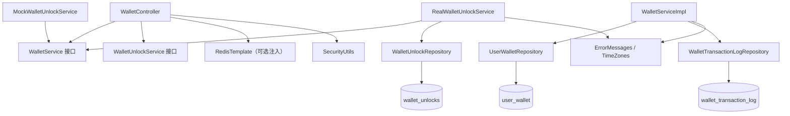

**图表来源**
- [WalletController.java:119-125](file://apps/api/src/main/java/com/campuslove/api/wallet/WalletController.java#L119-L125)
- [WalletController.java:180-192](file://apps/api/src/main/java/com/campuslove/api/wallet/WalletController.java#L180-L192)
- [WalletServiceImpl.java:84-91](file://apps/api/src/main/java/com/campuslove/api/wallet/WalletServiceImpl.java#L84-L91)
- [WalletServiceImpl.java:136-136](file://apps/api/src/main/java/com/campuslove/api/wallet/WalletServiceImpl.java#L136-L136)
- [WalletServiceImpl.java:300-300](file://apps/api/src/main/java/com/campuslove/api/wallet/WalletServiceImpl.java#L300-L300)
- [WalletServiceImpl.java:313-320](file://apps/api/src/main/java/com/campuslove/api/wallet/WalletServiceImpl.java#L313-L320)
- [RealWalletUnlockService.java:38-52](file://apps/api/src/main/java/com/campuslove/api/wallet/RealWalletUnlockService.java#L38-L52)
- [MockWalletUnlockService.java:27-42](file://apps/api/src/main/java/com/campuslove/api/wallet/MockWalletUnlockService.java#L27-L42)

仓储方法名可直接读出访问模式：`findByUserIdForUpdate`（悲观锁）、`findByUserId`（只读）、`save`（`WalletServiceImpl.java` L136、L156、L224、L235、L284、L320）；`findByOrderId`、`findByUserIdOrderByCreatedAtDesc`、`save`（L121、L174、L208、L250、L300、L363）；`findByUserIdAndTargetTypeAndTargetId`、`findByUserIdAndTargetTypeAndTargetIdIn`、`saveAndFlush`（`RealWalletUnlockService.java` L67、L98、L121）。

### 横切依赖

- **常量与文案**：所有异常消息取自 `com.campuslove.api.common.ErrorMessages`（`WalletController.java` L3、`WalletServiceImpl.java` L3、`RealWalletUnlockService.java` L3、`MockWalletUnlockService.java` L3）。
- **时区**：时间戳统一用 `LocalDateTime.now(TimeZones.BUSINESS)` / `LocalDate.now(TimeZones.BUSINESS)`（`WalletServiceImpl.java` L155、L234、L317-L319、L360-L362；`WalletController.java` L341）。
- **安全与开关**：`SecurityUtils`、`FeatureSwitch` / `FeatureSwitchKeys`（`WalletController.java` L7-L9、L250-L252）。
- **幂等切面**：`com.campuslove.api.common.Idempotent`（`WalletController.java` L6、L251）。
- **Redis**：`RedisTemplate<String, Object>` 以 `@Autowired(required = false)` 可选注入（L27、L180-L181）。

### 前端与契约侧的接入证据

管理端 `apps/admin/src/views/business/VipBills.vue`（499 行）与小程序端 `apps/client/src/stores/vip-billing.ts`（`useVipBillingStore`，L127）、`apps/client/src/subpackages/vip/bills.vue`（536 行）覆盖的是 **VIP 账单**视图；`docs/openapi/feedback-growth-and-auth.yaml` 登记的 path 覆盖 auth / profile / app-config（L33-L224），其中与钱包消费事实相关的只有会话类端点（`getCurrentSession` L52-L57、`refreshToken` L105-L112）。

**需要如实说明的两点缺口**：其一，`/api/v1/wallet/**` 五个端点在已登记的 OpenAPI 文档中没有对应 path 条目，其契约以控制器与其内联 record 为唯一来源；其二，本仓库中未见小程序端直接调用 `/wallet/unlock` 或 `/wallet/balance` 的代码证据，`apps/client/src/services/api.ts` 中可核对到的钱包相关表述是「已解锁（`wallet_transaction_log` 存在 `MESSAGE_UNLOCK` / `WHISPER_UNLOCK` 流水）」的判定说明（L1081），属于对账务事实的引用而非端点封装。

**章节来源**
- [WalletController.java:3-9](file://apps/api/src/main/java/com/campuslove/api/wallet/WalletController.java#L3-L9)
- [WalletController.java:119-125](file://apps/api/src/main/java/com/campuslove/api/wallet/WalletController.java#L119-L125)
- [WalletController.java:180-192](file://apps/api/src/main/java/com/campuslove/api/wallet/WalletController.java#L180-L192)
- [WalletController.java:276-277](file://apps/api/src/main/java/com/campuslove/api/wallet/WalletController.java#L276-L277)
- [WalletController.java:475-476](file://apps/api/src/main/java/com/campuslove/api/wallet/WalletController.java#L475-L476)
- [WalletServiceImpl.java:3-4](file://apps/api/src/main/java/com/campuslove/api/wallet/WalletServiceImpl.java#L3-L4)
- [WalletServiceImpl.java:56-91](file://apps/api/src/main/java/com/campuslove/api/wallet/WalletServiceImpl.java#L56-L91)
- [WalletServiceImpl.java:121-156](file://apps/api/src/main/java/com/campuslove/api/wallet/WalletServiceImpl.java#L121-L156)
- [WalletServiceImpl.java:208-235](file://apps/api/src/main/java/com/campuslove/api/wallet/WalletServiceImpl.java#L208-L235)
- [WalletServiceImpl.java:284-320](file://apps/api/src/main/java/com/campuslove/api/wallet/WalletServiceImpl.java#L284-L320)
- [RealWalletUnlockService.java:3-3](file://apps/api/src/main/java/com/campuslove/api/wallet/RealWalletUnlockService.java#L3-L3)
- [RealWalletUnlockService.java:38-52](file://apps/api/src/main/java/com/campuslove/api/wallet/RealWalletUnlockService.java#L38-L52)
- [RealWalletUnlockService.java:67-98](file://apps/api/src/main/java/com/campuslove/api/wallet/RealWalletUnlockService.java#L67-L98)
- [RealWalletUnlockService.java:121-121](file://apps/api/src/main/java/com/campuslove/api/wallet/RealWalletUnlockService.java#L121-L121)
- [MockWalletUnlockService.java:27-42](file://apps/api/src/main/java/com/campuslove/api/wallet/MockWalletUnlockService.java#L27-L42)
- [AutoRenewService.java:421-423](file://apps/api/src/main/java/com/campuslove/api/vip/AutoRenewService.java#L421-L423)
- [BillingService.java:66-66](file://apps/api/src/main/java/com/campuslove/api/vip/BillingService.java#L66-L66)
- [RealWhisperService.java:37-37](file://apps/api/src/main/java/com/campuslove/api/whisper/RealWhisperService.java#L37-L37)
- [RealWhisperService.java:223-267](file://apps/api/src/main/java/com/campuslove/api/whisper/RealWhisperService.java#L223-L267)
- [api.ts:1081-1081](file://apps/client/src/services/api.ts#L1081-L1081)
- [feedback-growth-and-auth.yaml:33-57](file://docs/openapi/feedback-growth-and-auth.yaml#L33-L57)
- [feedback-growth-and-auth.yaml:105-112](file://docs/openapi/feedback-growth-and-auth.yaml#L105-L112)
- [vip-billing.ts:127-127](file://apps/client/src/stores/vip-billing.ts#L127-L127)
- [WalletService.java:17-51](file://apps/api/src/main/java/com/campuslove/api/wallet/WalletService.java#L17-L51)

## 微信支付 APIv3 支付管道

本节描述与钱包余额扣费**并列**的第二条支付通道：微信支付 APIv3 管道，由提交 `91fffe7b`（2026-10-05）引入，物理上落在包 `com.campuslove.api.wxpay` 下的 11 个类，全部标注 `@Profile("real")`，不进入 mock 演示链路。它与前述钱包解锁的关系是「两条互不隶属的资金入口」：钱包侧用 `WalletService.deduct` 扣虚拟金币余额（单位分、悲观锁、`order_id` 幂等），微信侧用 JSAPI 真实收款并为 VIP 订单写 `payment_callback_log` 对账流水，二者不共享余额，也不互相回滚。

该管道的一条贯穿性设计是**不引官方 SDK**：请求签名与回调验签全部用 JDK 原生 `java.security.Signature` / `javax.crypto` 实现，HTTP 走 JDK 11 的 `java.net.http.HttpClient`（`WxPayJsapiService.java` 类注释 L20-L37）。第二条贯穿性设计是**缺省封存 + 启动期 fail-fast**：`enabled` 默认 `false`（`WxPayProperties.java` L40），未显式开启时所有下单/回调端点直接 404；一旦开启却缺任一必填项，则在容器初始化阶段抛异常拒绝启动，绝不进入「开关开了但密钥没配」的半可用态（`WxPayBootstrapChecker.java` L8-L19）。

### 配置模型与启动期校验

配置载体 `WxPayProperties` 以 `@ConfigurationProperties(prefix = "app.wechat-pay")` 绑定（`WxPayProperties.java` L33），字段声明即配置契约：8 个必填项（`app-id` / `mchid` / `mch-serial-no` / `merchant-private-key` / `api-v3-key` / `notify-url` / `refund-notify-url` / `platform-cert`）集中在 `REQUIRED_KEYS` 数组（L91-L94），4 个可调项带内置默认值（连接超时 3000ms L79、读超时 6000ms L82、订单有效期 120 分钟 L85、回调时间戳容差 300 秒 L88）。敏感项全部经环境变量注入、禁止硬编码，`merchant-private-key` / `platform-cert` 还支持「PEM 内容原文」与「PEM 文件路径」双取值（L29-L31 类注释）。

`findMissingRequired()` 是 fail-fast 的数据源：封存态直接返回空列表、不做缺项校验（L104-L108），仅在 `enabled=true` 时逐项判空并回填缺失 key（L109-L133）——其中 `notify-url` 的校验就是 L124 那句「`== null || isBlank()`」，**只校验非空，不校验是否为合法 https 或外网可达**。

```yaml
# apps/api/src/main/resources/application-real.yml (节选)
  wechat-pay:
    enabled: ${APP_WXPAY_ENABLED:false}
    notify-url: ${APP_WXPAY_NOTIFY_URL:}          # 无默认值环境变量：不设即空串
    refund-notify-url: ${APP_WXPAY_REFUND_NOTIFY_URL:}
```

`application-real.yml` 的 `app.wechat-pay` 块（L181-L196）把上述每一项映射为 `${ENV:默认}` 形式；关键是 `notify-url` 与 `refund-notify-url` 用的是**无默认值**写法 `${APP_WXPAY_NOTIFY_URL:}`（L188-L189，冒号后为空即默认空串），因此未注入环境变量时该值落到空串，进而被 `findMissingRequired` 判为缺失。装配由 `WxPayConfig`（`@Configuration` + `@Profile("real")` + `@EnableConfigurationProperties(WxPayProperties.class)`，`WxPayConfig.java` L22-L24）完成，并注册校验器 Bean `wxPayBootstrapChecker`（L33-L35）。

校验器 `WxPayBootstrapChecker` 实现 `InitializingBean`（`WxPayBootstrapChecker.java` L20），`afterPropertiesSet` 的执行序即启动序：先读 `enabled`，未开则记一条 404 预告日志并直接返回（L37-L41）；开启后取 `findMissingRequired()`，非空即拼出「缺 APP_WXPAY_* 请重启」消息、`log.error` 并抛 `IllegalStateException` 拒绝启动（L43-L49）；随后**预热解析本地密钥**——分别调 `WxPayRequestSigner.loadMerchantPrivateKey` 与 `WxPayCallbackVerifier.loadPlatformPublicKey`，把 PEM 格式非法也提前到启动期暴露（L52-L61）；若回调 IP 白名单为空，记一条纵深防御告警但不阻断启动（L63-L66）。全程不发起任何网络调用（类注释 L16）。

**章节来源**
- [WxPayProperties.java:33-40](file://apps/api/src/main/java/com/campuslove/api/wxpay/WxPayProperties.java#L33-L40)
- [WxPayProperties.java:79-94](file://apps/api/src/main/java/com/campuslove/api/wxpay/WxPayProperties.java#L79-L94)
- [WxPayProperties.java:104-133](file://apps/api/src/main/java/com/campuslove/api/wxpay/WxPayProperties.java#L104-L133)
- [WxPayConfig.java:22-35](file://apps/api/src/main/java/com/campuslove/api/wxpay/WxPayConfig.java#L22-L35)
- [WxPayBootstrapChecker.java:20-41](file://apps/api/src/main/java/com/campuslove/api/wxpay/WxPayBootstrapChecker.java#L20-L41)
- [WxPayBootstrapChecker.java:43-66](file://apps/api/src/main/java/com/campuslove/api/wxpay/WxPayBootstrapChecker.java#L43-L66)
- [application-real.yml:181-196](file://apps/api/src/main/resources/application-real.yml#L181-L196)

### 请求签名与 JSAPI 拉起

`WxPayRequestSigner`（`@Component` + `@Profile("real")`，`WxPayRequestSigner.java` L43-L44）承担两种签名。其一为 APIv3 请求的 `Authorization` 头：`authorizationHeader` 用秒级时间戳 + `newNonce()` 随机串拼官方五段签名串（`buildRequestMessage`：`METHOD\nURL\nTIMESTAMP\nNONCE\nBODY\n`，每段含结尾换行，L99-L106），经 `signMessage` 以商户私钥 `SHA256withRSA` 签名后 Base64（L115-L127），再按官方 `WECHATPAY2-SHA256-RSA2048 mchid="...",nonce_str="...",signature="...",timestamp="...",serial_no="..."` 格式装配（`AUTH_SCHEME` 常量 L50、拼装 L87-L93）。其二为 JSAPI 小程序拉起支付的 `paySign`，签名串是 `appId\ntimeStamp\nnonceStr\nprepay_id=xxx\n`（`buildJsapiPaySign` L141-L147）。

构造期对封存态做了刻意宽容：若 `merchant-private-key` 为空，则把 `privateKey` 置 null 并记 warn，而不是抛异常（L62-L69），因为「缺私钥」在 `enabled=false` 下属预期，真正开启时由 `WxPayBootstrapChecker` 在启动期拦截。私钥加载 `loadMerchantPrivateKey` 走 `readPem`（L164-L180）：`readPem` 以 `-----BEGIN` 前缀区分 PEM 原文与文件路径，后者从磁盘读（L189-L205）；`stripPemHeaders` 去头尾与空白后按 PKCS#8 解析，PKCS#1 需先经 openssl 转换（L177-L179 错误提示）。

`WxPayJsapiService`（`@Service` + `@Profile("real")`，`WxPayJsapiService.java` L38-L39）是对外的下单/关单/退款门面，基址 `API_BASE = https://api.mch.weixin.qq.com`（L45）。三个动作分别打 `/v3/pay/transactions/jsapi`（`createJsapiOrder` L73-L99，校验 `prepay_id` 非空后返回 `PrepayResult`）、`/v3/pay/transactions/out-trade-no/{outTradeNo}/close`（`closeOrder` L108-L115）、`/v3/refund/domestic/refunds`（`createRefund` L125-L146，退款结果走异步回调）。`buildJsapiPayParams` 把 `prepay_id` 组装成 `wx.requestPayment` 五件套 `JsapiPayParams`（`package` 字段经 `@JsonProperty("package")` 序列化，L158-L164、L278-L287）。

**双闸**是本服务的方法级前置守卫 `ensureEnabled`（L171-L178）：任一网络发起方法先查配置闸 `enabled`、再查商业化子闸 `featureSwitchService.isCommerceEnabled(FeatureSwitchKeys.COMMERCE_VIP)`，任一关闭抛 `WxPayDisabledException`——`WxPayDisabledException` 不直接映射 HTTP，端点层已用 404/403 拦截，它只是防止绕过端点直调服务的兜底（`WxPayDisabledException.java` L6-L9）。HTTP 发送集中在 `post`：自动挂签名头、按 `readTimeoutMs` 设超时、非 2xx 经 `toApiException` 解析微信错误体 `{code,message}` 抛 `WxPayApiException`（L181-L204、L207-L222）；网络层异常统一包装为 `code=NETWORK_ERROR`（L198-L203、`WxPayApiException.java` L23-L27）。`HttpClient` 采用惰性 double-check 单例，确保构造/启动期零网络相关初始化（L52-L53、L225-L239）。

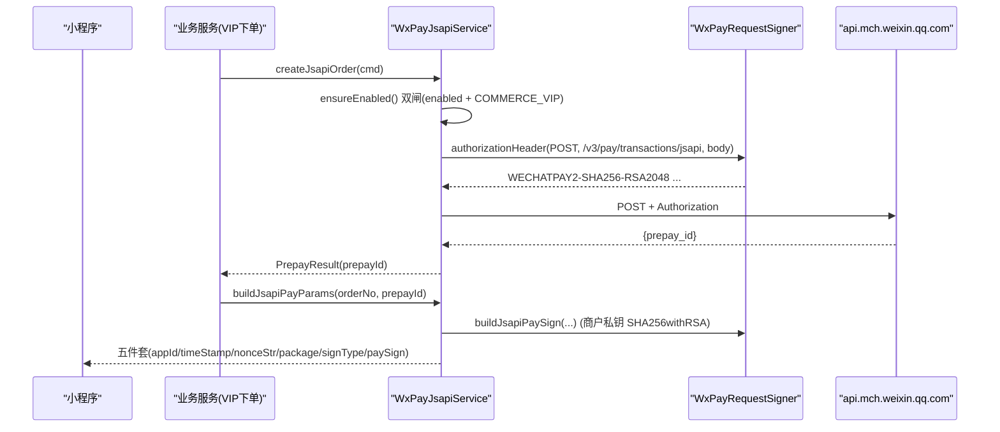

**图表来源**
- [WxPayJsapiService.java:73-99](file://apps/api/src/main/java/com/campuslove/api/wxpay/WxPayJsapiService.java#L73-L99)
- [WxPayJsapiService.java:158-178](file://apps/api/src/main/java/com/campuslove/api/wxpay/WxPayJsapiService.java#L158-L178)
- [WxPayJsapiService.java:181-239](file://apps/api/src/main/java/com/campuslove/api/wxpay/WxPayJsapiService.java#L181-L239)
- [WxPayRequestSigner.java:82-147](file://apps/api/src/main/java/com/campuslove/api/wxpay/WxPayRequestSigner.java#L82-L147)

**章节来源**
- [WxPayRequestSigner.java:43-205](file://apps/api/src/main/java/com/campuslove/api/wxpay/WxPayRequestSigner.java#L43-L205)
- [WxPayJsapiService.java:38-239](file://apps/api/src/main/java/com/campuslove/api/wxpay/WxPayJsapiService.java#L38-L239)
- [WxPayApiException.java:9-35](file://apps/api/src/main/java/com/campuslove/api/wxpay/WxPayApiException.java#L9-L35)
- [WxPayDisabledException.java:9-14](file://apps/api/src/main/java/com/campuslove/api/wxpay/WxPayDisabledException.java#L9-L14)

### 回调报文模型与验签解密

回调载荷由 `WxPayModels`（`final` 工具类，私有构造 L20-L21）定义两层结构：信封 `WxPayNotification`（`id` / `event_type` / `resource`，L25-L40），`resource` 是密文容器 `Resource`（`algorithm` / `ciphertext` / `associated_data` / `nonce` / `original_type`，L32-L39）；解密后的业务载荷按事件分两类——支付结果 `WxPayTransaction`（含 `out_trade_no` / `transaction_id` / `trade_state` / `amount{total,payer_total,currency}`，L44-L62）与退款结果 `WxPayRefundPayload`（含 `out_refund_no` / `refund_id` / `refund_status` / `amount{total,refund,payer_total}`，L66-L83）。字段名经 `@JsonProperty` 对齐官方 snake_case，`@JsonIgnoreProperties(ignoreUnknown = true)` 保证向前兼容。

`WxPayCallbackVerifier`（`@Component` + `@Profile("real")`，`WxPayCallbackVerifier.java` L40-L41）负责验签与解密。`verifyCallback` 依次：拒绝缺失的签名/时间戳/nonce 头（L83-L88）、用 `isTimestampWithinTolerance` 卡防重放时间窗（默认 300 秒，`Math.abs(now - ts) <= tolerance`，L89-L92、L118-L128）、在平台公钥未加载时直接拒绝（L93-L96），最后以官方签名串 `timestamp\nnonce\nbody\n` 做 RSA-SHA256 验签（L97-L109）。`decryptResource` 用 APIv3 密钥做 AES-256-GCM 解密：强校验密钥长度必须 32 字节（L146-L149），nonce 12 字节、GCM tag 128 位（常量 L49-L52），密文 Base64 末 16 字节即认证标签，`AEADBadTagException` 归入「密文可能被篡改」抛出（L161-L167）。类注释明确记录了这条防线关闭的历史漏洞：原骨架实现「非空即过」，等于任意请求可开通 VIP，本次改为验签不过/时间戳过期/解密失败一律拒绝（L37-L38）。构造期同样对封存态宽容——平台证书为空则置 null 并记 warn（L60-L68），`loadPlatformPublicKey` 走 X.509 `SubjectPublicKeyInfo` PEM 解析（L177-L192）。

`WxPayCallbackGuard`（`@Component` + `@Profile("real")`，`WxPayCallbackGuard.java` L23-L24）是纵深防御的 IP 层。`isIpAllowed` 的语义是：白名单为空则**放行所有来源**但用 `emptyWhitelistWarned` 标志保证每实例只告警一次（L44-L52），非空则逐条匹配——含 `/` 走 `matchesCidr`（IPv4 转 32 位无符号值 + 掩码比较，L87-L120），否则精确相等（L66-L68），全不匹配记 warn 并返回 false（L70-L71）。`normalizeIp` 剥离 IPv6 映射前缀 `::ffff:`（L75-L81）；本类刻意不做请求解析以便单测，取 X-Forwarded-For 首跳的责任交给调用方（类注释 L20-L21）。

**章节来源**
- [WxPayModels.java:18-84](file://apps/api/src/main/java/com/campuslove/api/wxpay/WxPayModels.java#L18-L84)
- [WxPayCallbackVerifier.java:40-128](file://apps/api/src/main/java/com/campuslove/api/wxpay/WxPayCallbackVerifier.java#L40-L128)
- [WxPayCallbackVerifier.java:139-192](file://apps/api/src/main/java/com/campuslove/api/wxpay/WxPayCallbackVerifier.java#L139-L192)
- [WxPayCallbackGuard.java:23-120](file://apps/api/src/main/java/com/campuslove/api/wxpay/WxPayCallbackGuard.java#L23-L120)

### 支付/退款回调端点与安全放行

回调落地在两个真实控制器：**支付结果**回调注册在 `BillingController.handleWechatPayCallback`（类级 `@RequestMapping("/api/v1/vip/bills")`，`BillingController.java` L64-L67，方法 `@PostMapping("/payment-callback")` L113，方法体 L114 起），与账单/其他 VIP 端点共用类前缀；**退款结果**回调独立在 `WxPayRefundNotifyController`（`@Profile("real")` + `@RestController` + `@RequestMapping("/api/v1/refund")`，`WxPayRefundNotifyController.java` L28-L30，方法 `@PostMapping("/notify")` L71）。两者防护链逐字对称，按固定四步短路：配置闸（`!enabled` 抛 `ResourceNotFoundException`→404）→ IP 白名单（不匹配同样 404，不暴露端点存在性）→ 验签（失败返回 `{"code":"FAIL"}` 让微信按其策略重发）→ AES-256-GCM 解密后交 `VipOrderService` 迁移订单状态机；支付侧见 `BillingController.java` L121-L129，退款侧见 `WxPayRefundNotifyController.java` L79-L128。IP 解析都走 X-Forwarded-For 首跳 → X-Real-IP → remoteAddr 三级回退（`WxPayRefundNotifyController.java` L159-L171）。

**这段曾经错位、现已修复**。历史上安全白名单里写的是 `/api/v1/vip/payment-callback`，而该串没有任何控制器承载（真实路径是类前缀 `/api/v1/vip/bills` + 方法 `/payment-callback` 拼出的 `/api/v1/vip/bills/payment-callback`）。结果微信真实回调既不匹配 permitAll、也不匹配任何已注册端点，落到安全链兜底的 `/api/v1/**` `authenticated()`，被 401 拒在门外——**端点内四道防护根本执行不到**，支付链路静默失效。今天（2026-10-11）HEAD 的实测位置是：`SecurityConfig.java:154` permitAll `/api/v1/vip/bills/payment-callback`、`SecurityConfig.java:157` permitAll `/api/v1/refund/notify`，其上的 `R4-00318` 注释（L146-L153）逐字记录了这次「路径修正」及错位后果；`BillingController` 类注释 L60-L62 同样把旧串标注为导致 401 的原因。

Mock 侧需要对一个易混淆点写准：`MockSecurityConfig.java` 有两处看似重复的回调串，语义完全不同。**放行清单**是安全链上的 `requestMatchers(...).permitAll()`（`MockSecurityConfig.java:203` `/api/v1/vip/bills/payment-callback`、`:204` `/api/v1/refund/notify`，注释 L198-L202 说明 mock 档真实控制器不注册、放行后表现为 404 而非 401）。而 `MockSecurityConfig.java:76` / `:78` 的两个串位于 `PERMIT_PATHS` 常量列表（L69-L83），`PERMIT_PATHS` **只决定 mock 过滤器是否为请求注入模拟用户、并不是放行清单**：过滤器仅在 `!isPermitPath(path)` 时才注入 ROLE_USER/ROLE_ADMIN（`MockSecurityConfig.java` L249-L252、`isPermitPath` L288-L291），把回调路径放进 `PERMIT_PATHS` 是为了**阻止**过滤器伪造身份，从而与 real 档「回调无 JWT」的行为对齐。

这段错位由两条回归用例守住，任何一侧改名未同步都会先红：`SecurityConfigTest.java:256` 的 `unauthenticated_accessToWechatPayCallback_shouldNotRequireAuth`（场景 12）用未认证 `POST /api/v1/vip/bills/payment-callback` 携带微信四头，断言响应状态**非 401/403**（L257-L270）；`SecurityConfigTest.java:281` 的 `permitAllCallbackPath_matchesControllerRegistration`（场景 13）不需容器与数据库，直接反射读取 `BillingController` 的类级 `@RequestMapping` 与 `handleWechatPayCallback` 上的 `@PostMapping` 拼出真实路径，断言其等于 `/api/v1/vip/bills/payment-callback` 并检查 `MockSecurityConfig.PERMIT_PATHS` 包含该串（L282-L299）。至于回调地址本身：`notify-url` 来自 `application-real.yml:188-189` 的**无默认值环境变量**（不设即空串），而 `WxPayProperties.java:124` 只校验其非空、不校验协议或可达性——配置成 `http` 或内网地址虽能通过启动校验，却会导致微信侧无法回调，属运维需自行保证的边界。

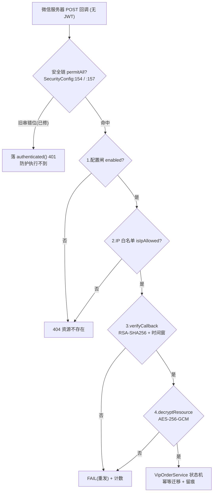

**图表来源**
- [SecurityConfig.java:146-157](file://apps/api/src/main/java/com/campuslove/api/config/SecurityConfig.java#L146-L157)
- [BillingController.java:64-129](file://apps/api/src/main/java/com/campuslove/api/vip/BillingController.java#L64-L129)
- [WxPayRefundNotifyController.java:71-156](file://apps/api/src/main/java/com/campuslove/api/wxpay/WxPayRefundNotifyController.java#L71-L156)

**章节来源**
- [BillingController.java:60-129](file://apps/api/src/main/java/com/campuslove/api/vip/BillingController.java#L60-L129)
- [WxPayRefundNotifyController.java:28-171](file://apps/api/src/main/java/com/campuslove/api/wxpay/WxPayRefundNotifyController.java#L28-L171)
- [SecurityConfig.java:146-157](file://apps/api/src/main/java/com/campuslove/api/config/SecurityConfig.java#L146-L157)
- [MockSecurityConfig.java:68-83](file://apps/api/src/main/java/com/campuslove/api/config/MockSecurityConfig.java#L68-L86)
- [MockSecurityConfig.java:198-204](file://apps/api/src/main/java/com/campuslove/api/config/MockSecurityConfig.java#L198-L204)
- [MockSecurityConfig.java:246-291](file://apps/api/src/main/java/com/campuslove/api/config/MockSecurityConfig.java#L246-L291)
- [SecurityConfigTest.java:255-299](file://apps/api/src/test/java/com/campuslove/api/config/SecurityConfigTest.java#L255-L299)
- [application-real.yml:188-189](file://apps/api/src/main/resources/application-real.yml#L188-L189)
- [WxPayProperties.java:124-126](file://apps/api/src/main/java/com/campuslove/api/wxpay/WxPayProperties.java#L124-L126)

### 回调留痕与监控指标

回调的可取证性落在 `PaymentCallbackLog`（`@Entity` + `@Table(name = "payment_callback_log")`，`PaymentCallbackLog.java` L48-L58）：`notification_id` 建唯一索引 `uk_payment_callback_notification`（L54、字段 L66-L67），`order_no` 建普通索引 `idx_payment_callback_order` 供按订单回溯（L56、字段 L70-L71）。类注释记录了两处语义演进——幂等主判定已从「本表 (notification_id, order_no) 双键」迁移到 `vip_order` 状态机（订单已 `SUCCESS` 的重复通知直接回成功应答），本表 `notification_id` 唯一索引降级为留痕去重与对账辅助（L24-L32）；本表同时升级为回调全量留痕，新增 `raw_body`（`@Lob` TEXT，验签取证 L82-L84）、`headers`（关键请求头 JSON 快照 L87）、`wx_transaction_id` / `mchid`（解密回填对账 L91-L96）、`detail`（对账差异/失败原因 L99-L100）。承载这些列扩容的迁移是 `V2026.10.05.0012__extend_payment_callback_log.sql`，一条 `ALTER TABLE ... ADD COLUMN` 加齐五列（L19-L24），文件头注释 L4-L16 说明扩容动因（争议取证）与幂等语义变更。

监控由 `PaymentMetrics`（`@Component`，`PaymentMetrics.java` L29-L30）承担，暴露两个指标：`payment.callback.latency` Timer（发布 p50/p95/p99，`recordCallbackLatency` L61-L68）与 `payment.callback.failure` Counter（`reason` 标签区分失败原因，`recordCallbackFailure` 首次失败按标签动态注册，L79-L89）。所有记录方法 try-catch 包裹、失败只记日志不抛出（L65-L67、L86-L88），类注释 L23-L25 说明 VIP 下线后原 `payment.vip.*` 指标已清理。回调失败原因串由各端点上报，与告警数据源 `docker/prometheus/rules/alert-rules.yml` 的 `PaymentCallbackFailure` 规则对齐（类注释 L18-L20）：退款侧 `WxPayRefundNotifyController` 分别以 `signature_invalid`（验签失败 L93-L95）、`envelope_invalid`（信封解析/缺 resource L105-L114）、`decrypt_failed`（解密失败 L124-L126）、`payload_invalid`（载荷解析失败 L136-L138）、`internal_error`（处理异常 L152-L154）计数；业务级失败（订单不存在/非法迁移/账单写失败）的 reason 在 `VipOrderService` 内按分支记录，端点只回 `{"code":"FAIL"}`（L147-L148）。

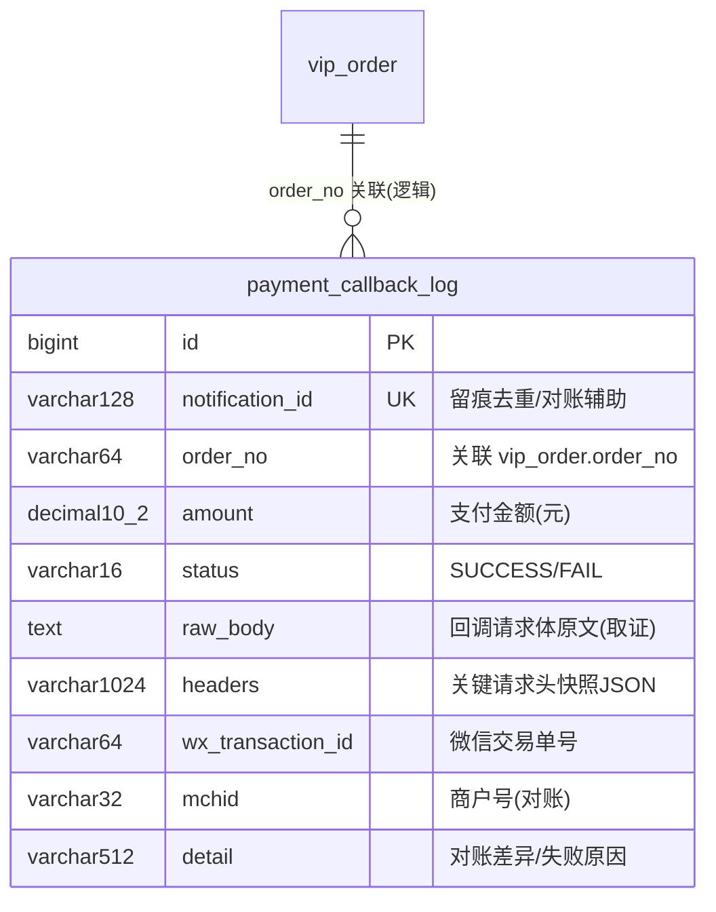

**图表来源**
- [PaymentCallbackLog.java:48-58](file://apps/api/src/main/java/com/campuslove/api/entity/PaymentCallbackLog.java#L48-L58)
- [PaymentCallbackLog.java:66-100](file://apps/api/src/main/java/com/campuslove/api/entity/PaymentCallbackLog.java#L66-L100)
- [V2026.10.05.0012__extend_payment_callback_log.sql:19-24](file://database/flyway/sql/V2026.10.05.0012__extend_payment_callback_log.sql#L19-L24)

**章节来源**
- [PaymentCallbackLog.java:24-100](file://apps/api/src/main/java/com/campuslove/api/entity/PaymentCallbackLog.java#L24-L100)
- [V2026.10.05.0012__extend_payment_callback_log.sql:1-24](file://database/flyway/sql/V2026.10.05.0012__extend_payment_callback_log.sql#L1-L24)
- [PaymentMetrics.java:29-89](file://apps/api/src/main/java/com/campuslove/api/monitor/PaymentMetrics.java#L29-L89)
- [WxPayRefundNotifyController.java:93-154](file://apps/api/src/main/java/com/campuslove/api/wxpay/WxPayRefundNotifyController.java#L93-L154)

## 结论

钱包解锁服务在仓库中的实现边界清晰、可验证：

1. **解锁机制**由 `RealWalletUnlockService` 的「白名单类型 → 查已解锁 → 按配置单价幂等扣费 → 写解锁记录（唯一约束兜底并发）」四步构成（`RealWalletUnlockService.java` L56-L108），对外承诺「已解锁不重复扣费」（L66-L70），批量判定由 `findUnlockedTargetIds` 提供（L110-L124）。
2. **余额计算**完全集中在 `WalletServiceImpl` 的两处算术（扣减 L153 的 `newBalance`、充值 L232 的 `newBalance`），以「分为单位的 BIGINT」存储，读侧 `getBalance` 只读不建（L278-L287）。
3. **权限与消费追踪**分五层落地：JWT 身份、`hasRole('USER')`、`COMMERCE_COIN` 功能开关、双层 `relatedType` 白名单、`(user_id, target_type, target_id)` 目标粒度；消费事实同时被推荐链路（`RecommendationRanker` / `RecommendationController`）与悄悄话退款链路（`RealWhisperService`）当作对账依据读取。
4. **并发安全**是三重防线（悲观行锁 + `order_id` 唯一索引 + 事务原子性）叠加解锁记录的 `uk_user_target`，并由 `noRollbackFor` 与 P0-16 强制回滚分支处理幂等冲突的两个子情形。
5. **防刷**目前只覆盖演示充值：开关 + 每日次数 + 累计金额三层，Redis 计数 fail-closed（`WalletController.java` L234-L241、L282-L399）。

以下能力在本仓库中**没有实现证据**，不应被理解为已有功能：余额冻结/解冻的业务接口（`frozen_cents` 仅为预留列，无任何方法读写它）、解锁任务队列与进度跟踪（`wallet_unlocks` 只有记录行，无任务态字段）、失败自动重试或定时补偿作业（`InsufficientBalanceException` 被原样重抛给调用方）、独立限流器、`/wallet/**` 的 OpenAPI path 条目。同级页面「用户资料服务」覆盖了资料读写与访客/喜欢我的展示侧，本服务的解锁计费与其边界在 `relatedType` 与 `targetType` 两组常量上交汇，不在资料服务中重复描述。

对后续变更最需要注意的三处耦合：新增扣费场景必须**同时**扩两张白名单（控制器客户端层与服务层）；`orderId` 格式必须包含 `userId`（历史事故已固化为测试）；`wallet_unlocks` 缺少外键，孤儿记录需业务层自检。

**章节来源**
- [RealWalletUnlockService.java:54-124](file://apps/api/src/main/java/com/campuslove/api/wallet/RealWalletUnlockService.java#L54-L124)
- [WalletServiceImpl.java:110-192](file://apps/api/src/main/java/com/campuslove/api/wallet/WalletServiceImpl.java#L110-L192)
- [WalletServiceImpl.java:202-271](file://apps/api/src/main/java/com/campuslove/api/wallet/WalletServiceImpl.java#L202-L271)
- [WalletServiceImpl.java:278-321](file://apps/api/src/main/java/com/campuslove/api/wallet/WalletServiceImpl.java#L278-L321)
- [WalletController.java:234-241](file://apps/api/src/main/java/com/campuslove/api/wallet/WalletController.java#L234-L241)
- [WalletController.java:249-280](file://apps/api/src/main/java/com/campuslove/api/wallet/WalletController.java#L249-L280)
- [WalletController.java:282-399](file://apps/api/src/main/java/com/campuslove/api/wallet/WalletController.java#L282-L399)
- [WalletController.java:413-426](file://apps/api/src/main/java/com/campuslove/api/wallet/WalletController.java#L413-L426)
- [WalletController.java:451-478](file://apps/api/src/main/java/com/campuslove/api/wallet/WalletController.java#L451-L478)
- [MockWalletUnlockService.java:44-72](file://apps/api/src/main/java/com/campuslove/api/wallet/MockWalletUnlockService.java#L44-L72)
- [V2026.07.28.0003__wallet_tables.sql:34-62](file://database/flyway/sql/V2026.07.28.0003__wallet_tables.sql#L34-L62)
- [V2026.08.08.0001__wallet_unlocks.sql:6-16](file://database/flyway/sql/V2026.08.08.0001__wallet_unlocks.sql#L6-L16)
- [V2026.07.28.0008__add_money_foreign_keys.sql:57-58](file://database/flyway/sql/V2026.07.28.0008__add_money_foreign_keys.sql#L57-L58)
- [RecommendationController.java:527-527](file://apps/api/src/main/java/com/campuslove/api/discover/RecommendationController.java#L527-L527)
- [RealWhisperService.java:223-223](file://apps/api/src/main/java/com/campuslove/api/whisper/RealWhisperService.java#L223-L223)
