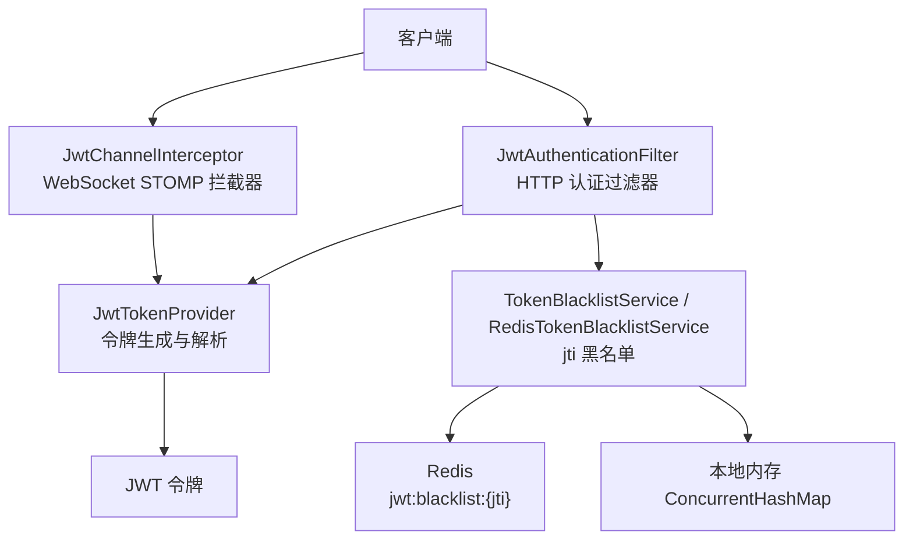
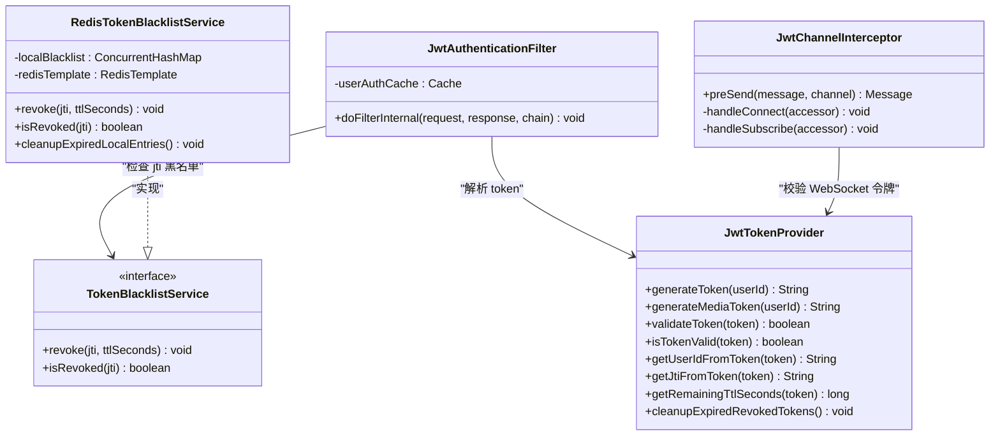
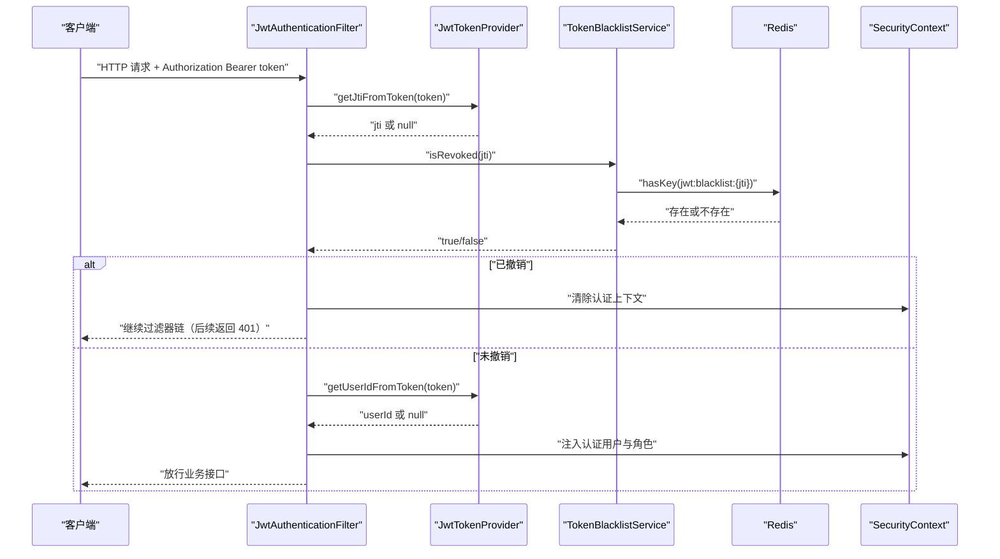
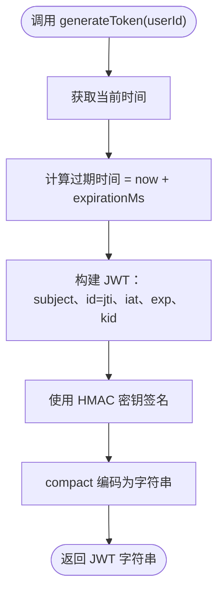
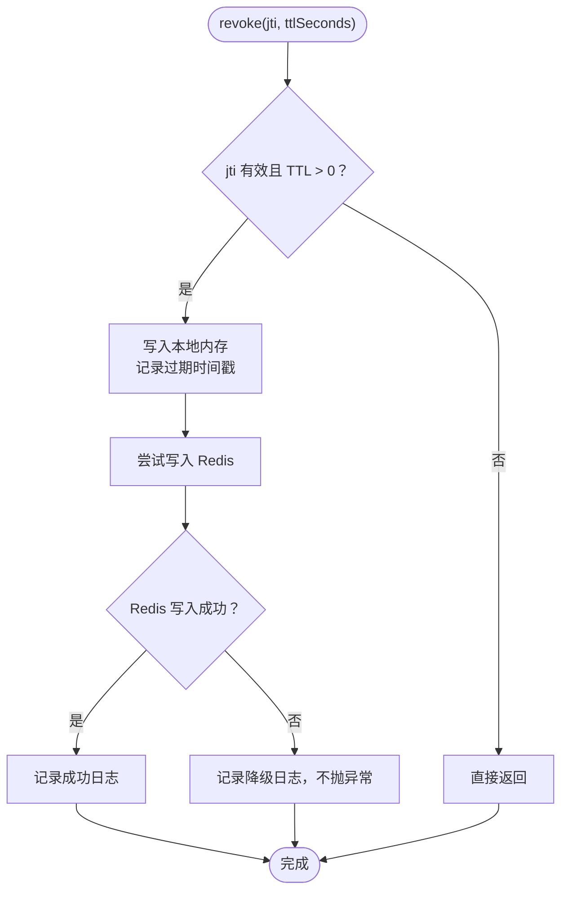
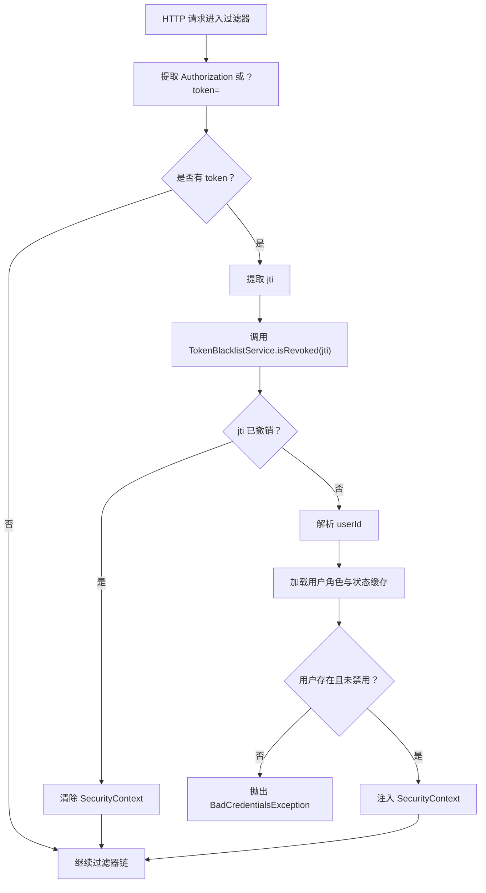
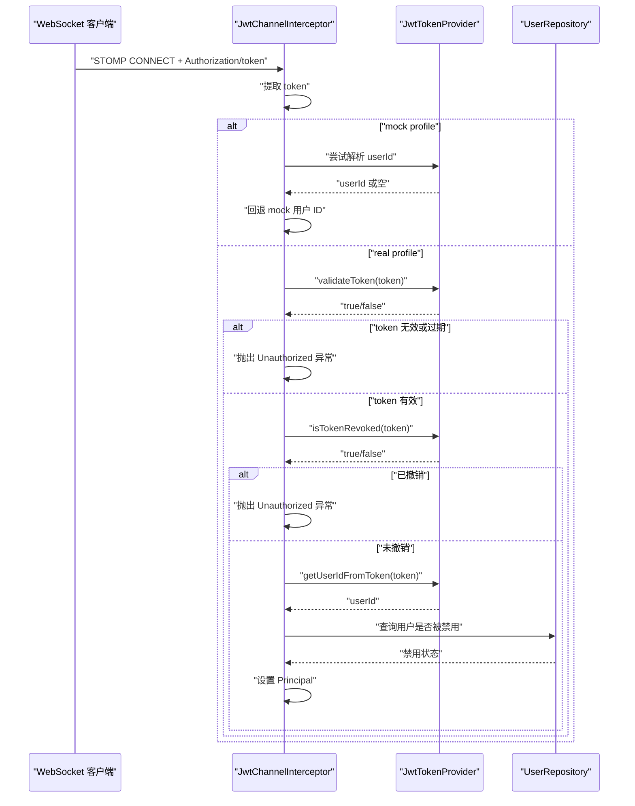
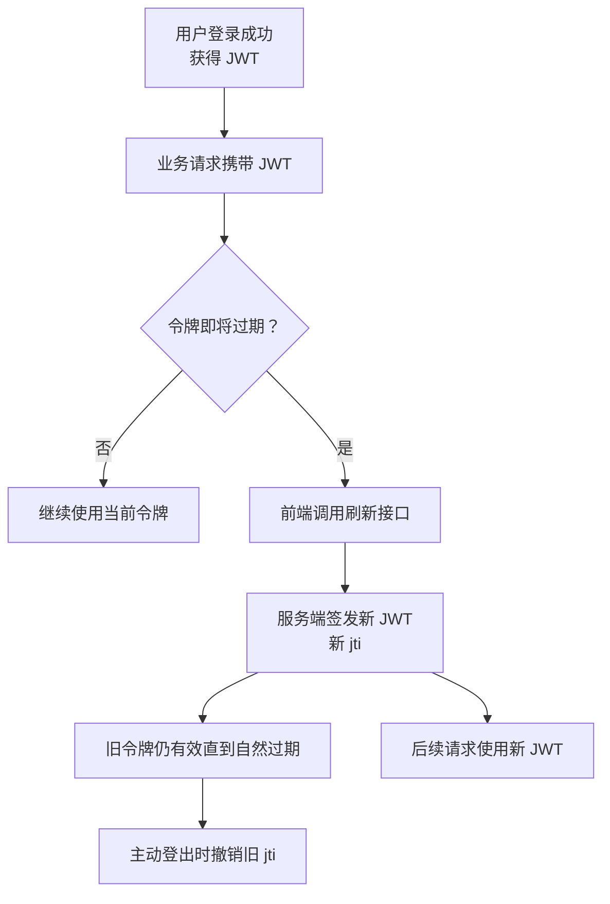
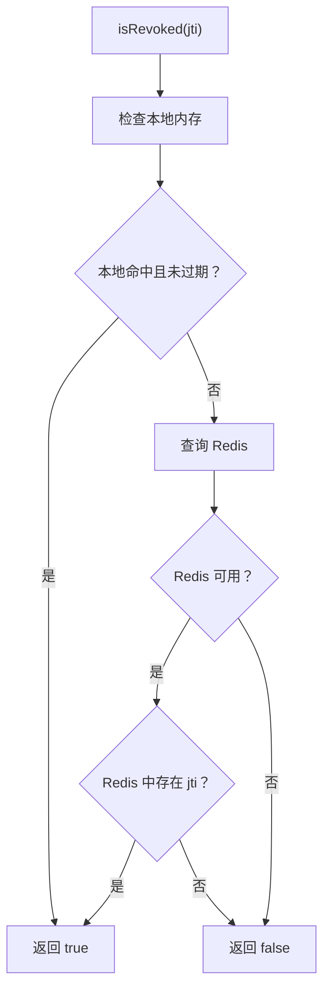
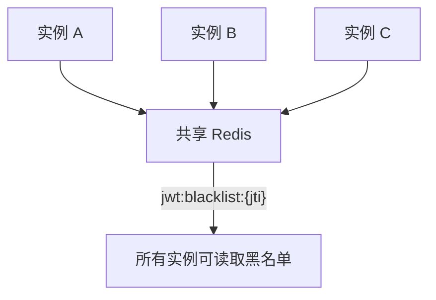

# JWT 令牌管理

<cite>
**本文引用的文件**   
- [JwtTokenProvider.java](file://apps/api/src/main/java/com/campuslove/api/config/JwtTokenProvider.java)
- [RedisTokenBlacklistService.java](file://apps/api/src/main/java/com/campuslove/api/auth/RedisTokenBlacklistService.java)
- [TokenBlacklistService.java](file://apps/api/src/main/java/com/campuslove/api/auth/TokenBlacklistService.java)
- [JwtAuthenticationFilter.java](file://apps/api/src/main/java/com/campuslove/api/config/JwtAuthenticationFilter.java)
- [JwtChannelInterceptor.java](file://apps/api/src/main/java/com/campuslove/api/config/JwtChannelInterceptor.java)
</cite>

## 目录
1. [引言](#引言)
2. [项目结构与定位](#项目结构与定位)
3. [核心组件总览](#核心组件总览)
4. [架构与数据流](#架构与数据流)
5. [JwtTokenProvider：令牌生成、验证与安全策略](#jwttokenprovider令牌生成验证与安全策略)
6. [RedisTokenBlacklistService：基于 jti 的令牌黑名单](#redistokenblacklistservice基于-jti的令牌黑名单)
7. [HTTP 认证过滤器中的令牌校验流程](#http-认证过滤器中的令牌校验流程)
8. [WebSocket STOMP 连接中的令牌传递与校验](#websocket-stomp-连接中的令牌传递与校验)
9. [令牌刷新与会话续期设计说明](#令牌刷新与会话续期设计说明)
10. [主动登出与令牌失效处理](#主动登出与令牌失效处理)
11. [错误处理机制](#错误处理机制)
12. [性能特性与优化建议](#性能特性与优化建议)
13. [多实例环境下的令牌同步策略](#多实例环境下的令牌同步策略)
14. [安全最佳实践与敏感信息保护](#安全最佳实践与敏感信息保护)
15. [故障排查指南](#故障排查指南)
16. [结论](#结论)

## 引言

本文围绕后端 API 服务中的 JWT 令牌管理机制，系统性梳理令牌签发、验证、撤销、黑名单、过期清理、HTTP 与 WebSocket 通道校验等实现。重点覆盖以下方面：

- `JwtTokenProvider` 的令牌生成、媒体令牌、claims 结构、过期时间、密钥版本与签名策略。
- `RedisTokenBlacklistService` 的 jti 黑名单、TTL 语义、本地内存降级与定时清理。
- `JwtAuthenticationFilter` 中 HTTP 请求的令牌提取、黑名单校验、用户角色注入与权限控制。
- `JwtChannelInterceptor` 中 WebSocket STOMP CONNECT/SUBSCRIBE 的令牌校验与订阅路径权限。
- 令牌刷新、会话续期在当前代码库中的现状与扩展建议。
- 多实例部署下的令牌撤销一致性、Redis 不可用时的降级策略。
- 安全最佳实践、敏感信息保护、性能优化与常见问题排查。

## 项目结构与定位

JWT 令牌相关逻辑位于后端 Java API 应用中，主要分布在配置层与认证授权层：

| 层级 | 主要职责 | 对应文件 |
|---|---|---|
| 令牌生成与解析 | 签发 JWT、媒体令牌、解析 claims、计算剩余 TTL、提取 jti 和 userId | `JwtTokenProvider.java` |
| 令牌黑名单接口与实现 | 定义 jti 维度撤销接口；提供 Redis 实现与本地内存降级 | `TokenBlacklistService.java`、`RedisTokenBlacklistService.java` |
| HTTP 认证过滤 | 从请求头或媒体查询参数中提取 token，校验签名、过期、黑名单、用户状态 | `JwtAuthenticationFilter.java` |
| WebSocket STOMP 拦截 | 在 CONNECT 阶段校验 JWT，在 SUBSCRIBE 阶段限制订阅路径 | `JwtChannelInterceptor.java` |

**图示来源**
- [JwtAuthenticationFilter.java:1-290](file://apps/api/src/main/java/com/campuslove/api/config/JwtAuthenticationFilter.java#L1-L290)
- [JwtChannelInterceptor.java:1-200](file://apps/api/src/main/java/com/campuslove/api/config/JwtChannelInterceptor.java#L1-L200)
- [JwtTokenProvider.java:1-200](file://apps/api/src/main/java/com/campuslove/api/config/JwtTokenProvider.java#L1-L200)
- [RedisTokenBlacklistService.java:1-200](file://apps/api/src/main/java/com/campuslove/api/auth/RedisTokenBlacklistService.java#L1-L200)
- [TokenBlacklistService.java:1-54](file://apps/api/src/main/java/com/campuslove/api/auth/TokenBlacklistService.java#L1-L54)

**章节来源**
- [JwtTokenProvider.java:1-200](file://apps/api/src/main/java/com/campuslove/api/config/JwtTokenProvider.java#L1-L200)
- [RedisTokenBlacklistService.java:1-200](file://apps/api/src/main/java/com/campuslove/api/auth/RedisTokenBlacklistService.java#L1-L200)
- [JwtAuthenticationFilter.java:1-290](file://apps/api/src/main/java/com/campuslove/api/config/JwtAuthenticationFilter.java#L1-L290)
- [JwtChannelInterceptor.java:1-200](file://apps/api/src/main/java/com/campuslove/api/config/JwtChannelInterceptor.java#L1-L200)

## 核心组件总览

### JwtTokenProvider

负责 JWT 令牌的创建、解析、校验、jti 提取、媒体令牌签发、黑名单兼容逻辑与过期清理调度。

关键能力：

- 使用 HMAC-SHA 密钥对令牌签名。
- 为普通用户会话令牌设置 subject、jti、issuedAt、expiration、kid。
- 为媒体访问令牌设置短 TTL 与 scope=media。
- 提供 validateToken、isTokenValid、getUserIdFromToken、getExpirationFromToken、getRemainingTtlSeconds、getJtiFromToken。
- 保留已废弃的完整 token 黑名单方法，用于兼容无 jti 的历史令牌。
- 通过 @Scheduled 清理本地黑名单中的过期条目，并使用分布式锁避免多实例重复执行。

### RedisTokenBlacklistService

实现 `TokenBlacklistService`，将 jti 写入 Redis 黑名单，TTL 等于 JWT 剩余有效期，并在 Redis 不可用时降级到本地内存。

关键能力：

- Redis key 格式：`jwt:blacklist:{jti}`。
- revoke(jti, ttlSeconds)：幂等写入本地内存与 Redis。
- isRevoked(jti)：先查本地内存，再查 Redis；失败时返回 false，不阻塞主流程。
- cleanupExpiredLocalEntries()：每小时清理本地内存中过期的 jti。

### TokenBlacklistService

定义 jti 维度的令牌撤销接口：

- revoke(String jti, long ttlSeconds)
- isRevoked(String jti)

### JwtAuthenticationFilter

HTTP 请求级 JWT 认证过滤器：

- 支持 Authorization Bearer 头。
- 支持 `/api/v1/media/**` 的 ?token= 查询参数。
- 先检查 jti 是否在黑名单中。
- 再解析 userId，加载用户角色并注入 SecurityContext。
- 对禁用用户、不存在用户、无效 token 抛出认证异常。

### JwtChannelInterceptor

WebSocket STOMP 通道拦截器：

- CONNECT 阶段校验 JWT，支持 Authorization header 与原生 token header。
- mock profile 下跳过真实 JWT 校验，回退到 mock 用户。
- SUBSCRIBE 阶段限制订阅路径。
- 兼容历史本地黑名单判断，并补查用户是否被禁用。

**章节来源**
- [JwtTokenProvider.java:1-438](file://apps/api/src/main/java/com/campuslove/api/config/JwtTokenProvider.java#L1-L438)
- [RedisTokenBlacklistService.java:1-208](file://apps/api/src/main/java/com/campuslove/api/auth/RedisTokenBlacklistService.java#L1-L208)
- [TokenBlacklistService.java:1-54](file://apps/api/src/main/java/com/campuslove/api/auth/TokenBlacklistService.java#L1-L54)
- [JwtAuthenticationFilter.java:1-290](file://apps/api/src/main/java/com/campuslove/api/config/JwtAuthenticationFilter.java#L1-L290)
- [JwtChannelInterceptor.java:1-200](file://apps/api/src/main/java/com/campuslove/api/config/JwtChannelInterceptor.java#L1-L200)

## 架构与数据流

### 系统架构图

**图示来源**
- [JwtTokenProvider.java:1-438](file://apps/api/src/main/java/com/campuslove/api/config/JwtTokenProvider.java#L1-L438)
- [TokenBlacklistService.java:1-54](file://apps/api/src/main/java/com/campuslove/api/auth/TokenBlacklistService.java#L1-L54)
- [RedisTokenBlacklistService.java:1-208](file://apps/api/src/main/java/com/campuslove/api/auth/RedisTokenBlacklistService.java#L1-L208)
- [JwtAuthenticationFilter.java:1-290](file://apps/api/src/main/java/com/campuslove/api/config/JwtAuthenticationFilter.java#L1-L290)
- [JwtChannelInterceptor.java:1-200](file://apps/api/src/main/java/com/campuslove/api/config/JwtChannelInterceptor.java#L1-L200)

### 令牌生命周期数据流

**图示来源**
- [JwtAuthenticationFilter.java:1-290](file://apps/api/src/main/java/com/campuslove/api/config/JwtAuthenticationFilter.java#L1-L290)
- [JwtTokenProvider.java:1-438](file://apps/api/src/main/java/com/campuslove/api/config/JwtTokenProvider.java#L1-L438)
- [RedisTokenBlacklistService.java:1-208](file://apps/api/src/main/java/com/campuslove/api/auth/RedisTokenBlacklistService.java#L1-L208)

## JwtTokenProvider：令牌生成、验证与安全策略

### 令牌 claims 结构设计

普通用户会话令牌包含以下核心字段：

| Claims 名称 | 含义 | 安全意义 |
|---|---|---|
| subject | 用户 ID | 标识当前登录用户 |
| id | jti，JWT ID | 支持基于 jti 的令牌撤销 |
| exp | 过期时间 | 控制令牌自然失效 |
| iat | 签发时间 | 记录令牌创建时刻 |
| kid | 密钥版本 ID | 支持密钥轮换扩展 |
| scope | 仅媒体令牌 | 区分媒体访问令牌与普通会话令牌 |

媒体令牌与普通令牌的区别：

- 普通令牌：subject 为用户 ID，携带 jti，用于业务接口认证。
- 媒体令牌：short TTL，scope=media，用于图片等资源代理请求，降低泄露风险。

### 令牌生成流程

**图示来源**
- [JwtTokenProvider.java:1-200](file://apps/api/src/main/java/com/campuslove/api/config/JwtTokenProvider.java#L1-L200)

### 令牌验证与过期处理

`JwtTokenProvider` 提供多种验证方式：

- `validateToken(token)`：通过是否能成功提取 userId 判断令牌有效。
- `isTokenValid(token)`：直接解析签名与过期时间，捕获过期异常。
- `getUserIdFromToken(token)`：提取 subject，忽略过期异常但返回 null。
- `getExpirationFromToken(token)`：提取过期时间。
- `getRemainingTtlSeconds(token)`：计算剩余秒数，供黑名单 TTL 使用。

### 密钥与密钥版本

- 密钥由配置注入，构造时使用 HMAC-SHA 算法生成 SecretKey。
- kid 表示密钥版本号，当前实现仅校验当前密钥，预留 KMS/Vault 多密钥轮换扩展点。
- 密钥长度要求满足 HMAC-SHA256 最低长度。

### 媒体令牌策略

媒体令牌用于无法携带 Authorization 头的场景，例如浏览器 `` 请求。其安全设计包括：

- 短 TTL：默认 5 分钟。
- scope=media：限制令牌用途。
- 可选严格模式：当配置开启后，拒绝完整用户 JWT 通过查询参数传递，避免访问日志或浏览器历史泄露长期会话令牌。

**章节来源**
- [JwtTokenProvider.java:1-200](file://apps/api/src/main/java/com/campuslove/api/config/JwtTokenProvider.java#L1-L200)
- [JwtTokenProvider.java:201-438](file://apps/api/src/main/java/com/campuslove/api/config/JwtTokenProvider.java#L201-L438)

## RedisTokenBlacklistService：基于 jti 的令牌黑名单

### jti 机制

jti 是 RFC 7519 定义的 JWT ID claim。每个令牌签发时都会生成唯一 UUID 作为 jti，用于令牌撤销。

优势：

- jti 远短于完整 JWT 字符串，节省 Redis 内存。
- 符合 JWT 标准。
- 即使 Redis 被入侵，也无法直接获得可用完整令牌。

### Redis Key 与 TTL 语义

- Key 前缀：`jwt:blacklist:`
- Key 值：`{jti}`
- TTL：JWT 剩余有效期秒数
- 自动清理：令牌自然过期后，黑名单条目随 TTL 到期自动删除

### 降级策略

RedisTokenBlacklistService 采用双轨存储：

1. 本地内存：ConcurrentHashMap，key 为 jti，value 为过期时间戳。
2. Redis：多实例共享事实源。

降级规则：

- revoke：总是写入本地内存；尝试写入 Redis；Redis 失败不影响主流程。
- isRevoked：先查本地内存，再查 Redis；Redis 不可用时返回 false。
- 清理任务：本地内存有独立定时清理任务，防止只增不减。

**图示来源**
- [RedisTokenBlacklistService.java:1-200](file://apps/api/src/main/java/com/campuslove/api/auth/RedisTokenBlacklistService.java#L1-L200)

### 本地内存清理

本地黑名单每条记录保存 jti 和过期时间戳。清理任务每小时执行一次，移除已过期条目，并通过原子 remove 保证并发安全。

**章节来源**
- [RedisTokenBlacklistService.java:1-200](file://apps/api/src/main/java/com/campuslove/api/auth/RedisTokenBlacklistService.java#L1-L200)
- [RedisTokenBlacklistService.java:201-208](file://apps/api/src/main/java/com/campuslove/api/auth/RedisTokenBlacklistService.java#L201-L208)
- [TokenBlacklistService.java:1-54](file://apps/api/src/main/java/com/campuslove/api/auth/TokenBlacklistService.java#L1-L54)

## HTTP 认证过滤器中的令牌校验流程

### 令牌来源优先级

1. Authorization Bearer 头。
2. `/api/v1/media/**` 路径上的 ?token= 查询参数。
3. 其他路径若无 token，则继续过滤器链，由 Spring Security 决定是否拒绝。

### 黑名单校验顺序

**图示来源**
- [JwtAuthenticationFilter.java:1-290](file://apps/api/src/main/java/com/campuslove/api/config/JwtAuthenticationFilter.java#L1-L290)

### 媒体令牌严格模式

当启用严格模式时，/api/v1/media/** 路径上的 ?token= 必须为 scope=media 的短期媒体令牌，否则拒绝认证。该策略用于防止完整会话 JWT 进入 URL，降低访问日志和浏览器历史泄露风险。

**章节来源**
- [JwtAuthenticationFilter.java:1-290](file://apps/api/src/main/java/com/campuslove/api/config/JwtAuthenticationFilter.java#L1-L290)

## WebSocket STOMP 连接中的令牌传递与校验

### 令牌传递方式

STOMP CONNECT 阶段支持的令牌来源：

1. Authorization header，值为 Bearer token。
2. 原生 token header，直接传 token 字符串。
3. 握手阶段由 WebSocketConfig 处理的查询参数（本文件不从 URL 提取）。

### CONNECT 校验流程

**图示来源**
- [JwtChannelInterceptor.java:1-200](file://apps/api/src/main/java/com/campuslove/api/config/JwtChannelInterceptor.java#L1-L200)
- [JwtTokenProvider.java:1-438](file://apps/api/src/main/java/com/campuslove/api/config/JwtTokenProvider.java#L1-L438)

### SUBSCRIBE 权限控制

SUBSCRIBE 命令允许：

- `/topic/**`：公共广播主题。
- `/user/{自身userId}/queue/**`：用户专属队列。

禁止订阅非自身用户队列或其他路径，防止越权接收消息。

**章节来源**
- [JwtChannelInterceptor.java:1-200](file://apps/api/src/main/java/com/campuslove/api/config/JwtChannelInterceptor.java#L1-L200)

## 令牌刷新与会话续期设计说明

当前代码库中未发现专门的“令牌刷新”端点或 refresh token 实现。现有模型更接近传统 JWT 会话令牌：

- 普通会话令牌具有固定 expiration。
- 媒体令牌具有更短的 5 分钟 TTL。
- 黑名单通过 jti 支持主动撤销。

因此，“令牌刷新”在当前仓库中应理解为前端在令牌接近过期前重新获取新令牌的业务流程，而非服务端内置 refresh token 机制。

### 建议的令牌刷新流程

需要补充的实现：

- 新增刷新接口，鉴权通过后签发新 JWT。
- 可选择性将旧令牌加入黑名单，使刷新即失效。
- 前端应在收到新令牌后更新本地存储。

**章节来源**
- [JwtTokenProvider.java:1-200](file://apps/api/src/main/java/com/campuslove/api/config/JwtTokenProvider.java#L1-L200)
- [RedisTokenBlacklistService.java:1-200](file://apps/api/src/main/java/com/campuslove/api/auth/RedisTokenBlacklistService.java#L1-L200)

## 主动登出与令牌失效处理

### 登出时的令牌失效

当前黑名单服务以 jti 为单位撤销令牌：

1. 客户端调用登出接口。
2. 服务端从当前令牌中提取 jti。
3. 调用 `TokenBlacklistService.revoke(jti, ttlSeconds)`。
4. jti 被写入 Redis 和本地内存。
5. 后续请求在过滤器中检测 jti 已撤销，拒绝认证。

### 黑名单查询优先级

**图示来源**
- [RedisTokenBlacklistService.java:1-200](file://apps/api/src/main/java/com/campuslove/api/auth/RedisTokenBlacklistService.java#L1-L200)

### 历史兼容逻辑

`JwtTokenProvider` 中仍保留 `revokeToken` 和 `isTokenRevoked`，但它们仅操作本地内存，不再写 Redis。这是为了兼容没有 jti 的历史令牌。常规路径应统一走 jti 黑名单。

**章节来源**
- [JwtTokenProvider.java:201-438](file://apps/api/src/main/java/com/campuslove/api/config/JwtTokenProvider.java#L201-L438)
- [RedisTokenBlacklistService.java:1-200](file://apps/api/src/main/java/com/campuslove/api/auth/RedisTokenBlacklistService.java#L1-L200)
- [TokenBlacklistService.java:1-54](file://apps/api/src/main/java/com/campuslove/api/auth/TokenBlacklistService.java#L1-L54)

## 错误处理机制

### HTTP 认证错误

- 无效或过期 token：抛出 `BadCredentialsException`。
- 用户不存在或被禁用：抛出带用户 ID 的错误信息。
- jti 已撤销：清除 SecurityContext，后续由认证入口返回 401。
- 媒体令牌严格模式下使用完整 JWT 查询参数：拒绝认证。

### Redis 不可用错误

- revoke：捕获 RuntimeException，记录警告日志，不抛出异常。
- isRevoked：捕获 RuntimeException，记录警告日志，返回 false。
- 降级语义：Redis 故障期间，已撤销令牌可能短暂被接受，但最终由 JWT 签名和过期校验兜底。

### WebSocket 错误

- 缺少 JWT：抛出 `MessageDeliveryException`。
- JWT 无效或过期：抛出 `MessageDeliveryException`。
- JWT 已撤销：抛出 `MessageDeliveryException`。
- 用户被禁用：抛出 `MessageDeliveryException`。

**章节来源**
- [JwtAuthenticationFilter.java:1-290](file://apps/api/src/main/java/com/campuslove/api/config/JwtAuthenticationFilter.java#L1-L290)
- [RedisTokenBlacklistService.java:1-200](file://apps/api/src/main/java/com/campuslove/api/auth/RedisTokenBlacklistService.java#L1-L200)
- [JwtChannelInterceptor.java:1-200](file://apps/api/src/main/java/com/campuslove/api/config/JwtChannelInterceptor.java#L1-L200)

## 性能特性与优化建议

### 当前性能特性

| 组件 | 性能特征 |
|---|---|
| JwtTokenProvider | 本地 CPU 计算，O(1) 签发与解析 |
| RedisTokenBlacklistService | Redis O(1) 读写；本地内存 O(1) 查找 |
| JwtAuthenticationFilter | 含 Caffeine 本地缓存，用户角色缓存 TTL 60 秒 |
| 黑名单清理 | 每小时定时清理，避免内存无限增长 |
| 分布式清理锁 | 使用 Redisson 分布式锁，防止多实例重复清理 |

### 优化建议

1. **减少重复解析**：在高并发场景下，可考虑对短生命周期内相同 token 的解析结果做极短缓存，但需谨慎评估安全性与内存成本。
2. **Redis 健康监控**：增加 Redis 可用性指标与告警，便于快速发现降级运行。
3. **黑名单大小监控**：监控 Redis 中 `jwt:blacklist:*` 键数量，评估登出频率与令牌留存情况。
4. **Caffeine 缓存调优**：根据 QPS 调整用户认证快照缓存最大容量和过期时间。
5. **批量登出优化**：若未来出现批量撤销需求，应避免逐个 jti 写 Redis，改用批处理或按用户维度扩展黑名单策略。

**章节来源**
- [JwtAuthenticationFilter.java:1-290](file://apps/api/src/main/java/com/campuslove/api/config/JwtAuthenticationFilter.java#L1-L290)
- [RedisTokenBlacklistService.java:1-200](file://apps/api/src/main/java/com/campuslove/api/auth/RedisTokenBlacklistService.java#L1-L200)
- [JwtTokenProvider.java:201-438](file://apps/api/src/main/java/com/campuslove/api/config/JwtTokenProvider.java#L201-L438)

## 多实例环境下的令牌同步策略

### 令牌生成

令牌生成是本地行为，无需多实例同步。所有实例使用相同签名密钥即可验证任意实例签发的令牌。

### 令牌黑名单同步

- Redis 是 jti 黑名单的多实例共享事实源。
- 本地内存仅作为 Redis 不可用时的降级方案。
- 清理任务通过 Redisson 分布式锁确保仅一个实例执行。

### 注意事项

- 多实例部署时必须确保所有实例配置相同的 JWT 签名密钥。
- Redis 故障期间，已撤销令牌可能短暂通过本地内存降级后的 isRevoked=false 路径。
- 建议在 Redis 恢复后，依赖 TTL 自然过期与后续请求再次校验完成最终一致性。

**图示来源**
- [RedisTokenBlacklistService.java:1-200](file://apps/api/src/main/java/com/campuslove/api/auth/RedisTokenBlacklistService.java#L1-L200)
- [JwtTokenProvider.java:201-438](file://apps/api/src/main/java/com/campuslove/api/config/JwtTokenProvider.java#L201-L438)

**章节来源**
- [RedisTokenBlacklistService.java:1-200](file://apps/api/src/main/java/com/campuslove/api/auth/RedisTokenBlacklistService.java#L1-L200)
- [JwtTokenProvider.java:201-438](file://apps/api/src/main/java/com/campuslove/api/config/JwtTokenProvider.java#L201-L438)

## 安全最佳实践与敏感信息保护

### 令牌安全原则

1. **不要将完整 JWT 存入 Redis**：当前实现仅存储 jti，符合最小暴露原则。
2. **使用强签名密钥**：HMAC-SHA 密钥应由安全配置管理，避免硬编码。
3. **合理设置过期时间**：会话令牌不宜过长；媒体令牌保持短 TTL。
4. **启用黑名单撤销**：主动登出后应立即撤销 jti。
5. **限制媒体令牌泄露面**：优先使用短期媒体令牌，必要时开启严格查询参数模式。
6. **密钥轮换预留**：kid 字段支持未来密钥版本管理。

### 敏感信息保护

- JWT subject 通常只放用户 ID，不应存放密码、手机号、身份证号等敏感信息。
- 媒体令牌仅限资源访问，不具备业务接口权限。
- 日志中应避免打印完整 JWT，当前实现更多记录 jti、userId 或错误信息。

### 推荐扩展

- 接入 KMS 或 Vault 管理签名密钥。
- 实现 refresh token 机制，分离会话令牌与刷新令牌。
- 增加令牌审计日志，记录签发、撤销、异常事件。
- 增加令牌熵校验，防止弱 jti 或预测性令牌。

**章节来源**
- [JwtTokenProvider.java:1-200](file://apps/api/src/main/java/com/campuslove/api/config/JwtTokenProvider.java#L1-L200)
- [RedisTokenBlacklistService.java:1-200](file://apps/api/src/main/java/com/campuslove/api/auth/RedisTokenBlacklistService.java#L1-L200)
- [JwtAuthenticationFilter.java:1-290](file://apps/api/src/main/java/com/campuslove/api/config/JwtAuthenticationFilter.java#L1-L290)

## 故障排查指南

### 常见症状与定位

| 现象 | 可能原因 | 排查方向 |
|---|---|---|
| 登录后立即被拒绝 | jti 已被撤销 | 检查 Redis 中是否存在 `jwt:blacklist:{jti}` |
| 登出后仍可访问 | Redis 不可用或未正确写入 | 查看降级日志，确认本地内存与 Redis 写入状态 |
| WebSocket 连接失败 | 缺少 JWT 或 token 无效 | 检查 CONNECT 请求头与 JwtChannelInterceptor 日志 |
| 媒体图片无法加载 | 媒体令牌过期或 scope 不正确 | 检查媒体令牌 TTL、scope 与严格模式配置 |
| 管理员权限未生效 | 用户角色缓存或数据库状态不一致 | 检查用户是否 admin/superAdmin，以及缓存 TTL |
| 清理任务未执行 | Redisson 未注入或分布式锁竞争 | 检查 mock profile 与 Redisson 配置 |

### 关键日志关键词

- “JWT jti 已被撤销”
- “Redis unavailable, falling back to local memory blacklist”
- “cleanupRevokedTokens 定时任务已被其他实例持有”
- “WebSocket CONNECT 拒绝”
- “媒体访问令牌无效”

### 建议诊断步骤

1. 确认 JWT 是否有效：检查签名、过期时间、userId。
2. 确认 jti 是否在黑名单：查询 Redis 键 `jwt:blacklist:{jti}`。
3. 确认 Redis 是否可用：观察降级日志。
4. 确认 WebSocket 连接头：检查 Authorization 或 token header。
5. 确认用户状态：检查数据库中用户是否被禁用或删除。
6. 确认媒体令牌策略：检查 scope 与严格模式配置。

**章节来源**
- [JwtAuthenticationFilter.java:1-290](file://apps/api/src/main/java/com/campuslove/api/config/JwtAuthenticationFilter.java#L1-L290)
- [RedisTokenBlacklistService.java:1-200](file://apps/api/src/main/java/com/campuslove/api/auth/RedisTokenBlacklistService.java#L1-L200)
- [JwtChannelInterceptor.java:1-200](file://apps/api/src/main/java/com/campuslove/api/config/JwtChannelInterceptor.java#L1-L200)

## 结论

当前 JWT 令牌管理模块以 `JwtTokenProvider` 为核心，结合 `TokenBlacklistService` 与 `RedisTokenBlacklistService` 实现了基于 jti 的令牌撤销机制。HTTP 层通过 `JwtAuthenticationFilter` 完成令牌解析、黑名单校验与用户角色注入；WebSocket 层通过 `JwtChannelInterceptor` 完成 STOMP CONNECT 与 SUBSCRIBE 的安全控制。

整体设计具备以下特点：

- 使用 jti 替代完整 token 作为黑名单键，降低泄露风险。
- Redis 为主、本地内存为辅的降级策略，保证主流程可用性。
- 媒体令牌独立于会话令牌，缩短泄露窗口。
- 定时清理与分布式锁配合，避免多实例重复清理。
- 预留密钥版本与黑名单扩展点，支持未来安全加固。

下一步改进建议包括：引入 refresh token 机制、增强令牌审计、完善 Redis 健康监控、细化媒体令牌严格模式迁移策略，以及在实际业务中明确令牌刷新与主动登出的边界条件。