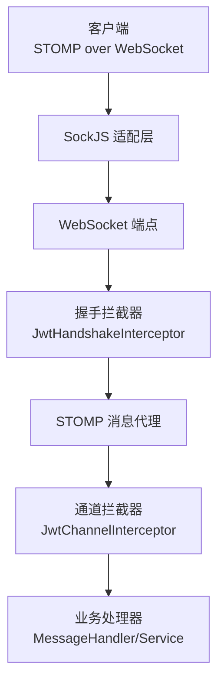
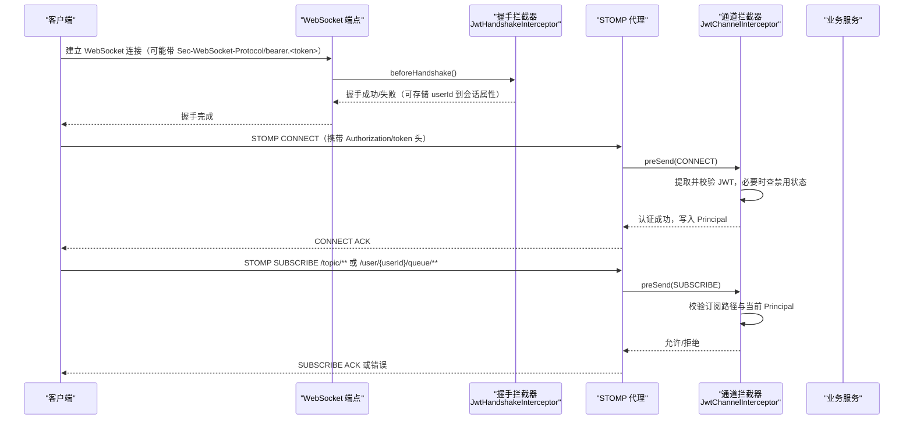
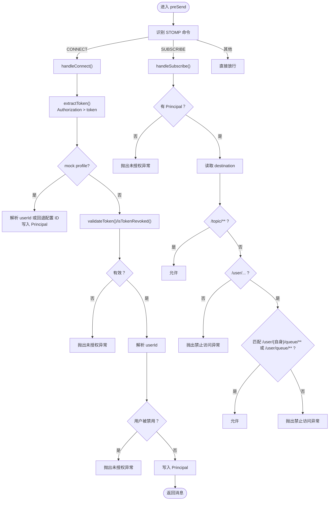
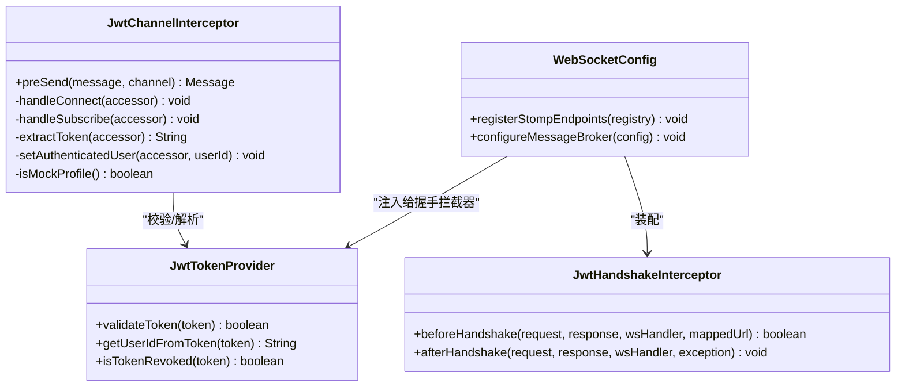
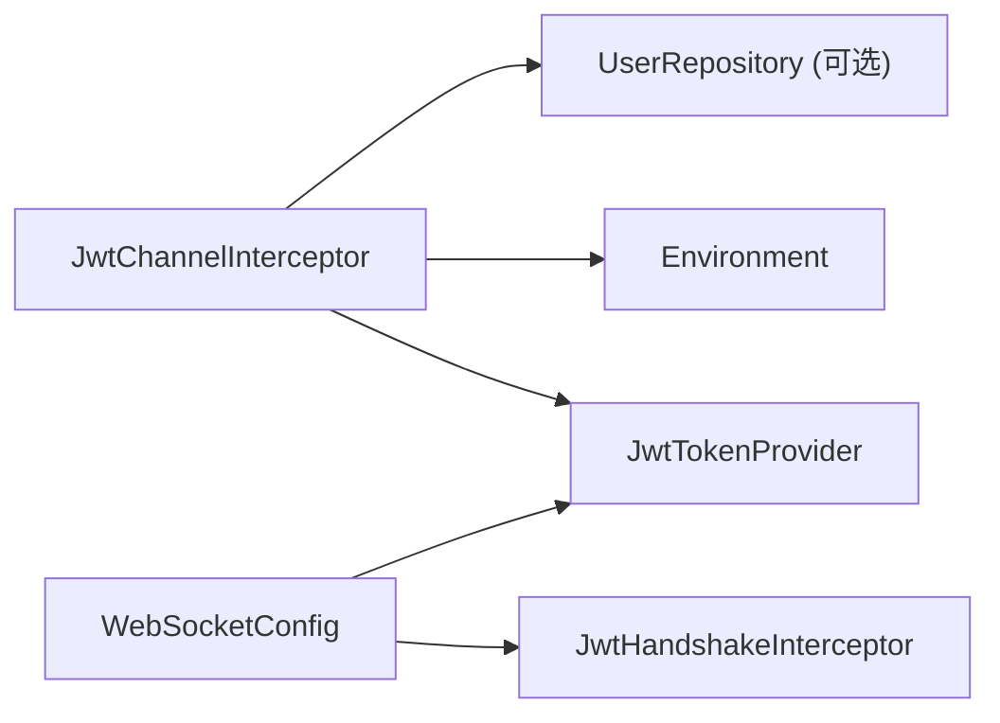

# WebSocket 认证

<cite>
**本文引用的文件**   
- [JwtChannelInterceptor.java](file://apps/api/src/main/java/com/campuslove/api/config/JwtChannelInterceptor.java)
- [WebSocketConfig.java](file://apps/api/src/main/java/com/campuslove/api/config/WebSocketConfig.java)
- [JwtChannelInterceptorTest.java](file://apps/api/src/test/java/com/campuslove/api/config/JwtChannelInterceptorTest.java)
</cite>

## 目录
1. [引言](#引言)
2. [项目结构定位](#项目结构定位)
3. [核心组件](#核心组件)
4. [架构总览](#架构总览)
5. [详细组件分析](#详细组件分析)
6. [依赖关系分析](#依赖关系分析)
7. [性能与安全特性](#性能与安全特性)
8. [故障排查指南](#故障排查指南)
9. [部署与多实例注意事项](#部署与多实例注意事项)
10. [结论](#结论)

## 引言
本技术文档聚焦于后端 WebSocket STOMP 通道的 JWT 认证与权限控制实现，重点说明 JwtChannelInterceptor 在 CONNECT 阶段的令牌校验、用户状态检查以及 SUBSCRIBE 阶段的订阅路径权限控制；同时梳理握手阶段 JwtHandshakeInterceptor 与通道拦截器的协作关系，覆盖令牌提取策略、消息安全边界、生产环境部署要点，以及在多实例环境下会话管理与故障恢复建议。

## 项目结构定位
WebSocket 相关认证逻辑位于后端 API 应用的配置包中：
- 通道级认证与授权由 `JwtChannelInterceptor` 实现，基于 Spring Messaging 的 `ChannelInterceptor`，在 STOMP 消息进入通道前进行拦截处理。
- WebSocket 端点注册、握手拦截器装配、SockJS 兼容等由 `WebSocketConfig` 负责。
- 单元测试位于 `JwtChannelInterceptorTest.java`，用于验证 CONNECT/SUBSCRIBE 分支行为。

**图表来源**
- [WebSocketConfig.java:126-127](file://apps/api/src/main/java/com/campuslove/api/config/WebSocketConfig.java#L126-L127)
- [WebSocketConfig.java:172-192](file://apps/api/src/main/java/com/campuslove/api/config/WebSocketConfig.java#L172-L192)
- [JwtChannelInterceptor.java:1-200](file://apps/api/src/main/java/com/campuslove/api/config/JwtChannelInterceptor.java#L1-L200)

**章节来源**
- [JwtChannelInterceptor.java:1-200](file://apps/api/src/main/java/com/campuslove/api/config/JwtChannelInterceptor.java#L1-L200)
- [WebSocketConfig.java:126-127](file://apps/api/src/main/java/com/campuslove/api/config/WebSocketConfig.java#L126-L127)
- [WebSocketConfig.java:172-192](file://apps/api/src/main/java/com/campuslove/api/config/WebSocketConfig.java#L172-L192)

## 核心组件
- **JwtChannelInterceptor**  
  实现 `ChannelInterceptor`，在 `preSend` 中对 STOMP 命令进行分类处理：
  - CONNECT：提取并校验 JWT，必要时查询用户状态，设置 Principal。
  - SUBSCRIBE：校验订阅目标是否允许，仅放行 `/topic/**` 和 `/user/{自身userId}/queue/**`（含标准简写）。
  - 其他命令：直接放行，不追加额外鉴权。
- **WebSocketConfig**  
  启用 STOMP 消息代理，注册端点，装配握手拦截器 `JwtHandshakeInterceptor`，支持 SockJS。
- **JwtTokenProvider**（外部依赖）  
  提供 JWT 解析、有效性校验、撤销黑名单判断和用户 ID 提取。

**章节来源**
- [JwtChannelInterceptor.java:1-200](file://apps/api/src/main/java/com/campuslove/api/config/JwtChannelInterceptor.java#L1-L200)
- [WebSocketConfig.java:38-48](file://apps/api/src/main/java/com/campuslove/api/config/WebSocketConfig.java#L38-L48)

## 架构总览
下图展示一次完整的 WebSocket 连接建立与 STOMP 认证的调用链：握手阶段先执行一次令牌验证与会话属性写入，随后 STOMP CONNECT 帧再次携带 token，通道拦截器完成二次校验并将认证主体注入到 STOMP header 中，供后续 SUBSCRIBE/SEND 使用。

**图表来源**
- [WebSocketConfig.java:126-127](file://apps/api/src/main/java/com/campuslove/api/config/WebSocketConfig.java#L126-L127)
- [WebSocketConfig.java:172-192](file://apps/api/src/main/java/com/campuslove/api/config/WebSocketConfig.java#L172-L192)
- [JwtChannelInterceptor.java:1-200](file://apps/api/src/main/java/com/campuslove/api/config/JwtChannelInterceptor.java#L1-L200)
- [JwtChannelInterceptor.java:201-307](file://apps/api/src/main/java/com/campuslove/api/config/JwtChannelInterceptor.java#L201-L307)

## 详细组件分析

### JwtChannelInterceptor 认证与授权机制
该拦截器通过 `preSend` 统一入口对 STOMP 命令分流：
- CONNECT：
  - 优先从 `Authorization` 头提取 `Bearer <token>`，否则回退到原生 `token` 头。
  - mock profile 下跳过真实 JWT 校验，尝试解析 userId，失败则回退配置的用户 ID。
  - 非 mock 模式下要求 token 存在、有效且未被撤销，并进一步查询用户状态，被禁用则拒绝连接。
  - 成功后将用户 ID 作为 `Principal` 写入 STOMP header。
- SUBSCRIBE：
  - 必须已认证（拥有 Principal）。
  - 允许 `/topic/**` 公共主题订阅。
  - 允许 `/user/{userId}/queue/**`，并兼容 Spring 标准简写 `/user/queue/**`。
  - 禁止订阅其他用户的 `/user/...` 或非 `/topic`/`/user` 的路径。

**图表来源**
- [JwtChannelInterceptor.java:1-200](file://apps/api/src/main/java/com/campuslove/api/config/JwtChannelInterceptor.java#L1-L200)
- [JwtChannelInterceptor.java:201-307](file://apps/api/src/main/java/com/campuslove/api/config/JwtChannelInterceptor.java#L201-L307)

**章节来源**
- [JwtChannelInterceptor.java:1-200](file://apps/api/src/main/java/com/campuslove/api/config/JwtChannelInterceptor.java#L1-L200)
- [JwtChannelInterceptor.java:201-307](file://apps/api/src/main/java/com/campuslove/api/config/JwtChannelInterceptor.java#L201-L307)

### 令牌提取策略
- 优先级：
  1. `Authorization` 头中的 `Bearer <token>`。
  2. 原生 `token` 头（无 `Bearer` 前缀）。
- 不再从 URL 查询参数提取 token，该职责由握手阶段承担。
- 若两个位置均缺失，CONNECT 会被拒绝。

**章节来源**
- [JwtChannelInterceptor.java:201-307](file://apps/api/src/main/java/com/campuslove/api/config/JwtChannelInterceptor.java#L201-L307)

### 用户状态检查与禁用用户拦截
- 非 mock 模式下，JWT 有效后，若注入的 `UserRepository` 不为空，会按用户 ID 查询用户实体并检查禁用标志。
- 若用户不存在或被禁用，CONNECT 将被拒绝，避免禁用用户维持长连接收发消息。
- mock profile 下跳过真实仓库查询，以配合测试与联调。

**章节来源**
- [JwtChannelInterceptor.java:1-200](file://apps/api/src/main/java/com/campuslove/api/config/JwtChannelInterceptor.java#L1-L200)

### mock profile 特殊处理
- 当激活的 profile 包含 `mock` 时，跳过真实 JWT 校验，尝试解析 token 获取 userId，失败则回退到配置项 `app.mock.principal-user-id`。
- 该逻辑与 HTTP 侧 mock 认证语义保持一致，便于联调。

**章节来源**
- [JwtChannelInterceptor.java:1-200](file://apps/api/src/main/java/com/campuslove/api/config/JwtChannelInterceptor.java#L1-L200)

### 握手阶段与通道拦截器的协作
- 握手阶段由 `WebSocketConfig.JwtHandshakeInterceptor` 负责，可从请求头或子协议协商中提取 token，验证后将用户信息存入 WebSocket 会话属性。
- 通道拦截器在 STOMP CONNECT 阶段再次校验 token，并把认证主体写入 STOMP header，供后续订阅与发送流程使用。
- 两者分工明确：握手关注“连接能否建立”，通道拦截器关注“STOMP 操作是否被允许”。

**章节来源**
- [WebSocketConfig.java:126-127](file://apps/api/src/main/java/com/campuslove/api/config/WebSocketConfig.java#L126-L127)
- [WebSocketConfig.java:172-192](file://apps/api/src/main/java/com/campuslove/api/config/WebSocketConfig.java#L172-L192)

### 订阅路径权限控制
- 允许：
  - `/topic/**`：公共广播主题。
  - `/user/{userId}/queue/**`：仅允许订阅自己的私有队列。
  - 兼容 Spring 标准简写 `/user/queue/**`。
- 禁止：
  - 订阅其他用户的 `/user/...`。
  - 订阅非 `/topic` 和非 `/user` 的路径。

**章节来源**
- [JwtChannelInterceptor.java:201-307](file://apps/api/src/main/java/com/campuslove/api/config/JwtChannelInterceptor.java#L201-L307)

### 类图：认证与配置组件关系

**图表来源**
- [JwtChannelInterceptor.java:1-200](file://apps/api/src/main/java/com/campuslove/api/config/JwtChannelInterceptor.java#L1-L200)
- [WebSocketConfig.java:126-127](file://apps/api/src/main/java/com/campuslove/api/config/WebSocketConfig.java#L126-L127)
- [WebSocketConfig.java:172-192](file://apps/api/src/main/java/com/campuslove/api/config/WebSocketConfig.java#L172-L192)

## 依赖关系分析
- `JwtChannelInterceptor` 依赖：
  - `JwtTokenProvider`：JWT 有效性、撤销黑名单、用户 ID 解析。
  - `Environment`：判断是否处于 mock profile。
  - `UserRepository`（可选）：查询用户禁用状态。
- `WebSocketConfig` 依赖：
  - `JwtTokenProvider`：为握手拦截器提供校验能力。
  - `Environment`、配置项：确定 mock principal user id。

**图表来源**
- [JwtChannelInterceptor.java:1-200](file://apps/api/src/main/java/com/campuslove/api/config/JwtChannelInterceptor.java#L1-L200)
- [WebSocketConfig.java:172-192](file://apps/api/src/main/java/com/campuslove/api/config/WebSocketConfig.java#L172-L192)

**章节来源**
- [JwtChannelInterceptor.java:1-200](file://apps/api/src/main/java/com/campuslove/api/config/JwtChannelInterceptor.java#L1-L200)
- [WebSocketConfig.java:172-192](file://apps/api/src/main/java/com/campuslove/api/config/WebSocketConfig.java#L172-L192)

## 性能与安全特性
- 性能
  - CONNECT 仅在握手后首次建立 STOMP 会话时触发一次 JWT 校验与可选用户状态查询。
  - SUBSCRIBE 仅做轻量路径匹配与 Principal 校验，开销低。
  - mock profile 下跳过真实仓库查询，降低联调成本。
- 安全
  - 双重校验：握手阶段与 STOMP CONNECT 阶段分别校验 token。
  - 撤销黑名单：登出或撤销后的 JWT 不得再建立 WebSocket 连接。
  - 用户状态：禁用用户无法建立 WebSocket 长连接。
  - 订阅隔离：严格限制 `/user/{userId}/queue/**`，防止跨用户订阅。
  - 最小化暴露：仅允许 `/topic/**` 公共主题与用户私有队列。

[本节为通用指导，不直接分析具体代码行]

## 故障排查指南
常见异常与处理建议：
- “Unauthorized: missing JWT token”
  - 检查客户端是否在 STOMP CONNECT 帧携带了 `Authorization: Bearer <token>` 或 `token` 头。
- “Unauthorized: invalid JWT token”
  - 检查 JWT 是否过期、签名无效。
- “Unauthorized: revoked JWT token”
  - 检查 JWT 是否已被撤销（例如登出后黑名单生效）。
- “Unauthorized: user disabled”
  - 检查用户是否被禁用；禁用用户不允许建立 WebSocket 连接。
- “Forbidden: cannot subscribe to another user's queue”
  - 检查订阅路径是否为 `/user/{自身userId}/queue/**`，或是否符合 Spring 简写 `/user/queue/**`。
- “Forbidden: only /user/{userId}/queue/** subscriptions are allowed”
  - 检查 `/user/...` 之后是否以 `queue/` 开头。
- “Forbidden: subscription destination not allowed”
  - 确认订阅路径不是 `/topic/**` 也不是 `/user/{userId}/queue/**`。

**章节来源**
- [JwtChannelInterceptor.java:1-200](file://apps/api/src/main/java/com/campuslove/api/config/JwtChannelInterceptor.java#L1-L200)
- [JwtChannelInterceptor.java:201-307](file://apps/api/src/main/java/com/campuslove/api/config/JwtChannelInterceptor.java#L201-L307)

## 部署与多实例注意事项
- 多实例会话管理
  - WebSocket 连接具有本地会话属性，不同实例之间默认不共享。若需要跨实例会话一致性（例如登录态、会话属性），应使用外部会话存储（如 Redis）并通过 STOMP 消息代理（如 Redis 适配器）实现跨节点转发。
  - 握手阶段写入的 WebSocket 会话属性不会自动同步到其他实例，需结合消息代理与全局会话管理方案。
- 负载均衡与健康检查
  - 确保网关/负载均衡器正确转发 WebSocket 升级请求。
  - 配置健康检查探针，检测 WebSocket 端点可用性。
- 令牌撤销与失效
  - 生产环境应确保 JWT 撤销黑名单持久化并跨实例共享，使任意实例均可拒绝已撤销的连接。
- 日志与监控
  - 关注 CONNECT/SUBSCRIBE 的拒绝日志，统计失败原因分布。
  - 监控高频订阅路径与异常拒绝率，及时发现越权尝试。

[本节为通用指导，不直接分析具体代码行]

## 结论
`JwtChannelInterceptor` 在 STOMP 通道层面实现了严格的 CONNECT 认证与 SUBSCRIBE 授权，结合 `WebSocketConfig` 的握手拦截器，形成两阶段认证防线。其令牌提取策略兼容 `Authorization` 与原生 `token` 头，mock profile 提供联调便利，禁用用户拦截与订阅路径白名单保障消息安全。在生产环境中，应结合外部会话存储与消息代理，确保多实例一致性、高可用与可观测性。