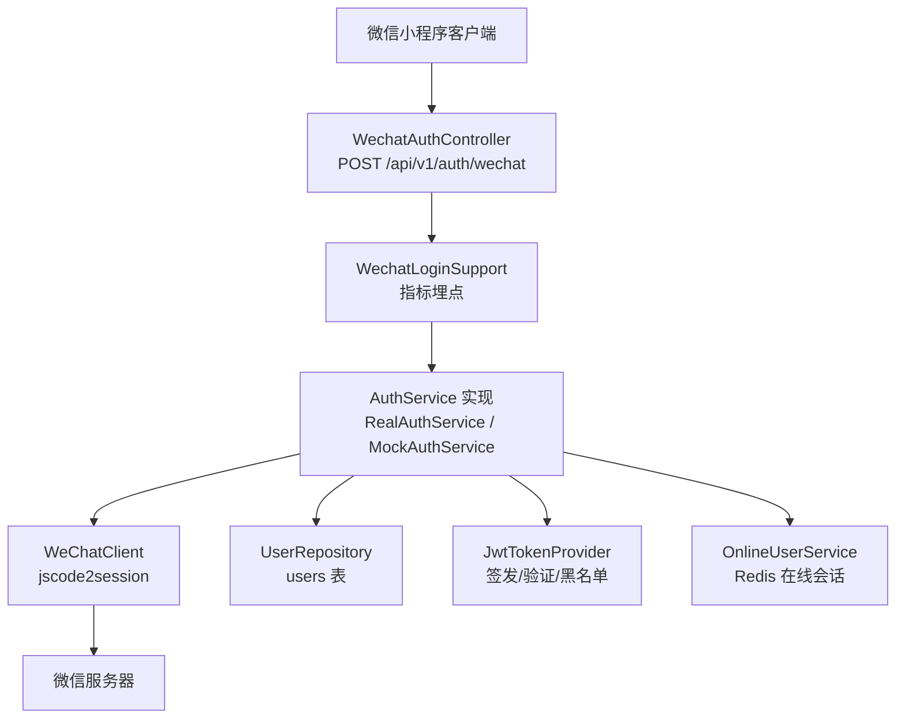
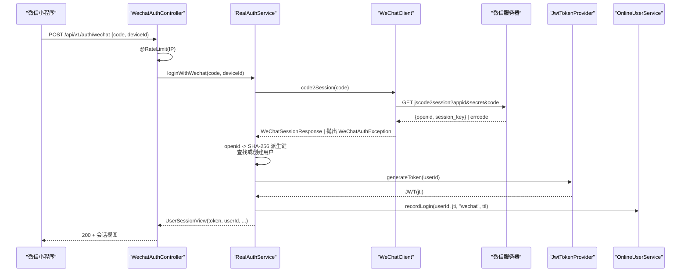
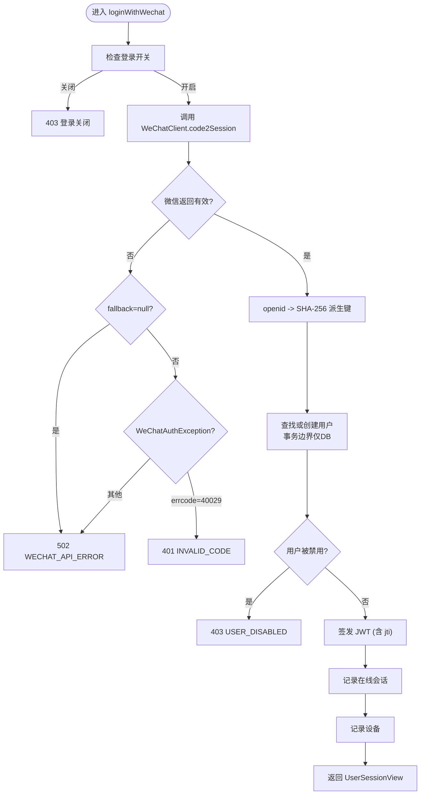
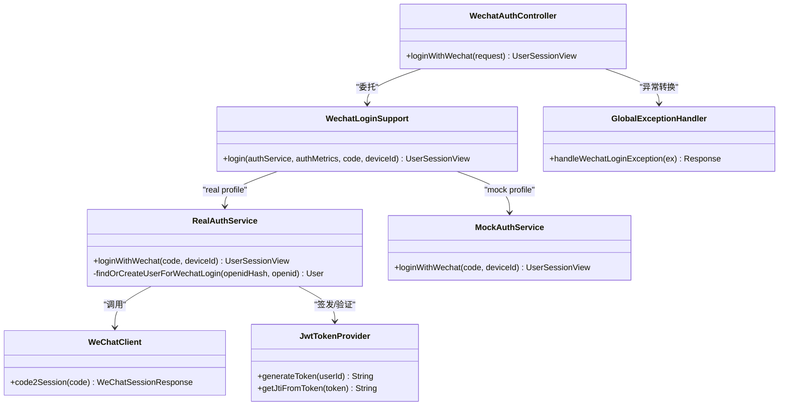

# 微信登录集成

<cite>
**本文引用的文件**
- [WechatAuthController.java](file://apps/api/src/main/java/com/campuslove/api/auth/WechatAuthController.java)
- [RealAuthService.java](file://apps/api/src/main/java/com/campuslove/api/auth/RealAuthService.java)
- [MockAuthService.java](file://apps/api/src/main/java/com/campuslove/api/auth/MockAuthService.java)
- [ThirdPartyAuthService.java](file://apps/api/src/main/java/com/campuslove/api/auth/ThirdPartyAuthService.java)
- [WeChatClient.java](file://apps/api/src/main/java/com/campuslove/api/auth/WeChatClient.java)
- [WechatLoginSupport.java](file://apps/api/src/main/java/com/campuslove/api/auth/WechatLoginSupport.java)
- [WechatLoginRequest.java](file://apps/api/src/main/java/com/campuslove/api/auth/WechatLoginRequest.java)
- [WechatLoginException.java](file://apps/api/src/main/java/com/campuslove/api/auth/WechatLoginException.java)
- [JwtTokenProvider.java](file://apps/api/src/main/java/com/campuslove/api/config/JwtTokenProvider.java)
- [GlobalExceptionHandler.java](file://apps/api/src/main/java/com/campuslove/api/config/GlobalExceptionHandler.java)
- [Resilience4jConfig.java](file://apps/api/src/main/java/com/campuslove/api/config/Resilience4jConfig.java)
- [application.yml](file://apps/api/src/main/resources/application.yml)
- [application-wechat.yml](file://apps/api/src/main/resources/application-wechat.yml)
- [V2026.07.26.0002__add_open_id_unique_constraint.sql](file://database/flyway/sql/V2026.07.26.0002__add_open_id_unique_constraint.sql)
- [User.java](file://apps/api/src/main/java/com/campuslove/api/entity/User.java)
- [feedback-growth-and-auth.yaml](file://docs/openapi/feedback-growth-and-auth.yaml)
</cite>

## 目录
1. [简介](#简介)
2. [项目结构](#项目结构)
3. [核心组件](#核心组件)
4. [架构总览](#架构总览)
5. [详细组件分析](#详细组件分析)
6. [依赖关系分析](#依赖关系分析)
7. [性能与韧性](#性能与韧性)
8. [故障排查指南](#故障排查指南)
9. [结论](#结论)
10. [附录：请求响应示例](#附录请求响应示例)

## 简介
本模块实现微信小程序登录完整链路：客户端调用 wx.login() 获取临时 code，后端通过 WechatAuthController 接收并委托 AuthService 实现（real/mock）完成 jscode2session 兑换 openId、用户查找或创建、禁用状态校验、JWT 签发与在线会话记录。文档聚焦 WechatAuthController 与 RealAuthService 的实现细节，覆盖错误处理、速率限制、安全防护、敏感数据加密与日志脱敏、重试与熔断、监控指标与常见问题排查。

## 项目结构
- 控制器层：WechatAuthController 暴露 /api/v1/auth/wechat 端点，统一走 WechatLoginSupport 指标埋点与异常处理。
- 服务层：RealAuthService（real profile）实现真实微信登录；MockAuthService（mock profile）提供本地演示。
- 外部调用：WeChatClient 封装 jscode2session 调用，内置 Resilience4j 的熔断、重试、限流。
- 安全与令牌：JwtTokenProvider 负责 JWT 生成、解析、黑名单撤销。
- 配置：application.yml 与 application-wechat.yml 管理应用与环境变量，wechat profile 要求显式注入 WECHAT_APPID/WECHAT_SECRET/WECHAT_JSCODE2SESSION_URL。
- 数据模型：User 实体带 openid 唯一约束 uk_users_openid；数据库迁移脚本保证约束存在。

图表来源
- [WechatAuthController.java:1-97](file://apps/api/src/main/java/com/campuslove/api/auth/WechatAuthController.java#L1-L97)
- [WechatLoginSupport.java:1-66](file://apps/api/src/main/java/com/campuslove/api/auth/WechatLoginSupport.java#L1-L66)
- [RealAuthService.java:201-450](file://apps/api/src/main/java/com/campuslove/api/auth/RealAuthService.java#L201-L450)
- [WeChatClient.java:1-200](file://apps/api/src/main/java/com/campuslove/api/auth/WeChatClient.java#L1-L200)
- [JwtTokenProvider.java:1-200](file://apps/api/src/main/java/com/campuslove/api/config/JwtTokenProvider.java#L1-L200)

章节来源
- [WechatAuthController.java:1-97](file://apps/api/src/main/java/com/campuslove/api/auth/WechatAuthController.java#L1-L97)
- [application.yml:1-200](file://apps/api/src/main/resources/application.yml#L1-L200)
- [application-wechat.yml:1-23](file://apps/api/src/main/resources/application-wechat.yml#L1-L23)

## 核心组件
- WechatAuthController：对外暴露微信登录端点，按 IP 做速率限制，委托 WechatLoginSupport 进行指标埋点与异常透传。
- WechatLoginSupport：统一记录登录成功/失败指标，失败时以异常类名作为原因避免泄露敏感信息。
- RealAuthService：真实登录流程，包含微信 code2session 调用、openid 哈希化查询/存储、用户禁用检查、JWT 签发、在线会话与设备记录。
- MockAuthService：mock profile 下返回固定会话，跳过微信调用，便于开发联调。
- WeChatClient：封装 jscode2session，使用 Resilience4j 注解实现熔断、重试、限流，生产环境禁止 dev-fallback。
- JwtTokenProvider：生成含 jti 的 JWT，支持黑名单撤销与媒体短令牌。
- GlobalExceptionHandler：将业务异常转换为标准 JSON 响应，生产模式对内部信息脱敏。

章节来源
- [WechatAuthController.java:1-97](file://apps/api/src/main/java/com/campuslove/api/auth/WechatAuthController.java#L1-L97)
- [WechatLoginSupport.java:1-66](file://apps/api/src/main/java/com/campuslove/api/auth/WechatLoginSupport.java#L1-L66)
- [RealAuthService.java:201-450](file://apps/api/src/main/java/com/campuslove/api/auth/RealAuthService.java#L201-L450)
- [MockAuthService.java:1-150](file://apps/api/src/main/java/com/campuslove/api/auth/MockAuthService.java#L1-L150)
- [WeChatClient.java:1-200](file://apps/api/src/main/java/com/campuslove/api/auth/WeChatClient.java#L1-L200)
- [JwtTokenProvider.java:1-200](file://apps/api/src/main/java/com/campuslove/api/config/JwtTokenProvider.java#L1-L200)
- [GlobalExceptionHandler.java:1-200](file://apps/api/src/main/java/com/campuslove/api/config/GlobalExceptionHandler.java#L1-L200)

## 架构总览
下图展示从客户端到后端的完整时序：客户端获取 code → 调用后端 /api/v1/auth/wechat → 控制器限流与指标埋点 → 服务层调用微信接口 → 用户查找/创建 → 签发 JWT → 记录在线会话与设备 → 返回会话视图。

图表来源
- [WechatAuthController.java:1-97](file://apps/api/src/main/java/com/campuslove/api/auth/WechatAuthController.java#L1-L97)
- [RealAuthService.java:201-450](file://apps/api/src/main/java/com/campuslove/api/auth/RealAuthService.java#L201-L450)
- [WeChatClient.java:1-200](file://apps/api/src/main/java/com/campuslove/api/auth/WeChatClient.java#L1-L200)
- [JwtTokenProvider.java:1-200](file://apps/api/src/main/java/com/campuslove/api/config/JwtTokenProvider.java#L1-L200)

## 详细组件分析

### WechatAuthController
- 职责：接收 WechatLoginRequest（code、deviceId），按客户端 IP 限流，委托 WechatLoginSupport 执行统一指标埋点与异常处理。
- 速率限制：桶容量 10，每 10 秒补充 1 个令牌，key 为 #request.remoteAddr，防止登录爆破。
- 错误映射：INVALID_CODE(401)、WECHAT_API_ERROR(502)、USER_DISABLED(403)、RATE_LIMITED(429)。
- OpenAPI：在 Swagger 中标注了操作说明、参数与响应。

章节来源
- [WechatAuthController.java:1-97](file://apps/api/src/main/java/com/campuslove/api/auth/WechatAuthController.java#L1-L97)
- [feedback-growth-and-auth.yaml:1-200](file://docs/openapi/feedback-growth-and-auth.yaml#L1-L200)

### RealAuthService
- 微信登录主流程：
  - 关闭开关检查：app_switch.login_open=false 直接拒绝（403）。
  - 调用 WeChatClient.code2Session(code)，捕获 WeChatAuthException：
    - errcode=40029 → INVALID_CODE(401)
    - 其他错误或网络异常 → WECHAT_API_ERROR(502)
  - 降级保护：若 fallback 返回 null（熔断/重试耗尽），转 WECHAT_API_ERROR(502)。
  - openid 安全处理：使用 SHA-256 派生固定 hash 作为查询键与存储值，避免明文泄露。
  - 查找或创建用户：事务边界仅覆盖 DB 操作，减少远程调用占用连接时间；并发首登冲突重试一次（最多 2 次尝试）。
  - 禁用检查：user.isDisabled() 返回 USER_DISABLED(403)。
  - 签发 JWT：generateToken(String.valueOf(userId))，携带 jti。
  - 记录在线会话与设备：recordOnlineSession 与 recordLoginDevice。
  - 构建并返回 UserSessionView。
- 刷新与登出：
  - refreshToken 先校验旧 token 有效性、黑名单、用户存在与启用状态，再签发新 token 并更新在线会话。
  - logout 将 jti 加入黑名单，立即失效。

图表来源
- [RealAuthService.java:201-450](file://apps/api/src/main/java/com/campuslove/api/auth/RealAuthService.java#L201-L450)
- [WeChatClient.java:1-200](file://apps/api/src/main/java/com/campuslove/api/auth/WeChatClient.java#L1-L200)
- [JwtTokenProvider.java:1-200](file://apps/api/src/main/java/com/campuslove/api/config/JwtTokenProvider.java#L1-L200)

章节来源
- [RealAuthService.java:201-450](file://apps/api/src/main/java/com/campuslove/api/auth/RealAuthService.java#L201-L450)
- [RealAuthService.java:451-721](file://apps/api/src/main/java/com/campuslove/api/auth/RealAuthService.java#L451-L721)

### MockAuthService
- 职责：在 mock profile 下提供无需微信调用的演示登录，直接返回固定会话与模拟 token。
- 差异对比：
  - 不访问微信接口，不查库，不校验 openid 唯一性。
  - 忽略验证码、密码等真实校验逻辑，快速返回登录成功。
  - 仍记录设备（内存态），用于本地设备管理演示。
- 适用场景：本地开发与前端联调，降低依赖外部服务的复杂度。

章节来源
- [MockAuthService.java:1-150](file://apps/api/src/main/java/com/campuslove/api/auth/MockAuthService.java#L1-L150)

### WeChatClient
- 能力：
  - 构造 jscode2session URL，使用 URI 变量自动编码，避免注入风险。
  - 生产环境强校验：dev-fallback 在生产 profile 下禁止启动。
  - Resilience4j 组合注解：
    - CircuitBreaker：连续失败超阈值打开熔断，半开探测。
    - Retry：指数退避重试（共 3 次），业务异常 WeChatAuthException 不重试。
    - RateLimiter：每秒最多 10 次调用，避免触发微信侧 QPS 限制。
  - 降级：fallback 方法返回 null，由 RealAuthService 转为 WECHAT_API_ERROR。
- 配置：jscode2session-url 默认来自 application-wechat.yml 环境变量，生产必须显式配置。

章节来源
- [WeChatClient.java:1-200](file://apps/api/src/main/java/com/campuslove/api/auth/WeChatClient.java#L1-L200)
- [WeChatClient.java:201-309](file://apps/api/src/main/java/com/campuslove/api/auth/WeChatClient.java#L201-L309)
- [Resilience4jConfig.java:1-76](file://apps/api/src/main/java/com/campuslove/api/config/Resilience4jConfig.java#L1-L76)
- [application-wechat.yml:1-23](file://apps/api/src/main/resources/application-wechat.yml#L1-L23)

### 第三方账号服务（对齐参考）
- ThirdPartyAuthService 同样通过 WeChatClient 调用 jscode2session，并对 openId 做 SHA-256 派生 hash 存储，确保与主登录流程一致。
- 绑定/解绑要求当前用户已认证，且同一 (provider, openIdHash) 只允许绑定一个用户。

章节来源
- [ThirdPartyAuthService.java:1-200](file://apps/api/src/main/java/com/campuslove/api/auth/ThirdPartyAuthService.java#L1-L200)

### 数据模型与唯一性约束
- User 实体：
  - openid 字段使用 @JsonIgnore 避免 JSON 序列化泄露。
  - 唯一约束 uk_users_openid 保证一个微信号只能注册一个账号。
- 数据库迁移：
  - V2026.07.26.0002__add_open_id_unique_constraint.sql 幂等补齐唯一索引，防止历史环境缺失导致并发重复插入。

章节来源
- [User.java:1-200](file://apps/api/src/main/java/com/campuslove/api/entity/User.java#L1-L200)
- [V2026.07.26.0002__add_open_id_unique_constraint.sql:1-42](file://database/flyway/sql/V2026.07.26.0002__add_open_id_unique_constraint.sql#L1-L42)

## 依赖关系分析
- WechatAuthController 依赖 AuthService 实现（real/mock）、AuthMetrics。
- RealAuthService 依赖 WeChatClient、JwtTokenProvider、UserRepository、OnlineUserService、AesEncryptor、PasswordEncoder。
- WeChatClient 依赖 WeChatConfig、RestClient、Resilience4j 配置。
- 全局异常处理器将 WechatLoginException 转换为标准化 JSON 响应，并在生产环境对内部信息脱敏。

图表来源
- [WechatAuthController.java:1-97](file://apps/api/src/main/java/com/campuslove/api/auth/WechatAuthController.java#L1-L97)
- [WechatLoginSupport.java:1-66](file://apps/api/src/main/java/com/campuslove/api/auth/WechatLoginSupport.java#L1-L66)
- [RealAuthService.java:201-450](file://apps/api/src/main/java/com/campuslove/api/auth/RealAuthService.java#L201-L450)
- [MockAuthService.java:1-150](file://apps/api/src/main/java/com/campuslove/api/auth/MockAuthService.java#L1-L150)
- [WeChatClient.java:1-200](file://apps/api/src/main/java/com/campuslove/api/auth/WeChatClient.java#L1-L200)
- [JwtTokenProvider.java:1-200](file://apps/api/src/main/java/com/campuslove/api/config/JwtTokenProvider.java#L1-L200)
- [GlobalExceptionHandler.java:1-200](file://apps/api/src/main/java/com/campuslove/api/config/GlobalExceptionHandler.java#L1-L200)

## 性能与韧性
- 速率限制：
  - 登录接口：@RateLimit(capacity=10, refillTokens=0.1/s)，key=#request.remoteAddr，防爆破。
  - WeChatClient 调用微信：@RateLimiter(name="wechatApi")，每秒最多 10 次。
- 熔断与重试：
  - @CircuitBreaker(name="wechatApi")：连续失败打开熔断，半开探测 3 次。
  - @Retry(name="wechatApi")：指数退避 500ms→1s→2s，共 3 次；业务异常不重试。
- 超时与降级：
  - RestClient 调用异常抛 WeChatAuthException；熔断/重试耗尽 fallback 返回 null，RealAuthService 转 WECHAT_API_ERROR。
- 监控指标：
  - AuthMetrics 记录登录成功/失败次数，通过 Actuator Prometheus 暴露。
  - Resilience4j 健康指示器暴露断路器/限流状态至 /actuator/health。
- 事务边界优化：
  - 移除方法级 @Transactional 包裹远程调用，事务仅覆盖 DB 操作，降低连接池压力。
- 并发安全：
  - 首次登录并发冲突捕获 DataIntegrityViolationException，重试一次命中既有用户，避免 500。

章节来源
- [WechatAuthController.java:1-97](file://apps/api/src/main/java/com/campuslove/api/auth/WechatAuthController.java#L1-L97)
- [WeChatClient.java:1-200](file://apps/api/src/main/java/com/campuslove/api/auth/WeChatClient.java#L1-L200)
- [RealAuthService.java:201-450](file://apps/api/src/main/java/com/campuslove/api/auth/RealAuthService.java#L201-L450)
- [Resilience4jConfig.java:1-76](file://apps/api/src/main/java/com/campuslove/api/config/Resilience4jConfig.java#L1-L76)
- [application.yml:1-200](file://apps/api/src/main/resources/application.yml#L1-L200)

## 故障排查指南
- 常见错误码与处理：
  - INVALID_CODE(401)：code 失效或过期，客户端需重新拉起 wx.login。
  - WECHAT_API_ERROR(502)：微信 API 调用失败或网络异常，建议重试或稍后重试。
  - USER_DISABLED(403)：用户被管理员禁用，联系管理员。
  - RATE_LIMITED(429)：触发限流，降低请求频率。
- 排查步骤：
  - 检查 code 是否来自最新 wx.login() 且未过期。
  - 检查 wechat profile 是否激活并正确注入 WECHAT_APPID/WECHAT_SECRET/WECHAT_JSCODE2SESSION_URL。
  - 查看 WeChatClient 日志与降级日志，确认是否触发熔断/重试。
  - 检查数据库 uk_users_openid 是否存在（迁移脚本 V2026.07.26.0002）。
  - 检查 GlobalExceptionHandler 输出，确认生产模式下内部信息已脱敏。
- 敏感数据与日志：
  - openid 使用 SHA-256 派生键存储与查询，避免明文泄露。
  - 手机号注册/登录路径使用 AesEncryptor 加密存储；日志通过 SensitiveDataMasker 脱敏。
  - 调试与监控中避免回显原始 code/token。

章节来源
- [WechatLoginException.java:1-101](file://apps/api/src/main/java/com/campuslove/api/auth/WechatLoginException.java#L1-L101)
- [GlobalExceptionHandler.java:1-200](file://apps/api/src/main/java/com/campuslove/api/config/GlobalExceptionHandler.java#L1-L200)
- [WeChatClient.java:201-309](file://apps/api/src/main/java/com/campuslove/api/auth/WeChatClient.java#L201-L309)
- [V2026.07.26.0002__add_open_id_unique_constraint.sql:1-42](file://database/flyway/sql/V2026.07.26.0002__add_open_id_unique_constraint.sql#L1-L42)
- [RealAuthService.java:201-450](file://apps/api/src/main/java/com/campuslove/api/auth/RealAuthService.java#L201-L450)

## 结论
本模块以清晰的层次划分实现了微信小程序登录的健壮流程：控制器层限流与指标、服务层安全与事务优化、外部调用韧性策略、JWT 黑名单撤销与在线会话管理。通过 openid 哈希化存储、敏感数据加密与日志脱敏，保障数据安全；通过 Resilience4j 熔断/重试/限流与监控指标，提升稳定性与可观测性。MockAuthService 为开发联调提供了便捷替代方案。整体设计兼顾功能完整性与安全合规性，适合生产部署。

## 附录：请求响应示例
以下示例基于 OpenAPI 定义与控制器注释整理，实际字段以 UserSessionView 为准。

- 登录请求
  - 方法：POST
  - 路径：/api/v1/auth/wechat
  - 请求体：
    - code：wx.login() 返回的临时凭证（必填）
    - deviceId：客户端设备标识（可选）
- 登录成功响应
  - 状态码：200
  - 响应体：包含 token、userId、profileCompleted、campusVerified 等会话信息
- 登录失败响应
  - 401 INVALID_CODE：code 失效或已过期
  - 403 USER_DISABLED：账号被禁用
  - 429 RATE_LIMITED：触发限流
  - 502 WECHAT_API_ERROR：微信服务不可用

章节来源
- [feedback-growth-and-auth.yaml:1-200](file://docs/openapi/feedback-growth-and-auth.yaml#L1-L200)
- [WechatAuthController.java:1-97](file://apps/api/src/main/java/com/campuslove/api/auth/WechatAuthController.java#L1-L97)
- [WechatLoginRequest.java:1-15](file://apps/api/src/main/java/com/campuslove/api/auth/WechatLoginRequest.java#L1-L15)