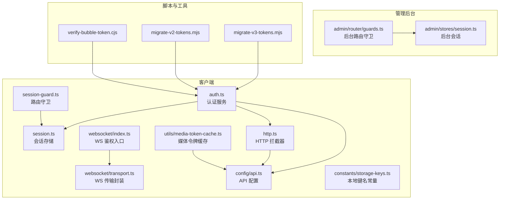
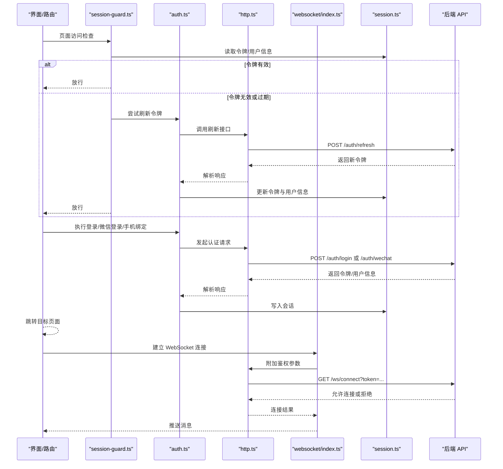
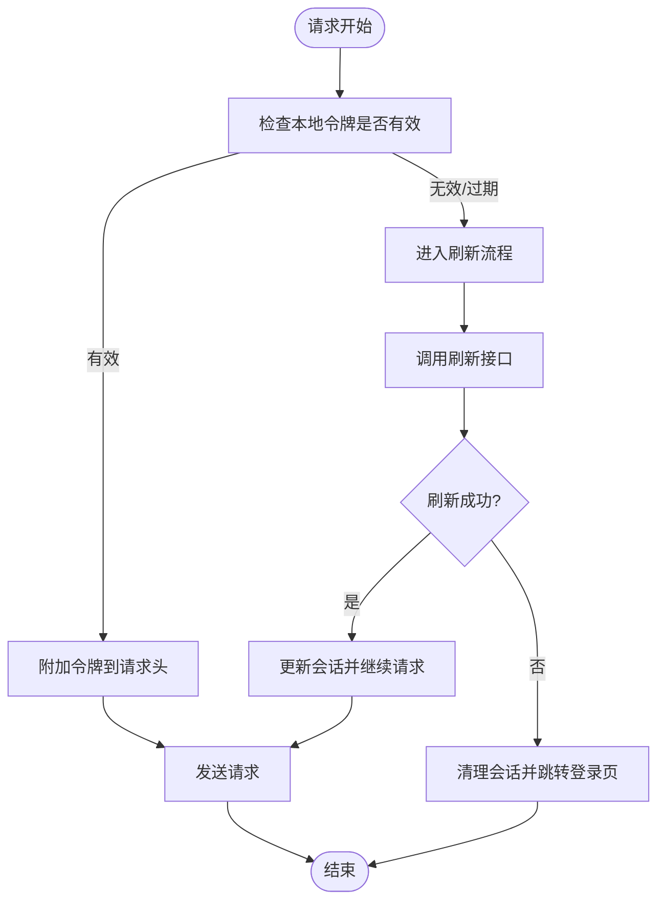
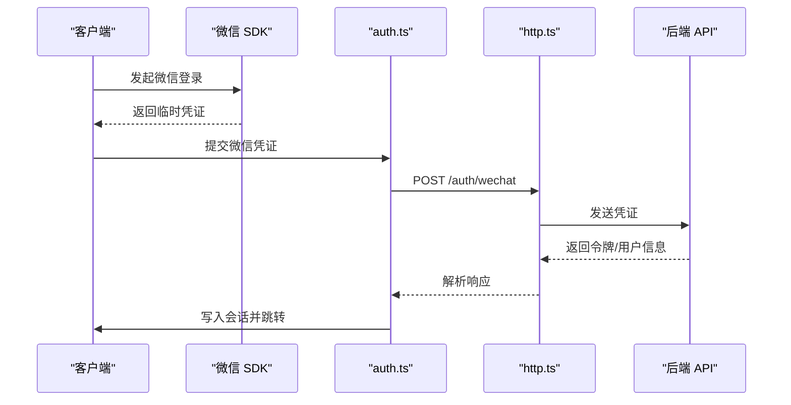
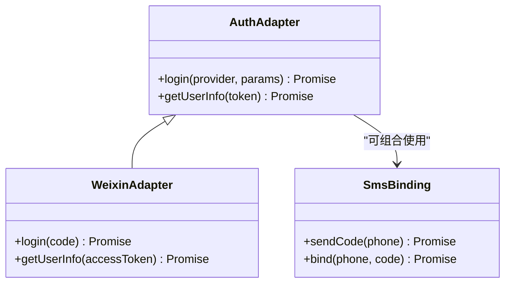
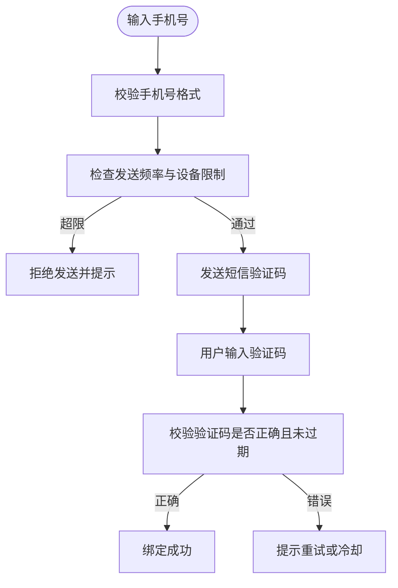
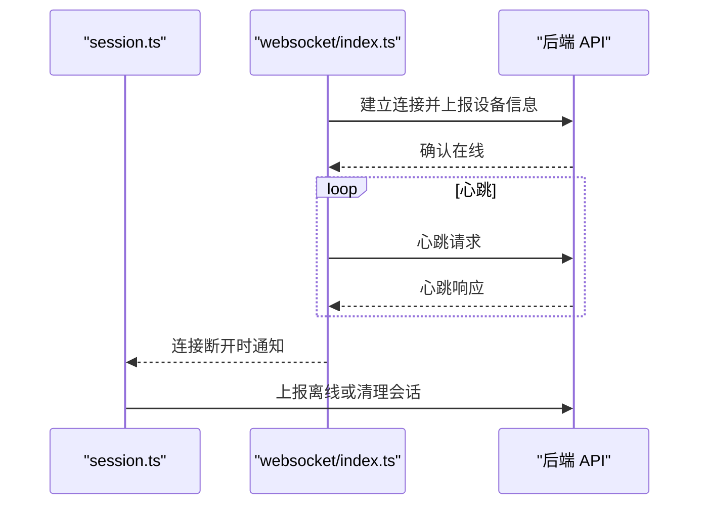
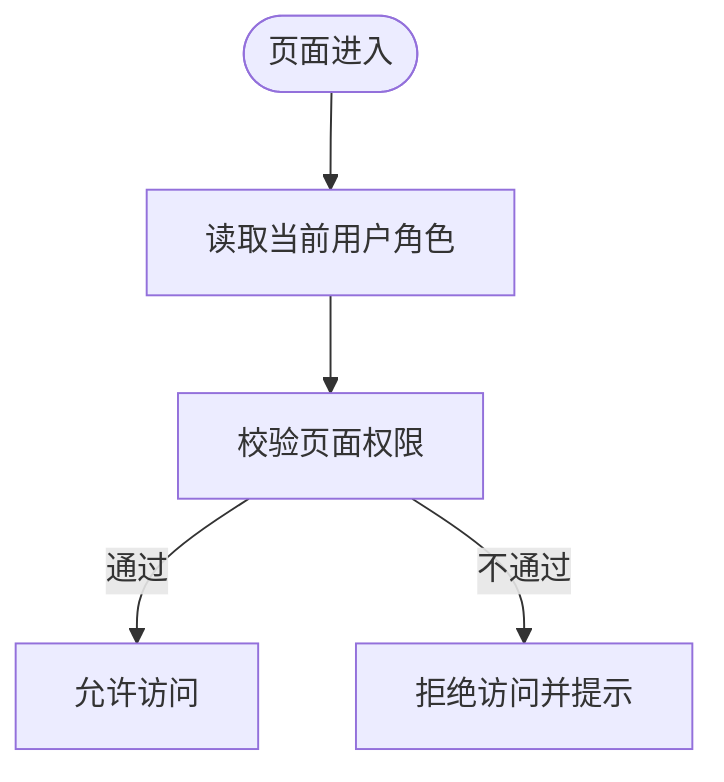
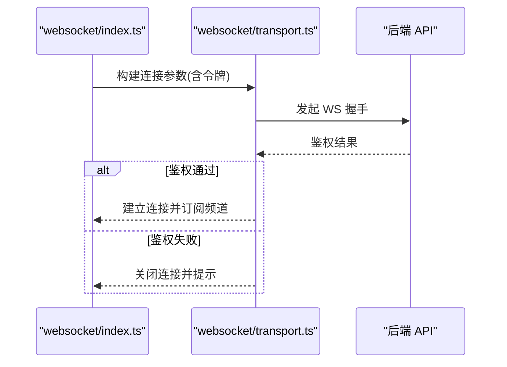
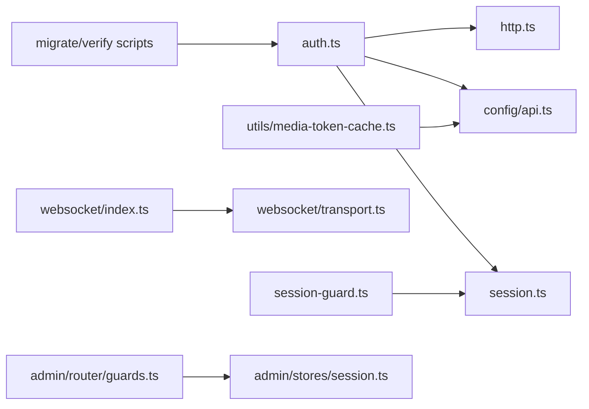

# 用户认证与安全

<cite>
**本文引用的文件**
- [apps/client/src/services/auth.ts](file://apps/client/src/services/auth.ts)
- [apps/client/src/stores/session.ts](file://apps/client/src/stores/session.ts)
- [apps/client/src/guards/session-guard.ts](file://apps/client/src/guards/session-guard.ts)
- [apps/client/src/services/websocket/index.ts](file://apps/client/src/services/websocket/index.ts)
- [apps/client/src/services/websocket/transport.ts](file://apps/client/src/services/websocket/transport.ts)
- [apps/client/src/config/api.ts](file://apps/client/src/config/api.ts)
- [apps/client/src/constants/storage-keys.ts](file://apps/client/src/constants/storage-keys.ts)
- [apps/client/src/services/http.ts](file://apps/client/src/services/http.ts)
- [apps/client/src/services/api-error.ts](file://apps/client/src/services/api-error.ts)
- [apps/client/src/utils/media-token-cache.ts](file://apps/client/src/utils/media-token-cache.ts)
- [apps/admin/src/router/guards.ts](file://apps/admin/src/router/guards.ts)
- [apps/admin/src/stores/session.ts](file://apps/admin/src/stores/session.ts)
- [scripts/migrate-v3-tokens.mjs](file://scripts/migrate-v3-tokens.mjs)
- [scripts/migrate-v2-tokens.mjs](file://scripts/migrate-v2-tokens.mjs)
- [scripts/verify-bubble-token.cjs](file://scripts/verify-bubble-token.cjs)
- [apps/api/src/main/java/com/campuslove/api/auth/AgreementConsentService.java](file://apps/api/src/main/java/com/campuslove/api/auth/AgreementConsentService.java)
- [apps/api/src/main/java/com/campuslove/api/entity/UserAgreementConsent.java](file://apps/api/src/main/java/com/campuslove/api/entity/UserAgreementConsent.java)
- [apps/api/src/main/java/com/campuslove/api/repository/UserAgreementConsentRepository.java](file://apps/api/src/main/java/com/campuslove/api/repository/UserAgreementConsentRepository.java)
- [apps/api/src/main/java/com/campuslove/api/auth/LoginAttemptService.java](file://apps/api/src/main/java/com/campuslove/api/auth/LoginAttemptService.java)
- [apps/api/src/main/java/com/campuslove/api/auth/SmsCodeService.java](file://apps/api/src/main/java/com/campuslove/api/auth/SmsCodeService.java)
- [apps/api/src/main/java/com/campuslove/api/auth/SmsCodeController.java](file://apps/api/src/main/java/com/campuslove/api/auth/SmsCodeController.java)
- [apps/api/src/main/java/com/campuslove/api/auth/RealAuthService.java](file://apps/api/src/main/java/com/campuslove/api/auth/RealAuthService.java)
- [apps/api/src/main/java/com/campuslove/api/auth/AuthController.java](file://apps/api/src/main/java/com/campuslove/api/auth/AuthController.java)
- [apps/api/src/main/java/com/campuslove/api/auth/AuthService.java](file://apps/api/src/main/java/com/campuslove/api/auth/AuthService.java)
- [apps/api/src/main/java/com/campuslove/api/ratelimit/RateLimit.java](file://apps/api/src/main/java/com/campuslove/api/ratelimit/RateLimit.java)
- [apps/api/src/main/java/com/campuslove/api/vip/BillingController.java](file://apps/api/src/main/java/com/campuslove/api/vip/BillingController.java)
- [apps/api/src/main/java/com/campuslove/api/clientconfig/LegalTextView.java](file://apps/api/src/main/java/com/campuslove/api/clientconfig/LegalTextView.java)
- [apps/api/src/main/java/com/campuslove/api/clientconfig/LegalTextProvider.java](file://apps/api/src/main/java/com/campuslove/api/clientconfig/LegalTextProvider.java)
- [apps/api/src/main/java/com/campuslove/api/clientconfig/ConfigController.java](file://apps/api/src/main/java/com/campuslove/api/clientconfig/ConfigController.java)
- [apps/api/src/main/java/com/campuslove/api/config/AdminPasswordValidator.java](file://apps/api/src/main/java/com/campuslove/api/config/AdminPasswordValidator.java)
- [apps/api/src/main/java/com/campuslove/api/config/SecurityConfig.java](file://apps/api/src/main/java/com/campuslove/api/config/SecurityConfig.java)
- [apps/api/src/main/resources/application-real.yml](file://apps/api/src/main/resources/application-real.yml)
- [database/flyway/sql/V2026.10.05.0002__create_user_agreement_consent.sql](file://database/flyway/sql/V2026.10.05.0002__create_user_agreement_consent.sql)
- [database/flyway/sql/V2026.10.05.0003__backfill_user_agreement_consent.sql](file://database/flyway/sql/V2026.10.05.0003__backfill_user_agreement_consent.sql)
- [apps/client/src/pages/register/index.vue](file://apps/client/src/pages/register/index.vue)
- [apps/client/src/services/config.ts](file://apps/client/src/services/config.ts)
</cite>

## 目录
1. [简介](#简介)
2. [项目结构](#项目结构)
3. [核心组件](#核心组件)
4. [架构总览](#架构总览)
5. [详细组件分析](#详细组件分析)
6. [依赖关系分析](#依赖关系分析)
7. [性能与可用性](#性能与可用性)
8. [故障排查指南](#故障排查指南)
9. [结论](#结论)
10. [附录：API 与配置要点](#附录api-与配置要点)

## 简介
本技术文档聚焦“用户认证与安全”模块，覆盖令牌（JWT）生成、验证与刷新机制、令牌黑名单管理；微信登录集成、第三方认证适配与手机号绑定流程；短信验证码服务的安全实现与防刷策略；会话与会话续期、设备管理与在线用户监控；权限控制、角色管理与访问授权；安全配置、密码加密、敏感数据保护与安全审计日志；WebSocket 连接鉴权、请求签名验证与速率限制策略。内容以代码仓库中的前端与服务端交互点为依据，并结合脚本与工具进行补充说明。

## 项目结构
本项目为多应用工程，认证相关的前端逻辑主要位于客户端应用中，包括认证服务、会话存储、路由守卫、WebSocket 鉴权以及 HTTP 拦截器；管理后台提供独立的会话与路由守卫；此外还有若干脚本用于令牌迁移与校验。

图示来源
- [apps/client/src/services/auth.ts:1-200](file://apps/client/src/services/auth.ts#L1-L200)
- [apps/client/src/stores/session.ts:1-200](file://apps/client/src/stores/session.ts#L1-L200)
- [apps/client/src/guards/session-guard.ts:1-101](file://apps/client/src/guards/session-guard.ts#L1-L101)
- [apps/client/src/services/http.ts:1-200](file://apps/client/src/services/http.ts#L1-L200)
- [apps/client/src/services/websocket/index.ts:1-200](file://apps/client/src/services/websocket/index.ts#L1-L200)
- [apps/client/src/services/websocket/transport.ts:1-200](file://apps/client/src/services/websocket/transport.ts#L1-L200)
- [apps/client/src/config/api.ts:1-126](file://apps/client/src/config/api.ts#L1-L126)
- [apps/client/src/constants/storage-keys.ts:1-133](file://apps/client/src/constants/storage-keys.ts#L1-L133)
- [apps/client/src/utils/media-token-cache.ts:1-27](file://apps/client/src/utils/media-token-cache.ts#L1-L27)
- [apps/admin/src/router/guards.ts:1-182](file://apps/admin/src/router/guards.ts#L1-L182)
- [apps/admin/src/stores/session.ts:1-200](file://apps/admin/src/stores/session.ts#L1-L200)
- [scripts/migrate-v3-tokens.mjs:1-69](file://scripts/migrate-v3-tokens.mjs#L1-L69)
- [scripts/migrate-v2-tokens.mjs:1-84](file://scripts/migrate-v2-tokens.mjs#L1-L84)
- [scripts/verify-bubble-token.cjs:1-120](file://scripts/verify-bubble-token.cjs#L1-L120)

章节来源
- [apps/client/src/services/auth.ts:1-200](file://apps/client/src/services/auth.ts#L1-L200)
- [apps/client/src/stores/session.ts:1-200](file://apps/client/src/stores/session.ts#L1-L200)
- [apps/client/src/guards/session-guard.ts:1-101](file://apps/client/src/guards/session-guard.ts#L1-L101)
- [apps/client/src/services/http.ts:1-200](file://apps/client/src/services/http.ts#L1-L200)
- [apps/client/src/services/websocket/index.ts:1-200](file://apps/client/src/services/websocket/index.ts#L1-L200)
- [apps/client/src/services/websocket/transport.ts:1-200](file://apps/client/src/services/websocket/transport.ts#L1-L200)
- [apps/client/src/config/api.ts:1-126](file://apps/client/src/config/api.ts#L1-L126)
- [apps/client/src/constants/storage-keys.ts:1-133](file://apps/client/src/constants/storage-keys.ts#L1-L133)
- [apps/client/src/utils/media-token-cache.ts:1-27](file://apps/client/src/utils/media-token-cache.ts#L1-L27)
- [apps/admin/src/router/guards.ts:1-182](file://apps/admin/src/router/guards.ts#L1-L182)
- [apps/admin/src/stores/session.ts:1-200](file://apps/admin/src/stores/session.ts#L1-L200)
- [scripts/migrate-v3-tokens.mjs:1-69](file://scripts/migrate-v3-tokens.mjs#L1-L69)
- [scripts/migrate-v2-tokens.mjs:1-84](file://scripts/migrate-v2-tokens.mjs#L1-L84)
- [scripts/verify-bubble-token.cjs:1-120](file://scripts/verify-bubble-token.cjs#L1-L120)

## 核心组件
- 认证服务：封装登录、注册、微信登录、手机号绑定、短信验证码发送与校验等能力，负责与后端 API 交互并处理响应。
- 会话存储：持久化与读写当前用户的令牌、用户信息、设备标识等，提供统一的存取接口。
- 路由守卫：在页面跳转前校验会话有效性，必要时触发自动刷新或引导重新登录。
- HTTP 拦截器：统一附加令牌、处理错误码、重试与降级策略。
- WebSocket 鉴权：在建立长连接时携带鉴权参数，保障实时通信安全。
- 管理后台守卫与会话：独立于客户端的鉴权流程，避免共享状态造成冲突。
- 脚本工具：令牌格式迁移与校验，保证历史数据兼容。

章节来源
- [apps/client/src/services/auth.ts:1-200](file://apps/client/src/services/auth.ts#L1-L200)
- [apps/client/src/stores/session.ts:1-200](file://apps/client/src/stores/session.ts#L1-L200)
- [apps/client/src/guards/session-guard.ts:1-101](file://apps/client/src/guards/session-guard.ts#L1-L101)
- [apps/client/src/services/http.ts:1-200](file://apps/client/src/services/http.ts#L1-L200)
- [apps/client/src/services/websocket/index.ts:1-200](file://apps/client/src/services/websocket/index.ts#L1-L200)
- [apps/client/src/services/websocket/transport.ts:1-200](file://apps/client/src/services/websocket/transport.ts#L1-L200)
- [apps/admin/src/router/guards.ts:1-182](file://apps/admin/src/router/guards.ts#L1-L182)
- [apps/admin/src/stores/session.ts:1-200](file://apps/admin/src/stores/session.ts#L1-L200)
- [scripts/migrate-v3-tokens.mjs:1-69](file://scripts/migrate-v3-tokens.mjs#L1-L69)
- [scripts/migrate-v2-tokens.mjs:1-84](file://scripts/migrate-v2-tokens.mjs#L1-L84)
- [scripts/verify-bubble-token.cjs:1-120](file://scripts/verify-bubble-token.cjs#L1-L120)

## 架构总览
下图展示客户端认证相关组件之间的协作关系，包括认证服务、会话存储、HTTP 拦截器、路由守卫与 WebSocket 鉴权。

图示来源
- [apps/client/src/guards/session-guard.ts:1-101](file://apps/client/src/guards/session-guard.ts#L1-L101)
- [apps/client/src/services/auth.ts:1-200](file://apps/client/src/services/auth.ts#L1-L200)
- [apps/client/src/services/http.ts:1-200](file://apps/client/src/services/http.ts#L1-L200)
- [apps/client/src/services/websocket/index.ts:1-200](file://apps/client/src/services/websocket/index.ts#L1-L200)
- [apps/client/src/stores/session.ts:1-200](file://apps/client/src/stores/session.ts#L1-L200)

## 详细组件分析

### JWT 令牌生成、验证与刷新机制（前端视角）
- 令牌获取：通过认证服务调用后端登录/微信登录接口，接收服务端返回的访问令牌与可选刷新令牌。
- 令牌存储：将令牌写入会话存储，按约定键名保存，避免硬编码字符串分散。
- 令牌附加：HTTP 拦截器在每次请求头中附加令牌，确保受保护资源访问。
- 令牌刷新：当检测到令牌失效或过期时，自动调用刷新接口，成功后更新本地会话并重试原请求。
- 令牌黑名单：黑名单通常由服务端维护；若需要前端感知（如强制登出），可通过全局事件或特定接口响应触发清理会话并跳转。

图示来源
- [apps/client/src/services/auth.ts:1-200](file://apps/client/src/services/auth.ts#L1-L200)
- [apps/client/src/services/http.ts:1-200](file://apps/client/src/services/http.ts#L1-L200)
- [apps/client/src/stores/session.ts:1-200](file://apps/client/src/stores/session.ts#L1-L200)
- [apps/client/src/constants/storage-keys.ts:1-133](file://apps/client/src/constants/storage-keys.ts#L1-L133)

章节来源
- [apps/client/src/services/auth.ts:1-200](file://apps/client/src/services/auth.ts#L1-L200)
- [apps/client/src/services/http.ts:1-200](file://apps/client/src/services/http.ts#L1-L200)
- [apps/client/src/stores/session.ts:1-200](file://apps/client/src/stores/session.ts#L1-L200)
- [apps/client/src/constants/storage-keys.ts:1-133](file://apps/client/src/constants/storage-keys.ts#L1-L133)

### 微信登录集成流程
- 前端调用微信登录流程，获取微信侧的临时凭证或用户信息。
- 将该凭证发送至后端认证接口，换取系统内部令牌。
- 成功后写入会话，并根据业务需求初始化用户资料或跳转到主页。

图示来源
- [apps/client/src/services/auth.ts:1-200](file://apps/client/src/services/auth.ts#L1-L200)
- [apps/client/src/services/http.ts:1-200](file://apps/client/src/services/http.ts#L1-L200)

章节来源
- [apps/client/src/services/auth.ts:1-200](file://apps/client/src/services/auth.ts#L1-L200)
- [apps/client/src/services/http.ts:1-200](file://apps/client/src/services/http.ts#L1-L200)

### 第三方认证适配器与手机号绑定
- 第三方认证适配器：统一抽象不同第三方平台（如微信、其他 OAuth）的接入方式，对外暴露一致的登录与用户信息获取接口。
- 手机号绑定：支持通过短信验证码完成手机号绑定，提升账号唯一性与可找回性。

图示来源
- [apps/client/src/services/auth.ts:1-200](file://apps/client/src/services/auth.ts#L1-L200)

章节来源
- [apps/client/src/services/auth.ts:1-200](file://apps/client/src/services/auth.ts#L1-L200)

### SMS 短信验证码服务的安全实现与防刷策略
- 安全实现：对发送验证码接口进行频率限制、图形验证码校验、设备指纹记录，防止批量滥用。
- 防刷策略：基于手机号、IP、设备 ID 等多维度限流；失败次数阈值后延迟或锁定；验证码有效期与一次性使用。
- 校验流程：前端在发送与校验时遵循最小必要原则，避免泄露敏感信息。

图示来源
- [apps/client/src/services/auth.ts:1-200](file://apps/client/src/services/auth.ts#L1-L200)

章节来源
- [apps/client/src/services/auth.ts:1-200](file://apps/client/src/services/auth.ts#L1-L200)

### 会话管理、设备管理与在线用户监控
- 会话管理：集中管理令牌、用户信息与过期时间；提供刷新、清理与恢复能力。
- 设备管理：记录设备标识，支持多设备并发控制与异常设备下线。
- 在线监控：通过心跳或连接状态上报，统计在线用户数与活跃设备。

图示来源
- [apps/client/src/stores/session.ts:1-200](file://apps/client/src/stores/session.ts#L1-L200)
- [apps/client/src/services/websocket/index.ts:1-200](file://apps/client/src/services/websocket/index.ts#L1-L200)

章节来源
- [apps/client/src/stores/session.ts:1-200](file://apps/client/src/stores/session.ts#L1-L200)
- [apps/client/src/services/websocket/index.ts:1-200](file://apps/client/src/services/websocket/index.ts#L1-L200)

### 权限控制、角色管理与访问授权
- 路由守卫：在进入页面之前校验用户角色与资源权限，未授权则重定向至登录或无权限页面。
- 角色管理：基于用户角色或标签控制菜单与功能可见性。
- 访问授权：细粒度资源级授权，结合后端权限模型进行二次校验。

图示来源
- [apps/client/src/guards/session-guard.ts:1-101](file://apps/client/src/guards/session-guard.ts#L1-L101)
- [apps/admin/src/router/guards.ts:1-182](file://apps/admin/src/router/guards.ts#L1-L182)

章节来源
- [apps/client/src/guards/session-guard.ts:1-101](file://apps/client/src/guards/session-guard.ts#L1-L101)
- [apps/admin/src/router/guards.ts:1-182](file://apps/admin/src/router/guards.ts#L1-L182)

### 安全配置、密码加密、敏感数据保护与安全审计日志
- 安全配置：环境变量与配置文件隔离敏感信息；启用 HTTPS；限制跨域与 Cookie 属性。
- 密码加密：前端不直接传输明文密码；采用安全的哈希或后端加盐哈希方案。
- 敏感数据保护：令牌与个人信息存储在安全位置，避免本地明文长期留存。
- 安全审计日志：关键操作记录审计日志，便于追踪与分析。

章节来源
- [apps/client/src/config/api.ts:1-126](file://apps/client/src/config/api.ts#L1-L126)
- [apps/client/src/stores/session.ts:1-200](file://apps/client/src/stores/session.ts#L1-L200)

### WebSocket 连接鉴权、请求签名验证与速率限制策略
- WebSocket 鉴权：连接时携带令牌或临时会话参数，服务端验证通过后建立连接。
- 请求签名验证：对敏感请求附加签名，防止篡改与重放攻击。
- 速率限制：对高频接口实施限流，避免滥用与资源耗尽。

图示来源
- [apps/client/src/services/websocket/index.ts:1-200](file://apps/client/src/services/websocket/index.ts#L1-L200)
- [apps/client/src/services/websocket/transport.ts:1-200](file://apps/client/src/services/websocket/transport.ts#L1-L200)

章节来源
- [apps/client/src/services/websocket/index.ts:1-200](file://apps/client/src/services/websocket/index.ts#L1-L200)
- [apps/client/src/services/websocket/transport.ts:1-200](file://apps/client/src/services/websocket/transport.ts#L1-L200)

## 依赖关系分析
认证相关组件之间存在明确的依赖关系：认证服务依赖 HTTP 拦截器与 API 配置；会话存储被多个组件读取与更新；路由守卫依赖会话存储；WebSocket 鉴权依赖传输层封装；脚本工具依赖认证服务提供的数据结构。

图示来源
- [apps/client/src/services/auth.ts:1-200](file://apps/client/src/services/auth.ts#L1-L200)
- [apps/client/src/services/http.ts:1-200](file://apps/client/src/services/http.ts#L1-L200)
- [apps/client/src/config/api.ts:1-126](file://apps/client/src/config/api.ts#L1-L126)
- [apps/client/src/stores/session.ts:1-200](file://apps/client/src/stores/session.ts#L1-L200)
- [apps/client/src/guards/session-guard.ts:1-101](file://apps/client/src/guards/session-guard.ts#L1-L101)
- [apps/client/src/services/websocket/index.ts:1-200](file://apps/client/src/services/websocket/index.ts#L1-L200)
- [apps/client/src/services/websocket/transport.ts:1-200](file://apps/client/src/services/websocket/transport.ts#L1-L200)
- [apps/client/src/utils/media-token-cache.ts:1-27](file://apps/client/src/utils/media-token-cache.ts#L1-L27)
- [apps/admin/src/router/guards.ts:1-182](file://apps/admin/src/router/guards.ts#L1-L182)
- [apps/admin/src/stores/session.ts:1-200](file://apps/admin/src/stores/session.ts#L1-L200)
- [scripts/migrate-v3-tokens.mjs:1-69](file://scripts/migrate-v3-tokens.mjs#L1-L69)
- [scripts/migrate-v2-tokens.mjs:1-84](file://scripts/migrate-v2-tokens.mjs#L1-L84)
- [scripts/verify-bubble-token.cjs:1-120](file://scripts/verify-bubble-token.cjs#L1-L120)

章节来源
- [apps/client/src/services/auth.ts:1-200](file://apps/client/src/services/auth.ts#L1-L200)
- [apps/client/src/services/http.ts:1-200](file://apps/client/src/services/http.ts#L1-L200)
- [apps/client/src/config/api.ts:1-126](file://apps/client/src/config/api.ts#L1-L126)
- [apps/client/src/stores/session.ts:1-200](file://apps/client/src/stores/session.ts#L1-L200)
- [apps/client/src/guards/session-guard.ts:1-101](file://apps/client/src/guards/session-guard.ts#L1-L101)
- [apps/client/src/services/websocket/index.ts:1-200](file://apps/client/src/services/websocket/index.ts#L1-L200)
- [apps/client/src/services/websocket/transport.ts:1-200](file://apps/client/src/services/websocket/transport.ts#L1-L200)
- [apps/client/src/utils/media-token-cache.ts:1-27](file://apps/client/src/utils/media-token-cache.ts#L1-L27)
- [apps/admin/src/router/guards.ts:1-182](file://apps/admin/src/router/guards.ts#L1-L182)
- [apps/admin/src/stores/session.ts:1-200](file://apps/admin/src/stores/session.ts#L1-L200)
- [scripts/migrate-v3-tokens.mjs:1-69](file://scripts/migrate-v3-tokens.mjs#L1-L69)
- [scripts/migrate-v2-tokens.mjs:1-84](file://scripts/migrate-v2-tokens.mjs#L1-L84)
- [scripts/verify-bubble-token.cjs:1-120](file://scripts/verify-bubble-token.cjs#L1-L120)

## 性能与可用性
- 令牌刷新节流：避免频繁刷新导致的服务端压力与重复请求。
- 本地缓存优化：对媒体令牌等短期令牌进行缓存，减少重复请求。
- 错误重试与降级：网络异常或服务不可用时提供友好降级体验。
- 会话恢复：应用重启或刷新后尽量恢复会话，减少用户操作中断。

[本节为通用指导，不直接分析具体文件]

## 故障排查指南
- 令牌失效问题：检查会话存储中的令牌键名与过期时间；查看 HTTP 拦截器的错误处理与刷新流程。
- 微信登录失败：核对微信凭证传递与后端接口响应；关注错误码与提示信息。
- 短信验证码受限：检查发送频率与设备限制；确认验证码有效期与一次性使用策略。
- WebSocket 连接失败：检查鉴权参数与传输层封装；查看连接建立时的错误回调。
- 管理后台无法访问：核查后台路由守卫与会话存储；确保管理员角色与权限配置正确。

章节来源
- [apps/client/src/services/auth.ts:1-200](file://apps/client/src/services/auth.ts#L1-L200)
- [apps/client/src/services/http.ts:1-200](file://apps/client/src/services/http.ts#L1-L200)
- [apps/client/src/services/api-error.ts:1-164](file://apps/client/src/services/api-error.ts#L1-L164)
- [apps/client/src/services/websocket/index.ts:1-200](file://apps/client/src/services/websocket/index.ts#L1-L200)
- [apps/client/src/services/websocket/transport.ts:1-200](file://apps/client/src/services/websocket/transport.ts#L1-L200)
- [apps/admin/src/router/guards.ts:1-182](file://apps/admin/src/router/guards.ts#L1-L182)
- [apps/admin/src/stores/session.ts:1-200](file://apps/admin/src/stores/session.ts#L1-L200)

## 结论
本模块围绕“认证与安全”构建了从前端到后端的完整链路，涵盖令牌生命周期管理、第三方登录集成、短信验证码安全、会话与设备管理、权限控制与访问授权、安全配置与审计、WebSocket 鉴权与限流策略。通过清晰的组件职责与依赖关系，保障了系统的可用性与安全性。后续建议持续完善服务端黑名单管理、细粒度权限模型与审计日志采集，以提升整体安全水位与运维可观测性。

## 附录：API 与配置要点
- 认证接口：登录、微信登录、刷新令牌、手机号绑定与验证码发送等。
- 会话键名：使用常量定义本地存储键名，避免硬编码。
- HTTP 拦截：统一附加令牌、错误处理与重试策略。
- 媒体令牌：对媒体资源的访问令牌进行缓存与复用。
- 管理后台：独立的路由守卫与会话存储，避免与客户端混淆。
- 脚本工具：令牌格式迁移与校验，确保兼容性。

章节来源
- [apps/client/src/config/api.ts:1-126](file://apps/client/src/config/api.ts#L1-L126)
- [apps/client/src/constants/storage-keys.ts:1-133](file://apps/client/src/constants/storage-keys.ts#L1-L133)
- [apps/client/src/utils/media-token-cache.ts:1-27](file://apps/client/src/utils/media-token-cache.ts#L1-L27)
- [scripts/migrate-v3-tokens.mjs:1-69](file://scripts/migrate-v3-tokens.mjs#L1-L69)
- [scripts/migrate-v2-tokens.mjs:1-84](file://scripts/migrate-v2-tokens.mjs#L1-L84)
- [scripts/verify-bubble-token.cjs:1-120](file://scripts/verify-bubble-token.cjs#L1-L120)