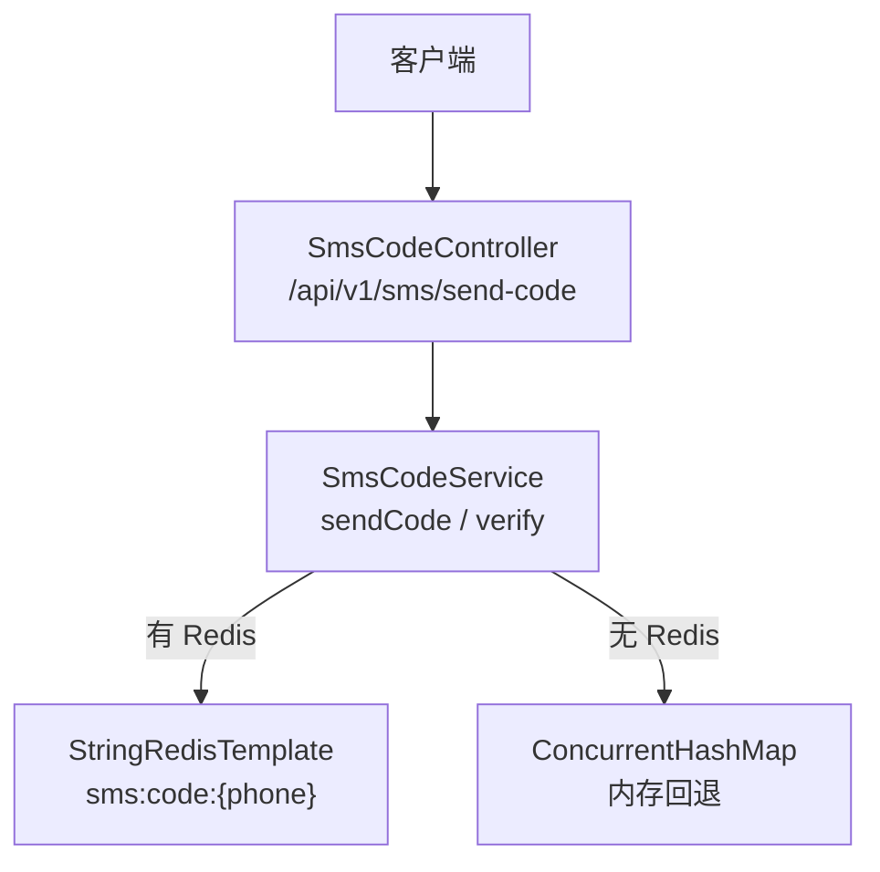
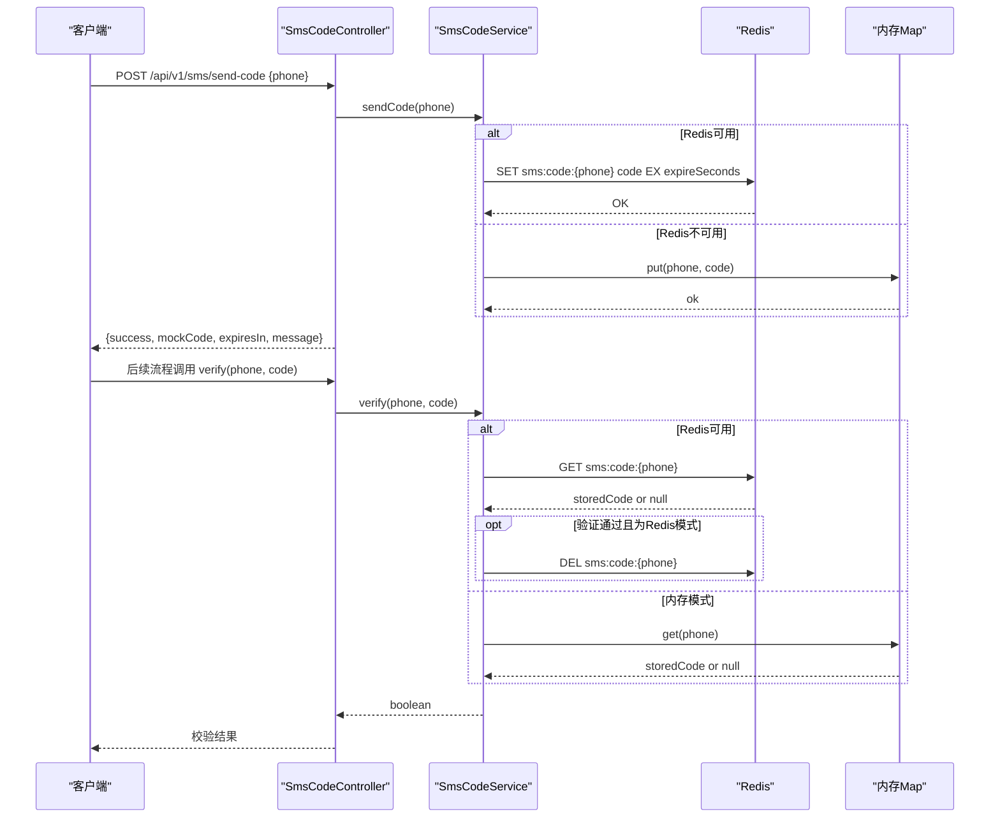
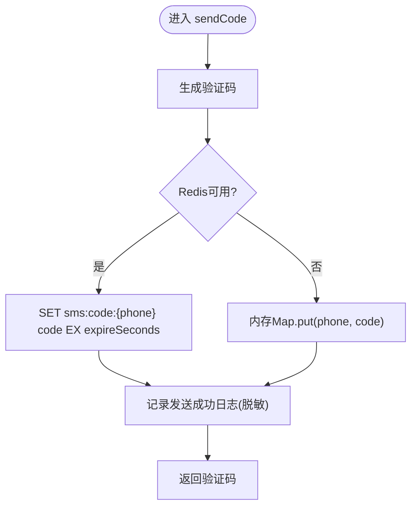
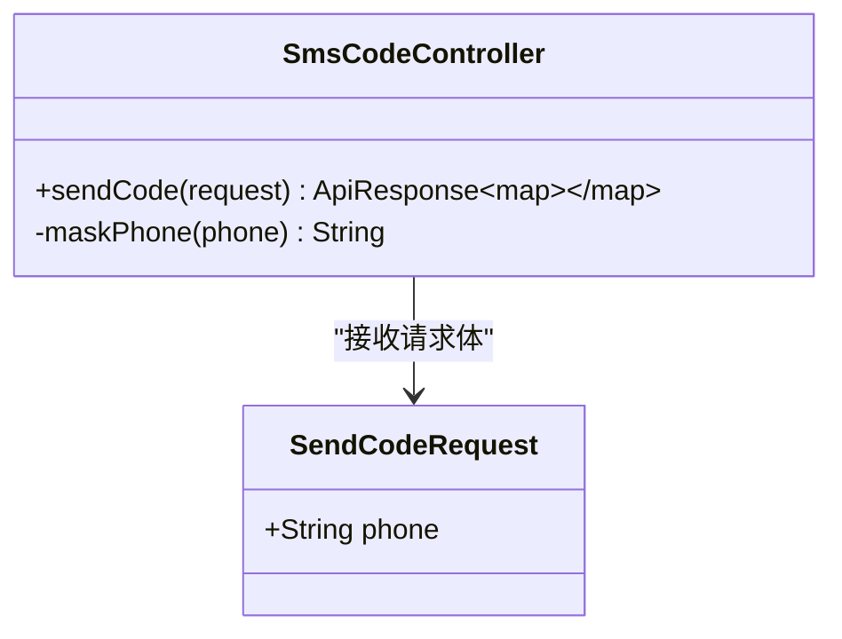
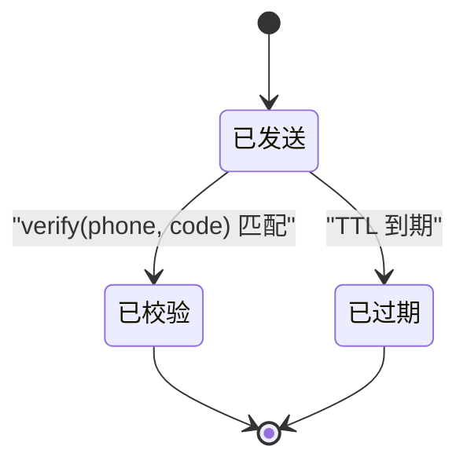
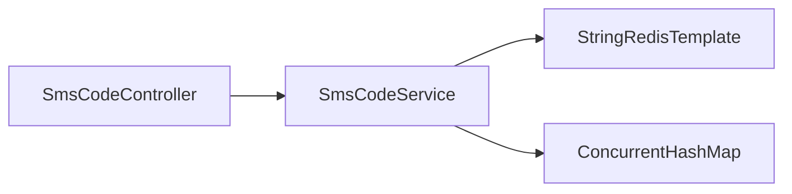

# 短信验证码服务

<cite>
**本文引用的文件**
- [SmsCodeService.java](file://apps/api/src/main/java/com/campuslove/api/auth/SmsCodeService.java)
- [SmsCodeController.java](file://apps/api/src/main/java/com/campuslove/api/auth/SmsCodeController.java)
- [application.yml](file://apps/api/src/main/resources/application.yml)
- [AuthController.java](file://apps/api/src/main/java/com/campuslove/api/auth/AuthController.java)
- [messages_zh_CN.properties](file://apps/api/src/main/resources/i18n/messages_zh_CN.properties)
</cite>

## 目录
1. [简介](#简介)
2. [项目结构](#项目结构)
3. [核心组件](#核心组件)
4. [架构总览](#架构总览)
5. [详细组件分析](#详细组件分析)
6. [依赖关系分析](#依赖关系分析)
7. [性能考量](#性能考量)
8. [故障排查指南](#故障排查指南)
9. [结论](#结论)
10. [附录](#附录)

## 简介
本技术文档围绕“短信验证码服务”的模拟实现展开，重点说明 SmsCodeService 的验证码生成、Redis 存储与内存回退机制；完整描述验证码生命周期（发送、存储、校验、过期清理）；给出 Redis Key 设计与 TTL 配置、并发安全保证；解释 mock profile 下无 Redis 环境的降级策略；并提供生产环境接入真实短信网关的适配方案。同时覆盖防刷策略、频率限制、安全防护、API 示例、错误处理场景与性能优化建议，并讨论验证码安全性、重放攻击防护及多设备场景处理。

## 项目结构
短信验证码相关代码位于后端 API 模块中，包含控制器与服务层：
- 控制器：负责接收 HTTP 请求，参数校验，调用服务层并返回统一响应。
- 服务层：封装验证码生成、存储（Redis/内存）、校验与一次性使用等核心逻辑。
- 配置：通过 application.yml 暴露应用级配置项，包括短信限流、重试与健康指标等；验证码相关的 mock-code 与 expire-seconds 通过 @Value 注入。

**图示来源**
- [SmsCodeController.java:1-69](file://apps/api/src/main/java/com/campuslove/api/auth/SmsCodeController.java#L1-L69)
- [SmsCodeService.java:1-112](file://apps/api/src/main/java/com/campuslove/api/auth/SmsCodeService.java#L1-L112)
- [application.yml:390-471](file://apps/api/src/main/resources/application.yml#L390-L471)

**章节来源**
- [SmsCodeController.java:1-69](file://apps/api/src/main/java/com/campuslove/api/auth/SmsCodeController.java#L1-L69)
- [SmsCodeService.java:1-112](file://apps/api/src/main/java/com/campuslove/api/auth/SmsCodeService.java#L1-L112)
- [application.yml:390-471](file://apps/api/src/main/resources/application.yml#L390-L471)

## 核心组件
- SmsCodeController：对外暴露发送验证码接口，参数校验手机号格式，调用服务层完成发送，并返回统一结果（含 mockCode、有效期提示等）。
- SmsCodeService：提供 sendCode 与 verify 两个方法。sendCode 生成验证码并持久化（优先 Redis，失败或不可用则回退内存），verify 从相同数据源读取并比对，成功后在 Redis 模式下删除以实现一次性验证。
- 配置项：mock-code（默认固定码用于联调）、expire-seconds（默认 300 秒）；以及全局的短信限流与重试策略。

**章节来源**
- [SmsCodeController.java:1-69](file://apps/api/src/main/java/com/campuslove/api/auth/SmsCodeController.java#L1-L69)
- [SmsCodeService.java:1-112](file://apps/api/src/main/java/com/campuslove/api/auth/SmsCodeService.java#L1-L112)
- [application.yml:390-471](file://apps/api/src/main/resources/application.yml#L390-L471)

## 架构总览
下图展示从客户端到存储层的完整调用链路，包括降级路径与一次性验证的删除操作。

**图示来源**
- [SmsCodeController.java:1-69](file://apps/api/src/main/java/com/campuslove/api/auth/SmsCodeController.java#L1-L69)
- [SmsCodeService.java:1-112](file://apps/api/src/main/java/com/campuslove/api/auth/SmsCodeService.java#L1-L112)

## 详细组件分析

### SmsCodeService 分析
- 验证码生成：当前为固定 mock 码（可配置），便于联调；未来替换为随机 6 位并由短信网关下发。
- 存储策略：优先写入 Redis（key=sms:code:{phone}，TTL=expire-seconds），异常或不可用时回退到内存 Map。
- 校验逻辑：从同一存储源读取并比较；Redis 模式下校验通过后删除 key，实现一次性验证，防止重放。
- 并发安全：使用 ConcurrentHashMap 作为内存回退，避免并发写冲突；Redis 本身具备原子性读写。
- 日志脱敏：手机号输出时进行掩码处理，保护隐私。

**图示来源**
- [SmsCodeService.java:1-112](file://apps/api/src/main/java/com/campuslove/api/auth/SmsCodeService.java#L1-L112)

**章节来源**
- [SmsCodeService.java:1-112](file://apps/api/src/main/java/com/campuslove/api/auth/SmsCodeService.java#L1-L112)

### SmsCodeController 分析
- 接口：POST /api/v1/sms/send-code
- 参数校验：要求手机号非空且符合中国大陆手机号正则。
- 返回体：包含 success、mockCode、expiresIn、message 等字段，便于前端联调。
- 日志：对手机号进行脱敏后记录。

**图示来源**
- [SmsCodeController.java:1-69](file://apps/api/src/main/java/com/campuslove/api/auth/SmsCodeController.java#L1-L69)

**章节来源**
- [SmsCodeController.java:1-69](file://apps/api/src/main/java/com/campuslove/api/auth/SmsCodeController.java#L1-L69)

### 验证码生命周期管理
- 发送：生成验证码并持久化（Redis 优先，否则内存）。
- 存储：Redis key 设计为 sms:code:{phone}，设置 TTL 为配置的 expire-seconds（默认 300 秒）。
- 校验：读取对应 key 或内存值，与输入比对；Redis 模式下通过后删除 key，确保一次性使用。
- 过期清理：由 Redis TTL 自动清理；内存模式在进程重启后失效。

**图示来源**
- [SmsCodeService.java:1-112](file://apps/api/src/main/java/com/campuslove/api/auth/SmsCodeService.java#L1-L112)

**章节来源**
- [SmsCodeService.java:1-112](file://apps/api/src/main/java/com/campuslove/api/auth/SmsCodeService.java#L1-L112)

### 生产环境接入真实短信网关
- 适配点：仅需替换 SmsCodeService 的发送实现，将固定 mock 码改为随机生成并通过短信网关下发。
- 保持契约：sendCode 仍返回本次验证码（供联调/测试），verify 保持不变。
- 配置扩展：可在 application.yml 中新增短信服务商相关配置项（如 accessKey、secretKey、模板 ID 等）。

[本节为概念性说明，不直接分析具体文件]

## 依赖关系分析
- SmsCodeController 依赖 SmsCodeService。
- SmsCodeService 依赖 StringRedisTemplate（可选注入）与 ConcurrentHashMap（内存回退）。
- 应用级配置（application.yml）提供短信限流、重试与健康指标等，影响整体稳定性与可观测性。

**图示来源**
- [SmsCodeController.java:1-69](file://apps/api/src/main/java/com/campuslove/api/auth/SmsCodeController.java#L1-L69)
- [SmsCodeService.java:1-112](file://apps/api/src/main/java/com/campuslove/api/auth/SmsCodeService.java#L1-L112)
- [application.yml:390-471](file://apps/api/src/main/resources/application.yml#L390-L471)

**章节来源**
- [SmsCodeController.java:1-69](file://apps/api/src/main/java/com/campuslove/api/auth/SmsCodeController.java#L1-L69)
- [SmsCodeService.java:1-112](file://apps/api/src/main/java/com/campuslove/api/auth/SmsCodeService.java#L1-L112)
- [application.yml:390-471](file://apps/api/src/main/resources/application.yml#L390-L471)

## 性能考量
- 缓存命中：Redis 提供 O(1) 读写，显著优于内存 Map 的分布式一致性缺失。
- 连接池：Redis Lettuce 连接池大小可通过环境变量配置，避免连接耗尽。
- 一次性验证：校验通过后立即删除 key，降低无效键的长期占用。
- 限流：应用层面提供短信限流实例（每 1s 最多 5 次），可按需调整以平衡用户体验与成本。
- 重试：短信网关调用具备指数退避重试，提高鲁棒性。

[本节为通用指导，不直接分析具体文件]

## 故障排查指南
- 发送失败：检查 Redis 连通性与权限；若异常则自动回退内存，确认业务是否可接受该降级。
- 校验失败：核对手机与验证码是否一致；注意一次性验证已通过删除 key，重复提交会失败。
- 频繁触发：检查短信限流配置与客户端重试行为，避免短时间多次请求。
- 日志脱敏：如需定位问题，结合 X-Trace-Id 与脱敏后的手机号进行关联分析。

**章节来源**
- [SmsCodeService.java:1-112](file://apps/api/src/main/java/com/campuslove/api/auth/SmsCodeService.java#L1-L112)
- [SmsCodeController.java:1-69](file://apps/api/src/main/java/com/campuslove/api/auth/SmsCodeController.java#L1-L69)
- [application.yml:390-471](file://apps/api/src/main/resources/application.yml#L390-L471)

## 结论
该短信验证码服务采用“Redis 优先 + 内存回退”的稳健设计，在 mock profile 下无需 Redis 即可运行，满足本地联调与演示需求；在生产环境中只需替换发送实现即可无缝接入真实短信网关。配合应用级限流与重试策略，具备良好的可用性、可扩展性与可观测性。一次性验证与 TTL 过期共同保障验证码的安全与资源回收。

[本节为总结性内容，不直接分析具体文件]

## 附录

### API 示例
- 发送验证码
  - 方法：POST
  - 路径：/api/v1/sms/send-code
  - 请求体：{ "phone": "1xxxxxxxxxx" }
  - 响应体：{ "success": true, "mockCode": "xxxxxx", "expiresIn": "300秒", "message": "验证码已发送（模拟短信：无真实短信网关，默认发送成功）" }

**章节来源**
- [SmsCodeController.java:1-69](file://apps/api/src/main/java/com/campuslove/api/auth/SmsCodeController.java#L1-L69)

### 错误处理场景
- 手机号为空或格式不正确：由控制器参数校验拦截。
- Redis 不可用：服务层自动回退内存，不影响发送流程。
- 验证码错误或过期：校验返回失败；过期由 TTL 控制。
- 频繁请求：受短信限流实例约束，超限将触发限流。

**章节来源**
- [SmsCodeController.java:1-69](file://apps/api/src/main/java/com/campuslove/api/auth/SmsCodeController.java#L1-L69)
- [SmsCodeService.java:1-112](file://apps/api/src/main/java/com/campuslove/api/auth/SmsCodeService.java#L1-L112)
- [application.yml:390-471](file://apps/api/src/main/resources/application.yml#L390-L471)

### 安全与防护措施
- 防刷与限流：应用层短信限流实例（每 1s 最多 5 次），按服务端配置生效。
- 一次性验证：Redis 模式下校验通过后删除 key，防止重放攻击。
- 手机号脱敏：日志输出时对手机号进行掩码处理，减少敏感信息泄露风险。
- 多设备场景：验证码以手机号为维度存储，同一手机号在不同设备共享同一验证码；如需设备隔离，可在 key 中引入 deviceId。

**章节来源**
- [SmsCodeService.java:1-112](file://apps/api/src/main/java/com/campuslove/api/auth/SmsCodeService.java#L1-L112)
- [application.yml:390-471](file://apps/api/src/main/resources/application.yml#L390-L471)

### 验证码安全性考虑
- 验证码长度与随机性：当前为固定 mock 码，生产应切换为随机 6 位数字。
- 传输安全：建议全站启用 HTTPS，避免明文传输。
- 重放攻击防护：一次性验证 + TTL 过期双重保障。
- 审计与监控：结合 Actuator 与 Prometheus 指标，观察发送与校验成功率、延迟与限流触发情况。

[本节为概念性说明，不直接分析具体文件]

### 与认证流程的衔接
- 注册与登录接口在其他控制器中实现，短信验证码可作为注册/登录前置条件之一。
- 当需要基于短信验证码进行注册时，可将验证码传递至注册接口，由 AuthService 进行二次校验。

**章节来源**
- [AuthController.java:1-200](file://apps/api/src/main/java/com/campuslove/api/auth/AuthController.java#L1-L200)