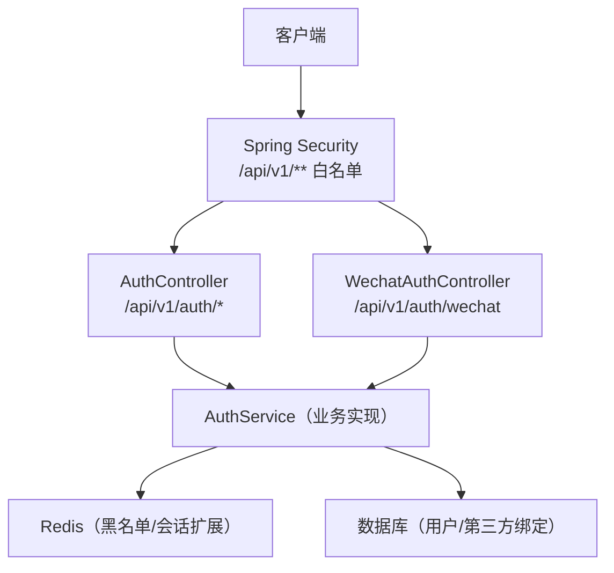
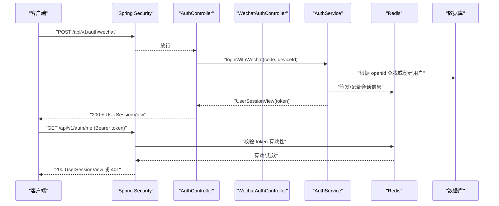
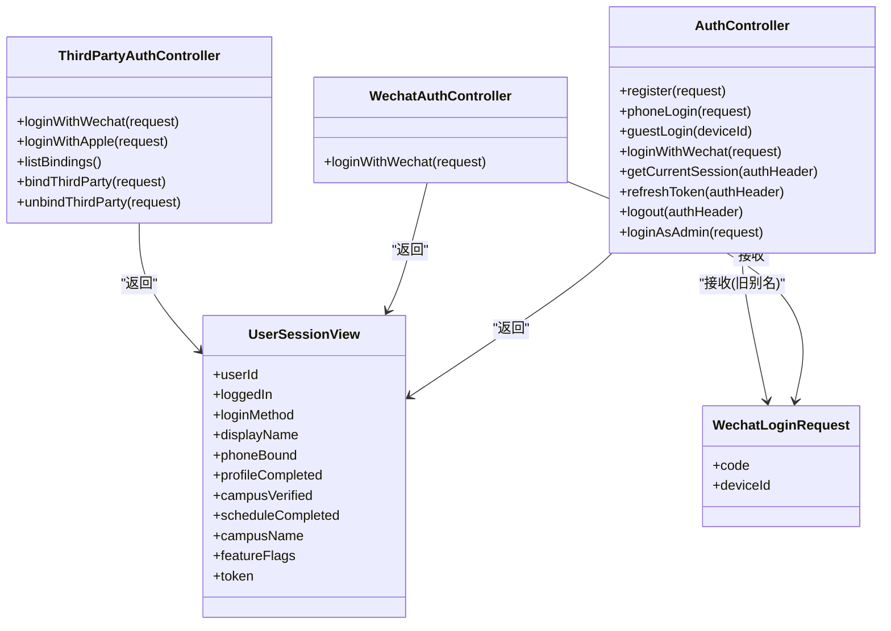

# 认证 API 端点

<cite>
**本文引用的文件**   
- [feedback-growth-and-auth.yaml](file://docs/openapi/feedback-growth-and-auth.yaml)
- [AuthController.java](file://apps/api/src/main/java/com/campuslove/api/auth/AuthController.java)
- [WechatAuthController.java](file://apps/api/src/main/java/com/campuslove/api/auth/WechatAuthController.java)
- [ThirdPartyAuthController.java](file://apps/api/src/main/java/com/campuslove/api/auth/ThirdPartyAuthController.java)
- [UserSessionView.java](file://apps/api/src/main/java/com/campuslove/api/auth/UserSessionView.java)
- [WechatLoginRequest.java](file://apps/api/src/main/java/com/campuslove/api/auth/WechatLoginRequest.java)
- [RateLimit.java](file://apps/api/src/main/java/com/campuslove/api/ratelimit/RateLimit.java)
- [SecurityConfig.java](file://apps/api/src/main/java/com/campuslove/api/config/SecurityConfig.java)
- [application.yml](file://apps/api/src/main/resources/application.yml)
- [GlobalExceptionHandler.java](file://apps/api/src/main/java/com/campuslove/api/config/GlobalExceptionHandler.java)
</cite>

## 目录
1. [引言](#引言)
2. [项目结构](#项目结构)
3. [核心组件](#核心组件)
4. [架构总览](#架构总览)
5. [详细端点文档](#详细端点文档)
6. [依赖关系分析](#依赖关系分析)
7. [性能与速率限制](#性能与速率限制)
8. [错误处理与状态码](#错误处理与状态码)
9. [安全与幂等性](#安全与幂等性)
10. [OpenAPI 与版本管理](#openapi-与版本管理)
11. [客户端集成指南](#客户端集成指南)
12. [故障排查](#故障排查)
13. [结论](#结论)

## 引言
本文件为“校园恋爱平台”后端认证相关 API 的权威说明，覆盖以下目标端点：
- POST /api/v1/auth/register（用户注册）
- POST /api/v1/auth/phone-login（手机号登录）
- POST /api/v1/auth/guest-login（体验账号登录）
- POST /api/v1/auth/wechat（微信小程序登录推荐路径）
- GET /api/v1/auth/me（获取当前会话）
- POST /api/v1/auth/refresh（令牌刷新）

这些端点由 Spring Boot REST 控制器暴露，统一以 `/api/v1` 作为 API 版本前缀。鉴权基于 JWT Bearer Token，公开认证接口在安全配置中放行；受保护接口默认要求认证。

## 项目结构
认证相关代码主要位于 `apps/api/src/main/java/com/campuslove/api/auth` 包下，配合全局安全、异常处理和 OpenAPI 配置使用：
- 控制器层：`AuthController`、`WechatAuthController`、`ThirdPartyAuthController`
- 数据模型：`UserSessionView`、`WechatLoginRequest`、`RegisterRequest`、`PhoneLoginRequest`
- 限流注解：`RateLimit`
- 安全配置：`SecurityConfig`
- 应用配置：`application.yml`
- 全局异常处理器：`GlobalExceptionHandler`
- OpenAPI 定义片段：`docs/openapi/feedback-growth-and-auth.yaml`

**图表来源**
- [SecurityConfig.java:120-200](file://apps/api/src/main/java/com/campuslove/api/config/SecurityConfig.java#L120-L206)
- [AuthController.java:23-45](file://apps/api/src/main/java/com/campuslove/api/auth/AuthController.java#L23-L45)
- [WechatAuthController.java:20-40](file://apps/api/src/main/java/com/campuslove/api/auth/WechatAuthController.java#L20-L40)

**章节来源**
- [SecurityConfig.java:100-200](file://apps/api/src/main/java/com/campuslove/api/config/SecurityConfig.java#L100-L206)
- [application.yml:1-60](file://apps/api/src/main/resources/application.yml#L1-L60)

## 核心组件
- `AuthController`：提供注册、手机号登录、体验账号登录、微信登录旧别名、会话查询、令牌刷新、登出、管理员登录等端点。
- `WechatAuthController`：提供推荐路径的小程序微信登录端点 `/api/v1/auth/wechat`。
- `UserSessionView`：统一的会话视图对象，包含用户标识、登录状态、资料完成度、角色信息以及 JWT token。
- `WechatLoginRequest`：小程序登录请求体，包含临时 code 和设备标识。
- `RateLimit`：基于 Bucket4j 的注解式限流，支持按 IP 或用户维度限流。
- `SecurityConfig`：Spring Security 配置，定义 `/api/v1/auth/**` 为匿名访问白名单，其余 `/api/v1/**` 默认需要认证。
- `GlobalExceptionHandler`：将业务异常和框架异常统一转换为标准 JSON 错误响应。

**章节来源**
- [AuthController.java:23-450](file://apps/api/src/main/java/com/campuslove/api/auth/AuthController.java#L23-L450)
- [WechatAuthController.java:1-97](file://apps/api/src/main/java/com/campuslove/api/auth/WechatAuthController.java#L1-L97)
- [UserSessionView.java:1-43](file://apps/api/src/main/java/com/campuslove/api/auth/UserSessionView.java#L1-L43)
- [WechatLoginRequest.java:1-15](file://apps/api/src/main/java/com/campuslove/api/auth/WechatLoginRequest.java#L1-L15)
- [RateLimit.java:1-88](file://apps/api/src/main/java/com/campuslove/api/ratelimit/RateLimit.java#L1-L88)
- [SecurityConfig.java:100-200](file://apps/api/src/main/java/com/campuslove/api/config/SecurityConfig.java#L100-L206)
- [GlobalExceptionHandler.java:330-360](file://apps/api/src/main/java/com/campuslove/api/config/GlobalExceptionHandler.java#L330-L360)

## 架构总览
认证流程的关键步骤如下：
- 客户端发起认证请求（注册、手机号登录、体验账号登录、微信登录）。
- Spring Security 对 `/api/v1/auth/**` 放行，允许未认证访问。
- 控制器接收并校验参数，调用 `AuthService` 完成用户查找、创建、签发 JWT。
- 返回 `UserSessionView`，客户端保存 token 并在后续请求中通过 `Authorization: Bearer <token>` 携带。
- 刷新令牌时，服务端验证旧 token 有效性后签发新 token。
- 登出时将 token 加入 Redis 黑名单，使后续使用该 token 的请求返回 401。

**图表来源**
- [WechatAuthController.java:58-97](file://apps/api/src/main/java/com/campuslove/api/auth/WechatAuthController.java#L58-L97)
- [AuthController.java:60-95](file://apps/api/src/main/java/com/campuslove/api/auth/AuthController.java#L60-L95)
- [SecurityConfig.java:140-170](file://apps/api/src/main/java/com/campuslove/api/config/SecurityConfig.java#L140-L176)

## 详细端点文档

### POST /api/v1/auth/register（用户注册）
- 方法：POST
- URL：/api/v1/auth/register
- 鉴权：无需登录（公开端点）
- 请求头：
  - Content-Type: application/json
- 请求体字段：
  - phone：必填，手机号格式校验（11 位，1[3-9] 开头）
  - password：必填，长度 6-64
  - nickname：必填，长度 1-20
  - birthDate：必填，出生日期（用于未成年人保护与年龄校验）
  - deviceId：可选，设备标识
  - verificationCode：可选，短信验证码（模拟短信场景）
- 成功响应：
  - 状态码：200
  - 响应体：`UserSessionView`（含 userId、displayName、profileCompleted、token 等）
- 错误响应：
  - 400：参数校验失败（例如手机号格式、密码长度、昵称长度）
  - 429：触发限流（按客户端 IP）
  - 409：手机号已注册（业务冲突）
  - 500：服务器内部错误

限流策略：
- 注解：`@RateLimit(capacity = 10, refillTokens = 0.1, key = "#request.remoteAddr")`
- 含义：桶容量 10，每 10 秒补充 1 个令牌，按客户端 IP 限流。

幂等性：
- 不声明 `@Idempotent`，重复注册可能产生冲突错误（如手机号已存在）。

安全考虑：
- 公开端点需防刷量与手机号探测，已加限流。
- 密码应通过 BCrypt 存储（参考注释中的 eladmin 模式），不应明文落库。
- 建议前端对验证码进行有效期校验，避免重放。

**章节来源**
- [AuthController.java:115-140](file://apps/api/src/main/java/com/campuslove/api/auth/AuthController.java#L115-L140)
- [AuthController.java:370-410](file://apps/api/src/main/java/com/campuslove/api/auth/AuthController.java#L370-L410)
- [RateLimit.java:1-88](file://apps/api/src/main/java/com/campuslove/api/ratelimit/RateLimit.java#L1-L88)

### POST /api/v1/auth/phone-login（手机号登录）
- 方法：POST
- URL：/api/v1/auth/phone-login
- 鉴权：无需登录（公开端点）
- 请求头：
  - Content-Type: application/json
- 请求体字段：
  - phone：必填，最大长度 32
  - password：必填，最大长度 64
  - deviceId：可选，设备标识
- 成功响应：
  - 状态码：200
  - 响应体：`UserSessionView`（含 userId、displayName、token 等）
- 错误响应：
  - 400：参数校验失败
  - 401：用户名或密码错误（INVALID_CREDENTIALS）
  - 403：用户被禁用（USER_DISABLED）
  - 429：触发限流（按客户端 IP）
  - 500：服务器内部错误

限流策略：
- 注解：`@RateLimit(capacity = 10, refillTokens = 0.1, key = "#request.remoteAddr")`
- 含义：防止手机号+密码爆破与撞库。

幂等性：
- 不声明 `@Idempotent`，但登录本质是读取操作，重复提交不会改变状态。

安全考虑：
- 公开端点必须限流。
- 错误消息应避免泄露具体账号是否存在。
- 建议结合验证码或二次确认机制降低暴力破解风险。

**章节来源**
- [AuthController.java:140-165](file://apps/api/src/main/java/com/campuslove/api/auth/AuthController.java#L140-L165)
- [RateLimit.java:1-88](file://apps/api/src/main/java/com/campuslove/api/ratelimit/RateLimit.java#L1-L88)
- [GlobalExceptionHandler.java:290-330](file://apps/api/src/main/java/com/campuslove/api/config/GlobalExceptionHandler.java#L290-L330)

### POST /api/v1/auth/guest-login（体验账号登录）
- 方法：POST
- URL：/api/v1/auth/guest-login
- 鉴权：无需登录（公开端点）
- 请求头：
  - Content-Type: application/json
- 查询参数：
  - deviceId：可选，设备标识（缺失时后端记为 unknown）
- 成功响应：
  - 状态码：200
  - 响应体：`UserSessionView`（体验账号会话，含 token）
- 错误响应：
  - 400：参数异常（较少见）
  - 500：服务器内部错误

幂等性：
- 首次调用自动创建固定体验账号并签发 JWT，后续复用同一账号（幂等语义由业务实现保证）。

安全考虑：
- 体验账号密码为随机值，无法通过手机号密码登录。
- 商业化上线前可通过配置关闭该入口（参考注释中 app.guest-login.enabled=false）。
- 建议对体验账号的行为做审计与限额。

**章节来源**
- [AuthController.java:165-190](file://apps/api/src/main/java/com/campuslove/api/auth/AuthController.java#L165-L190)

### POST /api/v1/auth/wechat（微信小程序登录推荐路径）
- 方法：POST
- URL：/api/v1/auth/wechat
- 鉴权：无需登录（公开端点）
- 请求头：
  - Content-Type: application/json
- 请求体字段：
  - code：必填，微信小程序 wx.login() 返回的临时凭证，5 分钟有效
  - deviceId：可选，设备标识
- 成功响应：
  - 状态码：200
  - 响应体：`UserSessionView`（含 userId、displayName、token 等）
- 错误响应：
  - 401：INVALID_CODE（微信 code 失效或已过期，需重新拉起 wx.login）
  - 403：USER_DISABLED（用户已被管理员禁用）
  - 429：RATE_LIMITED（触发登录接口限流）
  - 502：WECHAT_API_ERROR（微信 API 调用失败）

限流策略：
- 注解：`@RateLimit(capacity = 10, refillTokens = 0.1, key = "#request.remoteAddr")`
- 含义：按客户端 IP 限流，防止微信登录爆破。

幂等性：
- 不声明 `@Idempotent`，但重复使用相同 code 会被微信侧拒绝（code 一次性有效）。

安全考虑：
- 后端必须调用微信 jscode2session 换取 openId，不再信任客户端直接传入的 openId。
- 用户唯一性由 uk_users_openid 唯一约束保证。
- 错误码通过 `WechatLoginException` 映射到标准 JSON 错误响应。

**章节来源**
- [WechatAuthController.java:58-97](file://apps/api/src/main/java/com/campuslove/api/auth/WechatAuthController.java#L58-L97)
- [WechatLoginRequest.java:1-15](file://apps/api/src/main/java/com/campuslove/api/auth/WechatLoginRequest.java#L1-L15)
- [GlobalExceptionHandler.java:330-360](file://apps/api/src/main/java/com/campuslove/api/config/GlobalExceptionHandler.java#L330-L360)

### GET /api/v1/auth/me（获取当前会话）
- 方法：GET
- URL：/api/v1/auth/me
- 鉴权：需要登录（Bearer Token）
- 请求头：
  - Authorization: Bearer <JWT>
- 成功响应：
  - 状态码：200
  - 响应体：`UserSessionView`
- 错误响应：
  - 401：未授权（token 缺失/失效/已撤销）
  - 403：用户被禁用
  - 500：服务器内部错误

**章节来源**
- [AuthController.java:60-95](file://apps/api/src/main/java/com/campuslove/api/auth/AuthController.java#L60-L95)
- [SecurityConfig.java:140-170](file://apps/api/src/main/java/com/campuslove/api/config/SecurityConfig.java#L140-L176)

### POST /api/v1/auth/refresh（令牌刷新）
- 方法：POST
- URL：/api/v1/auth/refresh
- 鉴权：需要登录（Bearer Token）
- 请求头：
  - Authorization: Bearer <旧JWT>
- 成功响应：
  - 状态码：200
  - 响应体：`UserSessionView`（含新 token）
- 错误响应：
  - 401：原令牌无效或已撤销
  - 429：触发限流
  - 500：服务器内部错误

限流策略：
- 注解：`@RateLimit(capacity = 20, refillTokens = 0.5, key = "#request.remoteAddr")`
- 含义：刷新接口更宽松，但仍按 IP 限流，防止滥用。

幂等性：
- 声明 `@Idempotent`，相同刷新请求不会产生副作用。

安全考虑：
- 仅验证旧 token 有效性后签发新 token。
- 建议客户端在 token 接近过期时主动刷新，而不是等到完全失效。

**章节来源**
- [AuthController.java:200-235](file://apps/api/src/main/java/com/campuslove/api/auth/AuthController.java#L200-L235)
- [RateLimit.java:1-88](file://apps/api/src/main/java/com/campuslove/api/ratelimit/RateLimit.java#L1-L88)

## 依赖关系分析
认证相关控制器与服务类之间的依赖关系如下：

**图表来源**
- [AuthController.java:23-450](file://apps/api/src/main/java/com/campuslove/api/auth/AuthController.java#L23-L450)
- [WechatAuthController.java:1-97](file://apps/api/src/main/java/com/campuslove/api/auth/WechatAuthController.java#L1-L97)
- [ThirdPartyAuthController.java:1-204](file://apps/api/src/main/java/com/campuslove/api/auth/ThirdPartyAuthController.java#L1-L204)
- [UserSessionView.java:1-43](file://apps/api/src/main/java/com/campuslove/api/auth/UserSessionView.java#L1-L43)
- [WechatLoginRequest.java:1-15](file://apps/api/src/main/java/com/campuslove/api/auth/WechatLoginRequest.java#L1-L15)

## 性能与速率限制
- 所有认证相关写接口均使用 `@RateLimit` 注解进行限流。
- 登录类接口（微信、手机号、注册、管理员登录）采用较严格限流：桶容量 10，每秒补充 0.1 个令牌。
- 刷新接口限流较宽松：桶容量 20，每秒补充 0.5 个令牌。
- 限流键默认按客户端 IP，适合防护分布式环境下的单 IP 攻击。
- 限流异常统一由 `GlobalExceptionHandler` 转换为 429 标准错误响应。

建议：
- 生产环境监控 429 比例，评估是否需要调整桶容量与补充速率。
- 对于高频刷新场景，建议使用合理的刷新策略（例如 token 剩余有效期低于阈值再刷新）。

**章节来源**
- [RateLimit.java:1-88](file://apps/api/src/main/java/com/campuslove/api/ratelimit/RateLimit.java#L1-L88)
- [AuthController.java:115-235](file://apps/api/src/main/java/com/campuslove/api/auth/AuthController.java#L115-L235)
- [GlobalExceptionHandler.java:510-560](file://apps/api/src/main/java/com/campuslove/api/config/GlobalExceptionHandler.java#L510-L560)

## 错误处理与状态码
认证接口的通用错误响应结构包括：
- status：HTTP 状态码
- errorCode：业务错误码（如 INVALID_CODE、USER_DISABLED、RATE_LIMITED）
- message：人类可读的错误描述
- traceId：请求追踪 ID（便于日志定位）

常见错误码：
- 400：参数校验失败（手机号、密码、昵称等格式错误）
- 401：未授权（token 无效、已撤销、微信 code 失效、账号密码错误）
- 403：权限不足或被禁用（用户被禁用、非管理员访问管理端点）
- 409：资源冲突（例如手机号已注册）
- 429：触发限流（登录、注册、刷新接口）
- 500：服务器内部错误
- 502：微信 API 调用失败（仅微信登录）

**章节来源**
- [GlobalExceptionHandler.java:90-120](file://apps/api/src/main/java/com/campuslove/api/config/GlobalExceptionHandler.java#L90-L120)
- [GlobalExceptionHandler.java:290-360](file://apps/api/src/main/java/com/campuslove/api/config/GlobalExceptionHandler.java#L290-L360)
- [GlobalExceptionHandler.java:400-460](file://apps/api/src/main/java/com/campuslove/api/config/GlobalExceptionHandler.java#L400-L460)
- [GlobalExceptionHandler.java:510-560](file://apps/api/src/main/java/com/campuslove/api/config/GlobalExceptionHandler.java#L510-L560)

## 安全与幂等性
安全策略：
- Spring Security 默认对所有 `/api/v1/**` 启用认证，仅白名单路径放行。
- `/api/v1/auth/**` 全部放行，因为注册、登录等端点本身不需要已登录态。
- 认证成功后返回 JWT，客户端通过 `Authorization: Bearer <token>` 传递。
- 登出时将 token 加入 Redis 黑名单，使后续请求返回 401。
- 安全响应头包含 HSTS、X-Frame-Options、Referrer-Policy 等。

幂等性设计：
- 刷新接口声明 `@Idempotent`，避免重复刷新造成副作用。
- 体验账号登录具有幂等语义：首次创建固定体验账号，后续复用。
- 注册和手机号登录未声明幂等，但业务上通常只读或产生冲突错误。

**章节来源**
- [SecurityConfig.java:140-200](file://apps/api/src/main/java/com/campuslove/api/config/SecurityConfig.java#L140-L206)
- [AuthController.java:200-235](file://apps/api/src/main/java/com/campuslove/api/auth/AuthController.java#L200-L235)
- [AuthController.java:235-270](file://apps/api/src/main/java/com/campuslove/api/auth/AuthController.java#L235-L270)

## OpenAPI 与版本管理
OpenAPI 规范说明：
- 服务标题：Campus Love - Auth / Profile / Home / Chat / Feedback API
- 版本：1.0.0
- 服务器前缀：/api/v1
- 标签 auth 描述认证端点（微信登录、刷新、登出、管理员登录）
- 部分认证端点在 OpenAPI YAML 中已有定义，例如 /auth/me、/auth/wechat-login、/auth/refresh、/auth/logout、/auth/admin/login、/auth/admin/logout。

Swagger 注解配置：
- 控制器使用 `@Tag`、`@Operation`、`@Parameter`、`@ApiResponses` 等注解描述接口。
- Springdoc 扫描包 com.campuslove.api，匹配路径 /api/v1/** 和 /api/ai/**。
- Swagger UI 与 OpenAPI 文档在生产默认关闭，可通过环境变量 SWAGGER_UI_ENABLED 开启。

接口版本管理策略：
- 所有 API 统一以 /api/v1 作为版本前缀。
- 新增端点应遵循现有命名风格，保持向后兼容。
- 若未来出现破坏性变更，可考虑引入 /api/v2 并逐步迁移。

**章节来源**
- [feedback-growth-and-auth.yaml:1-60](file://docs/openapi/feedback-growth-and-auth.yaml#L1-L60)
- [application.yml:120-180](file://apps/api/src/main/resources/application.yml#L120-L180)
- [AuthController.java:23-45](file://apps/api/src/main/java/com/campuslove/api/auth/AuthController.java#L23-L45)
- [WechatAuthController.java:20-40](file://apps/api/src/main/java/com/campuslove/api/auth/WechatAuthController.java#L20-L40)

## 客户端集成指南
客户端集成认证流程建议：
1. 冷启动时拉取公开配置（例如登录页 Hero 配置）。
2. 用户选择注册时调用 POST /api/v1/auth/register，携带手机号、密码、昵称、出生日期等信息。
3. 用户选择手机号登录时调用 POST /api/v1/auth/phone-login。
4. 用户选择体验账号时调用 POST /api/v1/auth/guest-login。
5. 小程序用户调用 POST /api/v1/auth/wechat，使用 wx.login() 返回的 code。
6. 登录后保存 token，并在后续请求中设置 Authorization: Bearer <token>。
7. 定期或按需调用 POST /api/v1/auth/refresh 刷新 token。
8. 退出时调用 POST /api/v1/auth/logout 将 token 加入黑名单。
9. 获取当前会话时调用 GET /api/v1/auth/me 校验登录状态。

错误处理建议：
- 401：提示用户重新登录。
- 403：提示用户联系管理员。
- 429：提示用户稍后再试，并指数退避重试。
- 502：提示网络异常，稍后重试。

**章节来源**
- [AuthController.java:60-235](file://apps/api/src/main/java/com/campuslove/api/auth/AuthController.java#L60-L235)
- [WechatAuthController.java:58-97](file://apps/api/src/main/java/com/campuslove/api/auth/WechatAuthController.java#L58-L97)
- [GlobalExceptionHandler.java:290-560](file://apps/api/src/main/java/com/campuslove/api/config/GlobalExceptionHandler.java#L290-L560)

## 故障排查
常见问题与排查要点：
- 微信登录返回 401 INVALID_CODE：检查 code 是否来自最新 wx.login()，code 5 分钟有效且一次性。
- 微信登录返回 502 WECHAT_API_ERROR：检查微信 API 网络连通性与 errcode。
- 刷新接口返回 401：检查旧 token 是否已过期或被撤销。
- 注册或登录返回 429 RATE_LIMITED：检查客户端 IP 是否触发限流，适当增加重试间隔。
- 获取会话返回 401：检查 Authorization 请求头是否正确携带 Bearer token。
- 登出后仍可用 token：检查 Redis 黑名单是否正常写入，确认登出接口是否被调用。

**章节来源**
- [GlobalExceptionHandler.java:330-360](file://apps/api/src/main/java/com/campuslove/api/config/GlobalExceptionHandler.java#L330-L360)
- [GlobalExceptionHandler.java:400-460](file://apps/api/src/main/java/com/campuslove/api/config/GlobalExceptionHandler.java#L400-L460)
- [GlobalExceptionHandler.java:510-560](file://apps/api/src/main/java/com/campuslove/api/config/GlobalExceptionHandler.java#L510-L560)

## 结论
本项目认证 API 围绕 JWT 无状态鉴权构建，通过 Spring Security 控制白名单与默认认证策略，使用 `@RateLimit` 注解对敏感接口实施防爆破限流，并通过 `GlobalExceptionHandler` 统一错误响应。推荐客户端优先使用 /api/v1/auth/wechat 作为小程序登录路径，并结合 /api/v1/auth/refresh 与 /api/v1/auth/logout 维护会话生命周期。OpenAPI 文档与安全配置共同保障接口可发现性与生产安全性。