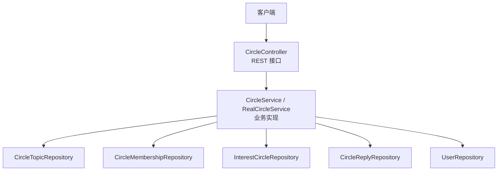
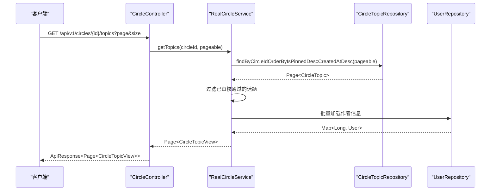
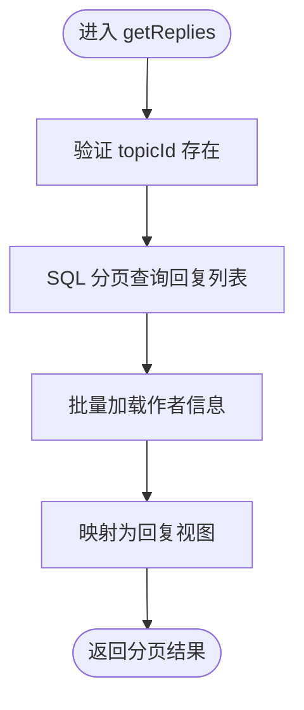
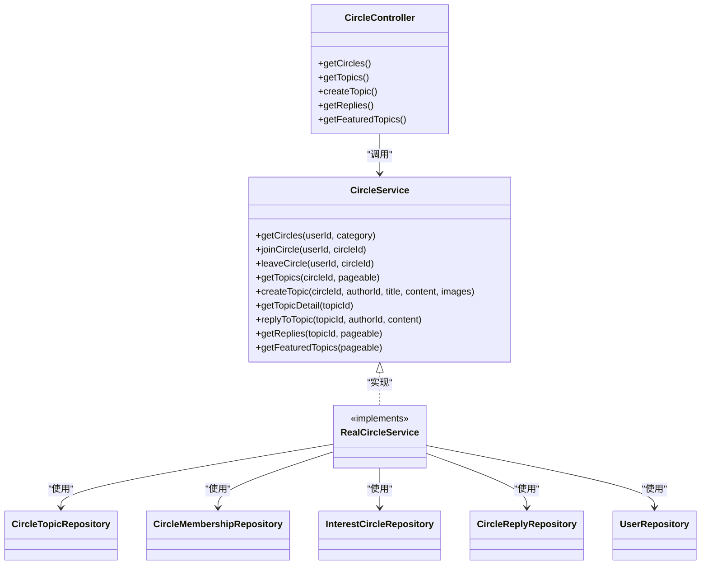

# 圈子查询服务

<cite>
**本文引用的文件**
- [CircleService.java](file://apps/api/src/main/java/com/campuslove/api/discover/CircleService.java)
- [RealCircleService.java](file://apps/api/src/main/java/com/campuslove/api/discover/RealCircleService.java)
- [CircleController.java](file://apps/api/src/main/java/com/campuslove/api/discover/CircleController.java)
- [CircleTopicRepository.java](file://apps/api/src/main/java/com/campuslove/api/repository/CircleTopicRepository.java)
</cite>

## 目录
1. [简介](#简介)
2. [项目结构](#项目结构)
3. [核心组件](#核心组件)
4. [架构总览](#架构总览)
5. [详细组件分析](#详细组件分析)
6. [依赖关系分析](#依赖关系分析)
7. [性能与分页优化](#性能与分页优化)
8. [故障排查指南](#故障排查指南)
9. [结论](#结论)
10. [附录：扩展与自定义查询开发指南](#附录扩展与自定义查询开发指南)

## 简介
本技术文档围绕“圈子查询服务”展开，重点说明兴趣圈列表、话题与回复的查询流程、复杂条件组合策略（分类筛选、标签过滤、作者过滤、同城匹配）、不同场景的数据获取方式（校园分类、关注分类、同城分类、发现分类），以及我的日常内容中 visibility=friends 的隐私保护机制。同时提供分页优化、大数据量调优、参数校验与异常统一处理方案，并给出扩展接口与自定义查询的开发指导。

## 项目结构
圈子查询服务位于后端 API 模块的 discover 包，采用控制器-服务-仓储的分层架构：
- 控制器：暴露 REST 接口，负责参数校验、权限控制、限流与统一响应封装
- 服务：实现业务逻辑，包括分类过滤、加入/退出、话题与回复的读写、精选话题聚合
- 仓储：通过 JPA Repository 访问数据库，支撑分页与排序

图表来源
- [CircleController.java:1-260](file://apps/api/src/main/java/com/campuslove/api/discover/CircleController.java#L1-L260)
- [RealCircleService.java:1-890](file://apps/api/src/main/java/com/campuslove/api/discover/RealCircleService.java#L1-L890)

章节来源
- [CircleController.java:1-260](file://apps/api/src/main/java/com/campuslove/api/discover/CircleController.java#L1-L260)
- [CircleService.java:1-96](file://apps/api/src/main/java/com/campuslove/api/discover/CircleService.java#L1-L96)

## 核心组件
- CircleService：定义圈子与话题、回复相关能力契约（列表、加入/退出、话题分页、发布、详情、回复分页、精选话题）
- RealCircleService：真实数据源下的实现，包含分类过滤、成员数原子更新、批量统计话题数、敏感词过滤、审核状态过滤、分页与排序等
- CircleController：REST 端点定义，包含请求参数校验、鉴权、限流、统一响应
- 仓库层：按实体维度提供查询与分页能力

章节来源
- [CircleService.java:1-96](file://apps/api/src/main/java/com/campuslove/api/discover/CircleService.java#L1-L96)
- [RealCircleService.java:1-890](file://apps/api/src/main/java/com/campuslove/api/discover/RealCircleService.java#L1-L890)
- [CircleController.java:1-260](file://apps/api/src/main/java/com/campuslove/api/discover/CircleController.java#L1-L260)

## 架构总览
下图展示了从客户端发起请求到返回数据的完整调用链，包括分页、排序、审核过滤与作者信息预加载等关键路径。

图表来源
- [CircleController.java:120-170](file://apps/api/src/main/java/com/campuslove/api/discover/CircleController.java#L120-L170)
- [RealCircleService.java:250-340](file://apps/api/src/main/java/com/campuslove/api/discover/RealCircleService.java#L250-L340)
- [CircleTopicRepository.java](file://apps/api/src/main/java/com/campuslove/api/repository/CircleTopicRepository.java)

## 详细组件分析

### 复杂查询条件的组合逻辑
- 分类筛选
  - 支持按 category 过滤（study/sports/music/movie/travel/game/food/reading），null/空表示全部（含未分类）
  - 服务端基于 InterestCircleRepository 全量查询后按分类进行内存过滤，保证未分类仅在无参时可见
- 标签过滤
  - 当前接口未暴露标签过滤参数；如需新增，建议在 Controller 增加 query 参数并在 Service 层结合 InterestCircle 字段或关联表进行过滤
- 作者过滤
  - 列表接口不直接支持作者过滤；话题与回复列表会批量预加载作者信息用于展示，但不在 SQL 侧做作者维度的过滤
- 同城匹配
  - 当前接口未实现同城匹配逻辑；如需新增，可在 Controller 增加 location 参数并在 Service 层根据用户地理位置与圈子/帖子位置字段进行匹配

章节来源
- [CircleController.java:35-70](file://apps/api/src/main/java/com/campuslove/api/discover/CircleController.java#L35-L70)
- [RealCircleService.java:80-140](file://apps/api/src/main/java/com/campuslove/api/discover/RealCircleService.java#L80-L140)

### 不同场景的查询策略
- 校园分类
  - 使用 getCircles(category="study") 获取校园类圈子列表，并按排序权重升序排列
- 关注分类
  - 当前未提供“仅展示已加入圈子”的专用接口；可在现有 getCircles 基础上增加 isJoinedOnly 参数，或在调用前由前端传入已加入圈子 ID 集合进行过滤
- 同城分类
  - 未实现；建议基于用户地理位置与圈子/话题位置字段进行匹配，并在 Service 层追加过滤逻辑
- 发现分类（精选话题）
  - 使用 getFeaturedTopics(pageable) 获取跨圈子的精选话题，置顶优先、创建时间倒序，且仅展示已审核通过的话题

章节来源
- [CircleController.java:35-70](file://apps/api/src/main/java/com/campuslove/api/discover/CircleController.java#L35-L70)
- [RealCircleService.java:520-600](file://apps/api/src/main/java/com/campuslove/api/discover/RealCircleService.java#L520-L600)

### “我的日常”内容的查询逻辑与 privacy=friends 机制
- 当前服务未发现针对“我的日常”的独立查询接口；若该功能属于其他模块，需在该模块的 Service 中实现 visibility 过滤
- 通用隐私保护建议：
  - 对 visibility=friends 的内容，应在 Service 层校验当前用户与被分享用户的关系（好友关系），仅当满足关系时才返回结果
  - 在查询语句中加入 WHERE visibility = 'public' OR (visibility = 'friends' AND is_friend(...)) 的条件
  - 避免将隐私内容放入缓存键或未脱敏日志中

[本节为概念性说明，未直接分析具体文件]

### 话题与回复的查询流程
- 话题列表
  - 使用 findByCircleIdOrderByIsPinnedDescCreatedAtDesc 进行分页与排序，过滤已审核通过的话题，批量预加载作者信息
- 话题详情
  - 返回完整内容，不做截断
- 回复列表
  - 使用 SQL 侧分页（替代原全量加载+内存分页），批量预加载作者信息，避免 N+1

图表来源
- [RealCircleService.java:460-520](file://apps/api/src/main/java/com/campuslove/api/discover/RealCircleService.java#L460-L520)

章节来源
- [RealCircleService.java:250-340](file://apps/api/src/main/java/com/campuslove/api/discover/RealCircleService.java#L250-L340)
- [RealCircleService.java:460-520](file://apps/api/src/main/java/com/campuslove/api/discover/RealCircleService.java#L460-L520)

### 加入/退出圈子的并发安全
- 加入：使用数据库侧原子递增 memberCount，避免并发重复加入导致计数丢失；事务提交前后清理持久化上下文防止脏写
- 退出：使用数据库侧原子递减（下限 0），批量删除成员关系并清理上下文

章节来源
- [RealCircleService.java:200-300](file://apps/api/src/main/java/com/campuslove/api/discover/RealCircleService.java#L200-L300)

## 依赖关系分析
- 控制器依赖服务，服务依赖多个仓储与工具类（ObjectMapper、敏感词过滤器、社交进度服务等）
- 仓储提供分页与排序能力，服务负责业务规则（审核状态、成员权限、敏感词过滤、隐私保护等）

图表来源
- [CircleController.java:1-260](file://apps/api/src/main/java/com/campuslove/api/discover/CircleController.java#L1-L260)
- [CircleService.java:1-96](file://apps/api/src/main/java/com/campuslove/api/discover/CircleService.java#L1-L96)
- [RealCircleService.java:1-890](file://apps/api/src/main/java/com/campuslove/api/discover/RealCircleService.java#L1-L890)

章节来源
- [CircleController.java:1-260](file://apps/api/src/main/java/com/campuslove/api/discover/CircleController.java#L1-L260)
- [CircleService.java:1-96](file://apps/api/src/main/java/com/campuslove/api/discover/CircleService.java#L1-L96)
- [RealCircleService.java:1-890](file://apps/api/src/main/java/com/campuslove/api/discover/RealCircleService.java#L1-L890)

## 性能与分页优化
- 批量统计话题数：使用 GROUP BY 聚合查询一次性统计多圈子的话题数，避免 N+1
- 批量预加载作者信息：通过 findByIdIn 批量查询用户，减少逐条查库
- SQL 侧分页：回复列表改用数据库分页，避免高回复场景下内存占用线性增长
- 排序与置顶：使用 Sort.by 组合排序，置顶优先、时间倒序
- 成员数原子更新：使用数据库侧 UPDATE 原子递增/递减，避免并发写入导致的覆盖问题
- 敏感词过滤：在服务层对标题、内容与回复进行过滤，降低后续处理成本
- 大页大小限制：Controller 对 size 进行上限限制（最大 100），防止过大页面导致性能问题

章节来源
- [RealCircleService.java:80-140](file://apps/api/src/main/java/com/campuslove/api/discover/RealCircleService.java#L80-L140)
- [RealCircleService.java:250-340](file://apps/api/src/main/java/com/campuslove/api/discover/RealCircleService.java#L250-L340)
- [RealCircleService.java:460-520](file://apps/api/src/main/java/com/campuslove/api/discover/RealCircleService.java#L460-L520)
- [CircleController.java:120-200](file://apps/api/src/main/java/com/campuslove/api/discover/CircleController.java#L120-L200)

## 故障排查指南
- 参数校验失败
  - 控制器使用注解进行参数校验（如 @NotBlank、@Size、@Min、@Max），失败时返回统一错误响应
- 权限不足
  - 发布话题与回复需要 USER 角色，未登录或无权限时返回 403
- 速率限制
  - 发布话题与回复启用限流，超限返回限流错误
- 话题不存在或圈子不存在
  - 服务层抛出 IllegalArgumentException，由全局异常处理器统一返回
- 敏感词过滤
  - 标题、内容与回复会被替换为 ***，确保内容合规

章节来源
- [CircleController.java:120-200](file://apps/api/src/main/java/com/campuslove/api/discover/CircleController.java#L120-L200)
- [RealCircleService.java:300-400](file://apps/api/src/main/java/com/campuslove/api/discover/RealCircleService.java#L300-L400)

## 结论
圈子查询服务通过清晰的分层架构实现了兴趣圈与话题的核心能力，具备完善的参数校验、权限控制、限流、审核过滤与性能优化措施。当前未内置标签过滤、同城匹配与“我的日常”隐私过滤，可按本文提供的扩展指导进行增强。

## 附录：扩展与自定义查询开发指南
- 新增标签过滤
  - 在 Controller 增加 tags 参数，并在 Service 层对 InterestCircle 或关联表进行过滤
- 新增同城匹配
  - 在 Controller 增加 location 参数，在 Service 层根据用户位置与圈子/话题位置进行匹配
- 新增“我的日常”隐私过滤
  - 在对应模块的 Service 中实现 visibility 过滤逻辑，确保 friends 仅对好友可见
- 自定义分页查询
  - 使用 Pageable 与 Sort 构建复杂查询，确保 SQL 侧分页与排序
- 扩展接口示例
  - 在 CircleController 中添加新的 GET/POST 端点，并在 CircleService 中实现相应逻辑

[本节为概念性指导，未直接分析具体文件]