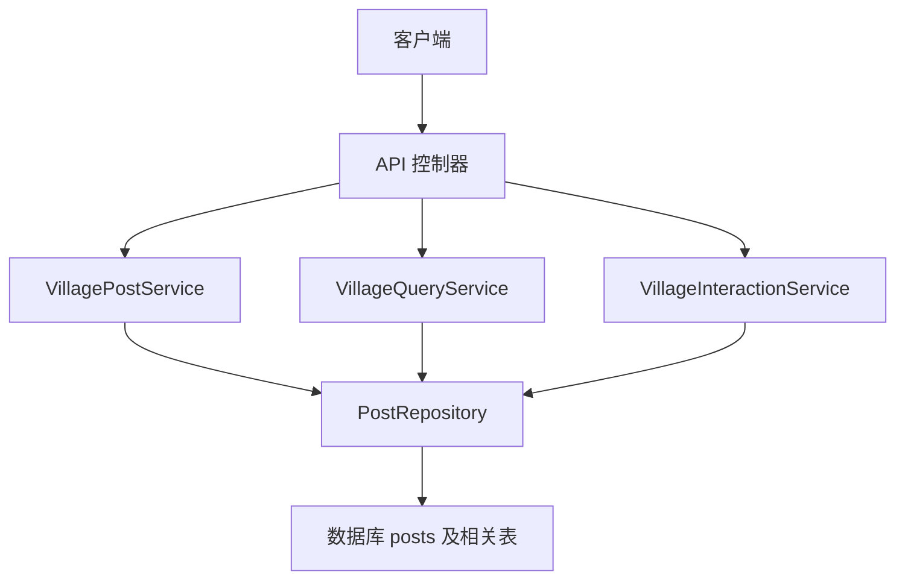
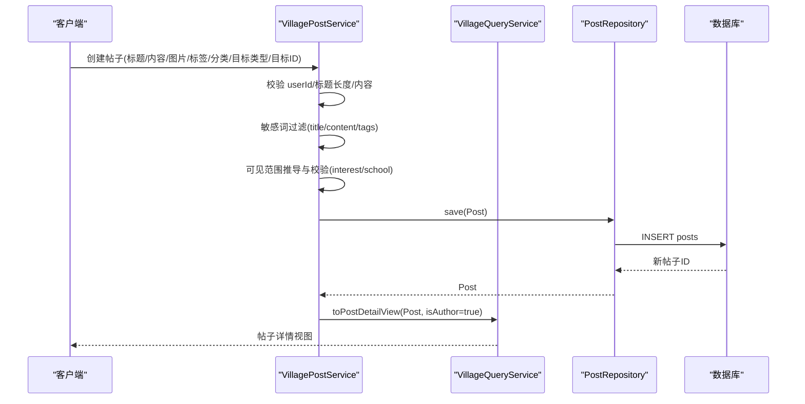
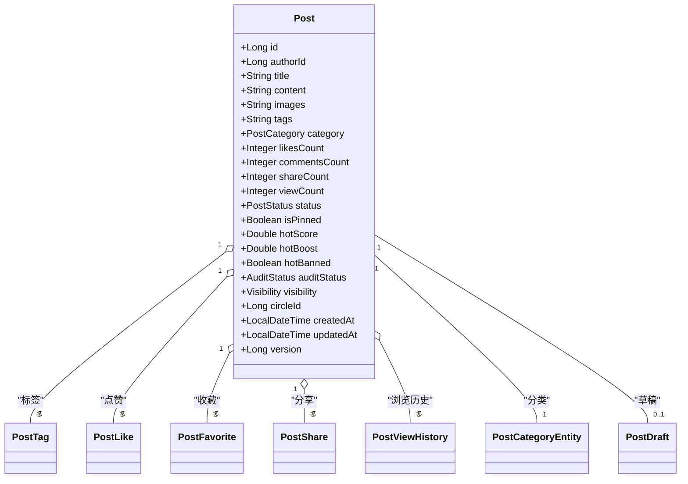
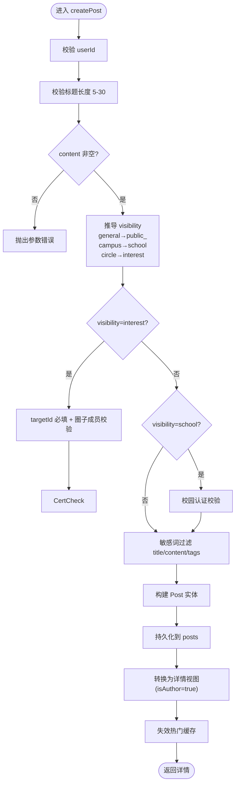
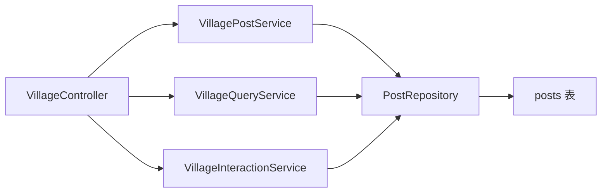

# 帖子管理模块

<cite>
**本文引用的文件**
- [Post.java](file://apps/api/src/main/java/com/campuslove/api/entity/Post.java)
- [VillagePostService.java](file://apps/api/src/main/java/com/campuslove/api/village/VillagePostService.java)
- [VillageQueryService.java](file://apps/api/src/main/java/com/campuslove/api/village/VillageQueryService.java)
- [VillageInteractionService.java](file://apps/api/src/main/java/com/campuslove/api/village/VillageInteractionService.java)
- [PostRepository.java](file://apps/api/src/main/java/com/campuslove/api/repository/PostRepository.java)
- [PostTagController.java](file://apps/api/src/main/java/com/campuslove/api/village/PostTagController.java)
- [PostReportController.java](file://apps/api/src/main/java/com/campuslove/api/village/PostReportController.java)
- [AdminVillagePostController.java](file://apps/api/src/main/java/com/campuslove/api/admin/AdminVillagePostController.java)
- [PostDraft.java](file://apps/api/src/main/java/com/campuslove/api/entity/PostDraft.java)
- [PostCategoryEntity.java](file://apps/api/src/main/java/com/campuslove/api/entity/PostCategoryEntity.java)
- [PostLike.java](file://apps/api/src/main/java/com/campuslove/api/entity\PostLike.java)
- [PostFavorite.java](file://apps/api/src/main/java/com/campuslove/api/entity\PostFavorite.java)
- [PostShare.java](file://apps/api/src/main/java/com/campuslove/api/entity\PostShare.java)
- [PostViewHistory.java](file://apps/api/src/main/java/com/campuslove/api/entity\PostViewHistory.java)
- [V2026.09.01.0003__add_post_visibility.sql](file://database/flyway/sql/V2026.09.01.0003__add_post_visibility.sql)
- [V2026.08.11.0001__add_post_hot_columns.sql](file://database/flyway/sql/V2026.08.11.0001__add_post_hot_columns.sql)
- [V2026.08.09.0001__create_post_favorites_and_view_history.sql](file://database/flyway/sql/V2026.08.09.0001__create_post_favorites_and_view_history.sql)
- [seed-post-interactions.sql](file://database/seed-post-interactions.sql)
</cite>

## 目录
1. [简介](#简介)
2. [项目结构与职责划分](#项目结构与职责划分)
3. [核心组件](#核心组件)
4. [架构总览](#架构总览)
5. [详细组件分析](#详细组件分析)
6. [依赖关系分析](#依赖关系分析)
7. [性能与索引优化](#性能与索引优化)
8. [故障排查指南](#故障排查指南)
9. [结论](#结论)
10. [附录：API 接口规范](#附录api-接口规范)

## 简介
本模块负责“村口”帖子的全生命周期管理，包括发布、存储、查询、更新、删除、互动与审核等。实体 Post 包含标题、内容、图片数组、标签、分类、状态、可见范围、圈子归属、热度分、审核状态等字段；通过服务层完成校验、清洗、权限控制与持久化；通过控制器暴露 CRUD 及互动、审核、搜索等能力；配合数据库迁移脚本与索引设计，保障数据一致性与查询性能。

## 项目结构与职责划分
- 实体层：Post 及其关联实体（标签、收藏、点赞、分享、浏览历史、草稿、分类等）
- 服务层：发布写操作（VillagePostService）、查询读操作（VillageQueryService）、互动（VillageInteractionService）
- 仓储层：PostRepository 及关联仓储
- 控制器层：前台/后台/标签/举报等 Controller
- 数据层：Flyway 迁移脚本定义表结构、索引、种子数据

**章节来源**
- [Post.java:1-472](file://apps/api/src/main/java/com/campuslove/api/entity/Post.java#L1-L472)
- [VillagePostService.java:1-333](file://apps/api/src/main/java/com/campuslove/api/village/VillagePostService.java#L1-L333)

## 核心组件
- Post 实体：定义帖子所有字段、枚举与约束，含可见范围 visibility、圈子 circle_id、审核状态 audit_status、热度相关 hot_score/hot_boost/hot_banned 等
- VillagePostService：发布/更新/删除的写操作入口，负责参数校验、敏感词过滤、可见范围推导与校验、活动关联校验、标签落库、缓存失效
- VillageQueryService：列表分页、排序、详情组装、JSON 序列化、视图转换
- VillageInteractionService：点赞、收藏、分享、浏览计数等互动逻辑
- 仓储与控制器：PostRepository 提供基础查询；各 Controller 暴露对外接口

**章节来源**
- [Post.java:1-472](file://apps/api/src/main/java/com/campuslove/api/entity/Post.java#L1-L472)
- [VillagePostService.java:1-333](file://apps/api/src/main/java/com/campuslove/api/village/VillagePostService.java#L1-L333)
- [VillageQueryService.java](file://apps/api/src/main/java/com/campuslove/api/village/VillageQueryService.java)
- [VillageInteractionService.java](file://apps/api/src/main/java/com/campuslove/api/village/VillageInteractionService.java)

## 架构总览

**图表来源**
- [VillagePostService.java:1-333](file://apps/api/src/main/java/com/campuslove/api/village/VillagePostService.java#L1-L333)
- [Post.java:1-472](file://apps/api/src/main/java/com/campuslove/api/entity/Post.java#L1-L472)

## 详细组件分析

### Post 实体与字段设计
- 标识与时间：id、created_at、updated_at、version（乐观锁）
- 作者与可见性：author_id、visibility(public_/school/interest/friends)、circle_id
- 内容与元信息：title、content、images(JSON)、tags(JSON)、category
- 统计与运营：likes_count、comments_count、share_count、view_count、is_pinned、hot_score、hot_boost、hot_banned
- 审核：audit_status(pending/approved/rejected)、audit_remark、auditor_id、audited_at
- 关联：activity_id

**图表来源**
- [Post.java:1-472](file://apps/api/src/main/java/com/campuslove/api/entity/Post.java#L1-L472)
- [PostTagController.java](file://apps/api/src/main/java/com/campuslove/api/village/PostTagController.java)
- [PostLike.java](file://apps/api/src/main/java/com/campuslove/api/entity\PostLike.java)
- [PostFavorite.java](file://apps/api/src/main/java/com/campuslove/api/entity\PostFavorite.java)
- [PostShare.java](file://apps/api/src/main/java/com/campuslove/api/entity\PostShare.java)
- [PostViewHistory.java](file://apps/api/src/main/java/com/campuslove/api/entity\PostViewHistory.java)
- [PostCategoryEntity.java](file://apps/api/src/main/java/com/campuslove/api/entity/PostCategoryEntity.java)
- [PostDraft.java](file://apps/api/src/main/java/com/campuslove/api/entity/PostDraft.java)

**章节来源**
- [Post.java:1-472](file://apps/api/src/main/java/com/campuslove/api/entity/Post.java#L1-L472)

### 帖子发布流程与校验规则
- 必填项：userId、title（5-30字）、content（非空）
- 内容安全：对 title/content/tags 进行敏感词过滤并记录日志
- 可见范围推导与校验：
  - general→public_，campus→school，circle→interest
  - interest：必须携带 targetId（circle_id），且发帖人必须是该圈子成员
  - school：发帖人需通过校园认证
- 活动关联：activityId 不存在时宽松置 null，不抛错
- 初始化：计数归零、status=active、audit_status=approved（默认）
- 持久化后：转换为详情页视图（isAuthor=true），并失效热门列表缓存

**图表来源**
- [VillagePostService.java:1-333](file://apps/api/src/main/java/com/campuslove/api/village/VillagePostService.java#L1-L333)

**章节来源**
- [VillagePostService.java:1-333](file://apps/api/src/main/java/com/campuslove/api/village/VillagePostService.java#L1-L333)

### 可见性控制机制
- public_：公开，所有人可见
- school：仅同校认证用户可见
- interest：仅所在圈子成员可见（需 circle_id）
- friends：日常内容，仅互相喜欢或关注作者的人及作者本人可见

可见性在发布时由 targetType/targetId 推导，并在查询侧结合当前用户身份进行过滤。

**章节来源**
- [Post.java:1-472](file://apps/api/src/main/java/com/campuslove/api/entity/Post.java#L1-L472)
- [V2026.09.01.0003__add_post_visibility.sql](file://database/flyway/sql/V2026.09.01.0003__add_post_visibility.sql)

### 审核状态流转
- pending：待审核（由举报或风控触发）
- approved：已通过（默认值，存量视为通过）
- rejected：已拒绝（管理员拒绝后列表不可见）

审核状态与业务状态 status（active/deleted/hidden）正交，分别控制“是否软删/隐藏”和“管理员审核结果”。

**章节来源**
- [Post.java:1-472](file://apps/api/src/main/java/com/campuslove/api/entity/Post.java#L1-L472)

### 分页查询、排序与索引优化
- 常用排序：按 created_at 降序（最新优先）；热度榜按 hot_score 排序
- 常见过滤：status=active、category、visibility、circle_id、activity_id
- 关键索引：
  - idx_posts_author：作者主页
  - idx_posts_category：分类筛选
  - idx_posts_created_at：时间排序
  - idx_posts_status：状态过滤
  - idx_posts_author_created_at：作者主页分页
  - idx_posts_status_created_at：状态+时间复合
  - idx_posts_activity：活动关联
  - idx_posts_circle_id：圈子关联

**章节来源**
- [Post.java:1-472](file://apps/api/src/main/java/com/campuslove/api/entity/Post.java#L1-L472)

### 帖子发布校验规则、内容安全检查与防刷机制
- 发布校验：标题长度、内容非空、可见范围条件
- 内容安全：敏感词过滤（标题/正文/标签）
- 防刷：未在本文件中直接实现限流逻辑；建议在网关或控制器层增加频率限制（如基于 IP/用户的 QPS 限制）

**章节来源**
- [VillagePostService.java:1-333](file://apps/api/src/main/java/com/campuslove/api/village/VillagePostService.java#L1-L333)

### 帖子 CRUD 与互动
- 创建：VillagePostService.createPost
- 查询：VillageQueryService（列表/详情/聚合）
- 更新/删除：由对应 Service/Controller 组合使用 PostRepository
- 互动：VillageInteractionService（点赞/收藏/分享/浏览计数）
- 草稿：PostDraft（暂存）
- 分类：PostCategoryEntity（分类维度）

**章节来源**
- [VillagePostService.java:1-333](file://apps/api/src/main/java/com/campuslove/api/village/VillagePostService.java#L1-L333)
- [VillageQueryService.java](file://apps/api/src/main/java/com/campuslove/api/village/VillageQueryService.java)
- [VillageInteractionService.java](file://apps/api/src/main/java/com/campuslove/api/village/VillageInteractionService.java)
- [PostDraft.java](file://apps/api/src/main/java/com/campuslove/api/entity/PostDraft.java)
- [PostCategoryEntity.java](file://apps/api/src/main/java/com/campuslove/api/entity/PostCategoryEntity.java)

## 依赖关系分析

**图表来源**
- [VillagePostService.java:1-333](file://apps/api/src/main/java/com/campuslove/api/village/VillagePostService.java#L1-L333)
- [PostRepository.java](file://apps/api/src/main/java/com/campuslove/api/repository/PostRepository.java)

**章节来源**
- [PostRepository.java](file://apps/api/src/main/java/com/campuslove/api/repository/PostRepository.java)

## 性能与索引优化
- 列表页：优先使用 (status, created_at) 复合索引进行分页
- 作者主页：使用 (author_id, created_at) 复合索引
- 圈子/活动：利用 circle_id/activity_id 单列索引快速定位
- 热度榜：hot_score 排序避免运行时计算，定期重算
- 乐观锁：version 字段避免并发覆盖冲突

**章节来源**
- [Post.java:1-472](file://apps/api/src/main/java/com/campuslove/api/entity/Post.java#L1-L472)
- [V2026.08.11.0001__add_post_hot_columns.sql](file://database/flyway/sql/V2026.08.11.0001__add_post_hot_columns.sql)

## 故障排查指南
- 发布失败：检查标题长度、内容是否为空、可见范围条件（圈子成员/校园认证）
- 审核问题：确认 audit_status 是否正确流转（pending→approved/rejected），并核对 auditor_id/audited_at
- 查询慢：检查是否命中索引，必要时调整 WHERE 条件顺序以匹配复合索引
- 并发冲突：遇到版本冲突异常时，提示重试或刷新数据

**章节来源**
- [VillagePostService.java:1-333](file://apps/api/src/main/java/com/campuslove/api/village/VillagePostService.java#L1-L333)
- [PostReportController.java](file://apps/api/src/main/java/com/campuslove/api/village/PostReportController.java)

## 结论
帖子管理模块围绕 Post 实体，结合服务层的多维校验、可见性控制与审核流程，配合完善的索引设计与缓存策略，实现了高可用的发布与查询体验。后续可补充接口级限流与更细粒度的访问控制，进一步提升系统稳定性与安全性。

## 附录：API 接口规范
以下为帖子相关的主要接口约定（方法、路径、请求体要点、响应要点与典型错误码）。具体实现位于各 Controller 中。

- 发布帖子
  - 方法/路径：POST /api/village/posts
  - 请求体要点：userId、title（5-30字）、content、images、tags、category、targetType、targetId
  - 成功响应：帖子详情视图
  - 典型错误：400 参数非法（标题/内容/可见范围校验失败）、403 无权限（非圈子成员或未认证）

- 查询帖子列表
  - 方法/路径：GET /api/village/posts
  - 查询参数：page、size、sort（默认 created_at desc）、category、visibility、circle_id、activity_id、status
  - 成功响应：分页列表
  - 典型错误：400 参数非法

- 获取帖子详情
  - 方法/路径：GET /api/village/posts/{id}
  - 成功响应：帖子详情视图
  - 典型错误：404 不存在

- 更新/删除帖子
  - 方法/路径：PUT /api/village/posts/{id}、DELETE /api/village/posts/{id}
  - 成功响应：操作结果
  - 典型错误：403 无权限、404 不存在

- 互动接口
  - 点赞：POST /api/village/posts/{id}/like
  - 收藏：POST /api/village/posts/{id}/favorite
  - 分享：POST /api/village/posts/{id}/share
  - 浏览计数：读取详情时原子 +1
  - 典型错误：400 参数非法、404 不存在

- 标签接口
  - 方法/路径：由 PostTagController 提供（增删改查标签关联）
  - 典型错误：400/404/403

- 举报接口
  - 方法/将帖子标记为待审核或拒绝
  - 典型错误：400/404/403

- 后台管理接口
  - 方法/路径：由 AdminVillagePostController 提供（审核、置顶、热度管理等）
  - 典型错误：403 无管理员权限

**章节来源**
- [VillagePostService.java:1-333](file://apps/api/src/main/java/com/campuslove/api/village/VillagePostService.java#L1-L333)
- [PostTagController.java](file://apps/api/src/main/java/com/campuslove/api/village/PostTagController.java)
- [PostReportController.java](file://apps/api/src/main/java/com/campuslove/api/village/PostReportController.java)
- [AdminVillagePostController.java](file://apps/api/src/main/java/com/campuslove/api/admin/AdminVillagePostController.java)