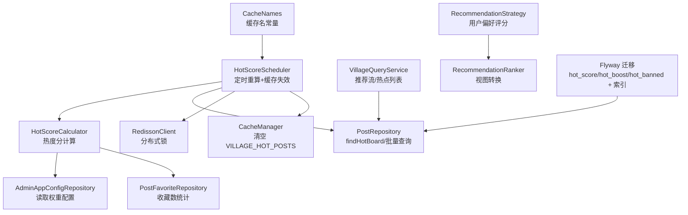
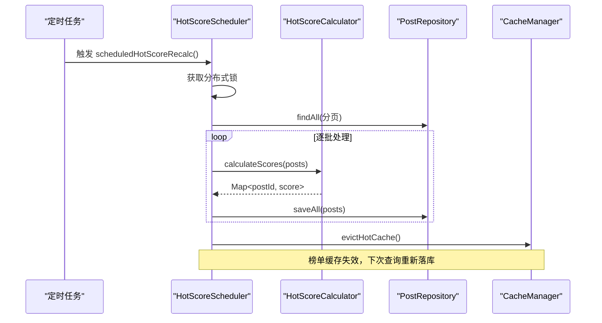
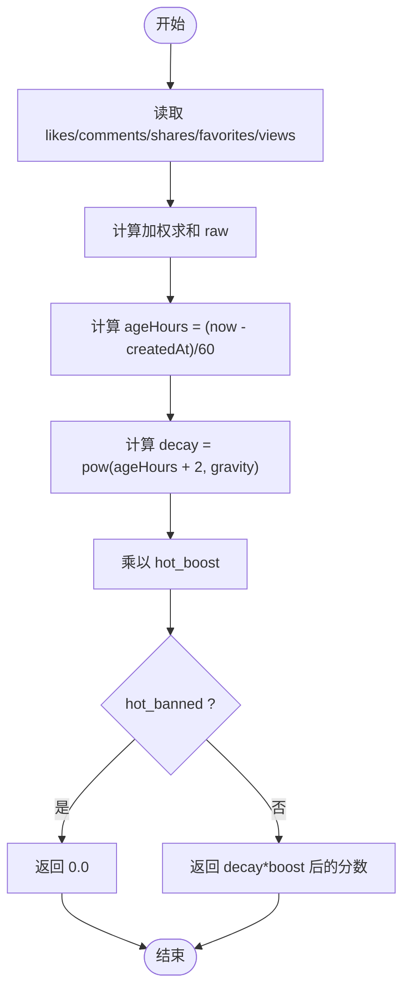
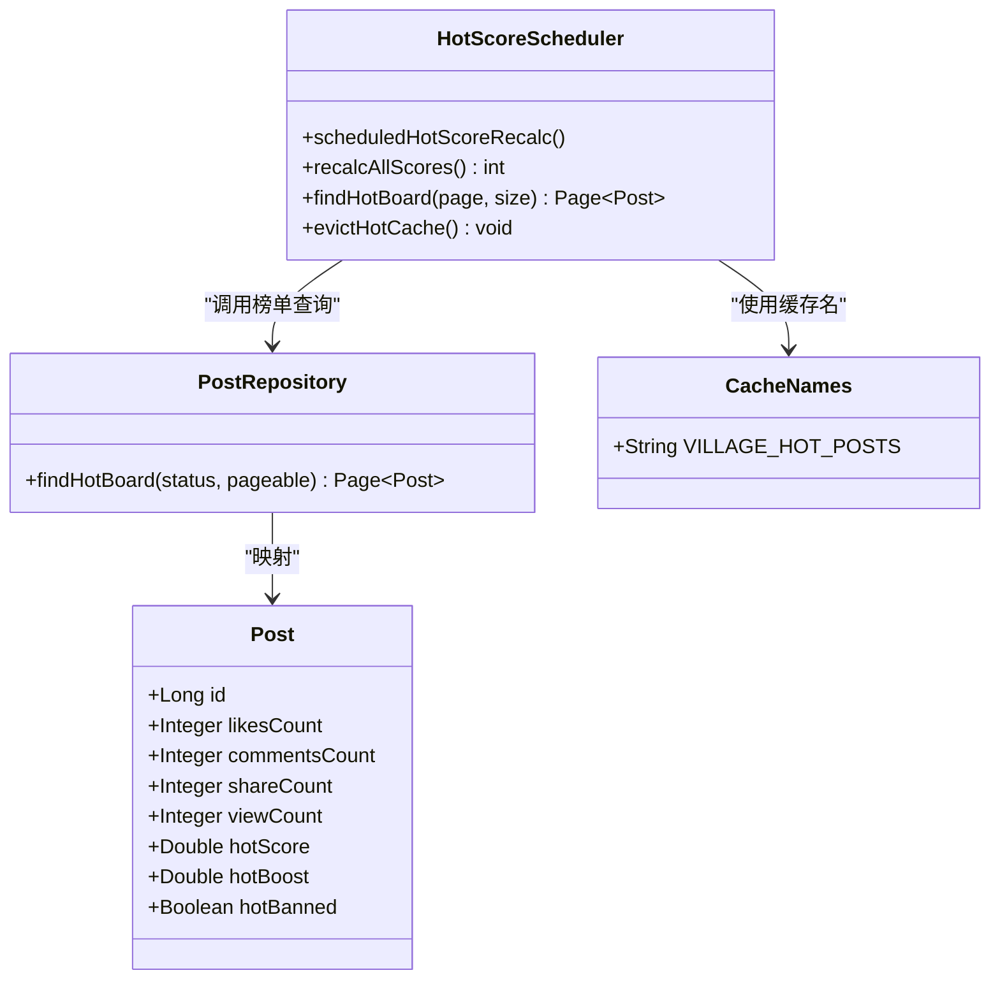
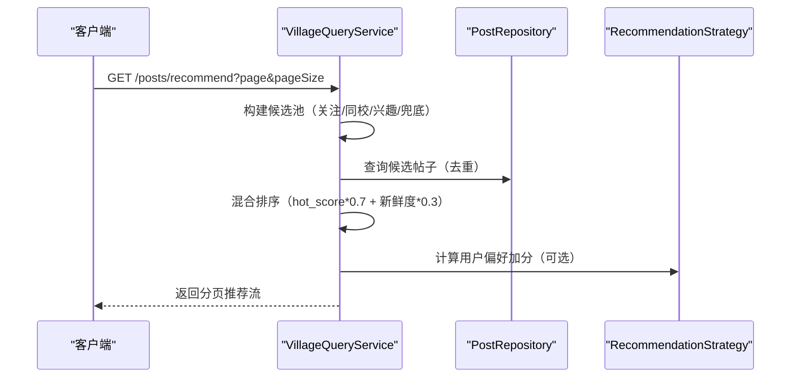
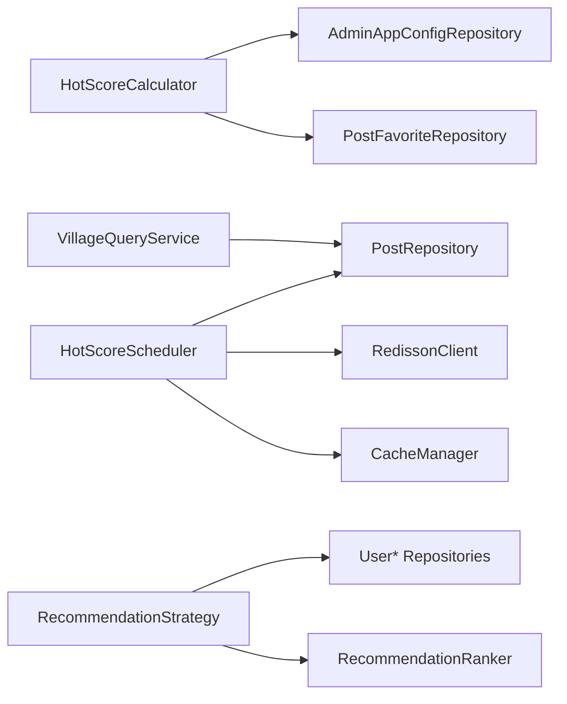

# 热度计算算法

<cite>
**本文引用的文件**
- [HotScoreScheduler.java](file://apps/api/src/main/java/com/campuslove/api/village/HotScoreScheduler.java)
- [HotScoreCalculator.java](file://apps/api/src/main/java/com/campuslove/api/village/HotScoreCalculator.java)
- [PostRepository.java](file://apps/api/src/main/java/com/campuslove/api/repository/PostRepository.java)
- [Post.java](file://apps/api/src/main/java/com/campuslove/api/entity/Post.java)
- [VillageQueryService.java](file://apps/api/src/main/java/com/campuslove/api/village/VillageQueryService.java)
- [RecommendationStrategy.java](file://apps/api/src/main/java/com/campuslove/api/discover/RecommendationStrategy.java)
- [RealRecommendationService.java](file://apps/api/src/main/java/com/campuslove/api/discover/RealRecommendationService.java)
- [CacheNames.java](file://apps/api/src/main/java/com/campuslove/api/config/CacheNames.java)
- [V2026.08.11.0001__add_post_hot_columns.sql](file://database/flyway/sql/V2026.08.11.0001__add_post_hot_columns.sql)
- [VillageMetrics.java](file://apps/api/src/main/java/com/campuslove/api/monitor/VillageMetrics.java)
</cite>

## 目录
1. [简介](#简介)
2. [项目结构](#项目结构)
3. [核心组件](#核心组件)
4. [架构总览](#架构总览)
5. [详细组件分析](#详细组件分析)
6. [依赖关系分析](#依赖关系分析)
7. [性能考量](#性能考量)
8. [故障排查指南](#故障排查指南)
9. [结论](#结论)
10. [附录](#附录)

## 简介
本技术文档围绕“热度计算与推荐排序”展开，覆盖以下关键点：
- 热度分计算公式：点赞、评论、转发、收藏、浏览量的权重；时间衰减因子；运营倍率 hot_boost 的影响；hot_banned 的禁止上榜机制。
- 热门榜单排序逻辑与缓存：按 hot_score 降序，过滤 banned 与非 active 帖；15 分钟缓存策略与定时重算任务。
- 推荐流混合排序：关注新帖、同校热帖、兴趣帖与兜底新鲜内容的加权策略与去重排序。
- 监控指标与性能优化方案。
- 配置调优与故障排查方法。

## 项目结构
与热度计算相关的后端实现集中在 API 模块的 village 与 discover 包中，并通过数据库迁移脚本新增字段和索引，配合 Spring Cache 与 Redisson 分布式锁完成定时重算与并发控制。

**图示来源**
- [HotScoreScheduler.java:1-180](file://apps/api/src/main/java/com/campuslove/api/village/HotScoreScheduler.java#L1-L180)
- [HotScoreCalculator.java:1-131](file://apps/api/src/main/java/com/campuslove/api/village/HotScoreCalculator.java#L1-L131)
- [PostRepository.java:250-300](file://apps/api/src/main/java/com/campuslove/api/repository/PostRepository.java#L250-L300)
- [CacheNames.java:1-111](file://apps/api/src/main/java/com/campuslove/api/config/CacheNames.java#L1-L111)
- [V2026.08.11.0001__add_post_hot_columns.sql:1-18](file://database/flyway/sql/V2026.08.11.0001__add_post_hot_columns.sql#L1-L18)

**章节来源**
- [HotScoreScheduler.java:1-180](file://apps/api/src/main/java/com/campuslove/api/village/HotScoreScheduler.java#L1-L180)
- [PostRepository.java:250-300](file://apps/api/src/main/java/com/campuslove/api/repository/PostRepository.java#L250-L300)
- [V2026.08.11.0001__add_post_hot_columns.sql:1-18](file://database/flyway/sql/V2026.08.11.0001__add_post_hot_columns.sql#L1-L18)
- [CacheNames.java:1-111](file://apps/api/src/main/java/com/campuslove/api/config/CacheNames.java#L1-L111)

## 核心组件
- 热度分计算（HotScoreCalculator）：基于互动计数与时间衰减，结合运营倍率得出最终分数；支持批量计算并避免 N+1 查询。
- 定时重算（HotScoreScheduler）：每 15 分钟全量扫描 posts，使用 Redisson 分布式锁防止多实例并发；重算完成后主动清空热度榜缓存。
- 榜单查询（PostRepository.findHotBoard）：按 hot_score 降序，过滤 banned 与非 active 帖子；配合缓存提供高性能读取。
- 推荐流（VillageQueryService + RecommendationStrategy）：混合排序关注新帖、同校热帖、兴趣帖与兜底新鲜内容；使用去重与综合得分排序。
- 配置与缓存（CacheNames）：集中管理缓存名称与 TTL 策略，确保榜单与首页热门读路径一致。

**章节来源**
- [HotScoreCalculator.java:1-131](file://apps/api/src/main/java/com/campuslove/api/village/HotScoreCalculator.java#L1-L131)
- [HotScoreScheduler.java:1-180](file://apps/api/src/main/java/com/campuslove/api/village/HotScoreScheduler.java#L1-L180)
- [PostRepository.java:250-300](file://apps/api/src/main/java/com/campuslove/api/repository/PostRepository.java#L250-L300)
- [VillageQueryService.java:570-680](file://apps/api/src/main/java/com/campuslove/api/village/VillageQueryService.java#L570-L680)
- [RecommendationStrategy.java:380-520](file://apps/api/src/main/java/com/campuslove/api/discover/RecommendationStrategy.java#L380-L520)
- [CacheNames.java:1-111](file://apps/api/src/main/java/com/campuslove/api/config/CacheNames.java#L1-L111)

## 架构总览
热度系统由“计算—存储—调度—缓存—查询”五层构成：
- 计算层：HotScoreCalculator 根据互动数据与时间衰减计算 raw 分数，再乘以时间衰减与运营倍率得到最终 hot_score。
- 存储层：Post 实体包含 hot_score、hot_boost、hot_banned 等字段；数据库通过 Flyway 迁移新增列与索引。
- 调度层：HotScoreScheduler 定时全量重算，使用 Redisson 锁保证单实例执行；支持单帖立即重算。
- 缓存层：Spring Cache 以 VILLAGE_HOT_POSTS 为键空间，缓存榜单与首页热门，TTL 15 分钟；重算或管理操纵后主动清空。
- 查询层：PostRepository.findHotBoard 按 hot_score 降序返回；VillageQueryService 提供推荐流混合排序。

**图示来源**
- [HotScoreScheduler.java:1-180](file://apps/api/src/main/java/com/campuslove/api/village/HotScoreScheduler.java#L1-L180)
- [HotScoreCalculator.java:1-131](file://apps/api/src/main/java/com/campuslove/api/village/HotScoreCalculator.java#L1-L131)
- [PostRepository.java:250-300](file://apps/api/src/main/java/com/campuslove/api/repository/PostRepository.java#L250-L300)

**章节来源**
- [HotScoreScheduler.java:1-180](file://apps/api/src/main/java/com/campuslove/api/village/HotScoreScheduler.java#L1-L180)
- [HotScoreCalculator.java:1-131](file://apps/api/src/main/java/com/campuslove/api/village/HotScoreCalculator.java#L1-L131)
- [PostRepository.java:250-300](file://apps/api/src/main/java/com/campuslove/api/repository/PostRepository.java#L250-L300)

## 详细组件分析

### 热度分计算模型
- 原始分数 raw：
  - 点赞权重 w1
  - 评论权重 w3（回复权重最高）
  - 转发权重 w2
  - 收藏权重 w2（实时统计，避免 N+1）
  - 浏览量权重 w0.1
- 时间衰减：raw / pow(ageHours + 2, gravity)，ageHours 为发帖至今的小时数，gravity 为衰减指数。
- 运营倍率：乘以 hot_boost（默认 1.0；>1 加成，0 压榜）。
- 禁止上榜：hot_banned=1 时直接归零，不影响前台可见性。

**图示来源**
- [HotScoreCalculator.java:1-131](file://apps/api/src/main/java/com/campuslove/api/village/HotScoreCalculator.java#L1-L131)
- [Post.java:1-200](file://apps/api/src/main/java/com/campuslove/api/entity/Post.java#L1-L200)

**章节来源**
- [HotScoreCalculator.java:1-131](file://apps/api/src/main/java/com/campuslove/api/village/HotScoreCalculator.java#L1-L131)
- [Post.java:1-200](file://apps/api/src/main/java/com/campuslove/api/entity/Post.java#L1-L200)

### 热门榜单排序与缓存
- 排序规则：按 hot_score 降序，同分时按创建时间倒序；过滤 status=active 且 hot_banned=false。
- 缓存策略：
  - 榜单页与首页热门统一使用 VILLAGE_HOT_POSTS 缓存，key 分别为 board:page 与 hot。
  - TTL 15 分钟；定时重算与管理端操纵后立即清空缓存。
- 查询接口：PostRepository.findHotBoard 提供分页结果；VillageQueryService.getHotBoard 负责视图转换与关注关系加载。

**图示来源**
- [PostRepository.java:250-300](file://apps/api/src/main/java/com/campuslove/api/repository/PostRepository.java#L250-L300)
- [HotScoreScheduler.java:1-180](file://apps/api/src/main/java/com/campuslove/api/village/HotScoreScheduler.java#L1-L180)
- [CacheNames.java:1-111](file://apps/api/src/main/java/com/campuslove/api/config/CacheNames.java#L1-L111)

**章节来源**
- [PostRepository.java:250-300](file://apps/api/src/main/java/com/campuslove/api/repository/PostRepository.java#L250-L300)
- [HotScoreScheduler.java:1-180](file://apps/api/src/main/java/com/campuslove/api/village/HotScoreScheduler.java#L1-L180)
- [VillageQueryService.java:570-680](file://apps/api/src/main/java/com/campuslove/api/village/VillageQueryService.java#L570-L680)

### 推荐流混合排序
- 候选池构建（每批 30 条）：
  - 关注新帖（最近 7 日，约 40%）
  - 同校热帖（最近 3 日，约 30%）
  - 兴趣帖（标签命中，约 20%）
  - 兜底新鲜内容（最近 3 日非热帖，约 10%）
- 去重与排序：
  - 候选 ID 去重（LinkedHashSet）
  - 混合得分：hot_score * 0.7 + 新鲜度 * 0.3（新鲜度用小时差倒数近似）
  - 可配参数：hot.recommendMix 调整混合权重
- 用户偏好加分（RecommendationStrategy）：
  - 同校区、同城、同专业加分
  - 兴趣标签匹配加分
  - 共同兴趣圈加分
  - 身高/年龄/理想型匹配加分
  - 校园优先加成（同校总分 × 1.3）

**图示来源**
- [VillageQueryService.java:570-680](file://apps/api/src/main/java/com/campuslove/api/village/VillageQueryService.java#L570-L680)
- [RecommendationStrategy.java:380-520](file://apps/api/src/main/java/com/campuslove/api/discover/RecommendationStrategy.java#L380-L520)

**章节来源**
- [VillageQueryService.java:570-680](file://apps/api/src/main/java/com/campuslove/api/village/VillageQueryService.java#L570-L680)
- [RecommendationStrategy.java:380-520](file://apps/api/src/main/java/com/campuslove/api/discover/RecommendationStrategy.java#L380-L520)

### 运营控制字段
- hot_boost（运营热度倍率）：
  - 默认 1.0；>1 提升上榜概率，0 压榜，支持小数微调。
  - 影响最终 hot_score 乘法因子。
- hot_banned（禁止上榜）：
  - 设置为 1 时强制热度分归零，不进入榜单与推荐流，但前台仍可见。
  - 与 status=hidden 不同，后者影响前台可见性。

**章节来源**
- [Post.java:1-200](file://apps/api/src/main/java/com/campuslove/api/entity/Post.java#L1-L200)
- [V2026.08.11.0001__add_post_hot_columns.sql:1-18](file://database/flyway/sql/V2026.08.11.0001__add_post_hot_columns.sql#L1-L18)

### 监控指标与性能优化
- 监控指标（VillageMetrics）：
  - 帖子创建计数器、评论创建计数器、帖子总数 Gauge（60 秒缓存刷新）。
  - 可通过 Prometheus 抓取用于观察活跃度。
- 性能优化：
  - 批量计算收藏数（避免 N+1）
  - 分页全扫（每批 500）降低内存压力
  - 分布式锁（Redisson）防止多实例重复重算
  - 缓存失效（重算/管理操纵后清空 VILLAGE_HOT_POSTS）
  - 数据库索引（idx_posts_hot_score）加速榜单排序

**章节来源**
- [VillageMetrics.java:24-93](file://apps/api/src/main/java/com/campuslove/api/monitor/VillageMetrics.java#L24-L93)
- [HotScoreScheduler.java:1-180](file://apps/api/src/main/java/com/campuslove/api/village/HotScoreScheduler.java#L1-L180)
- [HotScoreCalculator.java:1-131](file://apps/api/src/main/java/com/campuslove/api/village/HotScoreCalculator.java#L1-L131)

## 依赖关系分析
- HotScoreCalculator 依赖 AdminAppConfigRepository 读取权重配置，依赖 PostFavoriteRepository 统计收藏数。
- HotScoreScheduler 依赖 PostRepository 进行全量扫描与保存，依赖 RedissonClient 实现分布式锁，依赖 CacheManager 清空缓存。
- VillageQueryService 依赖 PostRepository 进行候选池构建与排序，依赖 UserCampusProfileRepository 等用于校园过滤。
- RecommendationStrategy 依赖多个 Repository 计算用户偏好加分，并与 RecommendationRanker 协作生成视图。

**图示来源**
- [HotScoreCalculator.java:1-131](file://apps/api/src/main/java/com/campuslove/api/village/HotScoreCalculator.java#L1-L131)
- [HotScoreScheduler.java:1-180](file://apps/api/src/main/java/com/campuslove/api/village/HotScoreScheduler.java#L1-L180)
- [VillageQueryService.java:570-680](file://apps/api/src/main/java/com/campuslove/api/village/VillageQueryService.java#L570-L680)
- [RecommendationStrategy.java:380-520](file://apps/api/src/main/java/com/campuslove/api/discover/RecommendationStrategy.java#L380-L520)

**章节来源**
- [HotScoreCalculator.java:1-131](file://apps/api/src/main/java/com/campuslove/api/village/HotScoreCalculator.java#L1-L131)
- [HotScoreScheduler.java:1-180](file://apps/api/src/main/java/com/campuslove/api/village/HotScoreScheduler.java#L1-L180)
- [VillageQueryService.java:570-680](file://apps/api/src/main/java/com/campuslove/api/village/VillageQueryService.java#L570-L680)
- [RecommendationStrategy.java:380-520](file://apps/api/src/main/java/com/campuslove/api/discover/RecommendationStrategy.java#L380-L520)

## 性能考量
- 计算复杂度：
  - 单帖计算 O(1)，批量计算 O(n) 加上一次收藏数聚合查询。
  - 榜单查询 O(log n) 利用索引排序。
- 缓存命中率：
  - VILLAGE_HOT_POSTS 缓存 15 分钟，显著降低数据库压力。
  - 推荐流每次请求需构建候选池，建议后续引入短期缓存（如 60 秒）以提升冷启动性能。
- 数据库压力：
  - 分页全扫每批 500 条，避免一次性加载全部帖子。
  - 索引 idx_posts_hot_score 加速榜单排序。
- 并发控制：
  - Redisson 分布式锁确保单实例执行重算任务，避免重复计算。

[本节为通用性能讨论，无需特定文件引用]

## 故障排查指南
- 榜单不更新：
  - 检查定时任务是否执行成功（日志查看 updated 数量）。
  - 确认缓存是否被清空（查看 evictHotCache 是否异常）。
  - 验证 hot_banned 是否误设为 1。
- 热度分异常：
  - 检查 app_config 中权重配置是否正确解析。
  - 确认收藏数统计是否准确（PostFavoriteRepository.countByPostIds）。
  - 核对时间衰减参数 gravity 是否合理。
- 推荐流异常：
  - 检查候选池构建逻辑（关注/同校/兴趣/兜底比例）。
  - 验证混合排序权重（hot_score*0.7 + 新鲜度*0.3）。
  - 确认用户偏好加分是否生效（校区/城市/兴趣标签匹配）。

**章节来源**
- [HotScoreScheduler.java:1-180](file://apps/api/src/main/java/com/campuslove/api/village/HotScoreScheduler.java#L1-L180)
- [HotScoreCalculator.java:1-131](file://apps/api/src/main/java/com/campuslove/api/village/HotScoreCalculator.java#L1-L131)
- [VillageQueryService.java:570-680](file://apps/api/src/main/java/com/campuslove/api/village/VillageQueryService.java#L570-L680)

## 结论
热度计算系统通过“互动加权 + 时间衰减 + 运营控制”实现了可配置、可监控、高性能的热度分计算与榜单排序。定时重算与缓存机制保障了数据实时性与系统稳定性，推荐流混合排序提升了内容多样性与用户粘性。通过合理的配置调优与故障排查，可有效支撑社区活跃度的持续增长。

[本节为总结性内容，无需特定文件引用]

## 附录
- 配置项参考：
  - hot.likesWeight、hot.commentsWeight、hot.sharesWeight、hot.favoritesWeight、hot.viewsWeight、hot.gravity
  - hot.recommendMix（推荐流混合权重）
- 数据库字段：
  - hot_score、hot_boost、hot_banned（默认值与注释见迁移脚本）
- 监控指标：
  - village.post.created、village.comment.created、village.post.total（Gauge 60 秒缓存）

**章节来源**
- [V2026.08.11.0001__add_post_hot_columns.sql:1-18](file://database/flyway/sql/V2026.08.11.0001__add_post_hot_columns.sql#L1-L18)
- [VillageMetrics.java:24-93](file://apps/api/src/main/java/com/campuslove/api/monitor/VillageMetrics.java#L24-L93)