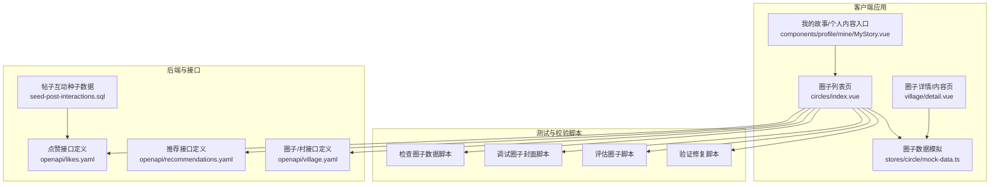
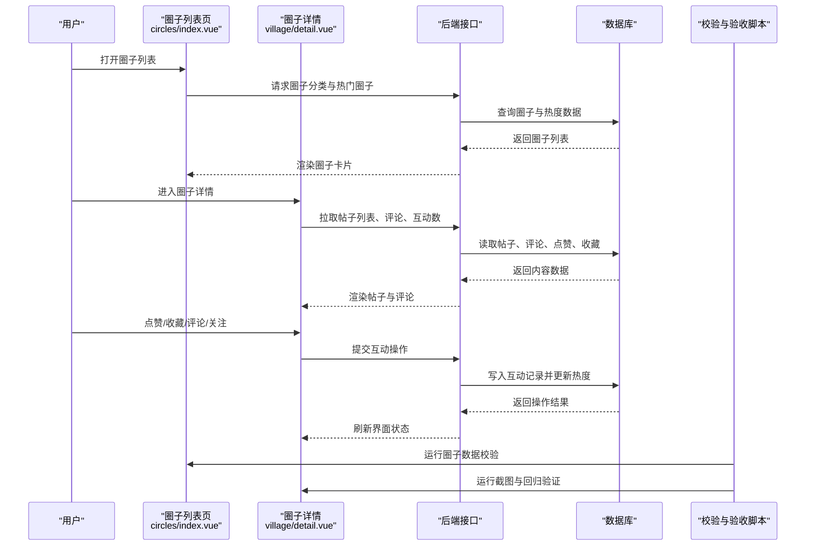
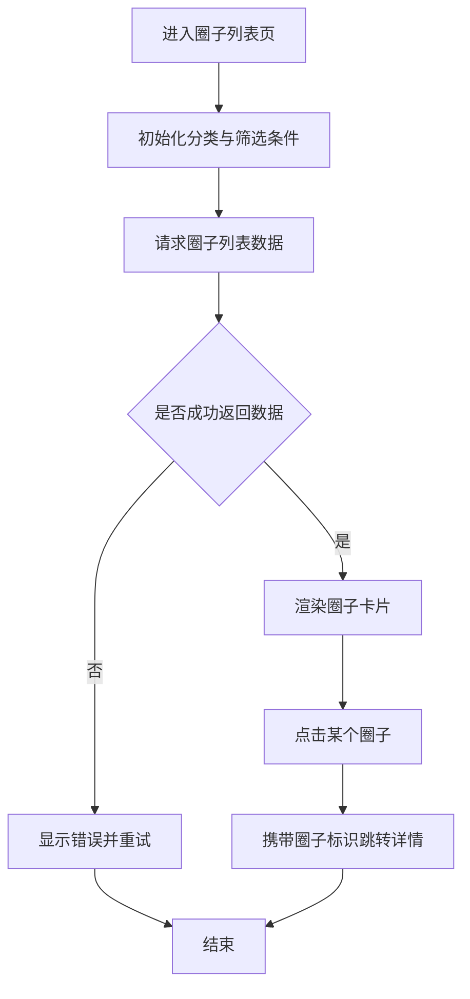
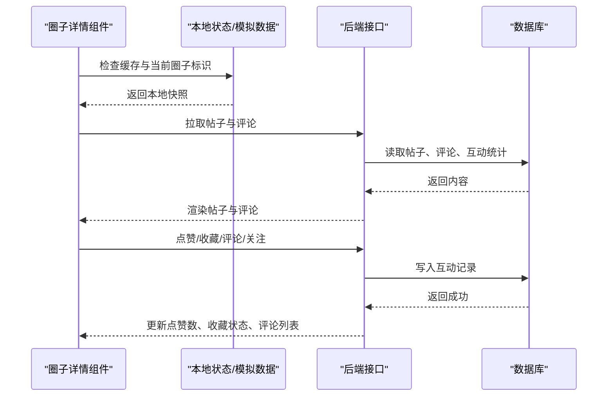
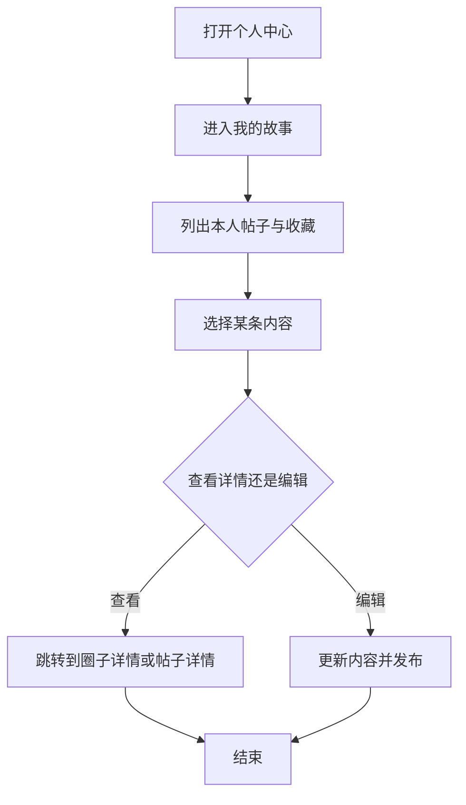
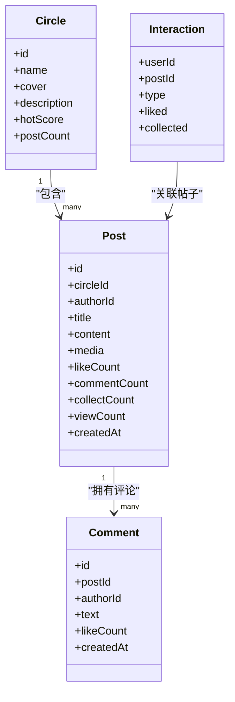
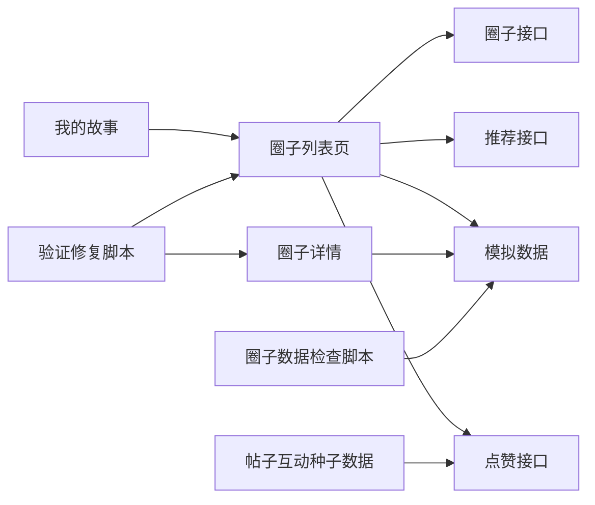
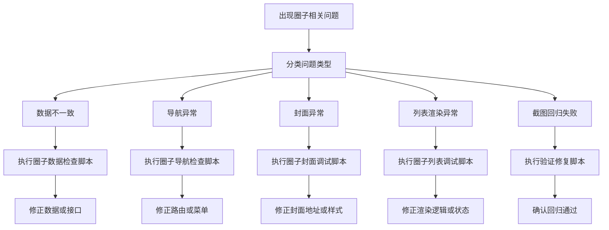

# 社区圈子功能

<cite>
**本文引用的文件**   
- [apps/client/src/stores/circle/mock-data.ts](file://apps/client/src/stores/circle/mock-data.ts)
- [apps/client/src/subpackages/circles/circles/index.vue](file://apps/client/src/subpackages/circles/circles/index.vue)
- [apps/client/src/subpackages/village/village/detail.vue](file://apps/client/src/subpackages/village/village/detail.vue)
- [apps/client/src/components/profile/mine/MyStory.vue](file://apps/client/src/components/profile/mine/MyStory.vue)
- [scripts/check-circle-data2.cjs](file://scripts/check-circle-data2.cjs)
- [scripts/check-circle-data3.cjs](file://scripts/check-circle-data3.cjs)
- [scripts/check-circle-src.cjs](file://scripts/check-circle-src.cjs)
- [scripts/check-circles-cover-data.cjs](file://scripts/check-circles-cover-data.cjs)
- [scripts/check-circles-data.cjs](file://scripts/check-circles-data.cjs)
- [scripts/check-circles-nav.cjs](file://scripts/check-circles-nav.cjs)
- [scripts/check-circles-nav2.cjs](file://scripts/check-circles-nav2.cjs)
- [scripts/debug-circle-cover.cjs](file://scripts/debug-circle-cover.cjs)
- [scripts/debug-circle-cover2.cjs](file://scripts/debug-circle-cover2.cjs)
- [scripts/debug-circle-list.cjs](file://scripts/debug-circle-list.cjs)
- [scripts/eval-circle.cjs](file://scripts/eval-circle.cjs)
- [scripts/shot-nearby-circles.cjs](file://scripts/shot-nearby-circles.cjs)
- [scripts/shot-circle-now.cjs](file://scripts/shot-circle-now.cjs)
- [scripts/test-circles2.cjs](file://scripts/test-circles2.cjs)
- [scripts/verify-circle-final.cjs](file://scripts/verify-circle-final.cjs)
- [scripts/verify-circle-fix.cjs](file://scripts/verify-circle-fix.cjs)
- [database/seed-post-interactions.sql](file://database/seed-post-interactions.sql)
- [docs/openapi/likes.yaml](file://docs/openapi/likes.yaml)
- [docs/openapi/recommendations.yaml](file://docs/openapi/recommendations.yaml)
- [docs/openapi/village.yaml](file://docs/openapi/village.yaml)
</cite>

## 目录

1. [引言](#引言)
2. [项目结构](#项目结构)
3. [核心组件](#核心组件)
4. [架构总览](#架构总览)
5. [详细组件分析](#详细组件分析)
6. [依赖关系分析](#依赖关系分析)
7. [性能与索引优化](#性能与索引优化)
8. [故障排查指南](#故障排查指南)
9. [结论](#结论)

## 引言

本技术文档围绕“社区圈子”能力，梳理从帖子发布、评论互动、内容管理到分类话题、审核治理、热度计算与推荐分发的完整链路。文档同时覆盖点赞收藏、关注订阅、内容发现、搜索分页与索引优化等关键主题，并给出可操作的排障建议与优化方向。

为便于非技术读者理解，文档先以高层流程说明社区圈子的整体工作方式，再逐步深入到具体代码文件、数据模型与接口契约。

## 项目结构

社区圈子相关实现横跨客户端子包、状态与数据模拟、脚本校验工具、数据库种子数据以及开放接口定义。

**图表来源**  
- [apps/client/src/subpackages/circles/circles/index.vue:1-200](file://apps/client/src/subpackages/circles/circles/index.vue#L1-L200)
- [apps/client/src/subpackages/village/village/detail.vue:1-200](file://apps/client/src/subpackages/village/village/detail.vue#L1-L200)
- [apps/client/src/components/profile/mine/MyStory.vue:1-200](file://apps/client/src/components/profile/mine/MyStory.vue#L1-L200)
- [apps/client/src/stores/circle/mock-data.ts:1-200](file://apps/client/src/stores/circle/mock-data.ts#L1-L200)
- [docs/openapi/likes.yaml:1-200](file://docs/openapi/likes.yaml#L1-L200)
- [docs/openapi/recommendations.yaml:1-200](file://docs/openapi/recommendations.yaml#L1-L200)
- [docs/openapi/village.yaml:1-200](file://docs/openapi/village.yaml#L1-L200)
- [database/seed-post-interactions.sql:1-200](file://database/seed-post-interactions.sql#L1-L200)

**章节来源**  
- [apps/client/src/subpackages/circles/circles/index.vue:1-200](file://apps/client/src/subpackages/circles/circles/index.vue#L1-L200)
- [apps/client/src/subpackages/village/village/detail.vue:1-200](file://apps/client/src/subpackages/village/village/detail.vue#L1-L200)
- [apps/client/src/components/profile/mine/MyStory.vue:1-200](file://apps/client/src/components/profile/mine/MyStory.vue#L1-L200)
- [apps/client/src/stores/circle/mock-data.ts:1-200](file://apps/client/src/stores/circle/mock-data.ts#L1-L200)

## 核心组件

社区圈子的核心由四类组件构成：

1. **圈子列表与导航**  
   负责展示圈子分类、热门圈子、附近圈子入口，并提供跳转至圈子详情页的能力。对应文件路径参考 `apps/client/src/subpackages/circles/circles/index.vue`。

2. **圈子详情与内容消费**  
   负责渲染圈子内的帖子列表、正文、媒体、评论与互动按钮；支持加载更多、回到顶部、返回上一级等交互。对应文件路径参考 `apps/client/src/subpackages/village/village/detail.vue`。

3. **个人内容与发现入口**  
   在个人中心或“我的故事”中提供已发布内容的查看入口，并可跳转到对应圈子详情。对应文件路径参考 `apps/client/src/components/profile/mine/MyStory.vue`。

4. **本地数据与模拟状态**  
   使用模拟数据驱动前端开发体验，包括圈子基础信息、帖子摘要、评论示例与互动计数。对应文件路径参考 `apps/client/src/stores/circle/mock-data.ts`。

这些组件共同形成“列表→详情→互动→发现”的主路径，并与后端开放接口、脚本校验工具和数据种子配合完成端到端验证。

**章节来源**  
- [apps/client/src/subpackages/circles/circles/index.vue:1-200](file://apps/client/src/subpackages/circles/circles/index.vue#L1-L200)
- [apps/client/src/subpackages/village/village/detail.vue:1-200](file://apps/client/src/subpackages/village/village/detail.vue#L1-L200)
- [apps/client/src/components/profile/mine/MyStory.vue:1-200](file://apps/client/src/components/profile/mine/MyStory.vue#L1-L200)
- [apps/client/src/stores/circle/mock-data.ts:1-200](file://apps/client/src/stores/circle/mock-data.ts#L1-L200)

## 架构总览

社区圈子的端到端流程可以概括为：用户在客户端发起浏览、发布、评论、点赞、收藏、关注等操作；客户端通过调用后端接口获取或更新数据；后端基于数据库与推荐服务进行内容分发、热度计算与权限控制；同时存在一套脚本体系对数据一致性、页面截图与行为路径进行自动化校验。

**图表来源**  
- [apps/client/src/subpackages/circles/circles/index.vue:1-200](file://apps/client/src/subpackages/circles/circles/index.vue#L1-L200)
- [apps/client/src/subpackages/village/village/detail.vue:1-200](file://apps/client/src/subpackages/village/village/detail.vue#L1-L200)
- [docs/openapi/likes.yaml:1-200](file://docs/openapi/likes.yaml#L1-L200)
- [docs/openapi/recommendations.yaml:1-200](file://docs/openapi/recommendations.yaml#L1-L200)
- [docs/openapi/village.yaml:1-200](file://docs/openapi/village.yaml#L1-L200)
- [database/seed-post-interactions.sql:1-200](file://database/seed-post-interactions.sql#L1-L200)

## 详细组件分析

### 圈子列表与导航组件

该组件承担以下职责：

- 展示圈子分类与推荐入口；
- 加载并展示热门圈子、附近圈子、精选圈子；
- 处理点击跳转、空状态、加载失败重试；
- 与模拟数据源对接，支撑离线开发和快速预览；
- 向后续详情页面传递圈子标识、标题、封面等上下文参数。

典型交互路径是：用户从首页或频道入口进入圈子列表，组件初始化时触发一次基础数据加载；若用户切换分类或下拉刷新，则重新请求对应分类下的圈子集合。

**图表来源**  
- [apps/client/src/subpackages/circles/circles/index.vue:1-200](file://apps/client/src/subpackages/circles/circles/index.vue#L1-L200)
- [apps/client/src/stores/circle/mock-data.ts:1-200](file://apps/client/src/stores/circle/mock-data.ts#L1-L200)

**章节来源**  
- [apps/client/src/subpackages/circles/circles/index.vue:1-200](file://apps/client/src/subpackages/circles/circles/index.vue#L1-L200)
- [apps/client/src/stores/circle/mock-data.ts:1-200](file://apps/client/src/stores/circle/mock-data.ts#L1-L200)

### 圈子详情与内容消费组件

该组件负责单个圈子内部的内容消费体验，主要包括：

- 拉取圈子基本信息、帖子列表、评论列表；
- 展示帖子正文、图片、视频与附件；
- 支持点赞、收藏、评论、转发与关注圈子；
- 支持分页加载、上滑加载更多、回到顶部；
- 将互动结果同步回本地状态，避免重复操作；
- 在评论区域维护新增评论的插入顺序和可见性。

**图表来源**  
- [apps/client/src/subpackages/village/village/detail.vue:1-200](file://apps/client/src/subpackages/village/village/detail.vue#L1-L200)
- [docs/openapi/likes.yaml:1-200](file://docs/openapi/likes.yaml#L1-L200)
- [docs/openapi/village.yaml:1-200](file://docs/openapi/village.yaml#L1-L200)
- [database/seed-post-interactions.sql:1-200](file://database/seed-post-interactions.sql#L1-L200)

**章节来源**  
- [apps/client/src/subpackages/village/village/detail.vue:1-200](file://apps/client/src/subpackages/village/village/detail.vue#L1-L200)
- [docs/openapi/likes.yaml:1-200](file://docs/openapi/likes.yaml#L1-L200)
- [docs/openapi/village.yaml:1-200](file://docs/openapi/village.yaml#L1-L200)

### 个人内容与发现入口

“我的故事”或个人中心中的内容入口，主要承担以下内容管理职责：

- 展示用户已发布的帖子、回复与收藏内容；
- 提供编辑、删除、隐藏与恢复等管理能力；
- 跳转到对应圈子详情或帖子详情；
- 作为内容发现的辅助入口，与首页推荐、圈子列表形成互补。

**图表来源**  
- [apps/client/src/components/profile/mine/MyStory.vue:1-200](file://apps/client/src/components/profile/mine/MyStory.vue#L1-L200)

**章节来源**  
- [apps/client/src/components/profile/mine/MyStory.vue:1-200](file://apps/client/src/components/profile/mine/MyStory.vue#L1-L200)

### 模拟数据与状态模型

`stores/circle/mock-data.ts` 提供圈子、帖子、评论与互动的模拟数据结构，用于：

- 在无后端环境时快速演示圈子列表与详情；
- 为自动化脚本提供稳定输入；
- 作为前后端联调阶段的占位数据；
- 帮助测试用例构造边界场景，例如空圈子、无评论、长正文、多图帖子等。

**图表来源**  
- [apps/client/src/stores/circle/mock-data.ts:1-200](file://apps/client/src/stores/circle/mock-data.ts#L1-L200)

**章节来源**  
- [apps/client/src/stores/circle/mock-data.ts:1-200](file://apps/client/src/stores/circle/mock-data.ts#L1-L200)

## 依赖关系分析

社区圈子功能的依赖关系可以从三个层面观察：

1. **客户端组件依赖**  
   圈子列表依赖模拟数据与路由跳转；圈子详情依赖帖子、评论、互动状态；个人内容入口依赖圈子详情与用户身份上下文。

2. **前后端接口依赖**  
   点赞、收藏、评论、关注、圈子信息、帖子列表与推荐内容分别对应不同的开放接口定义。其中 `likes.yaml` 描述点赞相关契约，`recommendations.yaml` 描述推荐与热度相关内容，`village.yaml` 描述圈子与内容聚合接口。

3. **脚本与数据依赖**  
   多个脚本用于检查圈子数据、调试封面、评估列表表现、生成截图与验证修复结果；数据库种子数据用于填充帖子互动基线。

**图表来源**  
- [apps/client/src/subpackages/circles/circles/index.vue:1-200](file://apps/client/src/subpackages/circles/circles/index.vue#L1-L200)
- [apps/client/src/subpackages/village/village/detail.vue:1-200](file://apps/client/src/subpackages/village/village/detail.vue#L1-L200)
- [apps/client/src/components/profile/mine/MyStory.vue:1-200](file://apps/client/src/components/profile/mine/MyStory.vue#L1-L200)
- [apps/client/src/stores/circle/mock-data.ts:1-200](file://apps/client/src/stores/circle/mock-data.ts#L1-L200)
- [docs/openapi/likes.yaml:1-200](file://docs/openapi/likes.yaml#L1-L200)
- [docs/openapi/recommendations.yaml:1-200](file://docs/openapi/recommendations.yaml#L1-L200)
- [docs/openapi/village.yaml:1-200](file://docs/openapi/village.yaml#L1-L200)
- [database/seed-post-interactions.sql:1-200](file://database/seed-post-interactions.sql#L1-L200)

**章节来源**  
- [apps/client/src/subpackages/circles/circles/index.vue:1-200](file://apps/client/src/subpackages/circles/circles/index.vue#L1-L200)
- [apps/client/src/subpackages/village/village/detail.vue:1-200](file://apps/client/src/subpackages/village/village/detail.vue#L1-L200)
- [apps/client/src/components/profile/mine/MyStory.vue:1-200](file://apps/client/src/components/profile/mine/MyStory.vue#L1-L200)
- [apps/client/src/stores/circle/mock-data.ts:1-200](file://apps/client/src/stores/circle/mock-data.ts#L1-L200)
- [docs/openapi/likes.yaml:1-200](file://docs/openapi/likes.yaml#L1-L200)
- [docs/openapi/recommendations.yaml:1-200](file://docs/openapi/recommendations.yaml#L1-L200)
- [docs/openapi/village.yaml:1-200](file://docs/openapi/village.yaml#L1-L200)
- [database/seed-post-interactions.sql:1-200](file://database/seed-post-interactions.sql#L1-L200)

## 性能与索引优化

针对社区圈子的内容规模增长，可从以下方面优化：

1. **分页与增量加载**  
   - 帖子列表应使用游标或时间戳分页，避免全量拉取。
   - 评论列表采用懒加载，只在展开评论区时加载。
   - 首次加载优先返回摘要字段，详情再按需拉取富文本与媒体。

2. **热点内容缓存**  
   - 对热门圈子、热门帖子、推荐列表做短时缓存。
   - 对点赞、收藏等高频但变化较慢的计数做异步更新与合并。

3. **搜索与索引优化**  
   - 帖子标题、正文关键词建立全文索引。
   - 圈子名称、标签、作者信息建立独立索引。
   - 推荐接口按兴趣标签、地理位置、最近活跃时间组合排序。

4. **图片与媒体优化**  
   - 封面图、帖子缩略图使用多尺寸与懒加载。
   - 大图与视频走 CDN，并设置合理缓存策略。

5. **写放大控制**  
   - 点赞、收藏、评论等写操作尽量幂等，避免重复计数。
   - 热度计算使用增量评分，而不是每次全表扫描。

[本节为通用性能建议，不直接分析特定源码文件]

## 故障排查指南

社区圈子相关的常见问题可通过以下脚本和文件定位：

| 问题类型 | 常用脚本或文件 | 排查要点 |
|---|---|---|
| 圈子数据不一致 | `scripts/check-circle-data2.cjs`、`scripts/check-circle-data3.cjs`、`scripts/check-circles-data.cjs` | 检查圈子 ID、名称、封面、帖子数量是否与预期一致 |
| 圈子导航异常 | `scripts/check-circles-nav.cjs`、`scripts/check-circles-nav2.cjs` | 检查分类跳转、默认选中项、返回列表状态 |
| 圈子封面异常 | `scripts/check-circles-cover-data.cjs`、`scripts/debug-circle-cover.cjs`、`scripts/debug-circle-cover2.cjs` | 检查封面 URL、加载失败回退、裁剪比例 |
| 圈子列表渲染异常 | `scripts/debug-circle-list.cjs`、`scripts/eval-circle.cjs` | 检查列表长度、空状态、加载态、错误提示 |
| 截图与回归验证失败 | `scripts/shot-nearby-circles.cjs`、`scripts/shot-circle-now.cjs`、`scripts/verify-circle-final.cjs`、`scripts/verify-circle-fix.cjs` | 对比基准截图、检查元素可见性与文案 |
| 帖子互动数据异常 | `database/seed-post-interactions.sql` | 检查点赞、收藏、评论基数是否被正确填充 |

**图表来源**  
- [scripts/check-circle-data2.cjs:1-22](file://scripts/check-circle-data2.cjs#L1-L22)
- [scripts/check-circle-data3.cjs:1-18](file://scripts/check-circle-data3.cjs#L1-L18)
- [scripts/check-circles-data.cjs:1-19](file://scripts/check-circles-data.cjs#L1-L19)
- [scripts/check-circles-nav.cjs:1-29](file://scripts/check-circles-nav.cjs#L1-L29)
- [scripts/check-circles-nav2.cjs:1-27](file://scripts/check-circles-nav2.cjs#L1-L27)
- [scripts/check-circles-cover-data.cjs:1-22](file://scripts/check-circles-cover-data.cjs#L1-L22)
- [scripts/debug-circle-cover.cjs:1-33](file://scripts/debug-circle-cover.cjs#L1-L33)
- [scripts/debug-circle-cover2.cjs:1-31](file://scripts/debug-circle-cover2.cjs#L1-L31)
- [scripts/debug-circle-list.cjs:1-26](file://scripts/debug-circle-list.cjs#L1-L26)
- [scripts/eval-circle.cjs:1-28](file://scripts/eval-circle.cjs#L1-L28)
- [scripts/shot-nearby-circles.cjs:1-15](file://scripts/shot-nearby-circles.cjs#L1-L15)
- [scripts/shot-circle-now.cjs:1-15](file://scripts/shot-circle-now.cjs#L1-L15)
- [scripts/verify-circle-final.cjs:1-25](file://scripts/verify-circle-final.cjs#L1-L25)
- [scripts/verify-circle-fix.cjs:1-34](file://scripts/verify-circle-fix.cjs#L1-L34)

**章节来源**  
- [scripts/check-circle-data2.cjs:1-22](file://scripts/check-circle-data2.cjs#L1-L22)
- [scripts/check-circle-data3.cjs:1-18](file://scripts/check-circle-data3.cjs#L1-L18)
- [scripts/check-circles-data.cjs:1-19](file://scripts/check-circles-data.cjs#L1-L19)
- [scripts/check-circles-nav.cjs:1-29](file://scripts/check-circles-nav.cjs#L1-L29)
- [scripts/check-circles-nav2.cjs:1-27](file://scripts/check-circles-nav2.cjs#L1-L27)
- [scripts/check-circles-cover-data.cjs:1-22](file://scripts/check-circles-cover-data.cjs#L1-L22)
- [scripts/debug-circle-cover.cjs:1-33](file://scripts/debug-circle-cover.cjs#L1-L33)
- [scripts/debug-circle-cover2.cjs:1-31](file://scripts/debug-circle-cover2.cjs#L1-L31)
- [scripts/debug-circle-list.cjs:1-26](file://scripts/debug-circle-list.cjs#L1-L26)
- [scripts/eval-circle.cjs:1-28](file://scripts/eval-circle.cjs#L1-L28)
- [scripts/shot-nearby-circles.cjs:1-15](file://scripts/shot-nearby-circles.cjs#L1-L15)
- [scripts/shot-circle-now.cjs:1-15](file://scripts/shot-circle-now.cjs#L1-L15)
- [scripts/verify-circle-final.cjs:1-25](file://scripts/verify-circle-final.cjs#L1-L25)
- [scripts/verify-circle-fix.cjs:1-34](file://scripts/verify-circle-fix.cjs#L1-L34)

## 结论

社区圈子功能以“圈子列表—圈子详情—互动反馈—内容发现”为主线，结合模拟数据、开放接口、脚本校验与种子数据，形成了较完整的开发与验证闭环。面向生产环境，应重点关注分页加载、热点缓存、搜索索引、媒体优化与写操作幂等性；面向质量保障，应持续使用现有脚本对圈子数据、导航、封面与截图回归进行自动化检查。

[本节为总结性内容，不直接分析特定源码文件]