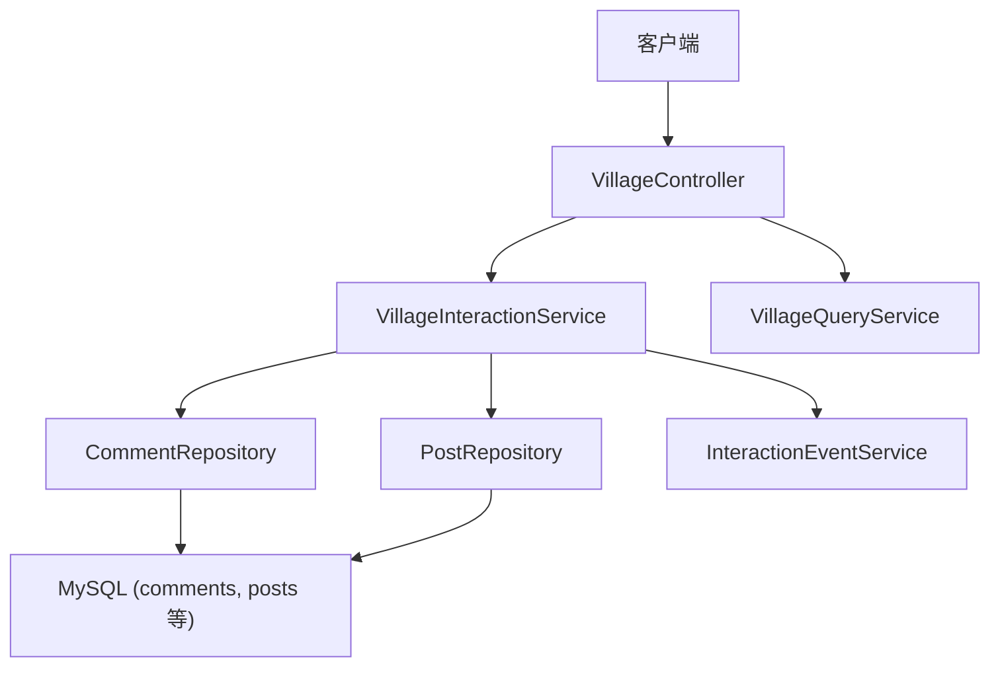
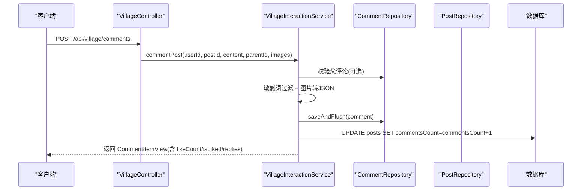
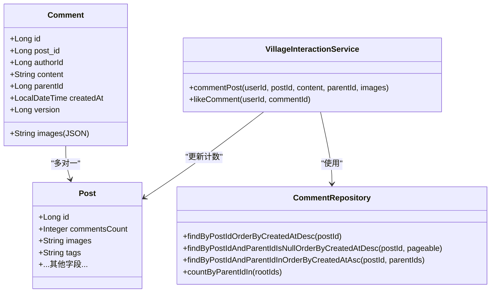
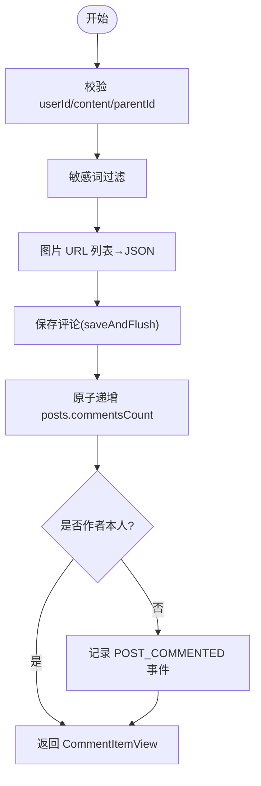
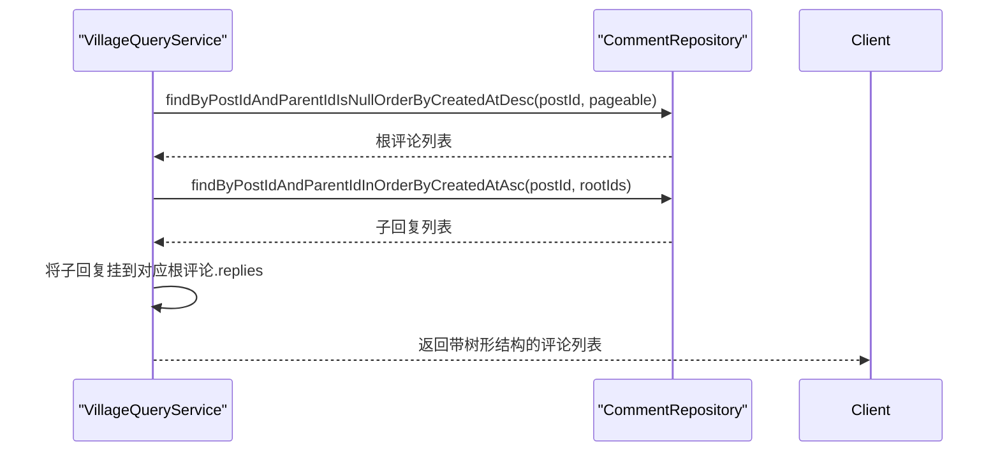
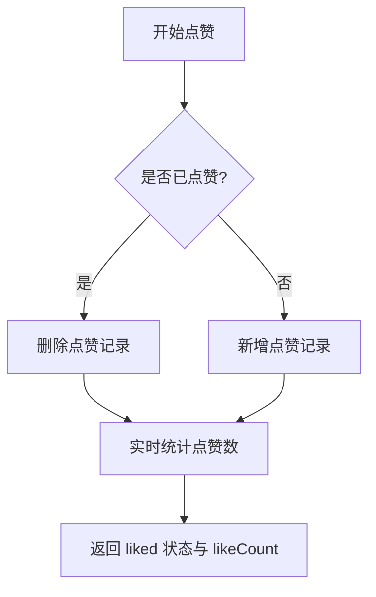
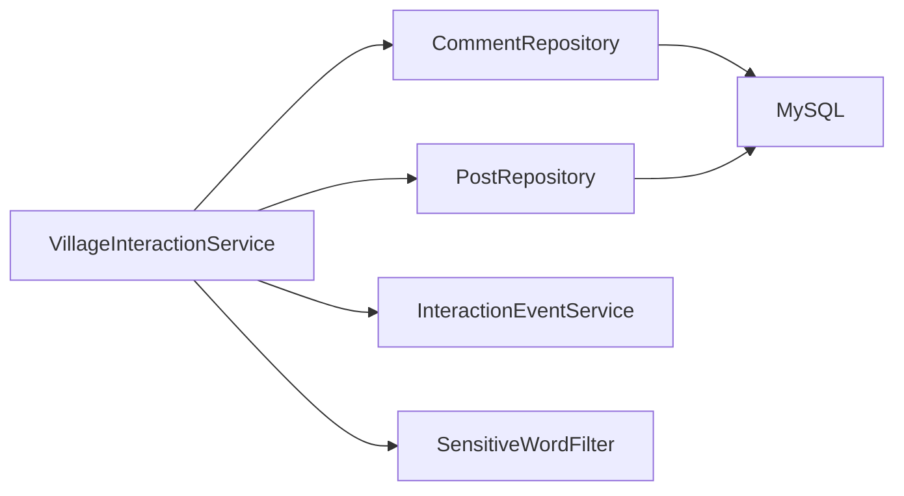

# 评论互动系统

<cite>
**本文引用的文件**
- [Comment.java](file://apps/api/src/main/java/com/campuslove/api/entity/Comment.java)
- [Post.java](file://apps/api/src/main/java/com/campuslove/api/entity/Post.java)
- [CommentRepository.java](file://apps/api/src/main/java/com/campuslove/api/repository/CommentRepository.java)
- [VillageInteractionService.java](file://apps/api/src/main/java/com/campuslove/api/village/VillageInteractionService.java)
- [CommentItemView.java](file://apps/api/src/main/java/com/campuslove/api/village/CommentItemView.java)
- [VillageController.java](file://apps/api/src/main/java/com/campuslove/api/village/VillageController.java)
- [village.yaml](file://docs/openapi/village.yaml)
</cite>

## 目录
1. [简介](#简介)
2. [项目结构](#项目结构)
3. [核心组件](#核心组件)
4. [架构总览](#架构总览)
5. [详细组件分析](#详细组件分析)
6. [依赖关系分析](#依赖关系分析)
7. [性能与优化](#性能与优化)
8. [故障排查指南](#故障排查指南)
9. [结论](#结论)
10. [附录：API 与数据模型](#附录api-与数据模型)

## 简介
本技术文档围绕“评论互动系统”展开，聚焦评论的层级结构设计（根评论与楼中楼回复）、Comment 与 Post 的关联关系、树形结构的维护方式，以及评论创建、查询、删除（含计数同步与乐观锁并发控制）。同时覆盖评论图片上传支持、内容安全校验、列表分页查询与排序策略、性能优化方案，并给出评论相关 API 接口规范与数据模型定义。

## 项目结构
评论功能位于后端 API 模块（Spring Boot + JPA）中，主要涉及以下层次：
- 实体层：Comment、Post
- 仓储层：CommentRepository
- 服务层：VillageInteractionService（评论创建/点赞等交互）、VillageQueryService（查询与视图转换）
- 控制器层：VillageController（对外 HTTP 接口）
- OpenAPI 文档：docs/openapi/village.yaml

**图表来源**
- [VillageController.java](file://apps/api/src/main/java/com/campuslove/api/village/VillageController.java)
- [VillageInteractionService.java:1-200](file://apps/api/src/main/java/com/campuslove/api/village/VillageInteractionService.java#L1-L200)
- [CommentRepository.java:1-141](file://apps/api/src/main/java/com/campuslove/api/repository/CommentRepository.java#L1-L141)
- [Post.java:1-200](file://apps/api/src/main/java/com/campuslove/api/entity/Post.java#L1-L200)

**章节来源**
- [VillageController.java](file://apps/api/src/main/java/com/campuslove/api/village/VillageController.java)
- [VillageInteractionService.java:1-200](file://apps/api/src/main/java/com/campuslove/api/village/VillageInteractionService.java#L1-L200)
- [CommentRepository.java:1-141](file://apps/api/src/main/java/com/campuslove/api/repository/CommentRepository.java#L1-L141)
- [Post.java:1-200](file://apps/api/src/main/java/com/campuslove/api/entity/Post.java#L1-L200)

## 核心组件
- Comment 实体：承载评论内容、作者、父评论 ID（用于楼中楼）、创建时间、图片 JSON、乐观锁版本。
- Post 实体：承载帖子元信息，包含 commentsCount 等计数字段。
- CommentRepository：提供按帖子查询、分页、批量查询根评论及子回复、管理后台筛选等能力。
- VillageInteractionService：封装评论创建（含敏感词过滤、图片处理、计数原子递增）、评论点赞、事件记录等交互逻辑。
- CommentItemView：统一视图对象，表达根评论与楼中楼回复的树形结构。

**章节来源**
- [Comment.java:1-145](file://apps/api/src/main/java/com/campuslove/api/entity/Comment.java#L1-L145)
- [Post.java:1-200](file://apps/api/src/main/java/com/campuslove/api/entity/Post.java#L1-L200)
- [CommentRepository.java:1-141](file://apps/api/src/main/java/com/campuslove/api/repository/CommentRepository.java#L1-L141)
- [VillageInteractionService.java:201-513](file://apps/api/src/main/java/com/campuslove/api/village/VillageInteractionService.java#L201-L513)
- [CommentItemView.java:1-74](file://apps/api/src/main/java/com/campuslove/api/village/CommentItemView.java#L1-L74)

## 架构总览
评论系统的核心流程包括：
- 创建评论：参数校验 → 敏感词过滤 → 写入 Comment → 原子递增 Post.commentsCount → 触发互动事件 → 返回视图
- 查询评论：按帖子分页拉取根评论 → 批量加载子回复 → 组装为树形结构（根评论携带 replies）
- 评论点赞：幂等切换，实时统计点赞数
- 并发控制：通过 @Version 乐观锁与数据库侧原子更新避免丢失更新

**图表来源**
- [VillageInteractionService.java:300-513](file://apps/api/src/main/java/com/campuslove/api/village/VillageInteractionService.java#L300-L513)
- [CommentRepository.java:1-141](file://apps/api/src/main/java/com/campuslove/api/repository/CommentRepository.java#L1-L141)
- [Post.java:1-200](file://apps/api/src/main/java/com/campuslove/api/entity/Post.java#L1-L200)

## 详细组件分析

### 实体模型与树形结构
- Comment 与 Post 通过外键关联（post_id），支持级联删除语义由上层业务保障。
- 树形结构通过 parent_id 维护：
  - parent_id 为 null 表示根评论
  - parent_id 非 null 表示该评论是某条根评论的楼中楼回复
- 查询时先拉取根评论（parent_id IS NULL），再根据根评论 ID 集合批量查询其子回复，形成树形响应。

**图表来源**
- [Comment.java:1-145](file://apps/api/src/main/java/com/campuslove/api/entity/Comment.java#L1-L145)
- [Post.java:1-200](file://apps/api/src/main/java/com/campuslove/api/entity/Post.java#L1-L200)
- [CommentRepository.java:1-141](file://apps/api/src/main/java/com/campuslove/api/repository/CommentRepository.java#L1-L141)
- [VillageInteractionService.java:201-513](file://apps/api/src/main/java/com/campuslove/api/village/VillageInteractionService.java#L201-L513)

**章节来源**
- [Comment.java:1-145](file://apps/api/src/main/java/com/campuslove/api/entity/Comment.java#L1-L145)
- [Post.java:1-200](file://apps/api/src/main/java/com/campuslove/api/entity/Post.java#L1-L200)
- [CommentRepository.java:1-141](file://apps/api/src/main/java/com/campuslove/api/repository/CommentRepository.java#L1-L141)

### 评论创建流程（含图片与安全校验）
- 参数校验：userId、content 必填；parentId 若传入需校验存在且属于同一帖子
- 敏感词过滤：调用 SensitiveWordFilter 对内容进行过滤（场景标记 POST_COMMENT）
- 图片处理：images 以 JSON 字符串存储（空列表默认 "[]"）
- 持久化：saveAndFlush 立即回填主键，保证视图 id 非空
- 计数同步：数据库侧原子递增 commentsCount，避免并发丢失
- 互动事件：若非作者本人评论，则记录 POST_COMMENTED 事件

**图表来源**
- [VillageInteractionService.java:300-513](file://apps/api/src/main/java/com/campuslove/api/village/VillageInteractionService.java#L300-L513)

**章节来源**
- [VillageInteractionService.java:300-513](file://apps/api/src/main/java/com/campuslove/api/village/VillageInteractionService.java#L300-L513)

### 评论列表分页与树形组装
- 根评论分页：按 createdAt 倒序，支持分页
- 子回复批量加载：根据根评论 ID 集合一次性查询所有子回复，按 createdAt 正序返回（符合阅读习惯）
- N+1 规避：使用 @EntityGraph 预加载 post 关联，避免访问 post.id 触发逐条 SELECT
- 预览与统计：支持批量获取多帖最新根评论预览，并统计各根评论的子回复数量

**图表来源**
- [CommentRepository.java:1-141](file://apps/api/src/main/java/com/campuslove/api/repository/CommentRepository.java#L1-L141)

**章节来源**
- [CommentRepository.java:1-141](file://apps/api/src/main/java/com/campuslove/api/repository/CommentRepository.java#L1-L141)

### 评论点赞与幂等性
- 已点赞 → 取消点赞（删除 CommentLike 记录）
- 未点赞 → 新增点赞（唯一约束兜底并发重复点赞）
- 点赞数实时统计：基于 CommentLikeRepository.countByCommentId，无冗余列，确保最终一致性

**图表来源**
- [VillageInteractionService.java:201-260](file://apps/api/src/main/java/com/campuslove/api/village/VillageInteractionService.java#L201-L260)

**章节来源**
- [VillageInteractionService.java:201-260](file://apps/api/src/main/java/com/campuslove/api/village/VillageInteractionService.java#L201-L260)

### 并发控制与数据一致性
- 乐观锁：Comment 实体使用 @Version 注解，JPA 自动维护 version 列；并发更新冲突时抛出异常，由全局异常处理器转换为 HTTP 409 Conflict
- 原子计数：commentsCount、likesCount、shareCount 等采用数据库侧 bulk UPDATE 原子递增/递减，避免读-改-写竞态
- 事务边界：评论创建/点赞/收藏等操作在事务内执行；浏览记录使用独立事务避免影响主事务

**章节来源**
- [Comment.java:80-145](file://apps/api/src/main/java/com/campuslove/api/entity/Comment.java#L80-L145)
- [VillageInteractionService.java:1-200](file://apps/api/src/main/java/com/campuslove/api/village/VillageInteractionService.java#L1-L200)
- [VillageInteractionService.java:300-513](file://apps/api/src/main/java/com/campuslove/api/village/VillageInteractionService.java#L300-L513)

## 依赖关系分析
- VillageInteractionService 依赖：
  - CommentRepository：评论读写
  - PostRepository：帖子计数更新
  - InteractionEventService：互动事件记录
  - SensitiveWordFilter：内容安全
- CommentRepository 依赖：
  - Spring Data JPA：派生查询、@EntityGraph、JPQL
- 实体间关系：
  - Comment → Post（多对一）
  - Post ↔ Comment（一对多）

**图表来源**
- [VillageInteractionService.java:1-200](file://apps/api/src/main/java/com/campuslove/api/village/VillageInteractionService.java#L1-L200)
- [CommentRepository.java:1-141](file://apps/api/src/main/java/com/campuslove/api/repository/CommentRepository.java#L1-L141)

**章节来源**
- [VillageInteractionService.java:1-200](file://apps/api/src/main/java/com/campuslove/api/village/VillageInteractionService.java#L1-L200)
- [CommentRepository.java:1-141](file://apps/api/src/main/java/com/campuslove/api/repository/CommentRepository.java#L1-L141)

## 性能与优化
- 分页查询：按 createdAt 倒序分页，避免全表扫描
- N+1 问题规避：使用 @EntityGraph 预加载 post 关联，减少多次 SELECT
- 批量操作：子回复批量查询、多帖根评论预览批量获取
- 原子更新：计数字段使用数据库侧 bulk UPDATE，避免读-改-写竞态
- 缓存失效：热门帖子缓存通过 @CacheEvict 主动失效，保证一致性

[本节为通用性能建议，不直接引用具体代码文件]

## 故障排查指南
- 评论不存在：创建或点赞时如 parentId/commentId 无效，会抛出非法参数异常
- 并发冲突：乐观锁冲突会返回 409 Conflict，需前端重试或提示刷新
- 计数不一致：确认是否走数据库侧原子更新路径（entityManager 非 null 时）
- 图片为空：images 默认 "[]"，前端需兼容空数组显示

**章节来源**
- [VillageInteractionService.java:300-513](file://apps/api/src/main/java/com/campuslove/api/village/VillageInteractionService.java#L300-L513)
- [Comment.java:80-145](file://apps/api/src/main/java/com/campuslove/api/entity/Comment.java#L80-L145)

## 结论
评论互动系统通过清晰的实体设计与分层架构，实现了根评论与楼中楼回复的树形结构管理。借助数据库侧原子更新与乐观锁，保证了高并发下的数据一致性；通过批量查询与预加载优化了查询性能；结合敏感词过滤与图片支持，提供了安全、丰富的评论体验。API 层通过统一的视图对象返回结构化数据，便于前端渲染与交互。

## 附录：API 与数据模型

### 数据模型定义
- Comment 实体字段：id、post_id、author_id、content、parent_id、images(JSON)、created_at、version
- Post 实体字段：id、author_id、title、content、images(JSON)、tags(JSON)、category、likes_count、comments_count、share_count、view_count、status、audit_status、visibility、circle_id 等
- 关联关系：Comment.post_id → Post.id；Comment.parent_id 指向同帖另一 Comment.id

**章节来源**
- [Comment.java:1-145](file://apps/api/src/main/java/com/campuslove/api/entity/Comment.java#L1-L145)
- [Post.java:1-200](file://apps/api/src/main/java/com/campuslove/api/entity/Post.java#L1-L200)

### 评论相关 API 接口规范
- 评论创建：POST /api/village/comments
  - 请求体：userId、postId、content、parentId（可选）、images（URL 列表，可选）
  - 响应：CommentItemView（包含 id、postId、parentId、author、content、images、likeCount、createdAt、isAuthor、isLiked、replyTo、replies）
- 评论点赞：POST /api/village/comments/{commentId}/like
  - 请求体：userId
  - 响应：PostLikeResponse（success、liked、likeCount）
- 评论列表：GET /api/village/posts/{postId}/comments
  - 查询参数：page、size、sort=createdAt,desc
  - 响应：CommentListResponse（包含分页信息与评论树）

注：以上接口定义参考 docs/openapi/village.yaml 与控制器方法签名。

**章节来源**
- [village.yaml](file://docs/openapi/village.yaml)
- [VillageController.java](file://apps/api/src/main/java/com/campuslove/api/village/VillageController.java)
- [CommentItemView.java:1-74](file://apps/api/src/main/java/com/campuslove/api/village/CommentItemView.java#L1-L74)