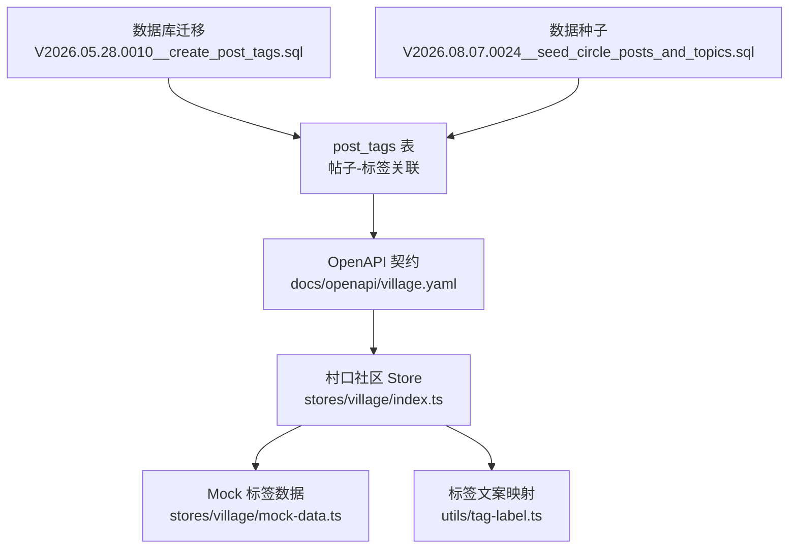
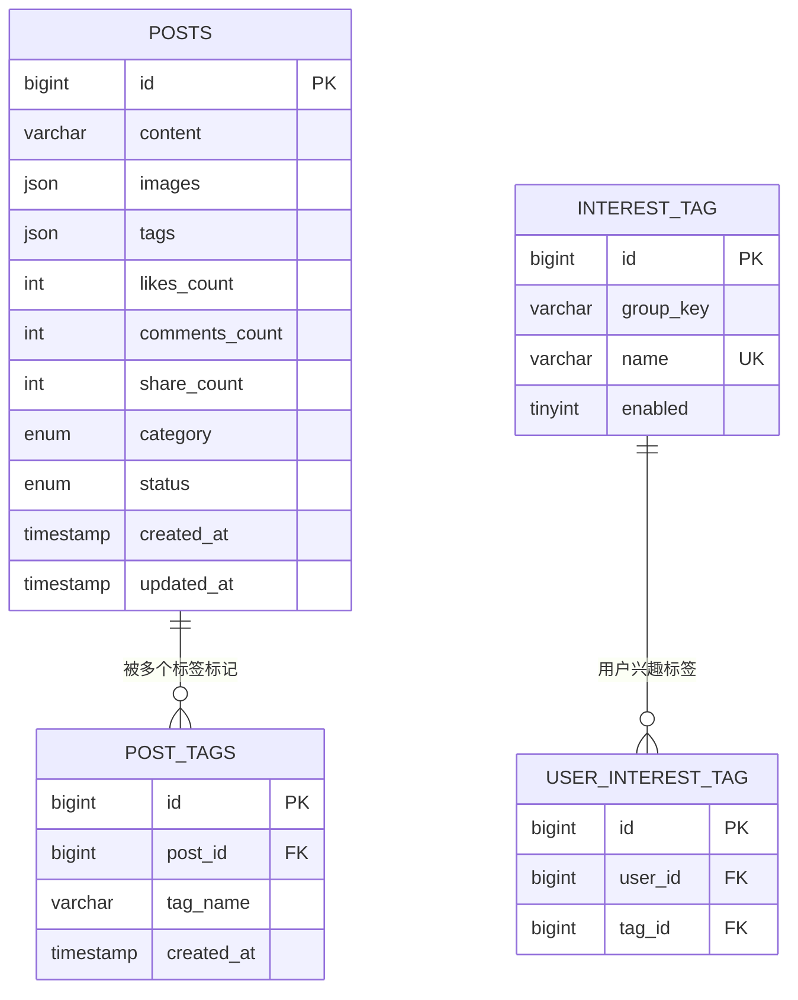
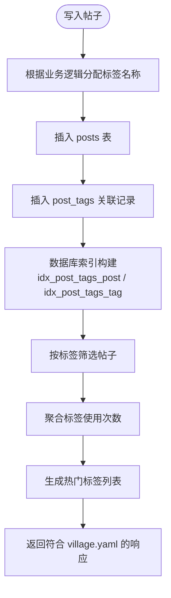
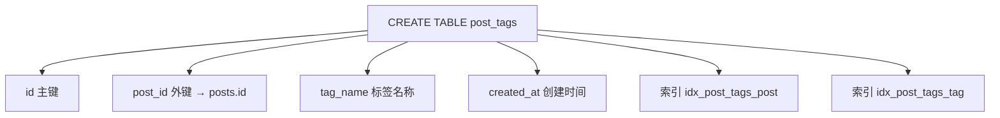
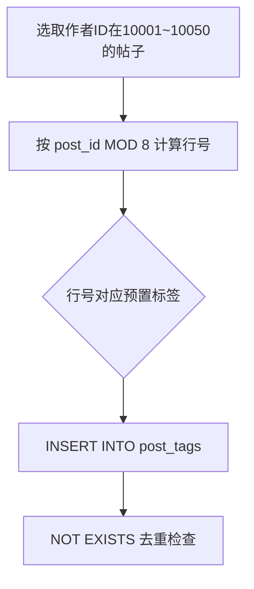
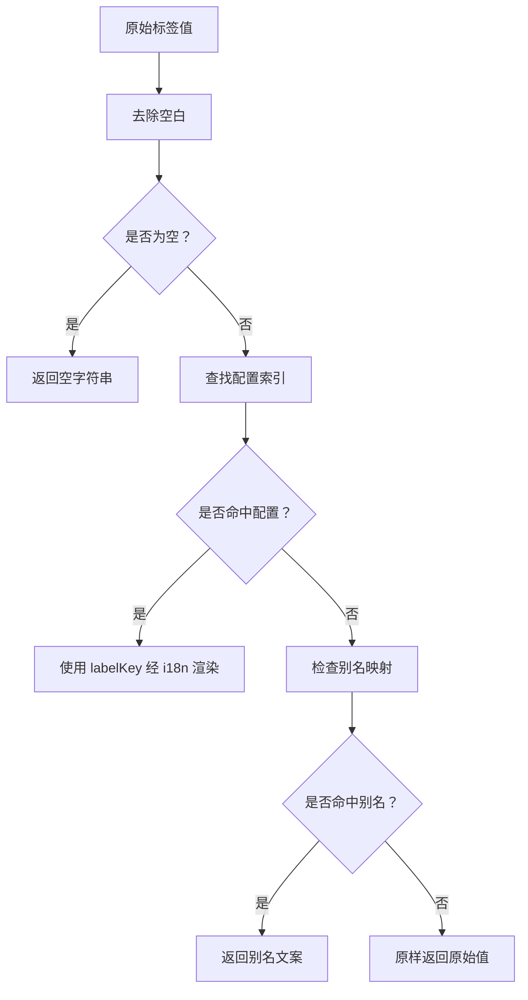
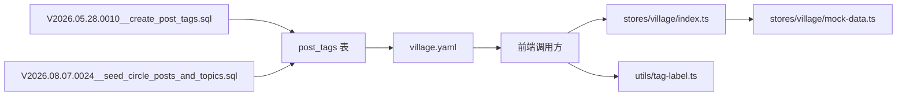
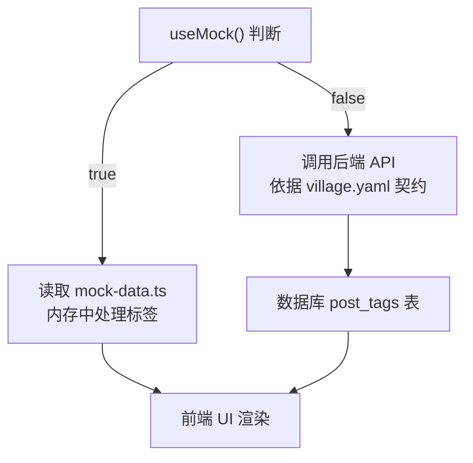
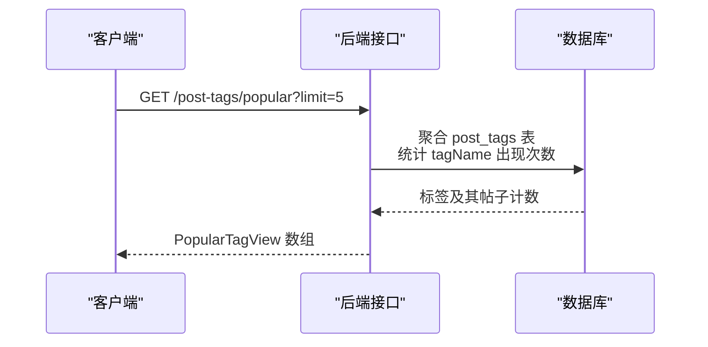
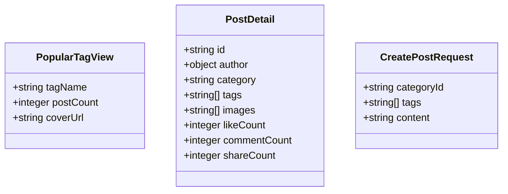

# 话题标签系统

<cite>
**本文引用的文件**   
- [V2026.05.28.0010__create_post_tags.sql](file://database/flyway/sql/V2026.05.28.0010__create_post_tags.sql)
- [V2026.08.07.0024__seed_circle_posts_and_topics.sql](file://database/flyway/sql/V2026.08.07.0024__seed_circle_posts_and_topics.sql)
- [V2026.08.15.0003__create_interest_tag_relation.sql](file://database/flyway/sql/V2026.08.15.0003__create_interest_tag_relation.sql)
- [V2026.07.28.0004__audit_fields.sql](file://database/flyway/sql/V2026.07.28.0004__audit_fields.sql)
- [V2026.07.26.0003__add_version_columns.sql](file://database/flyway/sql/V2026.07.26.0003__add_version_columns.sql)
- [village.yaml](file://docs/openapi/village.yaml)
- [tag-label.ts](file://apps/client/src/utils/tag-label.ts)
- [mock-data.ts](file://apps/client/src/stores/village/mock-data.ts)
- [index.ts（村口社区 Store）](file://apps/client/src/stores/village/index.ts)
</cite>

## 目录
1. [引言](#引言)
2. [项目结构](#项目结构)
3. [核心实体与数据模型](#核心实体与数据模型)
4. [架构总览](#架构总览)
5. [详细组件分析](#详细组件分析)
6. [依赖关系分析](#依赖关系分析)
7. [性能与索引优化](#性能与索引优化)
8. [Mock 与真实实现差异](#mock-与真实实现差异)
9. [标签增删改查规范](#标签增删改查规范)
10. [搜索、聚合与热门标签推荐](#搜索聚合与热门标签推荐)
11. [API 接口规范](#api-接口规范)
12. [最佳实践](#最佳实践)
13. [故障排查](#故障排查)
14. [结论](#结论)

## 引言
本技术文档聚焦于仓库中的“话题标签系统”，包括：
- 帖子与预置话题标签的多对多关联设计。
- 数据库层面的 `post_tags` 表结构、索引与种子数据。
- 前端展示层的标签文案映射机制。
- 客户端 Mock 模式下标签相关数据的组织方式。
- OpenAPI 文档中定义的标签筛选、热门话题聚合等接口契约。
- 兴趣标签体系与用户兴趣标签关系的补充说明。

当前仓库未发现后端 API 控制器或服务层中对 `post_tags` 的直接实现代码；因此，本文对后端实现的分析以数据库迁移、OpenAPI 契约和前端调用契约为准，并明确标注哪些能力属于“已定义契约但未在仓库中找到对应后端实现”的情况。

## 项目结构
与话题标签直接相关的代码分布在以下三个层次：

| 层次 | 关键文件 | 职责 |
|---|---|---|
| 数据库层 | `database/flyway/sql/V2026.05.28.0010__create_post_tags.sql` | 创建帖子与标签关联表及索引 |
| 数据种子层 | `database/flyway/sql/V2026.08.07.0024__seed_circle_posts_and_topics.sql` | 为帖子分配预置标签，构造热门话题数据 |
| 前端展示层 | `apps/client/src/utils/tag-label.ts` | 将标签值映射到可读文案 |
| 前端状态层 | `apps/client/src/stores/village/mock-data.ts` | Mock 帖子中的标签数组 |
| 前端 Store 入口 | `apps/client/src/stores/village/index.ts` | 通过 useMock 分支切换 Mock/真实模式 |
| API 契约层 | `docs/openapi/village.yaml` | 定义帖子标签筛选参数、热门话题接口及响应类型 |

**图表来源**
- [V2026.05.28.0010__create_post_tags.sql:1-11](file://database/flyway/sql/V2026.05.28.0010__create_post_tags.sql#L1-L11)
- [V2026.08.07.0024__seed_circle_posts_and_topics.sql:87-98](file://database/flyway/sql/V2026.08.07.0024__seed_circle_posts_and_topics.sql#L87-L98)
- [village.yaml:1-470](file://docs/openapi/village.yaml#L1-L470)
- [mock-data.ts:1-200](file://apps/client/src/stores/village/mock-data.ts#L1-L200)
- [index.ts（村口社区 Store）:1-260](file://apps/client/src/stores/village/index.ts#L1-L260)
- [tag-label.ts:1-60](file://apps/client/src/utils/tag-label.ts#L1-L60)

**章节来源**
- [V2026.05.28.0010__create_post_tags.sql:1-11](file://database/flyway/sql/V2026.05.28.0010__create_post_tags.sql#L1-L11)
- [village.yaml:1-470](file://docs/openapi/village.yaml#L1-L470)
- [index.ts（村口社区 Store）:1-260](file://apps/client/src/stores/village/index.ts#L1-L260)

## 核心实体与数据模型
### 帖子-标签关联实体
`post_tags` 是帖子与预置话题标签之间的多对多关联表。它不直接表示“标签实体本身”，而是记录某篇帖子被归入某个标签名称。

| 字段 | 类型 | 约束 | 含义 |
|---|---|---|---|
| `id` | BIGINT UNSIGNED AUTO_INCREMENT | 主键 | 关联记录自增 ID |
| `post_id` | BIGINT UNSIGNED | 非空，外键引用 `posts(id)` | 所属帖子 ID |
| `tag_name` | VARCHAR(50) | 非空 | 标签名称，例如“校园日常”“兴趣分享”等 |
| `created_at` | DATETIME | 默认当前时间 | 关联创建时间 |

此外，该表还维护两个索引：
- `idx_post_tags_post(post_id)`：用于按帖子查询其所有标签。
- `idx_post_tags_tag(tag_name)`：用于按标签名称筛选或聚合帖子。

**图表来源**
- [V2026.05.28.0010__create_post_tags.sql:1-11](file://database/flyway/sql/V2026.05.28.0010__create_post_tags.sql#L1-L11)
- [V2026.08.15.0003__create_interest_tag_relation.sql:1-29](file://database/flyway/sql/V2026.08.15.0003__create_interest_tag_relation.sql#L1-L29)

### 兴趣标签与用户兴趣标签
除了帖子标签，仓库还定义了兴趣标签体系：
- `interest_tag`：预置兴趣标签，包含分组键、名称、启用状态。
- `user_interest_tag`：用户与兴趣标签的多对多关系。

这部分更偏向“用户画像/兴趣标签”，与帖子话题标签不同，但都属于“标签”范畴。

**章节来源**
- [V2026.05.28.0010__create_post_tags.sql:1-11](file://database/flyway/sql/V2026.05.28.0010__create_post_tags.sql#L1-L11)
- [V2026.08.15.0003__create_interest_tag_relation.sql:1-29](file://database/flyway/sql/V2026.08.15.0003__create_interest_tag_relation.sql#L1-L29)

## 架构总览
从数据流角度看，话题标签系统的处理链路可概括为：

**图表来源**
- [V2026.05.28.0010__create_post_tags.sql:1-11](file://database/flyway/sql/V2026.05.28.0010__create_post_tags.sql#L1-L11)
- [village.yaml:1-470](file://docs/openapi/village.yaml#L1-L470)

**章节来源**
- [V2026.05.28.0010__create_post_tags.sql:1-11](file://database/flyway/sql/V2026.05.28.0010__create_post_tags.sql#L1-L11)
- [village.yaml:1-470](file://docs/openapi/village.yaml#L1-L470)

## 详细组件分析
### 数据库迁移：帖子标签表
`V2026.05.28.0010__create_post_tags.sql` 创建了 `post_tags` 表，注释明确说明该表用于“存储帖子与预置话题标签的关联关系，用于标签筛选和聚合展示”。

关键点：
- `post_id` 作为外键，删除帖子时级联删除关联标签记录。
- `tag_name` 是字符串而非外键，说明标签名称由业务侧管理，而不是通过独立的标签实体表强制约束。
- 两个索引分别优化“按帖子查标签”和“按标签查帖子”。

**图表来源**
- [V2026.05.28.0010__create_post_tags.sql:1-11](file://database/flyway/sql/V2026.05.28.0010__create_post_tags.sql#L1-L11)

**章节来源**
- [V2026.05.28.0010__create_post_tags.sql:1-11](file://database/flyway/sql/V2026.05.28.0010__create_post_tags.sql#L1-L11)

### 数据种子：预置标签分配
`V2026.08.07.0024__seed_circle_posts_and_topics.sql` 不仅为帖子注入内容，还为前 8 个帖子分配 8 个预置标签，形成“热门话题”的基础数据。

标签集合包括：
- “女生请回答”
- “校园趣事”
- “MBTI研究所”
- “周末去哪儿”
- “脱单互助”
- “图书馆奇遇”
- “萌宠日记”
- “毕业季告白”

分配规则是按帖子 ID 模 8 选择标签，保证每个帖子至少有一个标签，且标签分布相对均匀。

**图表来源**
- [V2026.08.07.0024__seed_circle_posts_and_topics.sql:87-98](file://database/flyway/sql/V2026.08.07.0024__seed_circle_posts_and_topics.sql#L87-L98)

**章节来源**
- [V2026.08.07.0024__seed_circle_posts_and_topics.sql:87-98](file://database/flyway/sql/V2026.08.07.0024__seed_circle_posts_and_topics.sql#L87-L98)

### 前端标签文案映射
`tag-label.ts` 负责把标签原始值转换为展示文案。虽然其主要用途是兴趣/性格/生活标签的英文 key 到中文文案映射，但它也体现了标签系统在展示层的通用原则：
- 优先使用配置化映射。
- 未命中时使用别名映射。
- 最终兜底原样透传。

这与 `post_tags` 中直接使用自然语言标签名称的设计一致：标签名称本身即可展示，不需要额外标签实体表。

**图表来源**
- [tag-label.ts:1-60](file://apps/client/src/utils/tag-label.ts#L1-L60)

**章节来源**
- [tag-label.ts:1-60](file://apps/client/src/utils/tag-label.ts#L1-L60)

### 前端 Mock 标签数据
`mock-data.ts` 中的 `mockTagPosts` 提供了 Mock 模式下标签页面的帖子数据。每条 Mock 帖子都带有 `tags` 数组，例如“#校园日常”“#表白墙”“#找搭子”等。

这些标签是前端展示用数据，并不直接写入 `post_tags` 表，而是由 Mock 分支在内存中模拟标签筛选行为。

**章节来源**
- [mock-data.ts:1-200](file://apps/client/src/stores/village/mock-data.ts#L1-L200)

## 依赖关系分析
### 标签相关依赖图

**图表来源**
- [V2026.05.28.0010__create_post_tags.sql:1-11](file://database/flyway/sql/V2026.05.28.0010__create_post_tags.sql#L1-L11)
- [V2026.08.07.0024__seed_circle_posts_and_topics.sql:87-98](file://database/flyway/sql/V2026.08.07.0024__seed_circle_posts_and_topics.sql#L87-L98)
- [village.yaml:1-470](file://docs/openapi/village.yaml#L1-L470)
- [index.ts（村口社区 Store）:1-260](file://apps/client/src/stores/village/index.ts#L1-L260)
- [mock-data.ts:1-200](file://apps/client/src/stores/village/mock-data.ts#L1-L200)
- [tag-label.ts:1-60](file://apps/client/src/utils/tag-label.ts#L1-L60)

### 版本与审计字段依赖
`post_tags` 还受到通用审计字段的迁移影响：
- `V2026.07.26.0003__add_version_columns.sql` 通过通用过程为 `post_tags` 添加版本列。
- `V2026.07.28.0004__audit_fields.sql` 通过通用过程为 `post_tags` 添加 `created_at` 列。

这说明标签关联表遵循项目的统一审计字段扩展策略。

**章节来源**
- [V2026.07.26.0003__add_version_columns.sql:92-92](file://database/flyway/sql/V2026.07.26.0003__add_version_columns.sql#L92-L92)
- [V2026.07.28.0004__audit_fields.sql:120-120](file://database/flyway/sql/V2026.07.28.0004__audit_fields.sql#L120-L120)

## 性能与索引优化
### 现有索引
`post_tags` 表已有两个关键索引：
1. `idx_post_tags_post(post_id)`：加速“获取某帖子的所有标签”。
2. `idx_post_tags_tag(tag_name)`：加速“按标签名称筛选或聚合帖子”。

这两个索引足以支撑：
- 标签详情页加载。
- 按标签过滤帖子列表。
- 统计各标签下帖子数量。

### 潜在优化点
当前设计中，`tag_name` 是普通字符串字段，没有唯一约束。若后续需要支持“标签去重、合并同义词、禁止重复标签名”，建议考虑：
- 增加 `UNIQUE INDEX(idx_post_tags_tag_unique(tag_name))` 或在应用层保证标签名称规范化。
- 引入独立标签实体表，将 `tag_name` 替换为 `tag_id`，便于统一管理标签别名、热度、启用状态等元数据。
- 若热点标签较多，可为热门标签查询增加覆盖索引或物化统计表。

**章节来源**
- [V2026.05.28.0010__create_post_tags.sql:1-11](file://database/flyway/sql/V2026.05.28.0010__create_post_tags.sql#L1-L11)

## Mock 与真实实现差异
### Mock 模式
在 `stores/village/index.ts` 中，当使用 Mock 模式时：
- 分类、帖子、评论、活动、相似作者等数据来自 `mock-data.ts`。
- `mockTagPosts` 提供带 `tags` 数组的 Mock 帖子。
- 标签筛选、排序等行为在前端内存中完成。

### 真实模式
真实模式中，标签数据应来源于后端服务，并通过 `village.yaml` 定义的接口返回。然而，在当前仓库中并未找到对应的后端控制器或服务实现；因此：
- 真实后端的标签写入、更新、删除逻辑未在仓库源码中体现。
- 真实后端的标签聚合、热门话题计算也未见具体实现。
- 前端对真实模式的期望契约由 OpenAPI 文档描述。

**图表来源**
- [index.ts（村口社区 Store）:1-260](file://apps/client/src/stores/village/index.ts#L1-L260)
- [mock-data.ts:1-200](file://apps/client/src/stores/village/mock-data.ts#L1-L200)
- [village.yaml:1-470](file://docs/openapi/village.yaml#L1-L470)

**章节来源**
- [index.ts（村口社区 Store）:1-260](file://apps/client/src/stores/village/index.ts#L1-L260)
- [mock-data.ts:1-200](file://apps/client/src/stores/village/mock-data.ts#L1-L200)

## 标签增删改查规范
基于现有仓库证据，标签相关操作的语义如下：

| 操作 | 当前实现状态 | 说明 |
|---|---|---|
| 新增标签关联 | 数据种子中有 INSERT | 种子脚本为演示数据分配标签；生产写入应在后端服务中完成 |
| 查询标签下的帖子 | OpenAPI 契约定义 tag 参数 | `/posts` 接口支持 `tag` 查询参数 |
| 查询热门标签 | OpenAPI 契约定义 `/post-tags/popular` | 返回按帖子数降序排列的热门标签 |
| 删除标签关联 | 外键级联删除 | 删除帖子时会级联删除 `post_tags` 中对应记录 |
| 修改标签名称 | 未见显式更新接口 | 当前设计直接存 `tag_name`，改名需谨慎处理历史数据 |
| 标签去重 | 未见唯一约束 | 建议在应用层或数据库层增加去重策略 |
| 标签验证 | 未见后端校验代码 | 应由后端在服务层校验标签名称合法性 |
| 动态标签创建 | 未见独立标签实体表 | 当前标签名称随帖子写入，未抽象为独立实体 |

### 标签去重建议
由于 `tag_name` 是字符串，当前没有唯一约束，可能出现“校园日常”和“校园日常 ”、“校园日常！”等名义相同但实际不同的标签。建议：
- 在后端写入前进行标准化：去空白、统一标点、大小写归一。
- 可选地增加唯一索引，避免脏数据。
- 对历史数据执行清洗任务。

### 标签验证建议
标签验证应包含：
- 长度限制：不超过 `VARCHAR(50)`。
- 字符集限制：仅允许中文、英文、数字及部分安全符号。
- 敏感词过滤：结合审核流程。
- 空值校验：不允许空标签。

**章节来源**
- [V2026.05.28.0010__create_post_tags.sql:1-11](file://database/flyway/sql/V2026.05.28.0010__create_post_tags.sql#L1-L11)
- [V2026.08.07.0024__seed_circle_posts_and_topics.sql:87-98](file://database/flyway/sql/V2026.08.07.0024__seed_circle_posts_and_topics.sql#L87-L98)
- [village.yaml:1-470](file://docs/openapi/village.yaml#L1-L470)

## 搜索、聚合与热门标签推荐
### 标签筛选
OpenAPI 中 `/posts` 接口的查询参数包含：
- `category`：帖子分类。
- `tag`：标签筛选。
- `sortBy`：排序方式。
- `page`、`pageSize`：分页。

这意味着标签筛选是帖子列表查询的一个维度。

### 热门标签聚合
`/post-tags/popular` 接口定义为：
- 方法：GET
- 路径：`/post-tags/popular`
- 参数：`limit`，范围 1~20，默认 5
- 响应：按帖子数降序排列的热门标签列表

响应类型为 `PopularTagView`，包含：
- `tagName`：标签名称。
- `postCount`：该标签下的帖子数量。
- `coverUrl`：该标签下最新带图片帖子的首张图片 URL。

**图表来源**
- [village.yaml:411-458](file://docs/openapi/village.yaml#L411-L458)

**章节来源**
- [village.yaml:1-470](file://docs/openapi/village.yaml#L1-L470)

## API 接口规范
### 帖子列表接口中的标签筛选
| 项目 | 值 |
|---|---|
| 路径 | `/posts` |
| 方法 | GET |
| 查询参数 | `category`、`tag`、`sortBy`、`page`、`pageSize` |
| 响应 | `PostListResponse` |
| 标签字段位置 | `PostItem.tags` 为字符串数组 |

### 热门话题接口
| 项目 | 值 |
|---|---|
| 路径 | `/post-tags/popular` |
| 方法 | GET |
| 查询参数 | `limit`，最小 1，最大 20，默认 5 |
| 响应 | `PopularTagView[]` |
| 主要字段 | `tagName`、`postCount`、`coverUrl` |

### 帖子详情与发布接口中的标签
`PostDetail`、`CreatePostRequest`、`UpdatePostRequest` 等结构中均包含 `tags` 字段，类型为字符串数组。这表明：
- 前端提交帖子时可携带标签数组。
- 后端应将标签数组写入 `post_tags` 表。
- 标签名称应以字符串形式持久化，而非仅存储在 JSON 字段中。

**图表来源**
- [village.yaml:411-600](file://docs/openapi/village.yaml#L411-L600)

**章节来源**
- [village.yaml:1-470](file://docs/openapi/village.yaml#L1-L470)

## 最佳实践
### 标签命名规范
- 使用简洁、可读的自然语言标签名称。
- 避免过长标签，控制在 50 字符以内。
- 避免纯符号或无意义标签。
- 对易混淆标签建立别名映射策略。

### 标签写入规范
- 写入前进行去重、标准化和敏感词过滤。
- 同一帖子不应重复写入相同标签。
- 批量写入时使用事务，保证帖子与标签关联的一致性。
- 删除帖子时依赖外键级联清理，或显式删除 `post_tags` 记录。

### 标签查询规范
- 优先使用索引列 `tag_name` 进行精确匹配。
- 模糊查询时应评估全表扫描风险。
- 热门标签聚合应避免频繁全量扫描，可考虑定时物化。

### 前端展示规范
- 标签文案应优先使用配置化映射。
- 未知标签回退为原始值，避免渲染失败。
- Mock 数据应与真实数据结构保持一致，便于测试。

**章节来源**
- [V2026.05.28.0010__create_post_tags.sql:1-11](file://database/flyway/sql/V2026.05.28.0010__create_post_tags.sql#L1-L11)
- [tag-label.ts:1-60](file://apps/client/src/utils/tag-label.ts#L1-L60)
- [village.yaml:1-470](file://docs/openapi/village.yaml#L1-L470)

## 故障排查
### 常见问题
| 问题 | 可能原因 | 排查建议 |
|---|---|---|
| 热门标签为空 | 尚未执行种子脚本或未写入 `post_tags` | 检查 V2026.08.07.0024 是否执行 |
| 标签筛选无效 | 后端未实现 tag 过滤或数据库索引缺失 | 检查后端实现与 `idx_post_tags_tag` |
| 标签名称不一致 | 未做去重或标准化 | 检查写入逻辑和标签清洗规则 |
| 删除帖子后仍有标签残留 | 外键未生效或手动删除未清理 | 检查外键约束和删除逻辑 |
| 前端 Mock 标签与真实数据不一致 | Mock 数据未同步更新 | 对比 `mockTagPosts` 与真实 API 响应 |

### 日志与审计
- `post_tags.created_at` 可用于追踪标签关联创建时间。
- 通用版本列可通过 `V2026.07.26.0003__add_version_columns.sql` 辅助审计。
- 审计字段由 `V2026.07.28.0004__audit_fields.sql` 统一扩展。

**章节来源**
- [V2026.08.07.0024__seed_circle_posts_and_topics.sql:87-98](file://database/flyway/sql/V2026.08.07.0024__seed_circle_posts_and_topics.sql#L87-L98)
- [V2026.05.28.0010__create_post_tags.sql:1-11](file://database/flyway/sql/V2026.05.28.0010__create_post_tags.sql#L1-L11)
- [V2026.07.26.0003__add_version_columns.sql:92-92](file://database/flyway/sql/V2026.07.26.0003__add_version_columns.sql#L92-L92)
- [V2026.07.28.0004__audit_fields.sql:120-120](file://database/flyway/sql/V2026.07.28.0004__audit_fields.sql#L120-L120)

## 结论
当前仓库中的话题标签系统以 `post_tags` 表为核心，采用“帖子-标签名称”的直接关联设计，配合两个索引支撑标签筛选与聚合。预置标签通过种子脚本注入，热门话题通过 OpenAPI 契约暴露。前端在 Mock 模式下使用本地标签数据进行开发和测试，真实模式则依赖后端实现和 API 契约。

未来若标签规模增长、标签管理需求增强，建议：
- 将标签名称抽象为独立实体。
- 增加标签别名、热度、启用状态等元数据。
- 完善后端标签增删改查、去重和验证逻辑。
- 对热门标签聚合引入缓存或物化表以提升性能。