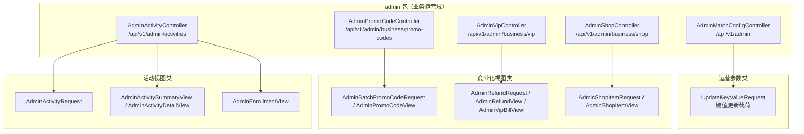
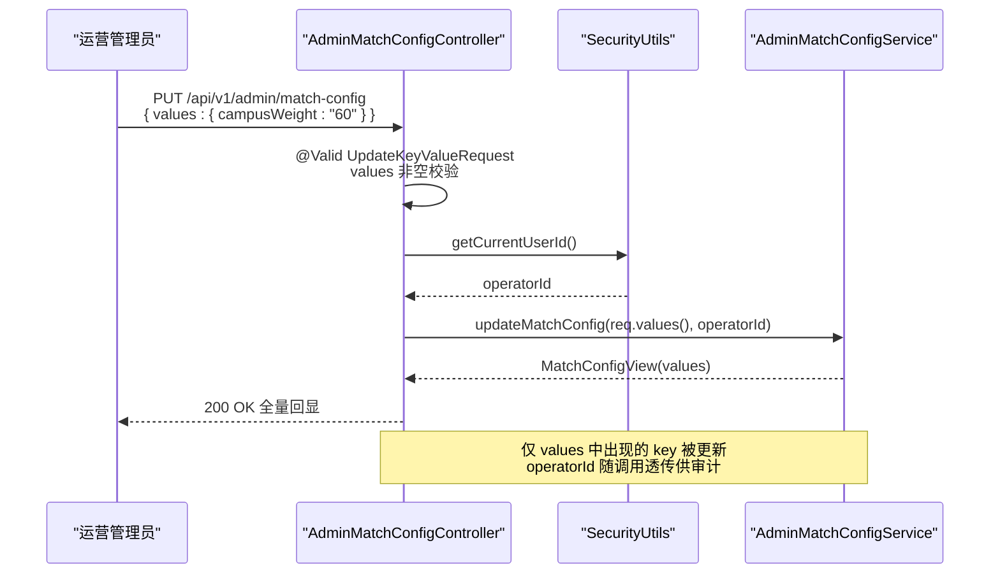
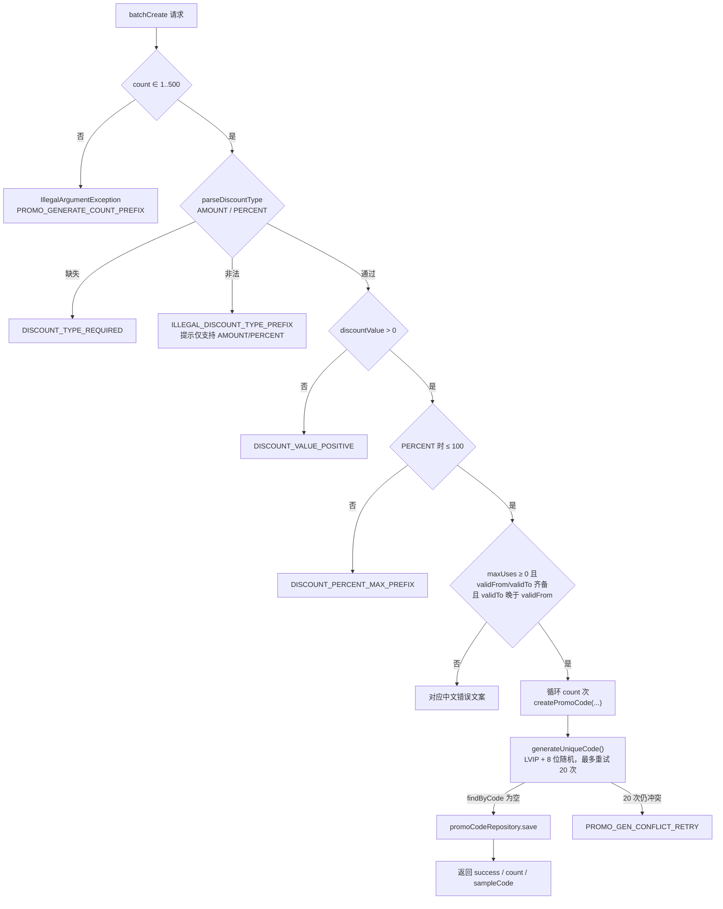
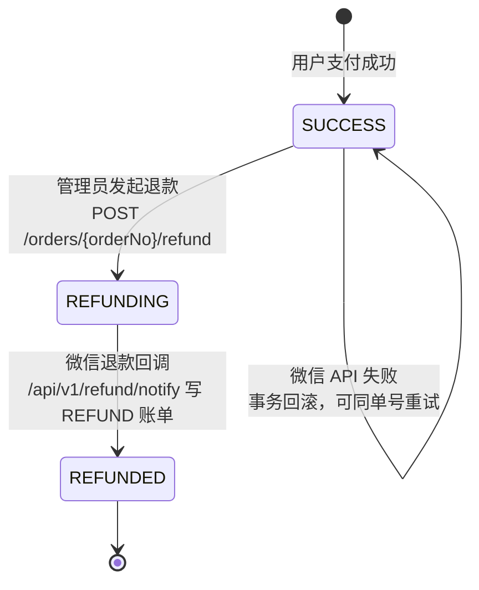
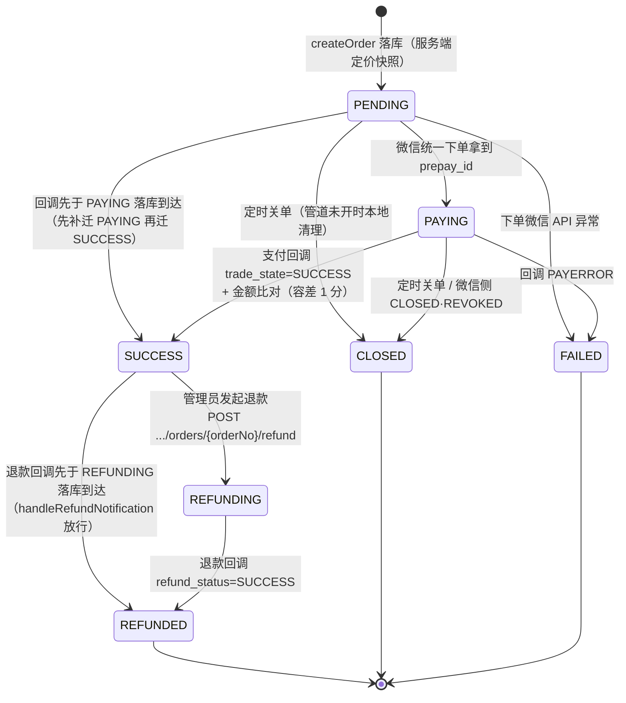
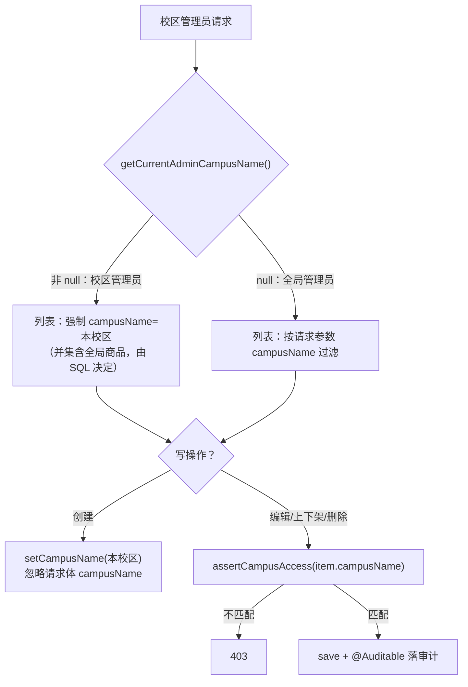
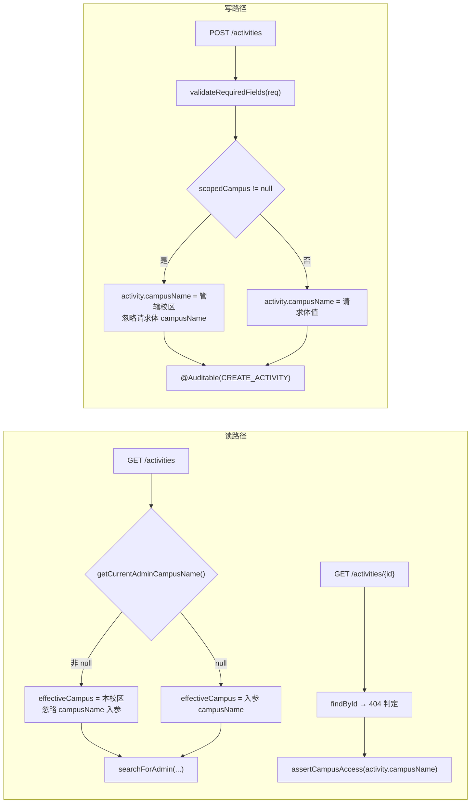
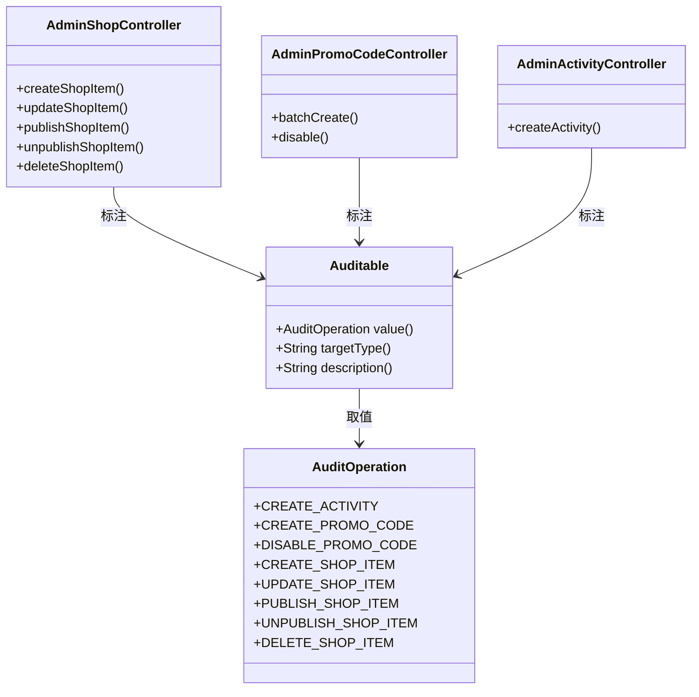
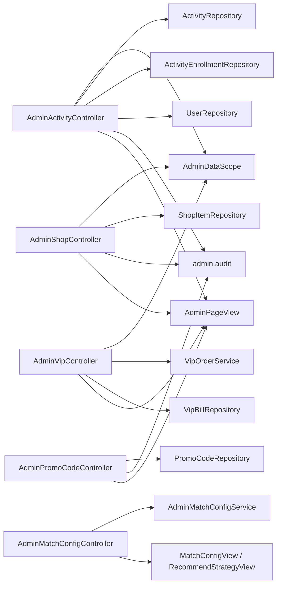

# 业务运营管理

<cite>
**本文引用的文件**
- [AdminMatchConfigController.java](file://apps/api/src/main/java/com/campuslove/api/admin/AdminMatchConfigController.java)
- [AdminActivityController.java](file://apps/api/src/main/java/com/campuslove/api/admin/AdminActivityController.java)
- [AdminPromoCodeController.java](file://apps/api/src/main/java/com/campuslove/api/admin/AdminPromoCodeController.java)
- [AdminVipController.java](file://apps/api/src/main/java/com/campuslove/api/admin/AdminVipController.java)
- [AdminShopController.java](file://apps/api/src/main/java/com/campuslove/api/admin/AdminShopController.java)
- [AdminMatchConfigService.java](file://apps/api/src/main/java/com/campuslove/api/admin/AdminMatchConfigService.java)
- [AdminDataScope.java](file://apps/api/src/main/java/com/campuslove/api/admin/AdminDataScope.java)
- [AdminPageView.java](file://apps/api/src/main/java/com/campuslove/api/admin/AdminPageView.java)
- [MatchConfigView.java](file://apps/api/src/main/java/com/campuslove/api/admin/MatchConfigView.java)
- [RecommendStrategyView.java](file://apps/api/src/main/java/com/campuslove/api/admin/RecommendStrategyView.java)
- [AuditOperation.java](file://apps/api/src/main/java/com/campuslove/api/admin/audit/AuditOperation.java)
- [Auditable.java](file://apps/api/src/main/java/com/campuslove/api/admin/audit/Auditable.java)
- [VipBillRepository.java](file://apps/api/src/main/java/com/campuslove/api/repository/VipBillRepository.java)
- [ShopItemRepository.java](file://apps/api/src/main/java/com/campuslove/api/repository/ShopItemRepository.java)
- [VipOrder.java](file://apps/api/src/main/java/com/campuslove/api/entity/VipOrder.java)
- [VipOrderRepository.java](file://apps/api/src/main/java/com/campuslove/api/repository/VipOrderRepository.java)
- [VipOrderController.java](file://apps/api/src/main/java/com/campuslove/api/vip/VipOrderController.java)
- [VipOrderService.java](file://apps/api/src/main/java/com/campuslove/api/vip/VipOrderService.java)
- [VipBill.java](file://apps/api/src/main/java/com/campuslove/api/entity/VipBill.java)
- [BillingService.java](file://apps/api/src/main/java/com/campuslove/api/vip/BillingService.java)
- [BillingController.java](file://apps/api/src/main/java/com/campuslove/api/vip/BillingController.java)
- [WxPayRefundNotifyController.java](file://apps/api/src/main/java/com/campuslove/api/wxpay/WxPayRefundNotifyController.java)
- [PaymentMetrics.java](file://apps/api/src/main/java/com/campuslove/api/monitor/PaymentMetrics.java)
- [V2026.10.05.0010__create_vip_order.sql](file://database/flyway/sql/V2026.10.05.0010__create_vip_order.sql)
- [V2026.10.05.0011__vip_bills_unique_transaction.sql](file://database/flyway/sql/V2026.10.05.0011__vip_bills_unique_transaction.sql)
- [match.spec.ts](file://apps/client/src/tests/stores/match.spec.ts)
- [activity.spec.ts](file://apps/client/src/tests/stores/activity.spec.ts)
- [MatchCard.spec.ts](file://apps/client/src/tests/components/MatchCard.spec.ts)
- [ActivityCard.spec.ts](file://apps/client/src/tests/components/ActivityCard.spec.ts)
- [navigation-config.spec.ts](file://apps/client/src/tests/navigation-config.spec.ts)
- [page-access-config.spec.ts](file://apps/client/src/tests/page-access-config.spec.ts)
</cite>

## 目录
1. [简介](#简介)
2. [项目结构](#项目结构)
3. [核心组件](#核心组件)
4. [匹配规则配置](#匹配规则配置)
5. [优惠券与推广码管理](#优惠券与推广码管理)
6. [VIP 会员运营](#vip-会员运营)
7. [VIP 订单域（微信支付工程补齐）](#vip-订单域微信支付工程补齐)
8. [商城运营](#商城运营)
9. [活动管理](#活动管理)
10. [架构总览](#架构总览)
11. [详细组件分析](#详细组件分析)
12. [依赖关系分析](#依赖关系分析)
13. [性能考虑](#性能考虑)
14. [故障排查指南](#故障排查指南)
15. [配置与开关](#配置与开关)
16. [未覆盖能力与缺口登记](#未覆盖能力与缺口登记)
17. [结论](#结论)

## 简介

本页聚焦「管理后台 API」下的业务运营域，覆盖五个后台控制器所承担的一线运营能力：匹配规则配置、活动全生命周期管理、促销码（优惠券）批量运营、VIP 会员账单与退款、以及商城商品运营。它们的实现都位于 `apps/api/src/main/java/com/campuslove/api/admin/` 包内，通过 Spring MVC 注解在 `/api/v1/admin` 及其子路径下暴露 HTTP 接口。

从路由命名可以读出本域的两条组织线索：

- 匹配配置类接口直接挂在 `@RequestMapping("/api/v1/admin")` 上，以 `/match-config`、`/recommend-strategy` 两个资源名对外提供读写，属于「运营策略参数」类能力。
- 商业化能力统一收敛在 `/api/v1/admin/business` 前缀之下：促销码为 `/api/v1/admin/business/promo-codes`，VIP 为 `/api/v1/admin/business/vip`，商城为 `/api/v1/admin/business/shop`。
- 活动管理是独立的资源集合，挂在 `/api/v1/admin/activities`，并以 `/{id}` 作为子资源锚点扩展发布、下线、报名名单与导出等动作。

需要说明的边界：catalog 的生成指令同时要求文档化「业务指标监控、运营效果分析、A/B 测试支持、业务规则引擎、策略模式与扩展点设计、自动化任务与运维脚本」。本仓库的 `admin` 包内只存在参数配置式实现，未检索到规则引擎、指标监控面板或 A/B 分流的实现证据；但 2026-10-05 微信支付工程补齐后，运营域在 `admin` 包之外接入了 VIP 订单域（`com.campuslove.api.vip` 包），该域带有 Micrometer 指标（`PaymentMetrics`）与 `@Scheduled` 定时关单任务，证据见「VIP 订单域（微信支付工程补齐）」章节。其余差异在「未覆盖能力与缺口登记」一节逐项如实登记，不在正文中以推测填充。

章节来源：
- [AdminMatchConfigController.java:31-34](file://apps/api/src/main/java/com/campuslove/api/admin/AdminMatchConfigController.java#L31-L34)
- [AdminActivityController.java:67-71](file://apps/api/src/main/java/com/campuslove/api/admin/AdminActivityController.java#L67-L71)
- [AdminPromoCodeController.java:50-54](file://apps/api/src/main/java/com/campuslove/api/admin/AdminPromoCodeController.java#L50-L54)
- [AdminVipController.java:42-46](file://apps/api/src/main/java/com/campuslove/api/admin/AdminVipController.java#L42-L46)
- [AdminShopController.java:53-57](file://apps/api/src/main/java/com/campuslove/api/admin/AdminShopController.java#L53-L57)

## 项目结构



结构上的共同点：每个控制器都在类体内以嵌套类型（nested `type`）声明自己的请求载荷与响应视图，而不是共享一套跨包 DTO。这一点从各文件尾部集中出现的 `type` 声明可以直接读出——`AdminMatchConfigController` 在第 89 行声明 `UpdateKeyValueRequest`；`AdminActivityController` 在第 650、671、691、720 行分别声明 `AdminActivityRequest`、`AdminActivitySummaryView`、`AdminActivityDetailView`、`AdminEnrollmentView`；`AdminPromoCodeController` 在第 417、447 行声明 `AdminBatchPromoCodeRequest`、`AdminPromoCodeView`；`AdminVipController` 在第 170、182、253 行声明 `AdminRefundRequest`、`AdminRefundView`、`AdminVipBillView`；`AdminShopController` 在第 321、338 行声明 `AdminShopItemRequest`、`AdminShopItemView`。

文件体量分布也反映了职责密度：活动管理（727 行）与促销码（464 行）承担最复杂的运营流程；商城（353 行）与 VIP（270 行）居中；匹配配置（91 行）最薄，仅提供参数读写入口。

章节来源：
- [AdminMatchConfigController.java:89-91](file://apps/api/src/main/java/com/campuslove/api/admin/AdminMatchConfigController.java#L89-L91)
- [AdminActivityController.java:650-727](file://apps/api/src/main/java/com/campuslove/api/admin/AdminActivityController.java#L650-L727)
- [AdminPromoCodeController.java:417-464](file://apps/api/src/main/java/com/campuslove/api/admin/AdminPromoCodeController.java#L417-L464)
- [AdminVipController.java:170-253](file://apps/api/src/main/java/com/campuslove/api/admin/AdminVipController.java#L170-L253)
- [AdminShopController.java:321-353](file://apps/api/src/main/java/com/campuslove/api/admin/AdminShopController.java#L321-L353)

## 核心组件

业务运营域由五个 `@RestController` 组成，它们共享同一套横切约定：`@Profile("real")` 限定只在真实数据配置下装配、`@PreAuthorize("hasRole('ADMIN')")` 做类级权限收口、`@Validated` 触发方法参数校验，并统一通过 `SecurityUtils.getCurrentUserId()` 取当前操作人。

| 组件 | 基础路径 | 行数 | 职责定位 | 依赖 |
| --- | --- | --- | --- | --- |
| `AdminMatchConfigController` | `/api/v1/admin` | 91 | 匹配算法权重与推荐策略的全局参数读写 | `AdminMatchConfigService` |
| `AdminActivityController` | `/api/v1/admin/activities` | 727 | 活动 CRUD、发布/下线、报名名单与导出 | 活动仓库与视图装配 |
| `AdminPromoCodeController` | `/api/v1/admin/business/promo-codes` | 464 | 促销码批量生成、停用、CSV 导出 | 促销码仓库 |
| `AdminVipController` | `/api/v1/admin/business/vip` | 270 | VIP 账单只读查询 + 管理员退款发起 | `VipBillRepository`、`AdminDataScope`、`VipOrderService` |
| `AdminShopController` | `/api/v1/admin/business/shop` | 353 | 积分商城商品 CRUD 与上下架 | `ShopItemRepository`、`AdminDataScope` |

三档权限梯度是本域最关键的组件特征：

1. **类级 ADMIN**——五个控制器均在类声明上标注 `@PreAuthorize("hasRole('ADMIN')")`，即整个运营域默认对管理员开放。
2. **方法级 SUPER_ADMIN**——只有全局生效或涉资金的写操作被再收一档：`AdminMatchConfigController` 的 `updateMatchConfig`（L57）与 `updateRecommendStrategy`（L77）都追加了 `@PreAuthorize("hasRole('SUPER_ADMIN')")`；`AdminVipController.refundOrder`（L145）同样仅限超级管理员，类注释明确写出「资金操作不开放给校区管理员」。
3. **运行期校区隔离**——`AdminVipController` 与 `AdminShopController` 注入 `AdminDataScope`，在读路径用 `getCurrentAdminCampusName()` 强制注入过滤条件，在写路径用 `assertCampusAccess(...)` 做越权断言。

`AdminMatchConfigController` 的类注释还给出与其余四个控制器不同的数据口径：匹配算法与推荐策略配置为**全局资源**，全平台统一生效、不区分校区，因此该类不做校区数据隔离，只在写操作上收敛到 SUPER_ADMIN。

```mermaid
flowchart LR
A["管理员请求"] --> B{"URL 层<br/>/api/v1/admin/**"}
B -->|非 ADMIN| X1["403"]
B -->|ADMIN| C{"Profile 判定<br/>@Profile(\"real\")"}
C -->|未激活| X2["Bean 不装配"]
C -->|激活| D{"是否写操作/资金操作"}
D -->|读| E["AdminDataScope<br/>校区过滤"]
D -->|策略参数写 / 退款| F{"hasRole('SUPER_ADMIN')"}
F -->|否| X3["403"]
F -->|是| G["Service / Repository"]
E --> G
G --> H["视图 record 返回"]
```

[此图为权限判定概念流程，节点标签取自各控制器的注解与私有方法，但连线关系为综合示意，不直接对应单一源文件]

章节来源：
- [AdminMatchConfigController.java:30-40](file://apps/api/src/main/java/com/campuslove/api/admin/AdminMatchConfigController.java#L30-L40)
- [AdminMatchConfigController.java:56-82](file://apps/api/src/main/java/com/campuslove/api/admin/AdminMatchConfigController.java#L56-L82)
- [AdminActivityController.java:67-71](file://apps/api/src/main/java/com/campuslove/api/admin/AdminActivityController.java#L67-L71)
- [AdminPromoCodeController.java:50-54](file://apps/api/src/main/java/com/campuslove/api/admin/AdminPromoCodeController.java#L50-L54)
- [AdminVipController.java:41-61](file://apps/api/src/main/java/com/campuslove/api/admin/AdminVipController.java#L41-L61)
- [AdminVipController.java:144-146](file://apps/api/src/main/java/com/campuslove/api/admin/AdminVipController.java#L144-L146)
- [AdminShopController.java:52-66](file://apps/api/src/main/java/com/campuslove/api/admin/AdminShopController.java#L52-L66)

## 匹配规则配置

`AdminMatchConfigController` 是匹配算法参数的后台入口，类注释标注为「任务 10」，共 91 行，装配条件是 `@Profile("real")`。它不直接读写数据库，而是把全部逻辑委托给同包接口 `AdminMatchConfigService`（声明于该文件第 17 行），控制器自身只做身份取值、权限判定与视图返回。

### 四个端点的契约

| 方法 | HTTP | 处理函数 | 权限 | 返回类型 |
| --- | --- | --- | --- | --- |
| 查询匹配算法配置 | `GET /api/v1/admin/match-config` | `getMatchConfig()`（L45-L49） | ADMIN | `MatchConfigView` |
| 更新匹配算法配置 | `PUT /api/v1/admin/match-config` | `updateMatchConfig(UpdateKeyValueRequest)`（L56-L62） | SUPER_ADMIN | `MatchConfigView` |
| 查询推荐策略配置 | `GET /api/v1/admin/recommend-strategy` | `getRecommendStrategy()`（L67-L71） | ADMIN | `RecommendStrategyView` |
| 更新推荐策略配置 | `PUT /api/v1/admin/recommend-strategy` | `updateRecommendStrategy(UpdateKeyValueRequest)`（L76-L82） | SUPER_ADMIN | `RecommendStrategyView` |

值得注意的是类注释书写的路径是 `/api/admin/...`，而生效路径由 `@RequestMapping("/api/v1/admin")`（L32）决定，实际对外为 `/api/v1/admin/...`；权限注释也提到「URL 层 `/api/admin/**` 已限制 ADMIN 角色，方法层 `@PreAuthorize` 作为深度防御（需 `@EnableMethodSecurity` 启用后生效）」，说明方法级注解是第二道防线而非唯一防线。

### 键值对式配置载荷

匹配算法配置与推荐策略共用同一个请求类型 `UpdateKeyValueRequest`（L89-L91），其唯一成员是 `@NotNull Map<String, String> values`。响应侧同样是弱类型容器：`MatchConfigView` 与 `RecommendStrategyView` 都只包一个 `Map<String, String> values` 字段。

这意味着配置项的名字、类型与合法区间**不在 Java 类型系统中约束**——所有值都以字符串形态传输，具体键集合由 `AdminMatchConfigService` 的实现决定。控制器注释给出的示例键是 `campusWeight`，形如 `{ "values": { "campusWeight": "60", ... } }`，并且明确「仅更新 values 中包含的 key」，即 PUT 是增量合并语义而非整体覆盖。



**图表来源**
- [AdminMatchConfigController.java:56-62](file://apps/api/src/main/java/com/campuslove/api/admin/AdminMatchConfigController.java#L56-L62)
- [AdminMatchConfigController.java:89-91](file://apps/api/src/main/java/com/campuslove/api/admin/AdminMatchConfigController.java#L89-L91)
- [MatchConfigView.java:14-17](file://apps/api/src/main/java/com/campuslove/api/admin/MatchConfigView.java#L14-L17)

### 数据隔离口径

与运营域其余控制器不同，本控制器**不做校区隔离**。类注释对此有明确交代：匹配算法/推荐策略配置为全局资源，全平台统一生效、不区分校区，写操作仅限 SUPER_ADMIN。代码层面也能印证——两个写方法都只调用 `SecurityUtils.getCurrentUserId()` 取操作人 ID 并透传给服务层，没有任何 `AdminDataScope` 注入或 `assertCampusAccess` 断言。

同样的全局口径出现在促销码模块：`AdminPromoCodeController` 类注释写明「兑换码为全局资源（`createdBy` 管理员，无校区归属），不做校区过滤」。因此运营域在隔离策略上分为两个阵营——**参数/营销资产类**（匹配配置、推荐策略、兑换码）全局共享，**用户数据类**（VIP 账单、商城商品、活动）按校区隔离。

章节来源：
- [AdminMatchConfigController.java:16-40](file://apps/api/src/main/java/com/campuslove/api/admin/AdminMatchConfigController.java#L16-L40)
- [AdminMatchConfigController.java:42-83](file://apps/api/src/main/java/com/campuslove/api/admin/AdminMatchConfigController.java#L42-L83)
- [AdminMatchConfigController.java:85-91](file://apps/api/src/main/java/com/campuslove/api/admin/AdminMatchConfigController.java#L85-L91)
- [AdminMatchConfigService.java:17-17](file://apps/api/src/main/java/com/campuslove/api/admin/AdminMatchConfigService.java#L17-L17)
- [MatchConfigView.java:14-17](file://apps/api/src/main/java/com/campuslove/api/admin/MatchConfigView.java#L14-L17)
- [RecommendStrategyView.java:13-16](file://apps/api/src/main/java/com/campuslove/api/admin/RecommendStrategyView.java#L13-L16)
- [AdminPromoCodeController.java:42-48](file://apps/api/src/main/java/com/campuslove/api/admin/AdminPromoCodeController.java#L42-L48)

## 优惠券与推广码管理

`AdminPromoCodeController` 实现 VIP 优惠码（兑换码）的管理端运营闭环，基础路径 `/api/v1/admin/business/promo-codes`，共 464 行。类注释定位为「兑换码（VIP 优惠码）商业模块控制器」，提供分页列表、批量生成、作废、CSV 导出四类管理端点。

### 端点一览

| HTTP | 处理函数 | 事务 | 审计注解 | 返回 |
| --- | --- | --- | --- | --- |
| `GET /api/v1/admin/business/promo-codes` | `listPromoCodes(...)`（L90-L119） | 无 | 无 | `AdminPageView<AdminPromoCodeView>` |
| `POST .../promo-codes/batch` | `batchCreate(AdminBatchPromoCodeRequest)`（L141-L180） | `@Transactional` | `AuditOperation.CREATE_PROMO_CODE` | `Map<String, Object>` |
| `POST .../promo-codes/{id}/disable` | `disable(@Positive Long id)`（L189-L211） | `@Transactional` | `AuditOperation.DISABLE_PROMO_CODE` | `Map<String, Object>` |
| `GET .../promo-codes/export` | `exportCsv()`（L219-L248） | 无 | 无 | `ResponseEntity<byte[]>` |

### 码生成机制

生成规则由五个类常量固化（L57-L73），全部参数集中可见、无外部配置项：

- `MAX_BATCH_COUNT = 500`——单批最大生成数量。
- `MAX_PERCENT = 100`——百分比折扣上限。
- `CODE_PREFIX = "LVIP"`——固定前缀，与 8 位随机段拼成 12 位码。
- `CODE_CHARSET = "ABCDEFGHJKLMNPQRSTUVWXYZ23456789"`——随机字符集，刻意剔除易混淆字符（`O/0`、`I/1`）。
- `CODE_RETRY_LIMIT = 20`——唯一性冲突重试上限。
- 随机源为静态 `SecureRandom SECURE_RANDOM`（L73），而非 `java.util.Random`。



**图表来源**
- [AdminPromoCodeController.java:56-73](file://apps/api/src/main/java/com/campuslove/api/admin/AdminPromoCodeController.java#L56-L73)
- [AdminPromoCodeController.java:145-180](file://apps/api/src/main/java/com/campuslove/api/admin/AdminPromoCodeController.java#L145-L180)
- [AdminPromoCodeController.java:288-300](file://apps/api/src/main/java/com/campuslove/api/admin/AdminPromoCodeController.java#L288-L300)

### 校验的双保险设计

`batchCreate` 同时使用声明式与命令式两套校验。请求记录 `AdminBatchPromoCodeRequest`（L417-L427）上标注 `@Min(1) @Max(MAX_BATCH_COUNT) count`、`@Positive discountValue`、`@Min(0) maxUses`；方法体内又对同样的约束逐条重写一遍，注释说明意图是「与 `@Valid` 双保险，保证统一中文错误文案」——即 Bean Validation 的默认英文消息被 `ErrorMessages` 常量替换。该行的 R4-01843 注释还记录了一次修正：`@Max` 原为字面量 500，与校验分支的常量易漂移，故统一引用 `MAX_BATCH_COUNT`。

`maxUses` 的语义值得单独注意：`0` 表示不限次数，此时 `remainingUses` 被初始化为 `Integer.MAX_VALUE`（L271），注释指出这与 Flyway 迁移及客户端兑换语义保持一致。`maxUsesPerUser` 在批量生成路径被硬编码为 `1`（L268），`usedCount` 初始化为 `0`，新码状态固定为 `ACTIVE`。

### 作废与导出

作废是幂等的：`disable`（L189-L211）取出实体后无条件 `setStatus(PromoCode.PromoStatus.DISABLED.name())` 再保存，注释明确「已作废的兑换码再次作废直接返回当前状态」，找不到码时返回 404。`updatedAt` 不在方法里赋值，而由 `@LastModifiedDate` 自动维护。

`exportCsv`（L219-L248）导出全量、不分页，按 `createdAt` 倒序，输出六列表头「兑换码,折扣类型,折扣值,状态,有效期起,有效期止」。三处细节服务于 Excel 兼容性：首字符写入 UTF-8 BOM `'\uFEFF'` 以识别中文表头；`Content-Type` 显式带 `StandardCharsets.UTF_8`；`Content-Disposition` 用 `attachment().filename(filename, UTF_8)`。文件名格式为 `promo_codes_yyyyMMddHHmmss.csv`，时间取自 `LocalDateTime.now(TimeZones.BUSINESS)`。字段级转义由 `escapeCsv`（L386-L394）承担，含逗号/引号/换行时用双引号包裹并双写引号。枚举值输出为中文标签：`discountTypeLabel`（L359-L364）映射「百分比折扣」/「满减金额」，`statusLabel`（L369-L374）映射「已禁用」/「可用」。

### 视图与查询参数

列表接口的筛选参数为 `status` 与 `keyword`，其中 `status` 经 `parsePromoStatus`（L327-L338）做大小写不敏感的枚举匹配，非法值直接抛错而不是静默忽略。`AdminPromoCodeView`（L447-L463）暴露 14 个字段，覆盖折扣配置、用量计数（`usedCount`/`remainingUses`）、有效期与 `createdBy` 归属，是运营侧统计兑换码消耗率的唯一数据来源。

章节来源：
- [AdminPromoCodeController.java:42-79](file://apps/api/src/main/java/com/campuslove/api/admin/AdminPromoCodeController.java#L42-L79)
- [AdminPromoCodeController.java:90-119](file://apps/api/src/main/java/com/campuslove/api/admin/AdminPromoCodeController.java#L90-L119)
- [AdminPromoCodeController.java:141-180](file://apps/api/src/main/java/com/campuslove/api/admin/AdminPromoCodeController.java#L141-L180)
- [AdminPromoCodeController.java:189-211](file://apps/api/src/main/java/com/campuslove/api/admin/AdminPromoCodeController.java#L189-L211)
- [AdminPromoCodeController.java:219-248](file://apps/api/src/main/java/com/campuslove/api/admin/AdminPromoCodeController.java#L219-L248)
- [AdminPromoCodeController.java:259-300](file://apps/api/src/main/java/com/campuslove/api/admin/AdminPromoCodeController.java#L259-L300)
- [AdminPromoCodeController.java:327-394](file://apps/api/src/main/java/com/campuslove/api/admin/AdminPromoCodeController.java#L327-L394)
- [AdminPromoCodeController.java:406-427](file://apps/api/src/main/java/com/campuslove/api/admin/AdminPromoCodeController.java#L406-L427)
- [AdminPromoCodeController.java:447-464](file://apps/api/src/main/java/com/campuslove/api/admin/AdminPromoCodeController.java#L447-L464)

## VIP 会员运营

`AdminVipController`（270 行，基础路径 `/api/v1/admin/business/vip`）的当前职责与命名并不一致，这来自一次明确记录在源码注释里的产品变更。

### 能力收缩的历史痕迹

类注释标注 R4-00397：「VIP 会员已下线，红包实体/页面已删，本控制器仅保留账单只读查询能力，供对账/追溯用」。因此 `AdminVipController` 自身不提供会员开通、套餐配置或权益发放端点，管理侧落点是**账单追溯 + 退款处置**。需要更正的是：「不存在会员生命周期管理接口」这一结论只对后台管理端成立——2026-10-05 订单域落地后，用户端已恢复「下单 → 支付 → 开通/顺延 → 退款」的完整生命周期能力（客户端下单与查单端点见 `VipOrderController`，权益发放由支付回调经订单状态机驱动，见下文「VIP 订单域（微信支付工程补齐）」），只是该生命周期不由管理后台端点驱动。

2026-10-05 的微信支付工程补齐又反向增加了一个写端点：`POST /api/v1/admin/business/vip/orders/{orderNo}/refund`，注释特别注明「资金操作不开放给校区管理员」。

### 端点与依赖

控制器注入三个协作对象（L48-L61）：`VipBillRepository`（声明于该仓库文件第 17 行，`extends JpaRepository<VipBill, Long>`）、`AdminDataScope`（第 38 行的校区隔离组件）、`VipOrderService`（位于 `com.campuslove.api.vip` 包）。

| HTTP | 处理函数 | 权限 | 说明 |
| --- | --- | --- | --- |
| `GET .../vip/bills` | `listBills(...)`（L73-L106） | ADMIN | 分页查询，支持 `userId`/`planType`/`status` 筛选 |
| `GET .../vip/bills/{id}` | `getBill(...)`（L114-L126） | ADMIN | 详情查询，不存在返回 404 |
| `POST .../vip/orders/{orderNo}/refund` | `refundOrder(...)`（L144-L163） | SUPER_ADMIN | 发起微信全额退款 |

`planType` 取值在注释中固定为套餐 ID `monthly`/`quarterly`/`yearly`；`status` 取值 `SUCCESS`/`FAILED`/`REFUNDED`。列表按创建时间倒序，分页参数 1-based、默认 `page=1`、`pageSize=20`、上限 100。

### 校区数据隔离的两条实施路径

隔离口径写在类注释里：账单按用户归属校区（`UserCampusProfile.campusName`）过滤，校区管理员仅可见本校区用户数据，全局管理员（`SUPER_ADMIN` 或无校区的 `ADMIN`）可见全部。代码用两种不同手段落实：

- **列表侧＝查询条件注入**。`listBills` 调用 `adminDataScope.getCurrentAdminCampusName()` 得到 `effectiveCampus`，直接作为 `vipBillRepository.searchForAdmin(userId, planType, status, effectiveCampus, pageable)` 的参数。校区管理员无法通过请求参数绕过，因为该值来自会话而非入参——本接口根本没有 `campusName` 请求参数。
- **详情侧＝事后断言**。`getBill` 先 `findById`，命中后调用私有方法 `resolveUserCampus(bill.getUserId())`（L219-L224）反查用户归属校区，再交给 `adminDataScope.assertCampusAccess(...)` 判定，注释明确越权访问返回 403。

注意 `getBill` 的越权语义与「不存在返回 404」并存：先判空返回 404，再判校区返回 403。

### 退款状态机与错误口径

`refundOrder` 的流程与错误分类被注释完整记录，并在代码中通过异常类型映射实现：



**图表来源**
- [AdminVipController.java:132-138](file://apps/api/src/main/java/com/campuslove/api/admin/AdminVipController.java#L132-L138)
- [AdminVipController.java:144-163](file://apps/api/src/main/java/com/campuslove/api/admin/AdminVipController.java#L144-L163)

幂等性由商户退款单号保证：`outRefundNo` 为 `RF + orderNo`，注释称「全额退款，重试安全」。异常映射为三档——订单不存在或状态不允许时服务层抛 `IllegalArgumentException`（400 语义）；`WxPayDisabledException`（`enabled=false`，含 mock/off）被 `catch` 后重新抛出 `ResourceNotFoundException`，注释解释这样做的目的是「404 与用户端支付端点口径一致」；`WxPayApiException` 被包装为 `IllegalStateException("微信退款受理失败: " + e.getMessage())`，对应 502 语义，且注释强调此时事务已回滚、订单留在 `SUCCESS`。

`AdminRefundView`（L182-L189）返回 `orderNo`/`refundId`/`outRefundNo`/`status`/`refundCents` 五个字段，受理成功时 `status` 为 `REFUNDING` 而非终态。请求体 `AdminRefundRequest(String reason)`（L170-L171）为可空体（`@RequestBody(required = false)`），`reason` 仅用于审计日志。

`AdminVipBillView`（L253-L268）共 13 个字段，其中 `amount` 与 `originalAmount` 单位为分，`type` 取值 `SUBSCRIBE`/`RENEW`/`REFUND`，`paymentMethod` 取值 `WECHAT`/`ALIPAY`，并保留 `transactionId` 第三方交易号用于对账。

章节来源：
- [AdminVipController.java:30-61](file://apps/api/src/main/java/com/campuslove/api/admin/AdminVipController.java#L30-L61)
- [AdminVipController.java:63-106](file://apps/api/src/main/java/com/campuslove/api/admin/AdminVipController.java#L63-L106)
- [AdminVipController.java:108-163](file://apps/api/src/main/java/com/campuslove/api/admin/AdminVipController.java#L108-L163)
- [AdminVipController.java:165-234](file://apps/api/src/main/java/com/campuslove/api/admin/AdminVipController.java#L165-L234)
- [AdminVipController.java:236-270](file://apps/api/src/main/java/com/campuslove/api/admin/AdminVipController.java#L236-L270)
- [VipBillRepository.java:17-17](file://apps/api/src/main/java/com/campuslove/api/repository/VipBillRepository.java#L17-L17)

## VIP 订单域（微信支付工程补齐）

2026-10-05 的微信支付工程补齐在 `admin` 包之外新建了 VIP 订单域（`com.campuslove.api.vip` 包 + 实体/仓储 + 两条 Flyway 迁移），承接「下单 → 待支付 → 支付成功/关单/失败 → 退款中 → 已退款」的完整生命周期。管理后台的退款端点（上一节）正是经由该域的 `VipOrderService.initiateRefund` 落地的，因此一并登记在此。微信支付管道本身（JSAPI 客户端、验签器、IP 守卫等，位于 `com.campuslove.api.wxpay` 包）由专门文档描述，本章只记录订单域如何调用它。

### 域组成与接入端点

| 组件 | 位置 | 职责 |
| --- | --- | --- |
| `VipOrder` | `entity/VipOrder.java`（实体声明 L46，表映射 L33-L45） | 订单实体，7 个状态常量（L48-L61），乐观锁 `@Version`（L136-L143） |
| `VipOrderRepository` | `repository/VipOrderRepository.java`（L15） | `findByOrderNo`（L23，回调幂等入口）、`findByUserIdAndOrderNo`（L32，查单归属校验）、`findByStatusInAndExpireAtBefore`（L41，定时关单扫描） |
| `VipOrderService` | `vip/VipOrderService.java`（L61-L63） | 状态机唯一迁移入口、下单、支付/退款回调处理、退款发起、定时关单 |
| `VipOrderController` | `vip/VipOrderController.java`（L36-L40） | 用户端下单/查单 HTTP 端点 |

用户端两个端点：`POST /api/v1/vip/orders`（`createOrder`，L58-L68）挂 `@FeatureSwitch(FeatureSwitchKeys.COMMERCE_VIP)` 商业化子闸与 `@PreAuthorize("hasRole('USER')")`，且当 `wxPayProperties` 未启用时抛 `ResourceNotFoundException` 返回 404（管道未开闸，L62-L65）；`GET /api/v1/vip/orders/{orderNo}`（`getOrder`，L77-L82）以 `SecurityUtils.getCurrentUserId()` + `findByUserIdAndOrderNo` 做「仅本人订单可见」的归属校验，请求体 `VipOrderCreateRequest` 仅一个 `@NotBlank @Size(max=32) planId` 字段（L85-L93）。类注释同时说明：商业化总开关本次不解封，客户端收到 404/COMMERCE_DISABLED 时维持「支付未开通」提示（L21-L35）。

订单域对微信支付的调用点共四处，全部经 `WxPayJsapiService`：下单时 `createJsapiOrder` 换取 prepay_id（`VipOrderService` L161-L174）、`buildJsapiPayParams` 组装 `wx.requestPayment` 五件套（L175-L178，视图 `OrderCreatedView` 字段与小程序参数严格对齐、`package` 经 `@JsonProperty` 映射，L710-L725）；退款时 `createRefund`（L495-L497）；关单时 `closeOrder`（L538-L547）。回调进入订单域的两个入口是 `BillingController` 的 `POST /api/v1/vip/bills/payment-callback`（`@RequestMapping` L67、`@PostMapping` L113，转调 `handlePayNotification` L187）与 `WxPayRefundNotifyController` 的 `POST /api/v1/refund/notify`（L30、L71，转调 `handleRefundNotification` L143），两者在进入业务前都执行「配置闸 → IP 白名单 → RSA-SHA256 验签 + 防重放 → AES-256-GCM 解密」防护链（支付回调侧 L121-L183，退款回调侧 L79-L128）。

### 订单状态机：状态、合法迁移与守卫函数

实体类注释与迁移脚本共同声明了同一张迁移表（`VipOrder` L23-L29；`V2026.10.05.0010` L11-L19），代码中的真相源是 `VipOrderService.ALLOWED_TRANSITIONS`（L83-L88）：

| 当前状态 | 合法目标 |
| --- | --- |
| `PENDING`（已创建，未获取 prepay_id，L48-L49） | `PAYING` / `CLOSED` / `FAILED` |
| `PAYING`（已拿到 prepay_id，等待用户支付，L50-L51） | `SUCCESS` / `CLOSED` / `FAILED` |
| `SUCCESS`（支付成功，L52-L53） | `REFUNDING` |
| `REFUNDING`（退款中，L56-L57） | `REFUNDED` |
| `CLOSED` / `FAILED` / `REFUNDED`（终态，L54-L61） | 无出边 |

守卫函数为 `applyTransition(VipOrder, String target)`（L564-L577）：查 `ALLOWED_TRANSITIONS`，当前状态无到目标的合法边即抛内部异常类 `IllegalOrderStateException`（继承 `IllegalStateException`，携带 `from`/`to`，L589-L610）。类注释明确该方法是「迁移唯一入口」（`VipOrder` L23）。另有一个宽松版 `applyTransitionQuietly`（L579-L587）供定时关单与回调清理场景使用——非法迁移仅告警、保持原状态。两处不经守卫的直接 `setStatus` 属于有意设计：下单 API 失败置 `FAILED` 终态（L179-L185，无出边状态不经状态机也可安全直达）；退款回调把 `SUCCESS → REFUNDED` 作为合法来源手工放行（见下文退款回调一节）。



**图表来源**
- [VipOrderService.java:83-88](file://apps/api/src/main/java/com/campuslove/api/vip/VipOrderService.java#L83-L88)
- [VipOrderService.java:291-362](file://apps/api/src/main/java/com/campuslove/api/vip/VipOrderService.java#L291-L362)
- [VipOrder.java:48-61](file://apps/api/src/main/java/com/campuslove/api/entity/VipOrder.java#L48-L61)

### vip_order 表结构与唯一约束

DDL 位于 `V2026.10.05.0010__create_vip_order.sql`（L27-L54），与 `VipOrder` 实体注解逐项镜像（L33-L45、L63-L143）：

- `order_no VARCHAR(32) NOT NULL` + **`UNIQUE KEY uk_vip_order_no`**（DDL L29、L50；实体 L38-L39、L67-L69）——商户订单号全局唯一，兼作回调幂等键；生成规则为 `VIP + yyyyMMddHHmmss + 8 位随机大写`，共 25 位、落在微信 out_trade_no 的 6-32 位上限内（`newOrderNo` L646-L650、注释 L70-L71）。
- `user_id BIGINT UNSIGNED NOT NULL` + `fk_vip_order_user` 外键指向 `users(id)`、`ON DELETE RESTRICT`（DDL L30、L53）；`idx_vip_order_user` 支撑按用户查单（DDL L51）。
- 套餐与金额均为**下单时服务端定价快照**：`plan_id`/`plan_name`/`plan_days`/`amount_cents`（DDL L31-L34；实体 L75-L89），注释强调「不信客户端传入金额」。套餐目录 `PLAN_CATALOG` 是服务端定价唯一真相源：monthly=1800 分/30 天、quarterly=4800 分/90 天、yearly=15800 分/365 天，与客户端 `config/vip-plans.ts` 对齐（L73-L81）；非法套餐经 `planOf` 拒绝（L634-L644）。
- `status VARCHAR(16) NOT NULL DEFAULT 'PENDING'`（DDL L35-L36；实体默认值 L91-L93）。
- 支付链路字段 `openid`/`prepay_id`/`wx_transaction_id`/`refund_id`（DDL L37-L40）与时间戳 `expire_at`/`paid_at`/`closed_at`/`refunded_at`/`notify_processed_at`（DDL L41-L45；`expire_at` = 下单时间 + `orderExpireMinutes()`，缺省 120 分钟，L156、L652-L654）。
- **`version BIGINT NOT NULL DEFAULT 0`** 乐观锁列（DDL L49；实体 `@Version` L136-L143）——并发重复回调时后提交方抛 `ObjectOptimisticLockingFailureException`，上层按「已被并发处理」幂等应答。
- 复合索引 `idx_vip_order_status_expire (status, expire_at)` 专为定时关单扫描而建（DDL L52、注释 L21-L24；实体 L42-L43）。

`created_at` 由实体 `@CreatedDate` 审计维护（L131-L134），DDL 侧另带 `updated_at ON UPDATE CURRENT_TIMESTAMP`（L47-L48）。

### 支付回调：四层幂等防线与 VIP 顺延

类注释把幂等设计（替代原「notificationId+orderNo 双键查询——可被同 orderNo 换新 notificationId 绕过」）列为四条防线（L51-L59），逐条对应到代码：

1. **订单状态机是唯一真相源**：订单已处于 `SUCCESS`/`REFUNDING`/`REFUNDED` 时重复通知直接成功应答（L259-L269）。
2. **`vip_order.version` 乐观锁兜底并发回调**：save 冲突按幂等成功处理（L312-L319）；状态迁移被并发方抢占时 `IllegalOrderStateException` 同样转幂等应答（L301-L307）。
3. **`vip_bills.transaction_id` 唯一约束**（0011 迁移）兜底防重复账单：写账单撞约束抛 `DataAccessException` 时返回 `FAIL` 触发微信重试而非吞掉事实（L321-L330）。
4. **`payment_callback_log.notification_id` 唯一索引保留为留痕去重**：写入冲突静默忽略、留痕失败不影响主流程应答（`writeCallbackLog` L667-L697）。

回调处理还包含金额对账：回调金额与服务端定价（分）比对、容差 `AMOUNT_TOLERANCE_CENTS = 1`（L67-L68、L271-L289），缺金额或超容差一律 `FAIL`。`trade_state` 分流：`SUCCESS` 走上述迁移 + 开通（L293-L337）；`CLOSED`/`REVOKED` 经 `applyTransitionQuietly` 置 `CLOSED`（L339-L348）；`PAYERROR` 置 `FAILED`（L350-L357）；其余状态（NOTPAY/USERPAYING）应答 SUCCESS 停止重试、等后续通知（L359-L362）。支付成功后的权益发放复用既有账单服务：`grantVipAndWriteBill` 调 `BillingService.grantVipExpiry` 做「max(now, 最近一笔 SUCCESS 账单 periodEnd) + 套餐天数」的顺延（L621-L632；`BillingService.java` L168-L181，该方法 2026-10-05 由 private 提升为 public 供订单域复用，注释 L160-L162），并写 `SUBSCRIBE`/`SUCCESS`/`WECHAT` 账单、`transactionId` 取微信交易单号。

### 管理员退款发起：端点路径与 SUPER_ADMIN 判定方式

端点为 `POST /api/v1/admin/business/vip/orders/{orderNo}/refund`（`AdminVipController` 类级 `@RequestMapping("/api/v1/admin/business/vip")` L43 + 方法级 `@PostMapping("/orders/{orderNo}/refund")` L144）。SUPER_ADMIN 的判定方式是 **Spring Security 角色表达式注解**而非代码内判断：类级 `@PreAuthorize("hasRole('ADMIN')")`（L44）之上，`refundOrder` 方法追加 `@PreAuthorize("hasRole('SUPER_ADMIN')")`（L144-L146），类注释写明「资金操作不开放给校区管理员」（L38-L39），并按既有约定注明方法注解需 `@EnableMethodSecurity` 启用后生效（L33-L34）。

服务层 `initiateRefund`（L455-L503）的执行顺序：① 管道闸——`wxPayProperties == null || !enabled || wxPayJsapiService == null`（即 mock/off）时抛 `WxPayDisabledException`，不产生半状态，控制层将其翻译为 404（L477-L480；`AdminVipController` L156-L158）；② 订单存在性与状态前置——仅 `SUCCESS` 或 `REFUNDING` 可进入，后者放行只为让状态机对重复发起抛 `IllegalOrderStateException` 实现幂等拒绝（L481-L488）；③ `applyTransition(order, REFUNDING)` 状态机唯一入口迁移 SUCCESS→REFUNDING（L489-L490）；④ 全额调微信 `createRefund`，商户退款单号 `outRefundNo = "RF" + orderNo`（≤32 位），微信侧按其幂等、重试安全（L492-L497）；⑤ 回填 `refundId` 并返回 `RefundInitiatedView`（L498-L503、L505-L513）。微信 API 失败抛 `WxPayApiException` 时 `@Transactional` 整体回滚，订单留在 `SUCCESS`（Javadoc L460-L462）。

### 退款回调确认：端点与幂等防线

退款终态由 `POST /api/v1/refund/notify` 确认（`WxPayRefundNotifyController`：`@RequestMapping("/api/v1/refund")` L30、`@PostMapping("/notify")` L71）。该端点在 `SecurityConfig` 中 permitAll（微信服务器无 JWT），防护全部在端点内完成（类注释 L21-L26）：配置闸 404（L79-L82）→ IP 白名单，X-Forwarded-For 首跳优先（L84-L88、L159-L171）→ 真实验签 RSA-SHA256 + 时间戳防重放（L90-L97）→ AES-256-GCM 解密（L116-L128），任一环节失败按 `signature_invalid`/`envelope_invalid`/`decrypt_failed`/`payload_invalid`/`internal_error` 计入回调失败指标（L93-L95、L104-L106、L123-L127、L152-L154）。

`handleRefundNotification`（L367-L451）的幂等防线依次为：已 `REFUNDED` 的重复通知直接成功应答（L396-L401）；`refund_status` 非 `SUCCESS`（ABNORMAL/CLOSED）时保持 REFUNDING 现状等待人工介入、应答 SUCCESS 停止微信重试（L403-L410）；来源状态白名单——`REFUNDING` 与 `SUCCESS` 均可迁移到 `REFUNDED`，后者容忍退款回调先于发起方落 REFUNDING 到达的竞态，其余状态拒绝并返回 FAIL（L412-L420）；此处不经 `applyTransition` 而是直接 `setStatus(REFUNDED)` 加回填 `refundId`/`refundedAt`/`notifyProcessedAt`（L421-L424），save 撞乐观锁即判定并发已处理、幂等成功（L425-L430）；最后写 `REFUND` 账单，`transactionId` 取**微信退款单号 refundId**——与支付账单的交易单号天然不同值，因此不撞 `uk_vip_bills_transaction` 唯一键（L432-L445，注释 L432-L433）。

### 定时关单：本域确有 @Scheduled（更正旧结论）

旧版文档「本域无 @Scheduled」的结论在订单域不再成立：`closeExpiredOrders` 标注 `@Scheduled(fixedDelay = 60_000, initialDelay = 120_000)`（L517-L527），且 `@EnableScheduling` 已在应用入口 `CampusLoveApplication` 启用（L25）。逻辑：`findByStatusInAndExpireAtBefore(List.of(PENDING, PAYING), now)` 扫描过期单（L528-L531，走复合索引 `idx_vip_order_status_expire`）；`enabled` 且状态为 `PAYING` 时先调微信 `closeOrder` 再本地置终态——微信关单 API 失败（可能是用户恰好支付完成）则跳过本轮、等支付回调确认（L537-L547），运行中开关被关（`WxPayDisabledException`）则降级为本地关单（L548-L551）；置 `CLOSED` 用 `applyTransitionQuietly` 并回填 `closedAt`（L553-L557）。管道未开（enabled=false）时不存在线上订单，仅做本地兜底清理（Javadoc L520-L522）。

### 0011 迁移：先去重、再加唯一约束的处理顺序

`V2026.10.05.0011__vip_bills_unique_transaction.sql` 把 `vip_bills.transaction_id` 从普通索引 `idx_vip_bills_transaction` 升级为唯一键 `uk_vip_bills_transaction`，堵住「应用层幂等被绕过（同 orderNo 换新 notificationId 重放）」的数据库缺口（L4-L10）。对既有重复数据的处理顺序是**先去重再加约束，避免加约束失败**（策略注释 L13-L17），三个步骤严格按序：

1. **去重 UPDATE**（L19-L35）：按 `transaction_id` 分组找出 `COUNT(*) > 1` 的重复集，每组仅保留 `MIN(id)` 最早一条，其余行 `SET b.transaction_id = NULL`。刻意置 NULL 而非删除行——保留账单记录本身，同时让唯一键成立；MySQL 唯一键允许多个 NULL，历史 FAILED/无交易号账单不受影响（L10-L11、L15-L16）。
2. **条件加唯一键**（L37-L49）：先查 `information_schema.STATISTICS` 判 `uk_vip_bills_transaction` 是否已存在，经 `PREPARE/EXECUTE` 动态 DDL 添加——存在即跳过，为脚本级幂等保护。
3. **条件移除旧普通索引**（L51-L63）：同样先探测 `idx_vip_bills_transaction` 再 `DROP INDEX`，避免重复索引。

实体侧注释已同步该迁移：`VipBill` 的 `@Table` 将 `uk_vip_bills_transaction` 声明为 `unique = true`（L50-L63，尤其 L57-L59），类注释记录升级来历（L39-L41）。应用层与数据库层的配合见上文支付回调第 3 条防线。

### 指标接入：PaymentMetrics 双指标

订单域是运营链路目前唯一的 Micrometer 指标接入点（`monitor/PaymentMetrics.java`）：`payment.callback.latency` Timer 发布 p50/p95/p99 百分位（L34-L35、L49-L53），在 `handlePayNotification` 出入口计时（`VipOrderService` L223-L234）；`payment.callback.failure` Counter 按 `reason` 标签动态注册（L36-L37、L70-L89），由 `recordFailure` 在 `missing_out_trade_no`/`order_not_found`/`duplicate_notify`/`amount_missing`/`amount_mismatch`/`illegal_transition`/`persist_error` 等分支调用（L614-L619），docker/prometheus/rules/alert-rules.yml 的 PaymentCallbackFailure 告警以此指标为数据源（`PaymentMetrics` L18-L20 注释）。指标注入均为 `@Autowired(required = false)`、缺数时静默跳过，单元测试可为 null（L102-L108）。

章节来源：
- [VipOrderService.java:35-59](file://apps/api/src/main/java/com/campuslove/api/vip/VipOrderService.java#L35-L59)
- [VipOrderService.java:67-88](file://apps/api/src/main/java/com/campuslove/api/vip/VipOrderService.java#L67-L88)
- [VipOrderService.java:133-186](file://apps/api/src/main/java/com/campuslove/api/vip/VipOrderService.java#L133-L186)
- [VipOrderService.java:223-363](file://apps/api/src/main/java/com/campuslove/api/vip/VipOrderService.java#L223-L363)
- [VipOrderService.java:376-451](file://apps/api/src/main/java/com/campuslove/api/vip/VipOrderService.java#L376-L451)
- [VipOrderService.java:455-513](file://apps/api/src/main/java/com/campuslove/api/vip/VipOrderService.java#L455-L513)
- [VipOrderService.java:517-587](file://apps/api/src/main/java/com/campuslove/api/vip/VipOrderService.java#L517-L587)
- [VipOrderService.java:614-654](file://apps/api/src/main/java/com/campuslove/api/vip/VipOrderService.java#L614-L654)
- [VipOrderService.java:667-737](file://apps/api/src/main/java/com/campuslove/api/vip/VipOrderService.java#L667-L737)
- [VipOrder.java:16-61](file://apps/api/src/main/java/com/campuslove/api/entity/VipOrder.java#L16-L61)
- [VipOrder.java:63-143](file://apps/api/src/main/java/com/campuslove/api/entity/VipOrder.java#L63-L143)
- [VipOrderRepository.java:9-42](file://apps/api/src/main/java/com/campuslove/api/repository/VipOrderRepository.java#L9-L42)
- [VipOrderController.java:21-93](file://apps/api/src/main/java/com/campuslove/api/vip/VipOrderController.java#L21-L93)
- [AdminVipController.java:30-46](file://apps/api/src/main/java/com/campuslove/api/admin/AdminVipController.java#L30-L46)
- [AdminVipController.java:128-163](file://apps/api/src/main/java/com/campuslove/api/admin/AdminVipController.java#L128-L163)
- [WxPayRefundNotifyController.java:18-172](file://apps/api/src/main/java/com/campuslove/api/wxpay/WxPayRefundNotifyController.java#L18-L172)
- [BillingService.java:156-181](file://apps/api/src/main/java/com/campuslove/api/vip/BillingService.java#L156-L181)
- [BillingController.java:113-199](file://apps/api/src/main/java/com/campuslove/api/vip/BillingController.java#L113-L199)
- [PaymentMetrics.java:11-89](file://apps/api/src/main/java/com/campuslove/api/monitor/PaymentMetrics.java#L11-L89)
- [VipBill.java:35-63](file://apps/api/src/main/java/com/campuslove/api/entity/VipBill.java#L35-L63)
- [V2026.10.05.0010__create_vip_order.sql:1-54](file://database/flyway/sql/V2026.10.05.0010__create_vip_order.sql#L1-L54)
- [V2026.10.05.0011__vip_bills_unique_transaction.sql:1-63](file://database/flyway/sql/V2026.10.05.0011__vip_bills_unique_transaction.sql#L1-L63)
- [CampusLoveApplication.java:17-25](file://apps/api/src/main/java/com/campuslove/api/CampusLoveApplication.java#L17-L25)

## 商城运营

`AdminShopController`（353 行，`/api/v1/admin/business/shop`）管理积分商城商品，类注释定位为「积分商城商品管理控制器（商业模式分页）」，并指明客户端 `pages/shop` 从此数据读取。依赖只有两个：`ShopItemRepository`（`extends JpaRepository<ShopItem, Long>`，声明于第 13 行）与 `AdminDataScope`（L59-L66）。

### 六个端点与审计覆盖

与 VIP、促销码模块不同，本控制器的**每一个写端点都带 `@Auditable` 注解**，且全部叠加 `@Transactional`：

| HTTP | 处理函数 | `AuditOperation` | `targetType` | 描述 |
| --- | --- | --- | --- | --- |
| `GET /api/v1/admin/business/shop` | `listShopItems(...)`（L79-L113） | — | — | 分页列表 |
| `POST /api/v1/admin/business/shop` | `createShopItem(...)`（L121-L152） | `CREATE_SHOP_ITEM` | `SHOP_ITEM` | 新增商城商品 |
| `PUT .../shop/{id}` | `updateShopItem(...)`（L161-L205） | `UPDATE_SHOP_ITEM` | `SHOP_ITEM` | 编辑商城商品 |
| `POST .../shop/{id}/publish` | `publishShopItem(...)`（L213-L230） | `PUBLISH_SHOP_ITEM` | `SHOP_ITEM` | 上架商城商品 |
| `POST .../shop/{id}/unpublish` | `unpublishShopItem(...)`（L238-L255） | `UNPUBLISH_SHOP_ITEM` | `SHOP_ITEM` | 下架商城商品 |
| `DELETE .../shop/{id}` | `deleteShopItem(...)`（L263-L277） | `DELETE_SHOP_ITEM` | `SHOP_ITEM` | 删除商城商品 |

上下架采用 `POST` 子资源动作而非 `PUT` 字段更新，因此前端无法绕过审计直接改 `published`；`AuditOperation` 枚举声明于 `admin/audit/AuditOperation.java` 第 8 行，`@Auditable` 注解类型声明于 `admin/audit/Auditable.java` 第 30 行。

### 商品字段与默认值

创建路径对每个可选字段都给了显式兜底（L128-L137），这是商品数据的最小一致形态：

| 字段 | 缺省值 | 约束来源 |
| --- | --- | --- |
| `title` | 无（必填） | `@NotBlank` + `@Size(1,128)`，文案 `PRODUCT_TITLE_REQUIRED`/`PRODUCT_TITLE_LENGTH_INVALID` |
| `category` | `"goods"` | 注释枚举 `ticket`/`food`/`goods`/`creative` |
| `priceCents` | `0` | `@Min(0)`，积分价格（分） |
| `originalPrice` | 原值透传（可空） | `@Min(0)`，划线价 |
| `imageUrl` / `description` | `""` | 创建时 `trim()` |
| `stock` | `-1` | 注释：`-1` 表示不限库存 |
| `published` | `true` | 新增即上架 |
| `sortOrder` | `0` | 排序权重 |
| `campusName` | 见下文隔离规则 | 可空表示全局商品 |

编辑路径 `updateShopItem` 与创建路径的关键差异是**逐字段判空赋值**（L178-L201）：八个字段各包一层 `if (req.xxx() != null)`，未传的字段保持原值。这意味着 `PUT` 是局部更新语义，但也导致 `published` 与 `campusName` 无法通过 `PUT` 修改——前者只能走 publish/unpublish，后者完全不可迁移。`updateShopItem` 也不写 `createdAt`，只在末尾 `setUpdatedAt(LocalDateTime.now(TimeZones.BUSINESS))`。

### 校区可见性与归属规则

商城的隔离规则比 VIP 账单复杂一层：校区管理员可见的是「全局商品 + 本校区商品」的并集，而非仅本校区。

- **列表**：`effectiveCampus = adminDataScope.getCurrentAdminCampusName()`；仅当其为 `null`（全局管理员）时才回落到请求参数 `campusName`（L89-L93）。注释写明校区管理员「强制按其管辖校区，忽略本参数」，即入参 `campusName` 对校区管理员无效。过滤条件交给 `shopItemRepository.searchForAdmin(keyword, category, published, effectiveCampus, pageable)`。
- **创建**：校区管理员创建的商品被强制归属其管辖校区——`myCampus != null` 时直接 `item.setCampusName(myCampus)`，忽略请求体；只有全局管理员才能通过 `req.campusName()` 指定归属或留空创建全局商品（L139-L145）。
- **改/上架/下架/删**：四个写端点在执行前一律调用 `adminDataScope.assertCampusAccess(item.getCampusName())`，跨校区返回 403。



**图表来源**
- [AdminShopController.java:89-93](file://apps/api/src/main/java/com/campuslove/api/admin/AdminShopController.java#L89-L93)
- [AdminShopController.java:139-145](file://apps/api/src/main/java/com/campuslove/api/admin/AdminShopController.java#L139-L145)
- [AdminShopController.java:176-176](file://apps/api/src/main/java/com/campuslove/api/admin/AdminShopController.java#L176-L176)
- [AdminShopController.java:225-226](file://apps/api/src/main/java/com/campuslove/api/admin/AdminShopController.java#L225-L226)

### 分页视图与销量口径

`AdminShopItemView`（L338-L353）暴露 14 个字段，其中 `salesCount` 由 `item.getSalesCount()` 直读、管理端不可编辑，因此商品销量只能由兑换行为累积，运营侧无法手改。`createdAt`/`updatedAt` 在视图里被 `toString()` 为字符串（空值保留 `null`），与 VIP、促销码视图直接返回 `LocalDateTime` 的做法不同——这是同一后台内两处时间序列化口径不一致的实例。删除端点返回 `ResponseEntity<Void>` 且成功为 204，是运营域唯一的无响应体写操作。下架注释额外承诺「已兑换记录保留」，即下架不回收历史订单。

章节来源：
- [AdminShopController.java:36-66](file://apps/api/src/main/java/com/campuslove/api/admin/AdminShopController.java#L36-L66)
- [AdminShopController.java:68-113](file://apps/api/src/main/java/com/campuslove/api/admin/AdminShopController.java#L68-L113)
- [AdminShopController.java:115-152](file://apps/api/src/main/java/com/campuslove/api/admin/AdminShopController.java#L115-L152)
- [AdminShopController.java:154-205](file://apps/api/src/main/java/com/campuslove/api/admin/AdminShopController.java#L154-L205)
- [AdminShopController.java:207-277](file://apps/api/src/main/java/com/campuslove/api/admin/AdminShopController.java#L207-L277)
- [AdminShopController.java:279-305](file://apps/api/src/main/java/com/campuslove/api/admin/AdminShopController.java#L279-L305)
- [AdminShopController.java:307-353](file://apps/api/src/main/java/com/campuslove/api/admin/AdminShopController.java#L307-L353)
- [ShopItemRepository.java:13-13](file://apps/api/src/main/java/com/campuslove/api/repository/ShopItemRepository.java#L13-L13)
- [AuditOperation.java:8-8](file://apps/api/src/main/java/com/campuslove/api/admin/audit/AuditOperation.java#L8-L8)
- [Auditable.java:30-30](file://apps/api/src/main/java/com/campuslove/api/admin/audit/Auditable.java#L30-L30)

## 活动管理

`AdminActivityController`（727 行，`/api/v1/admin/activities`）是运营域体量最大的控制器，类注释列出其能力面：活动分页列表、详情、新增、编辑、删除、上架/下架、报名列表与报名 CSV 导出。

### 依赖与协作

构造器注入四个协作者（L80-L95）：`ActivityRepository`、`ActivityEnrollmentRepository`、`UserRepository`、`AdminDataScope`。同时引入实体 `Activity` 及其内嵌枚举 `Activity.ActivityStatus`、`ActivityEnrollment`、`User`。`UserRepository` 的存在说明报名名单需要把 `userId` 关联回用户实体再拼装视图，而不是由单条 JOIN 查询直接产出。

两个类常量定义了导出口径：`ENROLLMENT_STATUS_JOINED = "joined"`，注释写明「报名记录无取消机制，状态恒为已报名」；`CSV_TIME_FORMATTER` 采用 `yyyy-MM-dd HH:mm:ss`，与促销码模块的 CSV 时间格式一致。

### 端点矩阵

| HTTP | 处理位置 | 说明 |
| --- | --- | --- |
| `GET /api/v1/admin/activities` | `listActivities(...)`（L111-L153） | 分页列表，五维筛选 |
| `GET /api/v1/admin/activities/{id}` | `getActivity(...)`（L161-L173） | 详情；404 不存在，403 越权 |
| `POST /api/v1/admin/activities` | `createActivity(...)`（L184-L200） | 新增，`AuditOperation.CREATE_ACTIVITY` |
| `PUT /api/v1/admin/activities/{id}` | L227 | 编辑 |
| `DELETE /api/v1/admin/activities/{id}` | L279 | 删除 |
| `POST /api/v1/admin/activities/{id}/publish` | L310 | 上架 |
| `POST /api/v1/admin/activities/{id}/unpublish` | L325 | 下线 |
| `GET /api/v1/admin/activities/{id}/enrollments` | L344 | 报名名单 |
| `GET /api/v1/admin/activities/{id}/enrollments/export` | L389 | 报名 CSV 导出 |

发布与下线采用两个独立 `POST` 子资源动作，与商城的 publish/unpublish 同构，运营侧的活动可见性因此始终有审计锚点。

### 列表筛选维度

`listActivities` 接收 `keyword`（标题模糊）、`status`、`published`、`campusName`、`category`、`page`、`pageSize` 七个参数。`status` 经 `parseActivityStatus` 解析为 `ActivityStatus` 枚举，注释给出的取值是 `upcoming`/`ongoing`/`ended`；`category` 的取值在第 117 行的 R4（2026-08-09）注释中枚举为 `social/sports/game/study/volunteer/food/music/other`，即活动分类筛选是后续迭代追加的维度。查询委托给 `activityRepository.searchForAdmin(keyword, statusEnum, published, effectiveCampus, category, pageable)`。



**图表来源**
- [AdminActivityController.java:111-153](file://apps/api/src/main/java/com/campuslove/api/admin/AdminActivityController.java#L111-L153)
- [AdminActivityController.java:161-173](file://apps/api/src/main/java/com/campuslove/api/admin/AdminActivityController.java#L161-L173)
- [AdminActivityController.java:184-200](file://apps/api/src/main/java/com/campuslove/api/admin/AdminActivityController.java#L184-L200)

### 隔离规则的三段式

类注释（L54-L61）把活动模块的数据隔离归纳为三条规则，与商城模块同源但覆盖面更广：

1. **列表**——校区管理员强制按管辖校区过滤并忽略 `campusName` 参数；全局管理员（`SUPER_ADMIN` 或无校区 `ADMIN`）可用 `campusName` 筛选。
2. **创建**——校区管理员强制把活动 `campusName` 设为管辖校区，注释理由是「避免越权创建他校活动」。
3. **编辑/删除/上架/下架/详情/报名列表/导出**——读取目标活动后调用 `AdminDataScope#assertCampusAccess(String)` 校验，越权抛 403。值得强调的是第 7 条把**读操作也纳入断言**（L170 注释：「读操作与写操作同规则」），这与 VIP 模块「列表靠条件注入、详情靠断言」的做法一致，但商城模块没有把读断言写得这么显式。

### 视图分层

控制器内部声明四个类型，构成清晰的两级视图层次：`AdminActivityRequest`（L650）承载新增/编辑载荷；`AdminActivitySummaryView`（L671）供列表使用；`AdminActivityDetailView`（L691）供详情与写操作返回；`AdminEnrollmentView`（L720）专供报名名单。列表与详情分离意味着 `searchForAdmin` 的批量装配只产出摘要字段，重字段（描述、报名统计等）留到详情路径，避免列表页 N+1 拉全量数据。

创建路径在实体赋值前调用 `validateRequiredFields(req)`（L191），说明除 Bean Validation 之外还存在一层业务级必填校验；紧随其后的 `activity.setTitle(req.title().trim())`、`setLocation(...)`、`setScheduleText(...)`、`setDescription(...)` 四个字段直接 `trim()` 后写入且未判空，而 `setCityName(normalize(req.cityName()))` 走了空值归一化——这一对比表明 `title`/`location`/`scheduleText`/`description` 是必填字段，`cityName` 是可选字段。

章节来源：
- [AdminActivityController.java:50-95](file://apps/api/src/main/java/com/campuslove/api/admin/AdminActivityController.java#L50-L95)
- [AdminActivityController.java:97-153](file://apps/api/src/main/java/com/campuslove/api/admin/AdminActivityController.java#L97-L153)
- [AdminActivityController.java:155-200](file://apps/api/src/main/java/com/campuslove/api/admin/AdminActivityController.java#L155-L200)
- [AdminActivityController.java:227-227](file://apps/api/src/main/java/com/campuslove/api/admin/AdminActivityController.java#L227-L227)
- [AdminActivityController.java:279-279](file://apps/api/src/main/java/com/campuslove/api/admin/AdminActivityController.java#L279-L279)
- [AdminActivityController.java:310-310](file://apps/api/src/main/java/com/campuslove/api/admin/AdminActivityController.java#L310-L310)
- [AdminActivityController.java:325-325](file://apps/api/src/main/java/com/campuslove/api/admin/AdminActivityController.java#L325-L325)
- [AdminActivityController.java:344-344](file://apps/api/src/main/java/com/campuslove/api/admin/AdminActivityController.java#L344-L344)
- [AdminActivityController.java:389-389](file://apps/api/src/main/java/com/campuslove/api/admin/AdminActivityController.java#L389-L389)
- [AdminActivityController.java:650-650](file://apps/api/src/main/java/com/campuslove/api/admin/AdminActivityController.java#L650-L650)
- [AdminActivityController.java:671-671](file://apps/api/src/main/java/com/campuslove/api/admin/AdminActivityController.java#L671-L671)
- [AdminActivityController.java:691-691](file://apps/api/src/main/java/com/campuslove/api/admin/AdminActivityController.java#L691-L691)
- [AdminActivityController.java:720-720](file://apps/api/src/main/java/com/campuslove/api/admin/AdminActivityController.java#L720-L720)

## 架构总览

业务运营域在技术上是一条「Spring MVC 控制器 → JPA Repository → 实体」的三段式链路，外加三个本域自有的横切组件：`AdminDataScope`（校区隔离）、`AdminPageView`（统一分页信封）、`@Auditable`（操作审计）。

```mermaid
graph TB
subgraph "接入层"
    SEC["SecurityUtils.getCurrentUserId()"]
    PA["URL 层 /api/admin/** 限 ADMIN"]
    MS["@PreAuthorize 方法层深度防御"]
end
subgraph "运营控制器（@Profile(\"real\")）"
    MC["AdminMatchConfigController"]
    AC["AdminActivityController"]
    PC["AdminPromoCodeController"]
    VC["AdminVipController"]
    SC["AdminShopController"]
end
subgraph "横切组件"
    DS["AdminDataScope"]
    PV["AdminPageView&lt;T&gt;"]
    AU["@Auditable / AuditOperation"]
    TZ["TimeZones.BUSINESS"]
    EM["ErrorMessages 中文文案"]
end
subgraph "服务与仓储"
    MCS["AdminMatchConfigService"]
    VOS["VipOrderService"]
    AR["ActivityRepository"]
    ERR["ActivityEnrollmentRepository"]
    UR["UserRepository"]
    PCR["PromoCodeRepository"]
    VBR["VipBillRepository"]
    SIR["ShopItemRepository"]
end
PA --> MC
PA --> AC
PA --> PC
PA --> VC
PA --> SC
SEC --> MC
SEC --> AC
SEC --> PC
SEC --> VC
SEC --> SC
MC --> MCS
VC --> VOS
AC --> AR
AC --> ERR
AC --> UR
PC --> PCR
VC --> VBR
SC --> SIR
AC --> DS
VC --> DS
SC --> DS
AC --> PV
PC --> PV
VC --> PV
SC --> PV
AC --> AU
PC --> AU
SC --> AU
AC --> EM
PC --> EM
SC --> TZ
VC --> TZ
```

**图表来源**
- [AdminMatchConfigController.java:30-40](file://apps/api/src/main/java/com/campuslove/api/admin/AdminMatchConfigController.java#L30-L40)
- [AdminActivityController.java:80-95](file://apps/api/src/main/java/com/campuslove/api/admin/AdminActivityController.java#L80-L95)
- [AdminPromoCodeController.java:75-79](file://apps/api/src/main/java/com/campuslove/api/admin/AdminPromoCodeController.java#L75-L79)
- [AdminVipController.java:48-61](file://apps/api/src/main/java/com/campuslove/api/admin/AdminVipController.java#L48-L61)
- [AdminShopController.java:59-66](file://apps/api/src/main/java/com/campuslove/api/admin/AdminShopController.java#L59-L66)
- [AdminPageView.java:16-35](file://apps/api/src/main/java/com/campuslove/api/admin/AdminPageView.java#L16-L35)

### 请求处理的标准形态

从五个控制器的同名结构可以提炼出本域每条列表接口的固定七步形态，各模块仅在筛选维度上有所不同：

1. `SecurityUtils.getCurrentUserId()` 取值（多数场景丢弃返回值，仅用于确保已认证）。
2. 对可选字符串筛选参数执行 `normalize(...)`，把空白串统一成 `null`。
3. 枚举型参数走显式解析器（`parseActivityStatus`、`parsePromoStatus`、`parseDiscountType`），非法值抛异常而非静默降级。
4. 页码归一：`safePage = Math.max(1, page)`、`safeSize = Math.max(1, Math.min(100, pageSize))`。
5. `PageRequest.of(safePage - 1, safeSize)` 构造 Spring Data  pageable（1-based 入参转 0-based）。
6. 调用 `<Entity>Repository.searchForAdmin(...)`，把校区作用域作为形参传入。
7. `result.getContent().stream().map(this::toView).toList()`，包成 `AdminPageView<>` 并用静态方法 `calculateTotalPages` 算总页数。

`normalize` 与 `toView` 在多个控制器里各自重复定义了一份私有实现（例如促销码 L399-L404、商城 L298-L304、VIP L229-L234），说明本域尚未把这类工具上提为公共组件。

### 统一分页信封

`AdminPageView<T>` 是运营域读接口的唯一返回容器，字段为 `items`/`total`/`page`/`pageSize`/`totalPages`。其静态方法 `calculateTotalPages(long total, int pageSize)` 有两条边界处理：`pageSize <= 0` 时返回 1；正常情况下 `(int) Math.max(1, (total + pageSize - 1) / pageSize)`，注释明确「至少为 1，避免空列表时返回 0 页」。这条约定使前端无需为空结果集做除零特判。

章节来源：
- [AdminPageView.java:16-36](file://apps/api/src/main/java/com/campuslove/api/admin/AdminPageView.java#L16-L36)
- [AdminActivityController.java:121-152](file://apps/api/src/main/java/com/campuslove/api/admin/AdminActivityController.java#L121-L152)
- [AdminPromoCodeController.java:96-119](file://apps/api/src/main/java/com/campuslove/api/admin/AdminPromoCodeController.java#L96-L119)
- [AdminPromoCodeController.java:327-404](file://apps/api/src/main/java/com/campuslove/api/admin/AdminPromoCodeController.java#L327-L404)
- [AdminVipController.java:80-106](file://apps/api/src/main/java/com/campuslove/api/admin/AdminVipController.java#L80-L106)
- [AdminVipController.java:229-234](file://apps/api/src/main/java/com/campuslove/api/admin/AdminVipController.java#L229-L234)
- [AdminShopController.java:87-113](file://apps/api/src/main/java/com/campuslove/api/admin/AdminShopController.java#L87-L113)
- [AdminShopController.java:298-304](file://apps/api/src/main/java/com/campuslove/api/admin/AdminShopController.java#L298-L304)

## 详细组件分析

### AdminDataScope：校区隔离的唯一实现体

`AdminDataScope` 是运营域最重要的横切组件，类声明位于该文件第 38 行，被 `AdminActivityController`（L84）、`AdminVipController`（L50）、`AdminShopController`（L60）三处注入，注释分别称其为「管理端数据隔离（多管理员多校区）」「校园管理员数据隔离（商业模式：每个高校一个管理员）」。

从五个控制器的调用面可以反推出它对外提供三个方法，且三者的调用契约各不相同：

| 方法 | 语义 | 调用位置举例 |
| --- | --- | --- |
| `getCurrentAdminCampusName()` | 返回当前管理员管辖校区名；全局管理员返回 `null` | 活动列表 L133、商城列表 L90、商城创建 L140、VIP 列表 L86 |
| `assertCampusAccess(String campusName)` | 越权断言，不匹配则抛 403 | 活动详情 L171、商城改/上架/下架/删 L176/L225/L250/L274、VIP 详情 L123 |
| `resolveUserCampusName(Long userId)` | 由用户 ID 反查归属校区，未认证校区信息返回 `null` | VIP 私有包装 `resolveUserCampus` L219-L224 |

`getCurrentAdminCampusName()` 返回 `null` 兼具两重含义——既是「全局管理员，可见全部」，也是「允许接受调用方传入的 `campusName` 筛选参数」，商城 L91-L93 与活动 L134-L136 都用三元/`if` 表达这层回落关系，因此该返回值不可与「空字符串」混用，两个模块的 `normalize` 也保证了空白串不会流入这一判定。

未注入 `AdminDataScope` 的是 `AdminMatchConfigController` 与 `AdminPromoCodeController`，与两者类注释声明的「全局资源」定位一致。

### @Auditable：声明式操作审计扩展点

`@Auditable` 是一个自定义方法注解，类型声明位于 `admin/audit/Auditable.java` 第 30 行；其取值来自 `admin/audit/AuditOperation.java` 第 8 行声明的枚举。注解的三个属性构成审计记录的骨架：`value`（操作类型）、`targetType`（实体类别）、`description`（人类可读描述）。

本域已登记的审计操作：

- 活动模块——`AuditOperation.CREATE_ACTIVITY`，`targetType = "ACTIVITY"`，描述「新增活动」（L186-L187）。
- 促销码模块——`CREATE_PROMO_CODE`（描述「管理员批量生成兑换码」，L143-L144）、`DISABLE_PROMO_CODE`（描述「管理员作废兑换码」，L191-L192），`targetType = "PROMO_CODE"`。
- 商城模块——`CREATE_SHOP_ITEM`、`UPDATE_SHOP_ITEM`、`PUBLISH_SHOP_ITEM`、`UNPUBLISH_SHOP_ITEM`、`DELETE_SHOP_ITEM` 五个，`targetType` 统一为 `"SHOP_ITEM"`（L123、L163、L215、L240、L265）。



**图表来源**
- [Auditable.java:30-30](file://apps/api/src/main/java/com/campuslove/api/admin/audit/Auditable.java#L30-L30)
- [AuditOperation.java:8-8](file://apps/api/src/main/java/com/campuslove/api/admin/audit/AuditOperation.java#L8-L8)
- [AdminShopController.java:121-125](file://apps/api/src/main/java/com/campuslove/api/admin/AdminShopController.java#L121-L125)
- [AdminShopController.java:213-217](file://apps/api/src/main/java/com/campuslove/api/admin/AdminShopController.java#L213-L217)
- [AdminPromoCodeController.java:141-145](file://apps/api/src/main/java/com/campuslove/api/admin/AdminPromoCodeController.java#L141-L145)
- [AdminActivityController.java:184-189](file://apps/api/src/main/java/com/campuslove/api/admin/AdminActivityController.java#L184-L189)

覆盖度上存在明显缺口：`@Auditable` 只出现在商城、促销码和活动的新增端点上；活动的编辑、删除、上架、下线、报名导出以及 VIP 的退款发起都没有审计注解。尤其是 `AdminVipController.refundOrder` 这一唯一涉资金写操作未标注 `@Auditable`，仅依赖 `AdminRefundRequest.reason` 字段注释所称的「审计日志用」。

### 折扣策略：枚举判别而非策略模式

catalog 指令要求说明「策略模式」与「扩展点设计」。就本域现有实现而言，可归入策略语义的位置有两处，但都不是经典的 `Strategy` 接口族：

- **折扣计算策略以枚举判别实现**。`PromoCode.DiscountType` 的 `AMOUNT`（满减金额，单位分）与 `PERCENT`（百分比，1-100）通过 `if (discountType == PromoCode.DiscountType.PERCENT && ...)`（L156）和 `if (PromoCode.DiscountType.PERCENT.name().equals(...))`（L360）这类分支处理，新增第三种折扣类型需要修改校验、落库与导出三处代码，没有多态分派点。
- **匹配与推荐策略以字符串键值集合实现**。`MatchConfigView` / `RecommendStrategyView` 均为 `Map<String, String> values` 的包装（各文件 L14-L17、L13-L16），策略内容完全由键集合定义，读写实现收敛在 `AdminMatchConfigService` 接口之后。

真正的扩展点因此是接口 `AdminMatchConfigService`（第 17 行）与注解 `@Profile("real")` 两处：前者把策略语义与解析逻辑留给实现替换，后者让整个运营域可在非真实数据配置下不装配。这一模式在五个控制器上完全一致，没有例外。

章节来源：
- [AdminDataScope.java:38-38](file://apps/api/src/main/java/com/campuslove/api/admin/AdminDataScope.java#L38-L38)
- [AdminActivityController.java:83-84](file://apps/api/src/main/java/com/campuslove/api/admin/AdminActivityController.java#L83-L84)
- [AdminActivityController.java:131-136](file://apps/api/src/main/java/com/campuslove/api/admin/AdminActivityController.java#L131-L136)
- [AdminVipController.java:49-50](file://apps/api/src/main/java/com/campuslove/api/admin/AdminVipController.java#L49-L50)
- [AdminVipController.java:86-86](file://apps/api/src/main/java/com/campuslove/api/admin/AdminVipController.java#L86-L86)
- [AdminVipController.java:165-171](file://apps/api/src/main/java/com/campuslove/api/admin/AdminVipController.java#L165-L171)
- [AdminVipController.java:213-224](file://apps/api/src/main/java/com/campuslove/api/admin/AdminVipController.java#L213-L224)
- [AdminShopController.java:89-93](file://apps/api/src/main/java/com/campuslove/api/admin/AdminShopController.java#L89-L93)
- [AdminShopController.java:139-145](file://apps/api/src/main/java/com/campuslove/api/admin/AdminShopController.java#L139-L145)
- [AdminMatchConfigService.java:17-17](file://apps/api/src/main/java/com/campuslove/api/admin/AdminMatchConfigService.java#L17-L17)
- [MatchConfigView.java:14-17](file://apps/api/src/main/java/com/campuslove/api/admin/MatchConfigView.java#L14-L17)
- [RecommendStrategyView.java:13-16](file://apps/api/src/main/java/com/campuslove/api/admin/RecommendStrategyView.java#L13-L16)
- [AdminPromoCodeController.java:152-160](file://apps/api/src/main/java/com/campuslove/api/admin/AdminPromoCodeController.java#L152-L160)
- [AdminPromoCodeController.java:356-364](file://apps/api/src/main/java/com/campuslove/api/admin/AdminPromoCodeController.java#L356-L364)

## 依赖关系分析

### 域内依赖

业务运营域的内部依赖呈单向星型，中心是 `AdminDataScope`：活动、VIP、商城三个控制器依赖它，它不依赖任何控制器。`AdminPageView` 是第二个共享点，被四个列表接口作为返回类型引用，本身无依赖。`audit` 子包（`Auditable`、`AuditOperation`）被活动、促销码、商城三个控制器引用，方向同样是从控制器指向 `admin.audit`。控制器之间没有任何互相调用——匹配配置、活动、促销码、VIP、商城五个入口彼此独立，因此单个模块的接口变更不会沿控制器边界传播。



**图表来源**
- [AdminActivityController.java:80-95](file://apps/api/src/main/java/com/campuslove/api/admin/AdminActivityController.java#L80-L95)
- [AdminPromoCodeController.java:75-79](file://apps/api/src/main/java/com/campuslove/api/admin/AdminPromoCodeController.java#L75-L79)
- [AdminVipController.java:48-61](file://apps/api/src/main/java/com/campuslove/api/admin/AdminVipController.java#L48-L61)
- [AdminShopController.java:59-66](file://apps/api/src/main/java/com/campuslove/api/admin/AdminShopController.java#L59-L66)
- [AdminMatchConfigController.java:36-40](file://apps/api/src/main/java/com/campuslove/api/admin/AdminMatchConfigController.java#L36-L40)

### 跨包依赖

从 import 清单可读出运营域对外部包的依赖方向：实体层 `com.campuslove.api.entity`（`Activity`、`ActivityEnrollment`、`User`、`PromoCode`、`ShopItem`、`VipBill`）、仓储层 `com.campuslove.api.repository`（对应六个 `*Repository`）、支付与会员能力 `com.campuslove.api.vip.VipOrderService` 与 `com.campuslove.api.wxpay`（`WxPayDisabledException`、`WxPayApiException`）、通用件 `com.campuslove.api.common`（`ErrorMessages`、`TimeZones`、`ResourceNotFoundException`）与安全工具 `com.campuslove.api.config.SecurityUtils`。

值得单独记录的是 `VipBillRepository`、`ShopItemRepository` 都是 `JpaRepository` 子接口，本域用到的自定义方法名统一为 `searchForAdmin(...)`，即管理端专用查询与业务端查询在仓储层就是分离的，两侧可独立调整过滤条件。`PromoCodeRepository` 除 `searchForAdmin` 外还用到了 `findByCode(String)`（唯一性检查）与带 `Sort` 的 `findAll(...)`（CSV 导出）。

### 客户端侧的关联证据

事实包登记了与匹配和活动两条运营链路相对应的客户端回归测试，均为 `.spec.ts`：`apps/client/src/tests/stores/match.spec.ts`（111 行）、`stores/activity.spec.ts`（158 行）、`components/MatchCard.spec.ts`（87 行）、`components/ActivityCard.spec.ts`（148 行）、`components/MatchActions.spec.ts`（49 行）、`components/MatchLoading.spec.ts`（51 行），另有导航与页面权限配置测试 `navigation-config.spec.ts`（45 行）、`page-access-config.spec.ts`（58 行）。这些文件的存在说明后台参数（如匹配权重、活动分类、页面准入）在前端有对应的契约测试面。本次取证仅登记文件与规模，未展开其断言内容。

章节来源：
- [AdminActivityController.java:3-48](file://apps/api/src/main/java/com/campuslove/api/admin/AdminActivityController.java#L3-L48)
- [AdminPromoCodeController.java:3-40](file://apps/api/src/main/java/com/campuslove/api/admin/AdminPromoCodeController.java#L3-L40)
- [AdminVipController.java:3-28](file://apps/api/src/main/java/com/campuslove/api/admin/AdminVipController.java#L3-L28)
- [AdminShopController.java:3-34](file://apps/api/src/main/java/com/campuslove/api/admin/AdminShopController.java#L3-L34)
- [VipBillRepository.java:17-17](file://apps/api/src/main/java/com/campuslove/api/repository/VipBillRepository.java#L17-L17)
- [ShopItemRepository.java:13-13](file://apps/api/src/main/java/com/campuslove/api/repository/ShopItemRepository.java#L13-L13)
- [match.spec.ts:1-111](file://apps/client/src/tests/stores/match.spec.ts#L1-L111)
- [activity.spec.ts:1-158](file://apps/client/src/tests/stores/activity.spec.ts#L1-L158)
- [MatchCard.spec.ts:1-87](file://apps/client/src/tests/components/MatchCard.spec.ts#L1-L87)
- [ActivityCard.spec.ts:1-148](file://apps/client/src/tests/components/ActivityCard.spec.ts#L1-L148)
- [navigation-config.spec.ts:1-45](file://apps/client/src/tests/navigation-config.spec.ts#L1-L45)
- [page-access-config.spec.ts:1-58](file://apps/client/src/tests/page-access-config.spec.ts#L1-L58)

## 性能考虑

本域的性能特征大多由代码里的显式护栏决定，而非依赖外部调优参数。

**分页上限硬编码。** 四个列表接口都用 `int safeSize = Math.max(1, Math.min(100, pageSize))` 把每页大小钳制在 100 以内（活动 L127-L129、促销码 L101-L103、VIP L88-L90、商城 L95-L97），配合参数上的 `@Min(1) @Max(100)` 注解形成双重限制。注解与运行时钳制的取值必须同步修改，否则会出现「注解放行、代码截断」的不一致。

**过滤条件落在 SQL 层。** 列表查询一律走 `searchForAdmin(keyword, status/published/category/campusName, pageable)`，校区作用域作为形参下推，而不是取回全量再在 Java 侧 `stream().filter(...)`。这是本域最重要的性能设计：校区管理员的数据量随 campus 收敛，分页 `total` 也因此准确。

**列表/详情视图分层。** 活动模块用 `AdminActivitySummaryView`（L671）承载列表、`AdminActivityDetailView`（L691）承载详情，两条装配路径（`toSummaryView` 与 `toDetailView`）分开，列表避免拉取重字段与关联集合。促销码与商城的列表视图（`AdminPromoCodeView` 14 字段、`AdminShopItemView` 14 字段）则是单一视图复用，未做同样的分层。

**批量生成的事务与查询放大。** `batchCreate` 标注 `@Transactional`（L142），单批最多 500 个码，每个码经历「`generateUniqueCode()` 内最多 20 次 `findByCode` → 一次 `save`」，因此最坏情况在同一事务里发起上万次存在性查询与 500 次插入。冲突概率方面，随机段为 31 个字符集中的 8 位（`CODE_CHARSET` 长度 31），组合空间约 31^8，常规批量下重试几乎不触发；但长事务会持有连接并推迟 `@CreatedDate`/`@LastModifiedDate` 的写入时间点。

**全量导出是不分页的。** `exportCsv`（L219-L248）直接 `promoCodeRepository.findAll(Sort.by(DESC, "createdAt"))`，把全表加载进内存再拼 `StringBuilder`，返回 `byte[]`。数据量增长时该端点是本域最先触及内存上限的位置；活动报名导出（`/{id}/enrollments/export`，L389）至少以单个活动 ID 为界，范围天然更小。

**时间戳统一走 `TimeZones.BUSINESS`。** 商城的 `createdAt`/`updatedAt`（L147-L149、L202、L227、L252）与导出文件名时间戳（L240）都通过 `LocalDateTime.now(TimeZones.BUSINESS)` 取值，避免各节点时区差异造成排序抖动与文件名错乱。促销码实体的时间戳则交由 `@CreatedDate`/`@LastModifiedDate` 维护（L202、L277 注释），两套机制并存。

章节来源：
- [AdminActivityController.java:127-152](file://apps/api/src/main/java/com/campuslove/api/admin/AdminActivityController.java#L127-L152)
- [AdminActivityController.java:671-671](file://apps/api/src/main/java/com/campuslove/api/admin/AdminActivityController.java#L671-L671)
- [AdminActivityController.java:691-691](file://apps/api/src/main/java/com/campuslove/api/admin/AdminActivityController.java#L691-L691)
- [AdminPromoCodeController.java:101-119](file://apps/api/src/main/java/com/campuslove/api/admin/AdminPromoCodeController.java#L101-L119)
- [AdminPromoCodeController.java:141-180](file://apps/api/src/main/java/com/campuslove/api/admin/AdminPromoCodeController.java#L141-L180)
- [AdminPromoCodeController.java:219-248](file://apps/api/src/main/java/com/campuslove/api/admin/AdminPromoCodeController.java#L219-L248)
- [AdminPromoCodeController.java:288-300](file://apps/api/src/main/java/com/campuslove/api/admin/AdminPromoCodeController.java#L288-L300)
- [AdminVipController.java:88-106](file://apps/api/src/main/java/com/campuslove/api/admin/AdminVipController.java#L88-L106)
- [AdminShopController.java:95-113](file://apps/api/src/main/java/com/campuslove/api/admin/AdminShopController.java#L95-L113)
- [AdminShopController.java:147-149](file://apps/api/src/main/java/com/campuslove/api/admin/AdminShopController.java#L147-L149)

## 故障排查指南

### 状态码判定顺序

运营域的错误语义高度一致，按下表排查可覆盖绝大多数工单：

| 现象 | 触发点 | 源码依据 |
| --- | --- | --- |
| 整条 `/api/v1/admin/**` 路径 404 | `@Profile("real")` 未激活，控制器 Bean 未装配 | 五个控制器类声明前的 `@Profile("real")`（L30、L66、L49、L41、L52） |
| 非 ADMIN 访问被拒 | 类级 `@PreAuthorize("hasRole('ADMIN')")` 与 URL 层双重限制 | 各控制器类声明 |
| 更新策略配置/退款被拒 | 方法级 `@PreAuthorize("hasRole('SUPER_ADMIN')")` | `updateMatchConfig` L57、`updateRecommendStrategy` L77、`refundOrder` L145 |
| 读/写他校区数据返回 403 | `adminDataScope.assertCampusAccess(...)` 断言失败 | 活动 L171、VIP L123、商城 L176/L225/L250/L274 |
| 资源不存在返回 404 | `findById(...).isEmpty()` 后 `notFound().build()` | VIP L119-L121、商城 L171-L173、促销码 L197-L199 |
| 删除成功无响应体 | `ResponseEntity.noContent().build()` | 商城 `deleteShopItem` L276 |
| 400 且返回中文提示 | 控制器抛 `IllegalArgumentException`，文案取自 `ErrorMessages` | 促销码 L149-L167、活动 L191 |

一个关键的排查提示是注释里反复出现的说明：「方法层 `@PreAuthorize` 作为深度防御（需 `@EnableMethodSecurity` 启用后生效）」。若该开关未启用，SUPER_ADMIN 的方法级约束不会拦截，只剩 URL 层的 ADMIN 判定——表现为校区管理员意外完成了只有超级管理员才应执行的策略更新或退款。

### 促销码生成的错误文案对照

`batchCreate` 的每条校验分支都对应一个独立的中文错误常量，可按提示直接定位缺失项：`PROMO_GENERATE_COUNT_PREFIX + MAX_BATCH_COUNT + " 之间"`（数量越界）、`DISCOUNT_TYPE_REQUIRED`（类型缺失）、`ILLEGAL_DISCOUNT_TYPE_PREFIX + value + "，仅支持 AMOUNT/PERCENT"`（类型非法）、`DISCOUNT_VALUE_POSITIVE`（折扣值非正）、`DISCOUNT_PERCENT_MAX_PREFIX + MAX_PERCENT`（百分比越 100）、`PROMO_MAX_USES_NOT_NEGATIVE`（次数为负）、`PROMO_VALID_PERIOD_REQUIRED`（有效期缺失）、`PROMO_END_AFTER_START`（`validTo` 未晚于 `validFrom`）、`PROMO_GEN_CONFLICT_RETRY`（重试 20 次仍撞码）。列表侧另有 `ILLEGAL_PROMO_STATUS_PREFIX + value`，来自 `parsePromoStatus`。

### VIP 退款的三个特有问题

1. **退款端点返回 404 却不是「订单不存在」。** `catch (WxPayDisabledException e)` 把它转抛为 `ResourceNotFoundException("资源不存在")`，注释解释理由是「与用户端支付端点口径一致」。因此遇到 404 需先确认微信支付 `enabled` 开关状态（含 mock/off 两种非真实形态），再怀疑订单号。
2. **受理成功不等于退款完成。** `AdminRefundView.status` 在受理时是 `REFUNDING`，终态 `REFUNDED` 由微信退款回调 `/api/v1/refund/notify` 确认并写入 `REFUND` 类型账单。若账单长期停在 `REFUNDING`，应查回调链路而非本控制器。
3. **微信 API 失败可安全重试。** `WxPayApiException` 被包装成 `IllegalStateException("微信退款受理失败: " + e.getMessage())`（502 语义），注释保证事务已回滚、订单留在 `SUCCESS`，重试凭同一 `orderNo` 复用幂等键 `outRefundNo = RF + orderNo`。

### 导出与展示的已知陷阱

- 促销码 CSV 表头为中文（「兑换码,折扣类型,折扣值,状态,有效期起,有效期止」），文件已写入 UTF-8 BOM；若自行拼接下载逻辑丢掉 BOM，Excel 会乱码。`Content-Disposition` 的文件名同样以 UTF-8 编码。
- `remainingUses` 在未限次（`maxUses = 0`）时为 `Integer.MAX_VALUE`（L271），报表侧若直接累加或展示会得出异常巨大的数值，应先按 `maxUses == 0` 判定为「不限」。
- 商城 `PUT /{id}` 无法修改 `published` 与 `campusName`：编辑路径的逐字段判空赋值（L178-L201）根本没有覆盖这两个字段，上下架必须走 `/publish`、`/unpublish`。
- 匹配配置 `PUT /match-config` 是增量合并：注释明确「仅更新 `values` 中包含的 key」，因此删除某个配置键不能通过省略它实现；同时所有值都是字符串形态，前端需自行做数字/布尔转换。
- 商品 `salesCount` 只读：`toView` 直读 `item.getSalesCount()`（L289），写请求记录 `AdminShopItemRequest` 不含该字段，销量异常应从兑换侧排查。

章节来源：
- [AdminMatchConfigController.java:16-82](file://apps/api/src/main/java/com/campuslove/api/admin/AdminMatchConfigController.java#L16-L82)
- [AdminActivityController.java:63-64](file://apps/api/src/main/java/com/campuslove/api/admin/AdminActivityController.java#L63-L64)
- [AdminActivityController.java:170-171](file://apps/api/src/main/java/com/campuslove/api/admin/AdminActivityController.java#L170-L171)
- [AdminPromoCodeController.java:145-180](file://apps/api/src/main/java/com/campuslove/api/admin/AdminPromoCodeController.java#L145-L180)
- [AdminPromoCodeController.java:219-248](file://apps/api/src/main/java/com/campuslove/api/admin/AdminPromoCodeController.java#L219-L248)
- [AdminPromoCodeController.java:259-280](file://apps/api/src/main/java/com/campuslove/api/admin/AdminPromoCodeController.java#L259-L280)
- [AdminPromoCodeController.java:327-338](file://apps/api/src/main/java/com/campuslove/api/admin/AdminPromoCodeController.java#L327-L338)
- [AdminVipController.java:128-163](file://apps/api/src/main/java/com/campuslove/api/admin/AdminVipController.java#L128-L163)
- [AdminVipController.java:191-210](file://apps/api/src/main/java/com/campuslove/api/admin/AdminVipController.java#L191-L210)
- [AdminShopController.java:178-201](file://apps/api/src/main/java/com/campuslove/api/admin/AdminShopController.java#L178-L201)
- [AdminShopController.java:263-296](file://apps/api/src/main/java/com/campuslove/api/admin/AdminShopController.java#L263-L296)

## 配置与开关

本域的行为差异由四个开关控制，均可从源码注释与注解直接读出。

| 开关 | 位置 | 影响 |
| --- | --- | --- |
| Spring Profile `real` | 五个控制器类上的 `@Profile("real")`（L30、L66、L49、L41、L52） | 非 `real` 配置下整个业务运营域不装配，所有 `/api/v1/admin/**` 运营端点返回 404 |
| 方法安全 | 各控制器注释「需 `@EnableMethodSecurity` 启用后生效」 | 决定 `@PreAuthorize` 的 SUPER_ADMIN 细粒度约束是否生效 |
| 微信支付 `enabled` | `AdminVipController` 注释与 `WxPayDisabledException`（L137、L156-L158） | 关闭（含 mock/off）时退款端点一律 404，拒绝发起 |
| 全局/校区管理员身份 | `AdminDataScope.getCurrentAdminCampusName()` 返回非空或 `null` | 决定列表是否强制校区过滤、创建能否指定校区、能否跨校区读写 |

此外有一组不可配置、只能改代码的常量：促销码模块的 `MAX_BATCH_COUNT = 500`、`MAX_PERCENT = 100`、`CODE_PREFIX = "LVIP"`、`CODE_CHARSET`、`CODE_RETRY_LIMIT = 20`（L57-L69），以及全域统一的页大小上限 100（`@Max(100)` 与 `Math.min(100, pageSize)`）。这些数值没有对应的配置文件键，运营侧无法在不发版的情况下调整批量生成规模或码前缀。

匹配算法与推荐策略的配置项本身存放在 `Map<String, String> values` 中，键集合由 `AdminMatchConfigService` 的实现约定；控制器注释仅举证了 `campusWeight` 一个键名（L53-L54）。

章节来源：
- [AdminMatchConfigController.java:30-33](file://apps/api/src/main/java/com/campuslove/api/admin/AdminMatchConfigController.java#L30-L33)
- [AdminMatchConfigController.java:52-54](file://apps/api/src/main/java/com/campuslove/api/admin/AdminMatchConfigController.java#L52-L54)
- [AdminActivityController.java:63-66](file://apps/api/src/main/java/com/campuslove/api/admin/AdminActivityController.java#L63-L66)
- [AdminPromoCodeController.java:56-73](file://apps/api/src/main/java/com/campuslove/api/admin/AdminPromoCodeController.java#L56-L73)
- [AdminVipController.java:33-41](file://apps/api/src/main/java/com/campuslove/api/admin/AdminVipController.java#L33-L41)
- [AdminVipController.java:132-138](file://apps/api/src/main/java/com/campuslove/api/admin/AdminVipController.java#L132-L138)
- [AdminShopController.java:52-52](file://apps/api/src/main/java/com/campuslove/api/admin/AdminShopController.java#L52-L52)

## 未覆盖能力与缺口登记

catalog 的生成指令要求本页同时覆盖若干本域源码中不存在的能力。为避免把设计意图当作实现事实，这里逐项登记取证结论，正文其余章节不包含任何未经证实的替代描述。

**业务指标监控与运营效果分析——管理端点无证据，订单域已有指标接入（更正旧结论）。** 旧版「无指标接入证据」的全称结论已不成立：`admin` 包内五个控制器确实没有任何统计聚合端点——既无 `@GetMapping` 形式的 dashboard/metrics/statistics 路由，也无跨模块汇总的服务类被注入；但 VIP 订单域接入了 Micrometer 指标 `PaymentMetrics`（`payment.callback.latency` 百分位计时 + `payment.callback.failure` 按 reason 计数，供 Prometheus 的 PaymentCallbackFailure 告警消费，详见上文「指标接入」小节与 `monitor/PaymentMetrics.java` L11-L89）。指标是「埋点 + 外部告警规则」形态，本域内仍无面向运营的面板或聚合查询端点。现存具备分析价值的明细输出仍是两个导出端点——促销码 `GET .../promo-codes/export`（L219-L248）与活动报名 `GET .../activities/{id}/enrollments/export`（L389），它们产出的是明细 CSV 而非指标；`AdminPromoCodeView` 的 `usedCount`/`remainingUses`、`AdminShopItemView` 的 `salesCount` 是最接近效果度量的字段，但没有任何代码对它们做聚合。

**A/B 测试支持——无接入证据。** 推荐策略的两个端点读写的是 `Map<String, String> values`（`RecommendStrategyView` L13-L16），结构中不存在实验分组、流量配比、变体标识或分流开关之类的字段；`AdminMatchConfigController` 也没有任何与实验相关的形参或方法。因此本域只支持「全局单值策略配置」，不具备并行变体的实现载体。

**业务规则引擎——不存在。** 本域的规则表达方式是三类：Bean Validation 注解（`@Min`/`@Max`/`@Positive`/`@NotBlank`/`@Size`/`@NotNull`）、控制器内的显式 `if` 分支（促销码 L149-L167）与私有解析器（`parseActivityStatus`、`parsePromoStatus`、`parseDiscountType`）。没有规则描述文件、表达式语言或规则 DSL 的加载点。

**运营工具集、自动化任务与运维脚本——管理包无定时任务，订单域有 @Scheduled（更正旧结论）。** `admin` 包五个控制器中确无 `@Scheduled`、任务队列或批处理入口；但「退款终态推进依赖外部微信回调而非本地定时任务」如今只对了后半程——订单域服务 `VipOrderService.closeExpiredOrders` 是运行于本域的 `@Scheduled(fixedDelay=60_000, initialDelay=120_000)` 定时关单任务（L517-L560，`@EnableScheduling` 已在 `CampusLoveApplication` L25 启用），超时订单的 `CLOSED` 终态由它本地推进，而 `REFUNDED` 终态仍由微信退款回调 `/api/v1/refund/notify` 确认。促销码到期失效仍未见任何自动作业，`disable` 只有人工触发路径（L189-L211）。仓库其他目录是否存在运维脚本未在本次取证范围内核对。

**契约与迁移文件——订单域迁移已取证，其余表 DDL 仍未核对。** 本次仍未获得本域端点的 OpenAPI `path` + `operationId` 条目，故接口契约一致性未核对。SQL DDL 方面旧结论已部分失效：VIP 订单域的 `vip_order` 建表脚本 `V2026.10.05.0010__create_vip_order.sql`（L27-L54）与 `vip_bills.transaction_id` 唯一约束升级脚本 `V2026.10.05.0011__vip_bills_unique_transaction.sql`（L19-L63）已存在并写入上文「VIP 订单域」章节；但 `promo_codes`、`shop_items`、`activities` 等其余表的迁移内容本次未逐条取证，字段级约束是否全部下推到数据库仍未验证。促销码注释「`maxUses=0` 时 `remainingUses` 初始化为 `Integer.MAX_VALUE`，与 Flyway 迁移语义一致」（L270-L271）为另一条 Flyway 存在性线索。

**管理后台前端 store——无证据。** 事实包未给出本域相关的 `defineStore` 条目。所列客户端测试仅覆盖匹配与活动的用户侧 store/组件（`stores/match.spec.ts`、`stores/activity.spec.ts` 等），未包含运营后台页面。

**管理侧会员与订单能力仍为收缩面（措辞更正）。** 旧版「不存在会员开通、套餐管理、权益发放类端点」的结论现已过时——2026-10-05 订单域落地后，**用户端**已有 `POST /api/v1/vip/orders` 下单与 `GET /api/v1/vip/orders/{orderNo}` 查单端点（`VipOrderController` L58-L82），服务端套餐目录 `PLAN_CATALOG` 恢复为定价真相源（`VipOrderService` L73-L81），权益发放由支付回调经 `BillingService.grantVipExpiry` 顺延（L621-L632；`BillingService.java` L168-L181）。但**管理后台侧**依旧不存在会员开通/套餐管理/权益发放类端点：`AdminVipController` 类注释（L31-L32）记录「VIP 会员已下线，红包实体/页面已删」，其能力面仍是账单只读 + SUPER_ADMIN 退款发起。`AdminShopController` 只管理商品，不含兑换订单/发放记录端点；活动侧的报名仅有列表与导出两个只读端点，且 `ENROLLMENT_STATUS_JOINED` 的注释明确「报名记录无取消机制，状态恒为已报名」（L73-L74），因此也不存在审核或撤销能力。

章节来源：
- [AdminMatchConfigController.java:42-82](file://apps/api/src/main/java/com/campuslove/api/admin/AdminMatchConfigController.java#L42-L82)
- [RecommendStrategyView.java:13-16](file://apps/api/src/main/java/com/campuslove/api/admin/RecommendStrategyView.java#L13-L16)
- [AdminActivityController.java:68-74](file://apps/api/src/main/java/com/campuslove/api/admin/AdminActivityController.java#L68-L74)
- [AdminActivityController.java:344-344](file://apps/api/src/main/java/com/campuslove/api/admin/AdminActivityController.java#L344-L344)
- [AdminActivityController.java:389-389](file://apps/api/src/main/java/com/campuslove/api/admin/AdminActivityController.java#L389-L389)
- [AdminPromoCodeController.java:149-167](file://apps/api/src/main/java/com/campuslove/api/admin/AdminPromoCodeController.java#L149-L167)
- [AdminPromoCodeController.java:189-248](file://apps/api/src/main/java/com/campuslove/api/admin/AdminPromoCodeController.java#L189-L248)
- [AdminPromoCodeController.java:270-271](file://apps/api/src/main/java/com/campuslove/api/admin/AdminPromoCodeController.java#L270-L271)
- [AdminPromoCodeController.java:447-463](file://apps/api/src/main/java/com/campuslove/api/admin/AdminPromoCodeController.java#L447-L463)
- [AdminVipController.java:30-40](file://apps/api/src/main/java/com/campuslove/api/admin/AdminVipController.java#L30-L40)
- [AdminVipController.java:132-134](file://apps/api/src/main/java/com/campuslove/api/admin/AdminVipController.java#L132-L134)
- [AdminShopController.java:36-50](file://apps/api/src/main/java/com/campuslove/api/admin/AdminShopController.java#L36-L50)
- [AdminShopController.java:338-353](file://apps/api/src/main/java/com/campuslove/api/admin/AdminShopController.java#L338-L353)

## 结论

业务运营域由五个 `@Profile("real")` 控制器构成，规模合计 1905 行（91 + 727 + 464 + 270 + 353），职责边界清晰：匹配算法与推荐策略走全局键值配置（`/api/v1/admin/match-config`、`/api/v1/admin/recommend-strategy`），活动、促销码、VIP、商城分别占据 `/api/v1/admin/activities` 与 `/api/v1/admin/business/{promo-codes,vip,shop}` 四条资源路径。

实现上的三条一致性收敛得较好。其一是分页信封：所有列表接口共享 `AdminPageView<T>` 与 `calculateTotalPages`，1-based 入参、上限 100、空白串归一化、页码越界钳制的处理完全同构。其二是隔离策略：按「全局资产不隔离（匹配配置、推荐策略、兑换码）／用户数据按校区隔离（活动、账单、商品）」二分，读侧靠 `getCurrentAdminCampusName()` 下推查询条件，写侧靠 `assertCampusAccess(...)` 事后断言。其三是资金与全局写操作单独提档到 `SUPER_ADMIN`。

不一致之处同样明确：`@Auditable` 只覆盖商城与促销码的全部写端点及活动的新增端点，活动的编辑/删除/上下架/导出与 VIP 退款均无审计注解；时间戳一部分走实体 `@CreatedDate`/`@LastModifiedDate` 自动维护、一部分由控制器显式 `LocalDateTime.now(TimeZones.BUSINESS)` 写入；视图时间字段一部分返回 `LocalDateTime`、商城视图返回 `toString()` 后的字符串；`normalize` 与 `toView` 在多个控制器各自重复实现。

catalog 指令中要求的运营效果分析、A/B 测试、规则引擎与运维脚本在本域没有实现载体，相关端点与配置项均无证据，已在「未覆盖能力与缺口登记」逐项列明。两条旧全称否定已被 2026-10-05 的 VIP 订单域推翻并更正：其一，指标监控与自动化任务——订单域接入 `PaymentMetrics`（回调耗时/失败计数，供 Prometheus 告警消费）并运行 `@Scheduled` 定时关单；其二，会员生命周期——管理后台侧仍收缩为账单只读加 SUPER_ADMIN 退款发起（该事实由源码注释直接记录），但用户端已恢复「下单 → 支付 → 开通/顺延 → 退款」全链路，由订单状态机（7 状态、迁移唯一入口 `applyTransition`）驱动，幂等靠状态机 + 乐观锁 + `uk_vip_bills_transaction` 唯一约束 + 留痕去重四层防线，退款终态由 `/api/v1/refund/notify` 回调确认。

章节来源：
- [AdminMatchConfigController.java:26-34](file://apps/api/src/main/java/com/campuslove/api/admin/AdminMatchConfigController.java#L26-L34)
- [AdminActivityController.java:50-71](file://apps/api/src/main/java/com/campuslove/api/admin/AdminActivityController.java#L50-L71)
- [AdminPromoCodeController.java:42-54](file://apps/api/src/main/java/com/campuslove/api/admin/AdminPromoCodeController.java#L42-L54)
- [AdminVipController.java:30-46](file://apps/api/src/main/java/com/campuslove/api/admin/AdminVipController.java#L30-L46)
- [AdminShopController.java:36-57](file://apps/api/src/main/java/com/campuslove/api/admin/AdminShopController.java#L36-L57)
- [AdminPageView.java:16-36](file://apps/api/src/main/java/com/campuslove/api/admin/AdminPageView.java#L16-L36)

