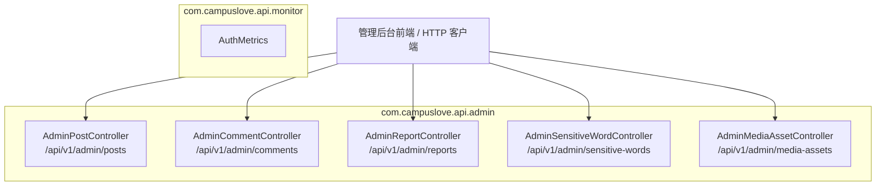
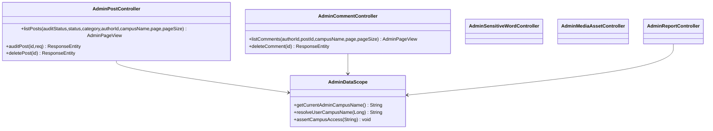
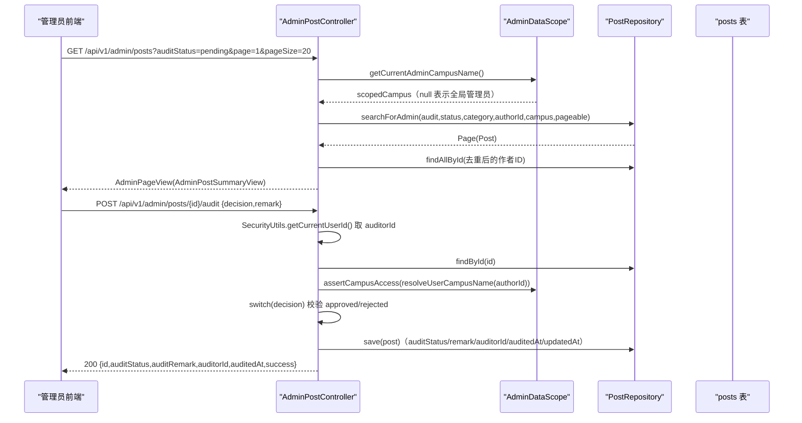
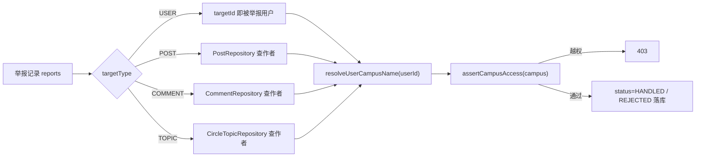
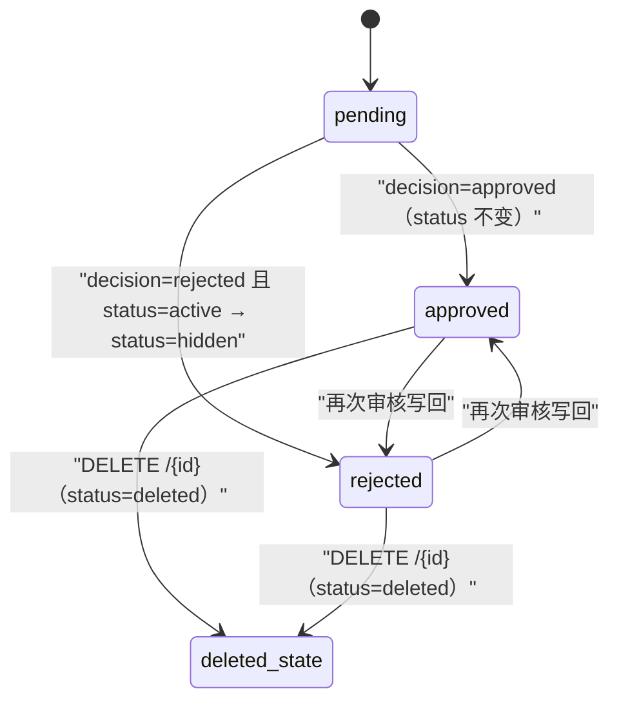
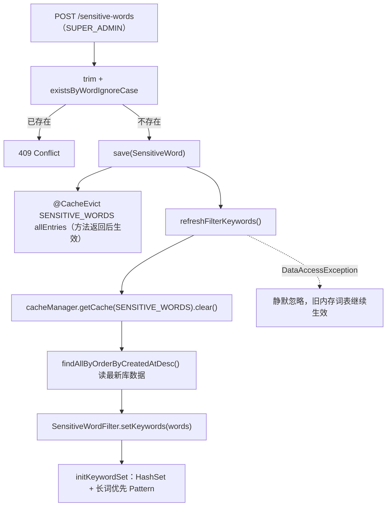
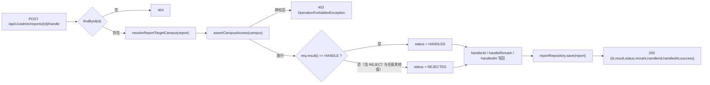
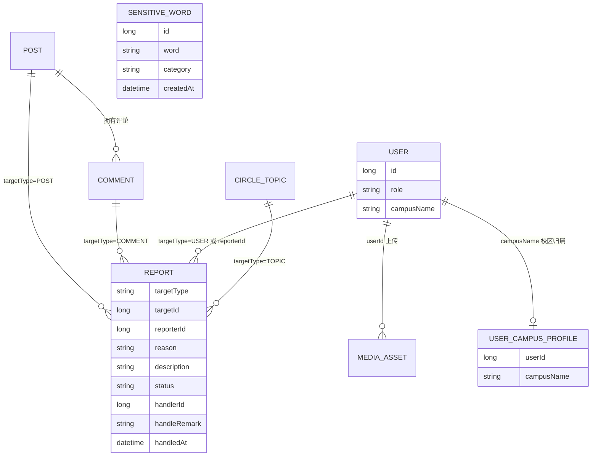

# 内容审核系统

<cite>
**本文引用的文件**
- [AdminPostController.java](file://apps/api/src/main/java/com/campuslove/api/admin/AdminPostController.java)
- [AdminCommentController.java](file://apps/api/src/main/java/com/campuslove/api/admin/AdminCommentController.java)
- [AdminReportController.java](file://apps/api/src/main/java/com/campuslove/api/admin/AdminReportController.java)
- [AdminSensitiveWordController.java](file://apps/api/src/main/java/com/campuslove/api/admin/AdminSensitiveWordController.java)
- [AdminMediaAssetController.java](file://apps/api/src/main/java/com/campuslove/api/admin/AdminMediaAssetController.java)
- [AuthMetrics.java](file://apps/api/src/main/java/com/campuslove/api/monitor/AuthMetrics.java)
- [SensitiveWordFilter.java](file://apps/api/src/main/java/com/campuslove/api/config/SensitiveWordFilter.java)
- [AdminDataScope.java](file://apps/api/src/main/java/com/campuslove/api/admin/AdminDataScope.java)
- [AuditOperation.java](file://apps/api/src/main/java/com/campuslove/api/admin/audit/AuditOperation.java)
</cite>

## 目录
1. [简介](#简介)
2. [项目结构](#项目结构)
3. [核心组件](#核心组件)
4. [架构总览](#架构总览)
5. [详细组件分析](#详细组件分析)
6. [敏感词过滤机制](#敏感词过滤机制)
7. [媒体资源审核](#媒体资源审核)
8. [举报处理流程](#举报处理流程)
9. [审核状态机与数据模型](#审核状态机与数据模型)
10. [内容统计与审核效率监控](#内容统计与审核效率监控)
11. [AI 辅助审核与多级审核现状](#ai-辅助审核与多级审核现状)
12. [配置与开关](#配置与开关)
13. [依赖关系分析](#依赖关系分析)
14. [性能考虑](#性能考虑)
15. [故障排查指南](#故障排查指南)
16. [能力缺口登记](#能力缺口登记)
17. [结论](#结论)

## 简介
内容审核系统是管理后台（`/api/v1/admin/**`）中负责社区内容治理的一组 Spring Boot REST 控制器集合，落在 `com.campuslove.api.admin` 包内。它覆盖五条互相配合的审核链路：帖子审核（`AdminPostController`）、评论管理（`AdminCommentController`）、举报处理（`AdminReportController`）、敏感词库维护（`AdminSensitiveWordController`）与媒体资源审核（`AdminMediaAssetController`）。

从代码可见，本页描述的是一个"人工审核 + 规则过滤"的后台能力：审核接口以状态字段（审核结果、审核备注、审核人、审核时间）的写回为核心动作，敏感词库通过独立的增删改查与批量导入接口维护，媒体资源提供审核动作与统计视图接口。仓库中不存在第三方内容安全服务的接入代码，因此 AI 辅助审核、自动审核规则引擎等能力在本页作为缺口如实登记。

**章节来源**
- [AdminPostController.java:58-59](file://apps/api/src/main/java/com/campuslove/api/admin/AdminPostController.java#L58-L59)
- [AdminSensitiveWordController.java:57-60](file://apps/api/src/main/java/com/campuslove/api/admin/AdminSensitiveWordController.java#L57-L60)

## 项目结构
审核能力按"资源维度"拆分为五个控制器，每个控制器独立定义自己的基路径、请求/响应记录类型（Java record），并直接依赖对应的 Repository 或 Service 完成数据读写。

**图表来源**
- [AdminPostController.java:58-62](file://apps/api/src/main/java/com/campuslove/api/admin/AdminPostController.java#L58-L62)
- [AdminCommentController.java:48-52](file://apps/api/src/main/java/com/campuslove/api/admin/AdminCommentController.java#L48-L52)
- [AdminReportController.java:65-69](file://apps/api/src/main/java/com/campuslove/api/admin/AdminReportController.java#L65-L69)
- [AdminSensitiveWordController.java:57-60](file://apps/api/src/main/java/com/campuslove/api/admin/AdminSensitiveWordController.java#L57-L60)
- [AdminMediaAssetController.java:54-58](file://apps/api/src/main/java/com/campuslove/api/admin/AdminMediaAssetController.java#L54-L58)

**章节来源**
- [AuthMetrics.java:22-23](file://apps/api/src/main/java/com/campuslove/api/monitor/AuthMetrics.java#L22-L23)

## 核心组件
- **AdminPostController**（331 行）：帖子审核主入口。`GET /api/v1/admin/posts` 提供按审核状态、帖子状态、分类、作者、校区筛选的分页列表；`POST /api/v1/admin/posts/{id}/audit` 写回审核决策；`DELETE /api/v1/admin/posts/{id}` 做软删除（status 置 `deleted`）。类上标注 `@Profile("real")`、`@PreAuthorize("hasRole('ADMIN')")`、`@Validated`。
- **AdminCommentController**（198 行）：评论管理。`GET /api/v1/admin/comments` 按作者、帖子、校区分页筛选；`DELETE /api/v1/admin/comments/{id}` 为硬删除，源码注释明确说明"评论当前没有软删字段"。该类没有审核状态写接口，只有列表与删除两种动作。
- **AdminReportController**（299 行）：举报处理，路由基路径 `/api/v1/admin/reports`，核心动作是 `POST /api/v1/admin/reports/{id}/handle`。
- **AdminSensitiveWordController**（282 行）：敏感词库维护，基路径 `/api/v1/admin/sensitive-words`，含单条删除、批量导入 `/batch-import`、导入状态查询 `/import/status/{taskId}`，并自带 `SensitiveWordView`、`SensitiveWordCreateRequest`、`SensitiveWordBatchImportRequest` 三个内嵌记录类型。
- **AdminMediaAssetController**（359 行）：媒体资源审核，基路径 `/api/v1/admin/media-assets`，提供详情 `GET /{id}`、审核 `POST /{id}/audit`，内嵌 `AdminMediaAssetSummaryView`、`AdminMediaAssetDetailView`。
- **AdminDataScope**（五个控制器共同依赖的协作者）：数据隔离能力，暴露 `getCurrentAdminCampusName()`、`resolveUserCampusName(Long)`、`assertCampusAccess(String)` 三个方法，用于"每校一管理员"的越权防护。
- **AdminPageView\<T\>**（统一分页响应壳）：由 `listPosts` / `listComments` 返回，携带 items、total、page、pageSize，并通过静态方法 `calculateTotalPages(total, size)` 计算总页数。
- **AuthMetrics**（`com.campuslove.api.monitor`，98 行）：`@Component` 埋点组件，提供 `recordLoginSuccess(Long)`、`recordLoginFailure(String)`、`recordTokenRefresh()`。它是仓库内已见的唯一 Micrometer 风格指标类，只覆盖认证域，不含内容审核维度指标。

**图表来源**
- [AdminPostController.java:62-79](file://apps/api/src/main/java/com/campuslove/api/admin/AdminPostController.java#L62-L79)
- [AdminPostController.java:94-137](file://apps/api/src/main/java/com/campuslove/api/admin/AdminPostController.java#L94-L137)
- [AdminCommentController.java:52-66](file://apps/api/src/main/java/com/campuslove/api/admin/AdminCommentController.java#L52-L66)
- [AdminCommentController.java:79-116](file://apps/api/src/main/java/com/campuslove/api/admin/AdminCommentController.java#L79-L116)
- [AdminSensitiveWordController.java:60](file://apps/api/src/main/java/com/campuslove/api/admin/AdminSensitiveWordController.java#L60-L60)
- [AdminMediaAssetController.java:58](file://apps/api/src/main/java/com/campuslove/api/admin/AdminMediaAssetController.java#L58-L58)
- [AdminReportController.java:69](file://apps/api/src/main/java/com/campuslove/api/admin/AdminReportController.java#L69-L69)

**章节来源**
- [AdminPostController.java:40-79](file://apps/api/src/main/java/com/campuslove/api/admin/AdminPostController.java#L40-L79)
- [AdminPostController.java:146-226](file://apps/api/src/main/java/com/campuslove/api/admin/AdminPostController.java#L146-L226)
- [AdminCommentController.java:30-66](file://apps/api/src/main/java/com/campuslove/api/admin/AdminCommentController.java#L30-L66)
- [AdminCommentController.java:118-146](file://apps/api/src/main/java/com/campuslove/api/admin/AdminCommentController.java#L118-L146)
- [AdminSensitiveWordController.java:57-60](file://apps/api/src/main/java/com/campuslove/api/admin/AdminSensitiveWordController.java#L57-L60)
- [AdminSensitiveWordController.java:214-275](file://apps/api/src/main/java/com/campuslove/api/admin/AdminSensitiveWordController.java#L214-L275)
- [AdminMediaAssetController.java:54-58](file://apps/api/src/main/java/com/campuslove/api/admin/AdminMediaAssetController.java#L54-L58)
- [AdminReportController.java:65-69](file://apps/api/src/main/java/com/campuslove/api/admin/AdminReportController.java#L65-L69)
- [AuthMetrics.java:22-91](file://apps/api/src/main/java/com/campuslove/api/monitor/AuthMetrics.java#L22-L91)

## 架构总览
五个审核控制器都是无状态瘦控制器：直接注入 Spring Data JPA Repository 完成读写，不经过独立 Service 层（唯一例外是敏感词批量导入委托给 `SensitiveWordImportService`）。横切能力由三层保证：URL 安全（`/api/admin/**` 限 ADMIN）、方法级 `@PreAuthorize`（深度防御）、`AdminDataScope` 校区数据隔离。审核写动作可选地通过 `@Auditable` 注解落入操作审计切面（举报处理与敏感词增删已标注，帖子审核未标注）。

**图表来源**
- [AdminPostController.java:94-137](file://apps/api/src/main/java/com/campuslove/api/admin/AdminPostController.java#L94-L137)
- [AdminPostController.java:146-192](file://apps/api/src/main/java/com/campuslove/api/admin/AdminPostController.java#L146-L192)
- [AdminPostController.java:234-248](file://apps/api/src/main/java/com/campuslove/api/admin/AdminPostController.java#L234-L248)

举报处理链路的差异在于目标类型分发：`resolveReportTargetCampus` 按 `USER` / `POST` / `COMMENT` / `TOPIC` 四种目标类型分别查 `userRepository` 之外的三张内容表拿到作者 ID，再解析校区，目标缺失时返回 null 并按"全局资源"放行。

**图表来源**
- [AdminReportController.java:170-206](file://apps/api/src/main/java/com/campuslove/api/admin/AdminReportController.java#L170-L206)
- [AdminReportController.java:223-241](file://apps/api/src/main/java/com/campuslove/api/admin/AdminReportController.java#L223-L241)
- [AdminReportController.java:54-62](file://apps/api/src/main/java/com/campuslove/api/admin/AdminReportController.java#L54-L62)

## 详细组件分析

### AdminPostController：帖子审核接口
类声明为 `@Profile("real") @RestController @RequestMapping("/api/v1/admin/posts") @PreAuthorize("hasRole('ADMIN')") @Validated`，构造注入四个协作者：`PostRepository`、`UserRepository`、`CommentRepository`、`AdminDataScope`。值得注意的是 `CommentRepository` 虽然被注入，但在当前实现中没有任何方法使用它——源码注释（第 196-198 行）说明这是对原"删除帖子时硬删评论"注释的更正，评论随帖子状态在查询维度天然隐藏。

三个端点：

| 端点 | 方法 | 语义 | 关键行为 |
| --- | --- | --- | --- |
| `GET /api/v1/admin/posts` | `listPosts` | 分页列表 | 按作者校区做数据隔离，批量预加载作者昵称 |
| `POST /api/v1/admin/posts/{id}/audit` | `auditPost` | 审核写回 | 决策值白名单 switch，拒绝时联动置 hidden |
| `DELETE /api/v1/admin/posts/{id}` | `deletePost` | 软删除 | status 置 `deleted`，保留数据用于审计 |

`listPosts` 支持 `auditStatus`（pending/approved/rejected）、`status`（active/deleted/hidden）、`category`（all/interest/sincere/hometown/anonymous/latest/campus）、`authorId`、`campusName`、`page`、`pageSize` 七个查询参数，参数在方法内先转枚举再交给 `postRepository.searchForAdmin(...)`。分页参数被双重钳制：注解层 `@Min(1) @Max(100)`，方法层 `Math.max(1, Math.min(100, pageSize))`。

枚举解析策略经历过一次修正：`parseAuditStatus` / `parsePostStatus` / `parseCategory` 在 `valueOf` 抛出 `IllegalArgumentException` 时不再静默返回 null，而是重新抛出带 `ErrorMessages.ILLEGAL_AUDIT_STATUS_PREFIX` / `ILLEGAL_POST_STATUS_PREFIX` / `ILLEGAL_POST_CATEGORY_PREFIX` 前缀的异常（源码标记 infra R2-00269），避免非法筛选条件被降级为"不加过滤"从而泄露全量数据。

`auditPost` 的写回字段共五处：`auditStatus`、`auditRemark`、`auditorId`（来自 `SecurityUtils.getCurrentUserId()`）、`auditedAt` 与 `updatedAt`（均取 `LocalDateTime.now(TimeZones.BUSINESS)`）。决策值用显式 switch 校验（源码标记 R4-00428）：只有字面量 `approved` / `rejected` 被接受，其他值抛 `IllegalArgumentException("不支持的审核决策: " + decision)`，这样未来若扩展 `pending` 决策不会被静默当作拒绝。拒绝分支还有一个联动副作用：当帖子当前 `status == active` 时同步置为 `hidden`，使其在村口列表不可见；通过分支不改 `status`，以保留管理员手动隐藏的场景。

[此图为概念流程，由 `auditPost`/`deletePost` 的字段写回逻辑归纳，不直接对应具体源文件，故不提供图表来源]

**章节来源**
- [AdminPostController.java:40-79](file://apps/api/src/main/java/com/campuslove/api/admin/AdminPostController.java#L40-L79)
- [AdminPostController.java:81-137](file://apps/api/src/main/java/com/campuslove/api/admin/AdminPostController.java#L81-L137)
- [AdminPostController.java:139-192](file://apps/api/src/main/java/com/campuslove/api/admin/AdminPostController.java#L139-L192)
- [AdminPostController.java:194-226](file://apps/api/src/main/java/com/campuslove/api/admin/AdminPostController.java#L194-L226)
- [AdminPostController.java:250-330](file://apps/api/src/main/java/com/campuslove/api/admin/AdminPostController.java#L250-L330)

### AdminCommentController：评论管理功能
类注解与帖子控制器同构（`@Profile("real")` + `@RequestMapping("/api/v1/admin/comments")` + `@PreAuthorize("hasRole('ADMIN')")` + `@Validated`），注入 `CommentRepository`、`UserRepository`、`AdminDataScope`。它只有两个端点：

- `GET /api/v1/admin/comments` → `listComments(authorId, postId, campusName, page, pageSize)`，委托 `commentRepository.searchForAdmin(authorId, postId, effectiveCampus, pageable)`。类注释明确指出 comments 表没有 `campus_name` 列，因此校区维度是**按评论作者所属校区**过滤的，校区名取自 `user_campus_profile.campus_name`。
- `DELETE /api/v1/admin/comments/{id}` → `deleteComment(id)`，调用 `commentRepository.deleteById(id)`，是**硬删除**。源码注释（第 118-125 行）说明理由："评论当前没有软删字段，采用硬删除与现有村口评论删除逻辑保持一致。删除后不可恢复，前端需二次确认。"

两点值得注意的实现约束：其一，该控制器**没有评论审核状态写回接口**（无 `/{id}/audit`），评论侧的治理能力只有"可见列表 + 删除"；其二，`deleteComment` 未标注 `@Auditable`，因此评论删除不会进入 `audit_log`，尽管 `AuditOperation` 枚举里已经预留了 `DELETE_COMMENT("删除评论")` 这一常量。

视图侧 `toSummaryView` 输出 `AdminCommentSummaryView`，字段为评论 id、所属帖子 id（从 `comment.getPost()` 空安全取值）、作者 id、作者昵称、正文与创建时间；作者昵称由 `loadAuthorNicknames` 去重后 `findAllById` 批量取得。

**章节来源**
- [AdminCommentController.java:30-66](file://apps/api/src/main/java/com/campuslove/api/admin/AdminCommentController.java#L30-L66)
- [AdminCommentController.java:68-116](file://apps/api/src/main/java/com/campuslove/api/admin/AdminCommentController.java#L68-L116)
- [AdminCommentController.java:118-146](file://apps/api/src/main/java/com/campuslove/api/admin/AdminCommentController.java#L118-L146)
- [AdminCommentController.java:162-197](file://apps/api/src/main/java/com/campuslove/api/admin/AdminCommentController.java#L162-L197)
- [AuditOperation.java:8-66](file://apps/api/src/main/java/com/campuslove/api/admin/audit/AuditOperation.java#L8-L66)

## 敏感词过滤机制
敏感词能力分两侧：内容侧的运行时过滤器 `SensitiveWordFilter`（`com.campuslove.api.config`，177 行）与管理侧的词库控制器 `AdminSensitiveWordController`（282 行）。

### SensitiveWordFilter：配置绑定的内存过滤器
该类是 `@Component` + `@ConfigurationProperties(prefix = "app.content-filter")`，暴露两个可绑定属性：`enabled`（默认 `false`）与 `keywords`（默认空列表）。过滤策略在类注释里写得很明确：**将敏感词替换为 `***` 而非拒绝发布**，替换字符串常量 `REPLACEMENT = "***"`。

数据结构由 `setKeywords → initKeywordSet()` 两级构建：
- `keywordSet`：全部词转小写后的 `Collections.unmodifiableSet(HashSet)`，实现大小写不敏感的 O(1) 包含判断；
- `pattern`：把词按**长度降序**排序后用 `Pattern.quote` 逐个拼接成 `a|b|c` 形式，再 `Pattern.compile(..., CASE_INSENSITIVE)`，长词优先匹配，避免短词先吞掉长词导致漏替换；词集为空时 `pattern = null`。

三个对外方法的行为差异：

| 方法 | 前置短路条件 | 返回 |
| --- | --- | --- |
| `filter(content)` | `!enabled` 或内容为空或 `pattern == null` | 命中部分替换为 `***` |
| `containsSensitive(content)` | `!enabled` 或内容为空或 `keywordSet.isEmpty()` | 遍历小写词做 `contains` 判断，返回布尔 |
| `filterWithLog(content, userId, scene)` | `!enabled` 或内容为空 | 调 `filter` 后，仅当内容发生变化才记一条 INFO 日志 |

`filterWithLog` 的日志只写 `userId`、`scene`、过滤时间与累计命中数，**不记录原始内容**（隐私考虑）；`scene` 取值在注释中列举为 `"POST"`、`"COMMENT"`、`"MESSAGE"`、`"CAMPUS_TOPIC"` 等。累计计数由 `AtomicLong filteredEventCount` 承担，源码标记 R4-00306 记录了这次降级：原 WARN 级别在批量/高频命中时会刷屏，故改为 INFO + `totalHits` 字段，作为"轻量聚合统计，供日志与监控参考"。

### AdminSensitiveWordController：词库的 CRUD 与异步批量导入
基路径 `/api/v1/admin/sensitive-words`，类级 `@PreAuthorize("hasRole('ADMIN')")`，但**写操作三个端点（新增、删除、批量导入）都额外收紧到 `hasRole('SUPER_ADMIN')`**。类注释给出理由：敏感词是全局资源（作用于全平台内容过滤，不区分校区），因此**不做校区数据隔离**，只有超级管理员能改词库。

- `GET /` → `list(category, page, size)`：`page` 从 0 开始、`size` 默认 100 且 `@Max(1000)`。源码标记 R4-00387 说明分页是后补的——词库上万条时防止响应体过大。带 category 走 `findByCategoryOrderByCreatedAtDesc`，否则 `findAllByOrderByCreatedAtDesc`。
- `POST /` → `create(SensitiveWordCreateRequest)`：先 `trim()`，再用 `existsByWordIgnoreCase` 做大小写不敏感去重，命中直接返回 `409 CONFLICT`；新建实体写入 `word`、`category`、`createdAt`（`TimeZones.BUSINESS`）后调用 `refreshFilterKeywords()` 同步内存过滤器。
- `DELETE /{id}` → `delete(id)`：`existsById` 不存在返回 404，删除后同样刷新过滤器，成功返回 `204 No Content`。
- `POST /batch-import` → `batchImport(SensitiveWordBatchImportRequest)`：委托 `SensitiveWordImportService.importBatchAsync(words, category, operatorId)`，返回 `202 ACCEPTED` 与 `SensitiveWordImportResult`。类常量 `MAX_IMPORT_WORDS = 10000` 由 `@Size(max = ...)` 在请求体上强制。注释描述的服务端语义为：`taskExecutor` 线程池分批执行、每批 500 条、双层去重（内存 Set + DB `existsByWordIgnoreCase`）、单批失败不阻断后续批次、完成后失效缓存并刷新过滤器。
- `GET /import/status/{taskId}` → `getImportStatus(taskId)`：源码标记 R4-00382，是对"此前只有受理接口、任务状态黑盒"的补全。返回 `SensitiveWordImportResult` 快照，`status` 取值注释列举为 `ACCEPTED/RUNNING/DONE/FAILED/EMPTY_INPUT`；任务不存在时抛 `IllegalArgumentException("任务不存在或已过期: taskId=...")`。注释同时记录已知局限：**任务状态仅存内存，应用重启后丢失**。

缓存一致性是本节最有意思的一处工程细节。`create` 与 `delete` 都同时做了两件事：注解 `@CacheEvict(cacheNames = CacheNames.SENSITIVE_WORDS, allEntries = true)` 与私有方法 `refreshFilterKeywords()`。后者的注释（第 174-178 行）解释了为什么要"手动再清一次"：`findAllByOrderByCreatedAtDesc()` 带 `@Cacheable`（TTL 1 小时），而 `@CacheEvict` 默认在方法返回后才执行，覆盖不了方法体内的本次读取，直接查会命中旧缓存、导致新增词不生效；所以 `refreshFilterKeywords()` 先用 `cacheManager.getCache(...).clear()` 主动失效，再查库、再 `sensitiveWordFilter.setKeywords(words)`。整个刷新过程 `catch (DataAccessException ignore)` 静默吞掉——同步失败不影响主流程，内存中旧的词表继续生效。`create` 另外标注 `@Transactional`（缺陷修复注释：保证 save 与刷新在同一事务内，`FlushModeType.AUTO` 下刷新查询前自动 flush，消除时序竞态）。

**图表来源**
- [AdminSensitiveWordController.java:108-193](file://apps/api/src/main/java/com/campuslove/api/admin/AdminSensitiveWordController.java#L108-L193)
- [SensitiveWordFilter.java:57-96](file://apps/api/src/main/java/com/campuslove/api/config/SensitiveWordFilter.java#L57-L96)

内嵌记录类型三个：`SensitiveWordView(id, word, category, createdAt)`（createdAt 转字符串输出）、`SensitiveWordCreateRequest`（`@NotBlank @Size(max = 64) String word` 与 `@Pattern(regexp = "POLITICS|PORN|ABUSE|AD|OTHER")` 的 category，校验消息取 `ErrorMessages.SENSITIVE_CATEGORY_INVALID`）、`SensitiveWordBatchImportRequest`（`@NotEmpty @Size(max = MAX_IMPORT_WORDS)` 的 `List<@NotBlank @Size(max = 64) String> words` 加同一 category 正则，且 category 允许为 null）。这五个分类常量 `POLITICS/PORN/ABUSE/AD/OTHER` 是词库唯一的维度，源码中没有按分类采取不同处置强度的逻辑。

**章节来源**
- [AdminSensitiveWordController.java:39-106](file://apps/api/src/main/java/com/campuslove/api/admin/AdminSensitiveWordController.java#L39-L106)
- [AdminSensitiveWordController.java:108-193](file://apps/api/src/main/java/com/campuslove/api/admin/AdminSensitiveWordController.java#L108-L193)
- [AdminSensitiveWordController.java:195-282](file://apps/api/src/main/java/com/campuslove/api/admin/AdminSensitiveWordController.java#L195-L282)
- [SensitiveWordFilter.java:14-56](file://apps/api/src/main/java/com/campuslove/api/config/SensitiveWordFilter.java#L14-L56)
- [SensitiveWordFilter.java:98-177](file://apps/api/src/main/java/com/campuslove/api/config/SensitiveWordFilter.java#L98-L177)

## 媒体资源审核
`AdminMediaAssetController`（359 行，基路径 `/api/v1/admin/media-assets`）承接图片/视频资产的审核闭环，类注释标注为 2026-08-09 引入。它是五个审核控制器里唯一注入业务 Service 的：除 `MediaAssetRepository`、`UserRepository`、`AdminDataScope` 之外还依赖 `com.campuslove.api.media.MediaAssetService`，审核写回实际由 `mediaAssetService.updateAudit(id, decision, remark, auditorId)` 完成，控制器只负责前置校验与视图组装。该类也是唯一自带 `Logger` 的审核控制器。

三个端点：

- `GET /` → `listMediaAssets(auditStatus, type, userId, campusName, page, pageSize)`。与其他列表不同，`auditStatus` 是**有默认值的必填语义**（`defaultValue = "pending"`），即后台默认打开就是待审核队列；注释说明排序为"pending 优先、同状态按上传时间倒序"，由 `mediaAssetRepository.searchForAdmin(normalizedStatus, userId, normalizedType, effectiveCampus, pageable)` 承担。`type` 允许 `avatar / image / video / background / app_asset`，其中 `app_asset` 注释标为 2026-08-10 后端托管的应用装饰资产。
- `GET /{id}` → `getMediaAssetDetail(id)`，404 与 403 都可能返回；详情视图比列表视图多一个 `durationMs`（视频时长）。
- `POST /{id}/audit` → `auditMediaAsset(id, req)`，带 `@Transactional` 与 `@Auditable(value = AuditOperation.AUDIT_MEDIA_ASSET, targetType = "MEDIA_ASSET", description = "管理员审核媒体图片")`，是五个控制器里唯一在审核动作上显式声明审计注解与描述文案的端点。

审核请求的硬约束在源码第 182-187 行：**驳回必须给备注**。判定条件是 `MediaAssetService.AUDIT_REJECTED.equals(req.decision()) && (remark == null || remark.isBlank())`，不满足直接返回 `400`，响应体为 `Map.of("error", "rejected 审核必须提供备注（remark）")`。注释把这条规则定性为"审核闭环要求：驳回原因可追溯"。与帖子侧对比可见差异：`AdminPostController.auditPost` 对 remark 无强制要求，媒体侧有。

后置动作 `updateAudit` 若返回空 `Optional`，控制器抛 `IllegalStateException("media_asset 记录不存在: " + id)`——即读写之间的记录消失按服务端一致性错误处理，而非 404。成功响应只回三个字段：`id`、`auditStatus`、`auditRemark`（注意不含 auditorId / auditedAt，与帖子侧返回六字段不同）。

数据隔离复用了 `AdminDataScope`，但封装层次更清晰：私有方法 `assertCampusAccess(MediaAsset)`（第 278 行）统一包一层 `adminDataScope.assertCampusAccess(adminDataScope.resolveUserCampusName(asset.getUserId()))`，详情与审核两个端点共用；注释明确其与 `AdminVillagePostController` 的隔离语义一致，且**读操作（详情）也做越权拦截**，这一点比帖子控制器更严格。列表侧同样遵循"校区管理员忽略调用方 campusName 参数"的规则。视图组装阶段每条记录都会调一次 `resolveUserCampusName`，因此列表页的 `user_campus_profile` 查询次数与页大小成正比。

`AdminMediaAssetSummaryView` 与 `AdminMediaAssetDetailView` 定义在文件末尾（第 313、338 行），共 18/19 个字段，把资产元信息（`url`、`originalName`、`mime`、`size`、`width`、`height`）、状态双维度（`status`：pending/ready/failed 与 `auditStatus`：pending/approved/rejected）、审核痕迹（`auditRemark`、`auditorId`、`auditedAt`）与上传者信息（昵称、头像、校区名）平铺输出，供后台审核台一次渲染。这里 `status` 与 `auditStatus` 是两条独立状态轴：前者描述转码/上传处理结果，后者描述人工审核结论。

**章节来源**
- [AdminMediaAssetController.java:39-76](file://apps/api/src/main/java/com/campuslove/api/admin/AdminMediaAssetController.java#L39-L76)
- [AdminMediaAssetController.java:78-133](file://apps/api/src/main/java/com/campuslove/api/admin/AdminMediaAssetController.java#L78-L133)
- [AdminMediaAssetController.java:135-197](file://apps/api/src/main/java/com/campuslove/api/admin/AdminMediaAssetController.java#L135-L197)
- [AdminMediaAssetController.java:199-289](file://apps/api/src/main/java/com/campuslove/api/admin/AdminMediaAssetController.java#L199-L289)
- [AdminMediaAssetController.java:313-359](file://apps/api/src/main/java/com/campuslove/api/admin/AdminMediaAssetController.java#L313-L359)

## 举报处理流程
`AdminReportController`（299 行，基路径 `/api/v1/admin/reports`）是审核链路中协作者最多的一个：注入 `ReportRepository`、`UserRepository`、`PostRepository`、`CommentRepository`、`CircleTopicRepository`、`AdminDataScope` 共六个依赖，数据持久化到 `reports` 表。

状态常量以私有 `static final String` 定义在类头（第 71-80 行），而不是 Java 枚举：

| 常量 | 值 | 用途 |
| --- | --- | --- |
| `RESULT_HANDLE` | `HANDLE` | 请求体 result 入参：已处理 |
| `RESULT_REJECT` | `REJECT` | 请求体 result 入参：驳回 |
| `STATUS_PENDING` | `PENDING` | 举报初始状态（列表筛选可用） |
| `STATUS_HANDLED` | `HANDLED` | 处理后状态 |
| `STATUS_REJECTED` | `REJECTED` | 驳回后状态 |

映射逻辑是一行三元表达式（第 189 行）：`String newStatus = RESULT_HANDLE.equals(req.result()) ? STATUS_HANDLED : STATUS_REJECTED;`。这条实现有一个必须知道的语义后果：**result 只要不等于 `HANDLE` 就一律记为 REJECTED**，包括拼写错误、空串或 null。`RESULT_REJECT` 常量在此表达式中并未被使用（它只在类注释里作为文档值出现），因此不存在"未知值被拒"的显式校验——这与帖子侧 `auditPost` 的白名单 switch 形成鲜明对比（源码 R4-00428 在帖子侧修掉了同类问题，举报侧未做同等改造）。调用方需自行保证 result 只能是 `HANDLE` 或 `REJECT`。

**图表来源**
- [AdminReportController.java:170-206](file://apps/api/src/main/java/com/campuslove/api/admin/AdminReportController.java#L170-L206)
- [AdminReportController.java:71-80](file://apps/api/src/main/java/com/campuslove/api/admin/AdminReportController.java#L71-L80)

`handleReport` 标注 `@Auditable(value = AuditOperation.HANDLE_REPORT, targetType = "REPORT")`，是举报侧唯一的审计接入点。写回四个字段：`status`、`handlerId`（`SecurityUtils.getCurrentUserId()`）、`handleRemark`（取 `req.remark()`）、`handledAt`（`TimeZones.BUSINESS`）。响应体回显 `result` 入参原值而非归一化后的状态，前端可据此比对。

`resolveReportTargetCampus(Report)`（第 223-241 行）是越权校验的前置解析器，按 `targetType` 做四路字符串分发：`USER` 直接把 `targetId` 当用户 ID；`POST`/`COMMENT`/`TOPIC` 分别经 `postRepository`/`commentRepository`/`circleTopicRepository` 查出内容作者 ID；作者 ID 为 null（目标已被删或类型不在列举内）则整体返回 null，按 `AdminDataScope` 语义视作"全局资源"放行。这里的分支是 `if/else if` 字符串等值比较，未识别的 targetType 不会报错，只是失去校区归属信息。

列表端点 `listReports` 支持 `status`、`targetType`、`campusName`、`page`、`pageSize`；与内容列表的"空串转 null"用 `normalizeFilter` 实现（第 249-254 行），且状态与目标类型**不转枚举、不做合法性校验**，非法值会原样进入 `reportRepository.findByStatusAndTargetType(...)`。举报人昵称由 `loadReporterNicknames` 用 `stream().collect(HashMap::new, ..., HashMap::putAll)` 批量装配，`toView` 输出 12 个字段的 `AdminReportView`（含 `reason` 与 `description` 两列）。

**章节来源**
- [AdminReportController.java:41-106](file://apps/api/src/main/java/com/campuslove/api/admin/AdminReportController.java#L41-L106)
- [AdminReportController.java:108-160](file://apps/api/src/main/java/com/campuslove/api/admin/AdminReportController.java#L108-L160)
- [AdminReportController.java:162-206](file://apps/api/src/main/java/com/campuslove/api/admin/AdminReportController.java#L162-L206)
- [AdminReportController.java:208-299](file://apps/api/src/main/java/com/campuslove/api/admin/AdminReportController.java#L208-L299)

## 审核状态机与数据模型
审核域的数据模型不靠专用审核表，而是把审核痕迹**内联在被审核实体的列上**，再由一张 `reports` 表承载用户侧举报工单、`sensitive_word` 表承载词库。从控制器实际读写的 getter/setter 可以还原出各实体参与的审核字段：

| 载体 | 状态字段 | 审核附加字段 | 证据端点 |
| --- | --- | --- | --- |
| 帖子 Post | `auditStatus`（`AuditStatus` 枚举：pending/approved/rejected）、`status`（`PostStatus`：active/deleted/hidden） | `auditRemark`、`auditorId`、`auditedAt`、`updatedAt` | `auditPost` 写回、`toSummaryView` 读取 |
| 评论 Comment | 无审核状态列（源码注释：评论没有软删字段） | 无 | `deleteComment` 硬删除 |
| 举报 Report | `status`（字符串常量 PENDING/HANDLED/REJECTED） | `handlerId`、`handleRemark`、`handledAt`；工单字段 `targetType`、`targetId`、`reporterId`、`reason`、`description`、`createdAt` | `handleReport` 写回、`toView` 读取 |
| 媒体资产 MediaAsset | `status`（pending/ready/failed）+ `auditStatus`（pending/approved/rejected）双轴 | `auditRemark`、`auditorId`、`auditedAt`、`durationMs`、`mime`、`size`、`width`、`height`、`originalName`、`url`、`type`、`userId`、`createdAt` | 两个视图 record 的字段清单 |
| 敏感词 SensitiveWord | 无状态列 | `word`、`category`、`createdAt` | `create`/`toView` |

**图表来源**
- [AdminReportController.java:223-241](file://apps/api/src/main/java/com/campuslove/api/admin/AdminReportController.java#L223-L241)
- [AdminReportController.java:283-298](file://apps/api/src/main/java/com/campuslove/api/admin/AdminReportController.java#L283-L298)
- [AdminDataScope.java:148-164](file://apps/api/src/main/java/com/campuslove/api/admin/AdminDataScope.java#L148-L164)
- [AdminSensitiveWordController.java:253-259](file://apps/api/src/main/java/com/campuslove/api/admin/AdminSensitiveWordController.java#L253-L259)
- [AdminMediaAssetController.java:313-359](file://apps/api/src/main/java/com/campuslove/api/admin/AdminMediaAssetController.java#L313-L359)

### AdminDataScope：审核写操作的越权模型
`AdminDataScope`（165 行，`@Service` + `@Profile("real")`）是"每校一管理员"商业模式的落地组件，也是所有审核写操作的前置闸门。类注释给出角色三态：`SUPER_ADMIN` 全局可见不强制过滤、`ADMIN + campusName 非空` 为校区管理员、`ADMIN + campusName 为空` 为兼容旧账号的全局运营管理员。两个角色编码常量 `ROLE_SUPER_ADMIN`、`ROLE_ADMIN` 定义在第 43、46 行。

`assertCampusAccess(String targetCampusName)`（第 103-122 行）的放行顺序值得逐条对照：当前用户 ID 为 null → 直接返回；`resolveCampusName` 得到 null（全局管理员）→ 返回；目标校区为 null 或空白（全局资源）→ 返回；仅当 `!myCampus.equalsIgnoreCase(targetCampusName.trim())` 时先 `log.warn("数据隔离拦截：管理员 userId={} 管辖校区 [{}] 尝试操作校区 [{}] 的资源", ...)` 再抛 `OperationForbiddenException(ErrorMessages.CAMPUS_ADMIN_SCOPE_FORBIDDEN)`，映射为 HTTP 403。

`resolveCampusName(userId)`（私有，第 130-146 行）读 `users` 表：用户不存在时 `log.warn("当前管理员不存在: userId={}")` 并返回 null（等价于按全局处理，属于宽松失败）；`SUPER_ADMIN` 恒定返回 null，注释明确"即使误设 campusName 也按全局处理"。

`resolveUserCampusName(userId)`（第 157-164 行）走另一条路：普通用户 `role=USER` 的 `users.campus_name` 恒为 null，校区信息存于 `user_campus_profile` 表，因此它查 `userCampusProfileRepository.findByUserId(userId).map(UserCampusProfile::getCampusName).orElse(null)`；未认证校区资料的用户返回 null，其内容被视作全局资源，任何校区管理员都能审核。这是当前隔离模型的一个已知宽松点，五个审核控制器的类注释都重复引用了同一语义来源。

`isCurrentSuperAdmin()`（第 76-83 行）是第五个审核控制器未使用的公开方法，供更粗粒度的角色判断。

**章节来源**
- [AdminDataScope.java:16-55](file://apps/api/src/main/java/com/campuslove/api/admin/AdminDataScope.java#L16-L55)
- [AdminDataScope.java:57-122](file://apps/api/src/main/java/com/campuslove/api/admin/AdminDataScope.java#L57-L122)
- [AdminDataScope.java:124-165](file://apps/api/src/main/java/com/campuslove/api/admin/AdminDataScope.java#L124-L165)
- [AdminPostController.java:160-180](file://apps/api/src/main/java/com/campuslove/api/admin/AdminPostController.java#L160-L180)
- [AdminCommentController.java:136-140](file://apps/api/src/main/java/com/campuslove/api/admin/AdminCommentController.java#L136-L140)

## 内容统计与审核效率监控
本页需要先厘清一件事：**审核域内没有统计报表端点**。逐个核对五个控制器的路由，可见的"统计"只有分页壳里的计数：`AdminPageView` 由 items、`result.getTotalElements()`、`safePage`、`safeSize` 与 `AdminPageView.calculateTotalPages(totalElements, size)` 组成，帖子、评论、举报、媒体资产四条列表链路全部按此结构返回。也就是说，后台能拿到"某个筛选条件下有多少条"，但拿不到"待审核积压量、日均审核量、平均处理时长、驳回率、违规分布"这类跨筛选条件的聚合指标。敏感词列表端点甚至不返回 total，只返回 `ResponseEntity<List<SensitiveWordView>>`。

仓库内已见的运营侧埋点能力集中在认证域。`com.campuslove.api.monitor.AuthMetrics`（98 行，`@Component`）的三个公开方法是 `recordLoginSuccess(Long userId)`、`recordLoginFailure(String reason)`、`recordTokenRefresh()`，没有任何与内容审核相关的计数器或计时器。内容侧唯一自带的计量点是 `SensitiveWordFilter.filteredEventCount`（`AtomicLong`），它只累计"发生过替换的内容条数"，随进程重启归零，且仅通过 INFO 日志的 `totalHits=` 字段暴露，没有对外查询接口。

已有的可见计数与缺失的运营指标对照如下（概念对照，不直接对应具体源文件，故不提供图表来源）：代码侧只有三项计数能力——`AdminPageView.totalElements`（帖子/评论/举报/媒体四条列表）、`calculateTotalPages` 派生的 `totalPages`、`SensitiveWordFilter.filteredEventCount`（进程内、仅日志输出）；官方指令要求的四类指标——待审核积压与队列时长、审核人效与处理时长分布、驳回率与违规分类占比、举报重犯与被举报用户画像——均无聚合端点可供给。

从可审计性角度看，审核留痕的**数据基础是齐备的**：帖子审核写了 `auditorId + auditedAt`，举报处理写了 `handlerId + handledAt`，媒体审核写了 `auditorId + auditedAt`（由 `updateAudit` 落库），`audit_log` 侧还可通过 `@Auditable` 切面拿到操作类型与目标类型（`AuditOperation` 枚举共 57 个常量，含 `AUDIT_POST`、`DELETE_POST`、`DELETE_COMMENT`、`HANDLE_REPORT`、`REVIEW_CERTIFICATION`、`ADD_SENSITIVE_WORD`、`DELETE_SENSITIVE_WORD`、`AUDIT_MEDIA_ASSET` 等审核相关项）。因此统计报表在数据层面可推导，缺的是查询与暴露层实现。

注解接入并不完整，这是排查"为什么某条审核没有审计记录"时首先要看的一点：五个控制器中只有 `AdminReportController.handleReport`、`AdminSensitiveWordController.create/delete/batchImport`、`AdminMediaAssetController.auditMediaAsset` 标注了 `@Auditable`；`AdminPostController.auditPost` / `deletePost` 与 `AdminCommentController.deleteComment` 都没有标注，尽管 `AuditOperation` 里已为它们预留了 `AUDIT_POST`、`DELETE_POST`、`DELETE_COMMENT` 三个枚举值。

**章节来源**
- [AdminPostController.java:130-136](file://apps/api/src/main/java/com/campuslove/api/admin/AdminPostController.java#L130-L136)
- [AdminCommentController.java:109-115](file://apps/api/src/main/java/com/campuslove/api/admin/AdminCommentController.java#L109-L115)
- [AdminReportController.java:153-159](file://apps/api/src/main/java/com/campuslove/api/admin/AdminReportController.java#L153-L159)
- [AdminMediaAssetController.java:126-132](file://apps/api/src/main/java/com/campuslove/api/admin/AdminMediaAssetController.java#L126-L132)
- [AdminSensitiveWordController.java:89-106](file://apps/api/src/main/java/com/campuslove/api/admin/AdminSensitiveWordController.java#L89-L106)
- [AuthMetrics.java:22-91](file://apps/api/src/main/java/com/campuslove/api/monitor/AuthMetrics.java#L22-L91)
- [SensitiveWordFilter.java:162-176](file://apps/api/src/main/java/com/campuslove/api/config/SensitiveWordFilter.java#L162-L176)
- [AuditOperation.java:10-66](file://apps/api/src/main/java/com/campuslove/api/admin/audit/AuditOperation.java#L10-L66)
- [AdminSensitiveWordController.java:116-122](file://apps/api/src/main/java/com/campuslove/api/admin/AdminSensitiveWordController.java#L116-L122)

## AI 辅助审核与多级审核现状
官方页面指令要求解释"AI 辅助审核""自动审核规则""多级审核机制""内容质量评估"。在本页的取证范围内——五个审核控制器全文、`SensitiveWordFilter`、`AdminDataScope`、`AuditOperation`、`AuthMetrics`——**没有发现任何外部内容安全服务的调用代码、模型推理入口、自动判决逻辑或质量评分字段**。因此这些能力在本节按"未实现"如实登记，同时说明代码中实际存在的、语义上最接近它们的机制。

最接近"自动审核规则"的是敏感词过滤，但它有三处本质限制。第一，它是**替换而非判决**：`filter()` 把命中词替换为 `***` 后原样返回内容，调用方（发布链路）拿到的仍然是可发布文本，不存在"命中即拦截、命中即置 pending"的分支；`containsSensitive()` 提供了判决所需的布尔能力，但 `SensitiveWordFilter` 自身没有把它接到任何审核流程上。第二，它默认关闭：`private boolean enabled = false;`，配置前缀 `app.content-filter`，未显式打开时 `filter` / `containsSensitive` / `filterWithLog` 全部直接返回原值或 false。第三，它无分类差异化：词库虽有 `POLITICS|PORN|ABUSE|AD|OTHER` 五个分类，但 `initKeywordSet()` 把所有词合并成同一个 `keywordSet` 与同一个 `pattern`，分类只在管理侧用于列表筛选，运行时命中不区分严重级别、不产生不同处置。

最接近"多级审核机制"的是**角色分级而非流程分级**。`AdminDataScope` 定义了 `SUPER_ADMIN` / `ADMIN+校区` / `ADMIN 无校区` 三种数据范围身份，`AdminSensitiveWordController` 在此基础上做了权限收紧——类级 `hasRole('ADMIN')` 管读，写操作三个端点各自标注 `hasRole('SUPER_ADMIN')`。但审核动作本身只有一级：一条内容从 `auditStatus = pending` 一步写为 `approved` 或 `rejected`，不存在"初审→复审→终审"的多阶段状态、不存在二审字段、也不存在审核人之间的交接或复核约束。`AuditOperation.REVIEW_CERTIFICATION("审核认证")` 说明认证审核是另一条独立链路，不构成本页内容审核的多级。

最接近"内容质量评估"的是热度与互动计数字段（`toSummaryView` 读取的 `likesCount`、`commentsCount`、`shareCount`、`viewCount`），它们只作为审核台的排序与展示信息被透传，控制器内没有任何基于这些数值的规则判断。

| 官方指令要求的能力 | 仓库内的实际状态 | 结论 |
| --- | --- | --- |
| AI 辅助审核 | 无模型/内容安全服务接入代码 | 未实现 |
| 自动审核规则 | 敏感词 `***` 替换，默认 `enabled=false` | 半实现（无判决） |
| 多级审核 | 一级状态直写 + SUPER_ADMIN/ADMIN 角色分级 | 未实现（是权限分级不是审核分级） |
| 内容质量评估 | 仅透传互动计数 | 未实现 |
| 审核结果反馈 | `auditRemark` / `handleRemark` 落库并在响应体回显 | 已实现（写回侧） |
| 违规分析报表 | 无聚合查询端点 | 未实现 |

需要强调一处已实现的"处置联动"，它是当前唯一的自动化行为：`auditPost` 在判定 rejected 且帖子原状态为 active 时，把 `status` 同步置为 `hidden`，使被拒内容无需二次人工操作即从村口列表消失。这是状态字段的机械联动，不是规则引擎。

**章节来源**
- [SensitiveWordFilter.java:24-56](file://apps/api/src/main/java/com/campuslove/api/config/SensitiveWordFilter.java#L24-L56)
- [SensitiveWordFilter.java:98-144](file://apps/api/src/main/java/com/campuslove/api/config/SensitiveWordFilter.java#L98-L144)
- [AdminSensitiveWordController.java:253-282](file://apps/api/src/main/java/com/campuslove/api/admin/AdminSensitiveWordController.java#L253-L282)
- [AdminPostController.java:163-182](file://apps/api/src/main/java/com/campuslove/api/admin/AdminPostController.java#L163-L182)
- [AdminPostController.java:253-271](file://apps/api/src/main/java/com/campuslove/api/admin/AdminPostController.java#L253-L271)
- [AdminSensitiveWordController.java:53-60](file://apps/api/src/main/java/com/campuslove/api/admin/AdminSensitiveWordController.java#L53-L60)
- [AdminDataScope.java:16-46](file://apps/api/src/main/java/com/campuslove/api/admin/AdminDataScope.java#L16-L46)
- [AuditOperation.java:10-18](file://apps/api/src/main/java/com/campuslove/api/admin/audit/AuditOperation.java#L10-L18)

## 配置与开关
审核链路的可调项分布在三个层面：Spring Profile、`@ConfigurationProperties` 绑定、以及代码内硬编码常量。

| 项 | 位置 | 默认值 / 取值 | 作用 |
| --- | --- | --- | --- |
| `app.content-filter.enabled` | `SensitiveWordFilter` 字段 `enabled` | `false` | 总开关；关闭时 `filter`/`containsSensitive`/`filterWithLog` 全部透传原内容 |
| `app.content-filter.keywords` | `SensitiveWordFilter` 字段 `keywords` | `List.of()` | 配置文件提供的初始词表，`setKeywords` 被绑定回调时建 `keywordSet` 与 `pattern` |
| `Profile("real")` | 五个审核控制器与 `AdminDataScope` 类级注解 | — | `AdminDataScope` 源码注释写明："mock profile 无 UserRepository bean（无 JPA），数据隔离仅 real 模式生效"；因此整套审核 API 只在 real profile 下装配 |
| `CacheNames.SENSITIVE_WORDS` | `AdminSensitiveWordController.create/delete/refreshFilterKeywords` | TTL 1 小时（注释记载） | 词库列表缓存；写操作靠 `@CacheEvict(allEntries=true)` + 手动 `cache.clear()` 双保险失效 |
| `TimeZones.BUSINESS` | 所有 `auditedAt`/`handledAt`/`updatedAt`/`createdAt` 取值 | 统一业务时区 | 审核时间戳与时报表述的一致性来源 |
| `MAX_IMPORT_WORDS` | `AdminSensitiveWordController` 公开常量 | `10000` | 单次批量导入条数上限，由请求体 `@Size(max=...)` 强制，注释标 R4-01822 与"导入服务分批处理语义一致" |
| 批处理大小 | 批量导入服务注释 | 每批 `500` 条 | `taskExecutor` 线程池内分批，源码注释记载，常量本身在 `SensitiveWordImportService` |
| 分页上限 | 内容类列表 `@Max(100)` + `Math.min(100, pageSize)` | `20` 默认 / `100` 上限 | 帖子、评论、举报、媒体资产四条列表一致 |
| 词库分页 | `@Min(1) @Max(1000)`，`page` 从 0 起 | `size=100` | 与内容列表不同：0-based、上限 1000 |
| 词长与分类 | `@Size(max = 64)`、`@Pattern(regexp = "POLITICS\|PORN\|ABUSE\|AD\|OTHER")` | 校验消息取 `ErrorMessages.SENSITIVE_CATEGORY_INVALID` | 词最长 64 字符；分类集合封闭，非法值在校验层 400 |

一处容易踩的实现细节：配置里的 `keywords` 与数据库词库是**两个来源**。`SensitiveWordFilter` 作为 `@ConfigurationProperties` bean 在启动时接收配置文件里的列表；`AdminSensitiveWordController.refreshFilterKeywords()` 在每次单条增删后用数据库全量覆盖同一实例（`sensitiveWordFilter.setKeywords(words)`）。这意味着管理端一旦做过任意一次敏感词写操作，配置文件里的初始词表就被数据库内容整体替换，二者不做合并。若数据库 `sensitive_word` 表为空，刷新后过滤器词集会变成空集，`pattern` 置 null，过滤实际失效——运维上线时必须确认词库已导入。

**章节来源**
- [SensitiveWordFilter.java:14-56](file://apps/api/src/main/java/com/campuslove/api/config/SensitiveWordFilter.java#L14-L56)
- [SensitiveWordFilter.java:62-96](file://apps/api/src/main/java/com/campuslove/api/config/SensitiveWordFilter.java#L62-L96)
- [AdminSensitiveWordController.java:62-79](file://apps/api/src/main/java/com/campuslove/api/admin/AdminSensitiveWordController.java#L62-L79)
- [AdminSensitiveWordController.java:89-106](file://apps/api/src/main/java/com/campuslove/api/admin/AdminSensitiveWordController.java#L89-L106)
- [AdminSensitiveWordController.java:174-193](file://apps/api/src/main/java/com/campuslove/api/admin/AdminSensitiveWordController.java#L174-L193)
- [AdminSensitiveWordController.java:253-282](file://apps/api/src/main/java/com/campuslove/api/admin/AdminSensitiveWordController.java#L253-L282)
- [AdminDataScope.java:35-38](file://apps/api/src/main/java/com/campuslove/api/admin/AdminDataScope.java#L35-L38)
- [AdminPostController.java:101-118](file://apps/api/src/main/java/com/campuslove/api/admin/AdminPostController.java#L101-L118)
- [AdminMediaAssetController.java:92-113](file://apps/api/src/main/java/com/campuslove/api/admin/AdminMediaAssetController.java#L92-L113)
- [AdminReportController.java:120-130](file://apps/api/src/main/java/com/campuslove/api/admin/AdminReportController.java#L120-L130)

## 依赖关系分析
从构造注入清单可以直接读出审核域 outbound 依赖，全部指向 `com.campuslove.api.repository` 下的 Spring Data 仓储与三个基础组件：

- `AdminPostController` → `PostRepository`、`UserRepository`、`CommentRepository`（注入未使用）、`AdminDataScope`
- `AdminCommentController` → `CommentRepository`、`UserRepository`、`AdminDataScope`
- `AdminReportController` → `ReportRepository`、`UserRepository`、`PostRepository`、`CommentRepository`、`CircleTopicRepository`、`AdminDataScope`（依赖面最广，六项）
- `AdminSensitiveWordController` → `SensitiveWordRepository`、`SensitiveWordFilter`、`SensitiveWordImportService`、`CacheManager`
- `AdminMediaAssetController` → `MediaAssetRepository`、`UserRepository`、`AdminDataScope`、`MediaAssetService`

横切依赖四类：`SecurityUtils.getCurrentUserId()`（每个端点第一行或审核分支内调用，用于取审核人/处理人身份）、`TimeZones.BUSINESS`（时间戳）、`ErrorMessages`（异常文案常量，敏感词分类校验与帖子筛选参数异常均引用它）、`admin.audit` 包的 `@Auditable` / `AuditOperation`（审计切面注解，仅部分端点接入）。

仓储侧被审核域调用的自定义方法名（从调用点可见，签名以各 Repository 为准）：`postRepository.searchForAdmin(...)`、`postRepository.findById/save`、`commentRepository.searchForAdmin(...)`、`commentRepository.findById/deleteById`、`reportRepository.findByStatusAndTargetType(...)`、`reportRepository.findById/save`、`mediaAssetRepository.searchForAdmin(...)`、`mediaAssetRepository.findById`、`sensitiveWordRepository.existsByWordIgnoreCase` / `findByCategoryOrderByCreatedAtDesc(word, pageable)` / `findAllByOrderByCreatedAtDesc(pageable)` / `findAllByOrderByCreatedAtDesc()`（无参重载带 `@Cacheable`）、`userRepository.findAllById` / `findById` / `findByIdIn`、`circleTopicRepository.findById`、`userCampusProfileRepository.findByUserId`。

注意 `userRepository` 有两个不同来源的批量查询方法被使用：帖子/评论/举报侧统一用 `findAllById(...)`（JpaRepository 标准方法），媒体侧用 `findByIdIn(ids)`（自定义），二者语义相同但走不同 SQL。

五个审核控制器之间**没有相互依赖**，也不共享 Service 层，仅共享 `AdminDataScope` 与视图壳 `AdminPageView`。这带来一个结构性后果：跨资源的审核动作无法在一次请求内原子完成——例如"处理一条 POST 举报并顺带把该帖子置为 hidden"需要前端分别调用 `POST /reports/{id}/handle` 与 `POST /posts/{id}/audit`，两个 `@Transactional` 边界互不回滚。举报处理端点自身也只写 `reports` 表，不触碰被举报内容，内容处置完全交给管理员另起一次审核请求。

对外契约侧，本页事实包解析到的 OpenAPI 文档是 `docs/openapi/feedback-growth-and-auth.yaml`（2501 行），其中与后台相关的是认证入口两个操作：`POST /auth/admin/login`（`operationId: loginAsAdmin`，summary "Admin username/password login"）与 `POST /auth/admin/logout`（`operationId: logoutAsAdmin`）。对 `docs/openapi/` 目录的检索显示，该文件及同目录其他 OpenAPI 文档均未声明 `/admin/posts`、`/admin/comments`、`/admin/reports`、`/admin/sensitive-words`、`/admin/media-assets` 任何一条审核路径，因此审核接口目前只有 Java 源码这一处契约来源，无 OpenAPI 覆盖（该缺口在末节统一登记）。

**章节来源**
- [AdminPostController.java:64-79](file://apps/api/src/main/java/com/campuslove/api/admin/AdminPostController.java#L64-L79)
- [AdminPostController.java:120-137](file://apps/api/src/main/java/com/campuslove/api/admin/AdminPostController.java#L120-L137)
- [AdminCommentController.java:54-66](file://apps/api/src/main/java/com/campuslove/api/admin/AdminCommentController.java#L54-L66)
- [AdminCommentController.java:99-100](file://apps/api/src/main/java/com/campuslove/api/admin/AdminCommentController.java#L99-L100)
- [AdminReportController.java:82-106](file://apps/api/src/main/java/com/campuslove/api/admin/AdminReportController.java#L82-L106)
- [AdminReportController.java:143-144](file://apps/api/src/main/java/com/campuslove/api/admin/AdminReportController.java#L143-L144)
- [AdminSensitiveWordController.java:65-79](file://apps/api/src/main/java/com/campuslove/api/admin/AdminSensitiveWordController.java#L65-L79)
- [AdminMediaAssetController.java:62-76](file://apps/api/src/main/java/com/campuslove/api/admin/AdminMediaAssetController.java#L62-L76)
- [AdminDataScope.java:48-55](file://apps/api/src/main/java/com/campuslove/api/admin/AdminDataScope.java#L48-L55)
- [feedback-growth-and-auth.yaml:149-182](file://docs/openapi/feedback-growth-and-auth.yaml#L149-L182)

## 性能考虑
审核域的性能特征全部可以从代码路径推出，下面区分"已做的优化"与"仍在的成本"。

已做的优化是**列表侧的昵称批量预加载**。四个内容列表端点都刻意避免逐行查作者：`AdminPostController.loadAuthorNicknames`、`AdminCommentController.loadAuthorNicknames`、`AdminReportController.loadReporterNicknames`、`AdminMediaAssetController.loadAuthorMap` 的 Javadoc 都写着"批量加载…避免 N+1 查询"，实现方式统一为先 `stream().map(...).distinct()` 收集 ID，再一次 `findAllById` / `findByIdIn`，装进 `Map` 后供 `toSummaryView` 取值；帖子与评论侧空列表提前返回 `Map.of()`，媒体侧还额外 `filter(Objects::nonNull)` 过滤空上传者 ID。分页尺寸被双重钳制在 100 以内，限制了单次预加载的 IN 列表长度。

仍在的成本有五处，按影响面排序：

1. **敏感词全量重载**。`refreshFilterKeywords()` 每执行一次就 `findAllByOrderByCreatedAtDesc()` 读整张词库表（无分页、无投影，返回完整实体列表），再把全部 `word` 交给 `setKeywords`。而 `initKeywordSet()` 会重建 `HashSet` 并按长度降序排序、`Pattern.quote` 拼接成一条巨型 alternation 正则再编译。词库上万条时，一次单条新增就触发一次全表扫描 + 一次万词正则编译。类注释对此的态度是"读多写少场景可接受"，但配合批量导入（单次上限 10000 条、服务侧每批 500）时，注释声明"导入完成后主动失效缓存并同步刷新内存过滤器"，即导入结束还会再来一次全量重建。
2. **缓存清除与查询的耦合**。`refreshFilterKeywords()` 先 `cache.clear()` 再查询，导致每次敏感词写操作都会让 `SENSITIVE_WORDS` 缓存冷一次，随后的读请求穿透到数据库；这是为保证正确性而主动牺牲的命中率。
3. **媒体列表的逐行校区解析**。`toSummaryView` 与 `toDetailView` 都调用 `adminDataScope.resolveUserCampusName(asset.getUserId())`，后者是一次 `userCampusProfileRepository.findByUserId` 查询；列表页每行执行一次，等价于在昵称批量优化之外又引入了 `user_campus_profile` 的 N+1，页大小 100 时最多 100 次额外查询。
4. **越权校验的重复用户读**。`assertCampusAccess` 内部先 `SecurityUtils.getCurrentUserId()` 再 `resolveCampusName` → `userRepository.findById`；而各控制器的校区归属解析（`resolveUserCampusName`）又查 `user_campus_profile`。一次审核写请求因此至少产生"目标内容 findById + 目标作者校区解析 + 管理员自身校区解析"三类查询，加上最后的 save。
5. **举报目标解析的多表探测**。`resolveReportTargetCampus` 按 targetType 走 `postRepository`/`commentRepository`/`circleTopicRepository` 之一的 `findById`，再 `resolveUserCampusName`；列表侧的校区过滤则由 `findByStatusAndTargetType` 在 SQL 层承担（`reports` 表无 campus_name 列，注释说明按被举报对象所属校区过滤，意味着查询里带有跨表关联）。

`containsSensitive(content)` 的复杂度也值得注意：它遍历整个 `keywordSet`，对每个词调 `lowerContent.contains(keyword)`，即 O(词数 × 内容长度)，且每次调用都 `content.toLowerCase()` 生成新串。词库越大，判决路径越慢；相比之下 `filter()` 走的是单条已编译正则的一次扫描。

**章节来源**
- [AdminPostController.java:123-137](file://apps/api/src/main/java/com/campuslove/api/admin/AdminPostController.java#L123-L137)
- [AdminPostController.java:228-248](file://apps/api/src/main/java/com/campuslove/api/admin/AdminPostController.java#L228-L248)
- [AdminCommentController.java:102-116](file://apps/api/src/main/java/com/campuslove/api/admin/AdminCommentController.java#L102-L116)
- [AdminCommentController.java:162-182](file://apps/api/src/main/java/com/campuslove/api/admin/AdminCommentController.java#L162-L182)
- [AdminReportController.java:146-159](file://apps/api/src/main/java/com/campuslove/api/admin/AdminReportController.java#L146-L159)
- [AdminReportController.java:256-274](file://apps/api/src/main/java/com/campuslove/api/admin/AdminReportController.java#L256-L274)
- [AdminMediaAssetController.java:118-132](file://apps/api/src/main/java/com/campuslove/api/admin/AdminMediaAssetController.java#L118-L132)
- [AdminMediaAssetController.java:199-270](file://apps/api/src/main/java/com/campuslove/api/admin/AdminMediaAssetController.java#L199-L270)
- [AdminSensitiveWordController.java:169-193](file://apps/api/src/main/java/com/campuslove/api/admin/AdminSensitiveWordController.java#L169-L193)
- [SensitiveWordFilter.java:67-96](file://apps/api/src/main/java/com/campuslove/api/config/SensitiveWordFilter.java#L67-L96)
- [SensitiveWordFilter.java:118-144](file://apps/api/src/main/java/com/campuslove/api/config/SensitiveWordFilter.java#L118-L144)
- [AdminDataScope.java:103-146](file://apps/api/src/main/java/com/campuslove/api/admin/AdminDataScope.java#L103-L146)

## 故障排查指南
下表按"现象 → 代码出处 → 判定方法"组织，全部对应已读源码中的显式分支。

| 现象 / HTTP 结果 | 触发条件（代码原文语义） | 出处 |
| --- | --- | --- |
| 404 且响应体为空 | 帖子/评论/举报/媒体资产 `findById` 返回空 Optional，直接 `ResponseEntity.notFound().build()` | `AdminPostController:154-156`、`AdminCommentController:132-134`、`AdminReportController:179-181`、`AdminMediaAssetController:147-149` |
| 403 `CAMPUS_ADMIN_SCOPE_FORBIDDEN` | 校区管理员操作其他校区的资源；`assertCampusAccess` 大小写不敏感比较不相等时抛出，且抛之前一定有一条 WARN 日志 | `AdminDataScope:117-121` |
| 400 + `IllegalArgumentException` | `auditPost` 的 decision 不属于 `approved`/`rejected`，异常文案 `"不支持的审核决策: " + decision` | `AdminPostController:165-169` |
| 400（筛选参数非法） | `parseAuditStatus`/`parsePostStatus`/`parseCategory` 的 `valueOf` 失败，改抛带 `ErrorMessages.ILLEGAL_*_PREFIX + value` 的异常（infra R2-00269 前是静默转 null） | `AdminPostController:290-330` |
| 400 + `{"error":"rejected 审核必须提供备注（remark）"}` | 媒体审核 decision 等于 `MediaAssetService.AUDIT_REJECTED` 且 remark 为 null 或空白 | `AdminMediaAssetController:182-187` |
| 409 且响应体为空 | 新增敏感词时 `existsByWordIgnoreCase(word)` 命中（词已先 `trim()`，比较大小写不敏感） | `AdminSensitiveWordController:127-130` |
| 202 + `SensitiveWordImportResult` | 批量导入受理成功但**不代表导入完成**，需拿 taskId 轮询 `/import/status/{taskId}` | `AdminSensitiveWordController:216-222` |
| 404 语义异常：`"任务不存在或已过期: taskId=..."` | `getImportStatus` 中 `getTaskStatus(taskId)` 为空；注释说明任务状态仅存内存，应用重启后全部丢失 | `AdminSensitiveWordController:237-241` |
| 204 无内容 | 敏感词删除成功；不存在时是 404 而非 204 | `AdminSensitiveWordController:155-167` |
| 500 `IllegalStateException("media_asset 记录不存在: " + id)` | 控制器前置 `findById` 已确认存在，但 `mediaAssetService.updateAudit(...)` 返回空 Optional——读写之间记录消失或服务内部另查失败 | `AdminMediaAssetController:189-190` |
| 500 `IllegalStateException("... 已确认非空但 orElseThrow 触发，数据不一致")` | 同一 Optional 先 `isEmpty()` 判过再 `orElseThrow`，正常不可达，出现即为并发或代理层异常 | `AdminPostController:212-213`、`AdminReportController:182-183` |
| 403（角色不足，非校区问题） | 敏感词的新增/删除/批量导入三个端点方法级标注 `hasRole('SUPER_ADMIN')`，普通 ADMIN 即使有校区权限也被拒 | `AdminSensitiveWordController:119`、`154`、`215` |
| 整组 `/api/v1/admin/**` 审核接口不存在（404） | 五个控制器与 `AdminDataScope` 都带 `@Profile("real")`；非 real profile 下 bean 不装配。`AdminDataScope` 注释直接说明原因："mock profile 无 UserRepository bean（无 JPA）" | `AdminPostController:57`、`AdminMediaAssetController:53`、`AdminDataScope:36-37` |
| 审核动作没有进入 `audit_log` | 该端点未标注 `@Auditable`（`auditPost`、`deletePost`、`deleteComment` 三者均未标注），或方法级 `@PreAuthorize` 未生效所需的环境未启用 `@EnableMethodSecurity` | `AuditOperation:10-12`、`AdminPostController:41-56` 类注释 |

三个高频"看起来是 bug 其实是设计"的问题：

**其一，帖子审核通过后仍在列表里看到被拒内容？** `auditPost` 只在 rejected 且原 `status == active` 时改 `status`；approved 分支明确不改 status（注释理由："避免覆盖管理员手动隐藏的场景"）。因此一条被人工置为 hidden 的帖子即使审核通过也依然是 hidden，需要单独改 status。

**其二，举报被驳回了但被举报内容还在？** `handleReport` 只更新 `reports` 表的四个字段，不调用任何内容处置逻辑；`resolveReportTargetCampus` 里的内容表查询仅用于校区判定，不写回。内容下架必须由管理员再发一次 `POST /posts/{id}/audit` 或 `DELETE /comments/{id}`。

**其三，加了敏感词但内容里还能发原文？** 按顺序核查四点：`app.content-filter.enabled` 是否为 true（默认 false，整条链路直接透传）；新增接口是否返回 200（返回 409 说明词已存在，可能存在的形态与输入大小写不同）；`refreshFilterKeywords()` 是否静默吞掉了 `DataAccessException`（`catch (DataAccessException ignore)` 会让内存词表停留在旧状态而接口仍返回成功）；以及数据库词库是否为空——若为空，刷新会用空列表覆盖配置文件 `keywords` 初始化的词集，使 `pattern = null`、过滤整体失效。

排查 403 时，日志是判定依据：`AdminDataScope` 在拦截时打印 `"数据隔离拦截：管理员 userId={} 管辖校区 [{}] 尝试操作校区 [{}] 的资源"`，管理员账号不存在时打印 `"当前管理员不存在: userId={}"`。若前者出现且第二个中括号为空/意外值，问题在 `users.campus_name` 或 `user_campus_profile` 的数据，而不是审核接口本身。

**章节来源**
- [AdminPostController.java:146-226](file://apps/api/src/main/java/com/campuslove/api/admin/AdminPostController.java#L146-L226)
- [AdminPostController.java:287-330](file://apps/api/src/main/java/com/campuslove/api/admin/AdminPostController.java#L287-L330)
- [AdminCommentController.java:126-146](file://apps/api/src/main/java/com/campuslove/api/admin/AdminCommentController.java#L126-L146)
- [AdminReportController.java:170-206](file://apps/api/src/main/java/com/campuslove/api/admin/AdminReportController.java#L170-L206)
- [AdminMediaAssetController.java:141-197](file://apps/api/src/main/java/com/campuslove/api/admin/AdminMediaAssetController.java#L141-L197)
- [AdminSensitiveWordController.java:108-241](file://apps/api/src/main/java/com/campuslove/api/admin/AdminSensitiveWordController.java#L108-L241)
- [AdminDataScope.java:103-146](file://apps/api/src/main/java/com/campuslove/api/admin/AdminDataScope.java#L103-L146)
- [SensitiveWordFilter.java:108-144](file://apps/api/src/main/java/com/campuslove/api/config/SensitiveWordFilter.java#L108-L144)

## 能力缺口登记
本节把"官方页面指令要求但本页无法给出实现证据"的内容逐条登记，避免文档虚构能力。判定依据是本页实际打开的文件：`AdminPostController.java`（331 行）、`AdminCommentController.java`（198 行）、`AdminReportController.java`（299 行）、`AdminSensitiveWordController.java`（282 行）、`AdminMediaAssetController.java`（359 行）、`AdminDataScope.java`（165 行）、`SensitiveWordFilter.java`（177 行）、`AuditOperation.java`（77 行）以及 `AuthMetrics.java`、`feedback-growth-and-auth.yaml`（事实包解析）。

| 指令要求 | 状态 | 缺失的具体证据 | 现状替代物 |
| --- | --- | --- | --- |
| 敏感词"过滤/拦截"规则接入发布链路 | 本页无证据 | 五个控制器中没有调用 `filter()`/`containsSensitive()` 的代码 | `SensitiveWordFilter` 提供方法，调用点在发布服务侧（属另一页范围） |
| 自动审核规则引擎 | 无接入证据 | 无规则表、无阈值配置、无判决分支；`auditStatus` 只能由人工接口改写 | rejected 时 `status → hidden` 的硬编码联动 |
| 内容质量评估 | 无接入证据 | 无评分字段、无质量分计算代码 | `likesCount`/`commentsCount`/`shareCount`/`viewCount` 仅透传展示 |
| AI 辅助审核 | 无接入证据 | 无外部内容安全 SDK、无 HTTP 出网调用、无模型推理入口 | 基于词表的正则替换 |
| 多级审核机制 | 未实现 | 无二级状态、无复核字段、无审核人交接 | `SUPER_ADMIN` / `ADMIN` 两级权限（非两级流程） |
| 内容统计报表 | 无端点 | 五个控制器无 `/stats`、`/summary`、`/metrics` 类路由 | `AdminPageView` 的 totalElements / totalPages |
| 违规分析 | 无端点 | 无按 `category`（POLITICS/PORN/ABUSE/AD/OTHER）聚合的查询；词库分类在运行时被合并为单一词集 | 词库列表支持按 category 筛选 |
| 审核效率监控 | 无接入证据 | `AuthMetrics` 只有 `recordLoginSuccess`/`recordLoginFailure`/`recordTokenRefresh` 三个认证指标；审核域无计时器与计数器 | `SensitiveWordFilter.filteredEventCount` 的 INFO 日志 |
| 审核结果反馈给用户 | 本页范围无证据 | 五个控制器均无面向内容作者的站内通知/消息推送代码；`auditRemark` 只写库并在管理端响应体回显 | 数据库留痕字段 `auditRemark` / `handleRemark` |
| 评论审核状态流转 | 接口不存在 | `AdminCommentController` 只有 `GET /` 与 `DELETE /{id}`，无 `/{id}/audit` | 评论侧治理只有删除 |
| 审核接口的 OpenAPI 契约 | 未覆盖 | `docs/openapi/feedback-growth-and-auth.yaml` 声明的是 `POST /auth/admin/login`（`loginAsAdmin`）与 `POST /auth/admin/logout`（`logoutAsAdmin`）等路径；对 `docs/openapi/` 目录检索 `/admin/posts\|comments\|reports\|sensitive-words\|media-assets` 无匹配 | Java 注解即事实契约 |
| 举报处理幂等性 | 无保护 | `handleReport` 不校验当前 `status` 是否仍为 `PENDING`，已处理的举报可被重复改写 | `@Transactional` 单条写 |
| 批量审核 | 接口不存在 | 五个控制器无批量审核路由；批量能力只有敏感词 `/batch-import` | 前端逐条调用 |
| 词库导入任务持久化 | 明确记录为局限 | `getImportStatus` 注释："状态仅存内存，应用重启后任务状态丢失属已知局限，见 SensitiveWordImportService" | 重启后按 taskId 查询返回 404 语义异常 |
| 软删除评论 | 无字段 | `AdminCommentController` 注释："评论当前没有软删字段，采用硬删除" | 硬删除 + 前端二次确认 |

另有两处**代码一致性缺陷**已在正文相应章节展开，此处一并登记以便后续整改定位：`AdminPostController` 注入了 `CommentRepository` 但无使用点；`AdminReportController` 定义了 `RESULT_REJECT` 常量但在三元映射中未被引用，导致非 `HANDLE` 的任意 result 值都被记为 `REJECTED`。

仓库自带的审查文档在同类议题上留有对照口径：`报告/PROJECT-REVIEW-REPORT.md` 设有「2.4 安全性」与「四、技术债务评估」章节，`报告/BUG-AUDIT-FULL-REPORT.md` 按 P0/P1/P2/P3 分级列出待修复项。这些章节标题本身可查证，但其中针对本页审核接口的具体条目未在本页取证范围内读取，故不作转述。

**章节来源**
- [AdminCommentController.java:118-146](file://apps/api/src/main/java/com/campuslove/api/admin/AdminCommentController.java#L118-L146)
- [AdminPostController.java:64-79](file://apps/api/src/main/java/com/campuslove/api/admin/AdminPostController.java#L64-L79)
- [AdminPostController.java:194-226](file://apps/api/src/main/java/com/campuslove/api/admin/AdminPostController.java#L194-L226)
- [AdminReportController.java:71-80](file://apps/api/src/main/java/com/campuslove/api/admin/AdminReportController.java#L71-L80)
- [AdminReportController.java:186-206](file://apps/api/src/main/java/com/campuslove/api/admin/AdminReportController.java#L186-L206)
- [AdminSensitiveWordController.java:224-241](file://apps/api/src/main/java/com/campuslove/api/admin/AdminSensitiveWordController.java#L224-L241)
- [AdminMediaAssetController.java:62-76](file://apps/api/src/main/java/com/campuslove/api/admin/AdminMediaAssetController.java#L62-L76)
- [AuthMetrics.java:63-91](file://apps/api/src/main/java/com/campuslove/api/monitor/AuthMetrics.java#L63-L91)
- [feedback-growth-and-auth.yaml:149-182](file://docs/openapi/feedback-growth-and-auth.yaml#L149-L182)
- [PROJECT-REVIEW-REPORT.md:107](file://报告/PROJECT-REVIEW-REPORT.md#L107-L107)
- [PROJECT-REVIEW-REPORT.md:290](file://报告/PROJECT-REVIEW-REPORT.md#L290-L290)
- [BUG-AUDIT-FULL-REPORT.md:77-79](file://报告/BUG-AUDIT-FULL-REPORT.md#L77-L79)

## 结论
内容审核系统在仓库里的真实形态是**五个瘦 REST 控制器 + 一个校区隔离服务 + 一个配置绑定的词表过滤器**。它把审核能力做成了"人工判决 + 字段留痕 + 校区越权防护"三件事，工程重心明显放在多管理员数据隔离与缓存/内存词表一致性上，而不是自动判决。

从接口面看，能力边界清晰：帖子有审核与软删除（含 rejected → hidden 联动）、媒体资产有审核且驳回强制备注、举报有 HANDLE/REJECT 双结论并接入 `@Auditable`、敏感词有分页读 + SUPER_ADMIN 写 + 万条异步批量导入与任务轮询、评论只有列表与硬删除。所有列表统一走 `AdminPageView`，昵称一律批量预加载防 N+1，时间戳统一 `TimeZones.BUSINESS`，参数钳制统一在注解层与方法层各做一次。

从能力缺口看，官方指令中的 AI 辅助审核、自动审核规则、内容质量评估、多级审核流程、统计报表与审核效率监控六项在本页取证范围内均无实现证据，已在「能力缺口登记」逐条列明替代物与缺失点。若要把本页描述的系统推进到"自动化审核"，可以依赖已经存在的基础：`auditStatus`/`auditedAt`/`auditorId` 字段齐备可支撑时效与人效统计，`reports.targetType` 四类分发已有内容表定位能力可支撑自动化处置，`containsSensitive()` 已具备判决语义只缺被调用，`@Auditable` 切面已能承接新的操作类型（`AuditOperation` 中 `AUDIT_POST`、`DELETE_POST`、`DELETE_COMMENT` 三个常量已预留但未接入注解）。

三处应当优先修正的一致性问题：`handleReport` 的 result 建议改成像 `auditPost` 那样的白名单 switch，避免未知值被静默判为 REJECTED；`AdminPostController` 未使用的 `CommentRepository` 注入与 `AdminReportController` 未使用的 `RESULT_REJECT` 常量应清理，前者已经造成过一次注释与实现不符的返工（infra R2-00270）；`refreshFilterKeywords()` 吞掉 `DataAccessException` 的静默降级建议在返回值或日志上显式暴露，否则"词库写成功但运行时未生效"无法被告警发现。

**章节来源**
- [AdminPostController.java:40-56](file://apps/api/src/main/java/com/campuslove/api/admin/AdminPostController.java#L40-L56)
- [AdminCommentController.java:30-46](file://apps/api/src/main/java/com/campuslove/api/admin/AdminCommentController.java#L30-L46)
- [AdminReportController.java:41-63](file://apps/api/src/main/java/com/campuslove/api/admin/AdminReportController.java#L41-L63)
- [AdminSensitiveWordController.java:39-63](file://apps/api/src/main/java/com/campuslove/api/admin/AdminSensitiveWordController.java#L39-L63)
- [AdminMediaAssetController.java:39-58](file://apps/api/src/main/java/com/campuslove/api/admin/AdminMediaAssetController.java#L39-L58)
- [AuditOperation.java:10-66](file://apps/api/src/main/java/com/campuslove/api/admin/audit/AuditOperation.java#L10-L66)
- [SensitiveWordFilter.java:14-31](file://apps/api/src/main/java/com/campuslove/api/config/SensitiveWordFilter.java#L14-L31)
