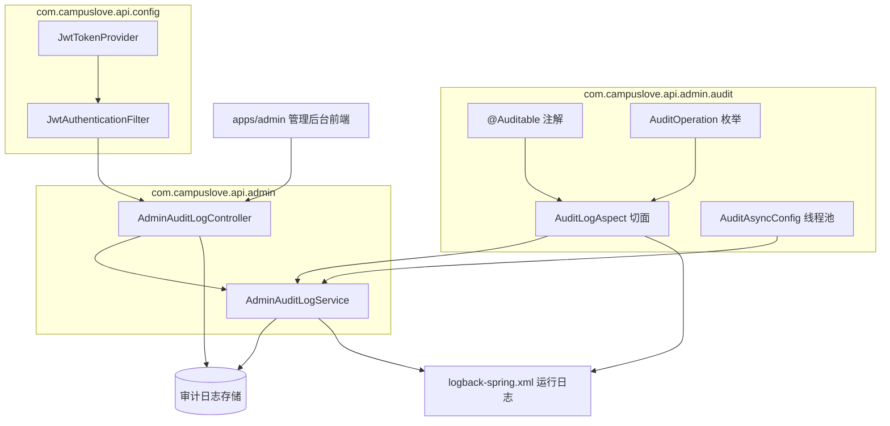
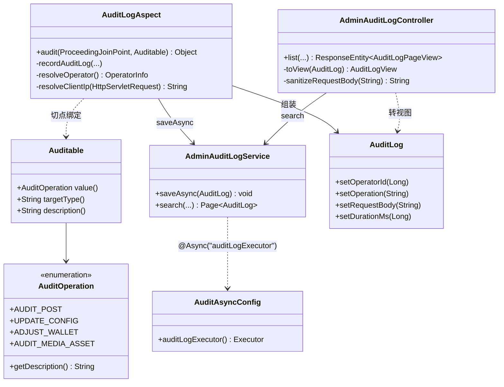
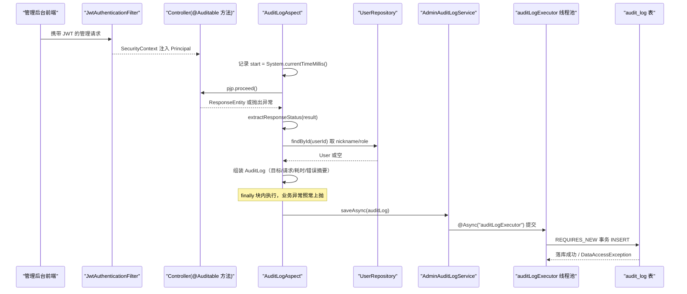
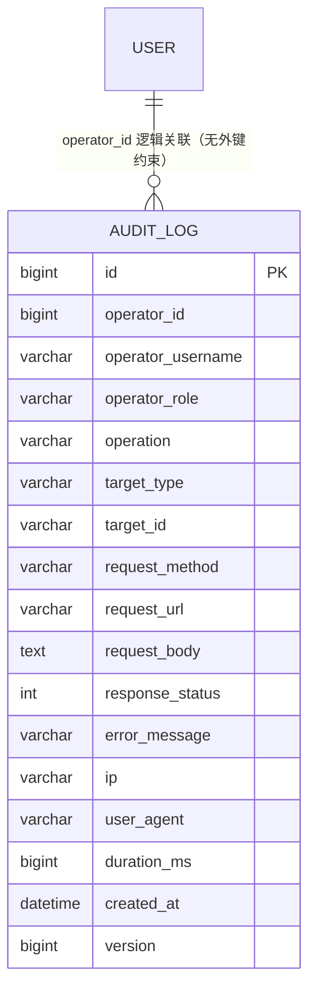
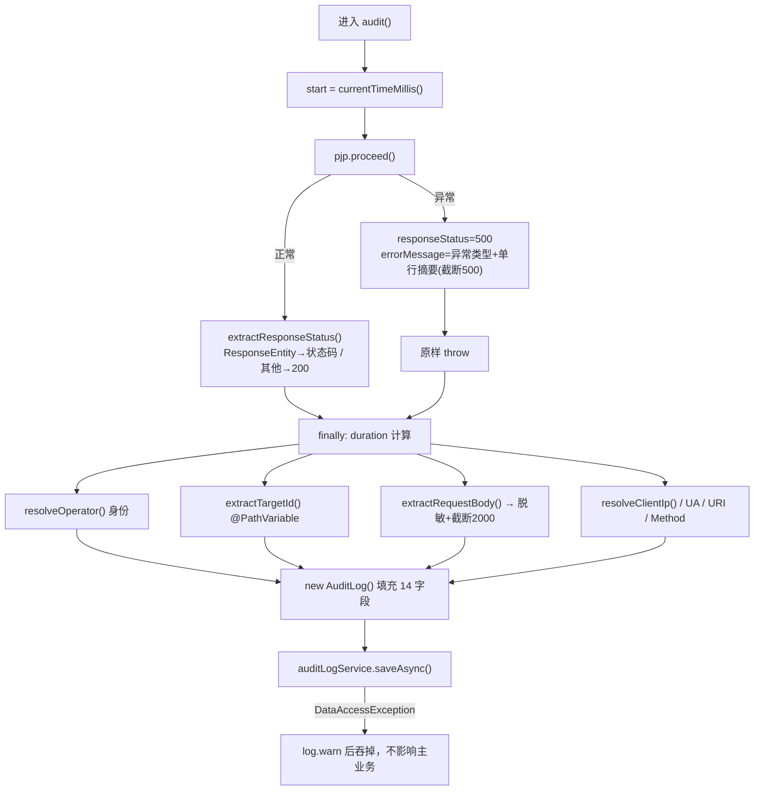
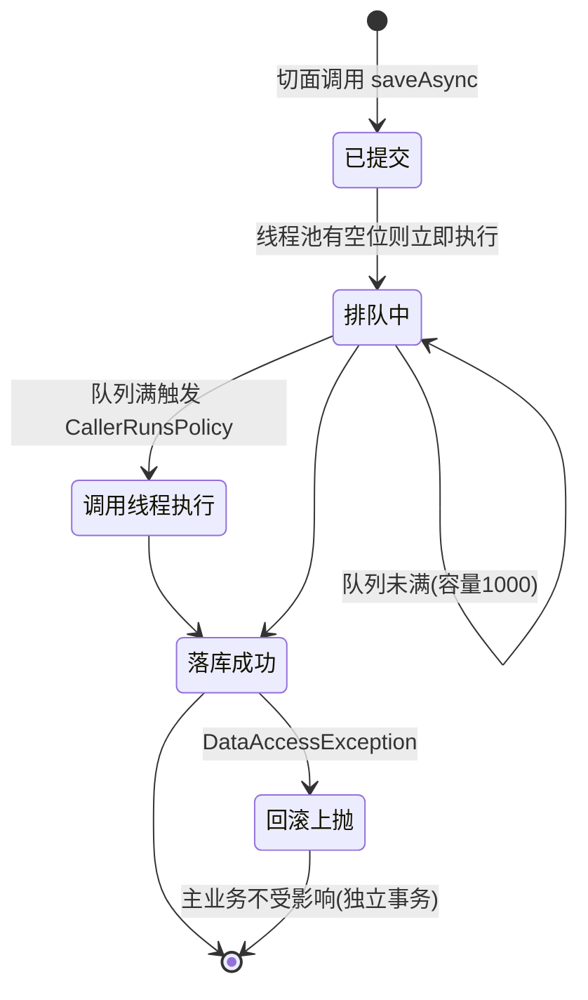
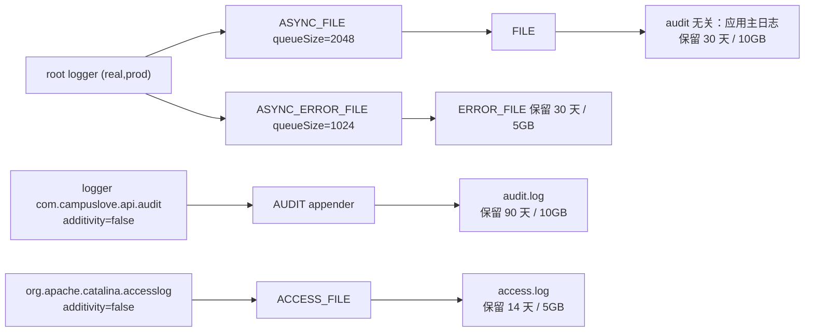

# 审计日志系统

<cite>
**本文引用的文件**
- [AdminAuditLogController.java](file://apps/api/src/main/java/com/campuslove/api/admin/AdminAuditLogController.java)
- [AdminAuditLogService.java](file://apps/api/src/main/java/com/campuslove/api/admin/AdminAuditLogService.java)
- [AuditLogAspect.java](file://apps/api/src/main/java/com/campuslove/api/admin/audit/AuditLogAspect.java)
- [Auditable.java](file://apps/api/src/main/java/com/campuslove/api/admin/audit/Auditable.java)
- [AuditOperation.java](file://apps/api/src/main/java/com/campuslove/api/admin/audit/AuditOperation.java)
- [AuditAsyncConfig.java](file://apps/api/src/main/java/com/campuslove/api/admin/audit/AuditAsyncConfig.java)
- [AuditLog.java](file://apps/api/src/main/java/com/campuslove/api/entity/AuditLog.java)
- [AuditLogRepository.java](file://apps/api/src/main/java/com/campuslove/api/repository/AuditLogRepository.java)
- [logback-spring.xml](file://apps/api/src/main/resources/logback-spring.xml)
- [JwtAuthenticationFilter.java](file://apps/api/src/main/java/com/campuslove/api/config/JwtAuthenticationFilter.java)
- [JwtTokenProvider.java](file://apps/api/src/main/java/com/campuslove/api/config/JwtTokenProvider.java)
- [MediaAccessController.java](file://apps/api/src/main/java/com/campuslove/api/media/MediaAccessController.java)
- [V2026.06.25.0007__create_audit_log.sql](file://database/flyway/sql/V2026.06.25.0007__create_audit_log.sql)
- [V2026.07.28.0005__add_indexes.sql](file://database/flyway/sql/V2026.07.28.0005__add_indexes.sql)
- [README.md](file://database/sanitize/README.md)
- [system.ts](file://apps/admin/src/api/system.ts)
- [index.ts](file://apps/admin/src/router/index.ts)
- [menu.ts](file://apps/admin/src/stores/menu.ts)
- [constants.ts](file://apps/admin/src/utils/constants.ts)
- [ErrorState.vue](file://apps/admin/src/components/ErrorState.vue)
- [AdminVillagePostController.java](file://apps/api/src/main/java/com/campuslove/api/admin/AdminVillagePostController.java)
- [AdminUserController.java](file://apps/api/src/main/java/com/campuslove/api/admin/AdminUserController.java)
- [AdminCertificationController.java](file://apps/api/src/main/java/com/campuslove/api/admin/AdminCertificationController.java)
- [AdminWalletController.java](file://apps/api/src/main/java/com/campuslove/api/admin/AdminWalletController.java)
- [AdminAccountController.java](file://apps/api/src/main/java/com/campuslove/api/admin/AdminAccountController.java)
</cite>

## 目录
1. [简介](#简介)
2. [项目结构](#项目结构)
3. [核心组件](#核心组件)
4. [架构总览](#架构总览)
5. [数据模型](#数据模型)
6. [详细组件分析](#详细组件分析)
7. [配置与开关](#配置与开关)
8. [合规追踪与隐私保护](#合规追踪与隐私保护)
9. [缺口与未实现能力登记](#缺口与未实现能力登记)
10. [依赖关系分析](#依赖关系分析)
11. [性能考虑](#性能考虑)
12. [故障排查指南](#故障排查指南)
13. [结论](#结论)

## 简介
审计日志系统是管理后台（`apps/api` 模块，包 `com.campuslove.api.admin` 及其子包 `admin.audit`）中用于记录"谁在什么时候对后台数据做了什么"的能力集合，由四部分组成：

- 声明层：`@Auditable` 注解（`admin/audit/Auditable.java`，共 46 行）与操作类型枚举 `AuditOperation`（`admin/audit/AuditOperation.java`，共 77 行，L8 声明类型，L74 提供 `getDescription()` 取操作中文描述）。
- 采集层：环绕切面 `AuditLogAspect`（`admin/audit/AuditLogAspect.java`，共 416 行，L58 `@Component`，L60 声明切面类型，L128 定义 `audit(ProceedingJoinPoint pjp, Auditable auditable)` 环绕通知）。
- 落库层：`AdminAuditLogService`（`admin/AdminAuditLogService.java`，共 92 行，L31 `@Service`，L52 定义 `saveAsync(AuditLog auditLog)` 异步写入方法），配套 `AuditAsyncConfig` 提供审计专用异步线程池。
- 查询层：`AdminAuditLogController`（`admin/AdminAuditLogController.java`，共 213 行，L34 `@RestController`，L35 挂载在 `@RequestMapping("/api/v1/admin/audit-logs")`，内部以 `AuditLogView`(L187) 与 `AuditLogPageView`(L207) 两个视图类型对外输出）。

需要与业务审计日志区分的是**应用运行日志**通道：`logback-spring.xml`（共 281 行）负责按日 + 按大小双触发滚动、`AsyncAppender` 异步落盘、以及对 `password`/`accessToken`/`openId` 等敏感字段的输出脱敏。它记录的是进程运行轨迹，而前者记录的是后台操作轨迹，两者存储位置、生命周期与查询方式都不同。

本文只描述仓库中有代码证据的实现；对官方页面要求中不存在证据的能力（报表生成、归档任务、告警规则等），统一在[缺口与未实现能力登记](#缺口与未实现能力登记)一节如实登记。

## 项目结构
审计能力集中在两个目录内，外围由安全过滤器、登录链路与运行日志配置提供调用者身份与留痕通道：

```
apps/api/src/main/java/com/campuslove/api/
├── admin/
│   ├── AdminAuditLogController.java      # /api/v1/admin/audit-logs 查询入口（213 行）
│   ├── AdminAuditLogService.java         # 审计日志异步落库服务（92 行）
│   ├── audit/
│   │   ├── Auditable.java                # 审计标记注解（46 行）
│   │   ├── AuditOperation.java           # 操作类型枚举（77 行）
│   │   ├── AuditLogAspect.java           # 自动审计切面（416 行）
│   │   └── AuditAsyncConfig.java         # 审计异步执行配置
│   └── auth/
│       └── AdminPermissionAspect.java    # 后台权限切面（与审计切面同属 AOP 链）
└── config/
    ├── JwtAuthenticationFilter.java      # 请求身份解析（290 行）
    └── JwtTokenProvider.java             # 令牌签发/校验/吊销（438 行）

apps/api/src/main/resources/logback-spring.xml   # 运行日志滚动、异步与脱敏（281 行）
apps/admin/src/utils/logger.ts                   # 后台前端日志工具（47 行）
```



**章节来源**
- [AdminAuditLogController.java:34-39](file://apps/api/src/main/java/com/campuslove/api/admin/AdminAuditLogController.java#L34-L39)
- [AdminAuditLogService.java:31-52](file://apps/api/src/main/java/com/campuslove/api/admin/AdminAuditLogService.java#L31-L52)
- [AuditLogAspect.java:58-60](file://apps/api/src/main/java/com/campuslove/api/admin/audit/AuditLogAspect.java#L58-L60)
- [Auditable.java:1-46](file://apps/api/src/main/java/com/campuslove/api/admin/audit/Auditable.java#L1-L46)
- [AuditOperation.java:8-74](file://apps/api/src/main/java/com/campuslove/api/admin/audit/AuditOperation.java#L8-L74)
- [logback-spring.xml:3-19](file://apps/api/src/main/resources/logback-spring.xml#L3-L19)

## 核心组件
- `@Auditable`（注解）：`@Target(ElementType.METHOD)` + `@Retention(RetentionPolicy.RUNTIME)`，三个成员——`AuditOperation value()`（必填）、`String targetType() default ""`、`String description() default ""`。它是采集层唯一的挂点，管理端 Controller 方法标注后即纳入审计。
- `AuditOperation`（枚举）：56 个操作常量，每个携带中文描述（构造参数 `description`，通过 `getDescription()` 读取），覆盖帖子、评论、用户、举报、认证、配置/规则/开关、匹配配置、推荐策略、通知配置、敏感词、在线用户、高校、菜单、角色、字典、活动、置顶、兴趣圈、兑换码、商城、钱包、媒体资产等管理动作。切面写入数据库的是 `auditable.value().name()`（枚举名），中文描述仅在代码侧供人工阅读。
- `AuditLogAspect`（切面，416 行）：`@Aspect @Component @Profile("real")`，环绕通知 `audit(ProceedingJoinPoint pjp, Auditable auditable)` 绑定切点 `@Around("@annotation(auditable)")`；负责状态码提取、异常摘要、操作者解析、`@PathVariable` → `targetId`、`@RequestBody` → 脱敏 JSON、请求头 → IP/UA/URL/Method、耗时统计，并在 `finally` 中调用 `AdminAuditLogService.saveAsync`。
- `AdminAuditLogService`（服务，92 行）：`@Service @Profile("real")`，两个能力——`saveAsync(AuditLog)`（`@Async("auditLogExecutor")` + `@Transactional(propagation = Propagation.REQUIRES_NEW)`）与 `search(...)`（`@Transactional(readOnly = true)`，委托 `AuditLogRepository.search`）。
- `AuditAsyncConfig`（配置）：`@Configuration @EnableAsync`，声明 `@Bean(name = "auditLogExecutor")` 线程池：核心 2、最大 8、队列 1000、线程名前缀 `audit-log-`、拒绝策略 `CallerRunsPolicy`、`waitForTasksToCompleteOnShutdown=true`、`awaitTerminationSeconds=5`。
- `AdminAuditLogController`（查询入口，213 行）：`@RestController @RequestMapping("/api/v1/admin/audit-logs") @Profile("real") @PreAuthorize("hasRole('ADMIN')") @Validated`，单一 `@GetMapping list(...)` 支持 7 个查询参数；另有视图层兜底脱敏 `sanitizeRequestBody` + `redactSensitiveKeys` 与两个 record 视图 `AuditLogView`(16 字段) / `AuditLogPageView`(5 字段)。
- `AuditLog`（实体）：由 `com.campuslove.api.entity.AuditLog` 承载，切面通过 setter 填充 14 个字段后交给服务层，表结构由 `database/flyway/sql/V2026.06.25.0007__create_audit_log.sql` 建立。



**章节来源**
- [Auditable.java:28-46](file://apps/api/src/main/java/com/campuslove/api/admin/audit/Auditable.java#L28-L46)
- [AuditOperation.java:8-77](file://apps/api/src/main/java/com/campuslove/api/admin/audit/AuditOperation.java#L8-L77)
- [AuditLogAspect.java:57-128](file://apps/api/src/main/java/com/campuslove/api/admin/audit/AuditLogAspect.java#L57-L128)
- [AuditLogAspect.java:196-213](file://apps/api/src/main/java/com/campuslove/api/admin/audit/AuditLogAspect.java#L196-L213)
- [AdminAuditLogService.java:31-91](file://apps/api/src/main/java/com/campuslove/api/admin/AdminAuditLogService.java#L31-L91)
- [AdminAuditLogController.java:34-106](file://apps/api/src/main/java/com/campuslove/api/admin/AdminAuditLogController.java#L34-L106)
- [AdminAuditLogController.java:187-213](file://apps/api/src/main/java/com/campuslove/api/admin/AdminAuditLogController.java#L187-L213)
- [AuditAsyncConfig.java:21-50](file://apps/api/src/main/java/com/campuslove/api/admin/audit/AuditAsyncConfig.java#L21-L50)

## 架构总览
系统运行时分两条链路：**写入链路**（切面驱动的自动留痕）与**读取链路**（管理后台分页检索）。二者共用 `audit_log` 表，但写入走 `auditLogExecutor` 线程池 + `REQUIRES_NEW` 独立事务，读取走只读事务，互不阻塞。



**图表来源**
- [AuditLogAspect.java:127-152](file://apps/api/src/main/java/com/campuslove/api/admin/audit/AuditLogAspect.java#L127-L152)
- [AuditLogAspect.java:167-213](file://apps/api/src/main/java/com/campuslove/api/admin/audit/AuditLogAspect.java#L167-L213)
- [AdminAuditLogService.java:50-72](file://apps/api/src/main/java/com/campuslove/api/admin/AdminAuditLogService.java#L50-L72)
- [AuditAsyncConfig.java:37-49](file://apps/api/src/main/java/com/campuslove/api/admin/audit/AuditAsyncConfig.java#L37-L49)
- [JwtAuthenticationFilter.java:47-49](file://apps/api/src/main/java/com/campuslove/api/config/JwtAuthenticationFilter.java#L47-L49)

读取链路是一条典型的 Spring Data 分页查询：控制器做参数归一化与枚举名大写化，服务层转调仓储的 `@Query`，视图层再执行一次兜底脱敏。


**图表来源**
- [AdminAuditLogController.java:35-106](file://apps/api/src/main/java/com/campuslove/api/admin/AdminAuditLogController.java#L35-L106)
- [AdminAuditLogService.java:85-91](file://apps/api/src/main/java/com/campuslove/api/admin/AdminAuditLogService.java#L85-L91)
- [AuditLogRepository.java:29-45](file://apps/api/src/main/java/com/campuslove/api/repository/AuditLogRepository.java#L29-L45)

三层职责边界清晰：注解只声明语义、切面只负责采集与容错、服务只负责落库与检索、控制器只负责检索与出参净化。任何一层抛错都不会把异常带回管理操作本身——切面在 `finally` 中捕获 `DataAccessException` 并只记 `log.warn`（L146-L150），服务层的写失败则抛给线程池统一记录（L61-L71）。

**章节来源**
- [AuditLogAspect.java:127-152](file://apps/api/src/main/java/com/campuslove/api/admin/audit/AuditLogAspect.java#L127-L152)
- [AdminAuditLogController.java:72-106](file://apps/api/src/main/java/com/campuslove/api/admin/AdminAuditLogController.java#L72-L106)

## 数据模型
审计记录落在单表 `audit_log`（InnoDB / utf8mb4），建表语句见 `V2026.06.25.0007__create_audit_log.sql`。迁移脚本头部注释交代了设计动机（Phase 2 任务 12：对审核帖子、禁用用户、修改配置等管理端关键操作留痕，供事后追溯与合规检查）与三点实现约定：AOP 拦截 `@Auditable`、异步写入避免阻塞主流程、请求体敏感字段写入前脱敏。

| 列名 | 类型 | 约束 | 实体字段 | 取值来源 |
|---|---|---|---|---|
| `id` | BIGINT | PRIMARY KEY AUTO_INCREMENT | `id` | 数据库自增 |
| `operator_id` | BIGINT | NOT NULL | `operatorId` | SecurityContext Principal 解析，未认证时为 `0` |
| `operator_username` | VARCHAR(64) | NOT NULL | `operatorUsername` | `User.nickname`，缺省为 `user-<id>`，未认证为 `ANONYMOUS` |
| `operator_role` | VARCHAR(16) | NOT NULL | `operatorRole` | `User.role`，缺省 `USER`，未认证为 `ANONYMOUS` |
| `operation` | VARCHAR(64) | NOT NULL | `operation` | `auditable.value().name()`（枚举名） |
| `target_type` | VARCHAR(32) | 可空 | `targetType` | 注解 `targetType()`，空串转 null |
| `target_id` | VARCHAR(64) | 可空 | `targetId` | 第一个非空 `@PathVariable` 参数 |
| `request_method` | VARCHAR(8) | 可空 | `requestMethod` | `HttpServletRequest.getMethod()` |
| `request_url` | VARCHAR(256) | 可空 | `requestUrl` | `getRequestURI()`，截断 256 |
| `request_body` | TEXT | 可空 | `requestBody` | `@RequestBody` 序列化并脱敏，截断 2000 |
| `response_status` | INT | 可空 | `responseStatus` | `ResponseEntity` 状态码，非响应体默认 200，异常置 500 |
| `error_message` | VARCHAR(512) | 可空 | `errorMessage` | 异常类型 + 单行化摘要，截断 500 |
| `ip` | VARCHAR(64) | 可空 | `ip` | 可信代理判定后的客户端 IP |
| `user_agent` | VARCHAR(256) | 可空 | `userAgent` | `User-Agent` 请求头，截断 256 |
| `duration_ms` | BIGINT | 可空 | `durationMs` | 环绕通知耗时（`System.currentTimeMillis()` 差值） |
| `created_at` | DATETIME | NOT NULL DEFAULT CURRENT_TIMESTAMP | `createdAt` | 服务层 `LocalDateTime.now(TimeZones.BUSINESS)` |
| `version` | BIGINT DEFAULT 0 | NOT NULL | `version` | JPA `@Version` 乐观锁，由 V2026.07.26.0003 追加 |

索引在建表时一并创建三个：`idx_audit_operator(operator_id)`、`idx_audit_operation(operation)`、`idx_audit_created_at(created_at)`，正对应查询接口的三类过滤条件与固定 `ORDER BY a.createdAt DESC` 排序。



[此图为概念模型，`operator_id` 与 `users` 表的关系在建表语句中并未声明外键，故不提供图表来源]

实体侧使用 `@Entity @EntityListeners(AuditingEntityListener.class) @Table(name = "audit_log")`，`created_at` 标注 `@CreatedDate @Column(name = "created_at", nullable = false, updatable = false)`；`version` 字段初始值 `0L`，注释说明并发更新冲突会抛 `ObjectOptimisticLockingFailureException` 并由全局异常处理器转成 HTTP 409。

出参模型 `AuditLogView` 是 16 字段的 Java record，字段与表列一一对应（`createdAt` 转为字符串输出）；分页包装 `AuditLogPageView` 含 `content`、`totalElements`、`totalPages`、`page`、`size`。切面内部另有私有 record `OperatorInfo(Long userId, String username, String role)` 作为操作者信息载体。

**章节来源**
- [V2026.06.25.0007__create_audit_log.sql:1-44](file://database/flyway/sql/V2026.06.25.0007__create_audit_log.sql#L1-L44)
- [AuditLog.java:19-101](file://apps/api/src/main/java/com/campuslove/api/entity/AuditLog.java#L19-L101)
- [AuditLog.java:104-242](file://apps/api/src/main/java/com/campuslove/api/entity/AuditLog.java#L104-L242)
- [AuditLogAspect.java:64-85](file://apps/api/src/main/java/com/campuslove/api/admin/audit/AuditLogAspect.java#L64-L85)
- [AuditLogAspect.java:189-213](file://apps/api/src/main/java/com/campuslove/api/admin/audit/AuditLogAspect.java#L189-L213)
- [AdminAuditLogService.java:52-58](file://apps/api/src/main/java/com/campuslove/api/admin/AdminAuditLogService.java#L52-L58)
- [AdminAuditLogController.java:187-213](file://apps/api/src/main/java/com/campuslove/api/admin/AdminAuditLogController.java#L187-L213)
- [AuditLogRepository.java:29-44](file://apps/api/src/main/java/com/campuslove/api/repository/AuditLogRepository.java#L29-L44)

## 详细组件分析

### @Auditable 注解与切点绑定
`Auditable` 是一个仅作用于方法、运行期保留的标记注解（`@Target(ElementType.METHOD)`、`@Retention(RetentionPolicy.RUNTIME)`），三个成员分别是必填的 `AuditOperation value()`、可选的 `String targetType()`（示例值如 USER/POST/CERTIFICATION/CONFIG）和预留人工阅读的 `String description()`。其 Javadoc 明确声明切面会自动完成四件事：从 `@PathVariable` 提取 `targetId`、从 `@RequestBody` 提取并脱敏请求体、从 SecurityContext 提取操作者 ID/用户名/角色、从 `HttpServletRequest` 提取 IP/UA/URL/Method。

切面侧的切点写作 `@Around("@annotation(auditable)")`，参数名 `auditable` 与通知方法签名 `audit(ProceedingJoinPoint pjp, Auditable auditable)` 中的形参绑定，Spring AOP 会把被拦截方法上的注解实例直接注入，因此无需反射查注解即可拿到操作类型。

接入面按 grep 统计分布在至少 19 个管理端控制器文件中（结果被截断，实际更多），标注形态统一为 `@Auditable(value = AuditOperation.XXX, targetType = "YYY")`，例如：

- `AdminVillagePostController` L210 `AUDIT_POST` / targetType `POST`，L259、L273 对应 `PIN_POST`、`UNPIN_POST`，L319 对应 `DELETE_POST`
- `AdminUserController` L127 `CREATE_USER`（targetType `USER`）与 L191 `CREATE_USER`（targetType `ADMIN`），说明同一操作类型可用不同 `targetType` 区分对象域
- `AdminCertificationController` L123 `REVIEW_CERTIFICATION` / `CERTIFICATION`
- `AdminWalletController` L182 `ADJUST_WALLET` / `USER`
- `AdminAccountController` L92 `CHANGE_PASSWORD` / `ACCOUNT`
- `AdminMediaAssetController` L167 `AUDIT_MEDIA_ASSET` / `MEDIA_ASSET`
- `OnlineUserAdminController` L135 `KICK_ONLINE_USER` / `USER`

**章节来源**
- [Auditable.java:8-46](file://apps/api/src/main/java/com/campuslove/api/admin/audit/Auditable.java#L8-L46)
- [AuditLogAspect.java:124-128](file://apps/api/src/main/java/com/campuslove/api/admin/audit/AuditLogAspect.java#L124-L128)
- [AdminVillagePostController.java:210-210](file://apps/api/src/main/java/com/campuslove/api/admin/AdminVillagePostController.java#L210-L210)
- [AdminUserController.java:127-127](file://apps/api/src/main/java/com/campuslove/api/admin/AdminUserController.java#L127-L127)
- [AdminCertificationController.java:123-123](file://apps/api/src/main/java/com/campuslove/api/admin/AdminCertificationController.java#L123-L123)
- [AdminWalletController.java:182-182](file://apps/api/src/main/java/com/campuslove/api/admin/AdminWalletController.java#L182-L182)
- [AdminAccountController.java:92-92](file://apps/api/src/main/java/com/campuslove/api/admin/AdminAccountController.java#L92-L92)

### AuditOperation 枚举
枚举共 56 个常量，每个常量以中文描述作为构造参数（`private final String description`，`getDescription()` 读取）。按业务域归类如下：

| 业务域 | 常量 |
|---|---|
| 内容与社区 | `AUDIT_POST`、`DELETE_POST`、`DELETE_COMMENT`、`PIN_POST`、`UNPIN_POST`、`PIN_TOPIC`、`UNPIN_TOPIC` |
| 用户与账号 | `DISABLE_USER`、`ENABLE_USER`、`EDIT_USER`、`CREATE_USER`、`CHANGE_PASSWORD`、`KICK_ONLINE_USER`、`ADJUST_WALLET`、`REVIEW_CERTIFICATION` |
| 治理与风控 | `HANDLE_REPORT`、`UPDATE_CONFIG`、`UPDATE_RULE`、`UPDATE_SWITCH`、`ADD_SENSITIVE_WORD`、`DELETE_SENSITIVE_WORD` |
| 匹配与推荐 | `UPDATE_MATCH_CONFIG`、`UPDATE_RECOMMEND_STRATEGY`、`UPDATE_NOTIFY_CONFIG` |
| 组织与权限 | `CREATE_SCHOOL`、`UPDATE_SCHOOL`、`DELETE_SCHOOL`、`TOGGLE_SCHOOL`、`CREATE_MENU`、`UPDATE_MENU`、`DELETE_MENU`、`CREATE_ROLE`、`UPDATE_ROLE`、`DELETE_ROLE`、`ASSIGN_ROLE_MENU` |
| 字典 | `CREATE_DICT`、`UPDATE_DICT`、`DELETE_DICT`、`CREATE_DICT_ITEM`、`UPDATE_DICT_ITEM`、`DELETE_DICT_ITEM` |
| 活动 | `CREATE_ACTIVITY`、`UPDATE_ACTIVITY`、`DELETE_ACTIVITY`、`PUBLISH_ACTIVITY`、`UNPUBLISH_ACTIVITY` |
| 兴趣圈 | `CREATE_CIRCLE`、`UPDATE_CIRCLE`、`DELETE_CIRCLE` |
| 电商 | `CREATE_PROMO_CODE`、`DISABLE_PROMO_CODE`、`CREATE_SHOP_ITEM`、`UPDATE_SHOP_ITEM`、`DELETE_SHOP_ITEM`、`PUBLISH_SHOP_ITEM`、`UNPUBLISH_SHOP_ITEM` |
| 媒体 | `AUDIT_MEDIA_ASSET` |

入库的是枚举名（`auditable.value().name()`），中文描述只在 Java 侧供开发阅读；前端通过一份手写的 `AUDIT_OPERATIONS` 常量把枚举名映射为 i18n key（如 `AUDIT_POST` → `auditLogs.opAuditPost`）供筛选下拉使用，注释显式要求"与后端 AuditOperation 对齐"。

**章节来源**
- [AuditOperation.java:8-77](file://apps/api/src/main/java/com/campuslove/api/admin/audit/AuditOperation.java#L8-L77)
- [AuditLogAspect.java:200-200](file://apps/api/src/main/java/com/campuslove/api/admin/audit/AuditLogAspect.java#L200-L200)
- [system.ts:463-484](file://apps/admin/src/api/system.ts#L463-L484)

### AuditLogAspect 采集管线
切面声明为 `@Aspect @Component @Profile("real")`，注释说明它依赖 `audit_log` 表与 `UserRepository`，因此 mock profile 不加载。构造注入四个依赖：`AdminAuditLogService`、`UserRepository`、`ObjectMapper`，以及通过 `@Value("${app.security.trusted-proxies:}")` 注入的可信代理列表；构造器把逗号分隔的配置项拆成精确 IP 集合 `trustedProxyIps` 与 CIDR 前缀列表 `trustedProxyCidrs`，两个集合都以不可修改视图保存。



**图表来源**
- [AuditLogAspect.java:127-152](file://apps/api/src/main/java/com/campuslove/api/admin/audit/AuditLogAspect.java#L127-L152)
- [AuditLogAspect.java:167-213](file://apps/api/src/main/java/com/campuslove/api/admin/audit/AuditLogAspect.java#L167-L213)

操作者解析 `resolveOperator()` 有明确降级链：SecurityContext 为空、未认证或 principal 为 null → `OperatorInfo(0L, "ANONYMOUS", "ANONYMOUS")`；principal 经 `parseUserId()` 转 Long 失败 → 同样 ANONYMOUS；`userRepository.findById` 查不到 → `OperatorInfo(userId, "UNKNOWN", "UNKNOWN")`；用户名取 `nickname`，为空则合成 `user-<id>`；角色为空则回落 `USER`；查询抛 `DataAccessException` 时记 debug 日志并回落 ANONYMOUS。整条链路的目的是"取不到身份也要留下审计记录"。

目标与请求信息采集：`extractTargetId()` 遍历方法参数注解，取第一个非空 `@PathVariable` 值并截断 64；`extractRequestBody()` 取第一个 `@RequestBody` 参数交给 `sanitizeAndSerialize()`（`valueToTree` → 递归脱敏 → `writeValueAsString` → 截断 `MAX_BODY_LENGTH = 2000`），序列化失败时写入 `<unable to serialize: 错误前100字符>` 而不是抛错。HTTP 上下文由 `currentRequest()` 从 `RequestContextHolder` 取得，采集动作全部发生在业务线程内（异步只推迟到 `saveAsync`），因此不会遇到异步线程取不到 request 的问题；URI 与 UA 各截断 256。

错误信息构造 `buildSafeErrorMessage()` 只保留异常类型名与替换掉换行后的单行消息，注释标注目的为"避免 SQL/堆栈等内部细节入库"。

**章节来源**
- [AuditLogAspect.java:57-122](file://apps/api/src/main/java/com/campuslove/api/admin/audit/AuditLogAspect.java#L57-L122)
- [AuditLogAspect.java:157-162](file://apps/api/src/main/java/com/campuslove/api/admin/audit/AuditLogAspect.java#L157-L162)
- [AuditLogAspect.java:167-213](file://apps/api/src/main/java/com/campuslove/api/admin/audit/AuditLogAspect.java#L167-L213)
- [AuditLogAspect.java:221-270](file://apps/api/src/main/java/com/campuslove/api/admin/audit/AuditLogAspect.java#L221-L270)
- [AuditLogAspect.java:276-324](file://apps/api/src/main/java/com/campuslove/api/admin/audit/AuditLogAspect.java#L276-L324)
- [AuditLogAspect.java:354-416](file://apps/api/src/main/java/com/campuslove/api/admin/audit/AuditLogAspect.java#L354-L416)

### AdminAuditLogService 与异步写入
服务类只有两个公开方法，但承载了三条关键语义：

1. **线程隔离**：`saveAsync` 标注 `@Async("auditLogExecutor")`，方法名与 `AuditAsyncConfig` 中 `@Bean(name = "auditLogExecutor")` 精确对应，线程名前缀 `audit-log-` 便于在线程栈与日志中定位。
2. **事务隔离**：`@Transactional(propagation = Propagation.REQUIRES_NEW)`，类注释与实现注释都明确"即使主业务事务回滚，审计日志仍能记录"。
3. **失败语义**：入参为 null 直接返回；`createdAt` 为空时以 `LocalDateTime.now(TimeZones.BUSINESS)` 填充（注释说明该字段是"审计事件发生时间，用于追溯"）；`auditLogRepository.save` 抛 `DataAccessException` 时，先 `log.warn` 记录 operation/operatorId/error，再显式 `TransactionAspectSupport.currentTransactionStatus().setRollbackOnly()` 并抛出包装异常 `RuntimeException("Audit log persistence failed", e)`。实现注释（Task 10 / FIN-00022）指出：在 `@Transactional` 内 catch 数据库异常若不回滚或重抛，Spring 会认为方法正常返回并提交事务，可能造成部分提交与连接状态不一致；由于本方法运行在 `REQUIRES_NEW` 独立事务中，`setRollbackOnly` 只回滚审计事务而不影响主业务事务，异常上抛交由线程池统一记录。

`search` 方法标注 `@Transactional(readOnly = true)`，参数顺序与仓储一致，直接委托 `AuditLogRepository.search(...)`，不含任何业务加工，因此过滤语义完全等价于那条 JPQL。

线程池策略（`AuditAsyncConfig`，`@Configuration @EnableAsync`）：核心 2、最大 8、队列 1000，三个数值以命名常量声明（`AUDIT_CORE_POOL_SIZE`、`AUDIT_MAX_POOL_SIZE`、`AUDIT_QUEUE_CAPACITY`）；拒绝策略为 `CallerRunsPolicy`——队列打满时由调用线程同步写入，宁可让管理请求变慢也不丢审计；关停阶段 `setWaitForTasksToCompleteOnShutdown(true)` + `setAwaitTerminationSeconds(5)`，给未落库的审计记录最多 5 秒收尾。



**图表来源**
- [AdminAuditLogService.java:43-72](file://apps/api/src/main/java/com/campuslove/api/admin/AdminAuditLogService.java#L43-L72)
- [AuditAsyncConfig.java:14-49](file://apps/api/src/main/java/com/campuslove/api/admin/audit/AuditAsyncConfig.java#L14-L49)

### AdminAuditLogController 查询接口
控制器唯一对外端点是 `GET /api/v1/admin/audit-logs`，类级注解四件：`@RestController`、`@RequestMapping("/api/v1/admin/audit-logs")`、`@Profile("real")`、`@PreAuthorize("hasRole('ADMIN')")`，外加 `@Validated` 使方法级 `@Min/@Max` 生效。方法签名 7 个 `@RequestParam`：

| 参数 | 默认/约束 | 处理逻辑 |
|---|---|---|
| `page` | 默认 0，`@Min(0)` | `safePage = Math.max(0, page)` |
| `size` | 默认 20，`@Min(1) @Max(100)` | `safeSize = Math.min(Math.max(1, size), 100)`，双保险钳制 |
| `operator` | 可空 | `parseLong`：非数字或空 → null，即不参与过滤 |
| `operation` | 可空 | 非空则 `toUpperCase()`，与入库的枚举名对齐 |
| `startDate` / `endDate` | 可空 | `parseDateTime`：长度为 10 时补 `T00:00:00` 兼容纯日期，解析失败 → null |
| `exception` | 可空 | 仅当 `Boolean.TRUE` 才传 TRUE，其余（含 false）传 null 不过滤 |

方法首行调用 `SecurityUtils.getCurrentUserId()`，返回值未参与后续逻辑，仅作为"必须存在已认证上下文"的调用；随后 `PageRequest.of(safePage, safeSize)` 交给服务层，把 `Page<AuditLog>` 逐条 `toView` 后组装 `AuditLogPageView(items, totalElements, totalPages, safePage, safeSize)` 并返回 `ResponseEntity.ok(view)`。

`toView` 直接映射实体的 15 个字段，其中只有 `requestBody` 经过 `sanitizeRequestBody()`，`createdAt` 以 `toString()` 输出。类内注释把这一层记为 R4-00394"审计视图层二次白名单"：切面脱敏依赖字段名单、新增敏感字段易漏，视图层按 key 名兜底；JSON 解析失败时原样返回，交由切面已做的脱敏兜底。

**章节来源**
- [AdminAuditLogController.java:34-106](file://apps/api/src/main/java/com/campuslove/api/admin/AdminAuditLogController.java#L34-L106)
- [AdminAuditLogController.java:108-183](file://apps/api/src/main/java/com/campuslove/api/admin/AdminAuditLogController.java#L108-L183)
- [AuditLogRepository.java:15-45](file://apps/api/src/main/java/com/campuslove/api/repository/AuditLogRepository.java#L15-L45)

### 管理后台前端接入
`apps/admin/src/api/system.ts` 定义与后端视图对齐的 TS 接口 `AuditLogView`、`AuditLogPageView`、`AuditLogQuery`，并导出 `listAuditLogs()`：注释说明"本模块对外统一 pageBase=1"，函数内部把 1-based 页码换算成后端的 0-based（`Math.max((query.page ?? 1) - 1, 0)`），`size` 缺省取共享常量 `DEFAULT_PAGE_SIZE`（`Users/Posts/Reports/AuditLogs` 共用），空字符串参数统一转 `undefined` 以免污染 query。`AuditLogQuery` 暴露 `startDate`/`endDate`（`yyyy-MM-dd`）与 `exceptionOnly`，与后端 `exception` 参数对应。

视图与导航：路由懒加载表把 `views/system/AuditLogs.vue` 注册为按需 chunk；菜单 store 中该项为 `id: 21, parentId: 20, name: "AuditLogs", path: "audit-logs"`，并标记 `superAdminOnly: true`，即审计日志页仅超管可见；`ErrorState.vue` 的注释表明 Dashboard/Feedback/AuditLogs 等视图共用该加载失败态组件；`format.ts` 注释说明 Users/Posts/Reports/Feedback/AuditLogs 五个视图共用同一套格式化逻辑。

**章节来源**
- [system.ts:455-502](file://apps/admin/src/api/system.ts#L455-L502)
- [index.ts:41-41](file://apps/admin/src/router/index.ts#L41-L41)
- [menu.ts:230-230](file://apps/admin/src/stores/menu.ts#L230-L230)
- [constants.ts:8-8](file://apps/admin/src/utils/constants.ts#L8-L8)
- [ErrorState.vue:5-5](file://apps/admin/src/components/ErrorState.vue#L5-L5)

## 配置与开关
审计能力受三类开关控制：Spring Profile、线程池常量、日志配置文件。

**1. Profile 门控。** `AdminAuditLogController`（`@Profile("real")`）、`AdminAuditLogService`（`@Profile("real")`）、`AuditLogAspect`（`@Profile("real")`）三个 Bean 只在 `real` profile 下装配。类注释给出原因：Phase 3 修复，避免 mock profile 下 `AuditLogRepository` Bean 缺失导致启动失败。也就是说，**数据库审计日志只在 real 环境存在**；而 `logback-spring.xml` 中名为 `com.campuslove.api.audit` 的 logger 特意声明在 `springProfile` 之外，注释明确"此 logger 在所有 profile 下激活，保证 dev/mock/real/prod 均能记录审计事件"。两条留痕通道的 profile 语义并不相同。

**2. 可信代理开关 `app.security.trusted-proxies`。** 通过 `@Value("${app.security.trusted-proxies:}")` 注入 `AuditLogAspect` 构造器，默认空串（即不信任任何代理头）。配置项为逗号分隔列表，含 `/` 的条目解析为 CIDR 前缀，其余解析为精确 IP。该开关直接决定审计日志中 `ip` 列的可信来源。

**3. 异步线程池常量。**

| 项 | 值 | 说明 |
|---|---|---|
| 核心线程数 | 2 | `AUDIT_CORE_POOL_SIZE` |
| 最大线程数 | 8 | `AUDIT_MAX_POOL_SIZE` |
| 队列容量 | 1000 | `AUDIT_QUEUE_CAPACITY`，R4-01823 命名常量，注释"应对突发管理操作" |
| 线程名前缀 | `audit-log-` | 便于排查 |
| 拒绝策略 | `CallerRunsPolicy` | 队列满时由调用线程同步写入，避免审计日志丢失 |
| 关停等待 | `waitForTasksToCompleteOnShutdown=true`，`awaitTerminationSeconds=5` | 最多 5 秒收尾 |

这些数值是编译期常量，仓库里没有对应的可配置属性键，调整需改代码重新构建。

**4. 运行日志配置（logback-spring.xml，281 行）。** `<configuration scan="false" scanPeriod="30 seconds">` 关闭热加载；两个 `springProperty` 把路径与应用名外置为 `app.logging.path`（默认 `logs`）与 `spring.application.name`（默认 `campus-love-api`）。四组文件 Appender 的滚动参数不同：

| Appender | 输出文件 | maxFileSize | maxHistory | totalSizeCap |
|---|---|---|---|---|
| `FILE` | `${LOG_PATH}/${APP_NAME}.log` | 100MB | 30 天 | 10GB |
| `ERROR_FILE` | `${LOG_PATH}/${APP_NAME}-error.log`（ThresholdFilter ERROR） | 100MB | 30 天 | 5GB |
| `AUDIT` | `${LOG_PATH}/audit.log`（`AUDIT_PATTERN` 单行 JSON） | 100MB | **90 天** | 10GB |
| `ACCESS_FILE` | `${LOG_PATH}/${APP_NAME}-access.log` | 100MB | 14 天 | 5GB |

四者均用 `SizeAndTimeBasedRollingPolicy` 且 `cleanHistoryOnStart=true`；`AUDIT` 的 90 天保留期注释为"审计合规要求长保留期"。异步包装 `ASYNC_FILE`（`neverBlock=true`、`queueSize=2048`、`discardingThreshold=0`）与 `ASYNC_ERROR_FILE`（`queueSize=1024`）挂在 `real,prod` 的 root logger 上；`dev,local,mock` 与 `default` 只输出控制台，且 `com.campuslove.api` 在这两种 profile 下为 DEBUG。Access Log 由 `server.tomcat.accesslog.enabled` 开关控制，注释说明 pattern 含 `%u`（JWT 解析后的 userId）与 `%U`（不含 query 的请求路径）。



**图表来源**
- [logback-spring.xml:58-144](file://apps/api/src/main/resources/logback-spring.xml#L58-L144)
- [logback-spring.xml:173-234](file://apps/api/src/main/resources/logback-spring.xml#L173-L234)
- [logback-spring.xml:236-273](file://apps/api/src/main/resources/logback-spring.xml#L236-L273)

**章节来源**
- [AdminAuditLogController.java:34-39](file://apps/api/src/main/java/com/campuslove/api/admin/AdminAuditLogController.java#L34-L39)
- [AdminAuditLogService.java:29-33](file://apps/api/src/main/java/com/campuslove/api/admin/AdminAuditLogService.java#L29-L33)
- [AuditLogAspect.java:57-59](file://apps/api/src/main/java/com/campuslove/api/admin/audit/AuditLogAspect.java#L57-L59)
- [AuditLogAspect.java:91-122](file://apps/api/src/main/java/com/campuslove/api/admin/audit/AuditLogAspect.java#L91-L122)
- [AuditAsyncConfig.java:21-49](file://apps/api/src/main/java/com/campuslove/api/admin/audit/AuditAsyncConfig.java#L21-L49)
- [logback-spring.xml:20-24](file://apps/api/src/main/resources/logback-spring.xml#L20-L24)
- [logback-spring.xml:193-215](file://apps/api/src/main/resources/logback-spring.xml#L193-L215)
- [Auditable.java:28-30](file://apps/api/src/main/java/com/campuslove/api/admin/audit/Auditable.java#L28-L30)

## 合规追踪与隐私保护
审计数据的隐私控制分布在三层，任何一层单独看都不完备，需要合起来读。

**第一层：切面字段名单脱敏。** `SENSITIVE_FIELDS` 是一个小写匹配的字符串集合，覆盖 `password`/`newpassword`/`oldpassword`、`token`/`secret`/`accesstoken`/`refreshtoken`、`code`/`captcha`/`verifycode`/`authcode`/`credential`，以及 infra R2-00233 扩展的手机号族（`phone`/`mobile`/`phonenumber`/`telephone`/`tel`）、证件号族（`idcard`/`idcardnumber`/`idcardno`/`identitycard`/`idcardurl`/`studentidcard`/`studentidcardurl`）、微信身份标识（`openid`/`unionid`/`sessionkey`/`session_key`）、`email`、`realname` 与密钥类（`apikey`/`secretkey`/`authorization`/`privatekey`）。`maskSensitiveFields()` 对 Jackson `JsonNode` 递归，对象节点先拷贝字段名集合再迭代（注释说明是为避免并发修改），命中即以 `obj.put(field, "***")` 覆盖，数组节点逐元素递归。

**第二层：视图层正则兜底（R4-00394）。** 查询侧另有一份 `SENSITIVE_KEY_PATTERN`，写作 `(?i)(password|passwd|secret|token|authorization|credential|idcard|id_card|idCard|phone|openid|open_id|unionid|session_key|jwt)`，用 `matches()` 对 JSON key 整名匹配后替换为 `***`。两层名单并不等价：视图层新增 `jwt`、`id_card`、`open_id` 的下划线变体，切面则额外覆盖 `email`、`realname`、`captcha`、`apikey`、`privatekey` 等视图层没有的项；注释给出的理由是"切面脱敏仅靠字段名单，新增敏感字段易漏；视图层按 key 名兜底"。`sanitizeRequestBody()` 解析失败时原样返回，把风险留给第一层。

**第三层：日志输出脱敏。** `CONSOLE_PATTERN` 与 `FILE_PATTERN` 用 logback 的 `%replace` 对 `%msg` 与 `%ex` 两处应用同一条正则，把 `(password|passwd|sessionToken|accessToken|refreshToken|secret|appSecret|jwtSecret|openId|unionId)\s*[=:]\s*\S+` 替换为 `$1=***`；`AUDIT_PATTERN`（单行 JSON）复用同一条正则，注释第 5 点即"应用与主日志相同的敏感字段脱敏正则，避免凭据泄露到审计文件"。需要如实指出：文件头部注释声明脱敏字段含"phone（保留前 3 后 4）"，但三处正则里都没有 `phone` 分支，也没有任何保留片段的构造，实际行为与注释不一致。

**入库内容的最小化。** 异常只留类型名与单行化消息并截断 500（`buildSafeErrorMessage` + `truncate`），注释明确避免 SQL/堆栈入库；`requestBody` 截断 2000、URI 与 UA 截断 256、`targetId` 与 `ip` 截断 64，全部与建表列宽一致。请求来源侧，R4-00395 规定仅当直连地址命中 `app.security.trusted-proxies` 时才读取 `X-Forwarded-For`/`X-Real-IP`/`Proxy-Client-IP`/`WL-Proxy-Client-IP` 的首值，否则直接记录 `getRemoteAddr()`，防止客户端伪造代理头写入虚假 IP 导致追溯失真。访问日志侧，R4-00407 取消记录含完整 query 的请求首行 `%r`，改用 `%m` + `%U`，避免 `?token=xxx` 这类参数明文落盘。

**操作轨迹还原。** 单条记录即含"谁（operatorId/username/role）— 做了什么（operation）— 对哪个对象（targetType/targetId）— 通过哪个接口（requestMethod/requestUrl/requestBody）— 结果如何（responseStatus/errorMessage/durationMs）— 从哪来（ip/userAgent）— 何时（createdAt）"。检索侧提供操作者、操作类型、时间区间、异常记录四个维度与固定按时间倒序的分页；跨通道关联依赖 `AUDIT_PATTERN` 中的 `%X{traceId}`（注释说明由 MDC 注入，供 ELK/Loki 解析）。

**安全事件留痕的第二条通道。** 除数据库审计外，`MediaAccessController` 定义了名为 `com.campuslove.api.audit` 的 logger，实际输出四类事件：`media.access.granted`（info）、`media.access.denied.unauthenticated`（warn）、`media.access.denied.forbidden`（warn）、`media.access.idcard.breach.attempt`（error）。这些事件进入 `${LOG_PATH}/audit.log`（90 天保留），并被配置注释列为媒体访问、登录、敏感操作、权限变更、敏感数据访问五类事件的载体。需要注意 `additivity="false"` 使该 logger 不向 root 传播，因此其中的 ERROR 级事件不会同时进入 `${APP_NAME}-error.log`。身份与令牌侧的配套能力在 `JwtTokenProvider`：`revokeToken`、`isTokenRevoked`、`cleanupExpiredRevokedTokens` 三个方法支撑令牌吊销与吊销记录清理，`JwtAuthenticationFilter` 则负责把请求身份放进 SecurityContext，供切面解析操作者。

**章节来源**
- [AuditLogAspect.java:64-85](file://apps/api/src/main/java/com/campuslove/api/admin/audit/AuditLogAspect.java#L64-L85)
- [AuditLogAspect.java:137-141](file://apps/api/src/main/java/com/campuslove/api/admin/audit/AuditLogAspect.java#L137-L141)
- [AuditLogAspect.java:215-231](file://apps/api/src/main/java/com/campuslove/api/admin/audit/AuditLogAspect.java#L215-L231)
- [AuditLogAspect.java:311-349](file://apps/api/src/main/java/com/campuslove/api/admin/audit/AuditLogAspect.java#L311-L349)
- [AuditLogAspect.java:351-397](file://apps/api/src/main/java/com/campuslove/api/admin/audit/AuditLogAspect.java#L351-L397)
- [AdminAuditLogController.java:43-50](file://apps/api/src/main/java/com/campuslove/api/admin/AdminAuditLogController.java#L43-L50)
- [AdminAuditLogController.java:108-165](file://apps/api/src/main/java/com/campuslove/api/admin/AdminAuditLogController.java#L108-L165)
- [logback-spring.xml:26-55](file://apps/api/src/main/resources/logback-spring.xml#L26-L55)
- [logback-spring.xml:146-172](file://apps/api/src/main/resources/logback-spring.xml#L146-L172)
- [logback-spring.xml:193-215](file://apps/api/src/main/resources/logback-spring.xml#L193-L215)
- [MediaAccessController.java:102-102](file://apps/api/src/main/java/com/campuslove/api/media/MediaAccessController.java#L102-L102)
- [MediaAccessController.java:300-300](file://apps/api/src/main/java/com/campuslove/api/media/MediaAccessController.java#L300-L300)
- [MediaAccessController.java:409-409](file://apps/api/src/main/java/com/campuslove/api/media/MediaAccessController.java#L409-L409)
- [MediaAccessController.java:420-420](file://apps/api/src/main/java/com/campuslove/api/media/MediaAccessController.java#L420-L420)
- [MediaAccessController.java:424-424](file://apps/api/src/main/java/com/campuslove/api/media/MediaAccessController.java#L424-L424)
- [JwtTokenProvider.java:342-342](file://apps/api/src/main/java/com/campuslove/api/config/JwtTokenProvider.java#L342-L342)
- [JwtTokenProvider.java:362-362](file://apps/api/src/main/java/com/campuslove/api/config/JwtTokenProvider.java#L362-L362)
- [JwtTokenProvider.java:387-387](file://apps/api/src/main/java/com/campuslove/api/config/JwtTokenProvider.java#L387-L387)
- [JwtAuthenticationFilter.java:47-49](file://apps/api/src/main/java/com/campuslove/api/config/JwtAuthenticationFilter.java#L47-L49)

## 缺口与未实现能力登记
本页主题在官方页面要求中覆盖面较宽，以下条目在本次取证范围内**没有找到实现证据**，按现状如实登记，不作为已有能力描述。

| 要求能力 | 仓库现状 | 判定依据 |
|---|---|---|
| 审计报表生成 / 聚合统计 | 无。控制器仅一个 `@GetMapping list(...)`；服务类仅 `saveAsync` 与 `search`；仓储仅一个 JPQL 分页查询，不含 `GROUP BY`/计数聚合 | [AdminAuditLogController.java:72-106](file://apps/api/src/main/java/com/campuslove/api/admin/AdminAuditLogController.java#L72-L106)、[AuditLogRepository.java:29-44](file://apps/api/src/main/java/com/campuslove/api/repository/AuditLogRepository.java#L29-L44) |
| 报表导出（CSV/Excel）与合规性报告 | 无端点、无导出工具类、无报告模板；`docs/` 目录对 `audit-logs`/`audit_log`/`审计日志` 检索无命中，OpenAPI 契约中亦无该路径与 operationId | 对仓库 `docs/` 目录的全量关键词检索返回 0 条 |
| 数据归档管理 | 无归档表、无历史迁移、无删除任务。主源码中对 `AuditLogRepository` 的引用只有服务层的 `save` 与 `search`，其余出现在测试的 `@MockBean` 声明；建表脚本没有分区、没有按时间搬迁语句 | [V2026.06.25.0007__create_audit_log.sql:24-44](file://database/flyway/sql/V2026.06.25.0007__create_audit_log.sql#L24-L44)、[AdminAuditLogService.java:37-91](file://apps/api/src/main/java/com/campuslove/api/admin/AdminAuditLogService.java#L37-L91) |
| 保留策略（数据库侧） | 明确"不删"。生产清洗脚本把 `audit_log` 与 `payment_callback_log` 列为"按合规要求保留"、不纳入自动清理范围；因此数据库审计记录没有过期清理机制 | [README.md:36-48](file://database/sanitize/README.md#L36-L48) |
| 保留策略（文件侧） | 只有 logback 滚动删除：`AUDIT` appender `maxHistory=90` + `totalSizeCap=10GB` + `cleanHistoryOnStart`，属于文件轮转而非归档留存 | [logback-spring.xml:126-144](file://apps/api/src/main/resources/logback-spring.xml#L126-L144) |
| 安全事件检测规则 / 告警联动 | 无规则引擎、无阈值判定、无通知发送代码。已有的是事件埋点：`media.access.granted`、`media.access.denied.unauthenticated`、`media.access.denied.forbidden`、`media.access.idcard.breach.attempt`（ERROR 级）经 `com.campuslove.api.audit` logger 落 `audit.log`；由于该 logger `additivity="false"`，ERROR 事件不会进入 `${APP_NAME}-error.log`，检测只能依赖外部日志采集侧 | [MediaAccessController.java:300-300](file://apps/api/src/main/java/com/campuslove/api/media/MediaAccessController.java#L300-L300)、[MediaAccessController.java:424-424](file://apps/api/src/main/java/com/campuslove/api/media/MediaAccessController.java#L424-L424)、[logback-spring.xml:213-215](file://apps/api/src/main/resources/logback-spring.xml#L213-L215) |
| 登录审计 | 配置注释把 `admin.login.success` / `admin.login.failed` 列为该 logger 应覆盖的事件类型（"参考"措辞），但本次检索未在认证相关类中找到对 `com.campuslove.api.audit` logger 的使用；除 `MediaAccessController` 外没有第二个引用点 | [logback-spring.xml:193-215](file://apps/api/src/main/resources/logback-spring.xml#L193-L215) |
| 异步审计的开关化配置 | 线程池四项均为 `AuditAsyncConfig` 内的 `private static final` 常量，没有 `app.audit.*` 之类的属性键，无法在运行期调整 | [AuditAsyncConfig.java:25-49](file://apps/api/src/main/java/com/campuslove/api/admin/audit/AuditAsyncConfig.java#L25-L49) |
| 枚举覆盖度核查 | 无法给出精确数字。对 `@Auditable(` 的检索在 70 条处被截断，可确认至少 19 个管理端控制器文件存在标注；剩余 `AuditOperation` 常量是否已全部挂点需要全量检索后另行结论 | 对 `apps/api` 的 `@Auditable\(` 检索（结果被上限截断） |
| 审计日志分页接口的可观测性 | 接口无缓存、无审计查询本身的"被查记录"埋点，未认证/越权访问审计接口的尝试不会额外留痕（仅有 Spring Security 的 403 结果） | [AdminAuditLogController.java:34-38](file://apps/api/src/main/java/com/campuslove/api/admin/AdminAuditLogController.java#L34-L38) |

**章节来源**
- [AdminAuditLogController.java:34-106](file://apps/api/src/main/java/com/campuslove/api/admin/AdminAuditLogController.java#L34-L106)
- [AdminAuditLogService.java:37-91](file://apps/api/src/main/java/com/campuslove/api/admin/AdminAuditLogService.java#L37-L91)
- [AuditLogRepository.java:29-44](file://apps/api/src/main/java/com/campuslove/api/repository/AuditLogRepository.java#L29-L44)
- [AuditAsyncConfig.java:25-49](file://apps/api/src/main/java/com/campuslove/api/admin/audit/AuditAsyncConfig.java#L25-L49)
- [logback-spring.xml:126-144](file://apps/api/src/main/resources/logback-spring.xml#L126-L144)
- [logback-spring.xml:193-215](file://apps/api/src/main/resources/logback-spring.xml#L193-L215)
- [V2026.06.25.0007__create_audit_log.sql:24-44](file://database/flyway/sql/V2026.06.25.0007__create_audit_log.sql#L24-L44)
- [README.md:36-48](file://database/sanitize/README.md#L36-L48)
- [MediaAccessController.java:300-300](file://apps/api/src/main/java/com/campuslove/api/media/MediaAccessController.java#L300-L300)

## 依赖关系分析
**编译期依赖（Java）。** 切面构造注入三项 Spring Bean 加一个属性值：`AdminAuditLogService`（写库入口）、`UserRepository`（操作者用户名与角色补全）、`ObjectMapper`（请求体序列化），以及 `${app.security.trusted-proxies:}`；服务层依赖 `AuditLogRepository` 与 `TimeZones.BUSINESS`（统一业务时区）；控制器依赖注入的只有 `AdminAuditLogService`，其 `ObjectMapper` 是 `new` 出来的私有实例而非容器 Bean，两者互不共享配置。三方库依赖集中在 AspectJ 注解（`@Aspect`/`@Around`/`ProceedingJoinPoint`/`MethodSignature`）、Jakarta Servlet 与 Validation、Spring Security（`SecurityContextHolder`、`@PreAuthorize`）、Spring Data（`Page`/`PageRequest`/`JpaRepository`）与 Jackson。

**运行期 Profile 依赖。** 三个 `@Profile("real")` Bean 与 `AuditLogRepository` 强绑定：服务类注释直接说明不加 profile 会在 mock 下因 Bean 缺失而启动失败。测试侧的配套证据是 `MockAllRepositoriesConfig`、`AdminPermissionTest`、`P0SecurityFilterChainIntegrationTest` 三处以 `@MockBean` 方式提供 `AuditLogRepository`，说明非 real 环境下审计链路由 mock 承担。`AuditAsyncConfig` 本身不带 profile 注解，`@EnableAsync` 在所有 profile 下生效。

**前端依赖。** `apps/admin` 通过 `listAuditLogs()` 调用 `/v1/admin/audit-logs`（与后端 `/api/v1/admin/audit-logs` 同一路径，前缀由请求封装补齐），页面 `views/system/AuditLogs.vue` 以懒加载形式注册在路由表中，入口菜单项由 `stores/menu.ts` 提供并标记 `superAdminOnly: true`；筛选下拉的枚举名清单是前端手写的 `AUDIT_OPERATIONS`（19 项），与后端 56 项枚举并不等长，属于人工同步点。

**数据库依赖。** 建表迁移 `V2026.06.25.0007` 创建 `audit_log` 与三个单列索引；`V2026.07.28.0005` 追加 `(operator_id, operation, created_at)` 复合索引 `idx_audit_log_operator_op_created`，注释说明既有两条单列索引分别支持单字段查询、新索引支持双字段加时间排序的复合查询，并给出对应的 `DROP INDEX` 回滚语句；`version` 列由实体注释标注来自 `V2026.07.26.0003`。表与 `users` 之间没有外键约束，`operator_id` 仅是逻辑关联，因此删除用户不会破坏审计记录的完整性（也不会级联清理）。

**同链路的其他切面。** `admin/auth/` 目录下还存在 `AdminPermissionAspect.java`，与审计切面共同作用于管理端控制器；本次未读取该文件，两者的执行顺序与异常交互不做断言。

| 组件 | 直接依赖 | 被依赖方 |
|---|---|---|
| `AuditLogAspect` | `AdminAuditLogService`、`UserRepository`、`ObjectMapper`、`HttpServletRequest` | 所有标注 `@Auditable` 的管理端控制器 |
| `AdminAuditLogService` | `AuditLogRepository`、`TimeZones`、`auditLogExecutor` | `AuditLogAspect`（写）、`AdminAuditLogController`（读） |
| `AdminAuditLogController` | `AdminAuditLogService`、`SecurityUtils`、Spring Security | 管理后台前端 `listAuditLogs()` |
| `AuditAsyncConfig` | Spring `ThreadPoolTaskExecutor` | `AdminAuditLogService.saveAsync` |
| `AuditLog` / `audit_log` | Flyway 迁移链 | 服务层与查询视图 |

**章节来源**
- [AuditLogAspect.java:87-122](file://apps/api/src/main/java/com/campuslove/api/admin/audit/AuditLogAspect.java#L87-L122)
- [AdminAuditLogService.java:5-17](file://apps/api/src/main/java/com/campuslove/api/admin/AdminAuditLogService.java#L5-L17)
- [AdminAuditLogController.java:3-58](file://apps/api/src/main/java/com/campuslove/api/admin/AdminAuditLogController.java#L3-L58)
- [AuditLogRepository.java:1-15](file://apps/api/src/main/java/com/campuslove/api/repository/AuditLogRepository.java#L1-L15)
- [AuditLog.java:1-22](file://apps/api/src/main/java/com/campuslove/api/entity/AuditLog.java#L1-L22)
- [V2026.06.25.0007__create_audit_log.sql:24-44](file://database/flyway/sql/V2026.06.25.0007__create_audit_log.sql#L24-L44)
- [V2026.07.28.0005__add_indexes.sql:390-397](file://database/flyway/sql/V2026.07.28.0005__add_indexes.sql#L390-L397)
- [system.ts:486-502](file://apps/admin/src/api/system.ts#L486-L502)
- [index.ts:41-41](file://apps/admin/src/router/index.ts#L41-L41)
- [menu.ts:230-230](file://apps/admin/src/stores/menu.ts#L230-L230)
- [Auditable.java:10-27](file://apps/api/src/main/java/com/campuslove/api/admin/audit/Auditable.java#L10-L27)

## 性能考虑
写入路径上，真正被异步化掉的只有落库这一段。切面的采集工作始终在业务线程内同步完成，可归纳为四类开销：

1. **一次额外的数据库查询。** `resolveOperator()` 会执行 `userRepository.findById(userId)` 补全用户名与角色；这是每次审计都发生的读操作，位于业务线程，且在 `pjp.proceed()` 之后的 `finally` 中执行。若操作者信息已在 principal 中携带，这次查询属于可优化点，但当前实现确实如此。
2. **JSON 序列化 + 递归脱敏。** `sanitizeAndSerialize()` 做 `valueToTree` → 递归遍历替换 → `writeValueAsString` → 截断 2000，开销与请求体字段数成正比；序列化失败只写占位串，不抛异常。
3. **线程上下文取请求。** `currentRequest()` 走 `RequestContextHolder`，无请求上下文时返回 null，此时 HTTP 相关四列全部留空但记录仍会写入。
4. **队列打满后的同步回退。** `CallerRunsPolicy` 在队列 1000 条占满时由调用线程执行写库，管理请求的尾延迟会直接吸收一次 INSERT（含 `REQUIRES_NEW` 事务开销）。这是"宁慢不丢"的显式取舍。

写入侧的隔离手段是 `@Async("auditLogExecutor")`（核心 2 / 最大 8）与 `REQUIRES_NEW`：审计事务与主业务事务彼此不回滚对方，主请求不等待 INSERT。

查询路径上的开销点：

- `Page<AuditLog>` 的分页语义会附带总数统计，`AuditLogPageView` 直接取 `totalElements` 与 `totalPages`；在只带时间范围的大区间检索上，这部分代价与结果集规模相关。
- JPQL 把每个可选条件写成 `(:param IS NULL OR a.col = :param)`，一条语句覆盖全部筛选组合，代价是数据库难以按具体组合挑选最优索引。迁移链为此专门补建 `idx_audit_log_operator_op_created (operator_id, operation, created_at)`，与既有三个单列索引并存；排序固定 `createdAt DESC`，与 `idx_audit_created_at` 匹配。
- `request_body` 为 TEXT 列，行宽大，分页扫描时的 IO 明显高于纯短列查询；`size` 被双钳制在 1–100，避免调用方用超大分页放大单次读取代价。
- 视图层兜底脱敏是纯 CPU 成本：每行 `requestBody` 都要 `readTree` + 递归 + `writeValueAsString`，单页最多 100 行即最多 100 次 JSON 往返；解析失败直接返回原串，不重试。

运行日志通道的性能参数集中在 logback：`ASYNC_FILE` 队列 2048、`ASYNC_ERROR_FILE` 队列 1024，两者 `neverBlock=true`（队列满即丢事件而不阻塞业务线程）、`discardingThreshold=0`（不因低容量而丢弃 DEBUG/TRACE）；文件按 100MB 与按日双触发切割，`maxHistory` 分别为业务 30 天、审计 90 天、访问日志 14 天，`totalSizeCap` 10GB/5GB/5GB 控制磁盘上限，`cleanHistoryOnStart=true` 在启动时做一次过期清理。`<configuration scan="false">` 关闭配置热扫描，避免周期性文件探测。

**章节来源**
- [AuditLogAspect.java:129-152](file://apps/api/src/main/java/com/campuslove/api/admin/audit/AuditLogAspect.java#L129-L152)
- [AuditLogAspect.java:237-261](file://apps/api/src/main/java/com/campuslove/api/admin/audit/AuditLogAspect.java#L237-L261)
- [AuditLogAspect.java:311-324](file://apps/api/src/main/java/com/campuslove/api/admin/audit/AuditLogAspect.java#L311-L324)
- [AuditLogAspect.java:399-408](file://apps/api/src/main/java/com/campuslove/api/admin/audit/AuditLogAspect.java#L399-L408)
- [AuditAsyncConfig.java:25-49](file://apps/api/src/main/java/com/campuslove/api/admin/audit/AuditAsyncConfig.java#L25-L49)
- [AdminAuditLogService.java:50-72](file://apps/api/src/main/java/com/campuslove/api/admin/AdminAuditLogService.java#L50-L72)
- [AdminAuditLogController.java:83-105](file://apps/api/src/main/java/com/campuslove/api/admin/AdminAuditLogController.java#L83-L105)
- [AdminAuditLogController.java:135-165](file://apps/api/src/main/java/com/campuslove/api/admin/AdminAuditLogController.java#L135-L165)
- [AuditLogRepository.java:29-44](file://apps/api/src/main/java/com/campuslove/api/repository/AuditLogRepository.java#L29-L44)
- [V2026.07.28.0005__add_indexes.sql:390-397](file://database/flyway/sql/V2026.07.28.0005__add_indexes.sql#L390-L397)
- [logback-spring.xml:65-103](file://apps/api/src/main/resources/logback-spring.xml#L65-L103)
- [logback-spring.xml:217-234](file://apps/api/src/main/resources/logback-spring.xml#L217-L234)

## 故障排查指南
| 现象 | 首要定位线索 | 代码依据 | 处置判断 |
|---|---|---|---|
| 完全没有审计记录 | 当前 profile 是否为 `real` | 控制器/服务/切面三处 `@Profile("real")` | 非 real 环境本就不写库；测试环境依赖 `@MockBean AuditLogRepository` |
| 个别操作没有记录 | 目标方法是否标注 `@Auditable` | 切点为 `@Around("@annotation(auditable)")`；注解 `@Target(ElementType.METHOD)` | 标注在类或字段上不会生效；新增操作需在控制器方法上加注解并补枚举 |
| 操作者列是 `ANONYMOUS` | SecurityContext 未认证、principal 非 Long/Integer/数字串 | `resolveOperator()` 与 `parseUserId()` 的三条回落分支 | 检查 JWT 过滤器是否放行、principal 类型；`0/ANONYMOUS/ANONYMOUS` 是设计内的占位而非脏数据 |
| 操作者列是 `UNKNOWN` | `userRepository.findById` 查无此人 | 同上，`userId` 保留、用户名与角色写 `UNKNOWN` | 说明身份存在但用户行缺失（如被删除），不影响记录写入 |
| `request_body` 为空但确有请求体 | 方法参数没有 `@RequestBody`，或序列化失败 | `extractRequestBody()` 只识别 `@RequestBody`；失败写入 `<unable to serialize: …>` | 看到占位串说明 Jackson 抛了 `JsonProcessingException`，需检查参数类型 |
| `target_id` 为空 | 方法没有 `@PathVariable` 或首个为 null | `extractTargetId()` 取第一个非空 `@PathVariable` 并截断 64 | 多路径变量场景只有第一个入库 |
| `ip` 是网关/内网地址 | 直连来源未被列入可信代理 | `resolveClientIp()` 仅对命中 `app.security.trusted-proxies` 的直连地址读代理头 | 把真实代理 IP 或 CIDR 前缀加入配置；未配置时读 `getRemoteAddr()` 是防伪造的预期行为 |
| `response_status` 恒为 200 而实际失败 | 方法返回的不是 `ResponseEntity` | `extractResponseStatus()` 非 `ResponseEntity` 一律返回 200 | 需要状态码精确入库时，控制器应返回 `ResponseEntity` |
| `error_message` 只有一行、无堆栈 | 这是预期行为 | `buildSafeErrorMessage()` 取异常类型名 + 单行消息，截断 500 | 堆栈到业务日志里查，不在审计库 |
| 主操作成功但审计缺失，且业务日志有 warn | 关键字 `Failed to save audit log: operation=` / `Failed to record audit log: operation=` | 服务层 `DataAccessException` 分支与切面 `finally` 捕获分支 | 前者说明 INSERT 失败并已 `setRollbackOnly` 后抛 `Audit log persistence failed`；后者说明采集阶段就失败 |
| 管理请求变慢、线程栈出现 `audit-log-` | 队列 1000 打满触发 `CallerRunsPolicy` | 线程池参数与拒绝策略 | 关注写库耗时与 `audit_log` 表膨胀；线程名前缀可用于确认 |
| 服务关停时最后几条审计丢失 | 关停等待仅 5 秒 | `setAwaitTerminationSeconds(5)` | 队列积压超过 5 秒消化量时会有尾部丢失 |
| 查询接口 403 | 权限要求 `hasRole('ADMIN')`；前端入口 `superAdminOnly: true` | 类级 `@PreAuthorize` | 先确认账号角色，再确认菜单可见性；两者相互独立 |
| 查询参数像"没生效" | 非法值被静默降级为 null | `parseLong()` 非数字 → null；`parseDateTime()` 解析失败 → null；`exception=false` → null | 过滤条件缺失时结果是"更宽"而不是报错，需在调用方校验输入 |
| 日期筛选结果与预期不符 | 只支持 `yyyy-MM-dd`（长度 10 自动补 `T00:00:00`）与 ISO `LocalDateTime` | `parseDateTime()` 与 `DateTimeFormatter.ISO_LOCAL_DATE_TIME` | `endDate` 传纯日期时按当天 00:00:00 参与 `<=` 比较，当天记录会被排除 |
| `operation` 筛选无结果 | 入库值是枚举名大写 | 控制器 `operation.toUpperCase()`，切面 `auditable.value().name()` | 前端 `AUDIT_OPERATIONS` 的 value 必须与后端枚举名逐字一致 |
| 页面页码与返回内容错位 | 前端 1-based 转后端 0-based | `listAuditLogs()` 的 `Math.max((query.page ?? 1) - 1, 0)` | 后端 `page` 从 0 起，`@Min(0)`；`size` 上限 100 |
| 想看登录/媒体访问类安全事件却找不到 | 这类事件不在 `audit_log` 表 | `com.campuslove.api.audit` logger 输出到 `${LOG_PATH}/audit.log` | 查文件而非查表；该 logger `additivity="false"`，不会同时出现在 `${APP_NAME}-error.log` |
| 更新审计记录报 409 | 实体启用 `@Version` 乐观锁 | `AuditLog.version` 注释说明冲突转 `ObjectOptimisticLockingFailureException` → HTTP 409 | 审计记录按设计只增不改，出现 409 说明有并发写改同一行 |
| 生产库清洗脚本没删审计数据 | 这是合规要求，不是缺陷 | `database/sanitize/README.md` 把 `audit_log` 列入"按合规要求保留" | 需要清理时另行制定归档方案，不要加入该脚本 |

排查时的最小闭环建议：先确认 profile 与注解挂点（决定"该不该有记录"），再看 `audit-log-` 线程与上述两条 warn 文本（决定"是没写还是写失败"），最后用 `GET /api/v1/admin/audit-logs` 带 `exception=true` 过滤出 `errorMessage` 非空的记录（决定"操作是否失败过"）。

**章节来源**
- [AuditLogAspect.java:142-152](file://apps/api/src/main/java/com/campuslove/api/admin/audit/AuditLogAspect.java#L142-L152)
- [AuditLogAspect.java:157-162](file://apps/api/src/main/java/com/campuslove/api/admin/audit/AuditLogAspect.java#L157-L162)
- [AuditLogAspect.java:167-213](file://apps/api/src/main/java/com/campuslove/api/admin/audit/AuditLogAspect.java#L167-L213)
- [AuditLogAspect.java:237-289](file://apps/api/src/main/java/com/campuslove/api/admin/audit/AuditLogAspect.java#L237-L289)
- [AuditLogAspect.java:294-324](file://apps/api/src/main/java/com/campuslove/api/admin/audit/AuditLogAspect.java#L294-L324)
- [AuditLogAspect.java:351-371](file://apps/api/src/main/java/com/campuslove/api/admin/audit/AuditLogAspect.java#L351-L371)
- [AdminAuditLogService.java:59-71](file://apps/api/src/main/java/com/campuslove/api/admin/AdminAuditLogService.java#L59-L71)
- [AdminAuditLogController.java:72-106](file://apps/api/src/main/java/com/campuslove/api/admin/AdminAuditLogController.java#L72-L106)
- [AdminAuditLogController.java:167-183](file://apps/api/src/main/java/com/campuslove/api/admin/AdminAuditLogController.java#L167-L183)
- [AuditAsyncConfig.java:37-49](file://apps/api/src/main/java/com/campuslove/api/admin/audit/AuditAsyncConfig.java#L37-L49)
- [AuditLog.java:90-101](file://apps/api/src/main/java/com/campuslove/api/entity/AuditLog.java#L90-L101)
- [system.ts:486-502](file://apps/admin/src/api/system.ts#L486-L502)
- [logback-spring.xml:204-215](file://apps/api/src/main/resources/logback-spring.xml#L204-L215)
- [README.md:36-48](file://database/sanitize/README.md#L36-L48)

## 结论
本仓库的审计日志系统是一套"注解声明 + AOP 采集 + 独立线程池落库 + 单表分页检索"的最小闭环：`@Auditable` 提供唯一挂点，`AuditOperation` 用 56 个枚举常量把管理动作收敛为可筛选的操作字典，`AuditLogAspect` 在 `finally` 中采集操作者、目标、请求上下文、状态码、错误摘要与耗时，`AdminAuditLogService.saveAsync` 以 `@Async("auditLogExecutor")` + `REQUIRES_NEW` 把 INSERT 与主业务事务解耦，`AdminAuditLogController` 用一条 JPQL 提供操作者/操作类型/时间区间/异常四条筛选维度。

设计上成立并且有代码证据的三点保障：

- **不因审计拖垮业务，也不因业务失败丢审计。** 采集与写库的异常分别被切面与服务层捕获（切面只记 warn 并吞掉 `DataAccessException`；服务层 `setRollbackOnly` 后抛给线程池），`REQUIRES_NEW` 保证主业务回滚时审计仍落库，`CallerRunsPolicy` 保证队列打满时宁可同步写也不丢。
- **敏感信息分三层收敛。** 切面按字段名单脱敏并截断入库长度，视图层按 key 正则做二次兜底，logback 在输出阶段用 `%replace` 屏蔽凭据，异常只留单行摘要；可信代理判定避免 `X-Forwarded-For` 伪造污染 `ip` 列。
- **留存取向明确。** 文件侧 `audit.log` 保留 90 天（长于业务日志 30 天、访问日志 14 天），数据库侧由清洗脚本显式豁免 `audit_log`，符合"审计按合规要求保留"。

同时必须承认边界：这套实现是**留痕与检索**，不是**分析与治理**。仓库里没有审计报表、聚合统计、导出与合规报告生成的证据（`docs/` 下 OpenAPI 相关材料对 `audit-logs` 检索为 0 命中），没有归档或过期清理任务，也没有安全事件规则引擎与告警联动；安全事件类信息走的是 `com.campuslove.api.audit` logger 到 `audit.log` 的第二通道，且因 `additivity="false"` 不会进入错误日志文件。异步线程池的容量参数是编译期常量，无法按环境调参。把该能力升级为可运营的合规体系，缺口清单已在[缺口与未实现能力登记](#缺口与未实现能力登记)中逐项列出，可作为后续任务输入。

