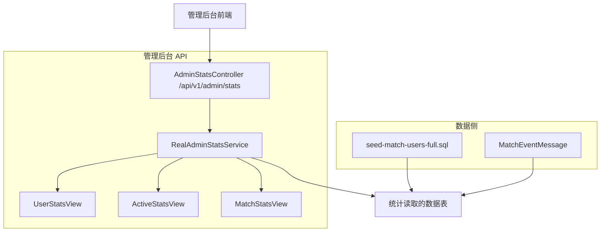
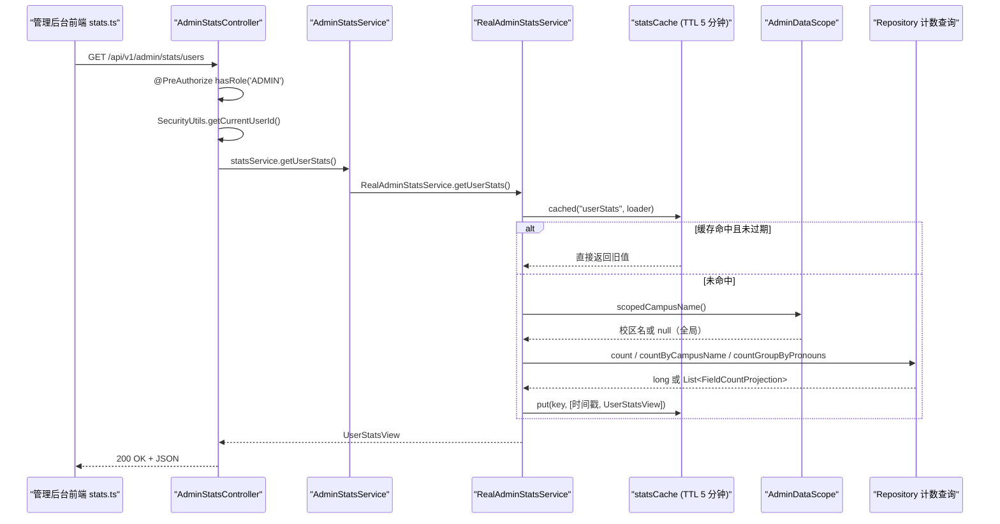
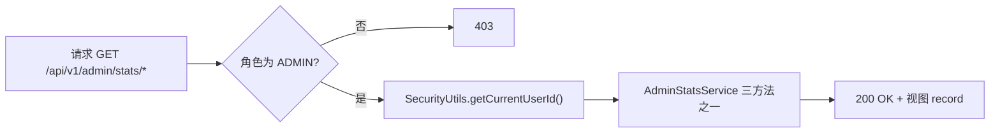
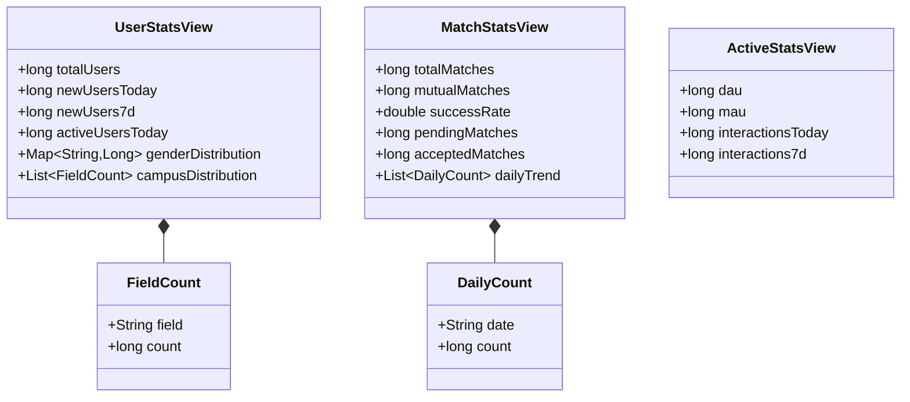
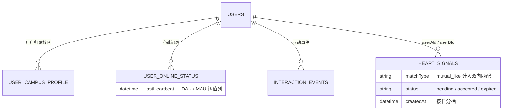
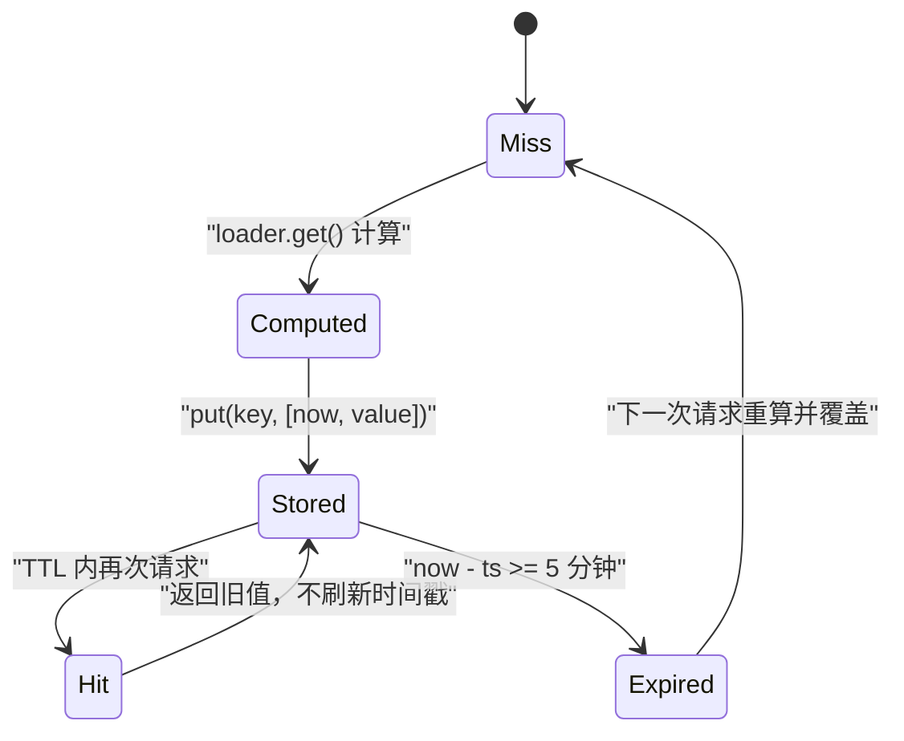
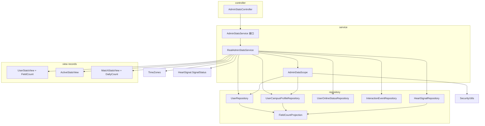
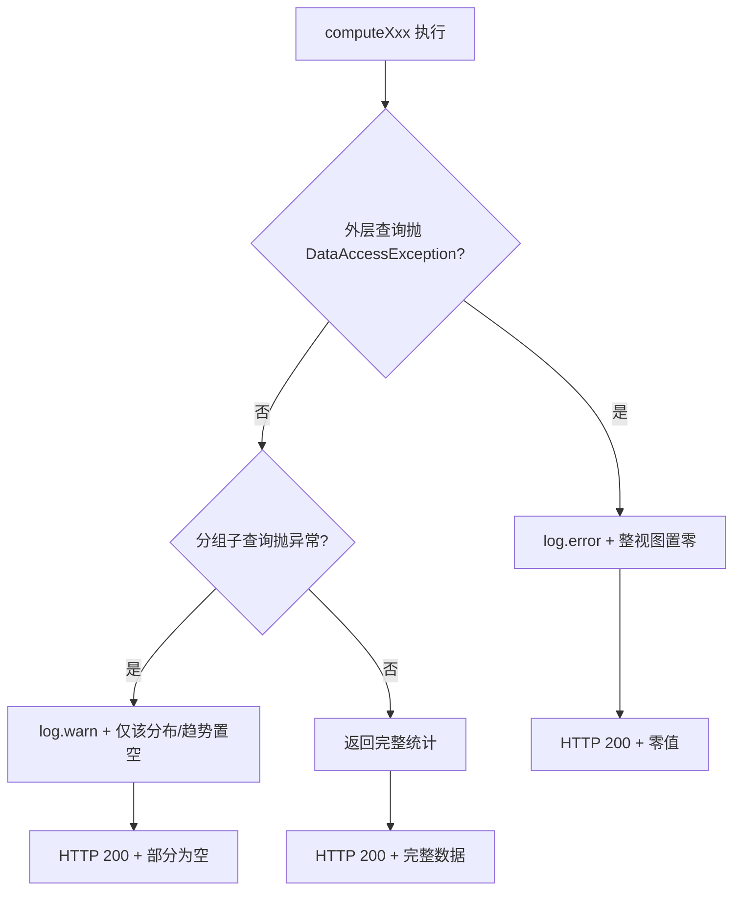

# 数据统计与分析

<cite>
**本文引用的文件**
- [AdminStatsController.java](file://apps/api/src/main/java/com/campuslove/api/admin/AdminStatsController.java)
- [RealAdminStatsService.java](file://apps/api/src/main/java/com/campuslove/api/admin/RealAdminStatsService.java)
- [UserStatsView.java](file://apps/api/src/main/java/com/campuslove/api/admin/UserStatsView.java)
- [MatchStatsView.java](file://apps/api/src/main/java/com/campuslove/api/admin/MatchStatsView.java)
- [ActiveStatsView.java](file://apps/api/src/main/java/com/campuslove/api/admin/ActiveStatsView.java)
- [AdminStatsService.java](file://apps/api/src/main/java/com/campuslove/api/admin/AdminStatsService.java)
- [AdminDataScope.java](file://apps/api/src/main/java/com/campuslove/api/admin/AdminDataScope.java)
- [TimeZones.java](file://apps/api/src/main/java/com/campuslove/api/common/TimeZones.java)
- [CacheNames.java](file://apps/api/src/main/java/com/campuslove/api/config/CacheNames.java)
- [RedisConfig.java](file://apps/api/src/main/java/com/campuslove/api/config/RedisConfig.java)
- [FieldCountProjection.java](file://apps/api/src/main/java/com/campuslove/api/repository/FieldCountProjection.java)
- [UserRepository.java](file://apps/api/src/main/java/com/campuslove/api/repository/UserRepository.java)
- [UserCampusProfileRepository.java](file://apps/api/src/main/java/com/campuslove/api/repository/UserCampusProfileRepository.java)
- [UserOnlineStatusRepository.java](file://apps/api/src/main/java/com/campuslove/api/repository/UserOnlineStatusRepository.java)
- [InteractionEventRepository.java](file://apps/api/src/main/java/com/campuslove/api/repository/InteractionEventRepository.java)
- [HeartSignalRepository.java](file://apps/api/src/main/java/com/campuslove/api/repository/HeartSignalRepository.java)
- [MatchEventMessage.java](file://apps/api/src/main/java/com/campuslove/api/mq/MatchEventMessage.java)
- [seed-match-users-full.sql](file://database/seed-match-users-full.sql)
- [stats.ts](file://apps/admin/src/api/stats.ts)
- [Dashboard.vue](file://apps/admin/src/views/Dashboard.vue)
- [constants.ts](file://apps/admin/src/utils/constants.ts)
- [admin-legacy stats.ts](file://apps/admin-legacy/src/api/stats.ts)
- [admin-legacy Dashboard.vue](file://apps/admin-legacy/src/views/Dashboard.vue)
- [AdminPermissionTest.java](file://apps/api/src/test/java/com/campuslove/api/admin/AdminPermissionTest.java)
- [P0SecurityFilterChainIntegrationTest.java](file://apps/api/src/test/java/com/campuslove/api/security/P0SecurityFilterChainIntegrationTest.java)
</cite>

## 目录
1. [简介](#简介)
2. [项目结构](#项目结构)
3. [核心组件](#核心组件)
4. [架构总览](#架构总览)
5. [详细组件分析](#详细组件分析)
6. [统计视图数据模型](#统计视图数据模型)
7. [实时统计与历史趋势分析](#实时统计与历史趋势分析)
8. [缓存策略与查询性能优化](#缓存策略与查询性能优化)
9. [依赖关系分析](#依赖关系分析)
10. [配置与开关](#配置与开关)
11. [性能考虑](#性能考虑)
12. [故障排查指南](#故障排查指南)
13. [能力缺口登记](#能力缺口登记)
14. [结论](#结论)

## 简介
本页文档化管理后台的数据统计与分析能力，对应后端包 `com.campuslove.api.admin` 中的统计子模块。该子模块由一个 REST 控制器 `AdminStatsController`（挂载在 `/api/v1/admin/stats`）暴露三类统计查询入口：用户统计 `/users`、活跃度统计 `/active`、匹配统计 `/matches`；由 `RealAdminStatsService` 承担全部统计计算逻辑；由 `UserStatsView`、`ActiveStatsView`、`MatchStatsView` 三个视图对象承载返回给管理后台的数据结构。

三节将说明接口契约、统计口径与计算实现；后续章节说明实时与历史两类数据的取数方式、缓存与性能相关事实，以及在仓库中未找到实现证据的能力（数据导出、报表生成、趋势预测等）会被单独登记为缺口，而不做推测性描述。

**章节来源**
- [AdminStatsController.java:30-67](file://apps/api/src/main/java/com/campuslove/api/admin/AdminStatsController.java#L30-L67)
- [RealAdminStatsService.java:48-49](file://apps/api/src/main/java/com/campuslove/api/admin/RealAdminStatsService.java#L48-L49)

## 项目结构
统计子模块位于后端 API 应用的 `admin` 包内，与前台业务包（如 `match`、`mq`）以及数据库种子脚本同仓协作。层级划分如下：

- 控制器层：`AdminStatsController`，声明 `@RestController` 与 `@RequestMapping("/api/v1/admin/stats")`，三个 `@GetMapping` 方法分别转发到服务层。
- 服务层：`RealAdminStatsService`，声明 `@Service`，实现 `getUserStats()`、`getActiveStats()`、`getMatchStats()` 三个统计计算入口。
- 视图层：`UserStatsView`（内含嵌套类型 `FieldCount`）、`MatchStatsView`（内含嵌套类型 `DailyCount`）、`ActiveStatsView`，作为接口返回的数据载体。
- 数据层：统计口径读取的用户与匹配数据，由 `database/seed-match-users-full.sql` 等种子脚本灌入 `user_campus_profile`、`user_basic_profile`、`posts` 等表，构成统计的底层数据来源。
- 事件侧：`MatchEventMessage`（`userId`、`targetUserId`、`eventType`、`createdAt`）是匹配行为的事件结构，`createdAt` 提供按日聚合所需的时间维度。

**图表来源**
- [AdminStatsController.java:30-67](file://apps/api/src/main/java/com/campuslove/api/admin/AdminStatsController.java#L30-L67)
- [RealAdminStatsService.java:48-49](file://apps/api/src/main/java/com/campuslove/api/admin/RealAdminStatsService.java#L48-L49)

**章节来源**
- [UserStatsView.java:17-29](file://apps/api/src/main/java/com/campuslove/api/admin/UserStatsView.java#L17-L29)
- [MatchStatsView.java:16-31](file://apps/api/src/main/java/com/campuslove/api/admin/MatchStatsView.java#L16-L31)
- [ActiveStatsView.java:12](file://apps/api/src/main/java/com/campuslove/api/admin/ActiveStatsView.java#L12)
- [MatchEventMessage.java:21-35](file://apps/api/src/main/java/com/campuslove/api/mq/MatchEventMessage.java#L21-L35)
- [seed-match-users-full.sql:88-259](file://database/seed-match-users-full.sql#L88-L259)

## 核心组件
- `AdminStatsController`：统计接口的唯一对外入口。类上同时标注 `@Profile("real")`、`@RestController`、`@RequestMapping("/api/v1/admin/stats")` 与类级 `@PreAuthorize("hasRole('ADMIN')")`；三个方法 `getUserStats()`、`getActiveStats()`、`getMatchStats()` 各返回 `ResponseEntity<UserStatsView>`、`ResponseEntity<ActiveStatsView>`、`ResponseEntity<MatchStatsView>`，方法体内先调用 `SecurityUtils.getCurrentUserId()` 再委派给 `statsService`。
- `AdminStatsService`：控制器持有的服务接口类型（`private final AdminStatsService statsService`），三个统计方法签名在此解耦。
- `RealAdminStatsService`：接口的真实实现，标注 `@Profile("real")` + `@Service`，`implements AdminStatsService`。它注入 6 个协作者：`UserRepository`、`UserCampusProfileRepository`、`UserOnlineStatusRepository`、`InteractionEventRepository`、`HeartSignalRepository`、`AdminDataScope`，并自带进程内缓存字段 `statsCache`（`ConcurrentHashMap<String, Object[]>`）与 TTL 常量 `STATS_CACHE_TTL_MS = 5L * 60 * 1000`。
- 视图对象（Java record）：`UserStatsView`（6 字段 + 嵌套 `FieldCount`）、`ActiveStatsView`（4 字段）、`MatchStatsView`（6 字段 + 嵌套 `DailyCount`）。
- 私有计算与辅助方法：`cached(String key, Supplier<T> loader)`、`scopedCampusName()`、`computeUserStats(String)`、`computeActiveStats(String)`、`computeMatchStats(String)`、静态 `safeCnt(Long)`；常量 `MATCH_TYPE_MUTUAL = "mutual_like"`、`DAILY_TREND_DAYS = 30`。

组件之间的调用与注入关系见「依赖关系分析」一节的全景图，此处不重复。

**章节来源**
- [AdminStatsController.java:29-67](file://apps/api/src/main/java/com/campuslove/api/admin/AdminStatsController.java#L29-L67)
- [RealAdminStatsService.java:47-127](file://apps/api/src/main/java/com/campuslove/api/admin/RealAdminStatsService.java#L47-L127)
- [UserStatsView.java:17-30](file://apps/api/src/main/java/com/campuslove/api/admin/UserStatsView.java#L17-L30)
- [ActiveStatsView.java:12-17](file://apps/api/src/main/java/com/campuslove/api/admin/ActiveStatsView.java#L12-L17)
- [MatchStatsView.java:16-32](file://apps/api/src/main/java/com/campuslove/api/admin/MatchStatsView.java#L16-L32)

## 架构总览
统计链路是「只读聚合」型请求：管理后台前端并行发起三个 GET，经安全过滤器与 `@PreAuthorize` 校验后进入控制器，控制器委派给接口，接口在 real profile 下由 `RealAdminStatsService` 实现；实现先查进程内缓存，未命中才按当前管理员的数据范围（全局 / 单校区）选择对应的 Repository 计数方法，最后把结果装箱成 record 返回。

**图表来源**
- [AdminStatsController.java:44-66](file://apps/api/src/main/java/com/campuslove/api/admin/AdminStatsController.java#L44-L66)
- [RealAdminStatsService.java:104-138](file://apps/api/src/main/java/com/campuslove/api/admin/RealAdminStatsService.java#L104-L138)
- [AdminDataScope.java:63-69](file://apps/api/src/main/java/com/campuslove/api/admin/AdminDataScope.java#L63-L69)
- [stats.ts:101-135](file://apps/admin/src/api/stats.ts#L101-L135)

链路上有三个决定行为的开关式事实：
1. `@Profile("real")` 同时标注在控制器与服务实现上——非 real profile 下这两个 bean 都不存在，统计端点不会被注册。
2. 校区隔离判定发生在每次缓存未命中时（`scopedCampusName()` 在 lambda 内部被调用，因此缓存 key 不含校区维度）。
3. 前端 `getStats()` 用 `Promise.allSettled` 并行拉三接口，失败子项置 `null` 并把 message 写入 `errors` 数组。

**章节来源**
- [AdminStatsController.java:29-66](file://apps/api/src/main/java/com/campuslove/api/admin/AdminStatsController.java#L29-L66)
- [RealAdminStatsService.java:47-138](file://apps/api/src/main/java/com/campuslove/api/admin/RealAdminStatsService.java#L47-L138)
- [stats.ts:92-135](file://apps/admin/src/api/stats.ts#L92-L135)

## 详细组件分析

### AdminStatsController：接口契约与权限
控制器类头是四行注解叠加：`@Profile("real")`（L29）、`@RestController`（L30）、`@RequestMapping("/api/v1/admin/stats")`（L31）、`@PreAuthorize("hasRole('ADMIN')")`（L32）。类注释明确写出「URL 层 `/api/admin/**` 已限制 ADMIN 角色；方法层 `@PreAuthorize` 作为深度防御（`@EnableMethodSecurity` 已在 SecurityConfig 启用）」，即权限是双层校验而非单点。

三个端点的实现高度一致，均为「取当前用户 ID → 调服务 → 包 `ResponseEntity.ok`」：

| HTTP 路由 | 方法 | 返回类型 | 服务调用 |
| --- | --- | --- | --- |
| `GET /api/v1/admin/stats/users` | `getUserStats()` | `ResponseEntity<UserStatsView>` | `statsService.getUserStats()` |
| `GET /api/v1/admin/stats/active` | `getActiveStats()` | `ResponseEntity<ActiveStatsView>` | `statsService.getActiveStats()` |
| `GET /api/v1/admin/stats/matches` | `getMatchStats()` | `ResponseEntity<MatchStatsView>` | `statsService.getMatchStats()` |

值得注意的是 `SecurityUtils.getCurrentUserId()` 的返回值在三个方法里都未被使用，其作用是强制建立认证上下文——服务层随后通过 `AdminDataScope` 再次读取同一身份来确定校区范围。

需要指出的路径不一致：类注释与 `UserStatsView` 等视图注释仍写 `GET /api/admin/stats/users`（无 `/v1`），而实际生效映射是 `@RequestMapping("/api/v1/admin/stats")`；前端 `apps/admin/src/api/stats.ts` 的注释专门记录了这一修正——旧代码使用 `/admin/stats/*` 实际命中 `/api/admin/stats/*` 返回 404，已改为 `/v1/admin/stats/*` 与后端对齐。

**图表来源**
- [AdminStatsController.java:29-66](file://apps/api/src/main/java/com/campuslove/api/admin/AdminStatsController.java#L29-L66)

**章节来源**
- [AdminStatsController.java:11-67](file://apps/api/src/main/java/com/campuslove/api/admin/AdminStatsController.java#L11-L67)
- [AdminStatsService.java:14-36](file://apps/api/src/main/java/com/campuslove/api/admin/AdminStatsService.java#L14-L36)
- [stats.ts:1-14](file://apps/admin/src/api/stats.ts#L1-L14)

## 统计视图数据模型
三个视图都是 Java `record`（顶层 final 类型），字段即接口 JSON 的键，且与前端 `apps/admin/src/api/stats.ts` 中的 TypeScript interface 一一对应。

### UserStatsView
`UserStatsView(long totalUsers, long newUsersToday, long newUsers7d, long activeUsersToday, Map<String, Long> genderDistribution, List<FieldCount> campusDistribution)`，嵌套 `record FieldCount(String field, long count)`。注释口径：
- `activeUsersToday` 基于 `user_online_status` 心跳；
- `genderDistribution` 按 `pronouns` 字段分组，key 为 pronouns 值或 `"unknown"`；
- `campusDistribution` 按 `campus_name` 分组，空值归入 `"未填写"`。

### MatchStatsView
`MatchStatsView(long totalMatches, long mutualMatches, double successRate, long pendingMatches, long acceptedMatches, List<DailyCount> dailyTrend)`，嵌套 `record DailyCount(String date, long count)`，其中 `date` 为 `yyyy-MM-dd` 字符串。注释给出的口径定义：`totalMatches` 是 `heart_signals` 表全部记录；`mutualMatches` 对应 `match_type='mutual_like'`；`successRate = mutualMatches / totalMatches`，取值 0~1；`pendingMatches`/`acceptedMatches` 按 `status` 统计；`dailyTrend` 为近 30 天。

### ActiveStatsView
`ActiveStatsView(long dau, long mau, long interactionsToday, long interactions7d)`。注释明确 `dau` 取 `user_online_status.last_heartbeat` 当天有心跳的用户数，`mau` 取近 30 天心跳，互动数取互动事件表。

**图表来源**
- [UserStatsView.java:17-30](file://apps/api/src/main/java/com/campuslove/api/admin/UserStatsView.java#L17-L30)
- [MatchStatsView.java:16-32](file://apps/api/src/main/java/com/campuslove/api/admin/MatchStatsView.java#L16-L32)
- [ActiveStatsView.java:12-17](file://apps/api/src/main/java/com/campuslove/api/admin/ActiveStatsView.java#L12-L17)

### 与前端契约的对应关系
`stats.ts` 用 `interface UserStats` / `ActiveStats` / `MatchStats` / `FieldCount` / `DailyCount` 复刻同一组字段（数值统一为 `number`，`genderDistribution` 为 `Record<string, number>`），并额外定义后端没有的聚合类型 `StatsOverview { userStats: UserStats | null; activeStats: ActiveStats | null; matchStats: MatchStats | null; errors: string[] }`——该类型只在前端 `getStats()` 内组装，不来自任何后端响应体。

**章节来源**
- [UserStatsView.java:6-31](file://apps/api/src/main/java/com/campuslove/api/admin/UserStatsView.java#L6-L31)
- [MatchStatsView.java:5-33](file://apps/api/src/main/java/com/campuslove/api/admin/MatchStatsView.java#L5-L33)
- [ActiveStatsView.java:3-18](file://apps/api/src/main/java/com/campuslove/api/admin/ActiveStatsView.java#L3-L18)
- [stats.ts:10-66](file://apps/admin/src/api/stats.ts#L10-L66)

## 实时统计与历史趋势分析
统计的「实时性」在本模块中不是流式计算，而是「按业务时区现算的时间窗口 + 5 分钟进程内缓存」。三类口径都由同一段逻辑推导：`LocalDate.now(TimeZones.BUSINESS).atStartOfDay()` 得到今日零点，其中 `TimeZones.BUSINESS = ZoneId.of("Asia/Shanghai")`，注释说明该常量与「DB `serverTimezone=Asia/Shanghai`」对齐，用于统一跨零点统计边界。

### 用户统计的计算顺序（computeUserStats）
入口 `getUserStats()` 只做一件事：`return cached("userStats", () -> computeUserStats(scopedCampusName()))`。`computeUserStats(String campusName)` 内先算 `boolean scoped = campusName != null && !campusName.isBlank()`，随后每个指标都走「scoped ? 校区版方法 : 全局版方法」的二选一分支：

| 指标 | scoped=false（全局） | scoped=true（校区管理员） |
| --- | --- | --- |
| 总用户数 | `userRepository.count()` | `userRepository.countByCampusName(campusName)` |
| 今日新增 | `countByCreatedAtAfter(startOfToday)` | `countByCreatedAtAfterAndCampusName(startOfToday, campusName)` |
| 近 7 天新增 | `countByCreatedAtAfter(startOf7d)` | `countByCreatedAtAfterAndCampusName(startOf7d, campusName)` |
| 今日活跃 | `onlineStatusRepository.countByLastHeartbeatAfter(startOfToday)` | `countByLastHeartbeatAfterAndCampusName(startOfToday, campusName)` |
| 性别比 | `userRepository.countGroupByPronouns()` | `countGroupByPronounsByCampus(campusName)` |
| 学校分布 | `campusProfileRepository.countGroupByCampusName()` | 同左，但循环内丢弃非本校区行 |

时间窗口：`startOfToday` 为今日零点，`startOf7d = startOfToday.minusDays(6)`，即「近 7 天」含今日共 7 个自然日。

两个分布统计各自包了一层 `try/catch (DataAccessException)`：性别比失败时 `log.warn("查询性别比统计失败，降级返回空分布")`，学校分布失败时 `log.warn("查询学校分布统计失败，降级返回空列表")`——即分布指标可单独降级为空，而 `total/newToday/new7d/activeToday` 一旦抛异常则由外层 `catch` 把整个视图置零（`new UserStatsView(0L, 0L, 0L, 0L, Map.of(), List.of())` 并 `log.error("查询用户统计失败，降级返回零值")`）。分组行经 `genderDist.merge(key, safeCnt(row.getCnt()), Long::sum)` 累加，`safeCnt(Long)` 把投影可能返回的 `null` 计数转为 `0L`。

### 活跃度统计（computeActiveStats）
`getActiveStats()` 对应 key `"activeStats"`。`computeActiveStats` 取 `startOfToday` 与 `startOf30d = startOfToday.minusDays(29)` 两个锚点，得到四个指标：`dau = countByLastHeartbeatAfter(startOfToday)`、`mau = countByLastHeartbeatAfter(startOf30d)`（30 天滚动窗口，非日历月）、`interactionsToday = interactionEventRepository.countByCreatedAtAfter(startOfToday)`、`interactions7d = countByCreatedAtAfter(startOfToday.minusDays(6))`。DAU 与 MAU 复用同一张在线状态表，仅阈值不同；校区版 `countByLastHeartbeatAfterAndCampusName` 的 JPQL 写作 `WHERE u.lastHeartbeat >= :threshold AND EXISTS (SELECT 1 FROM UserCampusProfile p WHERE p.userId = u.userId AND p.campusName = :campusName)`。整段被单个 `catch (DataAccessException)` 包裹，失败时 `log.error("查询活跃度统计失败，降级返回零值")` 并返回 `new ActiveStatsView(0L, 0L, 0L, 0L)`——活跃度没有分级降级，四指标要么全真要么全零。

### 匹配统计与每日趋势（computeMatchStats）
`getMatchStats()` 对应 key `"matchStats"`。四个计数同样二选一：`heartSignalRepository.count()` / `countByCampusName`、`countByMatchType(MATCH_TYPE_MUTUAL)` / `countByMatchTypeAndCampusName`、`countByStatus(SignalStatus.pending)` / `countByStatusAndCampusName`、`countByStatus(SignalStatus.accepted)` / `countByStatusAndCampusName`，其中 `MATCH_TYPE_MUTUAL = "mutual_like"`，状态取自实体枚举 `HeartSignal.SignalStatus`。

成功率是纯内存派生量：`double successRate = total > 0 ? (double) mutual / total : 0.0;`，即分母为信号总数（含所有状态与类型）而非用户数，`total` 为 0 时返回 0.0 而不抛除零。

历史趋势由仓储的分组查询直接给出：`from = LocalDate.now(TimeZones.BUSINESS).atStartOfDay().minusDays(DAILY_TREND_DAYS - 1)`、`to = LocalDateTime.now(TimeZones.BUSINESS)`，`DAILY_TREND_DAYS = 30`。全局版 JPQL 为 `SELECT FUNCTION('DATE', hs.createdAt) AS field, COUNT(hs) AS cnt FROM HeartSignal hs WHERE hs.createdAt BETWEEN :from AND :to GROUP BY FUNCTION('DATE', hs.createdAt) ORDER BY FUNCTION('DATE', hs.createdAt) ASC`；校区版在其基础上追加 `AND EXISTS (SELECT 1 FROM UserCampusProfile p WHERE (p.userId = hs.userAId OR p.userId = hs.userBId) AND p.campusName = :campusName)`，语义为「任一方属于该校区即计入」。结果行只在 `row.getField() != null` 时转为 `DailyCount(row.getField().toString(), safeCnt(row.getCnt()))`，趋势查询失败仅 `log.warn("查询每日匹配趋势失败，降级返回空列表")`，其余四个计数照常返回。

**图表来源**
- [RealAdminStatsService.java:28-34](file://apps/api/src/main/java/com/campuslove/api/admin/RealAdminStatsService.java#L28-L34)
- [HeartSignalRepository.java:131-198](file://apps/api/src/main/java/com/campuslove/api/repository/HeartSignalRepository.java#L131-L198)
- [UserOnlineStatusRepository.java:62-76](file://apps/api/src/main/java/com/campuslove/api/repository/UserOnlineStatusRepository.java#L62-L76)
- [UserRepository.java:113-147](file://apps/api/src/main/java/com/campuslove/api/repository/UserRepository.java#L113-L147)

### 校区隔离的判定路径
`scopedCampusName()` 调用 `adminDataScope.getCurrentAdminCampusName()`，后者先 `SecurityUtils.getCurrentUserId()`，为 `null` 直接返回 `null`（按全局），否则进入 `resolveCampusName(userId)`：`userRepository.findById` 为空时 `log.warn("当前管理员不存在: userId={}")` 并返回 `null`；角色等于 `SUPER_ADMIN`（`ROLE_SUPER_ADMIN`，忽略大小写）时恒返回 `null`（注释：即使误设 campusName 也按全局处理）；`user.getCampusName()` 为空或空白返回 `null`；否则返回 `campusName.trim()`。`RealAdminStatsService` 侧对整段再包一层 `catch (RuntimeException)`，失败时 `log.debug("获取当前管理员校区失败，按全局统计：{}")` 并返回 `null`——即范围解析异常一律退化为全局统计。

**章节来源**
- [RealAdminStatsService.java:53-57](file://apps/api/src/main/java/com/campuslove/api/admin/RealAdminStatsService.java#L53-L57)
- [RealAdminStatsService.java:136-215](file://apps/api/src/main/java/com/campuslove/api/admin/RealAdminStatsService.java#L136-L215)
- [RealAdminStatsService.java:220-255](file://apps/api/src/main/java/com/campuslove/api/admin/RealAdminStatsService.java#L220-L255)
- [RealAdminStatsService.java:260-321](file://apps/api/src/main/java/com/campuslove/api/admin/RealAdminStatsService.java#L260-L321)
- [AdminDataScope.java:43-46](file://apps/api/src/main/java/com/campuslove/api/admin/AdminDataScope.java#L43-L46)
- [AdminDataScope.java:63-69](file://apps/api/src/main/java/com/campuslove/api/admin/AdminDataScope.java#L63-L69)
- [AdminDataScope.java:130-146](file://apps/api/src/main/java/com/campuslove/api/admin/AdminDataScope.java#L130-L146)
- [HeartSignalRepository.java:98-198](file://apps/api/src/main/java/com/campuslove/api/repository/HeartSignalRepository.java#L98-L198)
- [UserOnlineStatusRepository.java:56-76](file://apps/api/src/main/java/com/campuslove/api/repository/UserOnlineStatusRepository.java#L56-L76)
- [InteractionEventRepository.java:66-95](file://apps/api/src/main/java/com/campuslove/api/repository/InteractionEventRepository.java#L66-L95)
- [UserRepository.java:90-155](file://apps/api/src/main/java/com/campuslove/api/repository/UserRepository.java#L90-L155)
- [TimeZones.java:1-12](file://apps/api/src/main/java/com/campuslove/api/common/TimeZones.java#L1-L12)

## 缓存策略与查询性能优化
本模块的缓存是一个「被 Redis 方案否决后回退到进程内」的案例，代码里同时留着两套证据。

### 进程内短 TTL 缓存（当前生效）
实现字段为 `private final java.util.concurrent.ConcurrentHashMap<String, Object[]> statsCache`，值槽位是 `[时间戳, 结果]` 二元数组；TTL 常量 `private static final long STATS_CACHE_TTL_MS = 5L * 60 * 1000`。读取逻辑集中在 `cached(String key, Supplier<T> loader)`：

1. 取 `now = System.currentTimeMillis()` 与 `entry = statsCache.get(key)`；
2. 命中条件为 `entry != null && now - (long) entry[0] < STATS_CACHE_TTL_MS`，命中则把 `entry[1]` 强转 `(T)` 返回；
3. 未命中执行 `loader.get()`，再 `statsCache.put(key, new Object[]{System.currentTimeMillis(), value})` 写入并返回。

三个统计方法传入的 key 分别是固定字符串 `"userStats"`、`"activeStats"`、`"matchStats"`，因此缓存空间上限恒为 3 个条目，不存在无界增长；同时也意味着 key 不含校区维度——`scopedCampusName()` 在 loader lambda 内部才被求值（`cached("userStats", () -> computeUserStats(scopedCampusName()))`），TTL 窗口内的后续请求直接复用首次计算出的范围结果。类注释与 `SubTask 5.3.4` 注释都写明，`@Cacheable(ADMIN_STATS)` 之所以不能用：Redis 序列化器（NON_FINAL default typing）对顶层 final record 类型不写 `@class`，缓存命中会反序列化为 `LinkedHashMap` 并在强转时抛 `ClassCastException`（实测 500）；进程内缓存规避该问题并满足「后台轮询命中缓存」的目标。

**图表来源**
- [RealAdminStatsService.java:76-115](file://apps/api/src/main/java/com/campuslove/api/admin/RealAdminStatsService.java#L76-L115)
- [RealAdminStatsService.java:136-138](file://apps/api/src/main/java/com/campuslove/api/admin/RealAdminStatsService.java#L136-L138)

需要注意一处残留：`RealAdminStatsService` 仍然 `import com.campuslove.api.config.CacheNames;`，但类体内没有任何 `CacheNames.ADMIN_STATS` 使用点，只出现在注释中；`RedisConfig` 侧也仍保留 `ADMIN_STATS_TTL = Duration.ofMinutes(5)` 并把 `CacheNames.ADMIN_STATS` 放进 `cacheNameTtl` 映射表——即 Redis 的 `admin_stats` 空间仍被注册，只是统计服务不再经由 Spring Cache 访问它。

### 大数据量下的查询代价
类注释对性能动机的表述是：原实现每次请求实时 `count()` 全表，「后台首页 30s 轮询频繁触发多表全量 COUNT，数据量大时拖垮主库」，恢复 5 分钟缓存即为此。按实现，一次未命中的统计请求会发出这些聚合查询：

- 用户统计：`users` 全表 `count()` 1 次、按 `createdAt` 阈值 count 2 次、`user_online_status` 心跳阈值 count 1 次、`pronouns` 分组 1 次、`campus_name` 分组 1 次（校区版把其中 4 次换成带 `EXISTS (SELECT 1 FROM UserCampusProfile p ...)` 的子查询）。
- 活跃度统计：`user_online_status` count 2 次（今日 / 近 30 天）+ `interaction_events` count 2 次。
- 匹配统计：`heart_signals` count 4 次 + 按日分组 1 次（`GROUP BY FUNCTION('DATE', hs.createdAt)`，`ORDER BY` 同日表达式）。

可优化点集中在三处，且代码里已有一条明确的同类先例：`UserRepository` 的管理端昵称搜索注释记录了 R4-00384——把 `LIKE '%x%'` 中缀通配改为 `LIKE 'x%'` 前缀匹配，理由是「中缀通配符无法命中普通 B-Tree 索引（数据量大时全表扫描）」。统计侧目前仍依赖 `createdAt`、`lastHeartbeat` 的范围扫描与 `EXISTS` 关联子查询，`heart_signals` 的每日趋势还额外要求数据库支持 `FUNCTION('DATE', ...)` 这种方言函数调用。前端 `Dashboard.vue` 通过 `.slice(-TREND_DAYS)`（`TREND_DAYS = 30`）在展示层再次截断趋势长度，与后端 `DAILY_TREND_DAYS = 30` 保持同一窗口。

**章节来源**
- [RealAdminStatsService.java:36-45](file://apps/api/src/main/java/com/campuslove/api/admin/RealAdminStatsService.java#L36-L45)
- [RealAdminStatsService.java:67-115](file://apps/api/src/main/java/com/campuslove/api/admin/RealAdminStatsService.java#L67-L115)
- [RealAdminStatsService.java:129-138](file://apps/api/src/main/java/com/campuslove/api/admin/RealAdminStatsService.java#L129-L138)
- [RealAdminStatsService.java:145-311](file://apps/api/src/main/java/com/campuslove/api/admin/RealAdminStatsService.java#L145-L311)
- [CacheNames.java:100-110](file://apps/api/src/main/java/com/campuslove/api/config/CacheNames.java#L100-L110)
- [RedisConfig.java:126-130](file://apps/api/src/main/java/com/campuslove/api/config/RedisConfig.java#L126-L130)
- [RedisConfig.java:273-300](file://apps/api/src/main/java/com/campuslove/api/config/RedisConfig.java#L273-L300)
- [UserRepository.java:157-164](file://apps/api/src/main/java/com/campuslove/api/repository/UserRepository.java#L157-L164)
- [HeartSignalRepository.java:123-139](file://apps/api/src/main/java/com/campuslove/api/repository/HeartSignalRepository.java#L123-L139)
- [Dashboard.vue:130-135](file://apps/admin/src/views/Dashboard.vue#L130-L135)
- [constants.ts:15](file://apps/admin/src/utils/constants.ts#L15-L15)

## 依赖关系分析
统计子模块的依赖是自上而下单向的：控制器只认识接口，实现只认识仓储与范围服务，视图对象不依赖任何 Spring 类型（仅 `java.util.List` / `Map`）。

**图表来源**
- [AdminStatsController.java:33-39](file://apps/api/src/main/java/com/campuslove/api/admin/AdminStatsController.java#L33-L39)
- [RealAdminStatsService.java:1-22](file://apps/api/src/main/java/com/campuslove/api/admin/RealAdminStatsService.java#L1-L22)
- [RealAdminStatsService.java:59-95](file://apps/api/src/main/java/com/campuslove/api/admin/RealAdminStatsService.java#L59-L95)
- [AdminDataScope.java:38-55](file://apps/api/src/main/java/com/campuslove/api/admin/AdminDataScope.java#L38-L55)

### 构造注入清单
`RealAdminStatsService` 的构造器接收 6 个参数并按序赋值给同名字段：`UserRepository userRepository`、`UserCampusProfileRepository campusProfileRepository`、`UserOnlineStatusRepository onlineStatusRepository`、`InteractionEventRepository interactionEventRepository`、`HeartSignalRepository heartSignalRepository`、`AdminDataScope adminDataScope`（最后一个字段的注释标注为「R4-00393：管理端数据隔离（校区管理员统计仅覆盖本校区）」）。

`AdminStatsController` 只注入 1 个协作者 `AdminStatsService statsService`，因此接口的可替换性是设计意图；但按仓库现状，全仓检索 `implements AdminStatsService` 仅命中 `RealAdminStatsService` 一处，没有 mock 实现。结合控制器与实现都带 `@Profile("real")`，可以确定：非 real profile 下既没有 bean 也没有端点，统计接口在 mock 环境整体缺席（测试用例 `AdminPermissionTest` 中「无 token 访问 /api/admin/stats/users → mock 下非 401」正是对这一现象的断言）。

### 投影与查询的耦合点
`FieldCountProjection` 是跨仓储共享的接口型投影，只声明 `String getField()` 与 `Long getCnt()`，由 Spring Data JPA 自动生成代理；`UserRepository.countGroupByPronouns()`、`countGroupByPronounsByCampus()`、`countGroupByGradeLabel()`、`UserCampusProfileRepository.countGroupByCampusName()` / `countGroupByCityName()`、`HeartSignalRepository.countDailyBetween()` / `countDailyBetweenAndCampusName()` 都返回它。服务层通过 `getField()` / `getCnt()` 读取，并因 `getCnt()` 返回装箱 `Long` 而必须经 `safeCnt()` 兜底。

### 前端与测试侧依赖
- 前端 `apps/admin/src/api/stats.ts` 定义 5 个 interface 与 4 个函数（`getUserStats` / `getActiveStats` / `getMatchStats` / `getStats`），`views/Dashboard.vue` 从 `@/api/stats` 引入 `getStats` 与三个类型，同时依赖 `@/api/users` 的 `listUsers`、`@/api/reports` 的 `listReports`、`@/components/TrendChart.vue`、`@/components/ErrorState.vue` 与 `@/utils/constants` 的 `TREND_DAYS`。
- `apps/admin-legacy/src/api/stats.ts` 存在同名同构的另一份前端封装（注释额外记录了历史路径修正），`views/Dashboard.vue` 的注释提到「后续若后端提供真实活动流接口（GET /v1/admin/stats/activities）」，该接口在后端不存在。
- 测试侧：`P0SecurityFilterChainIntegrationTest` 断言普通用户访问 `/api/v1/admin/stats/users` 返回 403、ADMIN 访问返回非 401/403；`AdminPermissionTest` 对同一路径给出 403 与非 401/403 两组断言。

**章节来源**
- [RealAdminStatsService.java:59-95](file://apps/api/src/main/java/com/campuslove/api/admin/RealAdminStatsService.java#L59-L95)
- [AdminStatsController.java:33-39](file://apps/api/src/main/java/com/campuslove/api/admin/AdminStatsController.java#L33-L39)
- [FieldCountProjection.java:14-21](file://apps/api/src/main/java/com/campuslove/api/repository/FieldCountProjection.java#L14-L21)
- [UserRepository.java:107-155](file://apps/api/src/main/java/com/campuslove/api/repository/UserRepository.java#L107-L155)
- [UserCampusProfileRepository.java:41-49](file://apps/api/src/main/java/com/campuslove/api/repository/UserCampusProfileRepository.java#L41-L49)
- [stats.ts:10-52](file://apps/admin/src/api/stats.ts#L10-L52)
- [Dashboard.vue:16-30](file://apps/admin/src/views/Dashboard.vue#L16-L30)
- [P0SecurityFilterChainIntegrationTest.java:236-292](file://apps/api/src/test/java/com/campuslove/api/security/P0SecurityFilterChainIntegrationTest.java#L236-L292)
- [AdminPermissionTest.java:294-457](file://apps/api/src/test/java/com/campuslove/api/admin/AdminPermissionTest.java#L294-L457)
- [admin-legacy Dashboard.vue:116](file://apps/admin-legacy/src/views/Dashboard.vue#L116-L116)

## 配置与开关
统计模块的行为参数绝大多数是编译期常量，集中在实现类头部，而不是运行时配置项。

| 名称 | 定义位置 | 取值 | 作用 |
| --- | --- | --- | --- |
| `MATCH_TYPE_MUTUAL` | `RealAdminStatsService` L54 | `"mutual_like"` | 双向匹配计数入参，与 `MatchStatsView` 注释一致 |
| `DAILY_TREND_DAYS` | L57 | `30` | 每日趋势回溯天数，窗口计算用 `minusDays(DAILY_TREND_DAYS - 1)` |
| `statsCache` | L76-L77 | `ConcurrentHashMap<String, Object[]>` | 进程内缓存容器，最多 3 个 key |
| `STATS_CACHE_TTL_MS` | L80 | `5L * 60 * 1000` | 缓存有效期 5 分钟 |
| `TimeZones.BUSINESS` | `TimeZones` L8 | `ZoneId.of("Asia/Shanghai")` | 所有「今日/近 N 天」锚点的时区 |
| `ROLE_SUPER_ADMIN` / `ROLE_ADMIN` | `AdminDataScope` L43、L46 | `"SUPER_ADMIN"` / `"ADMIN"` | 校区隔离判定的角色基准 |
| `TREND_DAYS` | `apps/admin/src/utils/constants.ts` L15 | `30` | 前端趋势展示天数，与后端窗口同值 |
| `CacheNames.ADMIN_STATS` | `CacheNames` L110 | `"admin_stats"` | 保留的 Spring Cache 名称，统计实现已不引用 |
| `ADMIN_STATS_TTL` | `RedisConfig` L130 | `Duration.ofMinutes(5)` | `admin_stats` 空间的 Redis TTL，仍在 L296 注册进 `cacheNameTtl` |

### Profile 开关
三处 `@Profile("real")` 共同决定统计能力是否存在：`AdminStatsController` L29、`RealAdminStatsService` L47、`AdminDataScope` L37（其上一行注释写作「mock profile 无 UserRepository bean（无 JPA），数据隔离仅 real 模式生效」）。这意味着开关是粗粒度的——不存在「real 模式下关闭统计」的独立配置。

### 权限开关
控制器类级 `@PreAuthorize("hasRole('ADMIN')")`（L32）叠加类注释所述的 URL 层 `/api/admin/**` 限制，形成双层校验；注释同时指出 `@EnableMethodSecurity` 已在 `SecurityConfig` 启用，否则方法级注解不会生效。身份来源统一是 `SecurityUtils.getCurrentUserId()`：控制器三个方法各调用一次（L46、L55、L64），`AdminDataScope.getCurrentAdminCampusName()`（L64）与 `assertCampusAccess()`（L104）内部再各取一次。

### 接口契约文档
`docs/openapi/` 目录当前只有 `check-in.yaml`、`feedback-growth-and-auth.yaml`、`likes.yaml`、`notifications.yaml`、`official-accounts.yaml`、`recommendations.yaml`、`users.yaml`、`village.yaml`、`whispers.yaml` 九份规范文件，检索 `/admin/stats`、`stats/users`、`stats/matches`、`stats/active` 均无命中——即这三个统计端点没有 OpenAPI 规范条目，接口契约的唯一来源是控制器与视图 record 的注释、以及前端 `stats.ts` 的 interface 定义。

**章节来源**
- [RealAdminStatsService.java:47-95](file://apps/api/src/main/java/com/campuslove/api/admin/RealAdminStatsService.java#L47-L95)
- [AdminStatsController.java:22-33](file://apps/api/src/main/java/com/campuslove/api/admin/AdminStatsController.java#L22-L33)
- [AdminStatsController.java:44-66](file://apps/api/src/main/java/com/campuslove/api/admin/AdminStatsController.java#L44-L66)
- [AdminDataScope.java:35-46](file://apps/api/src/main/java/com/campuslove/api/admin/AdminDataScope.java#L35-L46)
- [TimeZones.java:5-11](file://apps/api/src/main/java/com/campuslove/api/common/TimeZones.java#L5-L11)
- [CacheNames.java:100-110](file://apps/api/src/main/java/com/campuslove/api/config/CacheNames.java#L100-L110)
- [RedisConfig.java:129-130](file://apps/api/src/main/java/com/campuslove/api/config/RedisConfig.java#L129-L130)
- [RedisConfig.java:296](file://apps/api/src/main/java/com/campuslove/api/config/RedisConfig.java#L296-L296)
- [constants.ts:15](file://apps/admin/src/utils/constants.ts#L15-L15)

## 性能考虑
### 冷启动查询数
三个缓存 key 全部未命中时，一次 Dashboard 刷新会触发以下聚合调用：用户统计 6 次（`count()` + 2 次时间阈值 count + 1 次心跳 count + 2 次 GROUP BY），活跃度 4 次（2 次心跳 count + 2 次互动 count），匹配统计 5 次（4 次 count + 1 次按日 GROUP BY），合计 15 次聚合查询。5 分钟 TTL 把这组开销摊薄为「每个 key 每 5 分钟最多一次」，这也是引入进程内缓存的直接动机。

### 聚合形态与索引
全局口径是单表阈值 count（`createdAt >= :since`、`lastHeartbeat >= :threshold`），代价随表规模线性增长；校区口径把它替换为带关联子查询的形式，例如 `SELECT COUNT(u) FROM User u WHERE EXISTS (SELECT 1 FROM UserCampusProfile p WHERE p.userId = u.id AND p.campusName = :campusName)`，心跳与互动事件版本同构（`p.userId = u.userId` / `p.userId = e.userId`），匹配统计则要求 `p.userId = hs.userAId OR p.userId = hs.userBId` 的任一方位匹配——OR 条件通常使子查询难以只走一条索引，是校区口径下最重的一类计数。

按日趋势的分组表达式是 `GROUP BY FUNCTION('DATE', hs.createdAt)`，对列施加数据库函数后无法直接用 `created_at` 上的有序索引完成分组，且 `ORDER BY` 重复同一表达式；返回行最多 `DAILY_TREND_DAYS = 30` 条，属于「结果集小、扫描集大」的形态。

### 结果集规模与内存
服务层的内存构造只有两个列表与一个映射：`List<UserStatsView.FieldCount> campusDist`、`List<MatchStatsView.DailyCount> trend`、`Map<String, Long> genderDist`。性别比用 `merge(key, count, Long::sum)` 累加，键基数受 `pronouns` 取值域限制；学校分布键基数等于 distinct `campus_name` 数。两者规模都很小，服务类注释也据此判断「统计接口数据量极小(users.count + 少量 count)」。

### 缓存对象的共享与可变性
`statsCache` 存放的是 record 实例，record 本身不可变，但 `UserStatsView` 内部持有 `LinkedHashMap` 与 `ArrayList`（`computeUserStats` 里现场构造并被缓存复用）。当前链路只在控制器里把它们交给 `ResponseEntity.ok(...)` 做序列化输出，属于只读访问；若未来出现直接改写返回对象的调用方，会污染后续 5 分钟内的所有请求。

### 序列化与反序列化的历史教训
选型注释给出的关键约束是「顶层 final record 类型」与 Redis JSON 序列化的 default typing 不兼容：不写 `@class` 导致读回 `LinkedHashMap`、强转 `ClassCastException`。这决定了统计返回值不能走通用 Redis 缓存注解，也解释了为什么 `apps/admin/src/api/stats.ts` 需要在前端再包一层 `Promise.allSettled` 聚合：后端不提供组合端点，前端要自行处理局部失败的降级。

**章节来源**
- [RealAdminStatsService.java:28-34](file://apps/api/src/main/java/com/campuslove/api/admin/RealAdminStatsService.java#L28-L34)
- [RealAdminStatsService.java:129-133](file://apps/api/src/main/java/com/campuslove/api/admin/RealAdminStatsService.java#L129-L133)
- [RealAdminStatsService.java:145-215](file://apps/api/src/main/java/com/campuslove/api/admin/RealAdminStatsService.java#L145-L215)
- [RealAdminStatsService.java:230-311](file://apps/api/src/main/java/com/campuslove/api/admin/RealAdminStatsService.java#L230-L311)
- [UserRepository.java:118-147](file://apps/api/src/main/java/com/campuslove/api/repository/UserRepository.java#L118-L147)
- [UserOnlineStatusRepository.java:64-76](file://apps/api/src/main/java/com/campuslove/api/repository/UserOnlineStatusRepository.java#L64-L76)
- [InteractionEventRepository.java:74-86](file://apps/api/src/main/java/com/campuslove/api/repository/InteractionEventRepository.java#L74-L86)
- [HeartSignalRepository.java:141-198](file://apps/api/src/main/java/com/campuslove/api/repository/HeartSignalRepository.java#L141-L198)
- [stats.ts:92-135](file://apps/admin/src/api/stats.ts#L92-L135)

## 故障排查指南
统计接口不抛业务异常：所有数据库访问失败都在服务层被吞掉并降级，因此排查必须结合日志文案而不是响应码。

| 现象 | 判定依据 | 定位路径 |
| --- | --- | --- |
| 403 | `@PreAuthorize("hasRole('ADMIN')")` 或 URL 层限制拦截 | 检查 token 角色；`P0SecurityFilterChainIntegrationTest` L241、`AdminPermissionTest` L383 是 `userRole_accessAdminStats_shouldReturn403` 的现成断言 |
| mock profile 下端点整体不可用 | 控制器与实现都标 `@Profile("real")` | `AdminPermissionTest` L295 `unauthenticated_accessAdminStats_shouldNotBe401InMock` 记录 mock 行为 |
| 404 且请求路径为 `/api/admin/stats/*` | 实际映射带 `/v1` | `stats.ts` L4-L6 注释：旧前缀 `/admin/stats/*` 命中 404，须用 `/v1/admin/stats/*` |
| 用户四指标同时为 0 | 外层 catch 返回 `new UserStatsView(0L,0L,0L,0L, Map.of(), List.of())` | 日志 `查询用户统计失败，降级返回零值`（error 级） |
| 活跃度四项为 0 | 单一 catch 返回 `new ActiveStatsView(0L,0L,0L,0L)` | 日志 `查询活跃度统计失败，降级返回零值` |
| 匹配计数为 0 但趋势仍在 | 外层 catch 返回 `new MatchStatsView(0L,0L,0.0,0L,0L, List.of())` | 日志 `查询匹配统计失败，降级返回零值` |
| 只有性别比是空 Map | 内层 catch 独立降级 | 日志 `查询性别比统计失败，降级返回空分布`（warn 级） |
| 只有学校分布是空列表 | 内层 catch 独立降级 | 日志 `查询学校分布统计失败，降级返回空列表` |
| 只有趋势为空 | `row.getField() == null` 被跳过，或分组查询失败 | 日志 `查询每日匹配趋势失败，降级返回空列表` |
| 校区管理员看到全平台数字 | 缓存 key 不含校区，范围在 loader 内求值 | `cached("userStats", () -> computeUserStats(scopedCampusName()))`，TTL 5 分钟内首个请求决定后续所有请求的范围 |
| 校区管理员学校分布为空 | 行过滤用精确 `equals`：`if (scoped && !campusName.equals(name)) continue;` | `AdminDataScope` 侧用 `equalsIgnoreCase(targetCampusName.trim())`，两处比较口径不同，校区名大小写或空格差异会让全部行被丢弃 |
| 前端某张 KPI 卡显示「数据不可用」 | `failedStats[index] = true` 时模板渲染 `t("dashboard.dataUnavailable")` | `Dashboard.vue` L114-L137：`overview.userStats` 为 `null` 时把下标 0/1 置失败；`getStats()` 用 `Promise.allSettled` 记录 `errors` |
| 整页错误态 | `ErrorState` 组件 + `errorMessage` | `Dashboard.vue` L138-L150 与 L193-L197，重试按钮回调 `loadStats` |
| 缓存命中报 500（历史问题） | Redis default typing 与 record 不兼容 | 实现类 L36-L41、L129-L133 两处注释记录了 `ClassCastException` 成因与去除 `@Cacheable` 的修复 |

### 降级语义带来的歧义
后端把「查询失败」和「业务真值就是 0」压成了同一个响应（全零 record），HTTP 状态仍是 200；前端只在子接口整体失败（请求异常或返回 `null`）时才置 `failedStats`，无法区分后端内部降级。因此指标异常偏低时，第一步是检索上述 `降级返回零值` / `降级返回空列表` 日志，而不是怀疑数据本身。

[此图按实现类的 try/catch 分支绘制，条件与日志文案取自源码，未添加任何推测分支]

**图表来源**
- [RealAdminStatsService.java:180-214](file://apps/api/src/main/java/com/campuslove/api/admin/RealAdminStatsService.java#L180-L214)
- [RealAdminStatsService.java:251-254](file://apps/api/src/main/java/com/campuslove/api/admin/RealAdminStatsService.java#L251-L254)
- [RealAdminStatsService.java:307-315](file://apps/api/src/main/java/com/campuslove/api/admin/RealAdminStatsService.java#L307-L315)

**章节来源**
- [AdminStatsController.java:29-33](file://apps/api/src/main/java/com/campuslove/api/admin/AdminStatsController.java#L29-L33)
- [RealAdminStatsService.java:104-115](file://apps/api/src/main/java/com/campuslove/api/admin/RealAdminStatsService.java#L104-L115)
- [RealAdminStatsService.java:179-214](file://apps/api/src/main/java/com/campuslove/api/admin/RealAdminStatsService.java#L179-L214)
- [RealAdminStatsService.java:251-254](file://apps/api/src/main/java/com/campuslove/api/admin/RealAdminStatsService.java#L251-L254)
- [RealAdminStatsService.java:307-315](file://apps/api/src/main/java/com/campuslove/api/admin/RealAdminStatsService.java#L307-L315)
- [AdminDataScope.java:103-122](file://apps/api/src/main/java/com/campuslove/api/admin/AdminDataScope.java#L103-L122)
- [Dashboard.vue:111-152](file://apps/admin/src/views/Dashboard.vue#L111-L152)
- [Dashboard.vue:193-216](file://apps/admin/src/views/Dashboard.vue#L193-L216)
- [stats.ts:92-135](file://apps/admin/src/api/stats.ts#L92-L135)
- [P0SecurityFilterChainIntegrationTest.java:236-242](file://apps/api/src/test/java/com/campuslove/api/security/P0SecurityFilterChainIntegrationTest.java#L236-L242)
- [AdminPermissionTest.java:294-296](file://apps/api/src/test/java/com/campuslove/api/admin/AdminPermissionTest.java#L294-L296)

## 能力缺口登记
官方页面要求覆盖「趋势预测、数据导出、报表生成、数据可视化、大数据量处理、缓存策略与查询性能优化」。以下逐项登记仓库现状，未找到实现证据的条目一律标为缺口，不做推测性描述。取证范围限定为：`com.campuslove.api.admin` 包、相关 `repository` 与 `config` 类、`apps/admin` 与 `apps/admin-legacy` 的 stats 相关文件、`docs/openapi` 目录、`apps/api/src/test` 中命中 `AdminStats` 的文件。

| 要求能力 | 仓库现状 | 判定 |
| --- | --- | --- |
| 用户统计 | `GET /api/v1/admin/stats/users` + `computeUserStats` | 已实现 |
| 匹配统计 | `GET /api/v1/admin/stats/matches` + `computeMatchStats`（成功率 `mutual/total`） | 已实现 |
| 活跃度统计 | `GET /api/v1/admin/stats/active`（DAU/MAU/互动数） | 已实现 |
| 实时数据统计 | 按业务时区现算窗口 + 5 分钟进程内缓存，无推送/流式链路 | 部分实现（准实时） |
| 历史数据分析 | 仅 `dailyTrend` 近 30 天按日聚合，无更长区间、无自选区间参数 | 有限实现 |
| 发展趋势预测 | 三个视图 record 无预测字段；控制器方法无入参，无同比/环比计算；`KpiCard` 接口只有 `labelKey/value/tone`，Dashboard 注释里的「可选同比文案」没有对应数据字段 | 未实现 |
| 数据导出（CSV/Excel） | 控制器仅 3 个 `@GetMapping`，`stats.ts` 仅 3 个 GET + 1 个聚合函数，`docs/openapi` 无 stats 路径 | 未实现 |
| 报表生成 | 本页取证范围内无报表端点、报表任务或报表表 | 未实现 |
| 数据可视化 | 后端不返回任何图表配置；前端 `Dashboard.vue` 用 4 张 KPI 卡 + `TrendChart` + 表格渲染，`trend.length === 0` 时显示 `common.noData` | 前端实现 |
| 大数据量处理 | 只有短 TTL 缓存与「数据量极小」的判断注释；无预聚合表、无分片、无异步统计作业 | 有限实现 |
| 缓存策略 | 进程内 `ConcurrentHashMap` + 5 分钟 TTL；Spring Cache/Redis 路线被注释明确否决 | 已实现（进程内） |
| 查询性能优化 | 校区口径依赖 `EXISTS` 关联子查询与 `FUNCTION('DATE', ...)` 分组，本模块内无针对性索引或物化改造 | 未见优化 |

另有若干实现与文档之间的一致性缺口：

1. 注释路径与真实映射不一致：`AdminStatsController` 类注释、`AdminStatsService` 接口注释与三个视图 record 注释都写 `GET /api/admin/stats/*`，实际生效映射是 `/api/v1/admin/stats`；前端只有 `apps/admin/src/api/stats.ts` 与 `apps/admin-legacy/src/api/stats.ts` 的注释记录了修正过程。
2. 轮询假设与前端实现不符：服务类两处注释以「后台首页 30s 轮询」为性能前提，而 `Dashboard.vue` 只在 `onMounted` 调用 `loadStats()`，`refreshTimer` 是手动刷新提示的 3 秒清除定时器，未注册任何周期轮询。
3. 图表实现表述冲突：`Dashboard.vue` 头部注释称趋势为「CSS 柱状图（cobalt 单系列，网格线 #f1f4f7，坐标轴文字 #8595a4）」，而 L50 与 L218 的注释称「ECharts 柱状图（W2 图表库决策）」；`TrendChart.vue` 内部实现未在本次取证范围内核验。
4. 缓存名残留：`CacheNames.ADMIN_STATS` 与 `RedisConfig` 的 `ADMIN_STATS_TTL` / `cacheNameTtl` 注册仍在，统计实现已不再引用；`RealAdminStatsService` 顶部仍保留 `import com.campuslove.api.config.CacheNames;`。
5. 无组合端点：`StatsOverview` 是纯前端聚合类型；`apps/admin-legacy/src/views/Dashboard.vue` L116 提到的 `GET /v1/admin/stats/activities`（真实活动流）在后端不存在。
6. 无参数化能力：三个控制器方法签名均为 `()` 空参，时间窗口、趋势天数、缓存 TTL 全是常量，运营侧无法自选统计区间。
7. 数值口径无测试：`apps/api/src/test` 内检索 `AdminStats|UserStatsView|MatchStatsView|ActiveStatsView` 仅得 5 条权限相关命中（`AdminPermissionTest` L295/L383/L456、`P0SecurityFilterChainIntegrationTest` L241/L291），没有断言成功率、DAU 窗口或校区隔离计数的用例。

**章节来源**
- [AdminStatsController.java:11-28](file://apps/api/src/main/java/com/campuslove/api/admin/AdminStatsController.java#L11-L28)
- [AdminStatsController.java:44-66](file://apps/api/src/main/java/com/campuslove/api/admin/AdminStatsController.java#L44-L66)
- [AdminStatsService.java:7-36](file://apps/api/src/main/java/com/campuslove/api/admin/AdminStatsService.java#L7-L36)
- [RealAdminStatsService.java:36-57](file://apps/api/src/main/java/com/campuslove/api/admin/RealAdminStatsService.java#L36-L57)
- [RealAdminStatsService.java:67-80](file://apps/api/src/main/java/com/campuslove/api/admin/RealAdminStatsService.java#L67-L80)
- [RealAdminStatsService.java:129-138](file://apps/api/src/main/java/com/campuslove/api/admin/RealAdminStatsService.java#L129-L138)
- [UserStatsView.java:8-16](file://apps/api/src/main/java/com/campuslove/api/admin/UserStatsView.java#L8-L16)
- [MatchStatsView.java:7-15](file://apps/api/src/main/java/com/campuslove/api/admin/MatchStatsView.java#L7-L15)
- [stats.ts:1-6](file://apps/admin/src/api/stats.ts#L1-L6)
- [stats.ts:54-66](file://apps/admin/src/api/stats.ts#L54-L66)
- [Dashboard.vue:2-15](file://apps/admin/src/views/Dashboard.vue#L2-L15)
- [Dashboard.vue:34-51](file://apps/admin/src/views/Dashboard.vue#L34-L51)
- [Dashboard.vue:154-179](file://apps/admin/src/views/Dashboard.vue#L154-L179)
- [Dashboard.vue:218-233](file://apps/admin/src/views/Dashboard.vue#L218-L233)
- [admin-legacy stats.ts:4-10](file://apps/admin-legacy/src/api/stats.ts#L4-L10)
- [admin-legacy Dashboard.vue:116](file://apps/admin-legacy/src/views/Dashboard.vue#L116-L116)
- [CacheNames.java:100-110](file://apps/api/src/main/java/com/campuslove/api/config/CacheNames.java#L100-L110)
- [RedisConfig.java:129-130](file://apps/api/src/main/java/com/campuslove/api/config/RedisConfig.java#L129-L130)
- [RedisConfig.java:296](file://apps/api/src/main/java/com/campuslove/api/config/RedisConfig.java#L296-L296)

## 结论
数据统计与分析在仓库中是一个刻意做小的模块：3 个无参 GET、1 个服务实现、3 个 record、15 条聚合查询、1 个进程内缓存，加上一层校区数据隔离。它的能力边界由三个设计决定框定：

1. 口径全部来自「现算的阈值 count + GROUP BY」，没有预聚合表或计数器写入路径，因此所有指标的实时性上限等于缓存 TTL（5 分钟），历史深度上限等于 `DAILY_TREND_DAYS`（30 天）。
2. 稳定性优先于精确性：所有 `DataAccessException` 都被就地降级为零值或空集合，接口永远返回 200，代价是「查询失败」与「业务真值为零」在响应体上不可区分，必须靠 `降级返回零值` / `降级返回空列表` 这类日志排查。
3. 缓存路线是被具体故障逼出来的选择：Redis JSON 序列化对顶层 final record 不写类型标识，`@Cacheable(ADMIN_STATS)` 命中即 500，于是改为 `ConcurrentHashMap` + 时间戳数组，代价是缓存失去跨实例共享能力，且 key 不含校区维度。

对使用方的结论是：需要更长历史区间、可自选时间窗、导出或预测类能力时，本模块不提供，需要在视图 record 与仓储计数之外新增实现；需要在多实例部署下保证统计一致性时，应先解决进程内缓存与校区维度 key 的问题；若把统计迁回 Redis 缓存，前提是先改掉返回值类型使 default typing 能写出类型信息，否则会复现 `ClassCastException`。

**章节来源**
- [RealAdminStatsService.java:24-46](file://apps/api/src/main/java/com/campuslove/api/admin/RealAdminStatsService.java#L24-L46)
- [RealAdminStatsService.java:67-115](file://apps/api/src/main/java/com/campuslove/api/admin/RealAdminStatsService.java#L67-L115)
- [RealAdminStatsService.java:129-138](file://apps/api/src/main/java/com/campuslove/api/admin/RealAdminStatsService.java#L129-L138)
- [AdminStatsController.java:11-67](file://apps/api/src/main/java/com/campuslove/api/admin/AdminStatsController.java#L11-L67)
- [stats.ts:92-135](file://apps/admin/src/api/stats.ts#L92-L135)
- [Dashboard.vue:80-152](file://apps/admin/src/views/Dashboard.vue#L80-L152)

