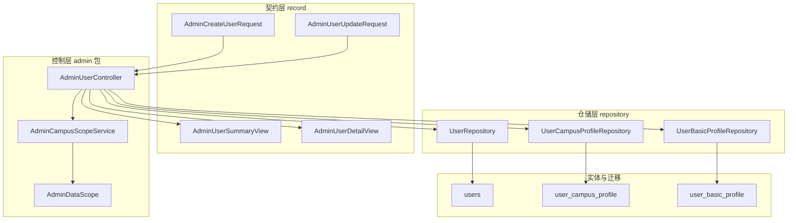
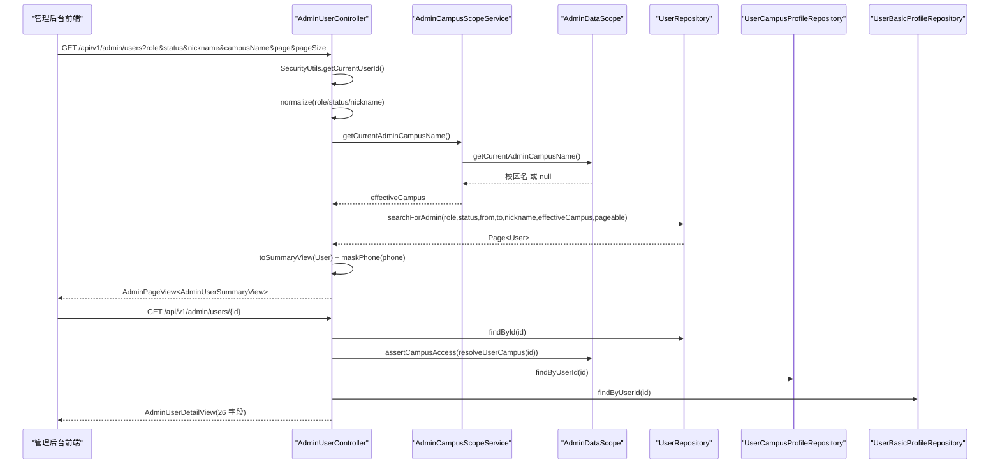
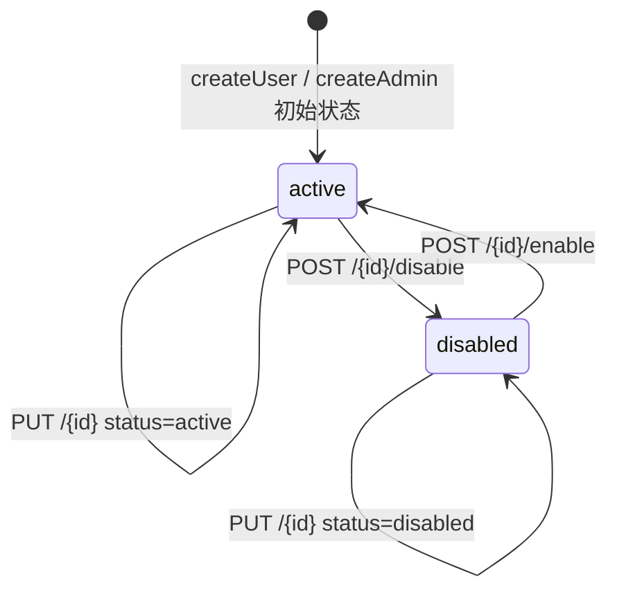
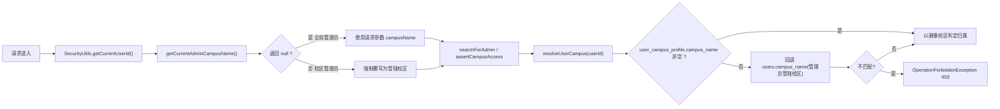
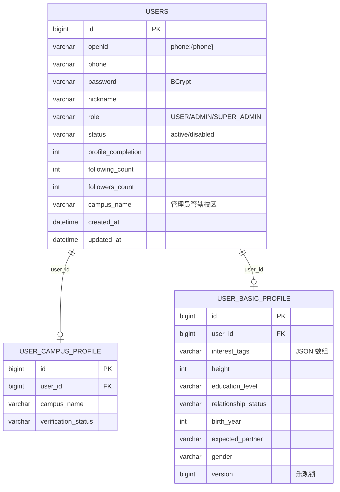
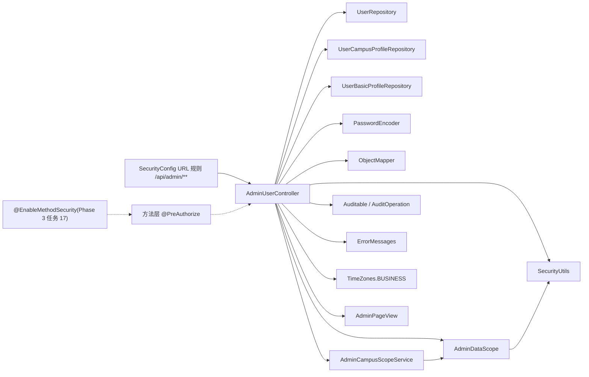

# 用户管理系统

<cite>
**本文引用的文件**
- [AdminUserController.java](file://apps/api/src/main/java/com/campuslove/api/admin/AdminUserController.java)
- [AdminUserDetailView.java](file://apps/api/src/main/java/com/campuslove/api/admin/AdminUserDetailView.java)
- [AdminUserUpdateRequest.java](file://apps/api/src/main/java/com/campuslove/api/admin/AdminUserUpdateRequest.java)
- [AdminUserSummaryView.java](file://apps/api/src/main/java/com/campuslove/api/admin/AdminUserSummaryView.java)
- [AdminCampusScopeService.java](file://apps/api/src/main/java/com/campuslove/api/admin/AdminCampusScopeService.java)
- [UserRepository.java](file://apps/api/src/main/java/com/campuslove/api/repository/UserRepository.java)
- [UserBasicProfile.java](file://apps/api/src/main/java/com/campuslove/api/entity/UserBasicProfile.java)
- [UserProfileDTO.java](file://apps/api/src/main/java/com/campuslove/api/profile/UserProfileDTO.java)
- [AuthMetrics.java](file://apps/api/src/main/java/com/campuslove/api/monitor/AuthMetrics.java)
- [ChatMetrics.java](file://apps/api/src/main/java/com/campuslove/api/monitor/ChatMetrics.java)
- [MatchMetrics.java](file://apps/api/src/main/java/com/campuslove/api/monitor/MatchMetrics.java)
- [VillageMetrics.java](file://apps/api/src/main/java/com/campuslove/api/monitor/VillageMetrics.java)
- [V2026.07.24.0001__extend_user_basic_profile.sql](file://database/flyway/sql/V2026.07.24.0001__extend_user_basic_profile.sql)
</cite>

## 目录
1. [简介](#简介)
2. [项目结构](#项目结构)
3. [核心组件](#核心组件)
4. [架构总览](#架构总览)
5. [详细组件分析](#详细组件分析)
6. [用户搜索过滤与状态控制](#用户搜索过滤与状态控制)
7. [数据模型与用户画像](#数据模型与用户画像)
8. [依赖关系分析](#依赖关系分析)
9. [性能考虑](#性能考虑)
10. [故障排查指南](#故障排查指南)
11. [能力缺口登记](#能力缺口登记)
12. [结论](#结论)

## 简介
本页文档化管理后台的用户管理系统，覆盖 `AdminUserController` 暴露的用户管理接口、用户详情与更新的数据契约（`AdminUserDetailView`、`AdminUserUpdateRequest`、`AdminUserSummaryView`），以及 `AdminCampusScopeService` 提供的校园范围隔离能力。

## 项目结构
用户管理相关的后端代码集中在 `apps/api/src/main/java/com/campuslove/api/admin` 包内，控制器负责 HTTP 路由与参数校验，视图类负责出参裁剪，范围服务负责校园维度的权限判定。

- 控制器层：`AdminUserController`（708 行），带 `@RestController` + `@RequestMapping("/api/v1/admin/users")`，并整体受 `@Profile("real")` 与 `@PreAuthorize("hasRole('ADMIN')")` 约束（[AdminUserController.java:68-73](file://apps/api/src/main/java/com/campuslove/api/admin/AdminUserController.java#L68-L73)）
- 契约层：三个 `record` 出参/入参——列表项 `AdminUserSummaryView`、详情 `AdminUserDetailView`、编辑请求 `AdminUserUpdateRequest`；创建请求体 `AdminCreateUserRequest` 作为同文件内的包级 record 定义（[AdminUserController.java:701-708](file://apps/api/src/main/java/com/campuslove/api/admin/AdminUserController.java#L701-L708)）
- 范围层：`AdminCampusScopeService` 是校区隔离的轻量门面，统一委托 `AdminDataScope` 取当前管理员管辖校区（[AdminCampusScopeService.java:9-47](file://apps/api/src/main/java/com/campuslove/api/admin/AdminCampusScopeService.java#L9-L47)）
- 数据层：`UserRepository`、`UserCampusProfileRepository`、`UserBasicProfileRepository` 三个仓储，用户主数据、校园资料、基础画像分别落库（[AdminUserController.java:75-83](file://apps/api/src/main/java/com/campuslove/api/admin/AdminUserController.java#L75-L83)）



**图表来源**
- [AdminUserController.java:75-83](file://apps/api/src/main/java/com/campuslove/api/admin/AdminUserController.java#L75-L83)
- [AdminUserController.java:68-73](file://apps/api/src/main/java/com/campuslove/api/admin/AdminUserController.java#L68-L73)
- [AdminCampusScopeService.java:21-32](file://apps/api/src/main/java/com/campuslove/api/admin/AdminCampusScopeService.java#L21-L32)

**章节来源**
- [AdminUserController.java:49-110](file://apps/api/src/main/java/com/campuslove/api/admin/AdminUserController.java#L49-L110)
- [AdminUserController.java:686-708](file://apps/api/src/main/java/com/campuslove/api/admin/AdminUserController.java#L686-L708)
- [AdminCampusScopeService.java:9-47](file://apps/api/src/main/java/com/campuslove/api/admin/AdminCampusScopeService.java#L9-L47)
- [AdminUserDetailView.java:1-39](file://apps/api/src/main/java/com/campuslove/api/admin/AdminUserDetailView.java#L1-L39)
- [AdminUserUpdateRequest.java:1-33](file://apps/api/src/main/java/com/campuslove/api/admin/AdminUserUpdateRequest.java#L1-L33)
- [AdminUserSummaryView.java:1-34](file://apps/api/src/main/java/com/campuslove/api/admin/AdminUserSummaryView.java#L1-L34)

## 核心组件
- **AdminUserController**：用户管理唯一 HTTP 入口，`/api/v1/admin/users` 下挂载 6 个端点——`POST`（新增用户，L124）、`POST /admins`（创建管理员，L188）、`GET /admins`（管理员分页，L252）、`GET`（用户分页，L301）、`GET /{id}`（详情，L355）、`PUT /{id}`（编辑，L416）、`POST /{id}/disable`（L496）、`POST /{id}/enable`（L510）；私有方法承担状态切换、校区解析、视图映射、脱敏与归一化（[AdminUserController.java:124-684](file://apps/api/src/main/java/com/campuslove/api/admin/AdminUserController.java#L124-L684)）
- **AdminCampusScopeService**：`@Service` + `@Profile("real")`，`getCurrentAdminCampusName()` 返回 null 表示全局管理员、非空表示校区管理员，是数据隔离的读侧入口（[AdminCampusScopeService.java:21-46](file://apps/api/src/main/java/com/campuslove/api/admin/AdminCampusScopeService.java#L21-L46)）
- **AdminUserSummaryView**：列表项 11 字段（id、nickname、avatarUrl、phone、role、status、profileCompletion、followingCount、followersCount、campusName、createdAt），手机号为脱敏后展示（[AdminUserSummaryView.java:5-34](file://apps/api/src/main/java/com/campuslove/api/admin/AdminUserSummaryView.java#L5-L34)）
- **AdminUserDetailView**：26 字段的详情视图，在列表字段基础上扩展简介、年级、代词、认证状态、兴趣标签、照片墙、主页背景、半身照、身高、学历、婚恋状态、出生年份、理想对象、性别（[AdminUserDetailView.java:6-39](file://apps/api/src/main/java/com/campuslove/api/admin/AdminUserDetailView.java#L6-L39)）
- **AdminUserUpdateRequest**：编辑白名单，仅开放 nickname/bio/gradeLabel/pronouns/status 与 7 个基础画像字段，并逐字段加 `@Size`/`@Min`/`@Max`/`@Pattern` 约束（[AdminUserUpdateRequest.java:10-33](file://apps/api/src/main/java/com/campuslove/api/admin/AdminUserUpdateRequest.java#L10-L33)）
- **UserRepository.searchForAdmin / searchAllAdmins**：JPQL 条件查询，用 `:param IS NULL` 模式实现可选筛选，校区条件通过 `EXISTS (SELECT 1 FROM UserCampusProfile p ...)` 子查询落地（[UserRepository.java:174-221](file://apps/api/src/main/java/com/campuslove/api/repository/UserRepository.java#L174-L221)）

**章节来源**
- [AdminUserController.java:124-684](file://apps/api/src/main/java/com/campuslove/api/admin/AdminUserController.java#L124-L684)
- [AdminCampusScopeService.java:21-46](file://apps/api/src/main/java/com/campuslove/api/admin/AdminCampusScopeService.java#L21-L46)
- [AdminUserSummaryView.java:5-34](file://apps/api/src/main/java/com/campuslove/api/admin/AdminUserSummaryView.java#L5-L34)
- [AdminUserDetailView.java:6-39](file://apps/api/src/main/java/com/campuslove/api/admin/AdminUserDetailView.java#L6-L39)
- [AdminUserUpdateRequest.java:10-33](file://apps/api/src/main/java/com/campuslove/api/admin/AdminUserUpdateRequest.java#L10-L33)
- [UserRepository.java:168-221](file://apps/api/src/main/java/com/campuslove/api/repository/UserRepository.java#L168-L221)

## 架构总览
请求自上而下经过「URL 角色校验 → 方法级 `@PreAuthorize` → 认证触发 → 校区范围解析 → 仓储条件查询 → 视图映射」六段。控制器在 real profile 下才注册，mock profile 由 `MockSecurityConfig` 全量放行以便本地调试（[AdminUserController.java:52-68](file://apps/api/src/main/java/com/campuslove/api/admin/AdminUserController.java#L52-L68)）。



**图表来源**
- [AdminUserController.java:301-406](file://apps/api/src/main/java/com/campuslove/api/admin/AdminUserController.java#L301-L406)
- [AdminUserController.java:590-622](file://apps/api/src/main/java/com/campuslove/api/admin/AdminUserController.java#L590-L622)
- [AdminCampusScopeService.java:40-46](file://apps/api/src/main/java/com/campuslove/api/admin/AdminCampusScopeService.java#L40-L46)
- [UserRepository.java:174-193](file://apps/api/src/main/java/com/campuslove/api/repository/UserRepository.java#L174-L193)

写路径遵循「先取用户 → 越权断言 → 白名单字段赋值 → 时间戳刷新 → save → 复用详情查询回读」的统一模式，`updateUser` 在保存后直接调用 `getUserDetail(id)` 返回最新视图，避免控制器自行拼装两套序列化逻辑（[AdminUserController.java:416-487](file://apps/api/src/main/java/com/campuslove/api/admin/AdminUserController.java#L416-L487)）。

**章节来源**
- [AdminUserController.java:52-68](file://apps/api/src/main/java/com/campuslove/api/admin/AdminUserController.java#L52-L68)
- [AdminUserController.java:301-406](file://apps/api/src/main/java/com/campuslove/api/admin/AdminUserController.java#L301-L406)
- [AdminUserController.java:416-487](file://apps/api/src/main/java/com/campuslove/api/admin/AdminUserController.java#L416-L487)

## 详细组件分析

### 用户创建与管理员创建
`POST /api/v1/admin/users` 由超级管理员专属（`@PreAuthorize("hasRole('SUPER_ADMIN')")`）并标注 `@Auditable(value = AuditOperation.CREATE_USER, targetType = "USER")`。校验顺序为：手机号正则 `^1[3-9]\d{9}$` → 密码长度 6-64 → 昵称去空后 1-20 字 → `userRepository.findByPhone` 唯一性；四条均先走显式 `IllegalArgumentException` + `ErrorMessages` 常量，`@Valid` 注解作为第二道防线（[AdminUserController.java:112-148](file://apps/api/src/main/java/com/campuslove/api/admin/AdminUserController.java#L112-L148)）。落库时 `openid` 按约定写为 `"phone:{phone}"`，`password` 经 `PasswordEncoder` 加密，`role` 固定 `USER`、`status` 固定 `active`、`profileCompletion/followingCount/followersCount` 归零，时间戳取 `LocalDateTime.now(TimeZones.BUSINESS)`，并使用 `save` 返回值以拿到 JPA 回填的主键与 `@Version`（[AdminUserController.java:150-168](file://apps/api/src/main/java/com/campuslove/api/admin/AdminUserController.java#L150-L168)）。

`POST /api/v1/admin/users/admins` 面向「每个高校一个管理员」的商业模式：`role` 由 `req.normalizedRole()` 归一，取 `ADMIN`（校区管理员）或 `SUPER_ADMIN`（全局）；两条互斥约束构成校区权限模型的入口——`ADMIN` 且 `campusName` 为空报 `CAMPUS_ADMIN_CAMPUS_NAME_REQUIRED`，`SUPER_ADMIN` 且带 `campusName` 报 `SUPER_ADMIN_NO_CAMPUS_NAME`（[AdminUserController.java:171-239](file://apps/api/src/main/java/com/campuslove/api/admin/AdminUserController.java#L171-L239)）。管理员列表 `GET /admins` 同样限 `SUPER_ADMIN`，改用 `searchAllAdmins` 一次覆盖两类角色，替代原「分两次单角色查询后内存合并」的实现（[AdminUserController.java:241-285](file://apps/api/src/main/java/com/campuslove/api/admin/AdminUserController.java#L241-L285)、[UserRepository.java:195-221](file://apps/api/src/main/java/com/campuslove/api/repository/UserRepository.java#L195-L221)）。

### 用户详情查询
`GET /{id}` 的 `id` 受 `@Positive` 约束，未命中直接 `ResponseEntity.notFound().build()`；命中后先执行 `adminDataScope.assertCampusAccess(resolveUserCampus(id))` 做校区越权拦截，再并联取 `user_campus_profile`（补 `campusName`、`verificationStatus`）与 `user_basic_profile`（补画像扩展字段）。值得注意的是画像仓储与 `ObjectMapper` 在 5 参构造下允许为 null，因此详情组装对 `userBasicProfileRepository == null` 与 `parseJsonList` 的 null 入参都做了降级（[AdminUserController.java:349-406](file://apps/api/src/main/java/com/campuslove/api/admin/AdminUserController.java#L349-L406)、[AdminUserController.java:85-110](file://apps/api/src/main/java/com/campuslove/api/admin/AdminUserController.java#L85-L110)）。手机号在详情与列表两条出参上统一走 `maskPhone`，仅保留前 3 位与后 4 位（[AdminUserController.java:659-670](file://apps/api/src/main/java/com/campuslove/api/admin/AdminUserController.java#L659-L670)）。

### 用户编辑与部分更新语义
`PUT /{id}` 采用「非 null 才赋值」的稀疏更新：`nickname/bio/gradeLabel/pronouns` 直接写入 `users`，`status` 先 `toLowerCase()` 再校验只接受 `active`/`disabled`，否则返回 `badRequest().build()`；`updatedAt` 无条件刷新。画像字段由 `hasBasicField(req)` 判定后按需 upsert——`findByUserId(id).orElseGet(...)` 在缺行时新建 `UserBasicProfile` 并回填 `userId`，`interestTags` 经 `serializeJsonList` 序列化为 JSON 字符串（[AdminUserController.java:408-487](file://apps/api/src/main/java/com/campuslove/api/admin/AdminUserController.java#L408-L487)、[AdminUserController.java:635-657](file://apps/api/src/main/java/com/campuslove/api/admin/AdminUserController.java#L635-L657)）。请求体的枚举白名单以正则硬编码：`educationLevel` 为 `high_school|bachelor|master|phd`、`relationshipStatus` 为 `never|married_before|divorced|widowed`、`gender` 为 `male|female`，`height` 限 120-250、`birthYear` 限 1900-2026（[AdminUserUpdateRequest.java:16-32](file://apps/api/src/main/java/com/campuslove/api/admin/AdminUserUpdateRequest.java#L16-L32)）。角色、密码、openid 不在白名单内，接口层无法通过该端点提权（[AdminUserUpdateRequest.java:10-15](file://apps/api/src/main/java/com/campuslove/api/admin/AdminUserUpdateRequest.java#L10-L15)、[AdminUserController.java:408-415](file://apps/api/src/main/java/com/campuslove/api/admin/AdminUserController.java#L408-L415)）。

**章节来源**
- [AdminUserController.java:112-285](file://apps/api/src/main/java/com/campuslove/api/admin/AdminUserController.java#L112-L285)
- [AdminUserController.java:349-406](file://apps/api/src/main/java/com/campuslove/api/admin/AdminUserController.java#L349-L406)
- [AdminUserController.java:408-487](file://apps/api/src/main/java/com/campuslove/api/admin/AdminUserController.java#L408-L487)
- [AdminUserController.java:590-670](file://apps/api/src/main/java/com/campuslove/api/admin/AdminUserController.java#L590-L670)
- [AdminUserUpdateRequest.java:10-32](file://apps/api/src/main/java/com/campuslove/api/admin/AdminUserUpdateRequest.java#L10-L32)
- [UserRepository.java:195-221](file://apps/api/src/main/java/com/campuslove/api/repository/UserRepository.java#L195-L221)

### 用户状态控制
`POST /{id}/disable` 与 `POST /{id}/enable` 是同一条私有通道 `toggleUserStatus(id, newStatus, adminId)` 的两个入口，分别传入 `disabled` 与 `active`。该通道内固化了三条不可绕过的护栏：目标 `role` 为 `SUPER_ADMIN` 时一律拒绝（防超级账号被锁）；目标为 `ADMIN` 而操作者非超级管理员时拒绝（`isSuperAdminOperator` 回查 `users.role` 判定）；操作者 ID 与目标 ID 相同时拒绝（自我锁定防护）。返回体为 `Map` 结构，含 `id`、`status`、`operatorId`、`success` 四个键（[AdminUserController.java:489-560](file://apps/api/src/main/java/com/campuslove/api/admin/AdminUserController.java#L489-L560)、[AdminUserController.java:562-577](file://apps/api/src/main/java/com/campuslove/api/admin/AdminUserController.java#L562-L577)）。



**图表来源**
- [AdminUserController.java:150-168](file://apps/api/src/main/java/com/campuslove/api/admin/AdminUserController.java#L150-L168)
- [AdminUserController.java:445-451](file://apps/api/src/main/java/com/campuslove/api/admin/AdminUserController.java#L445-L451)
- [AdminUserController.java:550-552](file://apps/api/src/main/java/com/campuslove/api/admin/AdminUserController.java#L550-L552)

被置为 `disabled` 的账号在登录时被拒绝，该拒绝动作由 `AuthService` 落地，控制层只负责状态写入（[AdminUserController.java:489-495](file://apps/api/src/main/java/com/campuslove/api/admin/AdminUserController.java#L489-L495)）。用户认证链路的可观测性由 `AuthMetrics` 承载，提供 `recordLoginSuccess(Long userId)`、`recordLoginFailure(String reason)`、`recordTokenRefresh()` 三个打点方法（[AuthMetrics.java:22-98](file://apps/api/src/main/java/com/campuslove/api/monitor/AuthMetrics.java#L22-L98)）。

### 校园权限控制与数据隔离
隔离分读写两侧。读侧：`listUsers` 先取 `campusScopeService.getCurrentAdminCampusName()`，非空则覆盖调用方传入的 `campusName`，从而让校区管理员无法通过改参数越界查看；`effectiveCampus` 为 null 时才接受请求参数（[AdminUserController.java:319-334](file://apps/api/src/main/java/com/campuslove/api/admin/AdminUserController.java#L319-L334)）。写侧与单条读：详情、编辑、状态切换三处均调用 `adminDataScope.assertCampusAccess(resolveUserCampus(id))`，越权抛 `com.campuslove.api.common.OperationForbiddenException`（HTTP 403）（[AdminUserController.java:359-366](file://apps/api/src/main/java/com/campuslove/api/admin/AdminUserController.java#L359-L366)、[AdminUserController.java:429-430](file://apps/api/src/main/java/com/campuslove/api/admin/AdminUserController.java#L429-L430)、[AdminUserController.java:533-534](file://apps/api/src/main/java/com/campuslove/api/admin/AdminUserController.java#L533-L534)）。



**图表来源**
- [AdminUserController.java:319-334](file://apps/api/src/main/java/com/campuslove/api/admin/AdminUserController.java#L319-L334)
- [AdminUserController.java:359-366](file://apps/api/src/main/java/com/campuslove/api/admin/AdminUserController.java#L359-L366)
- [AdminUserController.java:590-603](file://apps/api/src/main/java/com/campuslove/api/admin/AdminUserController.java#L590-L603)
- [AdminCampusScopeService.java:40-46](file://apps/api/src/main/java/com/campuslove/api/admin/AdminCampusScopeService.java#L40-L46)

`resolveUserCampus` 的双源取值是隔离语义的关键：普通用户（`role=USER`）的校区只存在于 `user_campus_profile.campus_name`，`users.campus_name` 恒为 null；管理员账号则回退读 `users.campus_name` 的管辖校区；两源皆空时返回 null，按 `AdminDataScope` 语义视为全局资源（[AdminUserController.java:579-603](file://apps/api/src/main/java/com/campuslove/api/admin/AdminUserController.java#L579-L603)）。`AdminCampusScopeService` 本身不查库，仅在 `userId` 为 null 时短路返回 null，否则委托 `AdminDataScope`；它带 `@Profile("real")`，因为 mock profile 下不存在 `AdminDataScope` bean（[AdminCampusScopeService.java:9-46](file://apps/api/src/main/java/com/campuslove/api/admin/AdminCampusScopeService.java#L9-L46)）。

### 内部辅助方法
- `toSummaryView(User)`：11 参构造 `AdminUserSummaryView`，`campusName` 取 `user.getCampusName()`，因此列表里的校区列仅对管理员账号有值（[AdminUserController.java:605-622](file://apps/api/src/main/java/com/campuslove/api/admin/AdminUserController.java#L605-L622)）
- `parseJsonList(String)` / `serializeJsonList(List<String>)`：`interestTags`、`photoGallery` 以 JSON 文本存库，解析异常一律吞掉并返回空列表或 `"[]"`，保证读接口不因脏数据 500（[AdminUserController.java:624-647](file://apps/api/src/main/java/com/campuslove/api/admin/AdminUserController.java#L624-L647)）
- `normalize(String)`：trim 后空串归一为 null，配合 JPQL 的 `:param IS NULL` 达成「不传即不过滤」（[AdminUserController.java:672-684](file://apps/api/src/main/java/com/campuslove/api/admin/AdminUserController.java#L672-L684)）

**章节来源**
- [AdminUserController.java:489-603](file://apps/api/src/main/java/com/campuslove/api/admin/AdminUserController.java#L489-L603)
- [AdminUserController.java:605-684](file://apps/api/src/main/java/com/campuslove/api/admin/AdminUserController.java#L605-L684)
- [AdminCampusScopeService.java:9-46](file://apps/api/src/main/java/com/campuslove/api/admin/AdminCampusScopeService.java#L9-L46)
- [AuthMetrics.java:22-98](file://apps/api/src/main/java/com/campuslove/api/monitor/AuthMetrics.java#L22-L98)
- [AdminUserSummaryView.java:21-33](file://apps/api/src/main/java/com/campuslove/api/admin/AdminUserSummaryView.java#L21-L33)

## 用户搜索过滤与状态控制
`GET /api/v1/admin/users` 的筛选维度共六个，全部为可选 `@RequestParam`：`role`（USER / ADMIN）、`status`（active / disabled）、`nickname`（昵称关键字）、`createdAtFrom` / `createdAtTo`（注册时间区间，`LocalDateTime` 绑定，格式 `yyyy-MM-dd'T'HH:mm:ss`）、`campusName`（校区）；分页参数 `page` 默认 1、`pageSize` 默认 20，并以 `@Min(1)`、`@Min(1) @Max(100)` 约束后再次用 `Math.max/Math.min` 兜底（[AdminUserController.java:287-330](file://apps/api/src/main/java/com/campuslove/api/admin/AdminUserController.java#L287-L330)）。

仓储侧的 JPQL 把「可选」做成显式的空值短路，并以子查询承接校区维度：

```
WHERE (:role IS NULL OR u.role = :role)
  AND (:status IS NULL OR u.status = :status)
  AND (:createdAtFrom IS NULL OR u.createdAt >= :createdAtFrom)
  AND (:createdAtTo IS NULL OR u.createdAt <= :createdAtTo)
  AND (:nickname IS NULL OR :nickname = '' OR u.nickname LIKE CONCAT(:nickname, '%'))
  AND (:campusName IS NULL OR :campusName = '' OR EXISTS (
        SELECT 1 FROM UserCampusProfile p
        WHERE p.userId = u.id AND p.campusName = :campusName))
ORDER BY u.createdAt DESC
```

（[UserRepository.java:174-193](file://apps/api/src/main/java/com/campuslove/api/repository/UserRepository.java#L174-L193)）

关键结论有四点：
1. **排序固定**为 `u.createdAt DESC`，控制器不提供排序参数，因此不存在按任意列排序带来的注入面（[UserRepository.java:184-184](file://apps/api/src/main/java/com/campuslove/api/repository/UserRepository.java#L184-L184)）
2. **昵称改为前缀匹配**：`LIKE CONCAT(:nickname, '%')` 而非中缀 `LIKE '%x%'`，属 R4-00384 优化，目的是可命中普通 B-Tree 索引、避免数据量增长后全表扫描；控制层 Javadoc 同步记录了该口径与后续 FULLTEXT/搜索引擎的演进路径（[AdminUserController.java:63-66](file://apps/api/src/main/java/com/campuslove/api/admin/AdminUserController.java#L63-L66)、[UserRepository.java:202-202](file://apps/api/src/main/java/com/campuslove/api/repository/UserRepository.java#L202-L202)）
3. **校区过滤走 EXISTS 子查询**，与 `resolveUserCampus` 的「普通用户校区存于 user_campus_profile」一致，二者共用同一归属口径（[UserRepository.java:181-183](file://apps/api/src/main/java/com/campuslove/api/repository/UserRepository.java#L181-L183)、[AdminUserController.java:594-599](file://apps/api/src/main/java/com/campuslove/api/admin/AdminUserController.java#L594-L599)）
4. **分页总数由视图封装**：`AdminPageView` 携带 items、totalElements、safePage、safeSize 与 `calculateTotalPages(...)` 结果，页码以 1-based 回传、查询以 0-based 下发（[AdminUserController.java:336-346](file://apps/api/src/main/java/com/campuslove/api/admin/AdminUserController.java#L336-L346)）

状态控制的对外契约集中在两处：编辑接口用 `@Pattern(regexp = "active|disabled", message = ErrorMessages.USER_STATUS_INVALID)` 拒绝非法值（[AdminUserUpdateRequest.java:21-22](file://apps/api/src/main/java/com/campuslove/api/admin/AdminUserUpdateRequest.java#L21-L22)），控制层再执行一次 `toLowerCase()` 加白名单复核，因此大小写混写（`Disabled`）也能被正确归一（[AdminUserController.java:445-451](file://apps/api/src/main/java/com/campuslove/api/admin/AdminUserController.java#L445-L451)）。列表侧的 `status` 参数是原样透传匹配 `u.status`，未做小写归一，调用方需按 `active`/`disabled` 小写传值（[AdminUserController.java:316-316](file://apps/api/src/main/java/com/campuslove/api/admin/AdminUserController.java#L316-L316)、[UserRepository.java:177-177](file://apps/api/src/main/java/com/campuslove/api/repository/UserRepository.java#L177-L177)）。

**章节来源**
- [AdminUserController.java:287-346](file://apps/api/src/main/java/com/campuslove/api/admin/AdminUserController.java#L287-L346)
- [AdminUserController.java:445-451](file://apps/api/src/main/java/com/campuslove/api/admin/AdminUserController.java#L445-L451)
- [UserRepository.java:174-202](file://apps/api/src/main/java/com/campuslove/api/repository/UserRepository.java#L174-L202)
- [AdminUserUpdateRequest.java:21-22](file://apps/api/src/main/java/com/campuslove/api/admin/AdminUserUpdateRequest.java#L21-L22)

## 数据模型与用户画像
用户管理的数据横跨三张表。`users` 承载账号维度：控制器写入与读取的列包括 `openid`（约定值 `phone:{phone}`）、`phone`、`password`（BCrypt 密文）、`nickname`、`avatarUrl`、`bio`、`gradeLabel`、`pronouns`、`role`、`status`、`profileCompletion`、`followingCount`、`followersCount`、`campusName`、`createdAt`、`updatedAt`（[AdminUserController.java:150-164](file://apps/api/src/main/java/com/campuslove/api/admin/AdminUserController.java#L150-L164)、[AdminUserController.java:377-393](file://apps/api/src/main/java/com/campuslove/api/admin/AdminUserController.java#L377-L393)）。`user_campus_profile` 承载校园维度，管理端消费 `campusName` 与 `verificationStatus` 两列（[AdminUserController.java:368-371](file://apps/api/src/main/java/com/campuslove/api/admin/AdminUserController.java#L368-L371)）。`user_basic_profile` 是画像主体，`@Entity` + `@Table(name = "user_basic_profile")`，字段覆盖昵称、签名、年级标签、代词、性别、兴趣标签、身高、学历、婚恋状态、籍贯省市、未来城市与规划标签、照片墙、半身照、个人视频、主页背景、职业、收入区间、性格标签、MBTI、理想对象、出生年份、邮箱与证件认证标记，并以 `createdAt/updatedAt/version` 三列支撑审计与乐观锁（[UserBasicProfile.java:24-194](file://apps/api/src/main/java/com/campuslove/api/entity/UserBasicProfile.java#L24-L194)）。

其中四个画像字段以 JSON 文本存储，实体侧给了 `"[]"` 默认值：`interestTags`、`futurePlanTags`、`photoGallery`、`personalityTags`；管理端目前只对 `interestTags` 与 `photoGallery` 做读侧解析，对 `futurePlanTags`、`personalityTags` 无读写路径（[UserBasicProfile.java:59-140](file://apps/api/src/main/java/com/campuslove/api/entity/UserBasicProfile.java#L59-L140)、[AdminUserController.java:394-395](file://apps/api/src/main/java/com/campuslove/api/admin/AdminUserController.java#L394-L395)）。管理端可写字段严格小于实体字段集：`updateUser` 只落 `interestTags/height/educationLevel/relationshipStatus/birthYear/expectedPartner/gender` 七项（[AdminUserController.java:455-483](file://apps/api/src/main/java/com/campuslove/api/admin/AdminUserController.java#L455-L483)），`bio`、`gradeLabel`、`pronouns` 走的是 `users` 表同名列而非画像表（[AdminUserController.java:433-444](file://apps/api/src/main/java/com/campuslove/api/admin/AdminUserController.java#L433-L444)）。画像表的列扩展由 Flyway 迁移负责，仓库中存在 `V2026.07.24.0001__extend_user_basic_profile.sql` 一支（共 30 行）用于扩充基础画像列（[V2026.07.24.0001__extend_user_basic_profile.sql:1-30](file://database/flyway/sql/V2026.07.24.0001__extend_user_basic_profile.sql#L1-L30)）。



**图表来源**
- [AdminUserController.java:150-164](file://apps/api/src/main/java/com/campuslove/api/admin/AdminUserController.java#L150-L164)
- [AdminUserController.java:368-371](file://apps/api/src/main/java/com/campuslove/api/admin/AdminUserController.java#L368-L371)
- [UserBasicProfile.java:24-194](file://apps/api/src/main/java/com/campuslove/api/entity/UserBasicProfile.java#L24-L194)

C 端画像 DTO `UserProfileDTO` 以嵌套类型组织同一批数据：顶层之外声明 `Basic`、`Identity`、`Intro`、`Relationship`、`Media`、`Relation`、`Post`、`Story` 八个内嵌类型（[UserProfileDTO.java:8-37](file://apps/api/src/main/java/com/campuslove/api/profile/UserProfileDTO.java#L8-L37)）。管理端详情视图与该 DTO 是两条独立投影：`AdminUserDetailView` 采用扁平 26 字段、不内嵌关系与内容列表，因此管理侧看不到用户的帖子与故事条目（[AdminUserDetailView.java:11-38](file://apps/api/src/main/java/com/campuslove/api/admin/AdminUserDetailView.java#L11-L38)）。

**章节来源**
- [AdminUserController.java:368-395](file://apps/api/src/main/java/com/campuslove/api/admin/AdminUserController.java#L368-L395)
- [AdminUserController.java:433-483](file://apps/api/src/main/java/com/campuslove/api/admin/AdminUserController.java#L433-L483)
- [AdminUserDetailView.java:11-38](file://apps/api/src/main/java/com/campuslove/api/admin/AdminUserDetailView.java#L11-L38)
- [UserBasicProfile.java:24-194](file://apps/api/src/main/java/com/campuslove/api/entity/UserBasicProfile.java#L24-L194)
- [UserProfileDTO.java:8-37](file://apps/api/src/main/java/com/campuslove/api/profile/UserProfileDTO.java#L8-L37)
- [V2026.07.24.0001__extend_user_basic_profile.sql:1-30](file://database/flyway/sql/V2026.07.24.0001__extend_user_basic_profile.sql#L1-L30)

## 依赖关系分析
`AdminUserController` 通过构造注入持有 7 个协作者，并提供两个构造器：5 参构造器（不含 `UserBasicProfileRepository` 与 `ObjectMapper`）以 `null` 委托给带 `@Autowired` 的 7 参构造器，这一设计让不装配画像仓储的上下文仍能实例化控制器，代价是详情组装与画像写入必须做 null 降级（[AdminUserController.java:85-110](file://apps/api/src/main/java/com/campuslove/api/admin/AdminUserController.java#L85-L110)）。



**图表来源**
- [AdminUserController.java:3-47](file://apps/api/src/main/java/com/campuslove/api/admin/AdminUserController.java#L3-L47)
- [AdminUserController.java:85-110](file://apps/api/src/main/java/com/campuslove/api/admin/AdminUserController.java#L85-L110)
- [AdminUserController.java:52-57](file://apps/api/src/main/java/com/campuslove/api/admin/AdminUserController.java#L52-L57)
- [AdminCampusScopeService.java:28-32](file://apps/api/src/main/java/com/campuslove/api/admin/AdminCampusScopeService.java#L28-L32)

依赖分层可归为四类：
- **安全与审计**：`SecurityUtils.getCurrentUserId()` 在每个端点首行调用，既取操作者 ID 也触发认证校验（`listUsers`/`listAdmins`/`getUserDetail` 仅调用而不使用返回值，注释明确说明其目的是触发认证）；`@Auditable` 只挂在两条创建路径上，分别标注 `targetType = "USER"` 与 `targetType = "ADMIN"`（[AdminUserController.java:5-6](file://apps/api/src/main/java/com/campuslove/api/admin/AdminUserController.java#L5-L6)、[AdminUserController.java:124-129](file://apps/api/src/main/java/com/campuslove/api/admin/AdminUserController.java#L124-L129)、[AdminUserController.java:188-193](file://apps/api/src/main/java/com/campuslove/api/admin/AdminUserController.java#L188-L193)、[AdminUserController.java:311-312](file://apps/api/src/main/java/com/campuslove/api/admin/AdminUserController.java#L311-L312)）
- **权限双层**：URL 层由 `SecurityConfig` 限定 `/api/admin/**` 仅 ADMIN 可达，方法层由类级 `@PreAuthorize("hasRole('ADMIN')")` 做深度防御；Javadoc 明确指出方法层需等 `@EnableMethodSecurity` 启用后才真正生效，mock profile 下由 `MockSecurityConfig` 全部放行（[AdminUserController.java:52-57](file://apps/api/src/main/java/com/campuslove/api/admin/AdminUserController.java#L52-L57)）
- **持久化**：三个仓储各自负责一张表，写操作统一标注 `@Transactional`，`createUser`、`createAdmin`、`updateUser`、`disableUser`、`enableUser` 五处，只读的 `listUsers`、`listAdmins`、`getUserDetail` 不加（[AdminUserController.java:124-129](file://apps/api/src/main/java/com/campuslove/api/admin/AdminUserController.java#L124-L129)、[AdminUserController.java:416-420](file://apps/api/src/main/java/com/campuslove/api/admin/AdminUserController.java#L416-L420)、[AdminUserController.java:496-515](file://apps/api/src/main/java/com/campuslove/api/admin/AdminUserController.java#L496-L515)）
- **契约与工具**：`AdminPageView` 承载分页信封并提供 `calculateTotalPages`；`ErrorMessages` 提供统一中文错误文案常量；`TimeZones.BUSINESS` 统一时间戳时区（[AdminUserController.java:3-4](file://apps/api/src/main/java/com/campuslove/api/admin/AdminUserController.java#L3-L4)、[AdminUserController.java:278-284](file://apps/api/src/main/java/com/campuslove/api/admin/AdminUserController.java#L278-L284)）

`AdminCampusScopeService` 的引入注释写明了它的定位——「避免各管理端点直接依赖 UserRepository」，因此校区解析被收敛到门面后再落到 `AdminDataScope`，控制器不自行查询管理员的校区列（[AdminCampusScopeService.java:9-20](file://apps/api/src/main/java/com/campuslove/api/admin/AdminCampusScopeService.java#L9-L20)、[AdminUserController.java:80-83](file://apps/api/src/main/java/com/campuslove/api/admin/AdminUserController.java#L80-L83)）。

**章节来源**
- [AdminUserController.java:3-110](file://apps/api/src/main/java/com/campuslove/api/admin/AdminUserController.java#L3-L110)
- [AdminUserController.java:124-129](file://apps/api/src/main/java/com/campuslove/api/admin/AdminUserController.java#L124-L129)
- [AdminUserController.java:278-284](file://apps/api/src/main/java/com/campuslove/api/admin/AdminUserController.java#L278-L284)
- [AdminUserController.java:416-515](file://apps/api/src/main/java/com/campuslove/api/admin/AdminUserController.java#L416-L515)
- [AdminCampusScopeService.java:9-32](file://apps/api/src/main/java/com/campuslove/api/admin/AdminCampusScopeService.java#L9-L32)

## 性能考虑
- **分页上限硬约束**：`@Max(100)` 之外还有 `Math.max(1, Math.min(100, pageSize))` 二次钳制，即使绕过 Bean Validation（如直接调用方法）也不会出现无界页；`listAdmins` 与 `listUsers` 采用同一钳制逻辑（[AdminUserController.java:264-266](file://apps/api/src/main/java/com/campuslove/api/admin/AdminUserController.java#L264-L266)、[AdminUserController.java:328-330](file://apps/api/src/main/java/com/campuslove/api/admin/AdminUserController.java#L328-L330)）
- **昵称检索走索引**：中缀 `LIKE '%x%'` 改为前缀 `LIKE CONCAT(:nickname, '%')` 后，普通 B-Tree 索引可被命中，消除大数据量下的全表扫描；这是 R4-00384 的动机，控制层与仓储层注释双向记录（[AdminUserController.java:63-66](file://apps/api/src/main/java/com/campuslove/api/admin/AdminUserController.java#L63-L66)、[UserRepository.java:180-180](file://apps/api/src/main/java/com/campuslove/api/repository/UserRepository.java#L180-L180)、[UserRepository.java:202-202](file://apps/api/src/main/java/com/campuslove/api/repository/UserRepository.java#L202-L202)）
- **管理员列表避免双查合并**：原实现对 `ADMIN` 与 `SUPER_ADMIN` 各查一页再内存合并，导致单页最多 `2×pageSize` 条、跨页全局排序不成立且可能重复/遗漏；`searchAllAdmins` 用一条 `role IN ('ADMIN','SUPER_ADMIN')` 查询修正（[UserRepository.java:195-221](file://apps/api/src/main/java/com/campuslove/api/repository/UserRepository.java#L195-L221)、[AdminUserController.java:268-272](file://apps/api/src/main/java/com/campuslove/api/admin/AdminUserController.java#L268-L272)）
- **列表映射无 N+1**：`toSummaryView` 只读 `User` 自身列（含 `campusName`），不触发关联查询，`result.getContent().stream().map(this::toSummaryView).toList()` 是纯内存转换（[AdminUserController.java:336-338](file://apps/api/src/main/java/com/campuslove/api/admin/AdminUserController.java#L336-L338)、[AdminUserController.java:605-622](file://apps/api/src/main/java/com/campuslove/api/admin/AdminUserController.java#L605-L622)）
- **单条路径存在重复取数**：`getUserDetail` 内 `findById(id)` 之后，`resolveUserCampus(id)` 会再查 `user_campus_profile` 与 `users` 各一次（管理员兼容回退分支），随后又查一次校园画像；`updateUser` 保存后复用 `getUserDetail(id)`，因此一次 PUT 至少产生「取用户 + 校区解析 2 查 + 画像 2 查 + save + 详情重查」的读放大。该写法换取了实现单一出口，代价是单条接口的查询次数偏高（[AdminUserController.java:356-375](file://apps/api/src/main/java/com/campuslove/api/admin/AdminUserController.java#L356-L375)、[AdminUserController.java:486-486](file://apps/api/src/main/java/com/campuslove/api/admin/AdminUserController.java#L486-L486)、[AdminUserController.java:590-603](file://apps/api/src/main/java/com/campuslove/api/admin/AdminUserController.java#L590-L603)）
- **状态切换的操作者回查**：`toggleUserStatus` 对目标角色为 `ADMIN` 的请求走 `isSuperAdminOperator(adminId)`，其实现是 `userRepository.findById(adminId)` 后在内存判断 `role`，即每条管理端状态操作可能多一次主键查询（[AdminUserController.java:540-545](file://apps/api/src/main/java/com/campuslove/api/admin/AdminUserController.java#L540-L545)、[AdminUserController.java:570-577](file://apps/api/src/main/java/com/campuslove/api/admin/AdminUserController.java#L570-L577)）
- **JSON 解析在请求线程内完成**：兴趣标签与照片墙每次详情请求各调一次 `objectMapper.readValue`，异常降级为空列表，不产生额外数据库往返（[AdminUserController.java:624-633](file://apps/api/src/main/java/com/campuslove/api/admin/AdminUserController.java#L624-L633)）
- **排序列的索引依赖**：两条分页查询固定 `ORDER BY u.createdAt DESC`，本页取证范围内未包含 `users` 表的建表 DDL，因此无法确认该列上索引的实际定义，需以数据库迁移脚本或运行时执行计划为准（[UserRepository.java:184-184](file://apps/api/src/main/java/com/campuslove/api/repository/UserRepository.java#L184-L184)、[UserRepository.java:216-216](file://apps/api/src/main/java/com/campuslove/api/repository/UserRepository.java#L216-L216)）

**章节来源**
- [AdminUserController.java:264-338](file://apps/api/src/main/java/com/campuslove/api/admin/AdminUserController.java#L264-L338)
- [AdminUserController.java:356-375](file://apps/api/src/main/java/com/campuslove/api/admin/AdminUserController.java#L356-L375)
- [AdminUserController.java:486-486](file://apps/api/src/main/java/com/campuslove/api/admin/AdminUserController.java#L486-L486)
- [AdminUserController.java:540-577](file://apps/api/src/main/java/com/campuslove/api/admin/AdminUserController.java#L540-L577)
- [AdminUserController.java:590-633](file://apps/api/src/main/java/com/campuslove/api/admin/AdminUserController.java#L590-L633)
- [UserRepository.java:180-221](file://apps/api/src/main/java/com/campuslove/api/repository/UserRepository.java#L180-L221)

## 故障排查指南
| 现象 | 触发条件 | 定位依据 |
| --- | --- | --- |
| 详情/编辑/状态切换返回 404 | `userRepository.findById(id)` 为空 | `getUserDetail`、`updateUser`、`toggleUserStatus` 三处均 `ResponseEntity.notFound().build()`（[AdminUserController.java:359-362](file://apps/api/src/main/java/com/campuslove/api/admin/AdminUserController.java#L359-L362)、[AdminUserController.java:423-426](file://apps/api/src/main/java/com/campuslove/api/admin/AdminUserController.java#L423-L426)、[AdminUserController.java:526-529](file://apps/api/src/main/java/com/campuslove/api/admin/AdminUserController.java#L526-L529)） |
| 403 越权 | 校区管理员访问非本校区用户 | `adminDataScope.assertCampusAccess(resolveUserCampus(id))` 抛 `com.campuslove.api.common.OperationForbiddenException`（[AdminUserController.java:58-61](file://apps/api/src/main/java/com/campuslove/api/admin/AdminUserController.java#L58-L61)、[AdminUserController.java:366-366](file://apps/api/src/main/java/com/campuslove/api/admin/AdminUserController.java#L366-L366)） |
| 创建用户 400 且带中文提示 | 手机号格式/密码长度/昵称长度/手机号重复 | 四条显式 `IllegalArgumentException` 分别对应 `PHONE_FORMAT_INVALID`、`PASSWORD_LENGTH_INVALID`、`NICKNAME_LENGTH_INVALID`、`PHONE_ALREADY_REGISTERED`（[AdminUserController.java:132-148](file://apps/api/src/main/java/com/campuslove/api/admin/AdminUserController.java#L132-L148)） |
| 创建管理员 400 | `ADMIN` 未带校区，或 `SUPER_ADMIN` 带了校区 | `CAMPUS_ADMIN_CAMPUS_NAME_REQUIRED`、`SUPER_ADMIN_NO_CAMPUS_NAME`（[AdminUserController.java:212-219](file://apps/api/src/main/java/com/campuslove/api/admin/AdminUserController.java#L212-L219)） |
| 编辑接口返回空响应体的 400 | `status` 小写化后不属于 `active`/`disabled` | `updateUser` 走 `ResponseEntity.badRequest().build()`，与创建接口的文案式 400 不同，排查时不要期待 body（[AdminUserController.java:445-449](file://apps/api/src/main/java/com/campuslove/api/admin/AdminUserController.java#L445-L449)） |
| 禁用/启用返回 400 且 body 有 `error` | 目标是 `SUPER_ADMIN`、或目标为 `ADMIN` 而操作者非超级管理员、或操作自己 | 三条护栏分别返回「不能禁用/启用超级管理员账号」「校区管理员无权禁用/启用其他管理员账号」「不能对自己的账号执行该操作」（[AdminUserController.java:536-548](file://apps/api/src/main/java/com/campuslove/api/admin/AdminUserController.java#L536-L548)） |
| 校区管理员列表比预期少数据 | 传入的 `campusName` 被忽略 | `effectiveCampus` 在校区管理员场景强制覆写为管辖校区（[AdminUserController.java:319-325](file://apps/api/src/main/java/com/campuslove/api/admin/AdminUserController.java#L319-L325)） |
| 列表项 `campusName` 恒为空 | 目标是普通用户 | `toSummaryView` 取 `user.getCampusName()`，而 `users.campus_name` 对 `role=USER` 恒为 null，校区只在 `user_campus_profile` 中（[AdminUserController.java:605-622](file://apps/api/src/main/java/com/campuslove/api/admin/AdminUserController.java#L605-L622)、[AdminUserController.java:582-585](file://apps/api/src/main/java/com/campuslove/api/admin/AdminUserController.java#L582-L585)） |
| 详情里 `interestTags`/`photoGallery` 为空数组 | 库中 JSON 脏数据，或控制器由 5 参构造器装配（`objectMapper`/`userBasicProfileRepository` 为 null） | `parseJsonList` 对 null、空白串与解析异常统一返回空列表（[AdminUserController.java:373-375](file://apps/api/src/main/java/com/campuslove/api/admin/AdminUserController.java#L373-L375)、[AdminUserController.java:624-633](file://apps/api/src/main/java/com/campuslove/api/admin/AdminUserController.java#L624-L633)） |
| PUT 提交的画像字段未生效 | 画像仓储未装配 | `userBasicProfileRepository != null && hasBasicField(req)` 为假时整段跳过，不报错（[AdminUserController.java:455-483](file://apps/api/src/main/java/com/campuslove/api/admin/AdminUserController.java#L455-L483)） |
| 手机号看起来没脱敏 | 手机号长度小于 7 | `maskPhone` 对 null 与长度 <7 原样返回（[AdminUserController.java:665-669](file://apps/api/src/main/java/com/campuslove/api/admin/AdminUserController.java#L665-L669)） |
| 方法级权限注解「没起作用」 | `@EnableMethodSecurity` 未启用 | Javadoc 说明 `@PreAuthorize` 是深度防御，需在 Phase 3 任务 17 启用后才生效（[AdminUserController.java:54-56](file://apps/api/src/main/java/com/campuslove/api/admin/AdminUserController.java#L54-L56)） |
| 本地调试时越权与角色限制全部消失 | 运行在 mock profile | `MockSecurityConfig` 全部放行；`AdminUserController` 与 `AdminCampusScopeService` 均标 `@Profile("real")`（[AdminUserController.java:57-57](file://apps/api/src/main/java/com/campuslove/api/admin/AdminUserController.java#L57-L57)、[AdminUserController.java:68-68](file://apps/api/src/main/java/com/campuslove/api/admin/AdminUserController.java#L68-L68)、[AdminCampusScopeService.java:22-23](file://apps/api/src/main/java/com/campuslove/api/admin/AdminCampusScopeService.java#L22-L23)） |

排查动作建议按序执行：先确认运行 profile（`real` 才有隔离 bean），再看请求是否命中 `@Profile("real")` 的控制器；若返回 403，核对目标用户归属校区（`user_campus_profile` 优先、`users.campus_name` 兜底）与当前管理员账号的管辖校区；若返回空数组字段，先区分「库中确为 `[]`」与「解析降级」两种来源；`createdAtFrom`/`createdAtTo` 无结果时确认时间串为 `yyyy-MM-dd'T'HH:mm:ss` 且与 `TimeZones.BUSINESS` 时区口径一致（[AdminUserController.java:293-294](file://apps/api/src/main/java/com/campuslove/api/admin/AdminUserController.java#L293-L294)、[AdminUserController.java:162-164](file://apps/api/src/main/java/com/campuslove/api/admin/AdminUserController.java#L162-L164)）。

**章节来源**
- [AdminUserController.java:52-61](file://apps/api/src/main/java/com/campuslove/api/admin/AdminUserController.java#L52-L61)
- [AdminUserController.java:132-148](file://apps/api/src/main/java/com/campuslove/api/admin/AdminUserController.java#L132-L148)
- [AdminUserController.java:212-219](file://apps/api/src/main/java/com/campuslove/api/admin/AdminUserController.java#L212-L219)
- [AdminUserController.java:359-362](file://apps/api/src/main/java/com/campuslove/api/admin/AdminUserController.java#L359-L362)
- [AdminUserController.java:423-449](file://apps/api/src/main/java/com/campuslove/api/admin/AdminUserController.java#L423-L449)
- [AdminUserController.java:526-548](file://apps/api/src/main/java/com/campuslove/api/admin/AdminUserController.java#L526-L548)
- [AdminUserController.java:582-633](file://apps/api/src/main/java/com/campuslove/api/admin/AdminUserController.java#L582-L633)
- [AdminUserController.java:665-669](file://apps/api/src/main/java/com/campuslove/api/admin/AdminUserController.java#L665-L669)
- [AdminCampusScopeService.java:22-23](file://apps/api/src/main/java/com/campuslove/api/admin/AdminCampusScopeService.java#L22-L23)

## 能力缺口登记
官方生成指令列出的若干能力，在本页取证范围（`admin` 包用户相关文件 + `repository`/`entity`/`profile`/`monitor` 中被直接引用的部分）内没有实现证据。为避免文档与代码脱节，逐条登记如下：

- **用户删除与生命周期终点**：`AdminUserController` 导入的映射注解只有 `GetMapping`、`PostMapping`、`PutMapping`、`RequestBody`、`PathVariable`、`RequestParam`、`RequestMapping`、`RestController`，不存在 `DeleteMapping`；`/api/v1/admin/users` 下的路径集合为 `POST`、`POST /admins`、`GET /admins`、`GET`、`GET /{id}`、`PUT /{id}`、`POST /{id}/disable`、`POST /{id}/enable`，生命周期只覆盖「创建 → 启用/禁用」，无注销、软删除、数据清除端点（[AdminUserController.java:40-47](file://apps/api/src/main/java/com/campuslove/api/admin/AdminUserController.java#L40-L47)、[AdminUserController.java:124-124](file://apps/api/src/main/java/com/campuslove/api/admin/AdminUserController.java#L124-L124)、[AdminUserController.java:510-515](file://apps/api/src/main/java/com/campuslove/api/admin/AdminUserController.java#L510-L515)）
- **批量操作**：所有写端点的路径变量都是单个 `{id}`，`toggleUserStatus` 每次只处理一个用户，`updateUser` 只接收一个请求体；未见 ids 数组入参、批量禁用或批量导入接口（[AdminUserController.java:416-420](file://apps/api/src/main/java/com/campuslove/api/admin/AdminUserController.java#L416-L420)、[AdminUserController.java:496-515](file://apps/api/src/main/java/com/campuslove/api/admin/AdminUserController.java#L496-L515)）
- **用户数据导出**：管理端出参全部为 `AdminPageView`/record/`Map` 的 JSON 投影，未见 CSV/Excel 生成、流式下载或 `text/csv`、`Content-Disposition` 相关代码（[AdminUserController.java:278-284](file://apps/api/src/main/java/com/campuslove/api/admin/AdminUserController.java#L278-L284)、[AdminUserController.java:554-559](file://apps/api/src/main/java/com/campuslove/api/admin/AdminUserController.java#L554-L559)）
- **用户关系图谱**：`AdminUserSummaryView` 与 `AdminUserDetailView` 只有 `followingCount`、`followersCount` 两个计数列，`UserProfileDTO` 虽有 `Relation`、`Post`、`Story` 嵌套类型，但管理端详情组装未取用这些投影；未见图数据接口、关系边列表或图谱查询（[AdminUserSummaryView.java:16-17](file://apps/api/src/main/java/com/campuslove/api/admin/AdminUserSummaryView.java#L16-L17)、[AdminUserDetailView.java:21-22](file://apps/api/src/main/java/com/campuslove/api/admin/AdminUserDetailView.java#L21-L22)、[UserProfileDTO.java:27-37](file://apps/api/src/main/java/com/campuslove/api/profile/UserProfileDTO.java#L27-L37)）
- **用户活跃度分析**：`monitor` 包提供的是打点组件而非管理端分析接口——`AuthMetrics` 有 `recordLoginSuccess(Long userId)`、`recordLoginFailure(String reason)`、`recordTokenRefresh()`；`ChatMetrics` 有 `recordMessageSent`、`recordMessageFailed`、`incrementActiveSession`、`decrementActiveSession`；`MatchMetrics` 有 `recordSwipe`、`recordMatchSuccess`、`recordRecommendLatency`；`VillageMetrics` 有 `refreshPostTotalCache`、`recordPostCreated`、`recordPostLiked`、`recordCommentCreated`。这些方法写入的是指标，用户管理控制器未消费它们，也未见按用户维度聚合活跃度的查询端点（[AuthMetrics.java:22-98](file://apps/api/src/main/java/com/campuslove/api/monitor/AuthMetrics.java#L22-L98)、[ChatMetrics.java:23-111](file://apps/api/src/main/java/com/campuslove/api/monitor/ChatMetrics.java#L23-L111)、[MatchMetrics.java:27-128](file://apps/api/src/main/java/com/campuslove/api/monitor/MatchMetrics.java#L27-L128)、[VillageMetrics.java:28-162](file://apps/api/src/main/java/com/campuslove/api/monitor/VillageMetrics.java#L28-L162)）
- **用户行为监控的读侧**：与上一条同源，控制层仅在创建路径挂 `@Auditable`，编辑、禁用、启用三条写路径未标注 `@Auditable`，操作者 ID 只出现在状态切换的返回体 `operatorId` 中；因此「谁改了哪个字段」在编辑接口上没有审计记录（[AdminUserController.java:127-128](file://apps/api/src/main/java/com/campuslove/api/admin/AdminUserController.java#L127-L128)、[AdminUserController.java:191-192](file://apps/api/src/main/java/com/campuslove/api/admin/AdminUserController.java#L191-L192)、[AdminUserController.java:554-558](file://apps/api/src/main/java/com/campuslove/api/admin/AdminUserController.java#L554-L558)）
- **合规性专项**：已有的隐私措施是手机号脱敏（前 3 后 4、中间 `****`）与详情视图不返回 `password`/`openid`；未见数据最小化开关、导出留痕、被遗忘权流程、敏感字段加密存储改造或合规审计端点的实现证据（[AdminUserController.java:659-670](file://apps/api/src/main/java/com/campuslove/api/admin/AdminUserController.java#L659-L670)、[AdminUserDetailView.java:11-38](file://apps/api/src/main/java/com/campuslove/api/admin/AdminUserDetailView.java#L11-L38)）
- **契约侧空档**：`AdminUserUpdateRequest` 允许写 12 个字段，但 `bio`、`gradeLabel`、`pronouns` 的长度上限（64/500/32）由注解定义，而创建请求体 `AdminCreateUserRequest` 只开放 `phone`、`password`、`nickname` 三个字段，创建时无法一次录入简介与校园信息（[AdminUserUpdateRequest.java:16-32](file://apps/api/src/main/java/com/campuslove/api/admin/AdminUserUpdateRequest.java#L16-L32)、[AdminUserController.java:701-708](file://apps/api/src/main/java/com/campuslove/api/admin/AdminUserController.java#L701-L708)）

**章节来源**
- [AdminUserController.java:40-47](file://apps/api/src/main/java/com/campuslove/api/admin/AdminUserController.java#L40-L47)
- [AdminUserController.java:124-128](file://apps/api/src/main/java/com/campuslove/api/admin/AdminUserController.java#L124-L128)
- [AdminUserController.java:416-420](file://apps/api/src/main/java/com/campuslove/api/admin/AdminUserController.java#L416-L420)
- [AdminUserController.java:496-558](file://apps/api/src/main/java/com/campuslove/api/admin/AdminUserController.java#L496-L558)
- [AdminUserController.java:659-708](file://apps/api/src/main/java/com/campuslove/api/admin/AdminUserController.java#L659-L708)
- [AdminUserDetailView.java:11-38](file://apps/api/src/main/java/com/campuslove/api/admin/AdminUserDetailView.java#L11-L38)
- [AdminUserSummaryView.java:16-17](file://apps/api/src/main/java/com/campuslove/api/admin/AdminUserSummaryView.java#L16-L17)
- [AdminUserUpdateRequest.java:16-32](file://apps/api/src/main/java/com/campuslove/api/admin/AdminUserUpdateRequest.java#L16-L32)
- [UserProfileDTO.java:27-37](file://apps/api/src/main/java/com/campuslove/api/profile/UserProfileDTO.java#L27-L37)
- [AuthMetrics.java:22-98](file://apps/api/src/main/java/com/campuslove/api/monitor/AuthMetrics.java#L22-L98)
- [ChatMetrics.java:23-111](file://apps/api/src/main/java/com/campuslove/api/monitor/ChatMetrics.java#L23-L111)
- [MatchMetrics.java:27-128](file://apps/api/src/main/java/com/campuslove/api/monitor/MatchMetrics.java#L27-L128)
- [VillageMetrics.java:28-162](file://apps/api/src/main/java/com/campuslove/api/monitor/VillageMetrics.java#L28-L162)

## 结论
用户管理系统在 `AdminUserController` 一个类内完成了管理端用户域的全部对外能力：两条创建路径（普通用户与管理员）、两条分页读路径（用户列表与管理员列表）、单条详情、白名单式稀疏更新、以及统一通道收口的启用/禁用。设计上采取了三层约束叠加——`@Profile("real")` 决定组件是否装配、类级与方法级 `@PreAuthorize` 决定谁能调、`AdminCampusScopeService` + `AdminDataScope` 决定能看哪些数据，其中校区管理员的读侧覆写与写侧越权断言构成「每个高校一个管理员」商业模式的数据隔离闭环（[AdminUserController.java:68-73](file://apps/api/src/main/java/com/campuslove/api/admin/AdminUserController.java#L68-L73)、[AdminUserController.java:319-334](file://apps/api/src/main/java/com/campuslove/api/admin/AdminUserController.java#L319-L334)、[AdminUserController.java:579-603](file://apps/api/src/main/java/com/campuslove/api/admin/AdminUserController.java#L579-L603)、[AdminCampusScopeService.java:9-46](file://apps/api/src/main/java/com/campuslove/api/admin/AdminCampusScopeService.java#L9-L46)）。

画像能力以「users 主表 + user_campus_profile + user_basic_profile」三表分工实现，管理端只开放画像表的 7 个可写字段并强制枚举白名单与数值区间，读侧对 JSON 脏数据与可选 bean 缺失都有降级路径，因而接口可用性优先于严格校验（[AdminUserController.java:455-483](file://apps/api/src/main/java/com/campuslove/api/admin/AdminUserController.java#L455-L483)、[AdminUserController.java:624-657](file://apps/api/src/main/java/com/campuslove/api/admin/AdminUserController.java#L624-L657)、[AdminUserUpdateRequest.java:16-32](file://apps/api/src/main/java/com/campuslove/api/admin/AdminUserUpdateRequest.java#L16-L32)、[UserBasicProfile.java:24-194](file://apps/api/src/main/java/com/campuslove/api/entity/UserBasicProfile.java#L24-L194)）。隐私方面唯一落地措施是手机号脱敏与敏感列不出现在出参中（[AdminUserController.java:659-670](file://apps/api/src/main/java/com/campuslove/api/admin/AdminUserController.java#L659-L670)、[AdminUserDetailView.java:11-38](file://apps/api/src/main/java/com/campuslove/api/admin/AdminUserDetailView.java#L11-L38)）。

查询层面，昵称筛选已从 `LIKE '%x%'` 中缀通配改为 `LIKE 'x%'` 前缀匹配以命中 B-Tree 索引，管理员列表由两条查询合并为 `searchAllAdmins` 单条查询修正了分页语义，分页尺寸钳制在 1-100；待优化项是单条路径的重复取数与画像 JSON 解析的读放大（[AdminUserController.java:63-66](file://apps/api/src/main/java/com/campuslove/api/admin/AdminUserController.java#L63-L66)、[UserRepository.java:174-221](file://apps/api/src/main/java/com/campuslove/api/repository/UserRepository.java#L174-L221)）。

批量操作、用户导出、关系图谱、活跃度分析与合规流程在当前代码中无实现证据，已在「能力缺口登记」逐条列明，后续如需补齐应先扩展控制层端点与审计标注，而不是由前端拼装（[AdminUserController.java:40-47](file://apps/api/src/main/java/com/campuslove/api/admin/AdminUserController.java#L40-L47)、[AdminUserController.java:510-515](file://apps/api/src/main/java/com/campuslove/api/admin/AdminUserController.java#L510-L515)）。
