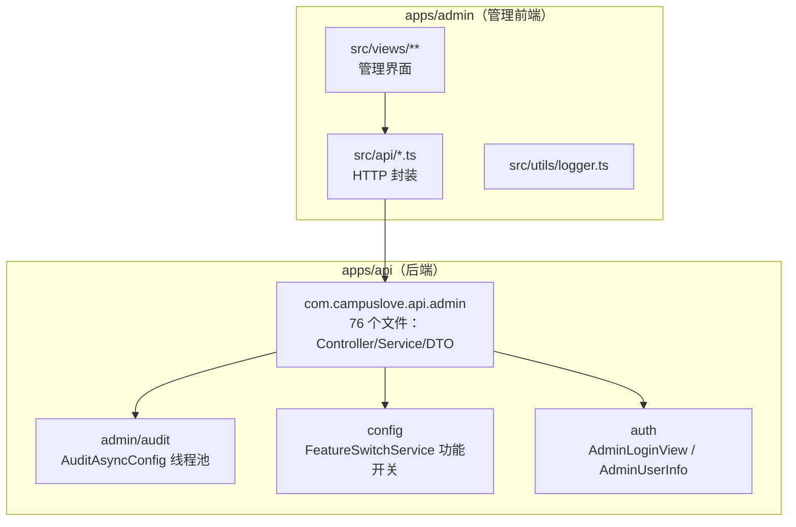
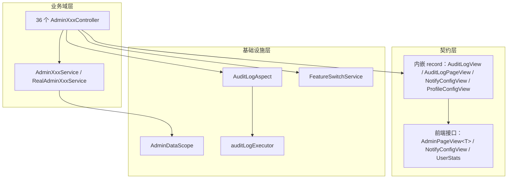
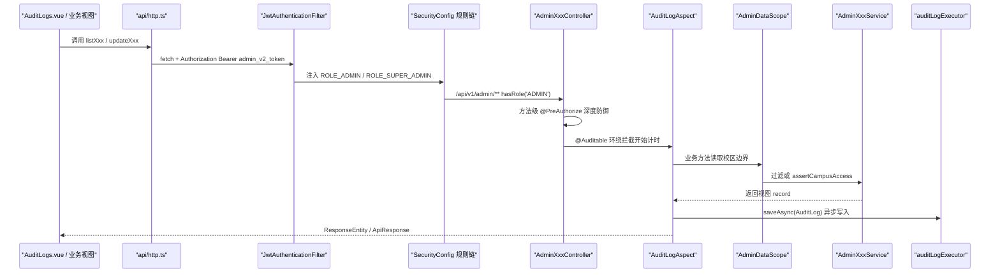
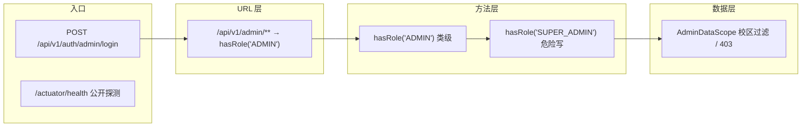
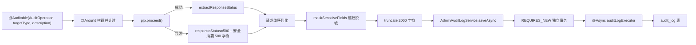
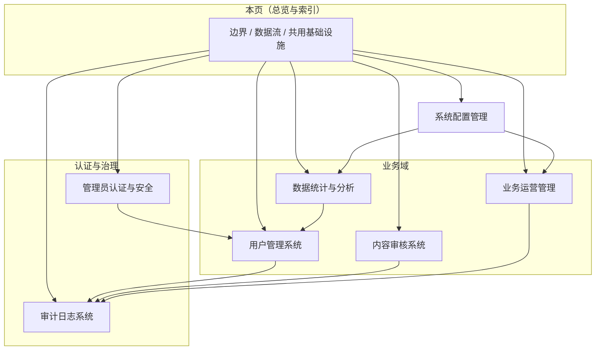
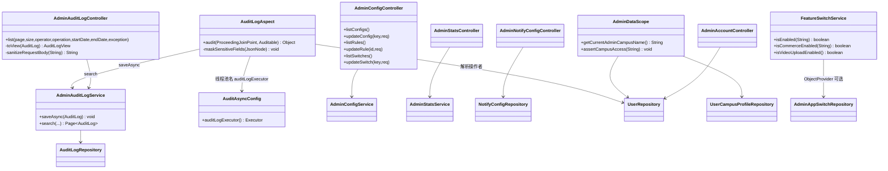
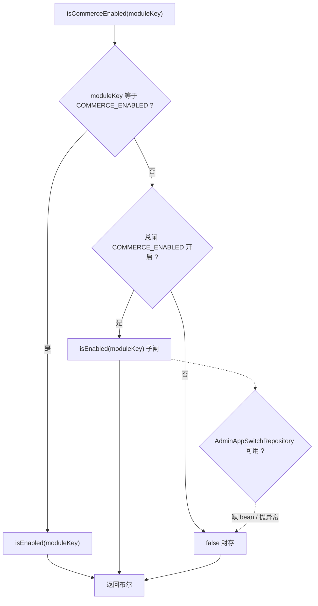
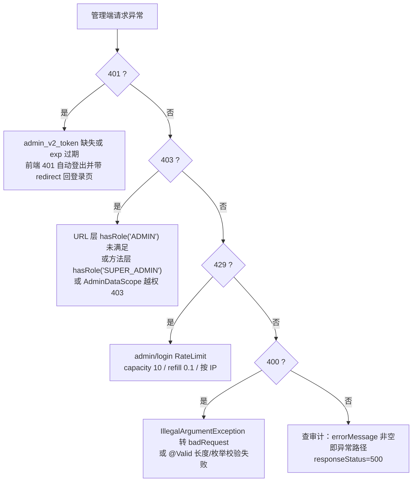

# 管理后台API

<cite>
**本文引用的文件**
- [AdminAuditLogController.java](file://apps/api/src/main/java/com/campuslove/api/admin/AdminAuditLogController.java)
- [AdminAuditLogService.java](file://apps/api/src/main/java/com/campuslove/api/admin/AdminAuditLogService.java)
- [AdminNotifyConfigController.java](file://apps/api/src/main/java/com/campuslove/api/admin/AdminNotifyConfigController.java)
- [AdminProfileConfigController.java](file://apps/api/src/main/java/com/campuslove/api/admin/AdminProfileConfigController.java)
- [AuditAsyncConfig.java](file://apps/api/src/main/java/com/campuslove/api/admin/audit/AuditAsyncConfig.java)
- [FeatureSwitchService.java](file://apps/api/src/main/java/com/campuslove/api/config/FeatureSwitchService.java)
- [AdminLoginView.java](file://apps/api/src/main/java/com/campuslove/api/auth/AdminLoginView.java)
- [notify-config.ts](file://apps/admin/src/api/notify-config.ts)
- [AuditLogs.vue](file://apps/admin/src/views/system/AuditLogs.vue)
- [AuditLogAspect.java](file://apps/api/src/main/java/com/campuslove/api/admin/audit/AuditLogAspect.java)
- [AuditOperation.java](file://apps/api/src/main/java/com/campuslove/api/admin/audit/AuditOperation.java)
- [Auditable.java](file://apps/api/src/main/java/com/campuslove/api/admin/audit/Auditable.java)
- [AdminDataScope.java](file://apps/api/src/main/java/com/campuslove/api/admin/AdminDataScope.java)
- [AdminAccountController.java](file://apps/api/src/main/java/com/campuslove/api/admin/AdminAccountController.java)
- [AdminConfigController.java](file://apps/api/src/main/java/com/campuslove/api/admin/AdminConfigController.java)
- [AdminStatsController.java](file://apps/api/src/main/java/com/campuslove/api/admin/AdminStatsController.java)
- [AdminSensitiveWordController.java](file://apps/api/src/main/java/com/campuslove/api/admin/AdminSensitiveWordController.java)
- [AdminUserController.java](file://apps/api/src/main/java/com/campuslove/api/admin/AdminUserController.java)
- [AdminPostController.java](file://apps/api/src/main/java/com/campuslove/api/admin/AdminPostController.java)
- [AdminReportController.java](file://apps/api/src/main/java/com/campuslove/api/admin/AdminReportController.java)
- [AdminRoleController.java](file://apps/api/src/main/java/com/campuslove/api/admin/AdminRoleController.java)
- [AdminMenuController.java](file://apps/api/src/main/java/com/campuslove/api/admin/AdminMenuController.java)
- [OnlineUserAdminController.java](file://apps/api/src/main/java/com/campuslove/api/admin/OnlineUserAdminController.java)
- [AdminPromoCodeController.java](file://apps/api/src/main/java/com/campuslove/api/admin/AdminPromoCodeController.java)
- [SecurityConfig.java](file://apps/api/src/main/java/com/campuslove/api/config/SecurityConfig.java)
- [AuthController.java](file://apps/api/src/main/java/com/campuslove/api/auth/AuthController.java)
- [http.ts](file://apps/admin/src/api/http.ts)
- [config.ts](file://apps/admin/src/api/config.ts)
- [stats.ts](file://apps/admin/src/api/stats.ts)
- [guards.ts](file://apps/admin/src/router/guards.ts)
- [menu.ts](file://apps/admin/src/stores/menu.ts)
- [Dashboard.vue](file://apps/admin/src/views/Dashboard.vue)
- [ProfileConfig.vue](file://apps/admin/src/views/config/ProfileConfig.vue)
- [application.yml](file://apps/api/src/main/resources/application.yml)
- [RedisHealthIndicator.java](file://apps/api/src/main/java/com/campuslove/api/config/RedisHealthIndicator.java)
- [AdminPageView.java](file://apps/api/src/main/java/com/campuslove/api/admin/AdminPageView.java)
- [index.ts](file://apps/admin/src/router/index.ts)
- [logger.ts](file://apps/admin/src/utils/logger.ts)
</cite>

## 目录
1. [简介](#简介)
2. [项目结构](#项目结构)
3. [核心组件](#核心组件)
4. [架构总览](#架构总览)
5. [详细组件分析](#详细组件分析)
6. [子页面索引与模块边界](#子页面索引与模块边界)
7. [依赖关系分析](#依赖关系分析)
8. [配置与开关](#配置与开关)
9. [性能考虑](#性能考虑)
10. [故障排查指南](#故障排查指南)
11. [能力缺口登记](#能力缺口登记)
12. [结论](#结论)
13. [附录](#附录)

## 简介

本页是「后端API服务 / 管理后台API」分组的**总览与索引页**，面向校园恋爱小程序的运营方与运维方，描述 `apps/api` 中 `com.campuslove.api.admin` 包所提供的管理员专用 HTTP 接口族，以及这些接口在 `apps/admin` 管理前端中的消费方式。本页不重复各子页的实现细节，而是回答三个问题：管理后台接口在整体后端中的位置、七个子能力域之间的边界与数据流、以及跨域共用的基础设施（审计日志、功能开关、异步线程池、DTO 视图层）。

从代码事实看，管理后台接口遵循统一的版本化前缀约定 `/api/v1/admin/**`，每个业务域由一对 `AdminXxxController` + `AdminXxxService` 承载，响应体使用定义在控制器内部的 Java `record` 视图类型（如 `AuditLogView`、`AuditLogPageView`、`NotifyConfigView`），请求体同样以内嵌 record 声明（如 `NotifyConfigUpdateRequest`、`NotifyConfigBatchUpdateRequest`）。前端一侧由 `apps/admin/src/api/*.ts` 封装 HTTP 调用、`apps/admin/src/views/**` 提供管理界面。

**章节来源**
- [AdminAuditLogController.java:34-35](file://apps/api/src/main/java/com/campuslove/api/admin/AdminAuditLogController.java#L34-L35)
- [AdminAuditLogController.java:187-213](file://apps/api/src/main/java/com/campuslove/api/admin/AdminAuditLogController.java#L187-L213)
- [AdminNotifyConfigController.java:43-46](file://apps/api/src/main/java/com/campuslove/api/admin/AdminNotifyConfigController.java#L43-L46)
- [AdminNotifyConfigController.java:134-153](file://apps/api/src/main/java/com/campuslove/api/admin/AdminNotifyConfigController.java#L134-L153)

## 项目结构

管理后台能力横跨后端 `apps/api`（Spring Boot 单体）与前端 `apps/admin`（Vue 3 + Vite 管理台），后端侧集中在 `admin` 包，跨域能力（功能开关）落在 `config` 包，异步基础设施落在 `admin/audit` 子包。

**章节来源**
- [AuditAsyncConfig.java:21-50](file://apps/api/src/main/java/com/campuslove/api/admin/audit/AuditAsyncConfig.java#L21-L50)
- [FeatureSwitchService.java:30-92](file://apps/api/src/main/java/com/campuslove/api/config/FeatureSwitchService.java#L30-L92)
- [AdminLoginView.java:13-36](file://apps/api/src/main/java/com/campuslove/api/auth/AdminLoginView.java#L13-L36)
- [logger.ts:28-47](file://apps/admin/src/utils/logger.ts#L28-L47)

## 核心组件

管理后台接口族由三类部件构成：**业务域控制器对**（`AdminXxxController` + `AdminXxxService`）、**跨域基础设施**（审计切面、数据范围、功能开关、线程池）、**契约视图层**（内嵌 `record` 与前端 TypeScript 接口）。`com.campuslove.api.admin` 包（含 `audit`、`auth`、`circle`、`event` 子目录）实测共 76 个 Java 文件，其中文件名匹配 `*Controller.java` 的控制器 36 个（顶层 33 个 + `circle/` 子包 3 个），且这 36 个全部带类级 `@RequestMapping`（无一例只有方法级映射）。

| 组件 | 位置 | 职责 | 是否跨域共用 |
| --- | --- | --- | --- |
| `AuditLogAspect` | [AuditLogAspect.java:57-60](file://apps/api/src/main/java/com/campuslove/api/admin/audit/AuditLogAspect.java#L57-L60) | `@Around("@annotation(auditable)")` 拦截全部 `@Auditable` 方法，采集操作者/IP/UA/请求体/耗时并异步落库 | 是 |
| `@Auditable` / `AuditOperation` | [Auditable.java:28-46](file://apps/api/src/main/java/com/campuslove/api/admin/audit/Auditable.java#L28-L46)、[AuditOperation.java:8-66](file://apps/api/src/main/java/com/campuslove/api/admin/audit/AuditOperation.java#L8-L66) | 方法级审计注解与 57 个操作类型枚举常量 | 是 |
| `AdminAuditLogService` | [AdminAuditLogService.java:31-92](file://apps/api/src/main/java/com/campuslove/api/admin/AdminAuditLogService.java#L31-L92) | `saveAsync` 写入 + `search` 分页查询，双 profile 门控 `@Profile("real")` | 是 |
| `AdminAuditLogController` | [AdminAuditLogController.java:34-106](file://apps/api/src/main/java/com/campuslove/api/admin/AdminAuditLogController.java#L34-L106) | `/api/v1/admin/audit-logs` 只读查询视图，视图层二次脱敏白名单 | 是 |
| `AuditAsyncConfig` | [AuditAsyncConfig.java:21-50](file://apps/api/src/main/java/com/campuslove/api/admin/audit/AuditAsyncConfig.java#L21-L50) | `auditLogExecutor` 专用线程池（core 2 / max 8 / queue 1000 / CallerRunsPolicy） | 是 |
| `AdminDataScope` | [AdminDataScope.java:35-70](file://apps/api/src/main/java/com/campuslove/api/admin/AdminDataScope.java#L35-L70) | 「每高校一管理员」的校区数据隔离：`getCurrentAdminCampusName()` + `assertCampusAccess()` | 是 |
| `FeatureSwitchService` | [FeatureSwitchService.java:30-92](file://apps/api/src/main/java/com/campuslove/api/config/FeatureSwitchService.java#L30-L92) | `isEnabled` / `isCommerceEnabled` / `isVideoUploadEnabled` 三级开关语义 | 是 |
| `AdminConfigController` | [AdminConfigController.java:41-132](file://apps/api/src/main/java/com/campuslove/api/admin/AdminConfigController.java#L41-L132) | `/configs`、`/rules`、`/switches` 三组读写端点 | 否 |
| `AdminNotifyConfigController` | [AdminNotifyConfigController.java:42-100](file://apps/api/src/main/java/com/campuslove/api/admin/AdminNotifyConfigController.java#L42-L100) | 通知模板配置的列表与批量原子更新 | 否 |
| `AdminProfileConfigController` | [AdminProfileConfigController.java:22-52](file://apps/api/src/main/java/com/campuslove/api/admin/AdminProfileConfigController.java#L22-L52) | `get()` / `save(ProfileConfigView)` 端点，直接以视图 record 作请求体 | 否 |
| `AdminAccountController` | [AdminAccountController.java:57-95](file://apps/api/src/main/java/com/campuslove/api/admin/AdminAccountController.java#L57-L95) | 管理员自助改密（BCrypt 校验旧密码 + `@Auditable(CHANGE_PASSWORD)`） | 否 |
| `AdminLoginView` | [AdminLoginView.java:13-36](file://apps/api/src/main/java/com/campuslove/api/auth/AdminLoginView.java#L13-L36) | 登录响应契约 `{token, user{id,username,displayName,role,campusName}}` | 否 |
| `AuditLogs.vue` | [AuditLogs.vue:255-386](file://apps/admin/src/views/system/AuditLogs.vue#L255-L386) | 审计日志管理界面（`<script setup>` + `template` + `style scoped` 三段式） | 否 |
| `api/http.ts` | [http.ts:23-53](file://apps/admin/src/api/http.ts#L23-L53) | fetch 封装、`AdminPageView<T>` 契约、`unwrapApiData` 双形态解包 | 是 |

36 个控制器的路由前缀呈现清晰的域分组：内容类 `/admin/posts`、`/admin/comments`、`/admin/reports`、`/admin/certifications`、`/admin/real-name-certifications`、`/admin/media-assets`；社区类 `/admin/forum/circles`、`/admin/forum/campus-topics`、`/admin/forum/village-posts`；商业类统一挂在 `/admin/business/**`（`coins`、`vip`、`wallets`、`promo-codes`、`shop`）；系统类 `/admin/account`、`/admin/roles`、`/admin/menus`、`/admin/dicts`、`/admin/schools`、`/admin/audit-logs`、`/admin/online-users`；另有三个控制器（`AdminConfigController`、`AdminMatchConfigController`、`AdminInterestTagController`）直接用 `/api/v1/admin` 作前缀，靠方法级路径 `/configs`、`/rules`、`/switches` 区分。

**图表来源**
- [AdminAuditLogController.java:185-213](file://apps/api/src/main/java/com/campuslove/api/admin/AdminAuditLogController.java#L185-L213)
- [http.ts:23-30](file://apps/admin/src/api/http.ts#L23-L30)
- [AuditLogAspect.java:127-145](file://apps/api/src/main/java/com/campuslove/api/admin/audit/AuditLogAspect.java#L127-L145)
- [AuditAsyncConfig.java:37-49](file://apps/api/src/main/java/com/campuslove/api/admin/audit/AuditAsyncConfig.java#L37-L49)
- [AdminDataScope.java:63-69](file://apps/api/src/main/java/com/campuslove/api/admin/AdminDataScope.java#L63-L69)

**章节来源**
- [AuditLogAspect.java:57-60](file://apps/api/src/main/java/com/campuslove/api/admin/audit/AuditLogAspect.java#L57-L60)
- [Auditable.java:28-46](file://apps/api/src/main/java/com/campuslove/api/admin/audit/Auditable.java#L28-L46)
- [AuditOperation.java:8-66](file://apps/api/src/main/java/com/campuslove/api/admin/audit/AuditOperation.java#L8-L66)
- [AdminAuditLogService.java:31-92](file://apps/api/src/main/java/com/campuslove/api/admin/AdminAuditLogService.java#L31-L92)
- [AdminAuditLogController.java:34-106](file://apps/api/src/main/java/com/campuslove/api/admin/AdminAuditLogController.java#L34-L106)
- [AuditAsyncConfig.java:21-50](file://apps/api/src/main/java/com/campuslove/api/admin/audit/AuditAsyncConfig.java#L21-L50)
- [AdminDataScope.java:35-70](file://apps/api/src/main/java/com/campuslove/api/admin/AdminDataScope.java#L35-L70)
- [AdminConfigController.java:41-132](file://apps/api/src/main/java/com/campuslove/api/admin/AdminConfigController.java#L41-L132)
- [AdminNotifyConfigController.java:42-100](file://apps/api/src/main/java/com/campuslove/api/admin/AdminNotifyConfigController.java#L42-L100)
- [AdminProfileConfigController.java:22-52](file://apps/api/src/main/java/com/campuslove/api/admin/AdminProfileConfigController.java#L22-L52)
- [AdminAccountController.java:57-95](file://apps/api/src/main/java/com/campuslove/api/admin/AdminAccountController.java#L57-L95)
- [AdminStatsController.java:29-67](file://apps/api/src/main/java/com/campuslove/api/admin/AdminStatsController.java#L29-L67)

## 架构总览

一次管理端写操作的完整链路跨越前端封装、Servlet 安全链、方法级鉴权、AOP 审计、校区数据隔离与 JPA 落库六层，各层职责互不重叠。

**图表来源**
- [http.ts:23-53](file://apps/admin/src/api/http.ts#L23-L53)
- [SecurityConfig.java:173-197](file://apps/api/src/main/java/com/campuslove/api/config/SecurityConfig.java#L179-L203)
- [AuditLogAspect.java:127-145](file://apps/api/src/main/java/com/campuslove/api/admin/audit/AuditLogAspect.java#L127-L145)
- [AdminAuditLogService.java:50-72](file://apps/api/src/main/java/com/campuslove/api/admin/AdminAuditLogService.java#L50-L72)
- [AdminDataScope.java:63-69](file://apps/api/src/main/java/com/campuslove/api/admin/AdminDataScope.java#L63-L69)

鉴权是三层叠加的。**第一层是 URL 规则**：`SecurityConfig` 在 `.requestMatchers("/api/v1/admin/**").hasRole("ADMIN")` 上收口，同一条链上还把 `/actuator/health` 设为 `permitAll`、`/actuator/**` 与 `/swagger-ui/**`、`/v3/api-docs/**` 设为 `hasRole("ADMIN")`，并把 `/uploads/**` 改为 `denyAll`，`.anyRequest().authenticated()` 兜底防止新增端点默认开放。**第二层是方法级 `@PreAuthorize`**：admin 包内共出现 35 处 `hasRole('SUPER_ADMIN')`、35 处 `hasRole('ADMIN')`、1 处 `hasRole('SUPER_ADMIN') or hasRole('ADMIN')`，控制器类上标 `ADMIN`、危险写端点上再收窄到 `SUPER_ADMIN`（如 `updateConfig`、`updateRule`、`updateSwitch`、`notify-config` 的 `PUT`、`sensitive-words/batch-import`）。**第三层是数据范围**：`AdminDataScope` 依据 `users.role + campus_name` 把管理员分成 `SUPER_ADMIN`（全校区）、`ADMIN + campusName 非空`（校区管理员，读过滤 / 写越权 403）、`ADMIN + campusName 为空`（全局运营，兼容旧账号）三种身份。

登录本身不属于 `/api/v1/admin/**`：它落在 `AuthController` 的 `POST /api/v1/auth/admin/login`，带 `@RateLimit(capacity = 10, refillTokens = 0.1, key = "#request.remoteAddr")` 与 `@Idempotent`，声明 401 `ADMIN_INVALID_CREDENTIALS`、403 `ADMIN_DISABLED`、429 `RATE_LIMITED` 三种失败语义，成功返回 `AdminLoginView`。前端 `guards.ts` 解析 `localStorage.admin_v2_token` 的 JWT `exp` 做过期校验，缺 `exp` 视为无效。

**图表来源**
- [SecurityConfig.java:160-198](file://apps/api/src/main/java/com/campuslove/api/config/SecurityConfig.java#L166-L204)
- [AuthController.java:260-277](file://apps/api/src/main/java/com/campuslove/api/auth/AuthController.java#L260-L277)
- [AdminConfigController.java:65-131](file://apps/api/src/main/java/com/campuslove/api/admin/AdminConfigController.java#L65-L131)
- [AdminDataScope.java:16-34](file://apps/api/src/main/java/com/campuslove/api/admin/AdminDataScope.java#L16-L34)

`profile` 是贯穿全架构的开关：`AdminStatsController`、`AdminConfigController`、`AdminAccountController`、`AdminAuditLogController`、`AdminAuditLogService`、`AuditLogAspect`、`AdminDataScope`、`AdminNotifyConfigController` 全部标注 `@Profile("real")`，即 mock 环境下这些 bean 不注册；mock 侧由 `MockSecurityConfig` 对 `/api/v1/admin/**` 自动注入 `ROLE_ADMIN` 供本地联调。唯一不带 profile 门控的跨域基础设施是 `AuditAsyncConfig`（`@Configuration @EnableAsync`，无条件加载）。

**章节来源**
- [SecurityConfig.java:160-198](file://apps/api/src/main/java/com/campuslove/api/config/SecurityConfig.java#L166-L204)
- [AuthController.java:251-300](file://apps/api/src/main/java/com/campuslove/api/auth/AuthController.java#L251-L300)
- [AdminLoginView.java:1-36](file://apps/api/src/main/java/com/campuslove/api/auth/AdminLoginView.java#L1-L36)
- [AdminStatsController.java:29-33](file://apps/api/src/main/java/com/campuslove/api/admin/AdminStatsController.java#L29-L33)
- [AdminConfigController.java:41-45](file://apps/api/src/main/java/com/campuslove/api/admin/AdminConfigController.java#L41-L45)
- [AdminAccountController.java:57-62](file://apps/api/src/main/java/com/campuslove/api/admin/AdminAccountController.java#L57-L62)
- [AdminAuditLogController.java:34-39](file://apps/api/src/main/java/com/campuslove/api/admin/AdminAuditLogController.java#L34-L39)
- [AuditLogAspect.java:57-60](file://apps/api/src/main/java/com/campuslove/api/admin/audit/AuditLogAspect.java#L57-L60)
- [AdminDataScope.java:35-38](file://apps/api/src/main/java/com/campuslove/api/admin/AdminDataScope.java#L35-L38)
- [AdminNotifyConfigController.java:42-46](file://apps/api/src/main/java/com/campuslove/api/admin/AdminNotifyConfigController.java#L42-L46)
- [AuditAsyncConfig.java:21-23](file://apps/api/src/main/java/com/campuslove/api/admin/audit/AuditAsyncConfig.java#L21-L23)
- [guards.ts:36-42](file://apps/admin/src/router/guards.ts#L36-L42)

## 详细组件分析

### 审计写入管道

`AuditLogAspect` 以 `@Around("@annotation(auditable)")` 绑定 `@Auditable`，在 `audit(ProceedingJoinPoint, Auditable)` 内计时并分叉处理成功/异常路径：正常返回时由 `extractResponseStatus(result)` 取 HTTP 状态码；抛异常时把 `responseStatus` 固定为 `500`，并把错误消息压成 `truncate(buildSafeErrorMessage(ex), 500)` —— 注释明确写入库的只有异常类型与单行化摘要，避免 SQL 片段与堆栈进入审计库。`finally` 块计算 `duration` 后调用 `recordAuditLog(...)`。

请求体脱敏是管道里最重的一环。切面维护 `SENSITIVE_FIELDS` 常量集合（小写匹配），涵盖 `password/newpassword/oldpassword/token/secret/accesstoken/refreshtoken/code/captcha/credential/authcode/verifycode`，并扩展了 `phone/mobile/phonenumber/telephone/tel`、`idcard/idcardnumber/idcardno/identitycard/idcardurl/studentidcard/studentidcardurl`、`openid/unionid/sessionkey/session_key`、`email/realname` 与 `apikey/secretkey/authorization/privatekey`。序列化后经 `maskSensitiveFields(node)` 递归遍历 JSON 树（对象字段与数组元素都下钻），最终 `truncate(json, MAX_BODY_LENGTH)`，其中 `MAX_BODY_LENGTH = 2000`。IP 提取按 `IP_HEADERS = {X-Forwarded-For, X-Real-IP, Proxy-Client-IP, WL-Proxy-Client-IP}` 顺序尝试，且仅在请求方命中 `app.security.trusted-proxies` 配置的可信 IP/CIDR 时才信任代理头（构造器把逗号串拆成 `trustedProxyIps` 集合与 `trustedProxyCidrs` 前缀列表）。`requestUrl` 与 `userAgent` 截断到 256，`targetId` 截断到 64。

**图表来源**
- [Auditable.java:35-45](file://apps/api/src/main/java/com/campuslove/api/admin/audit/Auditable.java#L35-L45)
- [AuditLogAspect.java:127-145](file://apps/api/src/main/java/com/campuslove/api/admin/audit/AuditLogAspect.java#L127-L145)
- [AuditLogAspect.java:65-85](file://apps/api/src/main/java/com/campuslove/api/admin/audit/AuditLogAspect.java#L65-L85)
- [AuditLogAspect.java:317-346](file://apps/api/src/main/java/com/campuslove/api/admin/audit/AuditLogAspect.java#L317-L346)
- [AdminAuditLogService.java:50-72](file://apps/api/src/main/java/com/campuslove/api/admin/AdminAuditLogService.java#L50-L72)

`AdminAuditLogService.saveAsync` 的的事务语义值得单独注意：它同时带 `@Async("auditLogExecutor")` 与 `@Transactional(propagation = Propagation.REQUIRES_NEW)`，捕获 `DataAccessException` 后先 `log.warn` 再显式 `TransactionAspectSupport.currentTransactionStatus().setRollbackOnly()` 并抛 `RuntimeException("Audit log persistence failed", e)`。源码注释解释这是 FIN-00022 的修复：`@Transactional` 内吞掉 DB 异常会让 Spring 误判方法正常返回而提交事务；由于是 `REQUIRES_NEW`，`setRollbackOnly` 只回滚审计自身事务而不影响主业务事务，异常再由线程池统一记录。`createdAt` 若为空则在写入前用 `LocalDateTime.now(TimeZones.BUSINESS)` 填充。

**章节来源**
- [AuditLogAspect.java:55-145](file://apps/api/src/main/java/com/campuslove/api/admin/audit/AuditLogAspect.java#L55-L145)
- [AuditLogAspect.java:189-193](file://apps/api/src/main/java/com/campuslove/api/admin/audit/AuditLogAspect.java#L189-L193)
- [AuditLogAspect.java:283-283](file://apps/api/src/main/java/com/campuslove/api/admin/audit/AuditLogAspect.java#L283-L283)
- [AuditLogAspect.java:317-346](file://apps/api/src/main/java/com/campuslove/api/admin/audit/AuditLogAspect.java#L317-L346)
- [AuditLogAspect.java:363-370](file://apps/api/src/main/java/com/campuslove/api/admin/audit/AuditLogAspect.java#L363-L370)
- [AuditLogAspect.java:405-405](file://apps/api/src/main/java/com/campuslove/api/admin/audit/AuditLogAspect.java#L405-L405)
- [AdminAuditLogService.java:19-72](file://apps/api/src/main/java/com/campuslove/api/admin/AdminAuditLogService.java#L19-L72)
- [Auditable.java:8-27](file://apps/api/src/main/java/com/campuslove/api/admin/audit/Auditable.java#L8-L27)

### 审计查询与视图层二次脱敏

`AdminAuditLogController` 只提供读能力，类上 `@Profile("real") @PreAuthorize("hasRole('ADMIN')") @Validated`。`GET /api/v1/admin/audit-logs` 接收 7 个查询参数：`page`（默认 0，`@Min(0)`）、`size`（默认 20，`@Min(1) @Max(100)`）、`operator`、`operation`、`startDate`、`endDate`、`exception`。控制器对参数做归一化（`safeSize = Math.min(Math.max(1, size), 100)`）、把 `operation` 统一 `toUpperCase()`、用 `parseDateTime` 按 `DateTimeFormatter.ISO_LOCAL_DATE_TIME` 解析时间，并把 `exception` 三态收敛成 `Boolean.TRUE` 或 `null` 后交给 `AdminAuditLogService.search`（`@Transactional(readOnly = true)`，透传给 `AuditLogRepository.search`）。响应是 `AuditLogPageView`（`content/totalElements/totalPages/page/size`），条目 `AuditLogView` 有 16 个字段：`id、operatorId、operatorUsername、operatorRole、operation、targetType、targetId、requestMethod、requestUrl、requestBody、responseStatus、errorMessage、ip、userAgent、durationMs、createdAt`。

关键设计是**双白名单**：切面按 `SENSITIVE_FIELDS` 名单脱敏，控制器另用正则 `SENSITIVE_KEY_PATTERN` 兜底，匹配 `password|passwd|secret|token|authorization|credential|idcard|id_card|idCard|phone|openid|open_id|unionid|session_key|jwt`（大小写不敏感）。源码注释指出这是 R4-00394 的补强——「切面脱敏仅靠字段名单，新增敏感字段易漏；视图层按 key 名兜底脱敏」。该控制器因此自建了一个 `ObjectMapper` 实例用于解析 `requestBody`。

值得注意的是，`list()` 的入参中**没有校区维度**，控制器也只注入 `AdminAuditLogService`，未引用 `AdminDataScope`；因此审计查询目前是跨校区全量的管理员级视图，校区管理员可见范围由 URL 层的 `hasRole('ADMIN')` 与前端菜单授权共同约束，而非数据行过滤。

**章节来源**
- [AdminAuditLogController.java:34-58](file://apps/api/src/main/java/com/campuslove/api/admin/AdminAuditLogController.java#L34-L58)
- [AdminAuditLogController.java:60-106](file://apps/api/src/main/java/com/campuslove/api/admin/AdminAuditLogController.java#L60-L106)
- [AdminAuditLogController.java:108-120](file://apps/api/src/main/java/com/campuslove/api/admin/AdminAuditLogController.java#L108-L120)
- [AdminAuditLogController.java:185-213](file://apps/api/src/main/java/com/campuslove/api/admin/AdminAuditLogController.java#L185-L213)
- [AdminAuditLogService.java:74-92](file://apps/api/src/main/java/com/campuslove/api/admin/AdminAuditLogService.java#L74-L92)

### 校区数据隔离与账号自助

`AdminDataScope` 是「每个高校一个管理员」商业模式的技术落点，以 `@Service @Profile("real")` 注册，依赖 `UserRepository` 与 `UserCampusProfileRepository`，并公开两个角色常量 `ROLE_SUPER_ADMIN = "SUPER_ADMIN"`、`ROLE_ADMIN = "ADMIN"`。读路径用 `getCurrentAdminCampusName()`（取 `SecurityUtils.getCurrentUserId()`，为空直接返回 `null`，否则 `resolveCampusName(userId)`），调用方把非 null 的校区名注入查询条件；写路径用 `assertCampusAccess(String)`，不匹配则抛 `OperationForbiddenException`（HTTP 403）。`AdminStatsController` 的类注释记录了 R4-00393 的效果：校区管理员的三类统计（用户/活跃/匹配）仅覆盖其管辖校区，平台级经营数据不再对其开放。

`AdminAccountController` 演示了权限的「放宽」方向：`POST /api/v1/admin/account/change-password` 原本要求 `SUPER_ADMIN`，R4-00389 起放开为 `ADMIN` 可改自己密码，因为它只操作 `SecurityUtils.getCurrentUserId()` 对应的当前登录者，并用 `passwordEncoder.matches(req.oldPassword(), storedHash)` 防越权；新密码长度 6-64，`@Size` 与显式校验双保险，历史明文遗留（`storedHash` 为空/空白）同样被拒。请求体的 `password` 字段在进入审计库前由切面 `SENSITIVE_FIELDS` 脱敏。

**章节来源**
- [AdminDataScope.java:16-70](file://apps/api/src/main/java/com/campuslove/api/admin/AdminDataScope.java#L16-L70)
- [AdminStatsController.java:11-67](file://apps/api/src/main/java/com/campuslove/api/admin/AdminStatsController.java#L11-L67)
- [AdminAccountController.java:29-95](file://apps/api/src/main/java/com/campuslove/api/admin/AdminAccountController.java#L29-L95)

### 配置、开关与通知端点

`AdminConfigController`（前缀 `/api/v1/admin`）成对提供三组读写端点：`GET /configs` + `PUT /configs/{key}`、`GET /rules` + `PUT /rules/{id}`（`@Positive`）、`GET /switches` + `PUT /switches/{key}`。读端点仅要求类级 `hasRole('ADMIN')`，三个写端点各自叠加方法级 `@PreAuthorize("hasRole('SUPER_ADMIN')")`；请求体 record 与长度上限分别是 `UpdateConfigRequest(@NotBlank @Size(max=2000) value, @Size(max=500) description)`、`UpdateRuleRequest(@Size(max=2000) expression, Boolean enabled, @Size(max=500) description)`、`UpdateSwitchRequest(@NotNull Boolean enabled)`。所有方法都以 `SecurityUtils.getCurrentUserId()` 起头做登录态断言，`IllegalArgumentException` 统一转成 `ResponseEntity.badRequest()`。前端 `api/config.ts` 一一对应地封装 `listConfigs()` → `get("/v1/admin/configs")`、`updateConfig(key, body)` → `put("/v1/admin/configs/${encodeURIComponent(key)}")`，并镜像出 `AdminConfig`/`AdminRule`/`AdminSwitch` 与三个 `Update*Request` TypeScript 接口。

`FeatureSwitchService` 是开关的**读取**侧，注释说明它「不引入自缓存（避免 AOP/事务自调用代理问题）」，每次经 `ObjectProvider<AdminAppSwitchRepository>` 可选注入取仓库：仓库缺失（mock profile 无 JPA）直接返回 `false` 视为封存态，`findBySwitchKey(...).map(AdminAppSwitch::getEnabled).orElse(FALSE)`，`RuntimeException` 也被吞成 `false` 并 `log.warn("查询功能开关失败，按封存处理...")`。`isCommerceEnabled(moduleKey)` 实现「总闸 + 子闸与运算」：传入 `COMMERCE_ENABLED` 本身等价于 `isEnabled`，否则先查总闸再查子闸；`isVideoUploadEnabled()` 走独立闸 `UPLOAD_VIDEO_ENABLED`，与商业化总闸解耦。

`AdminNotifyConfigController`（`/api/v1/admin/notify-config`）的 `GET` 走 `findAllByOrderByTypeAsc()`，`PUT` 标 `@Auditable(UPDATE_NOTIFY_CONFIG, targetType="NOTIFY_CONFIG")` + `@PreAuthorize("hasRole('SUPER_ADMIN')")` + `@Transactional`，按 `type` 匹配现有记录、不存在则新建，注释说明加 `@Transactional` 是 Task 2.5.4 为保证批量原子性（避免「部分成功部分失败」的中间态）。契约 record 为 `NotifyConfigView`（L134）、`NotifyConfigUpdateRequest`（L143）、`NotifyConfigBatchUpdateRequest`（L150），前端 `notify-config.ts` 用 `listNotifyConfigs()` → `http.get<NotifyConfigView[]>("/v1/admin/notify-config")`、`updateNotifyConfigs()` → `http.put(...)` 对应，界面在 `views/config/NotifyConfig.vue`。

**章节来源**
- [AdminConfigController.java:40-132](file://apps/api/src/main/java/com/campuslove/api/admin/AdminConfigController.java#L40-L132)
- [AdminConfigController.java:134-157](file://apps/api/src/main/java/com/campuslove/api/admin/AdminConfigController.java#L134-L157)
- [FeatureSwitchService.java:28-92](file://apps/api/src/main/java/com/campuslove/api/config/FeatureSwitchService.java#L28-L92)
- [AdminNotifyConfigController.java:40-100](file://apps/api/src/main/java/com/campuslove/api/admin/AdminNotifyConfigController.java#L40-L100)
- [AdminNotifyConfigController.java:134-153](file://apps/api/src/main/java/com/campuslove/api/admin/AdminNotifyConfigController.java#L134-L153)
- [config.ts:3-77](file://apps/admin/src/api/config.ts#L3-L77)
- [notify-config.ts:8-36](file://apps/admin/src/api/notify-config.ts#L8-L36)

### 内容审核与用户管理端点族

各业务域的写端点在路径风格上高度一致——动词化的子资源 POST，而非 RESTful 的 PATCH/DELETE 语义扩张：帖子审核 `POST /api/v1/admin/posts/{id}/audit`、删除 `DELETE /{id}`；举报处理 `POST /reports/{id}/handle`；认证复核 `POST /certifications/{id}/review` 与实名 `POST /real-name-certifications/{id}/review`；媒体审核 `POST /media-assets/{id}/audit`（另有 `GET /{id}`）；评论删除 `DELETE /comments/{id}`；在线用户强制下线 `POST /online-users/{userId}/kick`。用户域由 `AdminUserController`（`/api/v1/admin/users`）承载，除 `GET /{id}`、`PUT /{id}` 外还内嵌管理员账号子资源 `POST /admins`、`GET /admins`，以及 `POST /{id}/disable`、`POST /{id}/enable`。角色与菜单构成 RBAC 的管理面：`AdminRoleController` 提供 `GET /{id}`、`GET /{id}/menus`、`PUT /{id}`、`PUT /{id}/menus`（对应审计枚举 `ASSIGN_ROLE_MENU`）、`DELETE /{id}`；`AdminMenuController` 额外提供 `GET /menus/current`，供前端按登录者渲染动态菜单。

`AuditOperation` 的 57 个枚举常量恰好是这批端点的能力清单：内容类 `AUDIT_POST/DELETE_POST/PIN_POST/UNPIN_POST/DELETE_COMMENT/HANDLE_REPORT/REVIEW_CERTIFICATION/AUDIT_MEDIA_ASSET`，用户类 `CREATE_USER/EDIT_USER/ENABLE_USER/DISABLE_USER/KICK_ONLINE_USER`，配置类 `UPDATE_CONFIG/UPDATE_RULE/UPDATE_SWITCH/UPDATE_MATCH_CONFIG/UPDATE_RECOMMEND_STRATEGY/UPDATE_NOTIFY_CONFIG`，敏感词 `ADD_SENSITIVE_WORD/DELETE_SENSITIVE_WORD`，组织类 `CREATE_SCHOOL/UPDATE_SCHOOL/DELETE_SCHOOL/TOGGLE_SCHOOL`、`CREATE_MENU/UPDATE_MENU/DELETE_MENU`、`CREATE_ROLE/UPDATE_ROLE/DELETE_ROLE/ASSIGN_ROLE_MENU`、`CREATE_DICT/…/DELETE_DICT_ITEM`，社区类 `CREATE_CIRCLE/UPDATE_CIRCLE/DELETE_CIRCLE/PIN_TOPIC/UNPIN_TOPIC`，运营类 `CREATE_ACTIVITY/UPDATE_ACTIVITY/DELETE_ACTIVITY/PUBLISH_ACTIVITY/UNPUBLISH_ACTIVITY`、`CREATE_PROMO_CODE/DISABLE_PROMO_CODE`、`CREATE_SHOP_ITEM/…/UNPUBLISH_SHOP_ITEM/ADJUST_WALLET`，账号类 `CHANGE_PASSWORD`。每个常量为 `(value, description)` 形式并暴露 `getDescription()`。

**章节来源**
- [AdminPostController.java:146-203](file://apps/api/src/main/java/com/campuslove/api/admin/AdminPostController.java#L146-L203)
- [AdminCommentController.java:126-126](file://apps/api/src/main/java/com/campuslove/api/admin/AdminCommentController.java#L126-L126)
- [AdminReportController.java:170-170](file://apps/api/src/main/java/com/campuslove/api/admin/AdminReportController.java#L170-L170)
- [AdminCertificationController.java:124-124](file://apps/api/src/main/java/com/campuslove/api/admin/AdminCertificationController.java#L124-L124)
- [AdminRealNameController.java:112-112](file://apps/api/src/main/java/com/campuslove/api/admin/AdminRealNameController.java#L112-L112)
- [AdminMediaAssetController.java:141-165](file://apps/api/src/main/java/com/campuslove/api/admin/AdminMediaAssetController.java#L141-L165)
- [OnlineUserAdminController.java:133-133](file://apps/api/src/main/java/com/campuslove/api/admin/OnlineUserAdminController.java#L133-L133)
- [AdminUserController.java:188-252](file://apps/api/src/main/java/com/campuslove/api/admin/AdminUserController.java#L188-L252)
- [AdminUserController.java:355-510](file://apps/api/src/main/java/com/campuslove/api/admin/AdminUserController.java#L355-L510)
- [AdminRoleController.java:111-245](file://apps/api/src/main/java/com/campuslove/api/admin/AdminRoleController.java#L111-L245)
- [AdminMenuController.java:102-224](file://apps/api/src/main/java/com/campuslove/api/admin/AdminMenuController.java#L102-L224)
- [AuditOperation.java:8-77](file://apps/api/src/main/java/com/campuslove/api/admin/audit/AuditOperation.java#L8-L77)

### 批量操作与异步任务

管理端的批量能力集中在两处，且实现策略不同。`AdminSensitiveWordController`（`/api/v1/admin/sensitive-words`）除 `GET`、`POST`、`DELETE /{id}` 外提供 `POST /batch-import`：标 `@Auditable(ADD_SENSITIVE_WORD, targetType="SENSITIVE_WORD")` + `@PreAuthorize("hasRole('SUPER_ADMIN')")`，入参是 `SensitiveWordBatchImportRequest(words, category)`（JSON 请求体，非文件上传），交给 `SensitiveWordImportService.importBatchAsync(words, category, operatorId)` 并返回 `ResponseEntity.accepted()`。配套 `GET /import/status/{taskId}` 是 R4-00382 补上的轮询端点（此前「任务状态黑盒」），状态集合为 `ACCEPTED/RUNNING/DONE/FAILED/EMPTY_INPUT`，任务不存在时抛 `IllegalArgumentException` 走 404 语义；源码注释明确指出**状态仅存内存，应用重启后丢失属已知局限**。同处的类注释还记录了「异常隔离：单批失败不阻断后续批次」与导入完成后主动失效 `CacheNames#SENSITIVE_WORDS` 缓存并同步刷新内存 `SensitiveWordFilter`。兑换码侧则是同步批量：`AdminPromoCodeController`（`/api/v1/admin/business/promo-codes`）提供 `POST /batch` 生成、`POST /{id}/disable` 作废与 `GET /export` 导出；活动报名名册另有 `GET /api/v1/admin/activities/{id}/enrollments/export`。

**章节来源**
- [AdminSensitiveWordController.java:58-60](file://apps/api/src/main/java/com/campuslove/api/admin/AdminSensitiveWordController.java#L58-L60)
- [AdminSensitiveWordController.java:205-241](file://apps/api/src/main/java/com/campuslove/api/admin/AdminSensitiveWordController.java#L205-L241)
- [AdminPromoCodeController.java:51-51](file://apps/api/src/main/java/com/campuslove/api/admin/AdminPromoCodeController.java#L51-L51)
- [AdminPromoCodeController.java:141-219](file://apps/api/src/main/java/com/campuslove/api/admin/AdminPromoCodeController.java#L141-L219)
- [AdminActivityController.java:389-389](file://apps/api/src/main/java/com/campuslove/api/admin/AdminActivityController.java#L389-L389)
- [AdminWalletController.java:47-47](file://apps/api/src/main/java/com/campuslove/api/admin/AdminWalletController.java#L47-L47)
- [AdminWalletController.java:131-181](file://apps/api/src/main/java/com/campuslove/api/admin/AdminWalletController.java#L131-L181)
- [AdminVipController.java:43-43](file://apps/api/src/main/java/com/campuslove/api/admin/AdminVipController.java#L43-L43)
- [AdminVipController.java:73-144](file://apps/api/src/main/java/com/campuslove/api/admin/AdminVipController.java#L73-L144)

### 前端消费层与鉴权回跳

`apps/admin/src/api/http.ts` 是所有管理端调用的唯一出口：base URL 取 `VITE_API_BASE_URL`（回退 `/api`，由 vite proxy 转发）、token 读 `localStorage.admin_v2_token`（与旧后台 `admin_token` 隔离）、401 自动登出并带 `redirect` 回跳登录页。它同时导出 `AdminPageView<T>`（`items/total/page/pageSize/totalPages`，注释标注对应后端 `com.campuslove.api.admin.AdminPageView`）与 `unwrapApiData<T>`——因为部分端点（admin 登录、改密、新增用户、在线用户）返回 `ApiResponse` 包装 `{code,message,data,traceId}`，其余直接返回视图对象，识别规则是「含 `code`（number 或 string）且含 `data`」才解包。文件顶部还留下安全债记录：JWT 明文存 localStorage，任何 XSS 均可窃取管理员令牌，改进方向为 HttpOnly Cookie + CSRF、缩短有效期加刷新、限制 audience 与 sameSite。

路由守卫 `guards.ts` 承担第二重登录判定：`isTokenValid(token)` 解析三段式 JWT 的 `exp`（缺 `exp` 视为无效），仅 dev 模式放行 `dev-admin-token-` 前缀且长度 ≥16；`admin_v2_user` 可被前端篡改，故只用于展示层。已登录但菜单拉取失败（后端异常或无菜单权限）时返回 `{ name: "Forbidden" }` 而非空白页。`stores/menu.ts` 用 `defineStore("menu", ...)` 管理菜单树，`AdminMenuType = "DIR" | "MENU" | "BUTTON"`，提供 `normalizeMenuType`、`resolveMenuPath`、`findFirstMenuPath`、`isKnownMenuPath`、`buildMenuTree` 与 `loadMenus()`、`reset()`，对应后端 `GET /api/v1/admin/menus/current`。看板 `Dashboard.vue` 从 `@/api/stats` 批量导入统计类型，配合 `@/api/users` 的 `listUsers`、`@/api/reports` 的 `listReports` 组成首页卡片，失败时 `logger.error("[Dashboard] load stats failed", err)` 上报，趋势图由 `TrendChart.vue` 与 `TREND_DAYS` 常量驱动。`api/stats.ts` 侧的 `UserStats`/`ActiveStats`/`MatchStats`/`StatsOverview`/`FieldCount`/`DailyCount` 与 `getUserStats()`、`getActiveStats()`、`getMatchStats()`、`getStats()` 一一对应后端 `AdminStatsController` 的三个 GET。

**章节来源**
- [http.ts:1-53](file://apps/admin/src/api/http.ts#L1-L53)
- [guards.ts:36-42](file://apps/admin/src/router/guards.ts#L36-L42)
- [guards.ts:65-71](file://apps/admin/src/router/guards.ts#L65-L71)
- [guards.ts:114-162](file://apps/admin/src/router/guards.ts#L114-L162)
- [menu.ts:13-24](file://apps/admin/src/stores/menu.ts#L13-L24)
- [menu.ts:56-142](file://apps/admin/src/stores/menu.ts#L56-L142)
- [menu.ts:191-284](file://apps/admin/src/stores/menu.ts#L191-L284)
- [stats.ts:11-101](file://apps/admin/src/api/stats.ts#L11-L101)
- [Dashboard.vue:16-30](file://apps/admin/src/views/Dashboard.vue#L16-L30)
- [Dashboard.vue:139-139](file://apps/admin/src/views/Dashboard.vue#L139-L139)
- [AdminMenuController.java:102-102](file://apps/api/src/main/java/com/campuslove/api/admin/AdminMenuController.java#L102-L102)
- [logger.ts:28-47](file://apps/admin/src/utils/logger.ts#L28-L47)

### 统计、健康检查与前端菜单驱动

统计面只有三个只读 GET：`/api/v1/admin/stats/users`（`AdminStatsController` L44，返回 `UserStatsView`，31 行）、`/stats/active`（L53，`ActiveStatsView`，18 行）、`/stats/matches`（L62，`MatchStatsView`，33 行）。控制器共 67 行，类级依次是 `@Profile("real")`、`@RestController`、`@RequestMapping("/api/v1/admin/stats")`、`@PreAuthorize("hasRole('ADMIN')")`（L29-L32）；三个方法体首行都调 `SecurityUtils.getCurrentUserId()` 作登录态断言（L46、L55、L64），聚合逻辑委托 `AdminStatsService`（接口 36 行）→ `RealAdminStatsService`（322 行）。类注释 L17-L19 固定三个指标口径——用户（总数/新增/活跃/性别比/学校分布）、活跃（DAU/MAU/互动数）、匹配（总数/成功率/每日趋势）；L25-L27 记 R4-00393 的校区收敛结论（校区管理员仅见管辖校区）。前端 `api/stats.ts`（135 行）镜像 `FieldCount`/`UserStats`/`ActiveStats`/`DailyCount`/`MatchStats`/`StatsOverview` 六个 interface，L101 的 `getStats()` 用 `Promise.allSettled` 并发拉三路并汇总成 `StatsOverview`（L95-L99 注释：单子接口失败置 null、错误记入 `errors`），供 426 行的 `Dashboard.vue` 看板消费。

健康与指标不自研：`application.yml` L92-L103 仅暴露 `health,info,prometheus,metrics`（注释指明 health 含数据库连通性等自定义指标、prometheus 由 micrometer-registry-prometheus 提供），L104-L107 给所有指标统一打 `application: campus-love-api` 标签，L114-L119 用 `show-details: when_authorized` 收紧健康详情并显式启用 prometheus；L369、L387、L402、L453、L459 是各中间件的 `register-health-indicator: true`，L460-L461 暴露 Resilience4j 熔断/限流健康指标。仓库里唯一的自定义指示器是 `RedisHealthIndicator`（109 行，`@Component` + `@Profile("real")` 且 `implements HealthIndicator`，L25-L28）。这些出口全部落在 `/actuator/**` 前缀、由 `SecurityConfig` 区分公开与鉴权，不在 `/api/v1/admin/**` 之内（对应「能力缺口登记」G-02 的判定）。

界面可用性由「服务端菜单树 + 前端懒加载映射」拼合：`AdminMenuController`（类级 `@RequestMapping("/api/v1/admin/menus")` L67、`hasRole('ADMIN')` L68）的 `GET /current`（L102）返回当前管理员可见菜单，其余菜单读写方法在 L115、L128、L144、L188、L226 五处叠加 `@PreAuthorize("hasRole('SUPER_ADMIN')")`；角色-菜单绑定是 `AdminRoleController` 的 `GET /{id}/menus`（L125）与 `PUT /{id}/menus`（L211，其 L213 标 `@Auditable(ASSIGN_ROLE_MENU)`）。`router/index.ts` L17-L18 注释界定职责——本文件只在 `componentMap`（L32）写懒加载引用，L145 与 L156 落实「仅 `type=MENU` 且 `component` 命中映射表的节点注册路由」。视图实测分布在 6 个业务域目录共 36 页（`system/` 8、`content/` 8、`forum/` 7、`business/` 6、`config/` 5、`activity/` 2），另有 `views/` 根级 5 页（`Dashboard`/`Layout`/`Login`/`Forbidden`/`NotFound`），合计 41 个 `.vue`。前端日志统一走 `utils/logger.ts`（47 行）：`debug` 仅在 `import.meta.env.MODE === "development"` 时输出（L17、L29-L34），`info/warn/error` 始终输出且都带 `[LEVEL]` 前缀（L35-L44）。

**章节来源**
- [AdminStatsController.java:11-66](file://apps/api/src/main/java/com/campuslove/api/admin/AdminStatsController.java#L11-L66)
- [application.yml:92-119](file://apps/api/src/main/resources/application.yml#L92-L119)
- [RedisHealthIndicator.java:25-28](file://apps/api/src/main/java/com/campuslove/api/config/RedisHealthIndicator.java#L25-L28)
- [AdminMenuController.java:66-226](file://apps/api/src/main/java/com/campuslove/api/admin/AdminMenuController.java#L66-L226)
- [AdminRoleController.java:125-213](file://apps/api/src/main/java/com/campuslove/api/admin/AdminRoleController.java#L125-L213)
- [stats.ts:11-101](file://apps/admin/src/api/stats.ts#L11-L101)
- [index.ts:17-156](file://apps/admin/src/router/index.ts#L17-L156)
- [logger.ts:17-44](file://apps/admin/src/utils/logger.ts#L17-L44)

## 子页面索引与模块边界

本分组下 7 个子页已生成，本页只负责划定它们的边界；实现细节请以子页为准。

| 子页 | 覆盖的后端控制器 / 端点前缀 | 覆盖的前端产物 | 与相邻子页的分界 |
| --- | --- | --- | --- |
| 管理员认证与安全 | `POST /api/v1/auth/admin/login`（`AuthController`）、`AdminLoginView`、`SecurityConfig` 的 `/api/v1/admin/**` 规则、`AdminAccountController`、`AdminRoleController`、`AdminMenuController` | `Login.vue`、`router/guards.ts`、`stores/session.ts`、`views/system/{Admins,Roles,Menus,OnlineUsers}.vue` | 只管「谁能进、能看哪些菜单」；具体业务操作归各业务子页 |
| 用户管理系统 | `AdminUserController`（`/users`、`/users/admins`、`/{id}`、`/{id}/disable`、`/{id}/enable`）、`OnlineUserAdminController`（`/online-users`、`/{userId}/kick`） | `views/content/Users.vue`、`api/users.ts` | 用户档案与状态；内容违规处置归「内容审核系统」 |
| 内容审核系统 | `AdminPostController`、`AdminCommentController`、`AdminReportController`、`AdminCertificationController`、`AdminRealNameController`、`AdminMediaAssetController`、`AdminWhisperController`、`AdminSensitiveWordController` 与 `circle/{AdminLayer,CircleLayer,Evidence}Controller` | `views/content/{Certifications,RealNameCertifications,Reports,MediaAssets,SensitiveWords,Whispers,Feedback}.vue`、`views/system/CircleLayers.vue` | 处置动作与证据链；处置是否被记录归「审计日志系统」 |
| 系统配置管理 | `AdminConfigController`（`/configs`、`/rules`、`/switches`）、`AdminMatchConfigController` + `AdminMatchConfigService`/`RealAdminMatchConfigService`、`AdminInterestTagController`、`AdminNotifyConfigController`、`AdminProfileConfigController`、`AdminDictController`、`AdminSchoolController`、`AdminHotSearchController`、`AdminOfficialAccountController`、`FeatureSwitchService`/`FeatureSwitch`/`FeatureSwitchKeys` | `views/config/{Config,MatchConfig,NotifyConfig,ProfileConfig,OfficialAccounts}.vue`、`views/system/Dicts.vue`、`views/system/Schools.vue`、`api/{config,match-config,notify-config}.ts` | 配置的写入与生效语义；开关被业务侧读取的行为在对应业务子页 |
| 业务运营管理 | `AdminCoinController`（`/business/coins`）、`AdminVipController`（`/business/vip`、`/bills`、`/orders/{orderNo}/refund`）、`AdminWalletController`（`/business/wallets`、`/transactions`、`/{userId}/adjust`）、`AdminPromoCodeController`（`/business/promo-codes`、`/batch`、`/export`）、`AdminShopController`（`/business/shop`）、`AdminActivityController`（`/activities`、`/{id}/enrollments/export`） | `views/business/{Coins,VipPlans,VipBills,Wallets,PromoCodes,Shop}.vue`、`views/activity/{Activities,Enrollments}.vue`、`api/{business,activities}.ts` | 交易与运营对象生命周期；其金额变动的可追溯性依赖审计切面 |
| 数据统计与分析 | `AdminStatsController`（`/stats/users`、`/stats/active`、`/stats/matches`）、`AdminStatsService`/`RealAdminStatsService`、`UserStatsView`/`ActiveStatsView`/`MatchStatsView` | `views/Dashboard.vue`、`components/TrendChart.vue`、`api/stats.ts` | 只读聚合；实时在线态在「用户管理系统」的 online-users |
| 审计日志系统 | `admin/audit` 包（`Auditable`、`AuditOperation`、`AuditLogAspect`、`AuditAsyncConfig`）、`AdminAuditLogService`、`AdminAuditLogController` | `views/system/AuditLogs.vue`、`api/system.ts` | 记录与检索「谁做了什么」；做什么本身在各业务子页 |

[此图为概念流程，不直接对应具体源文件，故不提供图表来源]

三条边界判据可以据此复用。**其一，写操作是否被审计**：只要端点标了 `@Auditable`，其操作轨迹就属于「审计日志系统」，业务子页只描述动作语义；`AuditOperation` 枚举是两侧的共同词表。**其二，配置是否跨域生效**：`/api/v1/admin/switches` 与 `FeatureSwitchService` 的读写属于「系统配置管理」，而某个开关如何改变小程序侧行为（例如 `UPLOAD_VIDEO_ENABLED` 关闭后 `type=video` 上传被拒）应看对应业务子页。**其三，数据是否行级隔离**：`AdminDataScope` 只在服务层被业务 Service 引用，`AdminAuditLogController` 与 `AdminStatsController` 各自的隔离策略由子页说明（统计按校区过滤是 R4-00393 的显式结论）。

**章节来源**
- [AdminUserController.java:188-252](file://apps/api/src/main/java/com/campuslove/api/admin/AdminUserController.java#L188-L252)
- [OnlineUserAdminController.java:55-133](file://apps/api/src/main/java/com/campuslove/api/admin/OnlineUserAdminController.java#L55-L133)
- [AdminPostController.java:59-203](file://apps/api/src/main/java/com/campuslove/api/admin/AdminPostController.java#L59-L203)
- [AdminReportController.java:66-170](file://apps/api/src/main/java/com/campuslove/api/admin/AdminReportController.java#L66-L170)
- [AdminCertificationController.java:49-124](file://apps/api/src/main/java/com/campuslove/api/admin/AdminCertificationController.java#L49-L124)
- [AdminMediaAssetController.java:55-165](file://apps/api/src/main/java/com/campuslove/api/admin/AdminMediaAssetController.java#L55-L165)
- [AdminSensitiveWordController.java:58-241](file://apps/api/src/main/java/com/campuslove/api/admin/AdminSensitiveWordController.java#L58-L241)
- [AdminConfigController.java:43-131](file://apps/api/src/main/java/com/campuslove/api/admin/AdminConfigController.java#L43-L131)
- [AdminMatchConfigController.java:32-32](file://apps/api/src/main/java/com/campuslove/api/admin/AdminMatchConfigController.java#L32-L32)
- [AdminDictController.java:48-48](file://apps/api/src/main/java/com/campuslove/api/admin/AdminDictController.java#L48-L48)
- [AdminSchoolController.java:47-47](file://apps/api/src/main/java/com/campuslove/api/admin/AdminSchoolController.java#L47-L47)
- [AdminWalletController.java:47-181](file://apps/api/src/main/java/com/campuslove/api/admin/AdminWalletController.java#L47-L181)
- [AdminVipController.java:43-144](file://apps/api/src/main/java/com/campuslove/api/admin/AdminVipController.java#L43-L144)
- [AdminPromoCodeController.java:51-219](file://apps/api/src/main/java/com/campuslove/api/admin/AdminPromoCodeController.java#L51-L219)
- [AdminShopController.java:54-54](file://apps/api/src/main/java/com/campuslove/api/admin/AdminShopController.java#L54-L54)
- [AdminCoinController.java:37-37](file://apps/api/src/main/java/com/campuslove/api/admin/AdminCoinController.java#L37-L37)
- [AdminActivityController.java:68-389](file://apps/api/src/main/java/com/campuslove/api/admin/AdminActivityController.java#L68-L389)
- [AdminStatsController.java:31-66](file://apps/api/src/main/java/com/campuslove/api/admin/AdminStatsController.java#L31-L66)
- [AdminAuditLogController.java:34-106](file://apps/api/src/main/java/com/campuslove/api/admin/AdminAuditLogController.java#L34-L106)

## 依赖关系分析

管理后台后端的依赖方向严格自上而下：控制器 → 服务/仓库 → 实体，唯一的上向例外是 `AuditLogAspect`，它横切所有控制器并反向依赖 `AdminAuditLogService`。

**图表来源**
- [AdminAuditLogController.java:52-108](file://apps/api/src/main/java/com/campuslove/api/admin/AdminAuditLogController.java#L52-L108)
- [AdminAuditLogService.java:37-90](file://apps/api/src/main/java/com/campuslove/api/admin/AdminAuditLogService.java#L37-L90)
- [AuditLogAspect.java:87-122](file://apps/api/src/main/java/com/campuslove/api/admin/audit/AuditLogAspect.java#L87-L122)
- [AuditAsyncConfig.java:37-49](file://apps/api/src/main/java/com/campuslove/api/admin/audit/AuditAsyncConfig.java#L37-L49)
- [AdminDataScope.java:48-55](file://apps/api/src/main/java/com/campuslove/api/admin/AdminDataScope.java#L48-L55)
- [FeatureSwitchService.java:36-56](file://apps/api/src/main/java/com/campuslove/api/config/FeatureSwitchService.java#L36-L56)
- [AdminConfigController.java:47-131](file://apps/api/src/main/java/com/campuslove/api/admin/AdminConfigController.java#L47-L131)
- [AdminStatsController.java:35-66](file://apps/api/src/main/java/com/campuslove/api/admin/AdminStatsController.java#L35-L66)
- [AdminNotifyConfigController.java:48-63](file://apps/api/src/main/java/com/campuslove/api/admin/AdminNotifyConfigController.java#L48-L63)
- [AdminAccountController.java:66-72](file://apps/api/src/main/java/com/campuslove/api/admin/AdminAccountController.java#L66-L72)

从构造器可见四种依赖风格，各有明确用途。**直接注入**是主流（`AdminStatsController(AdminStatsService)`、`AdminConfigController(AdminConfigService)`、`AdminAccountController(UserRepository, PasswordEncoder)`）；**`ObjectProvider` 可选注入**专用于跨 profile 的 JPA 依赖，`FeatureSwitchService` 用 `switchRepositoryProvider.getIfAvailable()` 判空后返回 `false`，注释写明「mock profile 无 JPA 时为 null」；**控制器内自建**出现在 `AdminAuditLogController`，它 `new ObjectMapper()` 而非注入，用于 `sanitizeRequestBody` 的解析；**配置类外注入**指 `AuditLogAspect` 通过 `@Value("${app.security.trusted-proxies:}")` 读可信代理串并在构造器里拆成 IP 集合与 CIDR 列表，注释标明「与限流切面同源」。

公共层依赖集中在 `com.campuslove.api.common` 与 `com.campuslove.api.config`：`SecurityUtils.getCurrentUserId()` 是几乎所有管理方法的入口断言（`AdminStatsController` 甚至为每个方法单独调用一次）；`ApiResponse` 用于 `AdminAccountController.changePassword` 的包装返回；`ErrorMessages` 集中承载 `OLD_PASSWORD_WRONG`、`ADMIN_ACCOUNT_NOT_FOUND`、`NEW_PASSWORD_LENGTH_INVALID` 等文案常量；`TimeZones.BUSINESS` 统一时间基准。`SensitiveWordImportService` 完成后主动失效 `CacheNames.SENSITIVE_WORDS` 并刷新内存 `SensitiveWordFilter`，是全组唯一显式跨包触达缓存层的写路径。

前端侧的依赖链是 `views/**` → `api/*.ts` → `api/http.ts` → `config/env` + `i18n`。`api/http.ts` 只 import 两个内部模块（`env`、`t`），其余管理 API 模块（`notify-config.ts`、`config.ts`、`stats.ts`、`users.ts`、`reports.ts`、`system.ts` 等 20 个文件）全部经它的 `get/post/put/del` 出网；`views/Dashboard.vue` 额外依赖 `components/ErrorState.vue`、`components/TrendChart.vue`、`utils/logger`、`utils/constants` 与 `@/i18n` 的 `getLocale`。`stores/menu.ts` 依赖 `pinia` 的 `defineStore`，`router/guards.ts` 依赖 `config/env` 判定 dev 模式。

**章节来源**
- [FeatureSwitchService.java:35-53](file://apps/api/src/main/java/com/campuslove/api/config/FeatureSwitchService.java#L35-L53)
- [AuditLogAspect.java:91-122](file://apps/api/src/main/java/com/campuslove/api/admin/audit/AuditLogAspect.java#L91-L122)
- [AdminAuditLogController.java:52-58](file://apps/api/src/main/java/com/campuslove/api/admin/AdminAuditLogController.java#L52-L58)
- [AdminAccountController.java:3-27](file://apps/api/src/main/java/com/campuslove/api/admin/AdminAccountController.java#L3-L27)
- [AdminStatsController.java:44-66](file://apps/api/src/main/java/com/campuslove/api/admin/AdminStatsController.java#L44-L66)
- [AdminSensitiveWordController.java:205-222](file://apps/api/src/main/java/com/campuslove/api/admin/AdminSensitiveWordController.java#L205-L222)
- [http.ts:20-21](file://apps/admin/src/api/http.ts#L20-L21)
- [Dashboard.vue:16-30](file://apps/admin/src/views/Dashboard.vue#L16-L30)
- [menu.ts:1-1](file://apps/admin/src/stores/menu.ts#L1-L1)
- [guards.ts:36-42](file://apps/admin/src/router/guards.ts#L36-L42)

## 配置与开关

管理后台的行为由四组配置共同决定：Spring Profile、可信代理、功能开关闸、前端环境变量。

| 配置项 | 位置 | 取值 / 默认 | 影响面 |
| --- | --- | --- | --- |
| `real` / `mock` profile | 控制器与服务类的 `@Profile("real")`（如 `AdminStatsController`、`AdminConfigController`、`AdminAccountController`、`AdminAuditLogController`、`AdminAuditLogService`、`AuditLogAspect`、`AdminDataScope`） | 二选一激活 | 决定管理端审计、配置、统计、改密等 bean 是否注册 |
| `app.security.trusted-proxies` | [AuditLogAspect.java:100-121](file://apps/api/src/main/java/com/campuslove/api/admin/audit/AuditLogAspect.java#L100-L121) | 默认空串，逗号分隔 IP 或 CIDR | 决定审计日志记录真实客户端 IP 还是直连地址 |
| `auditLogExecutor` 线程池参数 | [AuditAsyncConfig.java:26-46](file://apps/api/src/main/java/com/campuslove/api/admin/audit/AuditAsyncConfig.java#L26-L46) | core 2 / max 8 / queue 1000 / 前缀 `audit-log-` / `CallerRunsPolicy` / `waitForTasksToCompleteOnShutdown=true` / `awaitTermination=5s` | 审计异步写入吞吐与优雅停机 |
| `MAX_BODY_LENGTH` | [AuditLogAspect.java:79-80](file://apps/api/src/main/java/com/campuslove/api/admin/audit/AuditLogAspect.java#L79-L80) | `2000` | 请求体入库长度上限 |
| 错误摘要上限 | [AuditLogAspect.java:140](file://apps/api/src/main/java/com/campuslove/api/admin/audit/AuditLogAspect.java#L140) | `500` | `errorMessage` 截断长度 |
| `SENSITIVE_FIELDS` / `SENSITIVE_KEY_PATTERN` | [AuditLogAspect.java:65-77](file://apps/api/src/main/java/com/campuslove/api/admin/audit/AuditLogAspect.java#L65-L77)、[AdminAuditLogController.java:44-50](file://apps/api/src/main/java/com/campuslove/api/admin/AdminAuditLogController.java#L44-L50) | 名单 + 正则双份 | 审计脱敏的两道白名单 |
| `VITE_API_BASE_URL` | [http.ts:1-18](file://apps/admin/src/api/http.ts#L1-L18) | 回退 `/api`，由 vite proxy 转发 | 前端请求根路径 |
| `admin_v2_token` / `admin_v2_user` | [http.ts:1-18](file://apps/admin/src/api/http.ts#L1-L18)、[guards.ts:65-71](file://apps/admin/src/router/guards.ts#L65-L71) | localStorage 键 | 与旧后台 `admin_token` 隔离的登录态载体 |
| 登录限流 | [AuthController.java:273-274](file://apps/api/src/main/java/com/campuslove/api/auth/AuthController.java#L273-L274) | `capacity=10, refillTokens=0.1, key="#request.remoteAddr"` | 密码爆破防护，与 phone/wechat 登录同口径 |
| `CacheNames.SENSITIVE_WORDS` | [AdminSensitiveWordController.java:205-208](file://apps/api/src/main/java/com/campuslove/api/admin/AdminSensitiveWordController.java#L205-L208) | 导入后主动失效 | 敏感词缓存与内存过滤器一致性 |

功能开关是「读多写少 + 默认封存」模型。写入侧只有 `PUT /api/v1/admin/switches/{key}`，且要求 `SUPER_ADMIN`；读取侧 `FeatureSwitchService.isEnabled` 在任何异常路径（仓库不可用、记录缺失、运行时异常）都收敛为 `false`，即 fail-closed。商业化模块是两级与运算。

**图表来源**
- [FeatureSwitchService.java:48-82](file://apps/api/src/main/java/com/campuslove/api/config/FeatureSwitchService.java#L48-L82)
- [FeatureSwitchService.java:89-91](file://apps/api/src/main/java/com/campuslove/api/config/FeatureSwitchService.java#L89-L91)

开关的独立轴值得单独记住：`isVideoUploadEnabled()` 读 `UPLOAD_VIDEO_ENABLED`，注释明确它与商业化总闸**解耦**——即使 `COMMERCE_ENABLED` 打开，视频闸仍可单独关闭并使 `type=video` 上传被拒。而 `AdminNotifyConfigController` 的类注释给出的是另一条边界：通知配置**不做校区数据隔离**，写操作仅限 `SUPER_ADMIN`。这意味着「按校区差异化」并非管理端的普适规则，读写边界须逐控制器判断。

**章节来源**
- [AuditAsyncConfig.java:25-49](file://apps/api/src/main/java/com/campuslove/api/admin/audit/AuditAsyncConfig.java#L25-L49)
- [AuditLogAspect.java:65-101](file://apps/api/src/main/java/com/campuslove/api/admin/audit/AuditLogAspect.java#L65-L101)
- [AuditLogAspect.java:138-145](file://apps/api/src/main/java/com/campuslove/api/admin/audit/AuditLogAspect.java#L138-L145)
- [AdminAuditLogController.java:43-50](file://apps/api/src/main/java/com/campuslove/api/admin/AdminAuditLogController.java#L43-L50)
- [FeatureSwitchService.java:42-92](file://apps/api/src/main/java/com/campuslove/api/config/FeatureSwitchService.java#L42-L92)
- [AdminConfigController.java:119-131](file://apps/api/src/main/java/com/campuslove/api/admin/AdminConfigController.java#L119-L131)
- [AdminNotifyConfigController.java:40-45](file://apps/api/src/main/java/com/campuslove/api/admin/AdminNotifyConfigController.java#L40-L45)
- [AdminAccountController.java:40-55](file://apps/api/src/main/java/com/campuslove/api/admin/AdminAccountController.java#L40-L55)
- [http.ts:1-18](file://apps/admin/src/api/http.ts#L1-L18)
- [AuthController.java:251-274](file://apps/api/src/main/java/com/campuslove/api/auth/AuthController.java#L251-L274)

## 性能考虑

审计链路的性能特征是设计出来的，不是顺带得到的。`AuditAsyncConfig` 用固定参数（core 2 / max 8 / queue 1000）把写入从请求线程剥离，线程名前缀 `audit-log-` 便于在 jstack 中定位；拒绝策略选 `CallerRunsPolicy`，意味着队列满时**由请求线程自己执行写入**——这是有意的背压：宁可让管理请求变慢，也不丢审计记录。配套的 `setWaitForTasksToCompleteOnShutdown(true)` + `setAwaitTerminationSeconds(5)` 把停机时的最长等待压到 5 秒，超出即放弃未完成任务。`saveAsync` 的 `REQUIRES_NEW` 传播级别带来每个管理操作一条独立事务的代价，换来的语义是「即使主业务事务回滚，审计日志仍能记录」。

单次审计的体积被四处截断上限约束：请求体 `MAX_BODY_LENGTH = 2000`、错误摘要 500、`requestUrl` 与 `userAgent` 各 256、`targetId` 与 `ip` 各 64。`truncate(String, int)` 是统一入口。递归脱敏 `maskSensitiveFields(JsonNode)` 对整棵 JSON 树下钻，成本随请求体嵌套深度与字段数增长，因此在写入前就被 2000 字符上限截住的超大请求体，实际脱敏遍历的规模也被间接限制。异常路径的 `buildSafeErrorMessage(ex)` 做单行化而非拼接堆栈，避免审计行随异常链膨胀。

读路径的边界由参数校验硬性保证：`GET /api/v1/admin/audit-logs` 的 `size` 受 `@Min(1) @Max(100)` 与 `safeSize = Math.min(Math.max(1, size), 100)` 双重钳制，`page` 受 `@Min(0)` 与 `Math.max(0, page)` 钳制；`AdminAuditLogService.search` 标注 `@Transactional(readOnly = true)` 并直接把 `Pageable` 透传给 `AuditLogRepository.search`，过滤维度为 `operatorId/operation/startTime/endTime/exceptionOnly`。`AdminAuditLogController` 自建 `ObjectMapper` 实例（非注入共享 bean）用于逐行 `sanitizeRequestBody`，视图层二次脱敏因此是**按行按请求体**的额外 CPU 开销，分页上限 100 也同时限制了它的单次代价。

功能开关侧的取舍写在类注释里：`不引入自缓存（避免 AOP/事务自调用代理问题）`，因此 `isEnabled(String)` 每次都经 `switchRepositoryProvider.getIfAvailable()` 再 `findBySwitchKey`，即一次 `ObjectProvider` 解析加一次 DB 查询。`isCommerceEnabled` 在最坏情况下（非总闸 key、总闸开启）会连续调用 `isEnabled` 两次，等于两次 `findBySwitchKey`。调用方若处于高频路径需自行控制调用次数。

批量导入采用「异步受理 + 轮询」而非同步长事务：`POST /api/v1/admin/sensitive-words/batch-import` 立即返回 `ResponseEntity.accepted()`，任务状态由 `GET /import/status/{taskId}` 轮询，单批失败不阻断后续批次。代价在注释中已声明——任务状态仅存内存，应用重启后丢失，轮询会退化为 404。与之对照，`PUT /api/v1/admin/notify-config` 选择同步 `@Transactional` 全批原子：它先 `findAllByOrderByTypeAsc()` 一次性加载并按 `type` 建 `Map` 索引再逐条 upsert，语义是「任意一条失败整批回滚」，因此该端点的耗时与配置表行数成正比，适合小批量而非大规模写入。

前端侧的开销控制点在于聚合而非缓存：`Dashboard.vue` 在 `onMounted` 并发拉取 `getUserStats`、`getActiveStats`、`getMatchStats` 与 `listUsers`、`listReports`，任一失败走 `logger.error` 并由 `ErrorState.vue` 呈现，趋势天数由 `utils/constants` 的 `TREND_DAYS` 统一决定，避免各卡片各自放大查询窗口。`api/http.ts` 的 `unwrapApiData` 只做一次浅层字段探测（`typeof record.code` + `"data" in record`），不递归解析响应体。

**章节来源**
- [AuditAsyncConfig.java:25-49](file://apps/api/src/main/java/com/campuslove/api/admin/audit/AuditAsyncConfig.java#L25-L49)
- [AdminAuditLogService.java:43-72](file://apps/api/src/main/java/com/campuslove/api/admin/AdminAuditLogService.java#L43-L72)
- [AuditLogAspect.java:79-85](file://apps/api/src/main/java/com/campuslove/api/admin/audit/AuditLogAspect.java#L79-L85)
- [AuditLogAspect.java:129-145](file://apps/api/src/main/java/com/campuslove/api/admin/audit/AuditLogAspect.java#L129-L145)
- [AuditLogAspect.java:189-193](file://apps/api/src/main/java/com/campuslove/api/admin/audit/AuditLogAspect.java#L189-L193)
- [AuditLogAspect.java:317-322](file://apps/api/src/main/java/com/campuslove/api/admin/audit/AuditLogAspect.java#L317-L322)
- [AuditLogAspect.java:405-405](file://apps/api/src/main/java/com/campuslove/api/admin/audit/AuditLogAspect.java#L405-L405)
- [AdminAuditLogController.java:60-106](file://apps/api/src/main/java/com/campuslove/api/admin/AdminAuditLogController.java#L60-L106)
- [AdminAuditLogController.java:52-58](file://apps/api/src/main/java/com/campuslove/api/admin/AdminAuditLogController.java#L52-L58)
- [AdminAuditLogService.java:85-91](file://apps/api/src/main/java/com/campuslove/api/admin/AdminAuditLogService.java#L85-L91)
- [FeatureSwitchService.java:26-62](file://apps/api/src/main/java/com/campuslove/api/config/FeatureSwitchService.java#L26-L62)
- [FeatureSwitchService.java:74-82](file://apps/api/src/main/java/com/campuslove/api/config/FeatureSwitchService.java#L74-L82)
- [AdminSensitiveWordController.java:205-241](file://apps/api/src/main/java/com/campuslove/api/admin/AdminSensitiveWordController.java#L205-L241)
- [AdminNotifyConfigController.java:66-100](file://apps/api/src/main/java/com/campuslove/api/admin/AdminNotifyConfigController.java#L66-L100)
- [Dashboard.vue:16-30](file://apps/admin/src/views/Dashboard.vue#L16-L30)
- [http.ts:32-53](file://apps/admin/src/api/http.ts#L32-L53)

## 故障排查指南

管理端的错误语义可按状态码分层定位：401 属于认证层，403 属于授权/数据范围层，400 属于参数与业务校验层，500 才落到业务实现。

[此图为概念流程，不直接对应具体源文件，故不提供图表来源]

**登录失败三态**。`POST /api/v1/auth/admin/login` 的 OpenAPI 声明给出确定映射：401 对应 `ADMIN_INVALID_CREDENTIALS`、403 对应 `ADMIN_DISABLED`（账号被停用）、429 对应 `RATE_LIMITED`。若管理员「密码正确却进不去」，先看是否 403 而非 401——那说明账号存在但被禁用。连续尝试后出现的 429 由 `@RateLimit(capacity = 10, refillTokens = 0.1, key = "#request.remoteAddr")` 触发，与 phone/wechat 登录同口径，因此排查时要确认代理后传给后端的 `remoteAddr` 是否是共享出口 IP（多管理员同一 NAT 会互相挤占令牌桶）。前端侧另有独立判定：`guards.ts` 的 `isTokenValid` 把「缺 `exp` 字段」直接视为无效 token，即使 token 未过期也会被踢回登录页。

**菜单拉取失败被误判为无权限**。`guards.ts` 对已登录但菜单加载失败的情况显式返回 `{ name: "Forbidden" }`（注释：「避免空白页」）。因此 403 页面既可能真的没权限，也可能是 `GET /api/v1/admin/menus/current` 报错。区分方法是直接请求该端点看返回体；`menu.ts` 的 `loadMenus()` 与 `reset()` 是这一路径的两个状态入口。菜单树若被 `buildMenuTree`/`normalizeMenuType` 判定为嵌套异常，`resolveMenuPath`、`findFirstMenuPath`、`isKnownMenuPath` 三个纯函数可用于离线复算路径。

**改密失败的两种原因**。`AdminAccountController.changePassword` 只有两条失败分支：`newPassword` 为 null 或长度不在 6-64 内抛 `ErrorMessages.NEW_PASSWORD_LENGTH_INVALID`；管理员账号查不到抛 `ErrorMessages.ADMIN_ACCOUNT_NOT_FOUND`；旧密码不匹配或存储哈希缺失/空白抛 `ErrorMessages.OLD_PASSWORD_WRONG`，并 `log.warn("修改密码失败：旧密码错误, adminId={}")`。历史明文遗留账号会被要求「强制走改密流程重建哈希」，表现为「明明输对了旧密码仍报旧密码错误」。

**审计日志「没记上」的排查顺序**。审计写入是异步且可失败的，不能假定请求成功即审计成功。切面在 `finally` 里写审计，异常路径先把 `responseStatus` 置 500、错误摘要截断到 500 字符再入库。真正落库失败时，`AdminAuditLogService.saveAsync` 打印 `log.warn("Failed to save audit log: operation={}, operatorId={}, error={}")` 并抛 `RuntimeException("Audit log persistence failed", e)`，该异常由 `auditLogExecutor` 线程池吞下而不影响主请求——因此**必须在 `audit-log-` 前缀线程的日志里找警告**，而不是看接口返回。若整批审计都缺失，先确认运行 profile：`AuditLogAspect`、`AdminAuditLogService`、`AdminAuditLogController` 都是 `@Profile("real")`，mock 环境下三者不存在，管理端点由 `MockSecurityConfig` 注入 `ROLE_ADMIN` 放行，本就不产生审计。队列满时 `CallerRunsPolicy` 会让写审计挤占请求线程，表现为「接口变慢但审计不丢」。

**审计记录里看不到请求内容**。这是两道白名单生效而非丢数据：切面 `SENSITIVE_FIELDS` 在写入前递归把命中字段打码，`AdminAuditLogController.SENSITIVE_KEY_PATTERN` 在读取时再兜底一次。若某个新字段既不在名单也不匹配正则（例如业务自定义的密钥字段名），它反而会明文入库——这正是 R4-00394 引入正则兜底的原因，新增敏感字段时需同时维护两处。超长请求体被截到 2000 字符，序列化失败会写入 `<unable to serialize: ...>` 占位串。

**开关「拨了没生效」**。`PUT /api/v1/admin/switches/{key}` 返回 400 通常是 `IllegalArgumentException` 被控制器转成 `badRequest()`（key 不存在或 `enabled` 为 null，`UpdateSwitchRequest` 要求 `@NotNull`）。写入成功但读取仍为 `false`，要看 `FeatureSwitchService.isEnabled` 的 fail-closed 语义：仓库不可用、记录缺失、抛 `RuntimeException` 三种情形都返回 `false` 并 `log.warn("查询功能开关失败，按封存处理: key={}, error={}")`。商业化子闸还需总闸 `COMMERCE_ENABLED` 同时开启，否则 `isCommerceEnabled` 直接短路返回 `false`；`UPLOAD_VIDEO_ENABLED` 不受总闸影响，是独立轴。

**批量导入的 404 与静默部分成功**。`GET /api/v1/admin/sensitive-words/import/status/{taskId}` 在任务不存在时抛 `IllegalArgumentException("任务不存在或已过期: taskId=...")`。源码注释明确这是**已知局限**：状态仅存内存，应用重启后丢失，所以「重启后再轮询得到 404」不代表导入失败。导入本身按「单批失败不阻断后续批次」执行，因此 `202 Accepted` 只代表受理；完成后服务端会主动失效 `CacheNames.SENSITIVE_WORDS` 并刷新内存 `SensitiveWordFilter`，若敏感词命中行为未变化，应检查该缓存失效是否执行。

**启动期 bean 缺失**。`AdminAuditLogService` 的类注释记录了 Phase 3 修复：仅 `real` profile 加载，避免 mock profile 下因 `AuditLogRepository` bean 缺失导致启动失败。同理 `AdminDataScope` 注释说明「mock profile 无 `UserRepository` bean（无 JPA），数据隔离仅 real 模式生效」。若在 mock 环境看到校区过滤不生效，这是预期行为而非缺陷。

**章节来源**
- [AuthController.java:251-300](file://apps/api/src/main/java/com/campuslove/api/auth/AuthController.java#L251-L300)
- [guards.ts:22-42](file://apps/admin/src/router/guards.ts#L22-L42)
- [guards.ts:114-162](file://apps/admin/src/router/guards.ts#L114-L162)
- [menu.ts:13-24](file://apps/admin/src/stores/menu.ts#L13-L24)
- [menu.ts:73-142](file://apps/admin/src/stores/menu.ts#L73-L142)
- [menu.ts:258-284](file://apps/admin/src/stores/menu.ts#L258-L284)
- [AdminMenuController.java:102-102](file://apps/api/src/main/java/com/campuslove/api/admin/AdminMenuController.java#L102-L102)
- [AdminAccountController.java:74-120](file://apps/api/src/main/java/com/campuslove/api/admin/AdminAccountController.java#L74-L120)
- [AuditLogAspect.java:127-145](file://apps/api/src/main/java/com/campuslove/api/admin/audit/AuditLogAspect.java#L127-L145)
- [AuditLogAspect.java:317-322](file://apps/api/src/main/java/com/campuslove/api/admin/audit/AuditLogAspect.java#L317-L322)
- [AdminAuditLogService.java:50-72](file://apps/api/src/main/java/com/campuslove/api/admin/AdminAuditLogService.java#L50-L72)
- [AdminAuditLogController.java:43-50](file://apps/api/src/main/java/com/campuslove/api/admin/AdminAuditLogController.java#L43-L50)
- [AuditAsyncConfig.java:37-49](file://apps/api/src/main/java/com/campuslove/api/admin/audit/AuditAsyncConfig.java#L37-L49)
- [FeatureSwitchService.java:48-92](file://apps/api/src/main/java/com/campuslove/api/config/FeatureSwitchService.java#L48-L92)
- [AdminConfigController.java:119-157](file://apps/api/src/main/java/com/campuslove/api/admin/AdminConfigController.java#L119-L157)
- [AdminSensitiveWordController.java:213-241](file://apps/api/src/main/java/com/campuslove/api/admin/AdminSensitiveWordController.java#L213-L241)
- [AdminDataScope.java:35-38](file://apps/api/src/main/java/com/campuslove/api/admin/AdminDataScope.java#L35-L38)
- [http.ts:1-18](file://apps/admin/src/api/http.ts#L1-L18)

## 能力缺口登记

catalog 生成指令中的部分要求在仓库中找不到实现证据。以下逐条登记判定依据，避免读者按本页目录去查找不存在的端点。

| 编号 | 指令要求 | 判定 | 取证依据 |
| --- | --- | --- | --- |
| G-01 | 告警通知机制（面向运维的主动告警） | 未实现 | 在 `admin/` 与 `config/` 两目录以 `告警\|Alert\|alert` 递归搜索，`admin/` 目录命中 0；`config/` 仅命中 `AesEncryptor.java`、`CacheErrorHandlerConfig.java`、`WeChatMsgSecCheckClient.java` 三个与管理员告警无关的文件。`AuditOperation` 的 57 个常量中也无任何通知/告警类操作 |
| G-02 | 管理端专属实时监控接口 | 未实现，能力位于 `/actuator/**` | 在 `admin/` 目录以 `MeterRegistry\|@Timed\|Counter.builder\|micrometer` 搜索，命中 0。指标出口是 `/actuator/prometheus`（`AuthController` 类注释记载），健康出口是 `/actuator/health`（`SecurityConfig` L166-L167），两者均不在 `/api/v1/admin/**` 前缀下 |
| G-03 | 通用数据导入导出 | 仅有零散端点，无通用框架 | 在 `admin/` 目录枚举含 `Mapping` 的导入导出端点，全组仅 3 处：`AdminPromoCodeController` L219 `GET /export`、`AdminActivityController` L389 `GET /{id}/enrollments/export`、`AdminSensitiveWordController` L237 `GET /import/status/{taskId}`。`AdminSensitiveWordController` 未引入 `MultipartFile`，批量导入入参是 JSON record `SensitiveWordBatchImportRequest(words, category)`，即不存在文件上传式导入，也没有 CSV/Excel 通用导出端点 |
| G-04 | 审计日志的导出 / 归档 / 保留期清理 | 未实现 | `AdminAuditLogController` 在取证覆盖的 L34-L120 与 L185-L213 区间内只提供 `@GetMapping` 分页查询（L72-L106）与两个视图 record（L187、L207），未见 `@DeleteMapping`、导出或归档端点；`AdminAuditLogService` 全部 92 行只有 `saveAsync` 与 `search` 两个公开方法 |
| G-05 | 审计查询的校区维度隔离 | 未实现 | `list()` 的 7 个参数为 `page/size/operator/operation/startDate/endDate/exception`，无校区入参；该控制器构造器只注入 `AdminAuditLogService`（L52-L58），未引用 `AdminDataScope`。相比之下 `AdminStatsController` 的 R4-00393 注释明确统计已按校区过滤，二者策略不一致 |
| G-06 | 服务健康检查在管理界面的呈现 | 未接入 | 后端已有 `/actuator/health`（`permitAll`）与其余 `/actuator/**`（`hasRole('ADMIN')`）规则，但 `Dashboard.vue` 的 import 清单只包含 `@/api/stats`、`@/api/users`、`@/api/reports`、`ErrorState.vue`、`TrendChart.vue`、`@/utils/logger`、`@/i18n`、`@/utils/constants`，未引用任何健康检查封装；`apps/admin/src/api/` 的 20 个模块中也不存在 health/actuator 封装文件 |
| G-07 | 批量操作的统一进度查询 | 仅敏感词具备 | `AdminSensitiveWordController` 有配套 `GET /import/status/{taskId}`，且其 `SensitiveWordImportResult` 状态集为 `ACCEPTED/RUNNING/DONE/FAILED/EMPTY_INPUT`；`AdminPromoCodeController` 的 `POST /batch` 只有受理路径（L141），同前缀下另有 `/{id}/disable`、`/export` 而无状态端点。此外状态「仅存内存，应用重启后任务状态丢失」在源码注释中被标记为已知局限 |
| G-08 | 独立运维工具接口（缓存刷新 / 过滤器重载 / 定时任务） | 未实现 | `admin/` 目录 36 个 `@RequestMapping` 前缀清单中不存在 `ops`、`cache`、`tasks`、`jobs` 类前缀；`AdminSensitiveWordController` 的缓存失效（`CacheNames.SENSITIVE_WORDS`）与内存 `SensitiveWordFilter` 刷新是在批量导入完成后内部触发，未对外暴露独立端点 |
| G-09 | 独立的管理端鉴权拦截器 | 采用 filter + 规则链，而非专用拦截器 | `config/` 目录完整清单中不存在 `AdminAuthInterceptor` 一类文件；管理员鉴权由 `JwtAuthenticationFilter`（其类注释记载「配合 SecurityConfig 中的 `.requestMatchers("/api/v1/admin/**").hasRole("ADMIN")` 实现权限校验」）与 `SecurityConfig` 规则链、方法级 `@PreAuthorize` 共同完成 |

上述缺口中，G-02、G-06 属于「能力存在但不在本模块」，读者应转向 `后端API服务/服务架构与配置` 与 Actuator 相关页面；G-01、G-03、G-04、G-05、G-07、G-08 属于「仓库当前确实没有实现」，若需落地应先补 `AuditOperation` 枚举与对应控制器，再在 `apps/admin/src/api/` 增封装。G-09 是实现方式差异，不构成缺陷。

**章节来源**
- [AdminAuditLogController.java:34-106](file://apps/api/src/main/java/com/campuslove/api/admin/AdminAuditLogController.java#L34-L106)
- [AdminAuditLogController.java:185-213](file://apps/api/src/main/java/com/campuslove/api/admin/AdminAuditLogController.java#L185-L213)
- [AdminAuditLogService.java:31-92](file://apps/api/src/main/java/com/campuslove/api/admin/AdminAuditLogService.java#L31-L92)
- [AuditOperation.java:8-66](file://apps/api/src/main/java/com/campuslove/api/admin/audit/AuditOperation.java#L8-L66)
- [AdminSensitiveWordController.java:205-241](file://apps/api/src/main/java/com/campuslove/api/admin/AdminSensitiveWordController.java#L205-L241)
- [AdminPromoCodeController.java:51-219](file://apps/api/src/main/java/com/campuslove/api/admin/AdminPromoCodeController.java#L51-L219)
- [AdminActivityController.java:389-389](file://apps/api/src/main/java/com/campuslove/api/admin/AdminActivityController.java#L389-L389)
- [AdminStatsController.java:25-27](file://apps/api/src/main/java/com/campuslove/api/admin/AdminStatsController.java#L25-L27)
- [SecurityConfig.java:164-175](file://apps/api/src/main/java/com/campuslove/api/config/SecurityConfig.java#L170-L181)
- [JwtAuthenticationFilter.java:39-39](file://apps/api/src/main/java/com/campuslove/api/config/JwtAuthenticationFilter.java#L39-L39)
- [Dashboard.vue:16-30](file://apps/admin/src/views/Dashboard.vue#L16-L30)
- [http.ts:1-18](file://apps/admin/src/api/http.ts#L1-L18)

## 结论

管理后台 API 的真实形态是「36 个 `/api/v1/admin/**` 控制器 + 一套共享审计基础设施 + 一个 Vue 管理台」。它没有采用独立的后台子系统或专用拦截器，而是把管理员能力叠加在同一个 Spring Boot 单体上，用 `profile=real` 决定这套能力是否注册、用 URL 规则与 71 处 `@PreAuthorize` 表达授权、用 `AdminDataScope` 表达校区边界、用 `@Auditable` + `AuditOperation` 的 57 个枚举表达可追溯的操作词表。

值得沉淀为约束的四点。第一，**审计是 fail-safe 而非 fail-fast**：`CallerRunsPolicy` 保证队列满时不丢记录，`REQUIRES_NEW` 保证主事务回滚也留下痕迹，代价是写审计可能挤占请求线程，以及失败只出现在 `audit-log-` 线程日志里。第二，**脱敏是双白名单**：切面名单 + 视图层正则，二者必须同步维护，否则新增敏感字段会以明文入库。第三，**开关一律 fail-closed**：`FeatureSwitchService` 在仓库缺失、记录缺失、运行时异常三种情形都返回 `false`，且刻意不自缓存；商业化子闸还受总闸短路，`UPLOAD_VIDEO_ENABLED` 独立成轴。第四，**隔离策略并不统一**：统计按校区过滤（R4-00393），通知配置显式不做校区隔离，审计查询未接入 `AdminDataScope`，因此判断「某个管理端点是否被校区边界约束」必须逐控制器读类注释，不能靠约定推断。

对使用方，本页给出的是入口而非终点：权限与登录细节看「管理员认证与安全」，审计的表结构与检索界面看「审计日志系统」，配置与开关的键位清单看「系统配置管理」，各业务域端点族分别看「用户管理系统」「内容审核系统」「业务运营管理」「数据统计与分析」。`能力缺口登记` 一节列出的 9 项是当前明确不存在于本模块的能力，任何按 catalog 指令预期这些行为的集成方案都应先与实现方确认。

**章节来源**
- [AuditAsyncConfig.java:25-49](file://apps/api/src/main/java/com/campuslove/api/admin/audit/AuditAsyncConfig.java#L25-L49)
- [AdminAuditLogService.java:43-72](file://apps/api/src/main/java/com/campuslove/api/admin/AdminAuditLogService.java#L43-L72)
- [AuditLogAspect.java:65-85](file://apps/api/src/main/java/com/campuslove/api/admin/audit/AuditLogAspect.java#L65-L85)
- [AdminAuditLogController.java:43-50](file://apps/api/src/main/java/com/campuslove/api/admin/AdminAuditLogController.java#L43-L50)
- [FeatureSwitchService.java:42-92](file://apps/api/src/main/java/com/campuslove/api/config/FeatureSwitchService.java#L42-L92)
- [AdminDataScope.java:16-38](file://apps/api/src/main/java/com/campuslove/api/admin/AdminDataScope.java#L16-L38)
- [AdminStatsController.java:25-33](file://apps/api/src/main/java/com/campuslove/api/admin/AdminStatsController.java#L25-L33)
- [AdminNotifyConfigController.java:40-46](file://apps/api/src/main/java/com/campuslove/api/admin/AdminNotifyConfigController.java#L40-L46)
- [AdminConfigController.java:110-131](file://apps/api/src/main/java/com/campuslove/api/admin/AdminConfigController.java#L110-L131)
- [SecurityConfig.java:173-197](file://apps/api/src/main/java/com/campuslove/api/config/SecurityConfig.java#L179-L203)
- [AdminLoginView.java:1-36](file://apps/api/src/main/java/com/campuslove/api/auth/AdminLoginView.java#L1-L36)
- [guards.ts:114-162](file://apps/admin/src/router/guards.ts#L114-L162)
- [http.ts:1-53](file://apps/admin/src/api/http.ts#L1-L53)

## 附录

### 新增受审计端点的既有约定

在本模块新增一个「受审计的管理端写操作」时，需要同时满足以下既有约定，五条均取自现网控制器的共同形态：

1. **路径与类级注解**：路径根 `/api/v1/admin/<kebab-case 资源>`；类级依次标 `@Profile("real")`、`@RestController`、`@RequestMapping`、`@PreAuthorize("hasRole('ADMIN')")`——`AdminUserController` 的 L68-L71 即标准形态（`/api/v1/admin/users`）。危险写方法再叠加方法级 `hasRole('SUPER_ADMIN')`（如 `POST /users/admins` 的 L190、`GET /users/admins` 的 L253）。
2. **profile 门控**：依赖 JPA 仓储与事务的组件一律类级 `@Profile("real")`，与审计（`AdminAuditLogController` L36）、配置（`AdminConfigController` L41-L45）、统计（`AdminStatsController` L29）组件保持一致；mock profile 下这些 bean 不注册，新端点若不加门控会在 mock 启动期因缺仓库而失败。
3. **审计声明**：写方法标 `@Auditable(value = AuditOperation.…, targetType = "…")`。注解本身 `@Target(METHOD)` + `@Retention(RUNTIME)`（`Auditable.java` L28-L29），`value()` 必填（L35），`targetType()` 默认空串、注释举例 USER/POST/CERTIFICATION/CONFIG（L38-L40），`description()` 预留人工说明（L45）；L20-L26 列出切面自动补齐的四类信息（`@PathVariable` 取 targetId、`@RequestBody` 取体并脱敏、SecurityContext 取操作者、`HttpServletRequest` 取 IP/UA/URL/Method）。新操作必须先扩 `AuditOperation`——常量形态为 `NAME("中文描述")`，实测 57 个（L10-L66），否则切面无类型可写。
4. **契约载体**：请求/响应用控制器内嵌的不可变 record（如 `AdminConfigController` L137/L146/L155 的三个 `Update*Request`、`AdminCreateAdminRequest` 39 行、`AuditLogView` L187），并与 `apps/admin/src/api/*.ts` 的 TypeScript interface 手工对齐——`docs/openapi/` 的 9 个 yaml 对 `/api/v1/admin` 的引用数为 0，改字段必须两侧同改。分页复用 `AuditLogPageView`（L207）或通用 `AdminPageView`（36 行，`items/total/page/pageSize/totalPages`）形态。
5. **校区边界**：涉及跨校区资源时，写前调 `assertCampusAccess(targetCampusName)`（`AdminDataScope` L103-L122，不匹配记 warn 并抛 `OperationForbiddenException` → 403），列表查询用 `getCurrentAdminCampusName()`（L63-L69）注入过滤；全局资源传 `null` 由该方法放行。

**章节来源**
- [Auditable.java:13-45](file://apps/api/src/main/java/com/campuslove/api/admin/audit/Auditable.java#L13-L45)
- [AuditOperation.java:8-66](file://apps/api/src/main/java/com/campuslove/api/admin/audit/AuditOperation.java#L8-L66)
- [AdminPageView.java:1-36](file://apps/api/src/main/java/com/campuslove/api/admin/AdminPageView.java#L1-L36)
- [AdminUserController.java:68-71](file://apps/api/src/main/java/com/campuslove/api/admin/AdminUserController.java#L68-L71)
- [AdminDataScope.java:63-122](file://apps/api/src/main/java/com/campuslove/api/admin/AdminDataScope.java#L63-L122)
- [AdminAuditLogController.java:34-39](file://apps/api/src/main/java/com/campuslove/api/admin/AdminAuditLogController.java#L34-L39)
- [AdminAuditLogController.java:187-207](file://apps/api/src/main/java/com/campuslove/api/admin/AdminAuditLogController.java#L187-L207)

