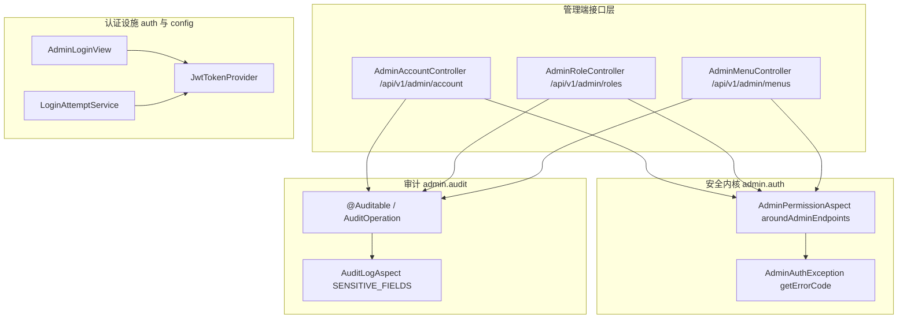
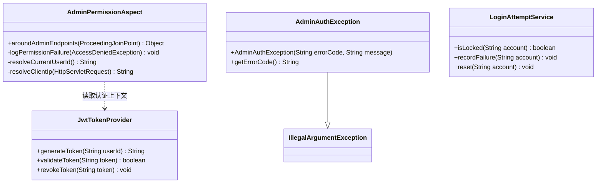
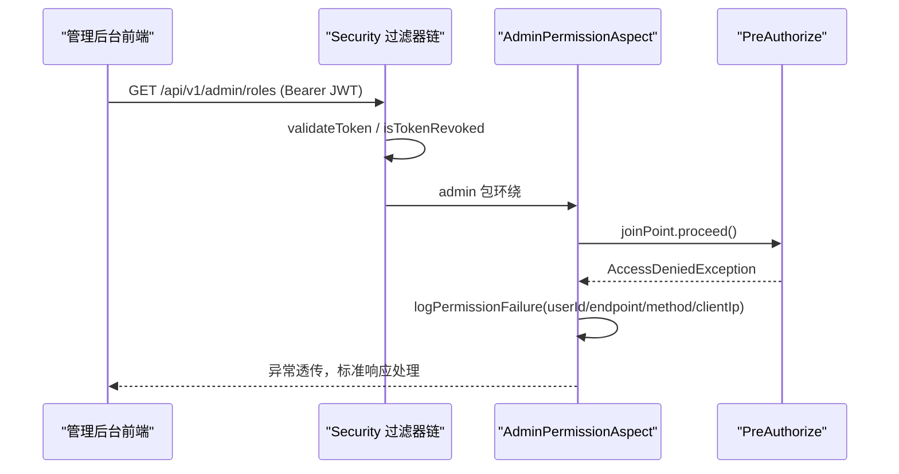
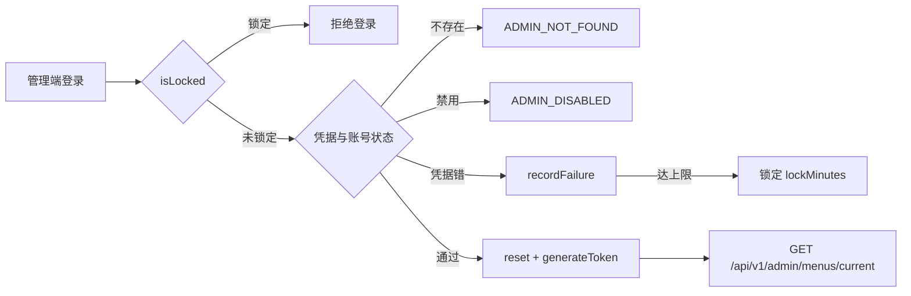
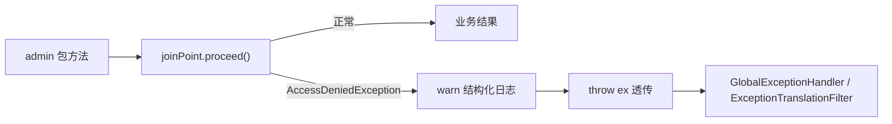
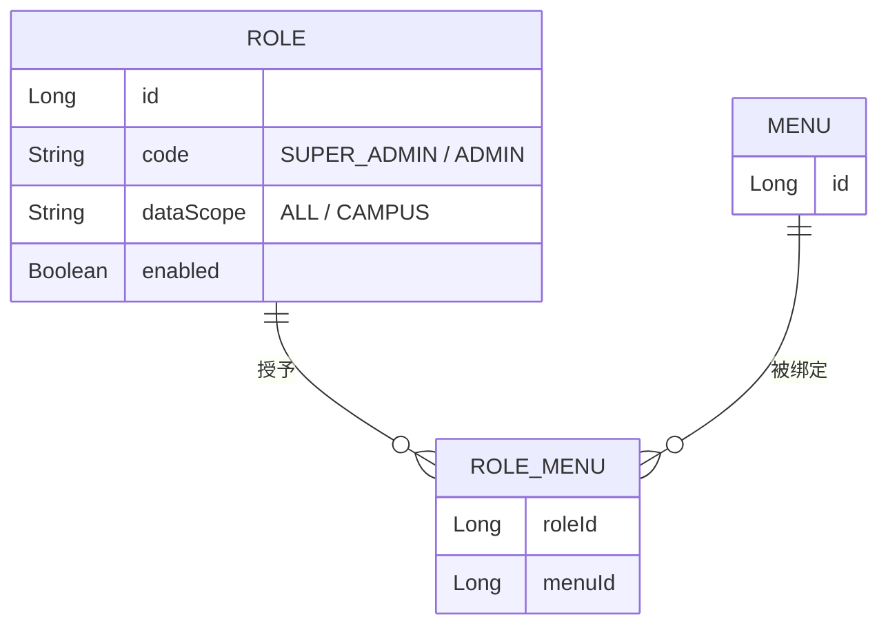
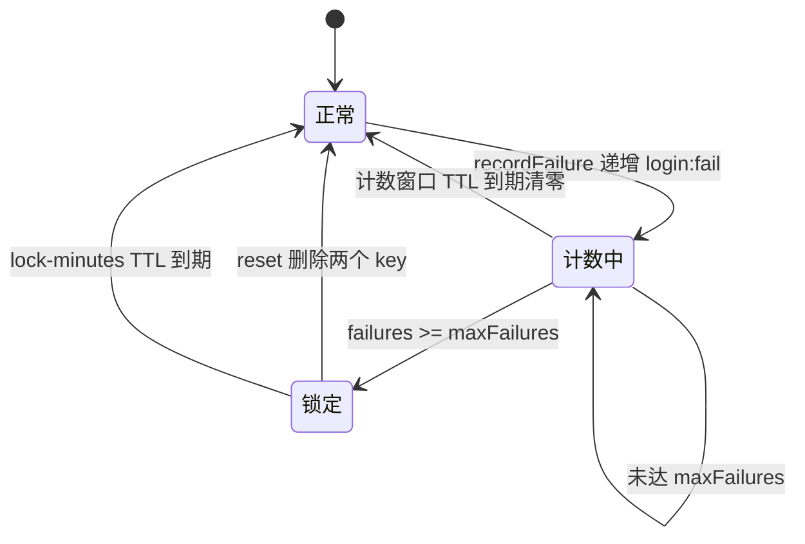
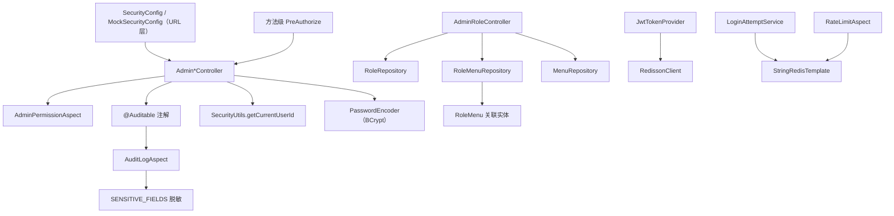

# 管理员认证与安全

<cite>
**本文引用的文件**
- [AdminAuthException.java](file://apps/api/src/main/java/com/campuslove/api/admin/auth/AdminAuthException.java)
- [AdminPermissionAspect.java](file://apps/api/src/main/java/com/campuslove/api/admin/auth/AdminPermissionAspect.java)
- [AdminAccountController.java](file://apps/api/src/main/java/com/campuslove/api/admin/AdminAccountController.java)
- [AdminRoleController.java](file://apps/api/src/main/java/com/campuslove/api/admin/AdminRoleController.java)
- [AdminMenuController.java](file://apps/api/src/main/java/com/campuslove/api/admin/AdminMenuController.java)
- [Auditable.java](file://apps/api/src/main/java/com/campuslove/api/admin/audit/Auditable.java)
- [AuditOperation.java](file://apps/api/src/main/java/com/campuslove/api/admin/audit/AuditOperation.java)
- [AuditLogAspect.java](file://apps/api/src/main/java/com/campuslove/api/admin/audit/AuditLogAspect.java)
- [AdminLoginView.java](file://apps/api/src/main/java/com/campuslove/api/auth/AdminLoginView.java)
- [LoginAttemptService.java](file://apps/api/src/main/java/com/campuslove/api/auth/LoginAttemptService.java)
- [TokenBlacklistService.java](file://apps/api/src/main/java/com/campuslove/api/auth/TokenBlacklistService.java)
- [InvalidTokenException.java](file://apps/api/src/main/java/com/campuslove/api/auth/InvalidTokenException.java)
- [JwtTokenProvider.java](file://apps/api/src/main/java/com/campuslove/api/config/JwtTokenProvider.java)
- [RateLimitAspect.java](file://apps/api/src/main/java/com/campuslove/api/ratelimit/RateLimitAspect.java)
- [AdminVillagePostController.java](file://apps/api/src/main/java/com/campuslove/api/admin/AdminVillagePostController.java)
</cite>

## 目录
1. [简介](#简介)
2. [项目结构](#项目结构)
3. [核心组件](#核心组件)
4. [架构总览](#架构总览)
5. [详细组件分析](#详细组件分析)
6. [RBAC 权限模型与菜单权限控制](#rbac-权限模型与菜单权限控制)
7. [登录认证与会话管理](#登录认证与会话管理)
8. [安全防护与操作审计](#安全防护与操作审计)
9. [安全设计模式与最佳实践](#安全设计模式与最佳实践)
10. [配置与开关](#配置与开关)
11. [依赖关系分析](#依赖关系分析)
12. [性能考虑](#性能考虑)
13. [故障排查指南](#故障排查指南)
14. [能力缺口登记](#能力缺口登记)
15. [结论](#结论)

## 简介
本页文档化 `com.campuslove.api.admin` 与 `com.campuslove.api.admin.auth` 两包构成的管理后台认证与安全能力，四条主线：

- 身份验证：登录响应结构由 `AdminLoginView`（内嵌 `AdminUserInfo`）承载；令牌签发、解析、作用域与吊销集中在 `JwtTokenProvider`（`generateToken`、`generateMediaToken`、`getTokenScope`、`getUserIdFromToken`、`validateToken`、`isTokenValid`、`revokeToken`、`isTokenRevoked`、`cleanupExpiredRevokedTokens`）。
- 访问控制：`AdminPermissionAspect`（`@Aspect @Component @Profile("real")`）以 `aroundAdminEndpoints(ProceedingJoinPoint joinPoint)` 环绕 admin 包全部方法，把越权尝试记录为结构化 warn 日志；业务失败语义由 `AdminAuthException` 携带 `getErrorCode()` 返回标准错误码。
- 管理入口：`AdminAccountController`（`/api/v1/admin/account`）、`AdminRoleController`（`/api/v1/admin/roles`）、`AdminMenuController`（`/api/v1/admin/menus`）。
- 登录安全：`LoginAttemptService` 做账号维度防爆破，`RateLimitAspect` 做 IP 维度限流，`TokenBlacklistService` 与 `InvalidTokenException` 承担令牌失效与非法令牌拒绝。

事实包与本页取证未覆盖的能力统一登记在「能力缺口登记」，不做推测性描述。

**章节来源**
- [AdminPermissionAspect.java:41-73](file://apps/api/src/main/java/com/campuslove/api/admin/auth/AdminPermissionAspect.java#L41-L73)
- [AdminAuthException.java:22-61](file://apps/api/src/main/java/com/campuslove/api/admin/auth/AdminAuthException.java#L22-L61)
- [LoginAttemptService.java:29-108](file://apps/api/src/main/java/com/campuslove/api/auth/LoginAttemptService.java#L29-L108)

## 项目结构
- `admin/`：管理端控制器（账户、角色、菜单）。
- `admin/auth/`：安全内核，切面 `AdminPermissionAspect` 与异常 `AdminAuthException`。
- `admin/audit/`：审计三件套 `Auditable`、`AuditOperation`、`AuditLogAspect`。
- `auth/`：登录与会话设施 `AdminLoginView`、`LoginAttemptService`、`TokenBlacklistService`、`InvalidTokenException`。
- `config/`：`JwtTokenProvider` 令牌生命周期。

**章节来源**
- [AdminPermissionAspect.java:41-64](file://apps/api/src/main/java/com/campuslove/api/admin/auth/AdminPermissionAspect.java#L41-L64)
- [AdminAccountController.java:57-62](file://apps/api/src/main/java/com/campuslove/api/admin/AdminAccountController.java#L57-L62)
- [AdminRoleController.java:55-59](file://apps/api/src/main/java/com/campuslove/api/admin/AdminRoleController.java#L55-L59)

## 核心组件
- AdminPermissionAspect：切点 `execution(* com.campuslove.api.admin..*(..))`，类注释自述为 `@PreAuthorize("hasRole('ADMIN')")` 与 SecurityConfig URL 层 `hasRole("ADMIN")` 之外的第三层权限防线，策略是记录不拦截。
- AdminAuthException：`extends IllegalArgumentException`，`final String errorCode` + `getErrorCode()`，两个构造器。
- 三个控制器：账户自助改密、角色 CRUD 与角色-菜单授权、菜单树维护；嵌套类型 `ChangePasswordRequest`、`AdminRoleRequest`、`AdminRoleView`、`MenuTreeNode`、`MenuDetailView`、`MenuRequest`。
- JwtTokenProvider：`@Component`，持有 `RedissonClient`，覆盖签发/解析/校验/作用域/吊销。
- LoginAttemptService：`@Service`，`isLocked` / `recordFailure` / `reset`，Redis key 前缀 `login:fail:` 与 `login:lock:`。
- AdminLoginView / AdminUserInfo 与 TokenBlacklistService / InvalidTokenException：登录响应体与令牌失效侧设施。

切面自身不签发也不校验签名，只在 `proceed()` 抛出权限异常时记录并透传；异常侧只承载错误码，HTTP 状态映射交由 `GlobalExceptionHandler`。

**章节来源**
- [AdminPermissionAspect.java:16-40](file://apps/api/src/main/java/com/campuslove/api/admin/auth/AdminPermissionAspect.java#L16-L40)
- [AdminAuthException.java:22-51](file://apps/api/src/main/java/com/campuslove/api/admin/auth/AdminAuthException.java#L22-L51)
- [JwtTokenProvider.java:37-99](file://apps/api/src/main/java/com/campuslove/api/config/JwtTokenProvider.java#L37-L99)

## 架构总览
一次管理端请求穿过四道判定：URL 级角色匹配、方法级 `@PreAuthorize`、切面兜底记录、业务层的账户状态检查。

**图表来源**
- [AdminPermissionAspect.java:63-100](file://apps/api/src/main/java/com/campuslove/api/admin/auth/AdminPermissionAspect.java#L63-L100)
- [LoginAttemptService.java:61-101](file://apps/api/src/main/java/com/campuslove/api/auth/LoginAttemptService.java#L61-L101)
- [AdminRoleController.java:55-98](file://apps/api/src/main/java/com/campuslove/api/admin/AdminRoleController.java#L55-L98)

## 详细组件分析

### AdminPermissionAspect：权限兜底切面
注解 `@Aspect @Component @Profile("real")`；环绕方法体只有 try/catch——`joinPoint.proceed()` 正常返回业务结果，捕获 `org.springframework.security.access.AccessDeniedException` 后先 `logPermissionFailure(ex)` 再 `throw ex`。类注释说明 Spring Security 6 的 `AuthorizationDeniedException` 是其子类，因此同一 catch 可覆盖 `@PreAuthorize` 的拒绝，且切面在 `@PreAuthorize` 之后执行。

warn 模板：`Admin 权限校验失败: userId={}, endpoint={}, method={}, clientIp={}, exception={}`。字段来源：`resolveCurrentUserId()` 取 `SecurityContextHolder` 的 principal，未认证或解析异常回退常量 `UNKNOWN_USER = "anonymous"`；`resolveCurrentRequest()` 经 `RequestContextHolder` 取 `ServletRequestAttributes`，非 HTTP 上下文时 endpoint 落为字面量 `unknown`（源码注释 infra R2-00231 记录了曾误用 `UNKNOWN_IP` 常量名的修正）、`httpMethod` 落为 `"UNKNOWN"`；`resolveClientIp(request)` 按 `X-Forwarded-For` → `X-Real-IP` → `Proxy-Client-IP` → `WL-Proxy-Client-IP` → `getRemoteAddr()` 逐级回退，多级代理取逗号分隔第一个并 `trim()`。mock profile 下控制器与切面都不加载。

**章节来源**
- [AdminPermissionAspect.java:41-51](file://apps/api/src/main/java/com/campuslove/api/admin/auth/AdminPermissionAspect.java#L41-L51)
- [AdminPermissionAspect.java:63-100](file://apps/api/src/main/java/com/campuslove/api/admin/auth/AdminPermissionAspect.java#L63-L100)
- [AdminPermissionAspect.java:107-137](file://apps/api/src/main/java/com/campuslove/api/admin/auth/AdminPermissionAspect.java#L107-L137)

### AdminAuthException：错误码契约
`extends IllegalArgumentException`，`serialVersionUID = 1L`，构造器 `(errorCode, message)` 与 `(errorCode, message, cause)`，`getErrorCode()` 返回标准码。注释给出四个取值：`ADMIN_DISABLED`（已禁用）、`ADMIN_NOT_FOUND`（不存在）、`INVALID_CREDENTIALS`（凭据无效）、`UNAUTHORIZED`（未认证或缺权限），并说明同时用于响应体与日志检索。继承 `IllegalArgumentException` 是为兼容历史登录校验路径与 `RealAuthServiceTest` 的 `assertThrows(IllegalArgumentException.class, ...)` 断言；注释显式指向 `com.campuslove.api.config.GlobalExceptionHandler` 作为响应转换点。`InvalidTokenException` 采用同样的 `getErrorCode()` 形态。

**章节来源**
- [AdminAuthException.java:1-21](file://apps/api/src/main/java/com/campuslove/api/admin/auth/AdminAuthException.java#L1-L21)
- [AdminAuthException.java:22-61](file://apps/api/src/main/java/com/campuslove/api/admin/auth/AdminAuthException.java#L22-L61)
- [InvalidTokenException.java:19-50](file://apps/api/src/main/java/com/campuslove/api/auth/InvalidTokenException.java#L19-L50)

### AdminAccountController：管理员自助改密
注解 `@Profile("real") @RestController @RequestMapping("/api/v1/admin/account") @PreAuthorize("hasRole('ADMIN')") @Validated`，注入 `UserRepository` 与 `PasswordEncoder`。唯一端点 `POST /change-password` 标注 `@Transactional` 与 `@Auditable(value = AuditOperation.CHANGE_PASSWORD, targetType = "ACCOUNT", description = "管理员修改自身密码")`。顺序：`SecurityUtils.getCurrentUserId()` 取当前 ID（请求体不含目标用户）→ 新密码长度显式校验 `< 6 || > 64` 抛 `ErrorMessages.NEW_PASSWORD_LENGTH_INVALID`（与 `@Size` 双保险）→ `findById` 为空则 warn `修改密码失败：管理员账号不存在` 并抛 `ErrorMessages.ADMIN_ACCOUNT_NOT_FOUND` → 哈希为 null/空白或 `!passwordEncoder.matches(req.oldPassword(), storedHash)` 时 warn `旧密码错误` 并抛 `ErrorMessages.OLD_PASSWORD_WRONG`（注释说明历史明文遗留同样拒绝，强制重建哈希）→ `encode` 写回、`setUpdatedAt(LocalDateTime.now(TimeZones.BUSINESS))`、`save`，info `管理员修改密码成功` 后返回 `ApiResponse.ok(Map.of("success", true))`。

`record ChangePasswordRequest` 约束：旧密码 `@NotBlank(OLD_PASSWORD_REQUIRED)` + `@Size(max = 128, OLD_PASSWORD_MAX_LENGTH)`，新密码 `@NotBlank(NEW_PASSWORD_REQUIRED)` + `@Size(min = 6, max = 64, NEW_PASSWORD_LENGTH_INVALID)`。注释记录 R4-00389 起放开 `hasRole('SUPER_ADMIN')`，校区管理员可自助改密，防越权依赖旧密码匹配；password 字段由 `AuditLogAspect` 的 `SENSITIVE_FIELDS`（含 `password`/`oldpassword`/`newpassword`）在写入审计前脱敏。

**章节来源**
- [AdminAccountController.java:29-62](file://apps/api/src/main/java/com/campuslove/api/admin/AdminAccountController.java#L29-L62)
- [AdminAccountController.java:88-127](file://apps/api/src/main/java/com/campuslove/api/admin/AdminAccountController.java#L88-L127)
- [AdminAccountController.java:130-141](file://apps/api/src/main/java/com/campuslove/api/admin/AdminAccountController.java#L130-L141)

### AdminRoleController：角色与角色-菜单授权
注解 `@RestController @RequestMapping("/api/v1/admin/roles") @PreAuthorize("hasRole('SUPER_ADMIN')") @Validated`，注入 `RoleRepository`、`RoleMenuRepository`、`MenuRepository`。核心约束是 `SYSTEM_ROLE_CODES = Set.of("SUPER_ADMIN", "ADMIN")`（R4-00391）与 `assertSystemRoleCode(code)`：集合外编码抛 `IllegalArgumentException`，文案写明鉴权只认 `user.role` 单一来源、自定义编码「创建后对权限无任何作用」。

端点：`GET /` → `listRoles()`（`findAll()` 映射 `AdminRoleView`，无分页）；`GET /{id}`（`@Min(1)`，缺失 404）；`GET /{id}/menus` → `getRoleMenuIds()`，由 `findByRoleId(id)` 取 `rm.getMenu().getId()` 聚合 `Set<Long>`，供分配页初始化勾选态；`POST /` → `createRole(@Valid @RequestBody AdminRoleRequest req)`，编码 `trim().toUpperCase()`、先白名单再 `existsByCode` 判重（400）；`PUT /{id}` → `updateRole(...)`，编码缺省沿用原值、唯一性排除自身；`PUT /{id}/menus` → `assignRoleMenus(id, List<Long> menuIds)`，事务内 `deleteByRoleId(id)` 后按 `findByIdIn(menuIds)` 循环 `new RoleMenu(role, menu)` 保存（全量替换），返回 204；`DELETE /{id}` → `deleteRole()`，内置角色（忽略大小写 `SUPER_ADMIN` / `ADMIN`）返回 409，缺失 404，成功 204。所有端点首行调用 `SecurityUtils.getCurrentUserId()`；写操作标注 `@Auditable(CREATE_ROLE / UPDATE_ROLE / ASSIGN_ROLE_MENU / DELETE_ROLE, targetType = "ROLE")`。`applyRequest` 仅在字段非 null 时覆盖（`name`/`description` `trim()`，`dataScope` `trim().toUpperCase()`，`enabled` 直接赋值），`AdminRoleRequest` 注释给出 `dataScope` 取值 `ALL / CAMPUS`。

**章节来源**
- [AdminRoleController.java:55-90](file://apps/api/src/main/java/com/campuslove/api/admin/AdminRoleController.java#L55-L90)
- [AdminRoleController.java:97-136](file://apps/api/src/main/java/com/campuslove/api/admin/AdminRoleController.java#L97-L136)
- [AdminRoleController.java:144-202](file://apps/api/src/main/java/com/campuslove/api/admin/AdminRoleController.java#L144-L202)

### AdminMenuController：菜单树与当前可见菜单
注解 `@RestController @RequestMapping("/api/v1/admin/menus")`。已取证端点：`GET /current` → `getCurrentMenus()`（当前管理员可见菜单，供侧边栏）、`GET /` → `listMenus()`、`GET /{id}`、`POST /` → `createMenu(@Valid @RequestBody MenuRequest req)`、`PUT /{id}`、`DELETE /{id}`；三个写端点分别标注 `@Auditable(CREATE_MENU / UPDATE_MENU / DELETE_MENU, targetType = "MENU")`（L145、L189、L227）。类型：`MenuTreeNode`（L406）、`MenuDetailView`（L424）、`MenuRequest`（L454）。类内声明 `private boolean autoGrantAdminToNewMenu`（L82），字段名指示语义为「新建菜单自动授予 ADMIN」，配置键与生效分支未取证。角色与菜单经 `RoleMenu` 建立多对多：读路径 `findByRoleId` → `getMenu().getId()`，写路径 `deleteByRoleId` + `findByIdIn` + 逐条 save。

**章节来源**
- [AdminMenuController.java:66-82](file://apps/api/src/main/java/com/campuslove/api/admin/AdminMenuController.java#L66-L82)
- [AdminMenuController.java:102-147](file://apps/api/src/main/java/com/campuslove/api/admin/AdminMenuController.java#L102-L147)
- [AdminMenuController.java:186-227](file://apps/api/src/main/java/com/campuslove/api/admin/AdminMenuController.java#L186-L227)

## RBAC 权限模型与菜单权限控制
本页可见的 RBAC 是「三层收敛」而非通用 RBAC 全量实现：

1. URL 层：`SecurityConfig` 在 real 模式下把 `/api/v1/admin/**` 限定为 ADMIN 可访问（结论来自 `AdminAccountController` 的权限说明注释）。
2. 方法层：控制器级 `@PreAuthorize`，已取证取值为 `hasRole('ADMIN')`（自助改密）与 `hasRole('SUPER_ADMIN')`（角色管理），构成「普通管理员自助操作 / 超管管理权限本身」的分级。
3. 切面层：`AdminPermissionAspect` 在 admin 包全域兜底记录越权尝试。

第四层是前端可达性：`GET /api/v1/admin/menus/current` 决定当前管理员可见菜单，`PUT /api/v1/admin/roles/{id}/menus` 决定角色-菜单绑定，`autoGrantAdminToNewMenu` 决定新菜单是否自动进入 ADMIN 可见集合。边界必须记录：角色编码被 `SYSTEM_ROLE_CODES` 限定为两个值，菜单绑定只影响界面可见性与后台数据，不会让第三个自定义角色获得任何鉴权效果。细粒度控制真实落在「菜单可见性 + `dataScope`（ALL / CAMPUS）」，源码中未见按钮级/权限字符串（如 `perm:sys:user:edit`）的实现证据。

**章节来源**
- [AdminAccountController.java:40-47](file://apps/api/src/main/java/com/campuslove/api/admin/AdminAccountController.java#L40-L47)
- [AdminRoleController.java:55-90](file://apps/api/src/main/java/com/campuslove/api/admin/AdminRoleController.java#L55-L90)
- [AdminRoleController.java:211-237](file://apps/api/src/main/java/com/campuslove/api/admin/AdminRoleController.java#L211-L237)

## 登录认证与会话管理
登录成功后返回 `AdminLoginView`，内嵌 `AdminUserInfo` 承载身份摘要；令牌由 `JwtTokenProvider`（`@Component`）负责全生命周期：签发 `generateToken(String userId)` 与面向媒体域的 `generateMediaToken(String userId)`（二者并存说明存在作用域区分）、解析 `getUserIdFromToken` / `getJtiFromToken` / `getExpirationFromToken` / `getRemainingTtlSeconds`、校验 `validateToken` / `isTokenValid`、作用域 `getTokenScope`、吊销 `revokeToken` / `isTokenRevoked` / `cleanupExpiredRevokedTokens`，并由字段 `RedissonClient redissonClient`（L78）与 `TokenBlacklistService` 承担黑名单存储侧能力。

会话可用性策略集中在 `LoginAttemptService`：按账号（手机号或管理员用户名）在 Redis 计数，key 前缀 `login:fail:{account}` 与 `login:lock:{account}`。

行为细节：首次失败对 `login:fail` 设 TTL（等于 `lockMinutes`），窗口内未凑满即自动清零；达上限写 `login:lock`（值 `"1"`，TTL `lockMinutes` 分钟）并删除计数 key；三个方法对 `account == null || account.isBlank() || redisTemplate == null` 一律短路，因此 mock/单测无 Redis 时锁定静默失效；Redis 抛 `RuntimeException` 时 fail-open 记录 warn 并放行（注释对比资金类风控 strict/fail-closed，此处可用性优先，因 IP 限流仍生效）；日志以 `account=***` 输出不落账号明文。

**章节来源**
- [JwtTokenProvider.java:37-99](file://apps/api/src/main/java/com/campuslove/api/config/JwtTokenProvider.java#L37-L99)
- [JwtTokenProvider.java:128-298](file://apps/api/src/main/java/com/campuslove/api/config/JwtTokenProvider.java#L128-L298)
- [JwtTokenProvider.java:342-387](file://apps/api/src/main/java/com/campuslove/api/config/JwtTokenProvider.java#L342-L387)

## 安全防护与操作审计

### 审计链：@Auditable + AuditOperation + AuditLogAspect
注解 `@Auditable`（`public @interface Auditable`，L30）、枚举 `AuditOperation`（L8）、切面 `AuditLogAspect`（L60），切点为 `@Around("@annotation(auditable)")`（L127），即只对显式标注的写操作生成记录。脱敏：`SENSITIVE_FIELDS`（L65）在 `if (SENSITIVE_FIELDS.contains(field.toLowerCase()))`（L338）分支按小写字段名匹配后脱敏。

按各控制器注解取值可归纳审计覆盖面（均为真实 `AuditOperation.*` 常量）：账户 `CHANGE_PASSWORD`；角色 `CREATE_ROLE` / `UPDATE_ROLE` / `DELETE_ROLE` / `ASSIGN_ROLE_MENU`；菜单 `CREATE_MENU` / `UPDATE_MENU` / `DELETE_MENU`；用户 `CREATE_USER`；在线会话 `KICK_ONLINE_USER`；内容 `AUDIT_POST` / `DELETE_POST` / `PIN_POST` / `UNPIN_POST` / `PIN_TOPIC` / `UNPIN_TOPIC`（示例位置 [AdminVillagePostController.java:210](file://apps/api/src/main/java/com/campuslove/api/admin/AdminVillagePostController.java#L210)）；圈子 `CREATE_CIRCLE` / `UPDATE_CIRCLE` / `DELETE_CIRCLE`；活动 5 个；商城 5 个；优惠码 2 个；字典 6 个；学校 4 个；敏感词 `ADD_SENSITIVE_WORD` / `DELETE_SENSITIVE_WORD`；实名 `REVIEW_CERTIFICATION`；举报 `HANDLE_REPORT`；钱包 `ADJUST_WALLET`；媒体 `AUDIT_MEDIA_ASSET`；通知配置 `UPDATE_NOTIFY_CONFIG`。每条注解同时携带 `targetType`（`ROLE`、`MENU`、`ACCOUNT`、`POST`、`USER` 等），构成「操作类型 + 目标类型」二元定位用于追溯。

### 越权与爆破防护
越权尝试由切面 warn 落盘并透传；账号爆破由 `LoginAttemptService` 锁定补齐「换出口 IP 继续撞库」的缺口；IP 维度由 `RateLimitAspect` 的 `@Around("@annotation(rateLimit)")`（L162）负责，`LoginAttemptService` 注释把它描述为第一层。越权改密由「只取当前用户 + 旧密码 BCrypt 匹配」阻断；内置角色删除返回 409；非系统编码被 `assertSystemRoleCode` 拒绝；`@Profile("real")` 隔离 mock（注释说明 mock 由 `MockSecurityConfig` 全部放行）。

**章节来源**
- [AuditOperation.java:8-8](file://apps/api/src/main/java/com/campuslove/api/admin/audit/AuditOperation.java#L8-L8)
- [Auditable.java:15-30](file://apps/api/src/main/java/com/campuslove/api/admin/audit/Auditable.java#L15-L30)
- [AuditLogAspect.java:60-65](file://apps/api/src/main/java/com/campuslove/api/admin/audit/AuditLogAspect.java#L60-L65)

## 安全设计模式与最佳实践
- 纵深防御且兜底不拦截：URL + 方法 + 包级切面三层，切面只记录与透传，避免第二套判定逻辑与主流程抢结论。
- 错误码契约化：异常携带 `errorCode`，由 `GlobalExceptionHandler` 统一转响应，前端与日志共享码表。
- 兼容性继承：新异常继承 `IllegalArgumentException`，旧断言无需修改即可继续约束登录失败语义。
- 白名单式角色编码 + 内置资源保护：`SYSTEM_ROLE_CODES` 拒绝「能创建但不生效」的角色，`deleteRole` 对内置角色返回 409。
- 自我作用域写操作：改密只接受 `SecurityUtils.getCurrentUserId()`，请求体不含目标用户 ID，并以旧密码匹配作二次确认。
- 双维度登录防护与显式可用性权衡：IP 限流叠加账号锁定，Redis 故障时 fail-open 并由注释记录取舍理由。
- 注解驱动横切审计：`@Auditable(value, targetType, description)` 在方法签名处声明，切面统一落审计，业务代码零重复；`SENSITIVE_FIELDS` 集中脱敏，日志侧 `account=***`。
- 全量替换 + 事务原子性：`assignRoleMenus` 先删后插包在 `@Transactional` 内，避免中间态。

扩展约束（与上述模式一致）：新增管理端写操作应同时具备控制器级 `@PreAuthorize`、`@Auditable`、必要时 `@Transactional`、请求体 Bean Validation；新增鉴权角色必须先确认编码进入 `SYSTEM_ROLE_CODES`，否则只有展示效果。

**章节来源**
- [AdminPermissionAspect.java:16-40](file://apps/api/src/main/java/com/campuslove/api/admin/auth/AdminPermissionAspect.java#L16-L40)
- [AdminAuthException.java:1-21](file://apps/api/src/main/java/com/campuslove/api/admin/auth/AdminAuthException.java#L1-L21)
- [AdminRoleController.java:65-90](file://apps/api/src/main/java/com/campuslove/api/admin/AdminRoleController.java#L65-L90)

## 配置与开关
| 配置项 / 开关 | 位置 | 默认值 | 语义 |
| --- | --- | --- | --- |
| `app.security.login-attempt.max-failures` | [LoginAttemptService.java:41-42](file://apps/api/src/main/java/com/campuslove/api/auth/LoginAttemptService.java#L41-L42) | 5（兜底 `APP_LOGIN_ATTEMPT_MAX_FAILURES:5`） | 连续失败上限，达到即锁定 |
| `app.security.login-attempt.lock-minutes` | [LoginAttemptService.java:44-46](file://apps/api/src/main/java/com/campuslove/api/auth/LoginAttemptService.java#L44-L46) | 15（兜底 `APP_LOGIN_ATTEMPT_LOCK_MINUTES:15`） | 锁定时长，同时充当计数窗口 TTL |
| `StringRedisTemplate` | [LoginAttemptService.java:48-53](file://apps/api/src/main/java/com/campuslove/api/auth/LoginAttemptService.java#L48-L53) | `ObjectProvider.getIfAvailable()`，可为 null | 为 null 时锁定静默关闭（fail-open） |
| `@Profile("real")` | [AdminPermissionAspect.java:41-44](file://apps/api/src/main/java/com/campuslove/api/admin/auth/AdminPermissionAspect.java#L41-L44) | — | 仅 real 加载切面与控制器 |
| `autoGrantAdminToNewMenu` | [AdminMenuController.java:82-82](file://apps/api/src/main/java/com/campuslove/api/admin/AdminMenuController.java#L82-L82) | 未取证 | 布尔字段，语义指向新菜单自动授予 ADMIN |
| `RedissonClient` | [JwtTokenProvider.java:78-78](file://apps/api/src/main/java/com/campuslove/api/config/JwtTokenProvider.java#L78-L78) | — | 吊销/黑名单侧分布式客户端 |
| `SYSTEM_ROLE_CODES` | [AdminRoleController.java:65-69](file://apps/api/src/main/java/com/campuslove/api/admin/AdminRoleController.java#L65-L69) | `SUPER_ADMIN`、`ADMIN` | 代码内常量白名单，非配置项 |

改密密码规则属隐式配置：显式校验区间 6-64（[AdminAccountController.java:100-102](file://apps/api/src/main/java/com/campuslove/api/admin/AdminAccountController.java#L100-L102)）与 `@Size(min = 6, max = 64)`（[AdminAccountController.java:136-141](file://apps/api/src/main/java/com/campuslove/api/admin/AdminAccountController.java#L136-L141)）必须一致，旧密码上限 `@Size(max = 128)`。

**章节来源**
- [LoginAttemptService.java:40-53](file://apps/api/src/main/java/com/campuslove/api/auth/LoginAttemptService.java#L40-L53)
- [AdminPermissionAspect.java:41-44](file://apps/api/src/main/java/com/campuslove/api/admin/auth/AdminPermissionAspect.java#L41-L44)
- [AdminRoleController.java:65-69](file://apps/api/src/main/java/com/campuslove/api/admin/AdminRoleController.java#L65-L69)

## 依赖关系分析
依赖方向单向：控制器依赖仓储与工具类，切面依赖 Spring 上下文与 Servlet API，审计切面依赖注解本身。

- `AdminRoleController` 持有三个仓储，是依赖最重的管理接口，因此删除与菜单绑定必须在事务内完成；`AdminAccountController` 不依赖角色仓储，权限判定完全交给注解与切面。
- `AdminPermissionAspect`（按包名匹配）与 `AuditLogAspect`（按注解匹配）互不依赖，同一方法被两层环绕但职责不重叠。
- `LoginAttemptService` 与 `RateLimitAspect` 是账号维度与 IP 维度的两条独立防线；`JwtTokenProvider` 是令牌侧唯一被文档化的入口。

**章节来源**
- [AdminPermissionAspect.java:63-63](file://apps/api/src/main/java/com/campuslove/api/admin/auth/AdminPermissionAspect.java#L63-L63)
- [AuditLogAspect.java:127-127](file://apps/api/src/main/java/com/campuslove/api/admin/audit/AuditLogAspect.java#L127-L127)
- [AdminAccountController.java:66-72](file://apps/api/src/main/java/com/campuslove/api/admin/AdminAccountController.java#L66-L72)

## 性能考虑
- 全量替换写放大：`assignRoleMenus` 单事务内 `deleteByRoleId` + `findByIdIn` + 循环 `save`，绑定菜单数即单条写入次数，是全量替换与原子性换来的代价。
- 逐行导航与全表读：`getRoleMenuIds` 在 stream 中访问 `rm.getMenu().getId()`；`listRoles` 用 `findAll()` 无分页。
- 审计固定开销：`AuditLogAspect` 在注解切点上逐字段处理并做 `SENSITIVE_FIELDS.contains(field.toLowerCase())` 判定。
- 切面成本：admin 包全部方法被代理环绕，正常路径仅一次 try/catch；header 解析只发生在越权异常路径。
- Redis 操作数：失败登录最多 `increment` +（首次）`expire`，达上限额外 `set` + `delete`；成功登录 2 次 `delete`；`isLocked` 1 次 `hasKey`；TTL 由 Redis 回收。吊销侧存在 `cleanupExpiredRevokedTokens()` 显式清理入口。
- 时间戳统一 `LocalDateTime.now(TimeZones.BUSINESS)`。

**章节来源**
- [AdminRoleController.java:97-136](file://apps/api/src/main/java/com/campuslove/api/admin/AdminRoleController.java#L97-L136)
- [AdminRoleController.java:211-237](file://apps/api/src/main/java/com/campuslove/api/admin/AdminRoleController.java#L211-L237)
- [AuditLogAspect.java:338-338](file://apps/api/src/main/java/com/campuslove/api/admin/audit/AuditLogAspect.java#L338-L338)

## 故障排查指南
| 现象 | 首查位置 | 判定依据 |
| --- | --- | --- |
| 403 且日志无 `Admin 权限校验失败` | profile 与所在包 | 切面仅 real 生效；mock 下 `MockSecurityConfig` 全部放行，越权不留痕 |
| 403 日志无法定位操作者 | `userId` / `clientIp` | 未认证固定输出 `anonymous`；`clientIp` 依赖 `X-Forwarded-For` 等头，全缺失为 `unknown` |
| 改密参数错误 | 新密码长度 | `< 6 || > 64` → `ErrorMessages.NEW_PASSWORD_LENGTH_INVALID`，需与 `@Size` 一致 |
| 改密提示旧密码错误 | `passwordEncoder.matches` | 存储哈希 null/空白同样判定 `OLD_PASSWORD_WRONG`（明文遗留需重建哈希） |
| 改密提示账号不存在 | `userRepository.findById` | 空则 `ADMIN_ACCOUNT_NOT_FOUND` |
| 创建角色 400 / 抛异常 | 编码重复 / 白名单 | `existsByCode` 命中 400；`assertSystemRoleCode` 只允许两个编码 |
| 删除角色 409 | 是否内置角色 | code 忽略大小写等于 `SUPER_ADMIN` 或 `ADMIN` 时禁止 |
| 菜单绑定后权限未变 | 绑到哪个角色 | 鉴权只认 `user.role`，其他编码的绑定不产生鉴权效果 |
| 锁定不生效或无法解除 | Redis 与 TTL | `redisTemplate` 为 null 直接返回 false；异常走 fail-open；`login:lock` TTL 即 `lockMinutes`（默认 15 分钟） |
| 审计日志出现密码痕迹 | `SENSITIVE_FIELDS` | 按 `field.toLowerCase()` 命中，字段名大小写影响结果 |
| 审计记录缺失 | 是否标注 `@Auditable` | 切点为 `@annotation(auditable)`，未标注不生成记录 |

排查顺序：先确认 profile 为 real，再核对控制器 `@PreAuthorize` 所需角色（`ADMIN` 还是 `SUPER_ADMIN`），然后检查 `user.role` 是否落在 `SYSTEM_ROLE_CODES`，最后看 Redis 侧吊销与锁定状态。

**章节来源**
- [AdminPermissionAspect.java:90-100](file://apps/api/src/main/java/com/campuslove/api/admin/auth/AdminPermissionAspect.java#L90-L100)
- [AdminPermissionAspect.java:107-167](file://apps/api/src/main/java/com/campuslove/api/admin/auth/AdminPermissionAspect.java#L107-L167)
- [AdminAccountController.java:96-127](file://apps/api/src/main/java/com/campuslove/api/admin/AdminAccountController.java#L96-L127)

## 能力缺口登记
取证范围限于 `admin`、`admin/auth`、`admin/audit`、`auth`、`config/JwtTokenProvider` 与事实包所列文件。以下能力在当前材料中**无实现证据或未被打开**，本页只登记不描述：

1. 管理端登录端点：只取到视图 `AdminLoginView` / `AdminUserInfo` 的类型声明，没有登录控制器的方法、参数与 URL 证据。
2. `SecurityConfig` / `MockSecurityConfig` 本体：URL 层「`/api/v1/admin/**` 仅 ADMIN（real）」与「mock 全放行」两条结论来自控制器注释转述。
3. `GlobalExceptionHandler` 对 `AdminAuthException` 的处理：错误码到 HTTP 状态与响应体字段的映射未取证。
4. 审计落库侧：三个审计类型已确认存在，但审计记录实体类、数据表 DDL、仓储写入、保留策略与是否异步落库均未取证（注释出现「异步记录审计」表述，无实现证据）。
5. 审计日志的查询/导出接口：未见管理端审计列表 API，因此「操作追溯」只能证明有记录，不能证明可查询。
6. 细粒度权限：无按钮级/权限字符串模型证据，粒度止于角色 + 菜单可见性 + `dataScope`。
7. `dataScope`（`ALL` / `CAMPUS`）的实际生效逻辑：仅见字段定义与赋值，未见查询侧数据过滤实现。
8. 会话吊销联动：`revokeToken` / `isTokenRevoked` / `cleanupExpiredRevokedTokens` 与 `TokenBlacklistService` 存在，但「改密后是否吊销既有令牌」无证据；`OnlineUserAdminController` 仅取到 `@Auditable(KICK_ONLINE_USER, targetType = "USER")` 注解行。
9. `autoGrantAdminToNewMenu` 的配置键、默认值与生效分支；`role` / `menu` / `role_menu` 的表结构与索引 DDL。
10. 密码策略仅取到长度 6-64 与 BCrypt，无复杂度、历史密码、有效期/强制改密证据；多因素认证、设备信任、异地登录告警、Web 安全头（CSRF / CORS / HSTS / SameSite）均无实现证据。

上述缺口不改变已描述部分的结论，但意味着「完整的审计追溯闭环」与「细粒度权限控制」目前**不可被文档证实**。

**章节来源**
- [AdminLoginView.java:13-36](file://apps/api/src/main/java/com/campuslove/api/auth/AdminLoginView.java#L13-L36)
- [AdminAuthException.java:1-21](file://apps/api/src/main/java/com/campuslove/api/admin/auth/AdminAuthException.java#L1-L21)
- [AuditOperation.java:8-8](file://apps/api/src/main/java/com/campuslove/api/admin/audit/AuditOperation.java#L8-L8)

## 结论
本仓库的管理员认证与安全由四块可验证能力组成：判定链（URL 角色约束 → 控制器 `@PreAuthorize` 的 `ADMIN` / `SUPER_ADMIN` 分级 → `AdminPermissionAspect` 包级兜底记录，且明确记录不拦截）；凭据与失败控制（BCrypt 旧密码校验 + 6-64 长度约束 + IP 限流 + 账号维度 Redis 锁定，默认 5 次 / 15 分钟、fail-open）；权限数据模型（`Role` / `Menu` / `RoleMenu` 多对多，生效编码被 `SYSTEM_ROLE_CODES` 收敛为两个，菜单绑定控制界面可达性，`dataScope` 预留 ALL / CAMPUS 语义）；追溯与错误契约（`@Auditable` + `AuditOperation` + `AuditLogAspect` 覆盖账户、角色、菜单、内容、活动、商城、字典、学校、举报、钱包等写操作，`SENSITIVE_FIELDS` 阻断凭据入审计，`AdminAuthException` 以四个标准码对接 `GlobalExceptionHandler`）。

边界同样明确：审计的存储与查询侧、`dataScope` 的实际过滤、改密后的令牌吊销联动均无实现证据，当前状态应描述为「具备完整的鉴权判定与审计记录能力，尚缺可证实的审计追溯闭环与细粒度权限模型」。新增管理端能力应沿用「`@PreAuthorize` + `@Auditable` + Bean Validation + 事务」四件套，并把新角色编码同步进 `SYSTEM_ROLE_CODES`，否则权限不会生效。

**章节来源**
- [AdminPermissionAspect.java:16-40](file://apps/api/src/main/java/com/campuslove/api/admin/auth/AdminPermissionAspect.java#L16-L40)
- [AdminAccountController.java:40-62](file://apps/api/src/main/java/com/campuslove/api/admin/AdminAccountController.java#L40-L62)
- [AdminRoleController.java:55-90](file://apps/api/src/main/java/com/campuslove/api/admin/AdminRoleController.java#L55-L90)
