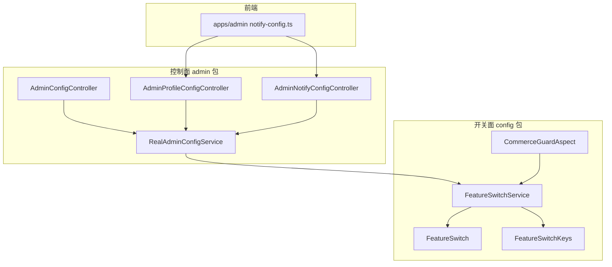
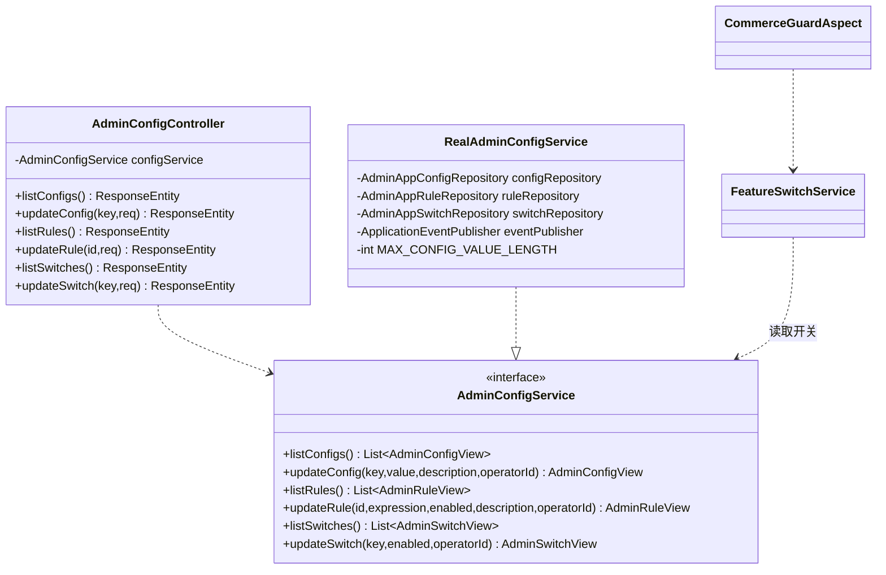
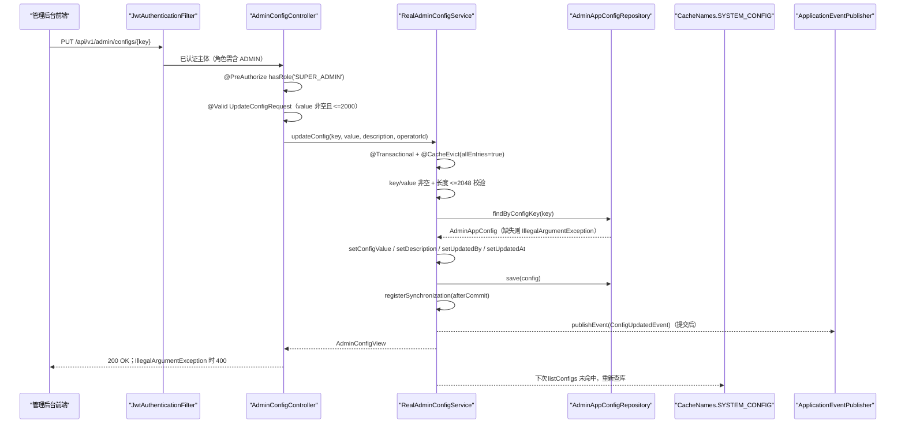
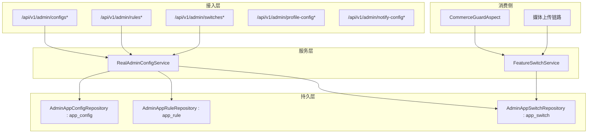
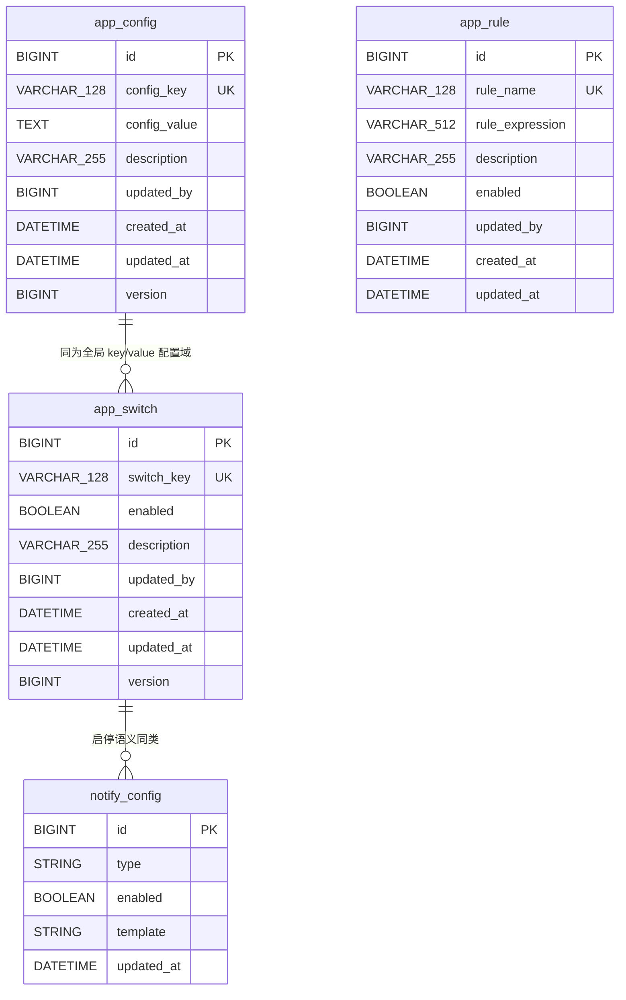
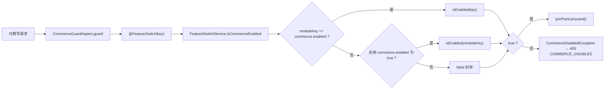
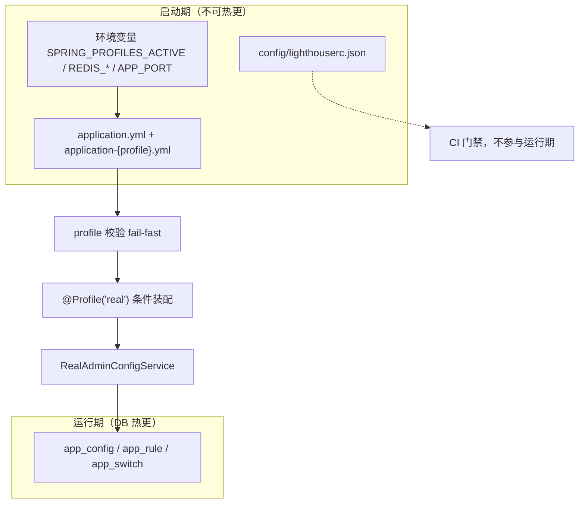
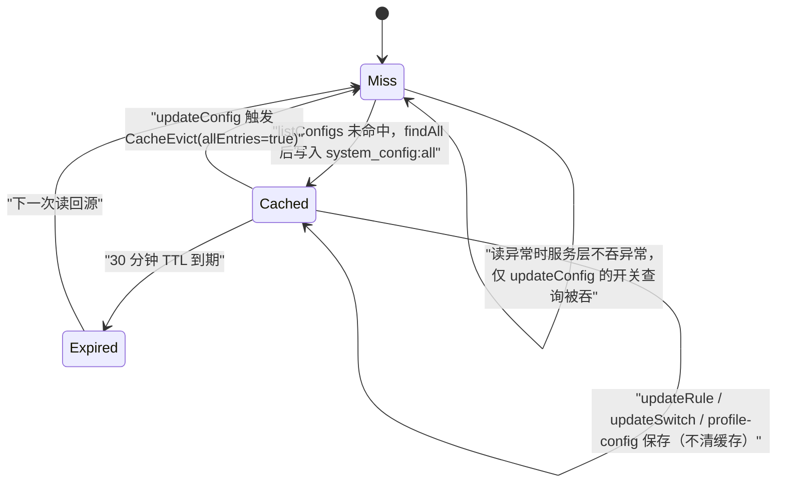
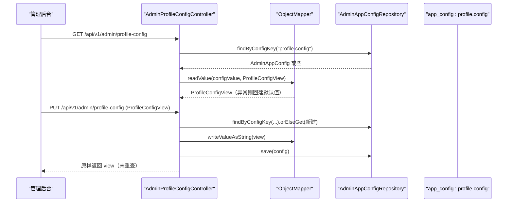

# 系统配置管理

<cite>
**本文引用的文件**
- [AdminConfigController.java](file://apps/api/src/main/java/com/campuslove/api/admin/AdminConfigController.java)
- [RealAdminConfigService.java](file://apps/api/src/main/java/com/campuslove/api/admin/RealAdminConfigService.java)
- [AdminProfileConfigController.java](file://apps/api/src/main/java/com/campuslove/api/admin/AdminProfileConfigController.java)
- [AdminNotifyConfigController.java](file://apps/api/src/main/java/com/campuslove/api/admin/AdminNotifyConfigController.java)
- [AdminConfigView.java](file://apps/api/src/main/java/com/campuslove/api/admin/AdminConfigView.java)
- [AdminRuleView.java](file://apps/api/src/main/java/com/campuslove/api/admin/AdminRuleView.java)
- [AdminSwitchView.java](file://apps/api/src/main/java/com/campuslove/api/admin/AdminSwitchView.java)
- [ConfigUpdatedEvent.java](file://apps/api/src/main/java/com/campuslove/api/admin/event/ConfigUpdatedEvent.java)
- [Auditable.java](file://apps/api/src/main/java/com/campuslove/api/admin/audit/Auditable.java)
- [AuditOperation.java](file://apps/api/src/main/java/com/campuslove/api/admin/audit/AuditOperation.java)
- [FeatureSwitchService.java](file://apps/api/src/main/java/com/campuslove/api/config/FeatureSwitchService.java)
- [FeatureSwitchKeys.java](file://apps/api/src/main/java/com/campuslove/api/config/FeatureSwitchKeys.java)
- [FeatureSwitch.java](file://apps/api/src/main/java/com/campuslove/api/config/FeatureSwitch.java)
- [CommerceGuardAspect.java](file://apps/api/src/main/java/com/campuslove/api/config/CommerceGuardAspect.java)
- [CacheNames.java](file://apps/api/src/main/java/com/campuslove/api/config/CacheNames.java)
- [ErrorMessages.java](file://apps/api/src/main/java/com/campuslove/api/common/ErrorMessages.java)
- [JwtAuthenticationFilter.java](file://apps/api/src/main/java/com/campuslove/api/config/JwtAuthenticationFilter.java)
- [AdminAppConfig.java](file://apps/api/src/main/java/com/campuslove/api/entity/AdminAppConfig.java)
- [AdminAppSwitch.java](file://apps/api/src/main/java/com/campuslove/api/entity/AdminAppSwitch.java)
- [ProfileConfigView.java](file://apps/api/src/main/java/com/campuslove/api/profile/ProfileConfigView.java)
- [UserIndexSyncListener.java](file://apps/api/src/main/java/com/campuslove/api/search/UserIndexSyncListener.java)
- [ProductController.java](file://apps/api/src/main/java/com/campuslove/api/shop/ProductController.java)
- [WalletController.java](file://apps/api/src/main/java/com/campuslove/api/wallet/WalletController.java)
- [ConsultingController.java](file://apps/api/src/main/java/com/campuslove/api/consulting/ConsultingController.java)
- [WxPayJsapiService.java](file://apps/api/src/main/java/com/campuslove/api/wxpay/WxPayJsapiService.java)
- [application.yml](file://apps/api/src/main/resources/application.yml)
- [V2026.06.25.0005__create_admin_configs.sql](file://database/flyway/sql/V2026.06.25.0005__create_admin_configs.sql)
- [V2026.09.01.0001__seed_commerce_switches.sql](file://database/flyway/sql/V2026.09.01.0001__seed_commerce_switches.sql)
- [config.ts](file://apps/admin/src/api/config.ts)
- [notify-config.ts](file://apps/admin/src/api/notify-config.ts)
- [profile-tags.ts](file://apps/client/src/config/profile-tags.ts)
- [profile-svg.ts](file://apps/client/src/config/profile-svg.ts)
- [assets-index.ts](file://apps/client/src/config/assets-index.ts)
- [lighthouserc.json](file://config/lighthouserc.json)
</cite>

## 目录
1. [简介](#简介)
2. [项目结构](#项目结构)
3. [核心组件](#核心组件)
4. [架构总览](#架构总览)
5. [详细组件分析](#详细组件分析)
6. [配置数据模型](#配置数据模型)
7. [功能开关与商用能力守卫](#功能开关与商用能力守卫)
8. [配置文件与环境变量管理](#配置文件与环境变量管理)
9. [配置的动态生效与缓存](#配置的动态生效与缓存)
10. [个人资料配置与通知配置](#个人资料配置与通知配置)
11. [依赖关系分析](#依赖关系分析)
12. [配置安全性与变更审计](#配置安全性与变更审计)
13. [配置模板、批量配置与效果验证](#配置模板批量配置与效果验证)
14. [性能考虑](#性能考虑)
15. [故障排查指南](#故障排查指南)
16. [能力缺口登记](#能力缺口登记)
17. [结论](#结论)

## 简介
系统配置管理是管理后台 API 中负责"运行期可调参数"的一层能力，覆盖三类互不相同的配置对象：

- **键值型系统参数（configs）**：以字符串 key 定位、value 承载任意标量或 JSON 文本，附带描述，由 `AdminConfigController` 的 `GET /api/v1/admin/configs` 与 `PUT /api/v1/admin/configs/{key}` 暴露读写。
- **规则型配置（rules）**：以数值 id 定位，携带表达式（expression）与启用位，对应 `GET /api/v1/admin/rules` 与 `PUT /api/v1/admin/rules/{id}`。
- **功能开关（switches）**：以 key 定位的布尔开关，对应 `GET /api/v1/admin/switches` 与 `PUT /api/v1/admin/switches/{key}`，由 `config` 包内的 `FeatureSwitchService` 读取并作用于业务链路。

在此之外，同一后台域还包含两个专用配置控制器：`AdminProfileConfigController`（挂载 `/api/v1/admin/profile-config`，提供个人资料页配置的读取与整体保存）与 `AdminNotifyConfigController`（挂载 `/api/v1/admin/notify-config`，提供通知配置的列表与批量更新）。三套能力共用 `admin` 包内的视图对象与 `RealAdminConfigService` 这类 `@Service` 实现，读写路径最终落到数据库配置表，并通过事务提交后的回调把新值推送给读侧缓存。

本文所有结论均来自仓库真实源码；catalog 中声明的 `com.campuslove.api.admin.FeatureSwitchService` 在仓库中不存在，功能开关实现的真实位置是 `com.campuslove.api.config.FeatureSwitchService`，正文按真实路径引用。

**章节来源**
- [AdminConfigController.java:42-137](file://apps/api/src/main/java/com/campuslove/api/admin/AdminConfigController.java#L42-L137)
- [AdminProfileConfigController.java:22-52](file://apps/api/src/main/java/com/campuslove/api/admin/AdminProfileConfigController.java#L22-L52)
- [AdminNotifyConfigController.java:43-58](file://apps/api/src/main/java/com/campuslove/api/admin/AdminNotifyConfigController.java#L43-L58)

## 项目结构
配置管理能力在包维度上是"控制面在 admin、开关在 config"的分工：

- `com/campuslove/api/admin/`：控制面。`AdminConfigController` 定义 `/api/v1/admin` 下的 configs / rules / switches 六条路由；`AdminProfileConfigController`、`AdminNotifyConfigController` 各占一条专用前缀；`RealAdminConfigService` 是配置的落地实现；同包还有 `AdminConfigView`、`AdminRuleView`、`AdminSwitchView` 等视图与 `UpdateConfigRequest`、`UpdateRuleRequest`、`UpdateSwitchRequest` 三个请求负载类型。
- `com/campuslove/api/config/`：开关注册表。`FeatureSwitchService` 提供开关读取语义，`FeatureSwitch` 与 `FeatureSwitchKeys` 定义开关本身与键集合，`CommerceGuardAspect` 把开关状态转成对商用接口的拦截。
- `apps/admin/src/api/`：管理后台前端契约。`notify-config.ts` 导出 `NotifyConfigView`、`NotifyConfigUpdateRequest`、`NotifyConfigBatchUpdateRequest` 三个类型与 `listNotifyConfigs`、`updateNotifyConfigs` 两个请求函数。
- `apps/client/src/config/`：客户端侧静态配置（`profile-svg.ts`、`profile-tags.ts`、`assets-index.ts`），与后台动态配置相互独立。



**图表来源**
- [AdminConfigController.java:42-57](file://apps/api/src/main/java/com/campuslove/api/admin/AdminConfigController.java#L42-L57)
- [RealAdminConfigService.java:51-87](file://apps/api/src/main/java/com/campuslove/api/admin/RealAdminConfigService.java#L51-L87)
- [notify-config.ts:29-35](file://apps/admin/src/api/notify-config.ts#L29-L35)

**章节来源**
- [AdminConfigController.java:42-137](file://apps/api/src/main/java/com/campuslove/api/admin/AdminConfigController.java#L42-L137)
- [notify-config.ts:8-35](file://apps/admin/src/api/notify-config.ts#L8-L35)

## 核心组件
- **AdminConfigController**：配置控制面唯一入口。类上同时标注 `@Profile("real")`、`@RestController`、`@RequestMapping("/api/v1/admin")` 与 `@PreAuthorize("hasRole('ADMIN')")`，构造注入 `AdminConfigService` 接口而非实现类；六个方法两两配对形成"读全局、写需更高权限"的格局。
- **AdminConfigService（接口）/ RealAdminConfigService（实现）**：`RealAdminConfigService` 以 `@Profile("real") + @Service` 注册，注入 `AdminAppConfigRepository`、`AdminAppRuleRepository`、`AdminAppSwitchRepository` 与 `ApplicationEventPublisher`，并声明常量 `MAX_CONFIG_VALUE_LENGTH = 2048` 作为服务端配置值长度上限。
- **FeatureSwitchService / FeatureSwitch / FeatureSwitchKeys**：位于 `com.campuslove.api.config` 包，负责开关的注册与读取语义（catalog 声明的 `admin` 包路径在仓库中不存在）。
- **CommerceGuardAspect**：把开关状态转换为对商用接口的运行时拦截，是"开关—行为"闭环的执行端。
- **视图对象**：`AdminConfigView(id, key, value, description, updatedBy, updatedAt)`、`AdminRuleView(id, name, expression, description, enabled, updatedBy, updatedAt)`、`AdminSwitchView(id, key, enabled, description, updatedBy, updatedAt)` 三个 record，由服务层私有方法 `toConfigView` / `toRuleView` / `toSwitchView` 从实体的 `getConfigKey()` / `getConfigValue()` / `getRuleName()` / `getSwitchKey()` 装配而来。
- **请求负载**：同文件末尾的三个 `record`：`UpdateConfigRequest(@NotBlank @Size(max = 2000) String value, @Size(max = 500) String description)`、`UpdateRuleRequest(@Size(max = 2000) String expression, Boolean enabled, @Size(max = 500) String description)`、`UpdateSwitchRequest(@NotNull Boolean enabled)`。
- **专用配置控制器**：`AdminProfileConfigController`（`/api/v1/admin/profile-config`）与 `AdminNotifyConfigController`（`/api/v1/admin/notify-config`）。



**图表来源**
- [AdminConfigController.java:41-157](file://apps/api/src/main/java/com/campuslove/api/admin/AdminConfigController.java#L41-L157)
- [RealAdminConfigService.java:50-253](file://apps/api/src/main/java/com/campuslove/api/admin/RealAdminConfigService.java#L50-L253)

值得记录的一处偏差：类级 Javadoc（L24-L32）列出的接口路径是 `/api/admin/configs` 等历史形式，而实际生效的是 `@RequestMapping("/api/v1/admin")` 拼接出的 `/api/v1/admin/configs`；同时 DTO 上的 `@Size(max = 2000)` 与服务层 `MAX_CONFIG_VALUE_LENGTH = 2048` 构成两道不等长的校验，实际先触发的是更严格的 Bean Validation。

**章节来源**
- [AdminConfigController.java:20-157](file://apps/api/src/main/java/com/campuslove/api/admin/AdminConfigController.java#L20-L157)
- [RealAdminConfigService.java:26-253](file://apps/api/src/main/java/com/campuslove/api/admin/RealAdminConfigService.java#L26-L253)

## 架构总览
配置写入是一条"鉴权 → 校验 → 事务写库 → 缓存失效 → 提交后广播"的链路；配置读取则是"缓存优先 → 全量装配视图"的短路径。



**图表来源**
- [AdminConfigController.java:65-78](file://apps/api/src/main/java/com/campuslove/api/admin/AdminConfigController.java#L65-L78)
- [RealAdminConfigService.java:105-155](file://apps/api/src/main/java/com/campuslove/api/admin/RealAdminConfigService.java#L105-L155)
- [JwtAuthenticationFilter.java:47-115](file://apps/api/src/main/java/com/campuslove/api/config/JwtAuthenticationFilter.java#L47-L115)

分层视角下，三类配置各占一套"仓库 + 实体 + 视图"，但共用同一个服务实例与同一个缓存名：



该图只画到"控制面写、开关面读"这一层：`profile-config` 与 `notify-config` 两条路由在源码中确有独立控制器，但其服务落点与 configs 并非同一实现，具体见"个人资料配置与通知配置"一节。

**章节来源**
- [AdminConfigController.java:41-131](file://apps/api/src/main/java/com/campuslove/api/admin/AdminConfigController.java#L41-L131)
- [RealAdminConfigService.java:59-218](file://apps/api/src/main/java/com/campuslove/api/admin/RealAdminConfigService.java#L59-L218)
- [FeatureSwitchService.java:36-62](file://apps/api/src/main/java/com/campuslove/api/config/FeatureSwitchService.java#L36-L62)

## 详细组件分析

### AdminConfigController：路由清单与权限分层
控制器只有 `AdminConfigService configService` 一个依赖，通过构造注入。类级 `@PreAuthorize("hasRole('ADMIN')")` 给出读权限，三条写路由再各自叠加方法级 `@PreAuthorize("hasRole('SUPER_ADMIN')")`，形成"读 ADMIN、写 SUPER_ADMIN"的双层门槛。

| 方法与路径 | 触发条件 | 返回 | 失败处理 |
|---|---|---|---|
| `GET /api/v1/admin/configs` | ADMIN | `List<AdminConfigView>` | 无 |
| `PUT /api/v1/admin/configs/{key}` | SUPER_ADMIN | `AdminConfigView` | `IllegalArgumentException` → `400` 空响应体 |
| `GET /api/v1/admin/rules` | ADMIN | `List<AdminRuleView>` | 无 |
| `PUT /api/v1/admin/rules/{id}` | SUPER_ADMIN | `AdminRuleView` | `IllegalArgumentException` → `400` 空响应体 |
| `GET /api/v1/admin/switches` | ADMIN | `List<AdminSwitchView>` | 无 |
| `PUT /api/v1/admin/switches/{key}` | SUPER_ADMIN | `AdminSwitchView` | `IllegalArgumentException` → `400` 空响应体 |

三个列表方法都先调用 `SecurityUtils.getCurrentUserId()` 并丢弃返回值，再走服务层；写入方法则把同一调用结果作为 `operatorId` 传入服务，用于落库 `updated_by`。规则更新的 `id` 参数带 `@Positive` 约束，因此 `0` 与负数在绑定阶段即被拒。类级 Javadoc 明确声明这三类配置是"全局资源"，全平台统一生效、不区分校区，故控制面不接入校区数据隔离。

**章节来源**
- [AdminConfigController.java:41-131](file://apps/api/src/main/java/com/campuslove/api/admin/AdminConfigController.java#L41-L131)

### 请求负载与两道长度校验
`UpdateConfigRequest` 由 `@NotBlank @Size(max = 2000) String value` 与 `@Size(max = 500) String description` 构成；`UpdateRuleRequest` 三个字段全部可选（`expression` 限 2000、`description` 限 500、`enabled` 为包装类型 `Boolean`），源码注释写明"null 表示不修改对应字段"，服务层也据此逐字段判空赋值；`UpdateSwitchRequest` 只有一个 `@NotNull Boolean enabled`。

服务端另有独立上限：`MAX_CONFIG_VALUE_LENGTH = 2048`，超限抛 `IllegalArgumentException(ErrorMessages.CONFIG_VALUE_MAX_LENGTH_PREFIX + 2048 + " 字符")`，即文案"配置值长度不能超过 2048 字符"。由于 DTO 的 2000 更严，正常情况下请求根本到不了服务层长度检查，服务层的 2048 实际是绕过 HTTP 层直接调用服务时的兜底。实体侧 `config_value` 是 `TEXT`、`description` 是 `VARCHAR(255)`，与 500 的 DTO 约束并不一致，超长描述会在 Bean Validation 通过后落入更窄的数据库列。

**章节来源**
- [AdminConfigController.java:134-157](file://apps/api/src/main/java/com/campuslove/api/admin/AdminConfigController.java#L134-L157)
- [RealAdminConfigService.java:56-57](file://apps/api/src/main/java/com/campuslove/api/admin/RealAdminConfigService.java#L56-L57)
- [RealAdminConfigService.java:109-118](file://apps/api/src/main/java/com/campuslove/api/admin/RealAdminConfigService.java#L109-L118)
- [AdminAppConfig.java:34-39](file://apps/api/src/main/java/com/campuslove/api/entity/AdminAppConfig.java#L34-L39)
- [ErrorMessages.java:705-705](file://apps/api/src/main/java/com/campuslove/api/common/ErrorMessages.java#L705-L705)

### 读路径：一个缓存区、三个固定 key
`listConfigs`、`listRules`、`listSwitches` 全部使用 `@Cacheable(cacheNames = CacheNames.SYSTEM_CONFIG, ...)`，但 key 互不相同，分别是字面量 `'all'`、`'rules'`、`'switches'`（方法无参，故 key 写死）。`CacheNames.SYSTEM_CONFIG` 的实际值为 `"system_config"`，注释记载 TTL 为 30 分钟，定位是"供业务方读取匹配/推荐/特性开关等运行时参数"。三个方法体本身只是 `findAll().stream().map(this::toXxxView).toList()`，即每次未命中都会全表扫描并整表装配视图。

**章节来源**
- [RealAdminConfigService.java:85-91](file://apps/api/src/main/java/com/campuslove/api/admin/RealAdminConfigService.java#L85-L91)
- [RealAdminConfigService.java:157-163](file://apps/api/src/main/java/com/campuslove/api/admin/RealAdminConfigService.java#L157-L163)
- [RealAdminConfigService.java:191-197](file://apps/api/src/main/java/com/campuslove/api/admin/RealAdminConfigService.java#L191-L197)
- [CacheNames.java:74-77](file://apps/api/src/main/java/com/campuslove/api/config/CacheNames.java#L74-L77)

### 写路径：事务、缓存失效与提交后广播
`updateConfig` 是唯一同时带 `@Transactional` 与 `@CacheEvict(cacheNames = CacheNames.SYSTEM_CONFIG, allEntries = true)` 的方法。`allEntries = true` 意味着一次参数更新会连带清掉同一缓存区里的 `rules` 与 `switches` 条目，下一次任意列表读取都会回源。方法体的执行次序是：key 非空 → value 非 null → value 长度 → `findByConfigKey` 取实体（缺失即抛"配置项不存在: {key}"）→ 赋值（`description` 仅在非 null 时覆盖）→ `setUpdatedBy(operatorId)` → `setUpdatedAt(LocalDateTime.now(TimeZones.BUSINESS))` → `save`。

事件广播被显式推迟到事务提交之后：源码注释标注 infra R2-00271，做法是先用 `TransactionSynchronizationManager.isSynchronizationActive()` 判断，活动事务下注册 `TransactionSynchronization` 并在 `afterCommit()` 中发布，无活动事务时直接发布。发布体被 `try/catch (RuntimeException)` 包裹，失败只打 `log.warn`，不影响主流程返回值；成功则打 `log.info("SubTask 5.3.3 配置更新事件已发布: key={}, operatorId={}")`。

`ConfigUpdatedEvent` 继承 Spring `ApplicationEvent`，携带 `configKey`、`configValue`、`operatorId` 三个 final 字段，并有静态工厂 `of(source, AdminAppConfig, operatorId)`；类注释声明订阅方应以 `@EventListener` 接收、默认同步发布、可用 `@Async` 转异步。

**章节来源**
- [RealAdminConfigService.java:105-155](file://apps/api/src/main/java/com/campuslove/api/admin/RealAdminConfigService.java#L105-L155)
- [ConfigUpdatedEvent.java:25-68](file://apps/api/src/main/java/com/campuslove/api/admin/event/ConfigUpdatedEvent.java#L25-L68)

### 规则与开关的写路径差异
`updateRule` 与 `updateSwitch` 都是 `@Transactional` 但**没有** `@CacheEvict`：前者按 `ruleRepository.findById(id)` 定位、逐字段判空覆盖 `ruleExpression` / `enabled` / `description`；后者按 `switchRepository.findBySwitchKey(key)` 定位，仅覆盖 `enabled`。两者同样写 `updatedBy` 与 `updatedAt(TimeZones.BUSINESS)`，同样不发布 `ConfigUpdatedEvent`。直接后果是：改完规则或开关后，后台列表接口在缓存区内仍可能返回旧值，直至 30 分钟 TTL 到期或被 `updateConfig` 的全量失效顺带清掉。

**章节来源**
- [RealAdminConfigService.java:165-189](file://apps/api/src/main/java/com/campuslove/api/admin/RealAdminConfigService.java#L165-L189)
- [RealAdminConfigService.java:199-218](file://apps/api/src/main/java/com/campuslove/api/admin/RealAdminConfigService.java#L199-L218)
- [CacheNames.java:74-77](file://apps/api/src/main/java/com/campuslove/api/config/CacheNames.java#L74-L77)

### 视图装配
三个私有方法 `toConfigView`、`toRuleView`、`toSwitchView` 是实体到视图的唯一出口，record 组件名与实体属性名并不一致：`AdminConfigView` 的组件是 `id / key / value / description / updatedBy / updatedAt`（由 `entity.getConfigKey()` / `getConfigValue()` 填入）；`AdminRuleView` 是 `id / name / expression / description / enabled / updatedBy / updatedAt`（由 `getRuleName()` / `getRuleExpression()` 填入）；`AdminSwitchView` 是 `id / key / enabled / description / updatedBy / updatedAt`（由 `getSwitchKey()` 填入）。因此对外 JSON 字段名是 `key` / `value` / `name` / `expression`，与 `apps/admin/src/api/config.ts` 里的 `AdminConfig`、`AdminRule`、`AdminSwitch` 三个 interface 逐字段吻合（`updatedBy: number | null`、`updatedAt: string`）。

值得注意的是 `version`（乐观锁列）与 `createdAt` 没有出现在任何视图里，管理后台无法从这些接口读到配置行的版本轨迹；三个 record 的注释同样写的是 `GET /api/admin/configs` 这类历史路径。

**章节来源**
- [RealAdminConfigService.java:220-252](file://apps/api/src/main/java/com/campuslove/api/admin/RealAdminConfigService.java#L220-L252)
- [AdminConfigView.java:9-17](file://apps/api/src/main/java/com/campuslove/api/admin/AdminConfigView.java#L9-L17)
- [AdminRuleView.java:9-18](file://apps/api/src/main/java/com/campuslove/api/admin/AdminRuleView.java#L9-L18)
- [AdminSwitchView.java:9-17](file://apps/api/src/main/java/com/campuslove/api/admin/AdminSwitchView.java#L9-L17)
- [config.ts:8-54](file://apps/admin/src/api/config.ts#L8-L54)
- [AdminAppConfig.java:58-69](file://apps/api/src/main/java/com/campuslove/api/entity/AdminAppConfig.java#L58-L69)

## 配置数据模型
配置表族由迁移 `V2026.06.25.0005__create_admin_configs.sql` 一次性建立，同一脚本共创建 5 张表（`app_config`、`app_rule`、`app_switch`、`match_config`、`recommend_strategy`）并写入初始 seed；脚本注释明确了三条设计取向：全部采用 key/value 结构以便动态扩展、value 用字符串存储由应用层解析类型、**不修改 `application-*.yml`**，seed 初值与 `MatchConfig` / `RecommendationConfig` 的代码默认值对齐。



上述两条关系只表达"配置域归类"，四张表之间在迁移脚本里没有任何外键约束，各自独立读写；`notify_config` 的字段取自 `AdminNotifyConfigController` 的视图与实体访问方法（`id` / `type` / `enabled` / `template` / `updatedAt`），长度约束目前只能证实到 DTO 层的 `@Size(max = 32)` 与 `@Size(max = 2000)`。

字段要点：

- `config_key` / `rule_name` / `switch_key` 均为 `VARCHAR(128) NOT NULL UNIQUE`，因此 configs 走 key 定位、rules 走 id 定位并不是结构差异，而是接口选择；JPA 侧分别映射为 `AdminAppConfig.configKey`、`AdminAppSwitch.switchKey`，且都标了 `unique = true`。
- `config_value` 是 `TEXT NOT NULL`，实体侧 `columnDefinition = "TEXT"`；`description` 是 `VARCHAR(255) DEFAULT ''`。
- `app_rule.rule_expression` 是 `VARCHAR(512) NOT NULL`，注释给的示例是 `10`、`>=5` 这类值或半表达式。
- 三张表的 `enabled` / `DEFAULT TRUE` 在库层默认"开启"，与 `FeatureSwitchKeys` 的"代码层缺省 false（封存态）"是两套相反默认值，商业化 6 个开关正是靠 seed 显式写 `FALSE` 才落在封存态。
- 实体额外带 `@Version` 乐观锁列，`columnDefinition = "BIGINT DEFAULT 0"`，初始值 `0L`，实体注释指明对应 Flyway `V2026.07.26.0003`；并发冲突抛 `ObjectOptimisticLockingFailureException`。
- `AdminAppConfig` / `AdminAppSwitch` 都注册 `AuditingEntityListener`，用 `@CreatedDate` / `@LastModifiedDate` 维护时间戳，同时服务层又显式 `setUpdatedAt(LocalDateTime.now(TimeZones.BUSINESS))`，两处写入并存。

初始配置键（来自同一迁移的 seed 段）：`app_config` 为 `site.title`、`site.subtitle`、`register.enabled`、`maintenance.mode`、`contact.email`；`app_rule` 为 `daily_recommend_limit`、`heart_signal_expire_hours`、`default_chat_duration_minutes`、`candidate_page_size`、`min_profile_completion`；`app_switch` 为 `maintenance_mode`、`register_open`、`login_open`、`match_open`、`recommend_open`、`post_publish_open`、`feedback_open`。商业化批次另由 `V2026.09.01.0001__seed_commerce_switches.sql` 追加 `commerce.enabled`、`commerce.vip`、`commerce.coin`、`commerce.course`、`commerce.consult`、`upload.video.enabled` 六个 key，初值全部 `FALSE`，且用 `INSERT ... SELECT ... WHERE NOT EXISTS` 保证幂等——重复执行不会覆盖管理员已经改过的值。

**图表来源**
- [V2026.06.25.0005__create_admin_configs.sql:22-53](file://database/flyway/sql/V2026.06.25.0005__create_admin_configs.sql#L22-L53)
- [AdminAppConfig.java:20-69](file://apps/api/src/main/java/com/campuslove/api/entity/AdminAppConfig.java#L20-L69)
- [AdminAppSwitch.java:20-69](file://apps/api/src/main/java/com/campuslove/api/entity/AdminAppSwitch.java#L20-L69)

**章节来源**
- [V2026.06.25.0005__create_admin_configs.sql:12-136](file://database/flyway/sql/V2026.06.25.0005__create_admin_configs.sql#L12-L136)
- [V2026.09.01.0001__seed_commerce_switches.sql:9-35](file://database/flyway/sql/V2026.09.01.0001__seed_commerce_switches.sql#L9-L35)
- [AdminAppConfig.java:29-69](file://apps/api/src/main/java/com/campuslove/api/entity/AdminAppConfig.java#L29-L69)
- [AdminAppSwitch.java:29-69](file://apps/api/src/main/java/com/campuslove/api/entity/AdminAppSwitch.java#L29-L69)

## 功能开关与商用能力守卫
功能开关是配置域里唯一"直接改变线上行为"的一类，其实现不在 `admin` 包（catalog 声明的路径不存在），而是分散在 `com.campuslove.api.config` 的四个文件：`FeatureSwitchService`、`FeatureSwitchKeys`、`FeatureSwitch`（注解）、`CommerceGuardAspect`。

- **FeatureSwitchService** 只有 `@Service` 而没有 `@Profile("real")`，因此在 mock 与 real 两套上下文都存在。它注入的是 `ObjectProvider<AdminAppSwitchRepository>` 而非仓库本体——注释解释 mock profile 排除了 `HibernateJpaAutoConfiguration`，此时 `getIfAvailable()` 返回 null，方法直接返回 false。`isEnabled(String switchKey)` 的三条兜底路径（无仓库 bean、开关行缺失、`RuntimeException`）一律返回 `false`，异常分支还会打 `log.warn("查询功能开关失败，按封存处理: key={}, error={}")`。
- **isCommerceEnabled(String moduleKey)** 实现"总闸 + 子闸与运算"：传入 key 等于 `COMMERCE_ENABLED` 时等价于 `isEnabled`；否则先查 `commerce.enabled`，总闸为 false 直接封存，不再看子闸。
- **isVideoUploadEnabled()** 只读 `upload.video.enabled`，注释强调它与商业化总闸解耦。
- **FeatureSwitchKeys** 是 `final` 类 + 私有构造的常量集合，六个 key 的字面值分别是 `commerce.enabled`、`commerce.vip`、`commerce.coin`、`commerce.course`、`commerce.consult`、`upload.video.enabled`，注释声明它们与 `app_switch` seed 及管理后台「功能开关-商业化」分组一一对应，其中 `commerce.consult` 标注为"预留：独立咨询报名端点接入时使用"。
- **@FeatureSwitch** 是 `@Target({METHOD, TYPE})`、`@Retention(RUNTIME)` 的单值注解，`value()` 即 `app_switch.switch_key`。约定"只拦截写操作，列表/详情查询端点保留（避免前端白屏）"。
- **CommerceGuardAspect** 是 `@Aspect @Component`，环绕通知切点写作 `@within(featureSwitch) || @annotation(featureSwitch)`，从而同时覆盖类级与方法级注解。开关开启则 `joinPoint.proceed()`；关闭则先 `log.info("商业化开关处于封存态，拦截写请求: switch={}, endpoint={}")`，再抛 `CommerceDisabledException("功能未开放")`，由 `GlobalExceptionHandler` 统一转成 HTTP 403 + 业务错误码 `COMMERCE_DISABLED`。



**图表来源**
- [CommerceGuardAspect.java:47-55](file://apps/api/src/main/java/com/campuslove/api/config/CommerceGuardAspect.java#L47-L55)
- [FeatureSwitchService.java:48-91](file://apps/api/src/main/java/com/campuslove/api/config/FeatureSwitchService.java#L48-L91)
- [FeatureSwitchKeys.java:19-41](file://apps/api/src/main/java/com/campuslove/api/config/FeatureSwitchKeys.java#L19-L41)

一处必须注意的**语义反转**：`FeatureSwitchKeys` 与 `FeatureSwitchService` 的注释都声明这 6 个 key 缺省 false（封存），而既有通用开关（`maintenance_mode` 等）缺失时默认 true（引用 `RealAppConfigService#isSwitchEnabled` 与 `com.campuslove.api.growth.AppConfigService` 的对照说明）。同一张 `app_switch` 表因此承载两套相反的缺失语义，两处注释都写明"消费方必须经由 `FeatureSwitchService` / `CommerceGuardAspect` 读取，禁止直接查表"。

**章节来源**
- [FeatureSwitchService.java:11-91](file://apps/api/src/main/java/com/campuslove/api/config/FeatureSwitchService.java#L11-L91)
- [FeatureSwitchKeys.java:3-37](file://apps/api/src/main/java/com/campuslove/api/config/FeatureSwitchKeys.java#L3-L37)
- [FeatureSwitch.java:9-38](file://apps/api/src/main/java/com/campuslove/api/config/FeatureSwitch.java#L9-L38)
- [CommerceGuardAspect.java:11-55](file://apps/api/src/main/java/com/campuslove/api/config/CommerceGuardAspect.java#L11-L55)

## 配置文件与环境变量管理
运行期配置在仓库里有两条互不重叠的载体，边界由建表迁移的注释直接划定："不修改 `application-*.yml`；初始 seed 数据使用内置默认值，与 `MatchConfig`/`RecommendationConfig` 默认值保持一致"。也就是说**业务参数一律走数据库配置表，yml 只承载基础设施与开关类环境参数**。

- **yml 侧**：`apps/api/src/main/resources/` 下有 `application.yml`、`application-mock.yml`、`application-real.yml`、`application-wechat.yml`、`logback-spring.xml`、`redisson-dev.yaml` 与 `i18n` 目录。`application.yml` 的基础设施项全部写成"环境变量 + 默认值"形式：Redis 用 `${REDIS_HOST:127.0.0.1}`、`${REDIS_PORT:6379}`、`${REDIS_PASSWORD:}`、`${REDIS_DATABASE:0}`、`${REDIS_TIMEOUT:3000}` 与 `${REDIS_POOL_MAX_ACTIVE:8}` 等连接池键；RabbitMQ 用 `${RABBITMQ_HOST:127.0.0.1}`、`${RABBITMQ_USERNAME:guest}`、`${RABBITMQ_VHOST:/}`、`${RABBITMQ_CONNECTION_TIMEOUT:5000}`；服务侧用 `${APP_PORT:8080}`、`${SERVER_TOMCAT_THREADS_MAX:200}`、`${SERVER_TOMCAT_THREADS_MIN:10}`、`${SERVER_TOMCAT_ACCEPT_COUNT:100}`、`${SERVER_TOMCAT_MAX_CONNECTIONS:8192}`、`${SERVER_TOMCAT_CONNECTION_TIMEOUT:20s}`；文档与日志开关用 `${SWAGGER_UI_ENABLED:false}`、`${APP_ACCESS_LOG_ENABLED:true}`、`${APP_ACCESS_LOG_DISABLED:false}`。
- **profile 侧**：`application.yml` 的注释（R4-00368）说明 `spring.profiles.default=mock` 只对"测试引导"生效，启动时会强制校验激活 profile 的来源（`SPRING_PROFILES_ACTIVE` / `--spring.profiles.active` / `-Dspring.profiles.active`），为空或非法时明确报错退出（fail-fast）。这与控制面的 `@Profile("real")` 直接相关：`AdminConfigController`、`RealAdminConfigService`、`AdminProfileConfigController`、`AdminNotifyConfigController` 都只在 real 下注册，mock 环境里这六条配置路由根本不存在，而 `FeatureSwitchService`、`CommerceGuardAspect` 不带 profile 限制，双环境下都在，mock 下因无仓库 bean 天然全封存。
- **两道闸并存**：微信支付链路的注释把配置项 `app.wechat-pay.enabled` 与 `@FeatureSwitch(FeatureSwitchKeys.COMMERCE_VIP)` 并列为两道独立条件，前者是 yml/环境层、后者是数据库开关层。
- **CI 配置文件**：`config/lighthouserc.json` 是仓库里另一类配置文件，顶层键为 `collect`、`assert`、`upload`，属于构建期而非运行期配置。



**图表来源**
- [application.yml:4-14](file://apps/api/src/main/resources/application.yml#L4-L14)
- [application.yml:26-48](file://apps/api/src/main/resources/application.yml#L26-L48)
- [AdminConfigController.java:41-45](file://apps/api/src/main/java/com/campuslove/api/admin/AdminConfigController.java#L41-L45)
- [V2026.06.25.0005__create_admin_configs.sql:12-19](file://database/flyway/sql/V2026.06.25.0005__create_admin_configs.sql#L12-L19)

**章节来源**
- [application.yml:4-14](file://apps/api/src/main/resources/application.yml#L4-L14)
- [application.yml:26-48](file://apps/api/src/main/resources/application.yml#L26-L48)
- [application.yml:59-90](file://apps/api/src/main/resources/application.yml#L59-L90)
- [application.yml:137-142](file://apps/api/src/main/resources/application.yml#L137-L142)
- [WxPayJsapiService.java:31-31](file://apps/api/src/main/java/com/campuslove/api/wxpay/WxPayJsapiService.java#L31-L31)
- [lighthouserc.json:1-1](file://config/lighthouserc.json#L1-L1)
- [FeatureSwitchService.java:19-21](file://apps/api/src/main/java/com/campuslove/api/config/FeatureSwitchService.java#L19-L21)

## 配置的动态生效与缓存
"改了多久生效"在三类配置上答案不同，因为失效动作只挂在其中一个方法上。

| 变更入口 | 是否失效缓存 | 是否广播事件 | 消费侧读取路径 | 实际生效延迟 |
|---|---|---|---|---|
| `PUT /api/v1/admin/configs/{key}` | 是，`@CacheEvict(SYSTEM_CONFIG, allEntries = true)` | 是，提交后发 `ConfigUpdatedEvent` | 业务方读 `listConfigs`（走缓存） | 下次读即回源，近实时 |
| `PUT /api/v1/admin/rules/{id}` | **否** | 否 | 仅后台列表（走缓存） | 最长 30 分钟 TTL |
| `PUT /api/v1/admin/switches/{key}` | **否**（但只影响后台列表） | 否 | `FeatureSwitchService.isEnabled` 每次直接查库 | 开关生效即时、后台列表最长滞后 30 分钟 |
| `PUT /api/v1/admin/profile-config` | **否**，控制器直接用 `AdminAppConfigRepository` 绕开服务层 | 否 | 自身 `GET` 直接查库 | 自身即时、`listConfigs` 最长滞后 30 分钟 |



三条实现细节决定了这张状态图：

1. `updateConfig` 的失效是"全量"而非"按 key"，`allEntries = true` 会把 `system_config` 区里的 `all` / `rules` / `switches` 三个条目一并清除，因此参数变更会顺带让规则与开关列表重新回源。
2. `FeatureSwitchService` 刻意不加缓存。其类注释写明"付费写端点为低频操作，每次请求 1-2 次单行唯一索引查询，可接受；不引入自缓存（避免 AOP/事务自调用代理问题）"，这正是开关"保存即生效"的原因——判定链每次都在读 `app_switch` 的 `switch_key` 唯一索引行。
3. `ConfigUpdatedEvent` 的订阅侧在仓库里是空的。事件由 `RealAdminConfigService` 在 `afterCommit` 发布，类注释列举了"缓存刷新器、推荐服务、WebSocket 推送器"三类预期订阅方，但全仓检索 `@EventListener` 只命中 `SensitiveWordStartupLoader` 对 `ApplicationReadyEvent` 的监听，`UserIndexSyncListener` 的注释还明确记录了自己"移除 `@EventListener` 事件订阅，不再宣称具备索引同步能力"。因此配置变更的对外可见性目前完全依赖缓存失效与下一次读，不存在推送式刷新。

**章节来源**
- [RealAdminConfigService.java:96-152](file://apps/api/src/main/java/com/campuslove/api/admin/RealAdminConfigService.java#L96-L152)
- [RealAdminConfigService.java:165-218](file://apps/api/src/main/java/com/campuslove/api/admin/RealAdminConfigService.java#L165-L218)
- [FeatureSwitchService.java:26-62](file://apps/api/src/main/java/com/campuslove/api/config/FeatureSwitchService.java#L26-L62)
- [AdminProfileConfigController.java:37-68](file://apps/api/src/main/java/com/campuslove/api/admin/AdminProfileConfigController.java#L37-L68)
- [CacheNames.java:74-77](file://apps/api/src/main/java/com/campuslove/api/config/CacheNames.java#L74-L77)
- [ConfigUpdatedEvent.java:8-25](file://apps/api/src/main/java/com/campuslove/api/admin/event/ConfigUpdatedEvent.java#L8-L25)
- [UserIndexSyncListener.java:17-36](file://apps/api/src/main/java/com/campuslove/api/search/UserIndexSyncListener.java#L17-L36)

### 配置版本管理与回滚
可用作版本线索的字段只有三个：`updated_by`（最后一次写入的管理员用户 ID）、`updated_at`（业务时区时间戳）与 `version`（`@Version` 乐观锁计数，`BIGINT DEFAULT 0`，初值 `0L`）。`version` 在每次更新时自增，能在并发写冲突时抛 `ObjectOptimisticLockingFailureException`，但它不保存历史值，仓库里也没有配置历史表、快照表或版本指针的建表语句，接口层同样没有任何读取或回退历史版本的端点。结论是：**当前实现不具备配置回滚能力**，唯一的"回滚"手段是由 SUPER_ADMIN 再次调用同一个 `PUT /api/v1/admin/configs/{key}` 把旧值写回去，而旧值只能从改前保存的响应体 `AdminConfigView.configValue` 中取得。

**章节来源**
- [AdminAppConfig.java:41-69](file://apps/api/src/main/java/com/campuslove/api/entity/AdminAppConfig.java#L41-L69)
- [RealAdminConfigService.java:220-229](file://apps/api/src/main/java/com/campuslove/api/admin/RealAdminConfigService.java#L220-L229)
- [AdminConfigController.java:65-78](file://apps/api/src/main/java/com/campuslove/api/admin/AdminConfigController.java#L65-L78)

## 个人资料配置与通知配置
这两个控制器与 configs/rules/switches 同属管理后台配置域，但都**不经过** `AdminConfigService`：它们直接注入各自的仓库，是"专用配置面板"而非通用配置项。

### profile-config：一行 JSON 承载的主页运营配置
`AdminProfileConfigController` 只有一个业务常量 `CONFIG_KEY = "profile.config"`，把整份配置存成 `app_config` 表中这一行的 `config_value`。`get()` 用 `ObjectMapper.readValue(configValue, ProfileConfigView.class)` 反序列化，任何异常都被 `catch (Exception ignored)` 吞掉并回落到硬编码默认值 `new ProfileConfigView(true, true, true, 6, 90)`，对应 `showMBTI` / `showVoice` / `showCircle` 全开、`maxStories = 6`、`minHighQualityScore = 90`。`save()` 则是 upsert 语义：`findByConfigKey(...).orElseGet(...)` 在行缺失时新建并写入描述"个人主页运营配置（Profile Config）"，序列化失败抛 `IllegalStateException("配置序列化失败")`，最后 `setUpdatedBy(SecurityUtils.getCurrentUserId())` 并 `setUpdatedAt(LocalDateTime.now())`——这里没有使用服务层统一的 `TimeZones.BUSINESS`，与 `RealAdminConfigService` 的时间写法不一致；且保存后原样返回入参 `view` 而非重查结果。

权限上它与通用 configs 不同：类上只有 `@PreAuthorize("hasRole('ADMIN')")`，`@PutMapping` 方法没有再叠加 `SUPER_ADMIN`，因此 ADMIN 即可改这份配置；`ProfileConfigView` 是裸 record，字段无 Bean Validation 注解，控制器也没有 `@Valid`，所以 `maxStories` 一类的取值不做服务端边界校验。



**图表来源**
- [AdminProfileConfigController.java:27-68](file://apps/api/src/main/java/com/campuslove/api/admin/AdminProfileConfigController.java#L27-L68)
- [ProfileConfigView.java:6-13](file://apps/api/src/main/java/com/campuslove/api/profile/ProfileConfigView.java#L6-L13)

### notify-config：按 type 幂等 upsert 的批量面板
`AdminNotifyConfigController` 只依赖 `NotifyConfigRepository`。`GET` 走 `findAllByOrderByTypeAsc()` 并映射为 `NotifyConfigView(id, type, enabled, template, updatedAt)`，其中 `updatedAt` 以 `toString()` 形式输出为字符串、空值输出 null。`PUT` 的写路径值得逐条看：方法上同时挂着 `@Auditable(value = AuditOperation.UPDATE_NOTIFY_CONFIG, targetType = "NOTIFY_CONFIG")`、`@PreAuthorize("hasRole('SUPER_ADMIN')")` 与 `@Transactional`；请求体 `NotifyConfigBatchUpdateRequest(@NotEmpty List<@Valid NotifyConfigUpdateRequest> configs)`，条目为 `(@NotBlank @Size(max = 32) String type, Boolean enabled, @Size(max = 2000) String template)`。控制器先把全表现有行按 `type` 收成 `Map<String, NotifyConfig>`，再逐条处理：`type` 为空则 `continue` 跳过、`type` 不存在则新建（新建时 `enabled` 为 null 会补成 `Boolean.TRUE`）、已存在则只在 `enabled` / `template` 非 null 时覆盖，统一写入 `LocalDateTime.now(TimeZones.BUSINESS)`，最后重新全量查询并返回完整列表——这个"写后重查返回全表"的形态就是接口自带的效果验证。

`request == null || request.configs() == null` 时直接返回 `400` 空体；注释（Task 2.5.4）说明 `@Transactional` 的目的正是保证批量原子性，避免"部分成功部分失败"的中间态。与 configs 一样，它的类注释列的是 `/api/admin/notify-config`，实际前缀是 `/api/v1/admin/notify-config`。

前端契约在 `apps/admin/src/api/notify-config.ts`：导出与后端同名的三个类型 `NotifyConfigView`、`NotifyConfigUpdateRequest`、`NotifyConfigBatchUpdateRequest`，以及 `listNotifyConfigs`（`http.get<NotifyConfigView[]>("/v1/admin/notify-config")`）和 `updateNotifyConfigs`（`http.put<NotifyConfigView[]>("/v1/admin/notify-config")`），路径不带 `/api` 前缀，说明由 http 客户端的 baseURL 补齐。

**章节来源**
- [AdminNotifyConfigController.java:29-153](file://apps/api/src/main/java/com/campuslove/api/admin/AdminNotifyConfigController.java#L29-L153)
- [AdminProfileConfigController.java:18-68](file://apps/api/src/main/java/com/campuslove/api/admin/AdminProfileConfigController.java#L18-L68)
- [ProfileConfigView.java:1-13](file://apps/api/src/main/java/com/campuslove/api/profile/ProfileConfigView.java#L1-L13)
- [notify-config.ts:8-35](file://apps/admin/src/api/notify-config.ts#L8-L35)
- [Auditable.java:27-45](file://apps/api/src/main/java/com/campuslove/api/admin/audit/Auditable.java#L27-L45)
- [AuditOperation.java:23-23](file://apps/api/src/main/java/com/campuslove/api/admin/audit/AuditOperation.java#L23-L23)

## 依赖关系分析
控制面与执行面之间只有一个耦合点：`app_switch` 表及其仓库。

```mermaid
graph TB
    IF["AdminConfigService（接口）"]
    IMPL["RealAdminConfigService"]
    CTRL["AdminConfigController"]
    PCC["AdminProfileConfigController"]
    NCC["AdminNotifyConfigController"]
    RC["AdminAppConfigRepository"]
    RR["AdminAppRuleRepository"]
    RS["AdminAppSwitchRepository"]
    RN["NotifyConfigRepository"]
    FSS["FeatureSwitchService"]
    CGA["CommerceGuardAspect"]
    GEH["GlobalExceptionHandler"]
    PROD["ProductController @FeatureSwitch(COMMERCE_ENABLED) 类级"]
    VIPC["VipOrderController / BillingController / PromoCodeController / AutoRenewController COMMERCE_VIP"]
    WALT["WalletController COMMERCE_COIN（3 处方法）"]
    CONS["ConsultingController COMMERCE_COURSE"]
    CTRL --> IF
    IMPL ..|> IF
    IMPL --> RC
    IMPL --> RR
    IMPL --> RS
    PCC --> RC
    NCC --> RN
    FSS --> RS
    CGA --> FSS
    CGA --> GEH
    PROD --> CGA
    VIPC --> CGA
    WALT --> CGA
    CONS --> CGA
```

- 控制器只依赖 `AdminConfigService` 接口，构造注入，因此换实现不需要改控制面；`RealAdminConfigService` 是 real profile 下唯一实现入口。
- 服务层依赖三个仓库加 `ApplicationEventPublisher`，并引用 `CacheNames.SYSTEM_CONFIG`、`ErrorMessages` 的六个校验文案常量、`TimeZones.BUSINESS` 时区以及 `ConfigUpdatedEvent`。
- `AdminAppConfigRepository` 被两条独立链路共用：`RealAdminConfigService.updateConfig` 与 `AdminProfileConfigController.save`。后者不经过接口层，这是 `system_config` 缓存可能出现陈旧的结构性原因。
- `@FeatureSwitch` 的实际标注点覆盖了 vip / wallet / shop / consulting 四个业务包；`FeatureSwitchKeys.COMMERCE_CONSULT` 在源码中没有任何标注点，与它"预留"的注释一致。
- 认证链在配置面之前：`JwtAuthenticationFilter` 作为 `@Component` 参与请求过滤，`SecurityUtils.getCurrentUserId()` 是 `operatorId` 的唯一来源，控制面自身不解析令牌。

**图表来源**
- [AdminConfigController.java:47-51](file://apps/api/src/main/java/com/campuslove/api/admin/AdminConfigController.java#L47-L51)
- [RealAdminConfigService.java:59-73](file://apps/api/src/main/java/com/campuslove/api/admin/RealAdminConfigService.java#L59-L73)
- [FeatureSwitchService.java:36-40](file://apps/api/src/main/java/com/campuslove/api/config/FeatureSwitchService.java#L36-L40)
- [AdminProfileConfigController.java:29-35](file://apps/api/src/main/java/com/campuslove/api/admin/AdminProfileConfigController.java#L29-L35)

**章节来源**
- [RealAdminConfigService.java:1-73](file://apps/api/src/main/java/com/campuslove/api/admin/RealAdminConfigService.java#L1-L73)
- [FeatureSwitchService.java:36-40](file://apps/api/src/main/java/com/campuslove/api/config/FeatureSwitchService.java#L36-L40)
- [CommerceGuardAspect.java:30-34](file://apps/api/src/main/java/com/campuslove/api/config/CommerceGuardAspect.java#L30-L34)
- [ProductController.java:34-34](file://apps/api/src/main/java/com/campuslove/api/shop/ProductController.java#L34-L34)
- [WalletController.java:250-250](file://apps/api/src/main/java/com/campuslove/api/wallet/WalletController.java#L250-L250)
- [ConsultingController.java:62-62](file://apps/api/src/main/java/com/campuslove/api/consulting/ConsultingController.java#L62-L62)
- [JwtAuthenticationFilter.java:47-49](file://apps/api/src/main/java/com/campuslove/api/config/JwtAuthenticationFilter.java#L47-L49)

## 配置安全性与变更审计
一次配置写入要连续通过四道关卡，任何一道失败都不会留下半更新状态：


- **权限分层**：读侧由类级 `@PreAuthorize("hasRole('ADMIN')")` 兜住（configs / rules / switches / profile-config / notify-config 五个控制器都有），写侧由方法级 `hasRole('SUPER_ADMIN')` 收紧。类注释（R4-00396 修正记录）明确说明早期的"任何已认证用户可访问"描述已移除，并声明 `SecurityConfig` 对 `/api/v1/admin/**` 要求 ADMIN 角色。唯一的例外是 `AdminProfileConfigController` 的 `save()`，它没有叠加 SUPER_ADMIN。
- **全局资源、不做校区隔离**：`AdminConfigController` 与 `AdminNotifyConfigController` 的注释都写明配置是全局资源、全平台统一生效、不区分校区，因此不会按校区裁剪可见性。
- **输入约束**：DTO 层 `@NotBlank` / `@NotNull` / `@NotEmpty` / `@Size(max = 2000)` / `@Size(max = 500)`，路径参数 `@Positive`；服务层再查 key 非空白、value 非 null、value 长度 ≤ 2048，通知条目 `type` 空白则跳过。
- **错误不外泄**：所有服务层校验只抛 `IllegalArgumentException`，控制器的 catch 块统一返回 `ResponseEntity.badRequest().build()`，即 400 且响应体为空，"配置项不存在: xxx"这类原因文本不会回传客户端。
- **降级取向**：开关查询异常按封存处理（返回 false 并 `log.warn`），事件发布异常只 `log.warn` 不回滚——注释原话是"封存安全优先于可用性"、"事件发布失败不影响主流程"。商业化 6 个开关的缺省 false 与 seed 的 FALSE 初值，构成"漏 seed 也不会裸奔"的防御设计。
- **并发写保护**：实体带 `@Version`，两个 SUPER_ADMIN 同时改同一行时后者抛 `ObjectOptimisticLockingFailureException`，实体注释记载该异常由 `GlobalExceptionHandler` 转为 HTTP 409。

**变更审计的真实覆盖面**：`@Auditable` 注解由 `AuditLogAspect` 切面拦截，注释声明它会"自动记录操作者、操作类型、请求信息、执行结果并异步写入 audit_log 表"，并自动从 `@PathVariable` 取 targetId、从 `@RequestBody` 取并脱敏请求体、从 SecurityContext 取操作者 ID/用户名/角色、从 `HttpServletRequest` 取 IP/UA/URL/Method。在配置域里，**只有 `AdminNotifyConfigController.update` 标注了 `@Auditable(value = AuditOperation.UPDATE_NOTIFY_CONFIG, targetType = "NOTIFY_CONFIG")`**；`updateConfig`、`updateRule`、`updateSwitch`、`AdminProfileConfigController.save` 四个写方法均无该注解，因此它们的变更痕迹只存在于配置行自身的 `updated_by` / `updated_at` 两列，不进 `audit_log`。`AuditOperation` 枚举里也检索不到与通用 configs / rules / switches 对应的操作类型常量（`UPDATE_NOTIFY_CONFIG("更新通知配置")` 是配置域里可见的那一条）。同包下另有 `AdminAuditLogController` 与 `AdminAuditLogService` 提供审计查询，但其实现细节不在本页取证范围内。

**敏感值存储**：`config_value` 是 `TEXT` 明文列，实体与迁移都没有加密列、掩码逻辑或字段级脱敏，seed 里已经放了 `contact.email` 这类明文值。因此 app_config 不适合承载密钥类配置——这类值在仓库中是走 yml 的环境变量注入形式（如 `${REDIS_PASSWORD:}`）。

**章节来源**
- [AdminConfigController.java:34-45](file://apps/api/src/main/java/com/campuslove/api/admin/AdminConfigController.java#L34-L45)
- [AdminConfigController.java:65-131](file://apps/api/src/main/java/com/campuslove/api/admin/AdminConfigController.java#L65-L131)
- [RealAdminConfigService.java:109-118](file://apps/api/src/main/java/com/campuslove/api/admin/RealAdminConfigService.java#L109-L118)
- [RealAdminConfigService.java:134-152](file://apps/api/src/main/java/com/campuslove/api/admin/RealAdminConfigService.java#L134-L152)
- [AdminNotifyConfigController.java:75-114](file://apps/api/src/main/java/com/campuslove/api/admin/AdminNotifyConfigController.java#L75-L114)
- [AdminProfileConfigController.java:50-68](file://apps/api/src/main/java/com/campuslove/api/admin/AdminProfileConfigController.java#L50-L68)
- [Auditable.java:9-45](file://apps/api/src/main/java/com/campuslove/api/admin/audit/Auditable.java#L9-L45)
- [FeatureSwitchService.java:16-28](file://apps/api/src/main/java/com/campuslove/api/config/FeatureSwitchService.java#L16-L28)
- [AdminAppConfig.java:58-69](file://apps/api/src/main/java/com/campuslove/api/entity/AdminAppConfig.java#L58-L69)
- [V2026.06.25.0005__create_admin_configs.sql:82-88](file://database/flyway/sql/V2026.06.25.0005__create_admin_configs.sql#L82-L88)

## 配置模板、批量配置与效果验证

### 配置模板的真实形态
仓库里的"模板"有两层可查证含义，且都不是独立的模板管理子系统：

1. **通知文案模板**：`NotifyConfig.template` 字段，随通知类型逐条存放，DTO 约束 `@Size(max = 2000)`，`template` 仅在非 null 时被覆盖，因此支持"只改启停、不动文案"的部分更新。它是配置域内唯一名字就叫 template 的持久化字段。
2. **配置基线（seed 脚本充当模板）**：`V2026.06.25.0005__create_admin_configs.sql` 里 5 张表的 INSERT 段就是这套系统的配置模板，注释明确"初始 seed 数据使用内置默认值，与 `MatchConfig`/`RecommendationConfig` 默认值保持一致"。脚本用了两种幂等策略：`ON DUPLICATE KEY UPDATE config_value = config_value`（重复执行不改写已有值）与 `INSERT ... SELECT ... WHERE NOT EXISTS`（已存在则保留管理员当前设置，不做强制回写）。此外 `AdminProfileConfigController.get()` 的兜底 `new ProfileConfigView(true, true, true, 6, 90)` 是 profile 这一份配置的代码级默认模板。

不存在"模板 CRUD 接口""模板集合表""模板导出"这类实现，控制面也没有任何以 template 为名的端点。

### 批量配置写入
唯一具备批量语义的端点是 `PUT /api/v1/admin/notify-config`，负载为 `NotifyConfigBatchUpdateRequest(@NotEmpty List<@Valid NotifyConfigUpdateRequest> configs)`。循环体的行为次序是：`type` 空白则跳过该条 → 按 `type` 在预载 Map 中查现有行 → 未命中则新建（`enabled` 为 null 时补 `Boolean.TRUE`，`template` 直接取入参）→ 命中则按非 null 字段覆盖 → 统一 `setUpdatedAt(now)` → `save`。整批由 `@Transactional` 包裹，任意一条失败即整批回滚；`request == null || request.configs() == null` 在进入循环前返回 400。

`configs` / `rules` / `switches` 三类则**只有单条更新端点**（路径里带 `{key}` 或 `{id}`），没有批量接口，也没有 multipart 或文件形式的导入端点；前端要批量改只能逐条调用 `updateConfig` / `updateRule` / `updateSwitch`。`apps/admin/src/api/config.ts` 导出的正是这三个单条函数加上 `listConfigs` / `listRules` / `listSwitches` / `getProfileConfig` / `saveProfileConfig`，与后端路由一一对应。

### 配置效果验证
可用的验证手段全部来自读写响应本身：

| 场景 | 验证方式 | 强度 |
|---|---|---|
| 改参数 | `PUT /configs/{key}` 返回的 `AdminConfigView`（含 `updatedBy` / `updatedAt`） | 强，返回持久化后的视图 |
| 改规则 / 改开关 | 同名 PUT 返回重映射后的视图 | 强，但不反映缓存状态 |
| 批量改通知 | `PUT /notify-config` 返回**重新全量查询**后的列表 | 最强，等于写后立即读回 |
| 改主页配置 | `PUT /profile-config` 原样返回入参 `view` | 弱，未经重查 |
| 开关是否真正生效 | 观察付费写端点是放行还是 403 + `COMMERCE_DISABLED` | 权威，因为切面每次读库 |
| 列表页显示值 | `GET /switches` 等 | 不可靠，可能命中 30 分钟缓存 |

没有 dry-run、预览、校验类端点，也没有把 `@Valid` 之外的业务规则（例如 `minHighQualityScore` 取值范围、`expression` 语法合法性）提交前验证的接口；`app_rule.rule_expression` 的 `>=5` 这类写法在服务层没有任何解析或校验代码，只有长度约束。

**章节来源**
- [AdminNotifyConfigController.java:66-120](file://apps/api/src/main/java/com/campuslove/api/admin/AdminNotifyConfigController.java#L66-L120)
- [AdminNotifyConfigController.java:142-153](file://apps/api/src/main/java/com/campuslove/api/admin/AdminNotifyConfigController.java#L142-L153)
- [AdminConfigController.java:56-131](file://apps/api/src/main/java/com/campuslove/api/admin/AdminConfigController.java#L56-L131)
- [config.ts:56-137](file://apps/admin/src/api/config.ts#L56-L137)
- [notify-config.ts:24-35](file://apps/admin/src/api/notify-config.ts#L24-L35)
- [V2026.06.25.0005__create_admin_configs.sql:81-108](file://database/flyway/sql/V2026.06.25.0005__create_admin_configs.sql#L81-L108)
- [V2026.09.01.0001__seed_commerce_switches.sql:9-35](file://database/flyway/sql/V2026.09.01.0001__seed_commerce_switches.sql#L9-L35)
- [AdminProfileConfigController.java:37-48](file://apps/api/src/main/java/com/campuslove/api/admin/AdminProfileConfigController.java#L37-L48)
- [RealAdminConfigService.java:167-189](file://apps/api/src/main/java/com/campuslove/api/admin/RealAdminConfigService.java#L167-L189)

## 性能考虑
- **读放大被缓存吸收**：三个列表方法都是 `findAll()` 全表 + `stream().map().toList()` 的整表装配，没有分页也没有条件过滤。设计上的补偿是 `@Cacheable` + 30 分钟 TTL，且 `CacheNames` 注释说明"配置项变更频率低，缓存命中可显著降低 DB 压力"。当前 seed 规模是 `app_config` 5 行、`app_switch` 7 行（加商业化 6 行为 13 行）、`app_rule` 5 行，全表扫描成本在常数级。
- **全量失效的连带效应**：`updateConfig` 用 `allEntries = true`，一次参数写入会同时清掉 `system_config` 区的 `all`、`rules`、`switches` 三个条目。若后台在写入后立即并发展开三个面板，会产生 3 次全表回源。改成 `key = "'all'"` 按条目失效可消除该连带，但当前写法对配置这种小表并无实测压力。
- **开关读路径是单行唯一索引**：`switch_key VARCHAR(128) NOT NULL UNIQUE` 与 JPA 侧 `unique = true` 使 `findBySwitchKey` 走唯一索引。代价是 `isCommerceEnabled(moduleKey)` 对非总闸 key 要发两次查询（先 `commerce.enabled` 再子闸），`FeatureSwitchService` 的注释明确这是有意为之："付费写端点为低频操作，每次请求 1-2 次单行唯一索引查询，可接受；不引入自缓存（避免 AOP/事务自调用代理问题）"。这也意味着开关变更对业务链路的生效是即时的，不受 `system_config` 缓存影响。
- **事务时长控制**：`ConfigUpdatedEvent` 的发布被推迟到 `afterCommit`，源码注释的理由是"避免订阅方同步处理拉长事务持有时间"；发布体自身被 `try/catch (RuntimeException)` 包住，异常不向上传播。
- **批量通知更新是读写混合热点**：`update` 里先 `findAllByOrderByTypeAsc()` 建索引 Map，循环内逐条 `save`，收尾再 `findAllByOrderByTypeAsc()` 组装响应，即"2 次全表读 + N 次单行写"，没有使用 `saveAll`。`configs` 列表只有 `@NotEmpty` 的下限没有条数上限，实际约束来自单条体量（`type` ≤ 32、`template` ≤ 2000）。
- **profile-config 每次都要反序列化**：`get()` 是"1 次唯一索引读 + 1 次 Jackson `readValue`"，无缓存也无 `@Cacheable`，与 `listConfigs` 的缓存策略不同；`ProfileConfigView` 只有 5 个字段，解析成本可忽略。
- **索引与后续迁移**：三张表的 key 列唯一约束即主查询路径的索引。另有 `V2026.07.28.0005__add_indexes.sql`、`V2026.07.28.0004__audit_fields.sql` 两个迁移在文本上命中同一组表名，本页未展开其内容，故不断言它们为配置表新增了哪些索引。
- **可执行的优化点（现状缺口的自然推论）**：为 `updateRule` / `updateSwitch` 补 `@CacheEvict`、为 `AdminProfileConfigController.save` 走服务层而非直连仓库，可消除"写成功但列表 30 分钟内仍显示旧值"；若开关查询频次上升，可在 `FeatureSwitchService` 里引入带短 TTL 的本地缓存，但需按注释提示规避 AOP/事务自调用代理问题。

**章节来源**
- [RealAdminConfigService.java:85-91](file://apps/api/src/main/java/com/campuslove/api/admin/RealAdminConfigService.java#L85-L91)
- [RealAdminConfigService.java:96-107](file://apps/api/src/main/java/com/campuslove/api/admin/RealAdminConfigService.java#L96-L107)
- [RealAdminConfigService.java:130-152](file://apps/api/src/main/java/com/campuslove/api/admin/RealAdminConfigService.java#L130-L152)
- [FeatureSwitchService.java:26-28](file://apps/api/src/main/java/com/campuslove/api/config/FeatureSwitchService.java#L26-L28)
- [FeatureSwitchService.java:74-82](file://apps/api/src/main/java/com/campuslove/api/config/FeatureSwitchService.java#L74-L82)
- [AdminNotifyConfigController.java:87-119](file://apps/api/src/main/java/com/campuslove/api/admin/AdminNotifyConfigController.java#L87-L119)
- [AdminProfileConfigController.java:37-48](file://apps/api/src/main/java/com/campuslove/api/admin/AdminProfileConfigController.java#L37-L48)
- [V2026.06.25.0005__create_admin_configs.sql:22-53](file://database/flyway/sql/V2026.06.25.0005__create_admin_configs.sql#L22-L53)
- [CacheNames.java:74-77](file://apps/api/src/main/java/com/campuslove/api/config/CacheNames.java#L74-L77)

## 故障排查指南
| 现象 | 根因 | 定位依据 | 处置 |
|---|---|---|---|
| 改完规则/开关，后台列表还是旧值 | `updateRule` / `updateSwitch` 没有 `@CacheEvict`，`system_config` 区缓存未失效 | `RealAdminConfigService.java` L165-189 / L199-218 只标 `@Transactional` | 等 30 分钟 TTL，或做一次 `PUT /configs/{key}` 触发全量失效 |
| 改完主页配置，`GET /configs` 里 `profile.config` 行是旧值 | `AdminProfileConfigController` 直连仓库、不经服务层 | 控制器构造注入的是 `AdminAppConfigRepository` 与 `ObjectMapper` | 同上；结构性修法是让 save 走服务层 |
| PUT 返回 400 且响应体为空 | 服务层抛 `IllegalArgumentException`，控制器 catch 后 `badRequest().build()` | `AdminConfigController.java` L75-77 / L102-104 / L128-130 | 逐项排除：key 空白、value 为 null、value 超 2048、`配置项不存在: {key}`、`规则不存在: id=`、`开关不存在: {key}`、`enabled` 为 null、`id` 非正数、`configs` 为 null |
| PUT 直接被 Bean Validation 拒 | `@NotBlank` / `@NotNull` / `@NotEmpty` / `@Size(2000)` / `@Size(500)` / `@Positive` | `AdminConfigController.java` L137-157、`AdminNotifyConfigController.java` L143-153 | 缩短 value 到 2000 内、description 到 500 内、补齐 enabled |
| PUT 返回 403 | 角色不足：configs / rules / switches / notify-config 的写操作要求 SUPER_ADMIN，读与 `profile-config` 的写只要求 ADMIN | 类级与方法级 `@PreAuthorize` | 以 SUPER_ADMIN 身份操作 |
| 业务写端点返回 403 + `COMMERCE_DISABLED` | `CommerceGuardAspect` 判定开关为封存态并抛 `CommerceDisabledException("功能未开放")` | 切面先 `log.info("商业化开关处于封存态，拦截写请求: switch={}, endpoint={}")` | 看日志里的 switch 名，按 `PUT /switches/{key}` 打开 |
| 子闸已开但功能仍封存 | 总闸 `commerce.enabled` 为 false 时无视子闸 | `isCommerceEnabled` 的实现次序 | 先开总闸再开子闸 |
| real 环境正常、mock 环境开关恒为关闭 | mock profile 排除 `HibernateJpaAutoConfiguration`，`ObjectProvider` 取不到仓库 → 三条兜底都返回 false | `FeatureSwitchService.java` L48-62 | mock 下不验证开关行为，属预期 |
| 六条配置路由 404 | 控制器与服务带 `@Profile("real")`，非 real profile 不注册 | `AdminConfigController.java` L41-45 | 确认激活 profile（启动期对空/非法 profile 会 fail-fast） |
| 两个管理员同时改同一项，后者 409 | `@Version` 乐观锁，`ObjectOptimisticLockingFailureException` | 实体注释记载由 `GlobalExceptionHandler` 转 409 | 重新 GET 取最新值与版本后再提交 |
| `GET /profile-config` 返回的是默认值而非已保存值 | 反序列化异常被 `catch (Exception ignored)` 吞掉后回落默认值 | `AdminProfileConfigController.java` L41-47 | 检查 `app_config` 中 `profile.config` 行的 `config_value` 是否为合法 `ProfileConfigView` JSON |
| 想新增一个配置 key 却报"配置项不存在" | `updateConfig` 是纯更新语义（`orElseThrow`），没有 upsert | `RealAdminConfigService.java` L120-121 | 通过 Flyway seed 迁移新增行；`profile-config` / `notify-config` 才具备 upsert |
| 配置变更记录在 `audit_log` 里查不到 | 四个写方法均未标 `@Auditable`，仅通知配置写入有 | 控制方法上无该注解 | 只能读 `updated_by` / `updated_at` 两列 |
| 同一次改动里时间戳时区不一致 | 服务层用 `LocalDateTime.now(TimeZones.BUSINESS)`，profile-config 用无参 `LocalDateTime.now()` | `RealAdminConfigService.java` L128 对比 `AdminProfileConfigController.java` L65 | 排查跨模块时间差时按两个时区分别换算 |
| description 保存后被截断或报数据库错 | DTO 允许 500 字符，DB 列是 `VARCHAR(255)` | `AdminConfigController.java` L139 对比迁移 L26 | description 控制在 255 以内 |

日志检索关键字（均来自源码里的字面量）：`SubTask 5.3.3 配置更新事件已发布`、`配置更新事件发布失败`、`查询功能开关失败，按封存处理`、`商业化开关处于封存态，拦截写请求`。

**章节来源**
- [AdminConfigController.java:65-131](file://apps/api/src/main/java/com/campuslove/api/admin/AdminConfigController.java#L65-L131)
- [AdminConfigController.java:137-157](file://apps/api/src/main/java/com/campuslove/api/admin/AdminConfigController.java#L137-L157)
- [RealAdminConfigService.java:105-218](file://apps/api/src/main/java/com/campuslove/api/admin/RealAdminConfigService.java#L105-L218)
- [FeatureSwitchService.java:48-91](file://apps/api/src/main/java/com/campuslove/api/config/FeatureSwitchService.java#L48-L91)
- [CommerceGuardAspect.java:47-55](file://apps/api/src/main/java/com/campuslove/api/config/CommerceGuardAspect.java#L47-L55)
- [AdminProfileConfigController.java:37-68](file://apps/api/src/main/java/com/campuslove/api/admin/AdminProfileConfigController.java#L37-L68)
- [AdminNotifyConfigController.java:75-120](file://apps/api/src/main/java/com/campuslove/api/admin/AdminNotifyConfigController.java#L75-L120)
- [AdminAppConfig.java:58-69](file://apps/api/src/main/java/com/campuslove/api/entity/AdminAppConfig.java#L58-L69)
- [application.yml:4-14](file://apps/api/src/main/resources/application.yml#L4-L14)

## 能力缺口登记
以下几项在本页任务要求里出现，但在仓库中**没有实现证据**，按"能力—检索结论"逐条登记，不作文性推测：

- **`admin` 包下的 `FeatureSwitchService`**：catalog 声明的 `apps/api/src/main/java/com/campuslove/api/admin/FeatureSwitchService.java` 不存在；`admin` 目录实际清单里没有该文件，功能开关实现位于 `com.campuslove.api.config` 包（`FeatureSwitchService`、`FeatureSwitch`、`FeatureSwitchKeys`、`CommerceGuardAspect` 四个文件）。
- **配置变更的事件订阅侧**：`ConfigUpdatedEvent` 只有发布方。全仓检索 `@EventListener` 仅命中 `SensitiveWordStartupLoader` 对 `ApplicationReadyEvent` 的监听，`UserIndexSyncListener` 的注释还记录了它自己移除了事件订阅。因此"缓存刷新器 / 推荐服务 / WebSocket 推送器拉取最新配置"目前是注释里的预期，不是代码里的事实。
- **配置版本管理**：没有配置历史表、快照表或版本指针；`app_config.version` / `app_switch.version` 是 `@Version` 乐观锁计数器，不保存历史值，接口层也没有读取历史版本的端点。
- **配置回滚**：不存在回滚端点或回滚服务方法；唯一可行路径是用旧值重新调用同一个 PUT 接口，且旧值必须事先自行留存。
- **配置模板管理**：没有模板实体、模板表或模板端点。`template` 一词在本域只指 `NotifyConfig.template` 这一个文案字段；"模板"的等价物是 Flyway seed 脚本与 `ProfileConfigView` 的硬编码默认值。
- **批量配置导入**：`configs` / `rules` / `switches` 只有单条 PUT，没有批量端点，也没有文件（multipart / CSV）导入接口；批量语义只存在于 `PUT /api/v1/admin/notify-config` 的数组负载里。
- **配置效果验证**：没有 dry-run / validate / 预览类端点；`app_rule.rule_expression` 这种"表达式"字段没有任何解析或合法性校验代码，只有长度约束。
- **写操作审计覆盖**：`updateConfig` / `updateRule` / `updateSwitch` / `AdminProfileConfigController.save` 均未标注 `@Auditable`，`AuditOperation` 中检索到的配置域常量是 `UPDATE_NOTIFY_CONFIG`。这四类变更不进 `audit_log`。
- **OpenAPI 契约**：`docs/openapi/` 下有 `check-in.yaml`、`feedback-growth-and-auth.yaml`、`likes.yaml`、`notifications.yaml`、`official-accounts.yaml`、`recommendations.yaml`、`users.yaml`、`village.yaml`、`whispers.yaml`，其中没有任何一条命中 `admin/configs`、`admin/rules`、`admin/switches`、`admin/notify-config` 或 `profile-config`。本页的接口定义只能来自 Java 源码与前端 `api/config.ts`。
- **前端配置状态层**：`apps/admin/src` 内 `defineStore` 只命中 `stores/menu.ts` 与 `stores/session.ts`，没有配置相关的 Pinia store；配置读写是 `api/config.ts` / `api/notify-config.ts` 的函数直调，没有集中状态缓存，这解释了"页面显示旧值"为何只能靠重新请求。
- **配置值加密**：`config_value` 为 `TEXT` 明文列，实体与迁移都没有加密列或脱敏逻辑；密钥类参数在本仓库是走 yml 的环境变量占位形式，而不是配置表。
- **校区维度配置**：控制器注释明确三类配置与通知配置都是全局资源、不做校区数据隔离，因此不存在按校区覆盖的配置能力。
- **后台驱动的客户端个人资料配置**：后台 `profile.config` 只覆盖 `showMBTI` / `showVoice` / `showCircle` / `maxStories` / `minHighQualityScore` 五个字段；客户端 `apps/client/src/config/` 下的 `profileTags`（`profileTagGroups` / `getProfileTagLabel`）、`profileSvg`、`assets-index`（`CAMPUS_IMAGES` / `ACTIVITY_IMAGES` / `HOME_POSTER` / `GENERATED_LOGIN_POSTER` / `GENERATED_HOME_POSTER` / `DEFAULT_AVATARS` / `EMPTY_ILLUSTRATIONS`）都是编译期导出的常量，不由后台配置驱动。
- **`commerce.consult` 子闸**：常量与 seed 都在，但没有任何 `@FeatureSwitch(FeatureSwitchKeys.COMMERCE_CONSULT)` 标注点，与其注释"预留：独立咨询报名端点接入时使用"一致；课程报名实际标注的是 `COMMERCE_COURSE`。

**章节来源**
- [RealAdminConfigService.java:132-152](file://apps/api/src/main/java/com/campuslove/api/admin/RealAdminConfigService.java#L132-L152)
- [ConfigUpdatedEvent.java:8-25](file://apps/api/src/main/java/com/campuslove/api/admin/event/ConfigUpdatedEvent.java#L8-L25)
- [UserIndexSyncListener.java:17-36](file://apps/api/src/main/java/com/campuslove/api/search/UserIndexSyncListener.java#L17-L36)
- [FeatureSwitchKeys.java:33-37](file://apps/api/src/main/java/com/campuslove/api/config/FeatureSwitchKeys.java#L33-L37)
- [ConsultingController.java:62-62](file://apps/api/src/main/java/com/campuslove/api/consulting/ConsultingController.java#L62-L62)
- [AdminConfigController.java:34-45](file://apps/api/src/main/java/com/campuslove/api/admin/AdminConfigController.java#L34-L45)
- [AdminNotifyConfigController.java:39-45](file://apps/api/src/main/java/com/campuslove/api/admin/AdminNotifyConfigController.java#L39-L45)
- [AdminAppConfig.java:33-35](file://apps/api/src/main/java/com/campuslove/api/entity/AdminAppConfig.java#L33-L35)
- [profile-tags.ts:25-148](file://apps/client/src/config/profile-tags.ts#L25-L148)
- [profile-svg.ts:13-51](file://apps/client/src/config/profile-svg.ts#L13-L51)
- [assets-index.ts:35-71](file://apps/client/src/config/assets-index.ts#L35-L71)

## 结论
系统配置管理的实现形态可以概括为"一套服务、三张表、四个开关文件、两个专用面板"：`AdminConfigService` 接口下的 `RealAdminConfigService` 统一承载 `app_config` / `app_rule` / `app_switch` 的读写，六个路由全部挂在 `/api/v1/admin` 前缀下并遵循"读 ADMIN、写 SUPER_ADMIN"；`config` 包的 `FeatureSwitchService` + `FeatureSwitchKeys` + `@FeatureSwitch` + `CommerceGuardAspect` 组成执行面，把 `app_switch` 里的 6 个商业化与视频上传开关翻译成对付费写端点的 403 拦截；`AdminProfileConfigController` 与 `AdminNotifyConfigController` 是绕开通用服务的两块专用面板，分别用"一行 JSON"和"按 type 批量 upsert"落配置。

动态生效机制是混合式的：参数更新走"事务内失效全量缓存 + 提交后广播事件"，开关更新因为消费侧刻意不加缓存而做到保存即生效，规则与两块专用面板则没有任何失效动作，最坏情况下有 30 分钟的显示滞后；事件广播在源码里只有发布端，没有订阅端。配置安全性主要由角色分层、输入约束（DTO 与服务层两道不等长校验）、"缺省即封存"的开关默认值和 yml 层的环境变量注入共同保证，而变更审计只在通知配置一处接入了 `@Auditable` 切面，其余三类写入的痕迹仅有 `updated_by` 与 `updated_at`。配置版本管理与回滚、配置的批量与文件导入、模板化配置、OpenAPI 契约与前端配置状态层这几项在本仓库没有实现证据，已在"能力缺口登记"逐条列出，后续若要补齐，最短路径是给 `updateRule` / `updateSwitch` / `AdminProfileConfigController.save` 补缓存失效，以及为四个写方法补 `@Auditable` 与对应的 `AuditOperation` 常量。

**章节来源**
- [AdminConfigController.java:20-131](file://apps/api/src/main/java/com/campuslove/api/admin/AdminConfigController.java#L20-L131)
- [RealAdminConfigService.java:26-218](file://apps/api/src/main/java/com/campuslove/api/admin/RealAdminConfigService.java#L26-L218)
- [FeatureSwitchService.java:11-91](file://apps/api/src/main/java/com/campuslove/api/config/FeatureSwitchService.java#L11-L91)
- [AdminProfileConfigController.java:18-68](file://apps/api/src/main/java/com/campuslove/api/admin/AdminProfileConfigController.java#L18-L68)
- [AdminNotifyConfigController.java:29-120](file://apps/api/src/main/java/com/campuslove/api/admin/AdminNotifyConfigController.java#L29-L120)
- [V2026.06.25.0005__create_admin_configs.sql:12-19](file://database/flyway/sql/V2026.06.25.0005__create_admin_configs.sql#L12-L19)

