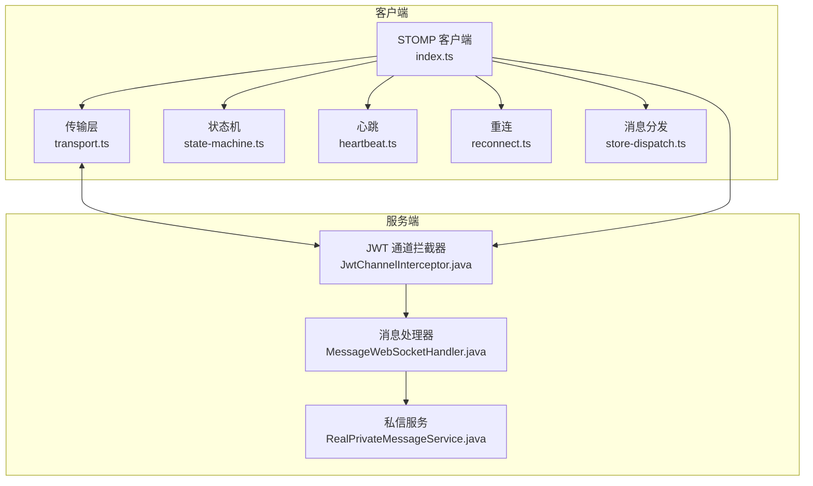
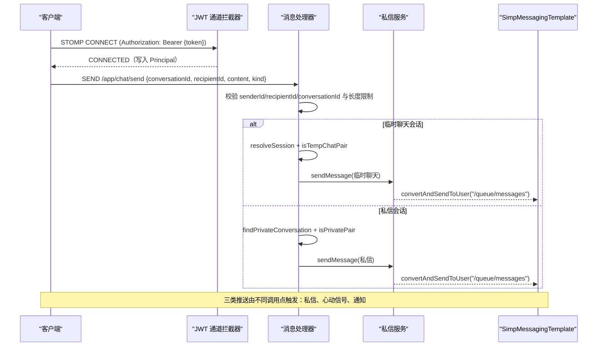
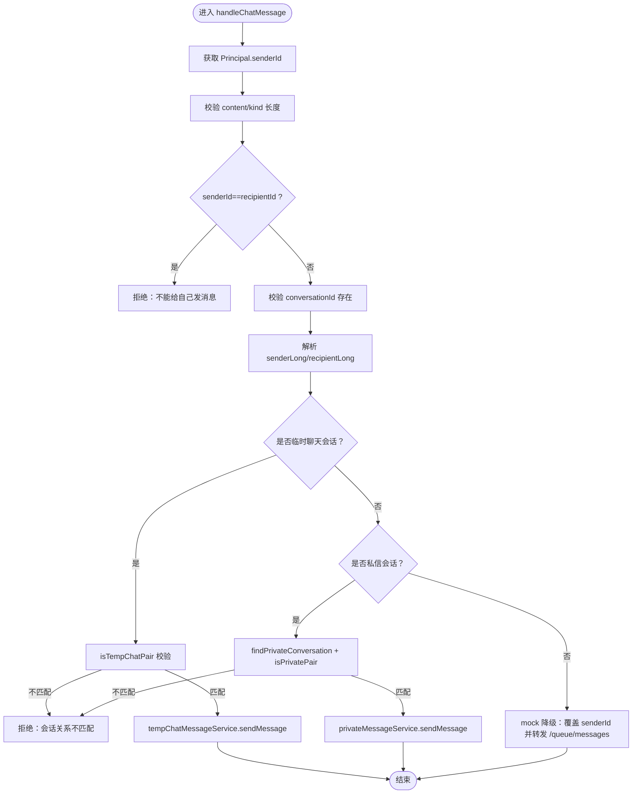
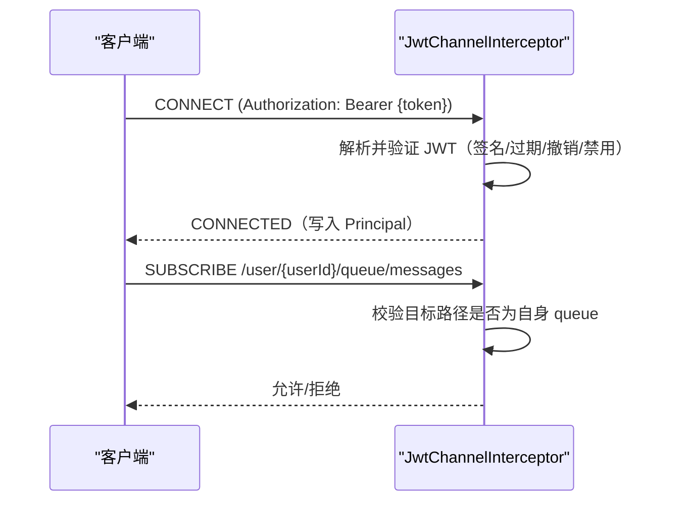
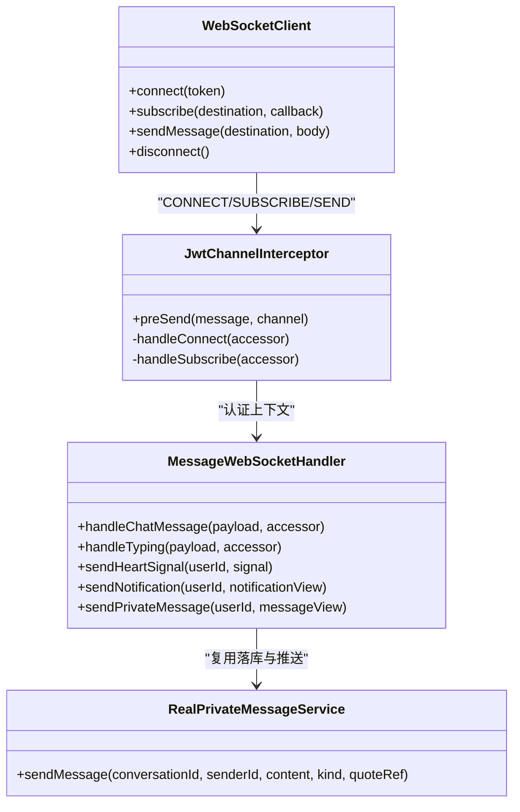

# WebSocket 实时通信

<cite>
**本文引用的文件**
- [MessageWebSocketHandler.java](file://apps/api/src/main/java/com/campuslove/api/chat/MessageWebSocketHandler.java)
- [JwtChannelInterceptor.java](file://apps/api/src/main/java/com/campuslove/api/config/JwtChannelInterceptor.java)
- [RealPrivateMessageService.java](file://apps/api/src/main/java/com/campuslove/api/chat/RealPrivateMessageService.java)
- [index.ts](file://apps/client/src/services/websocket/index.ts)
- [transport.ts](file://apps/client/src/services/websocket/transport.ts)
- [state-machine.ts](file://apps/client/src/services/websocket/state-machine.ts)
- [heartbeat.ts](file://apps/client/src/services/websocket/heartbeat.ts)
- [reconnect.ts](file://apps/client/src/services/websocket/reconnect.ts)
- [store-dispatch.ts](file://apps/client/src/services/websocket/store-dispatch.ts)
</cite>

## 目录
1. [简介](#简介)
2. [项目结构](#项目结构)
3. [核心组件](#核心组件)
4. [架构总览](#架构总览)
5. [详细组件分析](#详细组件分析)
6. [依赖关系分析](#依赖关系分析)
7. [性能与限流](#性能与限流)
8. [故障排查指南](#故障排查指南)
9. [结论](#结论)
10. [附录：客户端集成示例与调试技巧](#附录客户端集成示例与调试技巧)

## 简介
本模块基于 Spring WebSocket + STOMP 提供实时私信、心动信号与通知推送能力。服务端通过 MessageWebSocketHandler 处理 /app/chat/send 消息，结合会话关系校验与安全控制，将消息路由至用户专属队列；客户端使用自研 STOMP 简化实现，封装连接、心跳、重连与订阅分发。文档覆盖连接生命周期、用户会话绑定、断线重连、三类推送路径、消息去重与限流策略，以及错误处理与调试方法。

## 项目结构
- 服务端（后端）
  - STOMP 安全拦截器：在 CONNECT/SUBSCRIBE 阶段完成鉴权与权限校验
  - WebSocket 消息处理器：处理聊天消息、正在输入状态，并负责三类推送
  - 私信服务：复用统一落库与推送逻辑，保证数据一致性与业务规则（如拉黑、敏感词）
- 客户端（前端/小程序）
  - 自研 STOMP 帧编解码、连接管理、心跳与重连、订阅与消息分发

图表来源
- [MessageWebSocketHandler.java:1-455](file://apps/api/src/main/java/com/campuslove/api/chat/MessageWebSocketHandler.java#L1-L455)
- [JwtChannelInterceptor.java:1-307](file://apps/api/src/main/java/com/campuslove/api/config/JwtChannelInterceptor.java#L1-L307)
- [RealPrivateMessageService.java:1-100](file://apps/api/src/main/java/com/campuslove/api/chat/RealPrivateMessageService.java#L1-L100)
- [index.ts:1-150](file://apps/client/src/services/websocket/index.ts#L1-L150)

章节来源
- [MessageWebSocketHandler.java:1-455](file://apps/api/src/main/java/com/campuslove/api/chat/MessageWebSocketHandler.java#L1-L455)
- [JwtChannelInterceptor.java:1-307](file://apps/api/src/main/java/com/campuslove/api/config/JwtChannelInterceptor.java#L1-L307)
- [RealPrivateMessageService.java:1-100](file://apps/api/src/main/java/com/campuslove/api/chat/RealPrivateMessageService.java#L1-L100)
- [index.ts:1-150](file://apps/client/src/services/websocket/index.ts#L1-L150)

## 核心组件
- STOMP 安全拦截器（JwtChannelInterceptor）
  - CONNECT 阶段：从 Authorization/Bearer 或 token 头提取 JWT，校验签名、过期、撤销与禁用用户，写入 Principal
  - SUBSCRIBE 阶段：仅允许 /topic/** 与 /user/{自身userId}/queue/**，防止越权订阅
- 消息处理器（MessageWebSocketHandler）
  - /app/chat/send：校验 senderId、recipientId、conversationId，执行临时聊天/私信会话关系校验，落库并推送
  - /app/chat/typing：正在输入状态帧转发到接收方 /user/{recipientId}/queue/typing
  - 推送方法：sendHeartSignal、sendNotification、sendPrivateMessage
- 私信服务（RealPrivateMessageService）
  - 统一落库、敏感词过滤、会话预览更新、未读计数维护与 WS 推送，避免双通道不一致
- 客户端 STOMP 实现（index.ts 及子模块）
  - 构建 STOMP 帧、建立连接、自动重连、心跳检测、订阅管理与消息分发

章节来源
- [JwtChannelInterceptor.java:1-307](file://apps/api/src/main/java/com/campuslove/api/config/JwtChannelInterceptor.java#L1-L307)
- [MessageWebSocketHandler.java:1-455](file://apps/api/src/main/java/com/campuslove/api/chat/MessageWebSocketHandler.java#L1-L455)
- [RealPrivateMessageService.java:1-100](file://apps/api/src/main/java/com/campuslove/api/chat/RealPrivateMessageService.java#L1-L100)
- [index.ts:1-150](file://apps/client/src/services/websocket/index.ts#L1-L150)

## 架构总览
- 认证与会话绑定
  - 客户端在 CONNECT 时携带 Bearer Token；服务端 JwtChannelInterceptor 解析并写入 Principal，后续所有 SEND/SUBSCRIBE 均基于该认证上下文
  - 订阅限制：仅允许订阅自己的 /user/{userId}/queue/** 与公共 /topic/**
- 消息路由与推送
  - /app/chat/send 经 MessageWebSocketHandler 处理后，按会话类型（临时聊天/私信）进行关系校验与落库，最终通过 SimpMessagingTemplate 推送至用户队列
  - 三类推送路径：
    - 私信队列：/user/{userId}/queue/messages
    - 心动信号：/user/{userId}/queue/signals
    - 通知：/user/{userId}/queue/notifications

图表来源
- [JwtChannelInterceptor.java:1-307](file://apps/api/src/main/java/com/campuslove/api/config/JwtChannelInterceptor.java#L1-L307)
- [MessageWebSocketHandler.java:1-455](file://apps/api/src/main/java/com/campuslove/api/chat/MessageWebSocketHandler.java#L1-L455)
- [RealPrivateMessageService.java:1-100](file://apps/api/src/main/java/com/campuslove/api/chat/RealPrivateMessageService.java#L1-L100)

## 详细组件分析

### MessageWebSocketHandler：/app/chat/send 处理流程
- 安全与参数校验
  - senderId 来自 STOMP 认证用户（Principal），不信任 payload
  - 校验 content/kind 长度上限，防超大消息
  - 禁止 senderId == recipientId
  - 必须包含 conversationId 以进行会话关系校验
- 会话关系校验（FIN HIGH-2）
  - 临时聊天会话：resolveSession 并校验双方为 userA/userB
  - 私信会话：根据数据库 ID 或 conversationUid 查找 PrivateConversation，校验双方为 userA/userB
- 落库与推送
  - 临时聊天：委托 TempChatMessageService.sendMessage，内部完成落库与推送，此处不再重复推送
  - 私信：复用 RealPrivateMessageService.sendMessage，内部完成持久化、会话预览/最后消息时间更新与 WS 推送
  - 组件不可用（mock 模式）：退化为直接覆盖 senderId 后转发到 /queue/messages
- 其他端点
  - /app/chat/typing：校验会话关系后转发 {sessionId, typing, senderId} 到 /user/{recipientId}/queue/typing
  - 推送方法：sendHeartSignal、sendNotification、sendPrivateMessage

图表来源
- [MessageWebSocketHandler.java:1-455](file://apps/api/src/main/java/com/campuslove/api/chat/MessageWebSocketHandler.java#L1-L455)

章节来源
- [MessageWebSocketHandler.java:1-455](file://apps/api/src/main/java/com/campuslove/api/chat/MessageWebSocketHandler.java#L1-L455)

### STOMP 安全拦截器：连接与订阅权限
- CONNECT 阶段
  - 优先从 Authorization header 提取 Bearer token，其次兼容原生 token 头
  - 校验 JWT 签名、过期、撤销（黑名单），并检查用户是否被禁用
  - 设置 Principal，供后续 SEND/SUBSCRIBE 使用
- SUBSCRIBE 阶段
  - 仅允许 /topic/** 与 /user/{自身userId}/queue/**
  - 支持简写 /user/queue/**（Spring UserDestinationMessageHandler 会映射到当前会话用户）
  - 其他路径一律拒绝

图表来源
- [JwtChannelInterceptor.java:1-307](file://apps/api/src/main/java/com/campuslove/api/config/JwtChannelInterceptor.java#L1-L307)

章节来源
- [JwtChannelInterceptor.java:1-307](file://apps/api/src/main/java/com/campuslove/api/config/JwtChannelInterceptor.java#L1-L307)

### 私信服务：统一落库与推送
- 统一入口 RealPrivateMessageService.sendMessage
  - 完成敏感词过滤、拉黑关系检查、持久化、会话预览与未读计数更新
  - 内部通过 SimpMessagingTemplate 推送 /user/{userId}/queue/messages，避免与 WS 直发导致的双份消息
- 与 MessageWebSocketHandler 的协作
  - WS 私信链路复用该服务，确保 REST 与 WS 数据一致性

章节来源
- [RealPrivateMessageService.java:1-100](file://apps/api/src/main/java/com/campuslove/api/chat/RealPrivateMessageService.java#L1-L100)
- [MessageWebSocketHandler.java:201-455](file://apps/api/src/main/java/com/campuslove/api/chat/MessageWebSocketHandler.java#L201-L455)

### 客户端 STOMP 实现：连接、心跳、重连与分发
- 连接与帧编解码（transport.ts）
  - 构建 STOMP CONNECT/CONNECTED/SUBSCRIBE/SEND/DISCONNECT 帧
  - 通过 uni.connectSocket 建立原始 WebSocket 连接
- 状态机（state-machine.ts）
  - 管理连接状态、回调分发、订阅跟踪
- 心跳（heartbeat.ts）
  - 定时发送 ping，检测 pong，超时判定断开
- 重连（reconnect.ts）
  - 指数退避/次数限制，达到上限停止自动重连，可手动重试
- 消息分发（store-dispatch.ts）
  - 按订阅目标路径将消息分发给对应 Pinia Store 或回调

章节来源
- [index.ts:1-150](file://apps/client/src/services/websocket/index.ts#L1-L150)
- [transport.ts](file://apps/client/src/services/websocket/transport.ts)
- [state-machine.ts](file://apps/client/src/services/websocket/state-machine.ts)
- [heartbeat.ts](file://apps/client/src/services/websocket/heartbeat.ts)
- [reconnect.ts](file://apps/client/src/services/websocket/reconnect.ts)
- [store-dispatch.ts](file://apps/client/src/services/websocket/store-dispatch.ts)

## 依赖关系分析
- 组件耦合
  - MessageWebSocketHandler 依赖：SimpMessagingTemplate、TempChatSessionService、TempChatMessageService、PrivateConversationRepository、PrivateMessageService
  - JwtChannelInterceptor 依赖：JwtTokenProvider、UserRepository（可选）、Environment
  - 客户端 index.ts 依赖：transport/state-machine/heartbeat/reconnect/store-dispatch
- 外部集成点
  - 数据库：PrivateConversationRepository、UserRepository
  - 消息代理：SimpMessagingTemplate（/topic/**、/user/**）
  - 鉴权：JWT 令牌签发/校验、撤销列表

图表来源
- [MessageWebSocketHandler.java:1-455](file://apps/api/src/main/java/com/campuslove/api/chat/MessageWebSocketHandler.java#L1-L455)
- [JwtChannelInterceptor.java:1-307](file://apps/api/src/main/java/com/campuslove/api/config/JwtChannelInterceptor.java#L1-L307)
- [RealPrivateMessageService.java:1-100](file://apps/api/src/main/java/com/campuslove/api/chat/RealPrivateMessageService.java#L1-L100)
- [index.ts:1-150](file://apps/client/src/services/websocket/index.ts#L1-L150)

章节来源
- [MessageWebSocketHandler.java:1-455](file://apps/api/src/main/java/com/campuslove/api/chat/MessageWebSocketHandler.java#L1-L455)
- [JwtChannelInterceptor.java:1-307](file://apps/api/src/main/java/com/campuslove/api/config/JwtChannelInterceptor.java#L1-L307)
- [RealPrivateMessageService.java:1-100](file://apps/api/src/main/java/com/campuslove/api/chat/RealPrivateMessageService.java#L1-L100)
- [index.ts:1-150](file://apps/client/src/services/websocket/index.ts#L1-L150)

## 性能与限流
- 消息长度限制
  - content 最大长度与 kind 最大长度在服务端硬编码限制，防止内存与带宽滥用
- 去重策略
  - 服务端侧未在 MessageWebSocketHandler 中显式实现消息去重；建议在业务层对相同 conversationId+content+kind 在短时间内做幂等控制（例如基于 Redis 键与 TTL）
- 限流控制
  - 可在 JwtChannelInterceptor 或网关层增加 per-user 速率限制（如每分钟 N 条消息），防止恶意刷量
  - 心跳与重连已内置退避策略，避免雪崩
- 推送路径
  - 三类推送均通过 /user/{userId}/queue/**，由 Spring 用户目的地处理器保证只投递给在线且订阅了该队列的用户

[本节为通用性能建议，无需具体文件引用]

## 故障排查指南
- 连接失败
  - 检查 CONNECT 是否携带有效 Authorization: Bearer {token}
  - 查看拦截器日志：JWT 无效/过期/撤销、用户被禁用
- 订阅失败
  - 确认订阅路径为 /user/{自身userId}/queue/** 或 /topic/**
  - 若使用 /user/queue/** 简写，需确保服务端 UserDestinationMessageHandler 正确映射到当前会话用户
- 消息未送达
  - 校验会话关系：临时聊天/私信双方必须匹配
  - 检查落库是否成功：临时聊天走 tempChatMessageService，私信走 privateMessageService
  - 确认接收方已订阅对应队列
- 心跳/重连问题
  - 观察心跳超时与重连次数耗尽提示
  - 检查网络稳定性与服务端心跳配置

章节来源
- [JwtChannelInterceptor.java:1-307](file://apps/api/src/main/java/com/campuslove/api/config/JwtChannelInterceptor.java#L1-L307)
- [MessageWebSocketHandler.java:1-455](file://apps/api/src/main/java/com/campuslove/api/chat/MessageWebSocketHandler.java#L1-L455)
- [index.ts:1-150](file://apps/client/src/services/websocket/index.ts#L1-L150)

## 结论
本模块通过严格的 STOMP 安全拦截与精细的会话关系校验，实现了可靠的私信、心动信号与通知实时推送。服务端采用统一落库与推送策略，确保 REST 与 WS 数据一致；客户端提供健壮的连接、心跳与重连机制，保障弱网环境下的可用性。建议在生产环境中补充消息去重与速率限制，进一步提升系统鲁棒性。

## 附录：客户端集成示例与调试技巧
- 连接与订阅
  - 登录后调用 wsClient.connect(token)，随后订阅三类队列：
    - /user/{userId}/queue/messages
    - /user/{userId}/queue/signals
    - /user/{userId}/queue/notifications
- 发送消息
  - 通过 wsClient.sendMessage('/app/chat/send', {conversationId, recipientId, content, kind})
  - 正在输入：wsClient.sendMessage('/app/chat/typing', {conversationId, recipientId, typing})
- 断线重连
  - 自动重连在达到上限后停止，可监听 onStateChange 并在必要时手动 connect(token) 重试
- 调试技巧
  - 开发环境下启用 wsTrace 输出，便于观察连接/订阅/消息流转
  - 服务端关注拦截器与处理器日志，定位 CONNECT/SUBSCRIBE/SEND 失败原因
  - 核对推送路径与订阅路径是否一致，确保 /user/{userId}/queue/** 格式正确

章节来源
- [index.ts:1-150](file://apps/client/src/services/websocket/index.ts#L1-L150)
- [transport.ts](file://apps/client/src/services/websocket/transport.ts)
- [reconnect.ts](file://apps/client/src/services/websocket/reconnect.ts)
- [store-dispatch.ts](file://apps/client/src/services/websocket/store-dispatch.ts)
- [JwtChannelInterceptor.java:1-307](file://apps/api/src/main/java/com/campuslove/api/config/JwtChannelInterceptor.java#L1-L307)
- [MessageWebSocketHandler.java:1-455](file://apps/api/src/main/java/com/campuslove/api/chat/MessageWebSocketHandler.java#L1-L455)